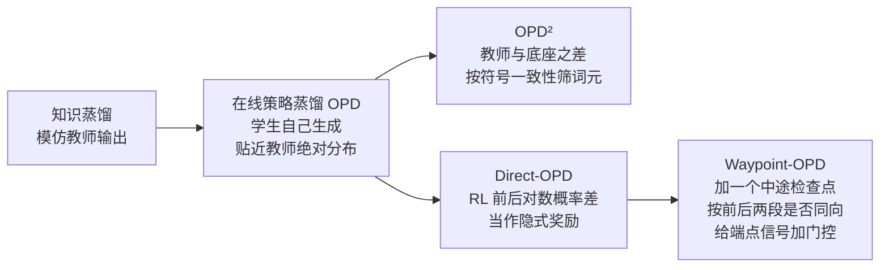
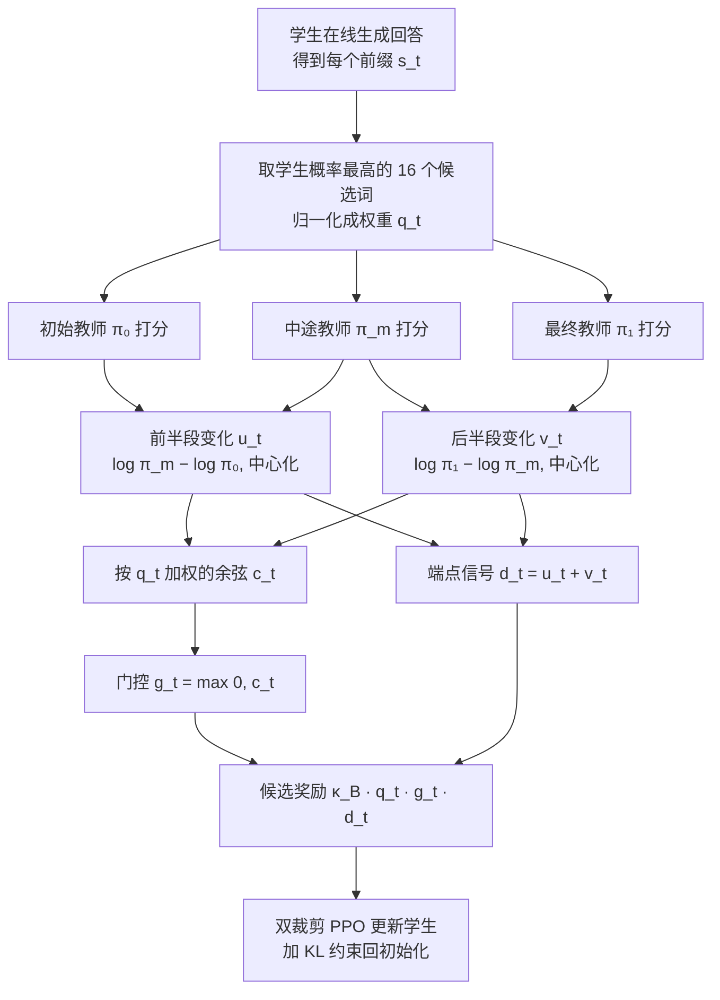

# Waypoint-OPD：用中途检查点给策略偏移蒸馏加门控

> **原题**：Waypoint-OPD: Transferring RL-Induced Policy Shifts via Gated On-Policy Distillation
> **作者**：Bingxi Hou, Guochao Jiang, Guofeng Quan, Weiqing Li, Wenfeng Feng, Guohua Liu, Yuewei Zhang
> **机构**：阿里云计算
> **年份**：2026（arxiv ID 2610.21601，10 月 15 日提交）
> **分类**：cs.LG / cs.CL
> **链接**：https://arxiv.org/abs/2610.21601
> **代码**：https://github.com/hhhbxloveai/WaypointOPD
> **精读日期**：2026-10-17

## 阅读须知

### 这篇在领域里的位置

这篇论文属于「在线策略蒸馏」这一支，它要解决的是一个越来越现实的工程问题：强化学习把一个模型的数学或代码能力练上去了，这份花了大量算力换来的进步，能不能便宜地搬到另一个模型身上。

这条路线大致经历了三步。最早的知识蒸馏让学生模仿教师的输出分布，或者直接拿教师生成的句子做监督微调。随后出现了在线策略蒸馏（OPD），让学生自己生成回答，再在学生走到的每一个位置上，让它的下一个词分布去贴近教师，这样学生学的是「自己会走到的状态下该怎么做」，比模仿教师的轨迹更稳。最近一年又出现了「策略偏移蒸馏」，代表是 Direct-OPD 和 OPD²：它们不再让学生贴近教师的绝对分布，而是只搬运教师在强化学习前后的那份「变化」，即同一个位置上某个词的概率被强化学习抬高了多少、压低了多少。这样做的好处是学生不必继承教师的能力上限，小教师的进步也能教给大学生。

Waypoint-OPD 站在 Direct-OPD 之上，补了一块此前没人看的信息：教师在强化学习过程中「中途」是什么样子。它多保留一个中间检查点，用来判断教师的偏好变化在前半段和后半段是否一致，一致的地方照搬，前后矛盾的地方压低。

### 读完能回答什么

- 在线策略蒸馏、Direct-OPD、OPD² 三者的监督信号分别是什么，各自有什么局限？
- 为什么只看强化学习前后两个端点，会丢掉「方向是否一致」这条信息？
- Waypoint-OPD 的门控是怎么算的，为什么要先「中心化」再算余弦？
- 一个 40 亿参数的教师，怎么能让 80 亿到 300 亿参数的学生超过它自己？
- 消融实验里「打乱门控」为什么比「不要门控」还差，这说明了什么？
- 这篇论文的提升有多大，哪些结论受实验设计所限应当打折扣？

### 阅读前置

假定读者熟悉语言模型的对数概率、KL 散度、PPO 这类策略梯度方法的基本形式，知道「可验证奖励的强化学习」是在数学和代码题上用判题器给奖励。不假定读者读过 Direct-OPD 或 OPD² 的原文。

### 首次出现的缩写表

- **RL**（Reinforcement Learning，强化学习）：本文特指在数学、代码题上用可验证奖励训练语言模型。
- **OPD**（On-Policy Distillation，在线策略蒸馏）：学生自己生成回答，在学生走到的位置上贴近教师分布。
- **Direct-OPD**：用教师强化学习前后的对数概率差作为奖励，只搬运「变化」的蒸馏方法，是本文的主要对照。
- **OPD²**（On-Policy Delta Distillation）：用推理调优后的教师与其底座之差作为信号，并按符号一致性筛选词元的蒸馏方法。
- **KL**（Kullback-Leibler 散度）：衡量两个分布差异的量，本文用于约束学生不偏离初始化太远。
- **PPO**（Proximal Policy Optimization，近端策略优化）：带裁剪的策略梯度方法，本文的优化实现用它的双裁剪变体。
- **MoE**（Mixture of Experts，专家混合）：本文的 Qwen3-30B-A3B 学生是 300 亿总参数、每次激活 30 亿的稀疏模型。
- **mean@k**：每道题生成 k 次回答，取正确率的平均。

## 一、问题

先说这个问题为什么值得做。可验证奖励的强化学习如今是提升推理能力的主力手段，但它很贵：每一步都要大量生成回答、跑判题器、再更新模型，几百上千步下来是可观的算力账单。如果每换一个目标模型都要把这套流程重跑一遍，成本会成倍增长。于是人们自然会想：既然某个模型已经被练过一次，能不能把它学到的东西直接蒸馏给别的模型，省掉重新探索的开销。

传统做法是让学生模仿教师。可这有两个毛病。其一，学生被绑在教师的绝对水平上，教师答不好的题学生也学不会，小教师教大学生尤其吃亏。其二，教师的输出分布里混着大量与强化学习无关的东西，比如教师自身的说话习惯和知识盲区，学生照单全收。

Direct-OPD 的思路更聪明一些：它不教学生「教师怎么说」，只教「强化学习让教师在哪些地方改变了偏好」。具体做法是，在学生生成的每个位置上，比较教师在强化学习之后和之前给某个词的对数概率，差值为正表示强化学习抬高了这个词，为负表示压低了，再把这个差值当作奖励去更新学生。理论上，在带 KL 约束的理想最优点，这个对数概率比恰好能还原出强化学习的奖励（这是 DPO 那一系推导的结论），所以它是一个有道理的隐式奖励。

问题出在「只看两个端点」。强化学习不是一步到位的，教师在训练中途的偏好可能先往一个方向走，后来又往回拉。最终的端点差是前半段变化和后半段变化之和，两段同向相加和两段反向抵消，可能得到一模一样的端点差，但含义完全不同：前者说明这个偏好是被持续强化的，后者说明它是来回摇摆的结果，可信度低得多。只看端点的方法分不出这两种情况。

论文把要验证的命题收窄为：**在学生访问到的位置上，教师强化学习前半段与后半段的偏好变化是否同向，能不能作为证据，决定端点信号该给多大权重。**

## 二、方法

### 2.1 三个教师检查点

Waypoint-OPD 从同一次教师强化学习里保留三个冻结的检查点：初始 π₀（强化学习之前）、中途 π_m（训练中间某一步）、最终 π₁（训练结束）。在本文的实验里，教师是 Qwen3-4B，训练共 1,200 步，中途检查点取第 600 步。学生是另一个模型 π_θ，它的初始化 π_S 固定作为 KL 约束的参照。教师和学生必须共用同一个分词器，这样才能在同一个词上直接比较概率。

在学生生成的某个前缀 s_t 上，端点信号就是 Direct-OPD 用的那个量：δ_t(a) = log π₁(a|s_t) − log π₀(a|s_t)，即强化学习前后某个候选词 a 的对数概率变化。有了中途检查点，这个端点变化可以拆成两段：前半段 δ⁽¹⁾ = log π_m − log π₀，后半段 δ⁽²⁾ = log π₁ − log π_m，两段相加正好等于端点变化。

### 2.2 为什么先中心化

论文不是直接拿两段变化的原始向量算夹角，而是先做一步「中心化」：在 16 个候选词上，用学生的概率 q_t 做权重求出平均变化，再把每个候选的变化减去这个平均值。

之所以要这样做，是因为对数概率的整体平移不改变候选词之间的相对偏好。比如前半段所有候选词的对数概率都升了 0.5，这只是一个与选哪个词无关的整体变化，学生该偏向哪个词并没有因此改变，可它却会让原始向量的夹角变得面目全非。中心化把这部分去掉，剩下的才是「强化学习让教师更偏向哪几个词、更排斥哪几个词」的相对变化。记中心化后的前半段为 u_t、后半段为 v_t、端点为 d_t = u_t + v_t。

### 2.3 门控与批归一化

一致性用按 q_t 加权的余弦衡量：c_t = ⟨u_t, v_t⟩ / (‖u_t‖·‖v_t‖)，加权内积意味着学生越可能选的候选词，在判断方向时分量越重。门控取 g_t = max(0, c_t)：两段同向时余弦接近 1，端点信号几乎原样保留；两段正交时门控为 0；两段反向时余弦为负，同样截成 0，端点信号被完全拿掉。如果某一段的变化太小、不足以定义方向（范数低于 10⁻⁸），就退回到 g_t = 1，照常使用端点信号。

论文给了一个干净的例子说明门控补了什么信息：同样的端点 d，可以拆成 u = v = d/2，此时余弦为 1、门控为 1；也可以拆成 u = 2d、v = −d，即先冲过头再往回拉，此时余弦为 −1、门控为 0。两种拆法的和都是 d，只看端点的方法无法分辨。

门控会让奖励整体变小，而且随批次波动，所以论文又乘了一个批级缩放系数 κ_B：让一个批次内门控的平均值被拉到目标值 τ = 0.8，系数限制在 [0.75, 1.5] 之间。这个系数对整批是同一个正数，所以不改变门控之间的相对大小，也不会把被截成 0 的位置重新打开。

### 2.4 学生的目标函数

每个候选词最终的系数是 A_t(a) = sg[κ_B · q_t(a) · g_t · d_t(a)]，sg 表示停止梯度，这些系数只作为奖励使用。学生要最大化的是在 16 个候选词上的「系数乘以学生对数概率」之和，再减去一个把学生拉回初始化的 KL 惩罚。和 Direct-OPD 只在实际采样到的那个词上给奖励不同，这里对 16 个候选词都给信号，是一个「稠密」的目标。实现上用候选级的双裁剪 PPO，在采样时的策略处它的梯度与上面的目标一致。

相对 Direct-OPD，额外开销只有一次冻结中途教师的打分，没有新的可训练参数，也不需要额外的学生采样或判题器调用。

## 三、实验

### 3.1 设置

教师是 Qwen3-4B，分别在数学和代码上做了 1,200 步非思考模式的强化学习，保留第 0、600、1200 步三个检查点。学生是 Qwen3-8B、Qwen3-14B 和 Qwen3-30B-A3B，三个尺寸都比教师大，后者是 MoE 架构。数学用 DAPO-Math-17K 的题目做迁移训练，在 AIME 2024/2025/2026、HMMT 2025 年 2 月与 11 月、HMMT 2026 年 2 月、AMC 2023 七个测试集上报 mean@32；代码用 Codeforces 衍生的题目训练，在 MBPP、MBPP+ 和 LiveCodeBench v4/v5/v6 上报 mean@8。每个学生训练 100 步，在 AIME 2024 上选最好的检查点。对照方法是原始学生、标准 OPD、OPD² 和 Direct-OPD。全部实验在一台 8 卡 H20 上完成。

### 3.2 主要结果

数学七项平均（mean@32，%）：

| 方法 | Qwen3-8B | Qwen3-14B | Qwen3-30B-A3B |
|---|---|---|---|
| 原始学生 | 26.04 | 27.32 | 28.03 |
| OPD | 51.04 | 56.17 | 51.22 |
| OPD² | 51.46 | 52.83 | 52.68 |
| Direct-OPD | 53.96 | 57.61 | 55.96 |
| **Waypoint-OPD** | **56.14** | **59.20** | **57.85** |
| 参照：教师初始 / 中途 / 最终 | 24.84 / 51.82 / 56.13 | | |

代码五项平均（mean@8，%）：

| 方法 | Qwen3-8B | Qwen3-14B | Qwen3-30B-A3B |
|---|---|---|---|
| 原始学生 | 41.03 | 47.72 | 50.33 |
| OPD | 43.91 | 51.66 | 51.91 |
| OPD² | 51.21 | 55.60 | 55.96 |
| Direct-OPD | 50.59 | 56.30 | 56.35 |
| **Waypoint-OPD** | **53.25** | **57.82** | **57.54** |
| 参照：教师初始 / 中途 / 最终 | 37.64 / 52.22 / 55.37 | | |

在六个「领域乘学生」的组合里，Waypoint-OPD 的平均分都是最高。相对 Direct-OPD，数学上分别高 2.18、1.59、1.89 个百分点，21 个单项比较里赢 19 个；代码上分别高 2.66、1.52、1.19 个百分点，15 个单项全部更高。

最值得注意的是学生反超教师。14B 学生数学平均 59.20，比最终教师的 56.13 高 3.07 个百分点，而且七个测试集全部超过教师；30B-A3B 学生高 1.72；8B 学生 56.14 与教师基本持平。代码上 14B 和 30B-A3B 也分别比教师高 2.45 和 2.17。这说明搬运的确实是「变化」而不是教师的绝对水平：一个 40 亿参数的教师在强化学习中学到的偏好调整，叠加到更大的底座上，能产生超过教师本身的效果。

### 3.3 训练过程与消融

在 Qwen3-8B 数学的 100 步训练里，按每 20 步一次的评测点比较，Waypoint-OPD 在 15 个「测试集乘检查点」组合里赢 13 个，第 60 步以后在三个跟踪的测试集上始终领先，第 100 步在 AIME 2025 上领先 4.17 个百分点。

消融只在 Qwen3-8B 数学上做：

| 变体 | 数学平均 | 相对完整方法 |
|---|---|---|
| 完整 Waypoint-OPD | 56.14 | — |
| 去掉批归一化（κ_B 固定为 1） | 55.22 | −0.92 |
| Direct-OPD | 53.96 | −2.18 |
| 去掉门控（g_t 全为 1） | 53.50 | −2.64 |
| 打乱门控（批内随机重排） | 51.20 | −4.94 |

有一个反直觉的结果值得单独拿出来：把门控在批内随机打乱，比干脆不要门控还差 2.30 个百分点，而且七个测试集上顺序完全一致。打乱保留了门控值的分布和批缩放系数，只破坏了「这个门控属于哪个位置」的对应关系。如果门控只是在整体上削弱奖励、起到类似正则的作用，打乱应当和保留差不多；结果却明显更差，说明门控值与它所在位置的对应确实携带了信息，错配会把信号用在不该用的地方。

另一个值得注意的现象是「去掉门控」比 Direct-OPD 还低一点（53.50 对 53.96）。两者的区别在于前者保留了中心化、16 个候选的稠密奖励和批归一化规则，但不按一致性加权，可见单是这些改动并不带来收益，增益主要来自一致性加权本身。

中途检查点位置的敏感性在附录 F 中测了第 500、600、700 步三个位置，平均分分别是 56.18、56.14、56.13，差距只有 0.05 个百分点，全部比 Direct-OPD 高约 2.2 个百分点。门控诊断显示，训练前 20 步平均门控 0.810、被截成 0 的位置占 7.26%，最后 20 步分别变成 0.683 和 16.59%，也就是随着学生变化，越来越多位置上的教师信号被判定为前后矛盾而压低。训练耗时方面，Waypoint-OPD 100 步用了 8 小时 2 分，反而比 Direct-OPD 的 8 小时 21 分快 3.73%，原因是它训出来的学生生成的回答更短，87 个训练步的平均回答长度更低。

## 四、局限

### 作者自己承认的

论文多处强调，方向一致只是加权的依据，不保证监督正确；门控的增益与中心化、稠密候选、批归一化等改动是交织在一起的，消融差值是在保留其他组件的条件下得到的，不能当作可以相加的独立贡献；去掉归一化的版本仍然比 Direct-OPD 高 1.26 个百分点，这部分增益不能全部归给门控。所有消融和中途位置实验只在 Qwen3-8B 数学上做。

### 读完能看出来的

第一，检查点选择与评测有重叠。每个学生都用 AIME 2024 选最好的检查点，而 AIME 2024 又是数学平均的七个测试集之一，这会让所有方法的 AIME 2024 分数偏乐观。好在所有方法用同一规则，对比较的公平性影响有限，但绝对分数要打折扣。

第二，看不到方差。论文没有报告多次运行的标准差或显著性，2 个百分点左右的提升在 AIME 这种每年 30 道题、mean@32 的测试上是有意义的，但单次运行的波动有多大，读者无从判断。

第三，设定很窄。教师只有一个 Qwen3-4B，学生都是同一家族、共用分词器，领域只有带判题器的数学和代码，强化学习是非思考模式、1,200 步。跨家族、跨分词器、开放式任务、思考模式下长链推理的情形都没有覆盖，而分词器必须一致这一点本身就限制了这套方法的适用面。

第四，中途位置不敏感，既是优点也是疑点。第 500 到 700 步的结果几乎一样，说明方法稳健，但也让人想问：门控到底捕捉的是「训练过程中的反复」，还是只要有任意一个合理的中间点就能提供某种平滑效果。论文没有测离端点很近的位置（比如第 100 步或第 1,100 步），也没有测用多个中途点的情形，门控信息的来源还可以拆得更清楚。

第五，门控的语义是「前后同向」而不是「前后都对」。教师在后半段把一个早期错误纠正过来，按门控规则会被判为反向而压低，可这种纠正恰恰可能是强化学习最有价值的部分。论文的结果说明平均而言压低反向变化是有利的，但没有分析被压低的那些位置里有多少是有益的纠正。

第六，前提是能拿到教师的中间检查点。对于开源权重的模型，人们通常只拿到最终权重，拿不到训练中途的快照，所以这套方法更适合有完整训练记录的团队内部使用，比如先在小模型上做强化学习、再把成果搬到大模型上。

## 一句话

保留教师强化学习中途的一个检查点，在学生访问的位置上只搬运前后两段同向的偏好变化，用 4B 教师把 8B 到 30B 学生的数学与代码平均分在 Direct-OPD 之上再提高约 1.2 到 2.7 个百分点，大学生还反超了教师。
