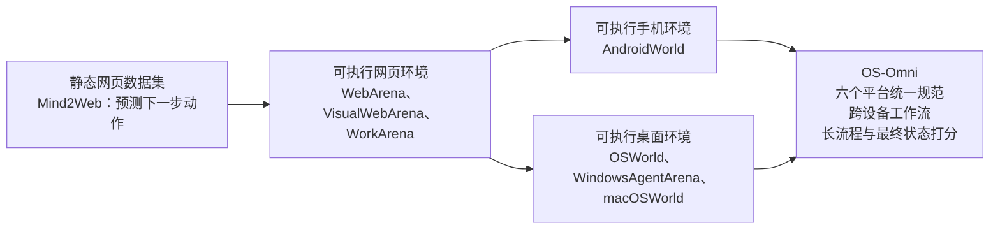
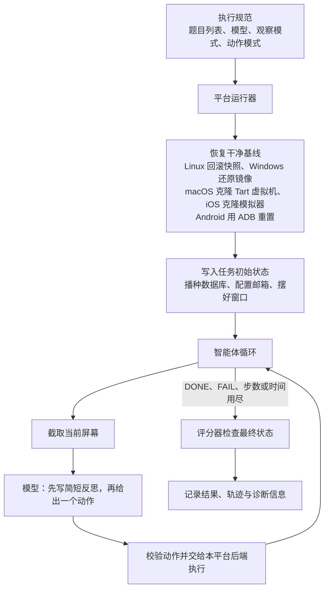
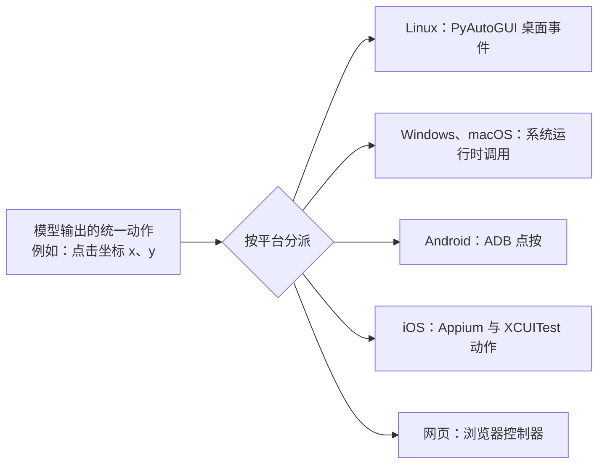
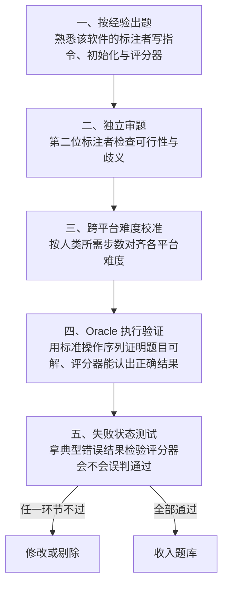
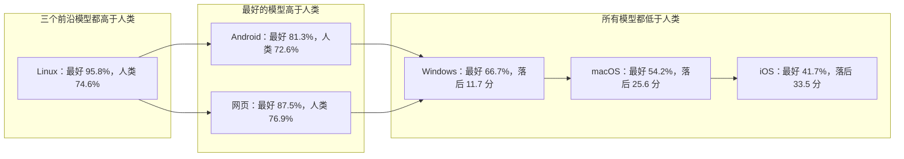
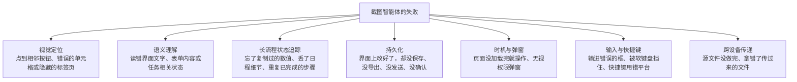

# OS-Omni：跨平台长流程任务上的通用电脑操作智能体评测

> - **原题**：OS-Omni: Benchmarking Generalist Computer-Using Agents on Long-Horizon Workflows Across Platforms
> - **作者**：Hui Shen、Yunta Hsieh、Jianing Ma、Zhuoran Yin、Zhuhan Bao、Ziyuan Liu、Qi Han、Xiuqi Xu 等，共 76 位（前八位为共同第一作者；联系人 Hui Shen、Qiushi Sun）
> - **机构**：Touchstone AI、密歇根大学、宾夕法尼亚大学、香港大学、SGLang Omni、Together AI、俄亥俄州立大学、MIT、普林斯顿大学、滑铁卢大学、字节跳动 Seed 等
> - **年份**：2026（arxiv ID 2611.34232，NeurIPS 2026）
> - **分类**：cs.CV
> - **链接**：https://arxiv.org/abs/2611.34232
> - **精读日期**：2026-11-27

## 阅读须知

### 这篇在领域里的位置

这篇论文属于「电脑操作智能体」的评测方向。所谓电脑操作智能体，指的是这样一类系统：它看着屏幕截图，像人一样移动鼠标、敲键盘、点手机屏幕，替用户把一件事办完。过去三年里，这个方向的评测沿着一条清楚的路线前进：最早的数据集只给静态网页和一条标准操作序列，让模型预测下一步点哪里；随后出现了可以真正执行的网页环境，例如 WebArena；再往后，评测搬进了手机（AndroidWorld）和桌面操作系统（OSWorld），模型要在真实的虚拟机里操作真实的软件，最后由程序检查结果对不对。

OS-Omni 位于这条路线的下一步。它没有再造一个单平台环境，而是把 Windows、Ubuntu、macOS、iOS、Android 与网页六种环境放进同一套规范、同一种打分方式里，又加入一类需要电脑与手机配合完成的跨设备工作流。与此同时，它把任务拉得更长：人类平均要操作 67.54 步才能做完一道题，而 OSWorld 的参考值是 15 步。换句话说，它想回答的不再是「模型会不会用某个界面」，而是「同一个模型能不能在任何平台上把一件完整的事办好」。

### 读完能回答什么

1. OS-Omni 与 OSWorld 这类前作相比，究竟扩展了哪两个维度，又为什么要自建 18 个「Open 系列」应用。
2. 为什么这个评测只看任务结束时系统里留下的状态，而不比对智能体走过的操作路径。
3. 为什么最强的几个模型在 Linux 上的成功率高于人类，到了 iOS 与 macOS 却落后人类二三十个百分点。
4. 论文主表里的宏平均与微平均为什么给出不同的排名，这个差别该怎么读。
5. 智能体失败时最常见的几种情形是什么，其中「界面上看着对、实际没保存」为什么特别要紧。

### 阅读前置

本文假定读者知道多模态大模型（能同时读图和文字的大语言模型）大致是什么，也用过虚拟机或手机模拟器。读者不需要专门做过 GUI 智能体，也不需要熟悉 OSWorld 等前作，相关背景会在正文第一次出现时交代。论文本身没有新的模型结构或训练方法，它的贡献是一套评测环境和一批任务，所以下文的「方法」一节讲的是评测怎么搭、题怎么出、分怎么打。

### 缩写与专名表

- **CUA**（Computer-Using Agent，电脑操作智能体）：看屏幕、动鼠标键盘或触屏来完成用户目标的智能体。
- **GUI**（Graphical User Interface，图形用户界面）：窗口、按钮、菜单这一类可视界面。
- **VLM**（Vision-Language Model，视觉语言模型）：能同时理解图像与文字的大模型，CUA 的「大脑」通常就是它。
- **VM**（Virtual Machine，虚拟机）：在一台物理机器里模拟出来的完整操作系统，可以随时恢复到干净的快照。
- **ADB**（Android Debug Bridge，安卓调试桥）：从电脑控制安卓设备的官方命令行工具，可以点按、输入、读写数据。
- **XCUITest / Appium**：苹果官方的界面自动化测试框架，以及建在它之上的跨平台自动化工具，这里用来在 iOS 模拟器里执行点击与输入。
- **scrcpy**：一个把安卓手机画面投到电脑上、并允许在电脑上直接操作手机的开源工具。
- **PyAutoGUI**：用 Python 控制鼠标和键盘的开源库，OSWorld 以来的桌面智能体大多用它的写法来表达动作。
- **a11y 树**（Accessibility Tree，无障碍树）：操作系统为读屏软件等辅助技术生成的界面结构描述，列出每个控件的类型、文字、位置与状态。
- **SoM**（Set-of-Mark，标记集提示）：在截图上给候选控件叠加编号框，让模型说「点 7 号」而不是报像素坐标的一种辅助手段。
- **Oracle 轨迹**：由人事先写好的、已知能正确完成任务的标准操作序列，用来验证题目可解、评分器可靠。
- **Macro-Avg. / Micro-Avg.**（宏平均 / 微平均）：前者把各平台成功率直接取平均，每个平台权重相同；后者把所有题目放在一起数，每道题权重相同。

## 一、问题

一个真正有用的电脑操作智能体，面对的往往不是「点一下这个按钮」这样孤立的指令，而是一件跨越好几个软件、好几台设备的完整差事。论文开篇举的例子很典型：用户要筹备一场小聚会，智能体可能需要在购物服务里比较用品、加进购物车，在电脑上更新预算表格，在手机上建几条日程提醒，导出一份简短文档，最后再发一条带着正确细节的消息。这些步骤单拿出来都不难，难的是把它们串在一起：中途要记住很多中间结果，要适应不同平台的操作习惯，最后每一处记录都必须真的被改对、存好。

这样的能力如果评不准，后果会落在几个地方。对做模型的团队来说，他们无法判断自家模型在某个平台上的高分，究竟意味着它会用电脑，还是只意味着它熟悉那一个环境；对用户来说，一个在演示里看起来很聪明的智能体，可能在自己的 iPhone 上连日期都选不对，或者把一笔转账提交了两遍。于是，一套能同时检验「跨平台的广度」与「长流程的深度」的评测，就成了这个方向继续往前走的前提。

### 前人走到了哪里

这一类评测大致可以分成三条主线。第一条是网页评测。早期的 Mind2Web 仍是静态数据集，只比较模型预测的下一步动作；到了 WebArena、VisualWebArena 和面向企业系统的 WorkArena，评测才搬进可以真正执行的网站。这一转变证明了一件重要的事：评测应当在可执行的环境里进行，由程序检查最终结果。它们的局限在于只覆盖浏览器这一种界面。

第二条是手机评测，代表作是 AndroidWorld。手机带来了桌面上没有的交互方式，例如滚轮式的日期选择器、会遮住输入框的软键盘、系统权限弹窗。与之相对地，它只覆盖安卓一个平台。

第三条是桌面评测，代表作是 OSWorld，此外还有 WindowsAgentArena、macOSWorld、OS-MAP、MMBench-GUI 等。OSWorld 的意义在于，它第一次在真实的桌面虚拟机里建立了「执行后检查」的评测范式。然而它的任务以单个桌面系统为主，人类平均 15 步就能做完，跨应用、跨设备的长流程覆盖得不多。

### 旧路线卡在哪里

这些评测各自都做得扎实，但放在一起看，问题就出来了。它们的平台范围、动作接口、题目风格和打分规则各不相同，于是一个模型在 OSWorld 上的分数和在 AndroidWorld 上的分数，很难合起来说明它「会不会用电脑」。换句话说，单平台上的高分，既可能来自通用能力，也可能只是对那一个平台的适应。

论文还指出，平台、流程长度与打分方式这三件事是互相纠缠的。同一个修改日程的操作，在桌面对话框里填几个字段即可，到了手机上却要转滚轮、处理弹出的底部面板、对付软键盘。流程一长，负担就从「点对地方」转到「记住进度」：加一个联系人不难，清理一份带着过期重复项的通讯录就难得多。打分方式也会改变「成功」的含义：一份文档在屏幕上看着已经完成，导出的文件格式却可能是错的；购物流程看着走完了，购物车与预算记录却可能对不上。

于是，这篇论文要回答的具体问题可以这样表述：给定一个只看屏幕截图的通用智能体，它能否在六种平台以及跨设备的场景下，可靠地完成平均数十步、涉及持久化状态的真实工作流，并且让系统最终停在正确的状态上。

## 二、方法

既然这篇论文的贡献是评测，那么「方法」要讲的就是三件事：执行环境怎么搭，题目怎么出，以及分数怎么打。下面依次展开。

### 2.1 打分的定义：只看最终状态

OS-Omni 的打分规则只有一条公式，它决定了整个评测的性格：

$$R(\tau)=g(s_T)$$

这里的几个符号分别是：

- $\tau=(o_0,a_0,\ldots,o_T)$ 是一次完整的交互轨迹，由每一步的观察 $o_t$（屏幕截图）和动作 $a_t$（一次点击、一次输入等）交替组成。
- $s_T$ 是任务结束那一刻整个环境的状态，例如文件系统里的文件、应用数据库里的记录、购物车里的商品。
- $g(\cdot)$ 是每道题专门写的评分程序，它去检查 $s_T$ 是否满足题目要求，返回成功或失败。

这条公式的要点在于，$R$ 只依赖 $s_T$，而与轨迹 $\tau$ 本身无关。之所以这样设计，是因为同一件事往往有许多种正确做法，比对标准轨迹会冤枉那些另辟蹊径的智能体；与此同时，只看最终状态也能抓住「看着做完了、实际没存下来」的失败，这恰好是长流程任务里最常见的一类错误。

### 2.2 执行环境：统一的外壳，各自的底座

整套环境由一层共享的调度逻辑，加上每个平台各自的适配器组成。一次评测由一份「执行规范」驱动，它指定要跑哪些题、用哪个模型、给模型什么样的观察、让模型用哪种动作接口。随后，对应平台的运行器把环境恢复到干净状态，写入这道题需要的初始数据，进入智能体循环，最后调用评分器。

环境初始化这一步值得多说一句。真实的使用场景很少从一台空白电脑开始，往往是邮箱里已经有信、文档已经打开、某个文件需要从一台设备挪到另一台。所以 OS-Omni 的初始化分成通用与应用专用两类：通用部分负责清理残留进程、准备素材、启动应用并摆好窗口；应用专用部分负责往应用数据库里播种数据、配置本地邮件账户、准备手机应用的存储。各平台恢复基线的手段也各不相同，这一点在上图里已经列出。

### 2.3 观察空间：主实验只给截图

OS-Omni 支持三种观察模式：只给截图、只给无障碍树、两者都给。论文的主实验全部采用只给截图的模式。之所以这样选，是因为截图在所有平台上都拿得到，而无障碍树的质量因平台、因应用而异，有的信息残缺，有的干脆没有。换句话说，只有截图能让六个平台站在同一条起跑线上。

具体设置上，桌面截图默认是 1920×1080，手机按设备原生分辨率截取；模型每一步看到当前截图，外加最近三步的交互记录与截图。值得留意的是，最近三步这个历史窗口相当短，而人类平均要走六十多步，这意味着模型必须从屏幕本身读出大部分进度信息，这一点在「局限」一节还会再谈。

### 2.4 动作空间：两层结构

不同操作系统暴露的自动化接口差别很大，于是 OS-Omni 把动作分成两层。上层是一套与平台无关的基本动作，覆盖点击、快捷键、输入文字、滚动、拖拽、触屏手势、等待，以及表示结束的 DONE 与 FAIL，写法沿用 PyAutoGUI 的风格。下层则把每个动作意图映射到该平台最可靠的原生执行方式上。

桌面平台上，模型交出来的是一小段 Python 代码，在一个受限的沙箱里执行。沙箱只允许导入 pyautogui 和 time、直接调用鼠标键盘、写简单循环；shell 命令、截图接口、按图找位置的接口、剪贴板捷径和应用内部脚本一律禁用。这样设计的原因是要把「智能体动了鼠标键盘」和「智能体偷偷改了文件」严格分开，免得一个只看截图的智能体借助别的自动化通道把任务做成，却被记作界面操作的功劳。

### 2.5 自建的 Open 系列应用

真实世界的很多工作流离不开商业服务：网购要账号和支付，订机票要实时库存，银行转账更不可能拿真账户来测。为了覆盖这些场景，作者自己开发了 18 个受控应用，统称 Open 系列。v1 的 300 道题里，有 180 道（60%）用到了它们。

这 18 个应用分成两组。第一组是九个跨平台的消费类应用，对应真实世界里依赖账号或第三方服务的产品：OpenNote（笔记社区）、OpenShop（电商）、OpenTwitter（社交网络）、OpenBank（网银，含转账与交易争议）、OpenDriver（打车，乘客与司机两端）、OpenTrip（机票与酒店）、OpenFood（外卖，含优惠券与客服）、OpenNavigation（路线规划与事故上报）、OpenPhotoEdit（修图与导出）。第二组是九个跑在 Linux 里的网页应用，用来填补各操作系统上专业软件分布不均的空缺，涵盖文档、表格、幻灯片、邮件、个人理财、代码编辑、三维场景、网络抓包分析与文献管理。

这些应用遵循两条共同的设计原则。其一是数据受控：账户、商品、航班、帖子、交易记录都来自应用自带的固定种子，记录编号每次运行都一样。其二是时间固定：凡是依赖日期的应用都跑在一个固定的「今天」上，例如 OpenBank 把 2026 年 6 月 1 日当作当天，于是题目里「下周五」这类相对日期，以及「这笔转账是已完成还是待执行」这类状态，每次都能复现。

### 2.6 题目的组成与出题流程

v1 一共 300 道题：Windows、Ubuntu、macOS、iOS、Android、网页六个平台各 48 道，再加 12 道跨设备工作流。网页题在 Ubuntu 虚拟机里的 Chrome 或 Chromium 中运行。按内容分，日常生活类 138 道（46.0%），专业办公类 59 道（19.7%），跨应用工作流 53 道（17.7%），网页类 50 道（16.7%），下面再细分成 34 个二级类别。

跨设备工作流的做法颇为巧妙。它不让智能体同时操作两块屏幕，而是让 Ubuntu 或 Windows 桌面通过 scrcpy 窗口显示一部安卓手机，智能体在同一块屏幕上用鼠标键盘操作两台设备。v1 的 12 道跨设备题（Ubuntu 加安卓、Windows 加安卓各六道）大体遵循同一个流程：

出题由 30 名计算机方向的研究生在两个月内完成，标注约 2,400 人时，复核另花约 400 人时。每道题都要经过五道工序：

第三道工序尤其关键。它通过比较人类在各平台上完成同类任务所需的步数，来调整题目，让不同平台的题目难度大致相当。正因为有了这一步，后面「同一个模型在不同平台上分数悬殊」的结论才有分量：差距更可能来自平台本身，而不是某个平台的题出得特别难。

### 2.7 活的评测：按版本分批发布

最后一个设计是把 OS-Omni 做成「活的」评测。静态题库有两个老毛病：模型进步之后很快会把分数刷满，题目也可能渗进训练数据。所以 OS-Omni 按 300 道题一批的节奏分版本发布，v1 之后还有 v2、v3。每一版内部题目固定，报告分数时必须注明版本；每出一版，题目会更难，例如流程更长、涉及的应用和设备更多、需要追踪的状态更多，同时 Open 系列应用也会继续扩充。本文只发布并评测了 v1。

## 三、实验

### 3.1 实验设置

人类基线由具备基本软件使用能力、但事先没见过这些题目的标注者完成，记录每道题的操作步数与耗时。模型方面一共评测九个：GPT-6-Astra、Claude Opus 5.5、Gemini 4 Argon、GLM-5.3-753B、Kimi K3、Qwen 3.8 Max、Qwen 3.8 27B、Qwen 3.8 9B 和 DeepSeek V4.1 Flash。

所有模型使用同一套协议：只看截图，带最近三步历史，单平台题最多 300 步、每步限时 180 秒，跨设备题最多 300 到 650 步、每步限时 120 秒。换句话说，这里比的是各家模型在同一个统一外壳下的表现，而不是各家自带的智能体产品。

### 3.2 人类做这些题有多费劲

在五个设备平台（Windows、Linux、macOS、iOS、Android）上取平均，人类做一道题需要 67.54 步、200.97 秒。作为对照，OSWorld 报告的人类耗时中位数是 111.94 秒，参考步数是 15 步。即使是最快的 macOS，平均也要 165.41 秒；其余四个平台集中在 207 到 213 秒之间。

这里有一个反直觉的细节。macOS 上人类的步数最多，平均 89.43 步，用时却最短；安卓的步数最少，只有 45.63 步，用时却要 207 秒。作者的解释是，人的负担并不只由动作次数决定，还取决于界面反馈的延迟、应用启动与导航的开销，以及确认结果是否真的保存所花的工夫。

### 3.3 主要结果

下表是论文的主表，单元格是成功率（%）。宏平均是七列（六个平台加跨设备）的简单平均；微平均是 300 道题里做对的比例。

| 模型 | Windows | Linux | macOS | iOS | Android | 网页 | 跨设备 | 宏平均 | 微平均 |
|---|---|---|---|---|---|---|---|---|---|
| 人类 | 78.4 | 74.6 | 79.8 | 75.2 | 72.6 | 76.9 | 83.3 | 77.3 | 76.5 |
| GPT-6-Astra | 66.7 | 89.6 | 50.0 | 33.3 | 77.1 | 87.5 | 58.3 | 66.1 | 67.0 |
| Claude Opus 5.5 | 62.5 | 85.4 | 54.2 | 41.7 | 81.3 | 70.8 | 83.3 | 68.5 | 66.7 |
| Gemini 4 Argon | 58.3 | 95.8 | 39.6 | 18.8 | 66.7 | 81.3 | 50.0 | 58.6 | 59.7 |
| DeepSeek V4.1 Flash | 22.9 | 62.5 | 16.7 | 12.5 | 41.7 | 22.9 | 33.3 | 30.4 | 30.0 |
| GLM-5.3-753B | 6.3 | 68.8 | 8.3 | 10.4 | 8.3 | 45.8 | 16.7 | 23.5 | 24.3 |
| Kimi K3 | 20.8 | 50.0 | 4.2 | 12.5 | 16.7 | 25.0 | 25.0 | 22.0 | 21.7 |
| Qwen 3.8 Max | 6.3 | 6.3 | 4.2 | 12.5 | 31.3 | 6.3 | 25.0 | 13.1 | 11.7 |
| Qwen 3.8 27B | 0.0 | 0.0 | 2.1 | 6.3 | 0.0 | 0.0 | 0.0 | 1.2 | 1.3 |
| Qwen 3.8 9B | 0.0 | 0.0 | 0.0 | 0.0 | 0.0 | 0.0 | 0.0 | 0.0 | 0.0 |

按宏平均，Claude Opus 5.5 以 68.5% 排第一，比人类的 77.3% 低 8.8 个百分点，其后是 GPT-6-Astra（66.1%）和 Gemini 4 Argon（58.6%）。然而按微平均，GPT-6-Astra 与 Claude Opus 5.5 几乎打平，分别是 67.0% 和 66.7%，折算成题数是 201 道对 200 道。两种算法之所以给出不同的名次，是因为宏平均让只有 12 道题的跨设备一列与每个 48 道题的平台一列同等计权，而 Claude Opus 5.5 恰好在跨设备题上多做对了三道。所以，较为稳妥的读法是：前两名在整体上不分高下，第三名落后七到十个百分点，其余模型落后得更远。

### 3.4 人类各平台稳定，模型不稳定

人类在七列上的成功率都落在 72.6% 到 83.3% 之间，起伏很小。模型则完全不同：Gemini 4 Argon 在 Linux 上做到 95.8%，到了 iOS 只剩 18.8%；Claude Opus 5.5 从 Linux 的 85.4% 跌到 iOS 的 41.7%。

更值得单独拎出来说的是 Linux 这一列。三个前沿模型在 Linux 上的成功率都超过了人类的 74.6%，最高的高出二十多个百分点。与之相对地，在 iOS 和 macOS 上，最好的成绩分别是 41.7% 和 54.2%，比人类低 33.5 和 25.6 个百分点。论文据此提出它最核心的论断：在某一个平台上表现好，并不代表具备通用的电脑操作能力。

论文没有特意强调的是，Linux 并不是唯一一处模型胜过人类的地方。安卓一列，最好的模型做到 81.3%，高于人类的 72.6%；网页一列，最好的模型做到 87.5%，高于人类的 76.9%。只不过在这两列上，三个前沿模型并非个个都胜过人类。

至于为什么偏偏是 Linux 最强、苹果系统最弱，论文本身只给出平台交互习惯不同这一层解释，例如滚轮选择器、底部弹出面板和软键盘。读者可以合理推测的另一层原因是训练数据的分布：OSWorld 一类基于 Ubuntu 虚拟机的环境已经被广泛用来训练和调试智能体，而 iOS 与 macOS 的自动化环境搭建门槛更高，需要苹果硬件，相应的训练轨迹大概也更少。这一点论文没有验证，只能算作读后的推测。

### 3.5 跨应用与跨设备

跨应用的题比单应用的题更难，难在第二层：智能体要在切换窗口时记住信息，要分清每个子目标归哪个应用管，还要在停下之前确认所有目标位置都已更新。论文观察到，这类失败的样子也不一样，智能体常常完成了一个看起来合理的中间动作，最后却因为某个日程或某条后续消息缺失、不一致而被判失败。

跨设备的 12 道题上，Claude Opus 5.5 做对 10 道，成功率 83.3%，与人类持平；GPT-6-Astra 和 Gemini 4 Argon 分别是 58.3% 和 50.0%，都低于它们自己在六个单平台上的平均水平。排名在这一列也有变化：Qwen 3.8 Max 和 DeepSeek V4.1 Flash 在这里的得分（25.0% 和 33.3%）比它们在大多数单平台上还高。不过，作者自己特别提醒，这一列只有 12 道题，每做对或做错一道就是 8.3 个百分点，这些差异应当谨慎看待。

### 3.6 失败的几种样子

作者翻看了大量轨迹，把失败归成几类。其中最常见的是四类，附录又补充了几类较少见的情形：

其中持久化错误最能说明为什么要按最终状态打分。论文结论里举了两个例子：在 OpenBank 里，一个智能体把同一笔转账提交了两次；在 OpenTrip 里，一个智能体建了五个已确认的预订，却重复了一个、漏掉了另一个。这两次操作在过程中看起来都在推进，最终状态却是错的，而且在真实世界里，前一个错误意味着真金白银多付了一笔。

## 四、局限

### 作者自己承认的

第一，跨设备一列只有 12 道题，作者明确说每道题会带来 8.3 个百分点的波动，这一列上的差异要谨慎解读。

第二，运行门槛不低。按论文脚注，Windows 题需要使用者自行激活系统，macOS 与 iOS 题必须在苹果硬件上运行；也就是说，想完整复现全部六个平台，需要同时具备 Linux 服务器、Windows 授权和苹果机器。

第三，作者把「活的评测」本身当作对静态题库局限的回应：他们承认任何固定题库都会被刷满、会泄进训练数据，所以 v1 的数字只代表 v1，与以后各版不能直接比较。

第四，论文在附录里专门区分了「任务失败」与「评测系统故障」，例如虚拟机恢复出错、模拟器崩溃、评分器抛异常，并建议两者分开报告。这说明作者意识到，在这么复杂的多平台环境里，有一部分失败未必是模型的错。

### 读完能看出来的

第一，统计上的不确定性没有给出。论文只报告了单次运行的成功率，没有给出多次运行的方差或置信区间。按每个平台 48 道题、成功率六成左右粗算，95% 置信区间的半宽大约是正负 14 个百分点。换句话说，同一列里相差五到十个百分点的两个模型，很可能在统计上分不出高下；宏平均的前两名尤其如此。

第二，人类基线的口径有几处需要留意。人类的平均步数与时间只在五个设备平台上计算，网页一列不在其中；与 OSWorld 对比时，OS-Omni 用的是平均耗时，OSWorld 用的是中位数耗时，平均数容易被少数特别慢的题拉高，所以「1.80 倍」这个倍数并不完全是同口径比较。此外，正文没有交代参与的人数，人类在 Linux 上只做到 74.6%，低于三个模型，这其中有多少来自题目难度、有多少来自标注者对 Linux 软件不熟，论文没有拆开。

第三，统一外壳可能影响模型之间的比较。所有模型都用同一套 PyAutoGUI 风格的提示与动作格式，并且只带最近三步历史。这样做保证了公平，但并不是各家模型最擅长的工作方式：有的模型针对自家的电脑操作接口专门训练过，有的产品会给智能体更长的记忆或单独的笔记工具。所以表里的数字衡量的是「在这个外壳里」的表现，不能直接等同于各家智能体产品的实际水平。

第四，论文声称支持无障碍树、组合观察和 SoM 等多种模式，但 v1 的正文只报告了纯截图的结果，附录对 SoM 也只做了定性讨论，没有给出数字。读者因此无法从这篇论文里知道，给模型加上结构化的界面信息之后，iOS 与 macOS 上的差距会缩小多少。

第五，失败分类停留在定性层面。作者列出了失败的几种类型和典型症状，却没有统计每一类各占多少比例，也没有按模型分别给出。这使得「哪一类错误最值得优先解决」这个问题，暂时只能靠读者自己去翻公开的轨迹。

第六，Open 系列应用是一把两刃的刀。它们让涉及账号、支付与实时数据的场景可以复现，又因为是新写的界面，不太可能出现在任何模型的训练数据里，这是优点。与此同时，60% 的题建立在这些自制应用之上，它们的界面复杂度、异常情况和加载延迟未必能代表真实的商业应用，所以在 OpenShop 上做得好，不一定意味着在真实的电商网站上同样做得好。

说明：这份笔记由 Claude Opus 5.5 撰写，而它正是论文里的受测模型之一。文中对各模型的比较一律照录论文数字，并在宏平均与微平均的差别处如实标出两者几乎打平，不做额外的褒贬。

## 一句话

OS-Omni 在六个平台和跨设备工作流上按最终状态考电脑操作智能体，最强模型仍落后人类，iOS 与 macOS 差距最大。
