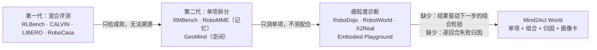
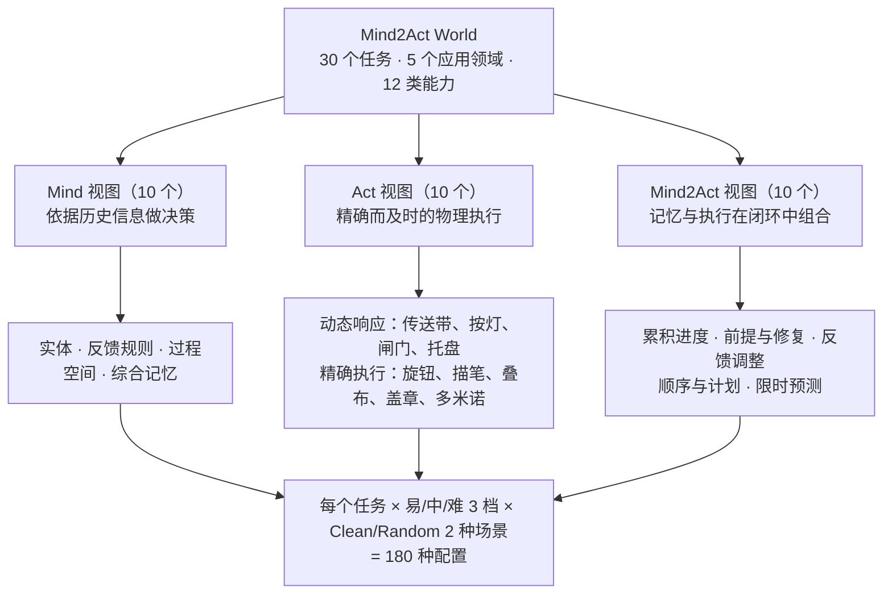
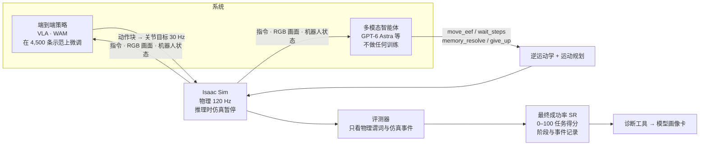
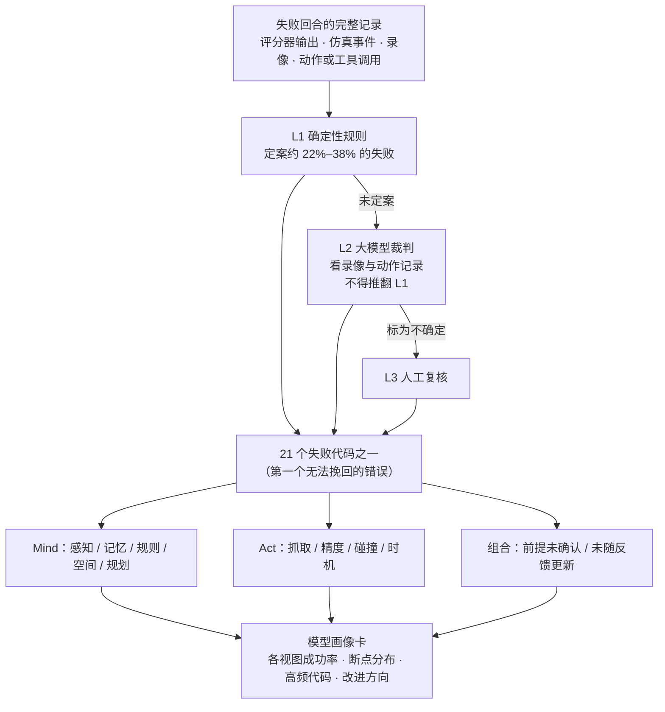

# Mind2Act World：分开考「记得住」与「做得准」，再考二者能否连成一气的机器人操作诊断基准

> **原题**：Mind2Act World: A Diagnostic Benchmark for Embodied Mind, Physical Action, and Mind-Action Composition in Robotic Manipulation
> **作者**：Yuzhi Huang、Jie Wu、Fanding Huang、Junchao Lin、Weichen Zhang 等，共 43 位作者（项目负责人为 Yuzhi Huang 与 Jie Wu）
> **机构**：清华大学牵头，合作方包括剑桥、牛津、斯坦福、卡内基梅隆、港大、港科大、港中文、北大、上海交大、复旦、人民大学、深圳大学，以及 Velabot AI、Simple AI、百度智能云
> **年份**：2026（arxiv ID 2611.26444）
> **分类**：cs.RO / cs.AI / cs.CV
> **链接**：https://arxiv.org/abs/2611.26444
> **精读日期**：2026-11-20

## 阅读须知

### 这篇在领域里的位置

这篇论文属于「具身智能评测」这一类工作，具体落在机器人操作（manipulation）的仿真基准上。过去几年，这一方向先后出现过两代基准。第一代以 RLBench、CALVIN、LIBERO 为代表，它们把许多操作任务放进同一个仿真环境，只报告每个任务成功与否，至于失败是因为想错了还是做错了，这类基准并不区分。

第二代基准开始拆分能力维度。有的专门考记忆，例如 RMBench 与 RoboMME；有的给出分阶段打分或执行轨迹，例如 RoboDojo 与 X2Real，后者已经尝试把推理与操作分开记录。这篇论文所处的位置，是在「拆开考」之后再往前走一步：它不仅把记忆与执行分开测，还专门设计了一组必须把二者串起来才能完成的任务，并且给每一次失败做归因。

### 读完能回答什么

1. 为什么只看一个任务的成功率，无法判断机器人是「想错了」还是「做错了」，Mind2Act World 用什么任务结构来区分这两者？
2. 多模态大模型智能体与端到端视觉语言动作模型，在「记忆」和「执行」两件事上各自强在哪里、弱在哪里？
3. 为什么最强的系统在单项任务上能有四五成成功率，到了需要串联的任务上却只剩 12%？这个落差主要来自「串联」本身，还是来自长流程里某一步先出了错？
4. 场景换了桌布、灯光和杂物之后，为什么视觉语言动作模型的记忆几乎消失，执行却基本保住？
5. 论文的诊断工具（规则加大模型裁判加人工复核）如何把每一次失败归到 Mind、Act 或组合三类之一，它给出的改进方向是什么？

### 阅读前置

本文假定读者熟悉深度学习的基本概念，知道大语言模型能够调用工具、知道 Transformer 能处理图像和文本的混合输入，也大致了解模仿学习就是让模型照着人类或脚本给的示范去学动作。本文不假定读者做过机器人，因此逆运动学、动作块、仿真器暂停这些机器人领域的说法，第一次出现时都会先解释。

### 首次出现的缩写表

- **VLA**（Vision-Language-Action model，视觉语言动作模型）：输入相机画面和一句自然语言指令，直接输出机器人关节或末端动作的端到端模型，典型代表有 OpenVLA、π0.5。
- **WAM**（World-Action Model，世界动作模型）：在预测动作的同时也预测环境未来如何变化的模型，相当于把「世界模型」和「策略」合在一起训练。本文评测了 InternW0 与 FastWAM。
- **Agent（多模态智能体）**：本文专指不经过任何针对性训练、直接通过 API 调用的多模态大语言模型。它看图、读状态，然后调用预先给定的运动工具去控制机械臂。
- **LLM judge（大模型裁判）**：用一个大语言模型去看失败录像和动作记录，判断失败属于哪一类。
- **SR**（Success Rate，最终成功率）：所有完成条件都满足的回合占比。
- **Task score（任务得分）**：0 到 100 的部分进度分，只有任务完全成功时才是 100。
- **IK**（Inverse Kinematics，逆运动学）：已知机械手要到达的位置和朝向，反推每个关节该转多少度的计算。
- **Action chunk（动作块）**：端到端策略一次预测出的一小段连续动作，执行完一段才再看一次画面、预测下一段。
- **Harness（智能体外壳）**：包在大模型外面的那一层工具、规划器与控制循环，决定模型能做哪些动作、能看到哪些历史。
- **Wilson 区间**：一种给比例（例如成功率）估计置信区间的方法，样本少或比例接近 0、1 时比常见的正态近似更稳。
- **Isaac Sim**：英伟达的机器人物理仿真平台，本文所有任务都在其中运行。
- **ARX X5**：本文使用的双臂机械臂型号，配平行夹爪。

具身智能的目标，是让机器人像人一样可靠地完成复杂的物理任务。以论文开头举的做饭为例，机器人要记得下一样该放哪种配料，要用两只手稳稳地把配料倒进锅里，还要在锅温升到 80 度时及时把灶从「加热」切到「保温」。这三件事分别对应三种能力：记住并推理先前看到的信息，精确而及时地完成物理动作，以及让每一次动作的结果反过来决定下一步做什么。

问题在于，现有的评测几乎没法告诉开发者，自己的模型到底卡在哪一种能力上。一个做饭任务失败了，可能是记错了配料顺序，可能是倒的时候罐子滑了，也可能是倒完之后没有确认就去开火。只看成功率，这三种失败看起来一模一样。于是开发者不知道该补数据、改架构，还是加一个检查步骤，改进只能靠猜。Mind2Act World 想要解决的，正是这种「知道失败、不知道为何失败」的困境。

## 一、问题

把上面的动机落成一个可以检验的技术问题，大致可以这样表述：给定一个机器人系统，能否设计一组任务，使得我们可以分别测出它的「心智」（Mind，依据先前观察做决策的能力）与「动作」（Act，精确及时地产生物理效果的能力），再测出它把二者组合起来的能力，并且在每一次失败时指出问题出在哪一边。

这个问题之所以不平凡，是因为三种能力在真实任务里总是缠在一起。一个考记忆的任务，机器人总还得抓起东西放下去；一个考执行的任务，机器人总还得先看懂指示。于是设计任务时必须做到一种微妙的平衡：让一种能力成为难点，同时让另一种能力虽然在场，却足够简单，不至于喧宾夺主。

前人的第一条路线，是把很多任务混在一起打分。RLBench、CALVIN、LIBERO、RoboCasa、BEHAVIOR-1K 都属于这一类。它们做对的地方在于覆盖面广、可以大规模比较不同策略；不够用的地方在于每个任务只给一个成败结果，推理与执行混在同一个任务里，失败无法溯源。

第二条路线是把能力拆开单独测。RMBench 与 RoboMME 专门考需要依赖历史信息的决策，后者还设了易中难三档；GeoMind 考空间推理与空间记忆。这一路的好处是能单独看清某一种能力的强弱；缺点是只测单项，并不检验这些能力在同一个流程里能否配合起来。

第三条路线开始做细粒度诊断。RoboDojo 和 RobotWorld 给出分阶段的得分或执行轨迹，X2Real 记录子任务的失败节点，并且把推理与操作分成不同维度，还比较了 VLA、WAM 与智能体三条技术路线。Embodied Playground 则考察闭环行为，即先前的动作是否为后续步骤铺好了前提。这些工作已经很接近本文想做的事情，但它们很少回答一个关键问题：当某一步动作的实际物理结果决定了下一步该做什么时，系统还能不能把记忆与执行接上。

与之相对地，模型这一侧也在快速分化。一边是 VLA 与 WAM 这类端到端策略，靠大量示范学会「看到这样的画面就做这样的动作」；另一边是多模态大模型智能体，靠语言推理决定下一步，再调用运动工具去执行。还有带记忆模块的策略、专做动态操作或力觉控制的策略。论文观察到，每一条技术路线通常只在「自己那一项最难」的任务上被评测：记忆方法在执行很简单的任务上测，动态控制器在目标已经给定的任务上测，智能体在「默认能感知到结果」的任务上测。于是没有人知道，当三种难点同时出现时，这些系统会怎样。

归根结底，作者要的是一个满足三个条件的基准：第一，任务能让一种能力成为难点、其余能力保持在场但简单；第二，组合能力的判定要基于真实发生的物理结果，而不是系统自称完成；第三，不同动作接口、不同推理速度的系统能在同一把尺子下比较。

## 二、方法

### 2.1 三个视图与三十个任务

Mind2Act World 的核心设计，是把 30 个仿真操作任务分成三个「视图」，每个视图 10 个任务。所谓视图，指的是这一组任务着重考察的能力，而不是模型内部的某个模块。

**Mind 视图**考的是依据历史信息做决策。这类任务的执行部分刻意做得很简单，只需要常规的抓取与放置，难点在于决策所依赖的信息已经从画面上消失了。例如，一个工件被盖子盖住，盖子又被来回调换七次，机器人要记住工件最后在哪个盖子下面；又如一摞蒸笼被逐层拆开，每层装的东西不同，机器人要按原来的顺序把它们重新摞好。

Mind 视图下又分为五类记忆，每类两个任务。实体记忆是记住一个物体的身份或对应的数值；反馈规则学习是通过交互推断出隐藏规则，例如摸清一排没有标签的按钮各自控制什么；过程记忆是记住已经完成了哪些操作、按什么顺序；空间记忆是在参照系移动或地图被遮住之后仍记得位置；综合记忆则把身份、位置、顺序合在一起，例如翻牌配对游戏。

**Act 视图**考的是精确而及时的物理执行。这类任务会把要做什么直接告诉机器人，难点只在于做得准、做得及时。它分为动态响应和精确执行两类：前者包括在传送带上把物体截住、在灯亮的时间窗里按下按钮、在周期性开合的闸门关上之前穿过去，以及端着放了散球的托盘绕过障碍而不让球滚出圆圈；后者包括把电压表旋钮调到指定读数、沿着曲线描笔、折叠布料、按指定朝向盖章，以及把一串多米诺骨牌沿弯曲的带子立好，推倒第一块后要一路传到终点敲响铃铛。

**Mind2Act 视图**考的是二者的组合，也就是论文所说的「结果驱动的延续」：先前记住的信息决定下一步操作，而这一步操作的物理结果又改变了后续决策所依赖的状态。这一视图下有五种组合机制。累积进度类任务要按订单从传送带上取餐，只有放稳了才算推进；状态前提与修复类任务要先让转盘停下才能盖上蛋糕罩，或者按记住的蓝图把放错的底座重搭；反馈驱动调整类任务要依据温度读数或天平偏转决定下一步；顺序与计划执行类任务要按记住的旋律弹钢琴，或按搭建计划为玩具车造一座能承重的桥；时间压力下的预测决策类任务要对飞来的球按颜色规则做出回击或放行。

之所以要这样分视图，是因为三组任务的语义彼此相关。Mind2Act 里的传送带取餐，在 Act 里有一个单独的传送带拾取任务与之对应。于是，如果一个系统在 Act 的传送带任务上做得很好、在 Mind 的记忆任务上也做得不错，却在 Mind2Act 的取餐任务上失败，人们就有理由怀疑问题出在组合上。不过作者也坦白，三个视图的任务并不完全相同，Mind2Act 的流程还更长，所以视图之间的差距本身并不能直接证明是组合出了问题，这一点在局限一节还会再谈。

### 2.2 难度分档与场景扰动

每个任务都有易、中、难三档。分档时任务目标保持不变，只提高这一视图看重的那种负担：Mind 任务增加要记住的东西，例如翻牌配对从 2 对增加到 8 对；Act 任务提高精度或缩短时间窗，例如多米诺从 5 块等高的增加到 9 块高矮不一的；Mind2Act 任务拉长流程，例如取餐从 1 份订单增加到 3 份，河面从 18 厘米加宽到 36 厘米。

此外，每一档都在两种场景下各测一次。Clean 场景用默认材质与灯光、桌上没有杂物；Random 场景使用同一组任务实例，但在空余桌面上放杂物，从 23 种桌面材质中随机挑一种，再从 6 种光源里随机挑一种，并大幅调整光的颜色与亮度。由于两种场景共用同一组实例，比较二者就能单独看出「外观变化」本身对系统的影响。30 个任务乘以 3 档再乘以 2 种场景，一共是 180 种配置。

### 2.3 平台、接口与计时

所有任务都在 Isaac Sim 中运行，机器人是两条 ARX X5 机械臂，带平行夹爪，有一个固定的头部相机和两个腕部相机，图像分辨率都是 640×480。物理仿真以每秒 120 次的频率推进，机械臂和夹爪的目标每秒更新 30 次。

为了让两类系统在同一把尺子下比较，论文定了一份「信息契约」：所有系统都只能拿到任务指令、选定的相机画面和声明过的机器人状态，历史信息只能来自本回合内已经展示过的内容，评分用的隐藏参数（例如盖章的目标角度和容差）只有评测器看得到。

在这份契约之下，两类系统通过不同的接口行动。端到端策略每次预测一个动作块，转换成关节目标后执行若干步，再看新画面、预测下一块。智能体则调用结构化工具：`move_eef` 给出末端执行器的目标位姿和夹爪指令，由后台负责逆运动学与运动规划；`wait_steps` 让仿真空转若干步；`memory_resolve` 可以按编号取回本回合先前的某张画面；`give_up` 则让智能体自行结束回合。三个被测智能体共用这一套固定外壳。

计时上有一个关键设计：模型推理时仿真会暂停。这意味着任务的时间限制按仿真时间计算，而推理花掉的真实时间不会让仿真里的时间窗缩短。于是，限时任务测的是「有没有选对动作、动作本身是否及时」，而不是「能不能在现实时间里来得及反应」。论文在后面专门讨论了这一点对智能体成绩的影响。

### 2.4 评分规则与防作弊

论文报告两个指标。最终成功率要求任务的全部完成条件都满足；任务得分在 0 到 100 之间，按任务专属的规则给部分进度分，并且只有完全成功时才等于 100。两个指标并用的道理在于：只看成功率，不知道失败的回合走到了哪一步；只看进度分，又可能奖励那些永远做不完的回合。

完成与否一律由环境一侧的物理谓词判定。一件东西必须被松开、并稳稳地落在目标位置上才算放好；旋钮读数在松手后必须保持稳定；琴键必须真的被有效按下。智能体宣布「我做完了」不算数，策略反复执行同一个动作也只有在满足新的要求时才得分。例如托盘任务里，球一旦滚出圆圈就判失败，哪怕之后又滚回来。

汇总时，每个视图的成绩是其中 10 个任务的平均，Clean 与 Random 两种场景等权。综合得分按 0.25 倍 Mind 加 0.25 倍 Act 加 0.5 倍 Mind2Act 计算，也就是让组合视图的分量等于两个单项视图之和。作者的理由是：机器人真正有用，在于能把整个流程走完，而在完整流程里记忆与执行互相依赖，只强一项是不够的。

为了训练端到端策略，论文用脚本专家生成了示范数据。脚本先规定操作顺序和末端目标，再用逆运动学和运动规划转成关节轨迹，最后用同一个评测器检查物理上是否真的完成。每个任务每一档采 50 条，一共 4,500 条示范，约 75.8 小时。Mind 与 Mind2Act 的示范平均长 58.5 秒与 99.6 秒，分别约为 Act（23.9 秒）的 2.5 倍和 4.2 倍；难档的 Mind2Act 示范平均更是长达 127.6 秒。脚本专家在每个任务的每一档都能成功，这也顺带证明了所有任务在这个平台上都是可完成的。

### 2.5 诊断工具与模型画像卡

成功率与进度分能告诉开发者「失败了多少」，却说不出「在哪一步、为什么失败」。为此，论文设计了一套诊断工具，对每个失败回合找出「第一个无法挽回的错误」，再从 21 个失败代码里给它贴上一个。

这些代码分三大组。Mind 组关乎感知与推理，例如因为记错顺序选错了物体（M-MEMORY）、读错了画面上的读数（M-PERCEIVE）、错误预测了场景将如何变化（M-PREDICT）。Act 组关乎物理执行，即动作选对了却没做好，例如没抓住或中途掉了（A-GRASP）、细微控制出错（A-PRECISION）、时机过早或过晚（A-TIMING）。组合组关乎用结果引导下一步，例如没确认前提就继续（C-PREREQ），或者指示灯已经变了却还在按同一个按钮（C-NO-UPDATE）。另有三个回合级代码，分别对应超时、停滞和证据不足。

诊断分三层进行。第一层是确定性规则，利用评分器输出和仿真事件，直接定位失败步骤或把范围缩小；第二层是大模型裁判，对规则没能定案的回合查看录像和动作或工具调用记录，它不能推翻第一层的结论，拿不准的要标为「不确定」；第三层是人工复核，专门处理裁判标为不确定的回合。

诊断的最终产物叫「模型画像卡」，每个系统一张。卡片从上到下依次列出：各视图的成功率；失败回合在哪一步首先断掉（感知、推理、执行、闭环）；失败归于 Mind、Act 还是组合；最常见的几个失败代码；典型任务卡在哪一步；按难度分档的成功率；以及从失败代码推出的改进建议。论文在正文里展示的是格式示例，三个代表系统（GPT-6 Astra、G0.5、InternW0）的实测卡片放在附录里。

## 三、实验

### 3.1 被测系统与评测规模

论文评测了九个系统，分两个排行榜。智能体一侧有三个多模态大模型：GPT-6 Astra、DeepSeek-V4.1-Flash 和 Gemini-4-Argon，都以中等推理强度通过 API 直接调用，不做任何训练。端到端策略一侧有四个 VLA（KinRT、π0.5、G0.5、X-VLA）和两个 WAM（InternW0、FastWAM），都从公开权重出发，在 4,500 条示范上微调。

两类系统的评测量相差十倍。每种配置固定 50 个实例，端到端策略在 Clean 与 Random 两种场景下各跑全部 50 个，所以每个策略共 9,000 个回合；智能体太慢太贵，只跑其中 5 个 Clean 和 5 个 Random，每个智能体共 900 个回合。九个系统合计 56,700 个计分回合。智能体还额外获得四倍于端到端策略的物理时间预算，每回合最多 150 次决策。

### 3.2 主要结果

下表摘自论文的排行榜，取三档难度合并、两种场景平均的成功率。综合得分按 0.25/0.25/0.5 加权，综合成功率则是全部回合的直接比例。

| 系统 | 类型 | Mind SR | Act SR | Mind2Act SR | 综合得分 | 综合 SR |
|---|---|---|---|---|---|---|
| GPT-6 Astra | 智能体 | 52.7% | 39.0% | 12.0% | 30.2 | 34.6% |
| DeepSeek-V4.1-Flash | 智能体 | 11.0% | 8.7% | 0.0% | 6.1 | 6.6% |
| Gemini-4-Argon | 智能体 | 4.3% | 9.7% | 0.0% | 4.4 | 4.7% |
| KinRT | VLA | 4.4% | 13.6% | 2.9% | 7.9 | 7.0% |
| π0.5 | VLA | 3.5% | 12.0% | 3.6% | 7.6 | 6.4% |
| G0.5 | VLA | 1.9% | 13.4% | 2.3% | 6.2 | 5.9% |
| X-VLA | VLA | 1.0% | 19.6% | 0.2% | 6.2 | 7.0% |
| InternW0 | WAM | 5.4% | 17.6% | 3.0% | 8.7 | 8.7% |
| FastWAM | WAM | 0.9% | 7.4% | 0.5% | 3.1 | 2.9% |

第一个结论是整体水平很低，而且两个榜首与其余系统差距很大。智能体榜首 GPT-6 Astra 的综合成功率是 34.6%，端到端榜首 InternW0 是 8.7%，其余七个系统都在 2.9% 到 7.0% 之间。作者排除了两种解释：任务本身不可能完成（脚本专家每一档都能完成），以及智能体外壳拖了后腿（三个智能体共用同一外壳，GPT-6 Astra 的成功次数却是第二名的五倍多）。因此他们认为短板主要在模型本身。

第二个结论是，两类系统的弱点恰好相反。GPT-6 Astra 在 Mind 视图上遥遥领先，达到 52.7%，其余两个智能体只有 11.0% 与 4.3%，端到端策略都在 0.9% 到 5.4% 之间，而且这些少量成功大多出现在要记的东西最少的易档。与之相对，每个端到端策略的最好成绩都出在 Act 视图上，四个 VLA 在 12.0% 到 19.6% 之间。一句话概括：最强的智能体记得住，却难以在接触中维持控制；端到端策略能做出练熟的动作，却几乎不保留任务状态。

第三个结论，也是论文标题所指的结论：单项能力不会自动迁移到组合任务上。所有系统在 Mind2Act 上的成功率都低于 Act。GPT-6 Astra 从 Mind 的 52.7%、Act 的 39.0% 跌到 Mind2Act 的 12.0%；另外两个智能体在 Mind2Act 上一次都没成功。端到端策略只有 0.2% 到 3.6%，与它们的 Mind 成绩相近、远低于 Act 成绩。例如 X-VLA 在 Act 上是端到端最强的 19.6%，到了 Mind2Act 只剩 0.2%。

### 3.3 成功集中在少数「练熟的动作」上

成功率不仅低，而且分布很窄。对每个系统而言，Mind 与 Act 这两个单项视图贡献了它全部成功次数的 81% 到 100%。在单项任务里，成功又集中在少数几个熟练动作上，其中最突出的是周期闸门穿越（DR3）：仅这一个限时任务，就贡献了 KinRT、π0.5、X-VLA 全部成功的 36% 到 41%，以及 FastWAM 全部成功的约 70%。

另一个极端是，30 个任务里有 8 个在全部 56,700 个回合中无一成功。它们是工件追踪（M1）、托盘端球（DR4）、按朝向盖章（PR5）、多米诺链（PR6）、厨房装架（CP03）、控温做饭（CP04）、搭桥（CP07）和白板复原（CP09）。

Mind2Act 上为数不多的成功，也来自系统在单项视图上本就会的步骤。GPT-6 Astra 只在传送带取餐（CP01）上稳定成功，达到 60%，而这里的拾取动作与它在 Act 传送带任务（DR1）上 77% 的成功率几乎是同一个动作；CP01 一项就占了它 36 次 Mind2Act 成功中的 18 次。端到端策略的组合成功则大多出在易档，因为易档只有一份订单或一件物品，组合任务退化成了一个 Act 任务。π0.5 在易档 Mind2Act 上成功 8.6%，到难档只剩 0.1%。

### 3.4 记忆在场景变化下的去留

Clean 与 Random 两种场景用的是同一组实例，示范又全部录自 Clean 场景，所以比较二者能看出外观变化本身的影响。从综合得分看，没有哪个系统的变化超过三分左右，但分视图看就大不一样。

四个 VLA 在 Random 场景下仍保住了 86% 到 94% 的 Act 成功次数，却只剩 28% 到 41% 的 Mind 成功次数。例如 KinRT 的 Mind 成功次数从 97 降到 35，π0.5 从 82 降到 23。作者的解释是：Act 任务的目标就在当前画面里，换了桌布和灯光，策略仍能找到它；Mind 任务却要依据先前的观察做决定，而在 Random 场景里，这些先前的画面与训练时见过的样子完全不同。由此推测，VLA 记住的更像是「训练时场景看起来什么样」，而不是「场景里有什么」。

GPT-6 Astra 的表现恰好相反。它的 Mind 成功率只从 54.7% 降到 50.7%，Mind2Act 仍是 12.0%，说明它记住的是场景的内容而非外观；它受影响更大的反而是执行，Act 成功次数从 150 次中的 65 次降到 52 次。两个 WAM 彼此也不一样：InternW0 的 Mind 成功次数在 Random 下反而略多（83 对 78），FastWAM 的总成功次数却从 198 跌到 67。所以对 WAM 而言，抗外观变化取决于具体模型，而不是模型类型。

### 3.5 难度升级时谁塌得最快

难度从易到难，所有系统的成功率都下降，但塌法不同。GPT-6 Astra 从易档的 44.7% 降到难档的 27.0%，保住了六成；KinRT、π0.5、G0.5、InternW0 只保住 26% 到 34%。

| GPT-6 Astra 成功率 | 易 | 中 | 难 |
|---|---|---|---|
| Mind | 64.0% | 50.0% | 44.0% |
| Act | 44.0% | 39.0% | 34.0% |
| Mind2Act | 26.0% | 7.0% | 3.0% |
| 全部任务 | 44.7% | 32.0% | 27.0% |

下降集中在 Mind2Act 上，因为它的难档主要是增加相互依赖的操作。论文指出，下降幅度的顺序恰好与示范的平均长度一致：Act 23.9 秒、Mind 58.5 秒、Mind2Act 99.6 秒。流程越长，可能出错的操作就越多，而 Mind2Act 只要其中一步失败，整个流程就失败。

限时的 Act 任务则几乎不受难度影响，因为它们的难档主要是缩短时间窗，并不增加新的操作。按灯任务（DR2）的时间窗从 4.0 秒缩到 2.6 秒，G0.5 在三档上的成功次数分别是 100 次中的 37、39、34；闸门任务（DR3）上，π0.5 是 76、81、79。练熟了的动作只需做得快一点，时间缩短并不会带来新的出错机会。

### 3.6 反直觉的几处结果

有几个结果与直觉相反，值得单独拎出来讨论。

其一，排行榜的综合名次会掩盖组合能力。InternW0 凭借 Mind 与 Act 的成绩登上端到端榜首，可它的 Mind2Act 成功率（3.0%）其实低于 π0.5（3.6%）。这说明一个系统可以单靠单项能力领跑总榜，读排行榜时不能只看总分。

其二，有一个 Mind 任务上端到端策略反超了所有智能体。在蒸笼复原（P2）上，KinRT 与 π0.5 分别达到 15% 和 14%，而三个智能体都是零。考虑到这些策略在其他 Mind 任务上几乎不保留状态，作者认为它们在 P2 上的成功更可能来自练熟的蒸笼搬运动作，而不是真的记住了顺序；反过来，这也说明 GPT-6 Astra 在 P2 上卡住的是搬运，而不只是记忆。

其三，难度高的档位不一定更难。X-VLA 叠布（PR4）在易、中、难三档的成功次数是 100 次中的 97、1、94。易档沿中线对折、难档折六边形都能做好，偏偏中档的对角线折法几乎全败，可见它学到的那一个动作恰好适合矩形与六边形，却不适合对角线。

其四，也是最需要细读的一处：Mind2Act 的失败大多发生在流程刚开头，远在「记忆与执行需要配合」之前。对每个系统而言，Mind2Act 的进度分都只比成功率高出不到 1.5 分；在搭桥（CP07）和白板复原（CP09）上，没有任何系统拿到哪怕第一个阶段的分。例如 G0.5 在 300 个搭桥回合里有 202 个连一块零件都没抓起来。真正属于组合环节的错误，只有在回合走得足够远时才会出现，比如 InternW0 在 300 个做饭回合中有 271 个在配料没放齐时就开了火。作者因此承认，Mind2Act 的失败与其说是「推理与执行配合不好」，不如说是推理或执行在某一步先出了错。

若用论文自己提出的参照来算，一个系统的 Mind2Act 成功率如果恰好等于 Mind 成功率乘以 Act 成功率，就相当于每个组合流程只需要「一次独立的 Mind 成功加一次独立的 Act 成功」。按表中数字，GPT-6 Astra 的乘积约为 20.6%，实测 12.0%，低于乘积；π0.5 的乘积只有约 0.4%，实测却是 3.6%，反而高于乘积，这与它的组合成功大多来自易档、而易档几乎就是 Act 任务的解释一致。（此段乘积为笔者按表 4 计算。）

### 3.7 接触控制：两类系统共同的盲区

两类系统都在需要持续接触控制的任务上失手。所谓持续接触控制，是指机器人在与物体保持接触的同时要不断微调，例如端托盘、描笔、立多米诺，因为每一次细小的滑动都会改变下一个动作必须应对的状态。

GPT-6 Astra 在这类五个任务（DR4、PR3、PR4、PR5、PR6）上一次都没成功，画像卡显示失败都发生在接触过程之中：30 个托盘回合全部在托起托盘时失败，30 个多米诺回合中有 21 个在摆放时就把骨牌碰倒了。端到端策略除了 X-VLA 能靠一个练熟的动作叠布之外，表现也好不到哪里去。

作者给出的解释很有说服力：两类系统在两次观察之间都是开环执行的。智能体的运动工具把每个目标变成一条完整规划好的轨迹一口气走完，端到端策略则一次执行动作块里固定数量的动作才重新预测。于是，一个开始滚动的球、一块开始倾倒的骨牌，在下一次观察之前都得不到纠正。

### 3.8 速度与花费

暂停仿真的设计掩盖了一个一到三个数量级的速度差距。智能体一次 API 调用要 11.0 到 35.6 秒，端到端策略一次预测只要 77.1 到 488.1 毫秒。

| 系统 | 每次调用 | 每回合（分钟） | 每回合 API 费用 | 每次成功的费用 |
|---|---|---|---|---|
| GPT-6 Astra | 11.0 s | 22.2 | 25.13 美元 | 72.7 美元 |
| DeepSeek-V4.1-Flash | 35.6 s | 96.1 | 1.24 美元 | 18.9 美元 |
| Gemini-4-Argon | 27.8 s | 18.0 | 1.12 美元 | 24.0 美元 |
| X-VLA | 153.0 ms | 16.5 | 本地运行 | 本地运行 |
| InternW0 | 488.1 ms | 19.2 | 本地运行 | 本地运行 |

GPT-6 Astra 每回合的费用约为另外两个智能体的二十倍，但由于成功得多，每次成功的花费只约为 DeepSeek-V4.1-Flash 的四倍。更重要的是，它在限时任务上的领先依赖暂停的时钟：它在 Act 任务上平均每次请求要 9.2 秒，是难档按灯任务 2.6 秒时间窗的三倍多。在真实环境里，传送带不会等它，灯也不会等它。

### 3.9 诊断结果与改进方向

对三个代表系统的全部失败回合做诊断后，执行错误是每个系统最大的失败类别：G0.5 占 41.4%，InternW0 占 37.2%，GPT-6 Astra 高达 55.3%。G0.5 与 InternW0 的感知与推理错误也不少，分别占 27.7% 与 32.8%。归于闭环组合的失败只占每个系统的 6% 到 11%。

具体到代码层面，三个系统的主要毛病各不相同。G0.5 和 GPT-6 Astra 最常见的是抓取失败，分别有 1,324 次和 120 次；InternW0 最常见的是细微控制错误，有 1,132 次；两个端到端策略还分别有 924 次和 1,011 次记忆错误。InternW0 另有 761 次前提未确认的失败，其中 271 次就是做饭任务里配料没放齐就开火。

智能体的停止行为也很有意思。GPT-6 Astra 在 900 个回合里主动放弃了 460 次，只有一次是在任务其实已经完成后才停下的；其余 459 次占了它全部 589 个失败回合的 77.9%，其中 264 次连 150 次决策预算的三分之二都没用完。这些主动放弃大多源于执行错误，常常是运动规划器拒绝了它请求的位姿之后，它便不再尝试。与之相对，DeepSeek-V4.1-Flash 经常把预算耗尽。

从这些代码出发，论文给出了几条具体的改进方向。对于端到端策略的记忆缺陷，建议在示范数据中使用更多样的场景外观，并拉长「信息展示」与「信息被用到」之间的间隔。对于抓取与接触问题，建议把示范的权重向这些片段倾斜，增加位姿、接触与时机的变化。对于前提确认与修复，建议加入「某一步失败、随后修复」的示范，因为脚本专家只录下了成功的步骤，策略从来没见过失败之后如何补救。对于智能体，则建议外壳提供更细的运动工具、在停止前加一次重试，并把每一步的实际结果返回给模型、要求它确认后再进行下一步。

还有一条关于数据收集的建议很有启发。在白板复原上，G0.5 的 300 个回合中有 299 个连白板都没从架子上取下来。此时再补充完整长度的示范，大部分步骤都会花在策略根本到不了的后半段。更有效的做法是围绕断点构造数据：从回合通常卡住的状态及其附近的扰动状态出发录制示范，把训练数据集中在策略失败的地方。

## 四、局限

### 作者承认的局限

第一，视图只是任务集合，而不是对同一个系统的受控干预。Mind 任务仍需要常规操作，Act 任务仍需要读懂提示，Mind2Act 流程又比单项任务更长、内容也不同。因此，Mind2Act 成绩低，目前还无法与「流程更长」或「早期执行出错」的影响区分开。作者计划引入「Mind 神谕」与「Act 神谕」：前者直接提供本该记住的任务状态，后者让系统调用脚本技能完成物理操作，二者都给足之后仍然剩下的差距才是组合本身的代价。

第二，仿真在推理时暂停，所以限时任务测的是仿真时间里的正确性，而不是真实时间里的反应能力。智能体还额外获得逆运动学与运动规划服务、四倍的物理预算，并且共用同一套固定外壳，因此结果并不代表某个模型用上自己的工具、控制器或记忆之后能达到的水平。这也是两类系统分榜排名的原因。

第三，被测系统只有三个智能体、四个 VLA 和两个 WAM，没有混合架构，也没有带记忆模块的端到端策略，不足以分析模型规模、训练数据或架构如何影响结果。智能体在每个任务每一档只跑了 10 个回合，按难度拆开后的结论相当粗略；部分回合因基础设施故障重跑过。

第四，所有任务都是单一双臂平行夹爪平台上的桌面仿真任务，每个任务每一档只有一条固定的英文指令；灵巧手、移动操作、导航和人形机器人都没有覆盖。Random 场景的变化幅度刻意做得很大，并不模拟真实部署环境。每一类能力只有一到六个任务，不足以支撑关于某一类能力的结论。仿真结果与真实机器人上的结果之间的关系，也还没有测量。

第五，诊断工具里，规则层只能定案 22% 到 38% 的失败，其余都要靠大模型裁判加人工复核；而且目前只记录每个回合的第一个无法挽回的错误，看不到之后系统有没有察觉并补救。

### 读者能看出的潜在问题

其一，论文的核心叙事与它自己的诊断数据之间存在张力。摘要与结论把「通过环境反馈组合推理与执行」称为主要的未解问题，可诊断结果显示，归于闭环组合的失败只占 6% 到 11%，大多数 Mind2Act 回合在组合环节被检验之前就已失败，作者在正文里也承认了这一点。更稳妥的读法是：这份基准目前测出来的，是「长流程里每一步都要可靠」这一前置条件还远未满足；组合能力本身究竟有多弱，要等神谕实验做完才能下结论。

其二，端到端策略的成绩很可能受示范数量所限。每个任务每一档只有 50 条示范，而 Mind2Act 示范平均长达 99.6 秒、难档超过两分钟。用这么少的长流程示范微调一个通用 VLA，成绩低落未必说明架构不行，也可能只是数据不够。论文没有做「示范数量与成绩」的关系实验，所以「VLA 天生不保留任务状态」这一判断需要打个折扣。

其三，两类系统之间的比较并不对等，读数字时要时时记住这一点。智能体有运动规划器、四倍预算、可以随时取回历史画面的工具，还享受暂停的时钟；端到端策略要靠自己从画面直接输出动作。论文分榜排名、反复提醒，这是对的，但读者看到「GPT-6 Astra 在所有视图都领先」时，不宜把它直接理解为「大模型智能体比 VLA 更会操作机器人」。

其四，智能体一侧的样本量偏小。每个智能体每个任务只有 30 个回合（三档合并、两种场景合并），据此得出的单任务成功率误差相当大，例如某任务 30 次中成功 2 次与成功 5 次，在统计上很难区分。视图层面的结论（每视图 300 个回合）相对可靠，具体到某个任务的高低排序则宜谨慎看待。

其五，被测智能体都是闭源 API，费用不低（GPT-6 Astra 每回合约 25 美元），而且模型版本会随时间更新。这意味着复现智能体榜单既昂贵又难以保证可比，排行榜的长期可信度取决于作者能否持续维护、记录版本。

其六，部分任务的难点可能部分来自仿真物理本身。多米诺、叠布、托盘端球这类任务高度依赖接触与摩擦的仿真精度，Isaac Sim 里的接触模型与真实世界未必一致。八个任务无人完成，其中有几个正是这类接触密集的任务，论文目前没有讨论仿真物理精度对这些任务难度的影响，这一点要等它承诺的真实机器人实验才能澄清。

## 一句话

用 30 个分视图仿真任务把机器人的记忆、执行与二者组合拆开测并逐回合归因，发现单项能力不会自动迁移到长流程组合任务上。
