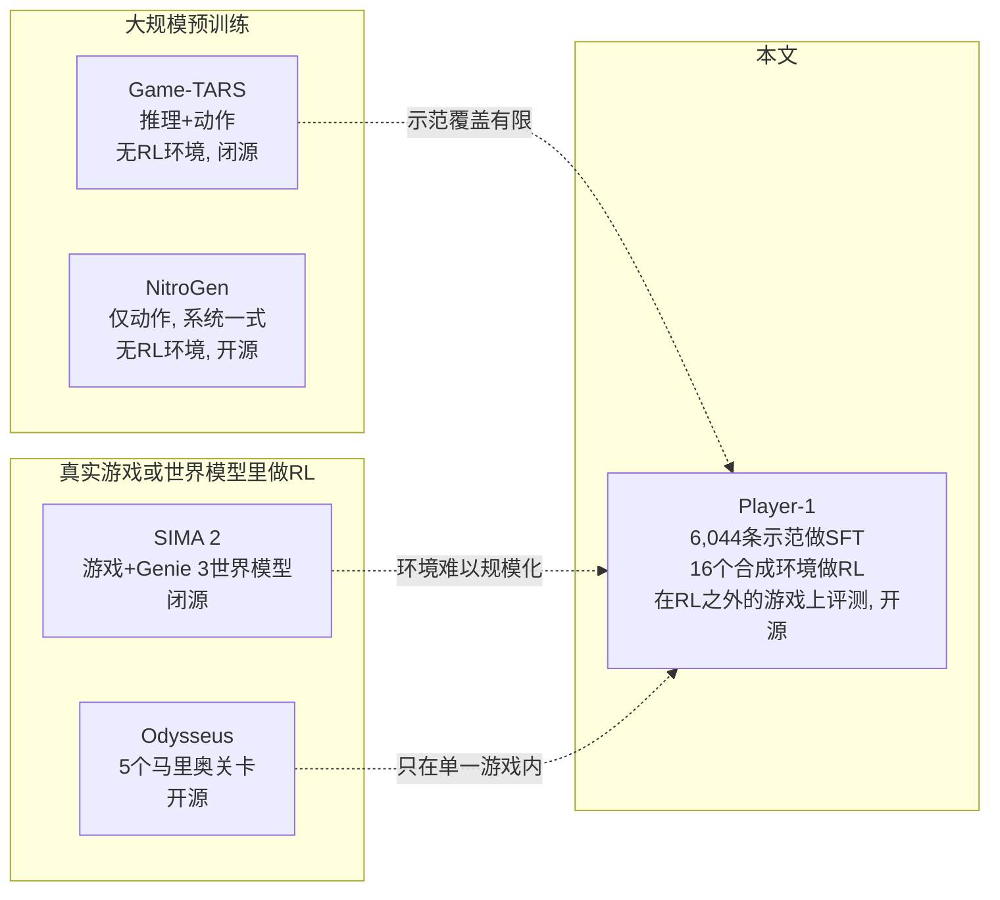
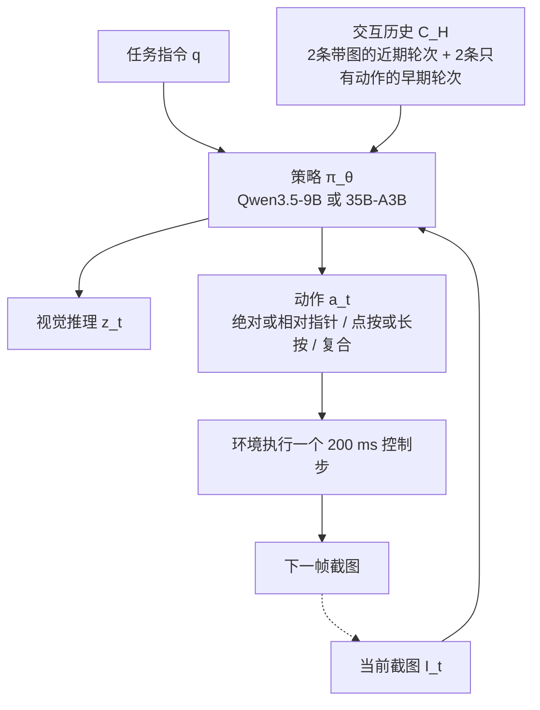
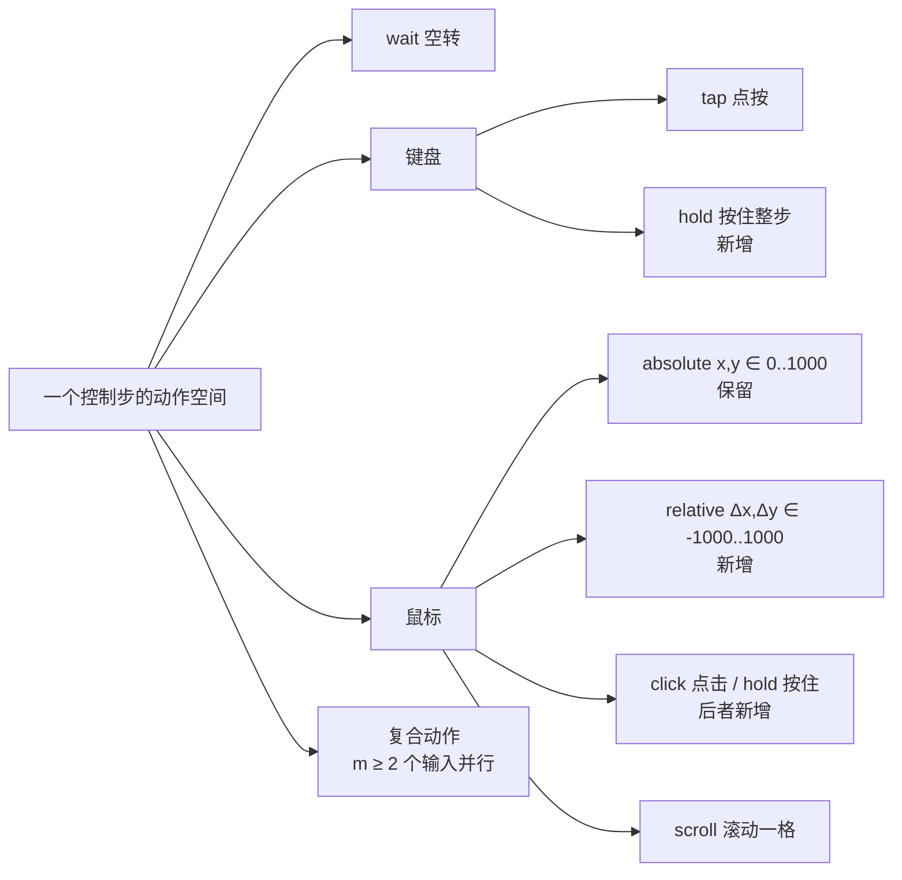
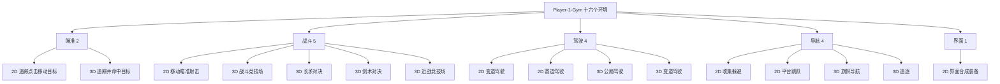
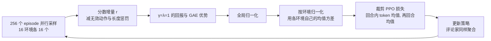

# Player-1：从合成经验中学会玩游戏

> **原题**：Player-1: Learning to Play from Synthetic Experience
> **作者**：Mingyu Ouyang, Yiran Wang, Siyuan Hu, Xingyilang Yin, Huiqiang Sun, Guangzhi Wang, Junfu Pu, Cheng Cheng, Honghao Chen, Ying Shan, Mike Zheng Shou, Hwee Tou Ng
> **机构**：新加坡国立大学、腾讯 IEG ARC Lab、南洋理工大学
> **年份**：2026（arxiv ID 2610.20584，10 月 14 日提交）
> **分类**：cs.CV / cs.AI / cs.HC
> **链接**：https://arxiv.org/abs/2610.20584
> **项目页与代码**：player-1-project.github.io，github.com/TencentARC/Player-1
> **精读日期**：2026-10-15

## 阅读须知

### 这篇在领域里的位置

这篇论文属于「游戏智能体」这一支，而游戏智能体本身又是「计算机使用智能体」向更难的交互场景延伸出来的一个分支。所谓计算机使用智能体，指的是以屏幕截图为输入、以键盘与鼠标操作为输出的视觉语言模型，它们在过去两年里已经能够相当可靠地完成网页与桌面软件上的多步任务。游戏把同样的接口推到了极限：画面变化快，机制五花八门，并且要求精确、持续、同时按下多个键的控制，这几点恰好是办公软件里不常出现的。

过去一年里，这个方向上出现了几条互相竞争的路线。一条是用海量玩游戏的录像做大规模预训练，代表是 Game-TARS 与 NitroGen；一条是在真实游戏或学出来的世界模型里做强化学习，代表是 DeepMind 的 SIMA 2 和在《马里奥》里做长程强化学习的 Odysseus；还有一条干脆放弃截图，改用游戏内部的结构化状态做文本接口，代表是 Jev。Player-1 走的是中间道路：先用一小批精选的示范做监督初始化，再在自己搭建的十六个合成小游戏里用可验证奖励做强化学习，最后去真实游戏上检验能不能迁移。它的核心主张是，游戏之间虽然外观与规则各异，但底层的控制需求（瞄准、持续移动、多键协同）是共通的，所以在合成环境里练出来的控制能力可以带到没见过的游戏里去。

### 读完能回答什么

- 为什么把计算机使用智能体直接拿去玩游戏会失败，缺的到底是哪三样动作能力？
- Player-1-Gym 的十六个合成环境是按什么原则设计的，它们如何提供不需要学习型裁判的可验证奖励？
- 在多个奖励尺度完全不同的环境里同时做 PPO，论文是如何防止某一个环境主导策略更新的？
- 监督初始化到底有多重要？直接从基座模型做强化学习会怎样？
- 强化学习之后，策略的行为发生了什么可观测的变化？「复合动作」的比例为什么会自发上升？
- 这篇论文的证据链在哪些地方比较薄弱，哪些结论应当打折扣？

### 阅读前置

假定读者熟悉 Transformer 结构的视觉语言模型、监督微调的基本流程，以及策略梯度类强化学习的大致框架（知道 PPO 是什么、优势函数是干什么的）。不假定读者做过游戏智能体或计算机使用智能体，也不假定读者熟悉 Minecraft 或 Doom 这些具体的评测游戏。

### 首次出现的缩写表

- **CUA**（Computer-Use Agent，计算机使用智能体）：以屏幕截图为观察、以键鼠操作为动作的视觉语言模型智能体。
- **VLM**（Vision-Language Model，视觉语言模型）：同时接收图像与文本输入的大模型，本文的策略网络就是一个 VLM。
- **VLA**（Vision-Language-Action，视觉语言动作模型）：在 VLM 基础上直接输出动作的模型，游戏智能体里常见的叫法。
- **SFT**（Supervised Fine-Tuning，监督微调）：用「输入到正确输出」的配对数据做的微调，本文用它做初始化。
- **RL**（Reinforcement Learning，强化学习）：让策略在环境里行动、根据奖励调整自身的学习方式。
- **RLVR**（Reinforcement Learning with Verifiable Rewards，可验证奖励的强化学习）：奖励由程序规则算出来而不是由另一个模型打分的强化学习。
- **PPO**（Proximal Policy Optimization，近端策略优化）：一种带裁剪的策略梯度算法，本文的强化学习算法。
- **GAE**（Generalized Advantage Estimation，广义优势估计）：用价值函数平滑地估计「这一步比平均好多少」的方法。
- **MoE**（Mixture of Experts，专家混合）：每个 token 只激活部分参数的稀疏架构，本文的 35B-A3B 模型即 350 亿总参数、每次激活 30 亿。
- **EMA**（Exponential Moving Average，指数移动平均）：训练曲线平滑用的手段。
- **FOV**（Field of View，视场角）：三维相机能看到的角度范围，本文作为随机化参数之一。

## 一、问题

先说这个问题为什么值得做。计算机使用智能体在过去两年里进步很快，但它们所处的世界基本是静止的：网页不会自己跑掉，按钮等着你去点，一步想错了可以回头。游戏完全不是这样。画面每一帧都在变，敌人会动，车会漂，而且很多操作必须同时进行，比如一边按住前进键一边转动视角一边开火。如果想把「能用电脑」的智能体推向「能在任意动态数字界面里行动」的通用控制能力，游戏是眼前最合适、也最苛刻的一级台阶。

这个方向上的主流做法有两类，而两类都卡在同一个地方。第一类靠大规模示范数据，也就是收集人类玩游戏的录像与键鼠记录，让模型模仿。问题在于示范只覆盖了状态空间里很小的一部分：人类玩家不会故意走进墙角、不会把视角转到天花板，于是模型一旦偏离示范分布，就不知道该怎么回来。第二类靠交互式训练，让模型自己在游戏里行动并从结果中学习。问题在于商业游戏很难提供可扩展的训练环境：要在几十上百个游戏里分别写出可靠的程序化奖励、做好重置与并行，工程代价极高，而且商业游戏的内部状态往往拿不到。

于是论文把问题收窄成一个清楚可验证的陈述：**合成经验能否把游戏控制能力推进到监督初始化之上，并且这种提升能迁移到强化学习训练集之外的游戏里去？** 这里「合成经验」指的是在作者自己造的小游戏里跑出来的交互数据，「训练集之外的游戏」指的是 Minecraft、Doom 和一批浏览器小游戏，它们都没有参与强化学习。

要回答这个问题，有三件事必须先解决。其一，各种来源的示范数据使用的输入约定与时间分辨率都不一样，必须先统一到同一个动作空间里，并且配上任务指令和视觉推理，让模型知道「玩家当时想干什么」。其二，要在示范之外学习，就需要对策略自己走到的状态给出反馈，而跨商业游戏实现程序化奖励难以规模化。其三，不同环境的控制需求、动力学与奖励尺度都不同，来自它们的经验必须能融进同一个策略里，而且这个策略还要能泛化到训练集之外。这三件事分别对应了论文方法的三个部分：统一动作空间与示范整理、合成环境与可验证奖励、多环境强化学习。

下面这张图把论文自己整理的几条代表性路线放在一起对照。

## 二、方法

Player-1 的整体结构可以概括为三段：先把动作空间扩成能玩游戏的样子，再用精选示范做监督初始化，最后在十六个合成环境里做多环境 PPO。三段之间靠同一个动作空间串起来。

### 2.1 把计算机使用的动作空间扩成游戏控制

在每一个回合 t，策略接收任务指令 q、当前截图 I_t 和交互历史 C_H(h_<t)，输出一段视觉推理 z_t 和一个动作 a_t。写成公式就是 (z_t, a_t) ~ π_θ(· | q, I_t, C_H(h_<t))。这个形式与普通的计算机使用智能体没有区别，区别全在动作 a_t 可以取什么值。论文在基座模型原有的键鼠动作之上加了三样东西。

第一样是**相对指针移动**。计算机使用智能体习惯用归一化的绝对坐标来点击屏幕上看得见的目标，坐标范围是 [0, 1000]。但在第一人称游戏里鼠标是隐藏的，移动鼠标的意义是转动视角，所以论文补充了相对位移 (Δx, Δy)，范围是 [−1000, 1000]，同样按屏幕宽高归一化，向右向下为正。实际转过多少角度取决于游戏自己的相机增益，论文在合成环境里把名义增益定为每个观察像素 0.00196 弧度。

第二样是**持续输入**。原有动作空间只有「按一下」和「点一下」，而游戏里需要一直按着前进键。论文为每个键或鼠标按钮加了「按住整整一个控制步」的 hold 动作，控制步的长度 Δt 固定为 200 毫秒；连续几个回合都 hold 同一个键，就实现了持续移动。

第三样是**复合动作**。论文把两个或更多可兼容的键鼠输入在同一个控制步里并行执行定义为一个复合动作，写作 input_1 ∥ … ∥ input_m，m ≥ 2。按住 W 的同时点一下空格就是跑跳，移动指针的同时按住右键再点左键就是边瞄准边开火。约束是同一个键不能在同一步里既按住又点按，一次鼠标移动只能用绝对或相对坐标之一。

### 2.2 用精选示范做监督初始化

动作空间只规定了「能做什么」，策略还得学会「什么时候做、怎么做」。论文整理了 6,044 条示范轨迹，共 295,097 个交互回合，来源包括 D2E、Markov AI 的 Gaming 500 hours、Pixel2Play、OpenAI 的 VPT 这些公开数据集，以及作者自己录制的内部数据，合计来自 2,544 个录制会话、172 款游戏。按每回合 200 毫秒折算，这批数据只相当于 16.4 小时的实际操控时间，这一点值得记住，它说明监督初始化用的是一小批精选数据而不是海量录像。其中 5,360 条是游戏过程，684 条是游戏内界面操作。

把这些异构来源统一起来有两步对齐。时间上，原始记录按 150 到 250 毫秒的区间投射到 200 毫秒的目标网格上，短于 100 毫秒的按键算点按，更长的算按住，鼠标按键不超过 300 毫秒算点击。空间上，不同录制设备的原生鼠标输入尺度差异很大，论文用同一会话里自由移动的界面指针来标定，把原生输入换算成像素等价的位移，标定系数 k 对 D2E 取 0.66，对 VPT 在 1280×720 逻辑坐标下取 2，内部录像则逐段单独标定；换算结果超出范围的样本直接丢弃而不是裁剪。

对齐之后，论文用 Gemini 3.8 Flash 为每条轨迹生成任务指令和逐回合的视觉推理。具体做法是先为每款游戏建一份可复用的档案（规则、角色、输入方式、示例），再根据整条轨迹的故事板与动作时间线分配目标，最后在给定目标、固定动作目标以及当前与过去帧的条件下写出每一回合的推理。换句话说，推理文本是模型反推出来的解释，而不是人类玩家的真实想法。

监督微调的每个样本是 (q, I_t, C_H(h_<t), z_t, a_t)，前三项是输入，后两项是监督目标。历史采用「2+2」设定：两个带截图的近期回合加两个只保留动作的更早回合，历史里的截图替换为「image omitted」，历史里的推理替换为「thinking omitted」。SFT、RL 与评测全程使用同一种历史设定。训练时还做了动作平衡采样：原始录像里左键输入不到有效输入的 1%，但对任务进度至关重要，所以论文把回合按动作类型分成九个可重叠的池（键盘、鼠标移动、点击、按住、任意鼠标键、键鼠组合、移动加点击、键盘加点击、三者组合），每个池权重 1，其余回合归入「其他」池权重 0.1，先按权重抽池再在池内均匀抽样。两种模型都做两个 epoch，全局批大小 512 个回合，学习率 5×10⁻⁷。

### 2.3 Player-1-Gym：从合成经验中学习

这是论文的核心贡献。作者归纳出跨游戏反复出现的五类控制需求：瞄准、战斗、驾驶、导航、界面交互，然后基于自己的 2D 与 3D 引擎、可复用资产和场景模板，做了十六个小环境，分别用不同的机制、视角与布局来考验这五类控制。按主要任务划分，瞄准 2 个，战斗 5 个，驾驶 4 个，导航 4 个，界面 1 个。

运行时是一个共享的 Three.js 浏览器引擎，提供可控的重置、键鼠执行、截图与奖励，并且采用固定步长的模拟，也就是说游戏不会因为模型推理慢而多走几帧。每个环境定义一个累计分数 S_e(s)，把相邻两步的分数增量 r_{e,t} = S_e(s_{t+1}) − S_e(s_t) 作为回合奖励。这样奖励既稠密又可验证，不需要训练一个打分模型，而计算奖励所用的特权状态对策略是不可见的，策略只能看到截图和文字。分数的定义都很朴素：瞄准环境数命中，驾驶环境数通过的检查点，对决环境用命中数减去 0.5 倍受到的伤害，界面合成环境则把查配方、选对材料、合成、装备分别计分。

为了让同一个环境也能产生多样的经验，论文在四个维度上做随机化：外观（实体色相在六个值里均匀选、饱和度与亮度微扰、色温冷暖、三维场景的环境光与主光强度和方位）、相机（2D 的正交缩放、3D 的视场角偏移正负 8 度、机位高度、跟随距离、初始偏航与俯仰）、场景（布局、刷新点、任务配置，这会改变难度）、控制（视角增益、移动速度、驾驶与转向响应、跳跃冲量等的倍率，多数取三角分布 Tri(0.8, 1, 1.2)，峰值在原生值上）。外观与相机在每个 episode 开始时采样并固定，控制响应的随机种子独立于其他三项。训练时四个维度全部同时开启。

### 2.4 多环境强化学习

强化学习用同步 PPO，两种尺寸的策略都配一个从 Qwen3.5-9B 初始化的稠密评论家，评论家先单独预热五轮再开始更新策略。每一步采集 256 个 episode，平均分配到十六个环境，每个 episode 最多 50 个回合，每回合最多输出 256 个 token，观察分辨率 480p，一共训练 200 步。

奖励在分数增量之外减去两项惩罚：无效动作惩罚为 1（无效动作会退化成 wait），长度惩罚为 min{1, 0.005 × max(0, n_reason − 64)}，即推理文本超过 64 个 token 后每多一个 token 扣 0.005，封顶 1。折扣因子 γ 与 GAE 参数 λ 都取 1，回报就是从当前回合到终局的全部惩罚后奖励之和，这保证了后面的结果能把功劳记到前面的决策上。

真正的难点在于十六个环境的奖励尺度相差很大，一个数命中的环境和一个数检查点的环境，回报量级可能差一个数量级，直接混在一起会让尺度大的环境主导梯度。论文的处理是**按环境归一化优势**：先对 GAE 得到的优势做全局归一化，再在每个环境内部用该环境自己的均值 μ_e 与样本方差 σ_e² 归一化，公式为 Ã_{i,j} = (A_{i,j} − μ_e) / sqrt(σ_e² + ε)，其中 i 是回合、j 是回应 token，S_e 是该环境在本批次里全部回应 token 的下标集合。损失的聚合顺序是先在回合内对 token 取平均，再对回合取平均，于是每个环境对损失的贡献与它贡献的回合数成正比。

算力方面，每种尺寸的 SFT 用 32 张 H200 跑约 24 小时，200 步 RL 用 64 张 H200 跑约 36 小时。浏览器环境由 32 个工作节点各管理最多 16 个隔离的 Playwright 上下文，合计 512 个并发环境，浏览器进程跨 episode 复用以摊销启动开销。

## 三、实验

### 3.1 评测设置

除了十六个合成环境的域内验证，论文构造了三个强化学习训练集之外的评测：MineDojo-300，从 MineDojo 任务集里取 200 个战斗任务和 100 个采集任务，移植到 Minecraft 1.16.5 上，每个任务 8 次试验，每次最多 1,000 个决策，一个决策推进 50 毫秒的模拟器节拍；ViZDoom-10，从 ViZDoom 的十二张地图里取十张，分成精确射击、目标导航、移动战斗、生存四类，每张地图 50 次试验，报告按地图尺度缩放后的回报；GameWorld，这是作者此前发布的浏览器游戏评测，34 款游戏 170 个任务，每个任务 3 次试验，报告成功率与进度。

对比对象有两类：游戏专用模型 JARVIS-VLA、NitroGen、Open-P2P-1.2B、GameWAM，以及计算机使用模型 UI-TARS-1.5-7B 和作为基座的 Qwen3.5-9B 与 Qwen3.5-35B-A3B。每个基线保留自己的预处理与推理方式，通过适配器映射到评测的动作接口。论文还同时报告基座、SFT 之后、RL 之后三个阶段的结果，用来分离监督初始化与合成经验各自的贡献。

### 3.2 主要结果

MineDojo-300 的总体成功率与覆盖如下表，覆盖指在 8 次试验里至少成功 m 次的任务数。

| 方法 | 战斗 | 采集 | 总体成功率 | ≥1/8 | ≥2/8 | ≥4/8 |
|---|---|---|---|---|---|---|
| JARVIS-VLA | 7.56 | 5.00 | 6.71 | 95 | 41 | 5 |
| UI-TARS-1.5-7B | 0.56 | 0.00 | 0.38 | 8 | 1 | 0 |
| NitroGen | 0.00 | 0.00 | 0.00 | 0 | 0 | 0 |
| Open-P2P-1.2B | 0.44 | 0.00 | 0.29 | 7 | 0 | 0 |
| GameWAM | 14.00 | 9.88 | 12.63 | 155 | 79 | 16 |
| Qwen3.5-9B（基座） | 11.75 | 4.13 | 9.21 | 106 | 59 | 13 |
| Qwen3.5-35B-A3B（基座） | 8.69 | 6.00 | 7.79 | 99 | 50 | 8 |
| Player-1-9B-SFT | 12.50 | 6.63 | 10.54 | 120 | 63 | 20 |
| Player-1-35B-A3B-SFT | 30.31 | 9.50 | 23.38 | 172 | 133 | 76 |
| **Player-1-9B** | 52.31 | 10.38 | **38.33** | 209 | 173 | 136 |
| **Player-1-35B-A3B** | 55.56 | 12.00 | **41.04** | 224 | 182 | 142 |

9B 模型从 SFT 后的 10.54% 提升到 38.33%，提升 27.79 个百分点，95% 置信区间 [35.13, 41.58]，而最强的外部基线 GameWAM 只有 12.63%。至少成功四次的任务数从 20 个增加到 136 个，说明提升同时体现在覆盖面与可重复性上。35B-A3B 从 23.38% 提升到 41.04%，提升 17.7 个百分点。两个尺寸的提升几乎全部来自战斗任务，采集任务在 RL 之后仍然只有 10% 到 12%。

ViZDoom-10 与 GameWorld 的结果如下。

| 方法 | ViZDoom 精确射击 | 目标导航 | 移动战斗 | 生存 | ViZDoom 总体 | GameWorld 成功率 | GameWorld 进度 |
|---|---|---|---|---|---|---|---|
| GameWAM | 0.1175 | −0.1285 | 1.1860 | 0.1424 | 0.3938 | 5.88 | 16.91 |
| NitroGen | −0.3877 | −0.0732 | 0.0740 | 0.1471 | −0.0793 | 8.82 | 23.41 |
| Qwen3.5-9B | 0.2257 | 0.1155 | 0.4340 | 0.3822 | 0.2975 | 10.39 | 29.22 |
| Qwen3.5-35B-A3B | 0.3376 | 0.1147 | 0.5627 | 0.4909 | 0.3912 | 13.14 | 33.49 |
| Player-1-9B-SFT | 0.4403 | 0.1839 | 0.5293 | 0.5423 | 0.4361 | 13.14 | 31.43 |
| Player-1-35B-A3B-SFT | 0.7376 | 0.3019 | 0.5380 | 0.6065 | 0.5644 | 15.49 | 34.60 |
| **Player-1-9B** | 1.0772 | 0.5974 | 0.3033 | 0.7927 | **0.6922** | 15.88 | 34.45 |
| **Player-1-35B-A3B** | 1.0423 | 0.2628 | 0.5960 | 0.8979 | **0.7236** | **17.25** | **38.79** |

ViZDoom-10 上 9B 的缩放回报从 0.4361 升到 0.6922，35B-A3B 达到 0.7236，比 GameWAM 的 0.3938 高 83.7%。GameWorld 上 9B 的进度从 31.43% 升到 34.45%，35B-A3B 的成功率达到 17.25%。这两个评测与合成环境在画风、机制上都不相同，论文据此认为合成环境里学到的控制经验确实迁移了出去。论文还给了一个定性案例：把 Player-1-9B 接到《看门狗 2》这款在 SFT 与 RL 里都没出现过的商业游戏里，它能完成步行导航、走近车辆、上车、在城市里驾驶这一串操作。

### 3.3 分析

**监督初始化的作用**。论文做了一组对照：同样跑 100 步 RL，从 SFT 检查点出发的 9B 在 Minecraft 开发任务上从 17.67% 升到 51.67%，而直接从基座出发只从 12.67% 升到 16.67%，两者在第 100 步时相差 35 个百分点。也就是说，合成经验的价值要在一个已经会基本操作的策略上才能兑现，基座模型在合成环境里几乎学不动。

**训练动态**。十六个环境的平均回报与平均分数在 200 步里持续上升，前期涨得快后期趋缓，35B-A3B 的曲线最终略高于 9B。分环境看，2D 瞄准这类简单任务很快饱和，2D 赛道驾驶的提升则很晚才出现。

**环境数量的影响**。论文固定 25,600 个 episode、100 步的预算，分别分配到 2、4、8、16 个环境上，从同一个 9B-SFT 检查点出发。文字结论是更广的环境覆盖带来更好的迁移，但正文没有给出具体数字，只在图 7 里以曲线形式呈现。

**复合动作的自发增长**。这是论文里最有意思的一个观察。在合成环境的验证轨迹中，含复合动作的回合占比从 RL 开始时的 64.7% 上升到 50 步后的 85.4%、100 步后的 93.2%，而奖励函数里并没有任何鼓励复合动作的项。论文的解释是，边瞄准边开火、边移动边调整视角这类协同输入本来就是完成任务所需要的，任务驱动的 RL 自然会强化它们。

有一个反直觉的结果值得单独拎出来。ViZDoom-10 上，9B 模型在移动战斗一类的分数从 SFT 后的 0.5293 反而降到了 RL 后的 0.3033，而 35B-A3B 在目标导航一类也从 SFT 后的 0.3019 降到 0.2628。论文正文没有讨论这两处回退，只强调了总体回报的上升。这说明合成经验带来的迁移并不是在所有控制类别上都单调为正。

**评测成本**。三个外部评测合计每个模型最多 3.14 百万个决策回合，每回合约 3,000 个输入 token 与 100 个输出 token。论文按 GPT-6 Astra 每百万输入 10 美元、输出 50 美元的标价估算，跑一遍完整评测约需 11 万美元，因此没有把闭源 API 模型纳入对比。

## 四、局限

### 作者自己承认的

闭源的前沿模型没有参与比较，理由是评测成本，所以「超过最强基线」里的基线只包括已发布的开源游戏控制与计算机使用策略。采集类任务在 RL 之后仍然很低，论文没有回避这一点，但也没有分析原因。环境数量的实验只给了定性结论。

### 读完能看出来的

第一，监督初始化对两个尺寸的作用差异很大：9B 的 SFT 只把 MineDojo 成功率从 9.21% 提到 10.54%，35B-A3B 却从 7.79% 提到 23.38%。这意味着 6,044 条示范到底教会了模型什么，在小模型上并不清楚，而「SFT 之后才能 RL」的结论是在 9B 上做的，解释起来有些别扭。

第二，评测时间尺度很短。MineDojo 每次试验 1,000 个决策、每个决策 50 毫秒，折合 50 秒游戏时间；合成环境每个 episode 最多 50 个回合即 10 秒。论文证明的是短程反应式控制的迁移，对需要规划、记忆、探索的长程任务没有证据。

第三，基线通过适配器接入，分辨率从 640×360 到 192×192 不等，动作分块方式也各不相同。NitroGen 在 MineDojo 上 0% 的成功率更像是接口不匹配而非能力为零，这类数字只能说明「在本文协议下」的表现，论文自己也用了「under our evaluation protocol」的措辞。

第四，奖励是分数增量，环境又是作者自己设计的，奖励作弊的风险没有被讨论。复合动作比例升到 93% 既可以解释为学会了协同，也可以解释为策略发现同时按很多键在这些环境里从不吃亏。

第五，示范数据的推理标注全部由 Gemini 3.8 Flash 生成，策略学到的「视觉推理」是另一个模型的事后解释；长度惩罚又把推理压在 64 个 token 附近，所以这里的推理与其说是思考，不如说是一种格式。

第六，GameWorld 上的提升很小，9B 成功率只从 13.14% 到 15.88%，进度从 31.43% 到 34.45%，而且 9B 的 SFT 在进度上还不如基座的 35B。浏览器游戏与合成环境在操作方式上最接近，提升却最有限，这与「控制能力共通」的叙事之间有张力。

第七，可复现性方面代码与模型已开源，但 RL 需要 64 张 H200 和 512 个并发浏览器环境，一般实验室复现 200 步训练的门槛不低。

## 一句话

用 6,044 条示范做初始化、再在十六个自建小游戏里用程序化奖励跑 PPO，9B 模型在 Minecraft 任务上的成功率从 10.5% 升到 38.3%，证明合成经验能把短程游戏控制推到示范之外并迁移到未见游戏。
