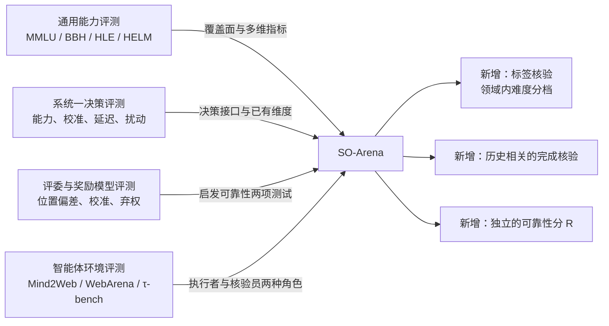
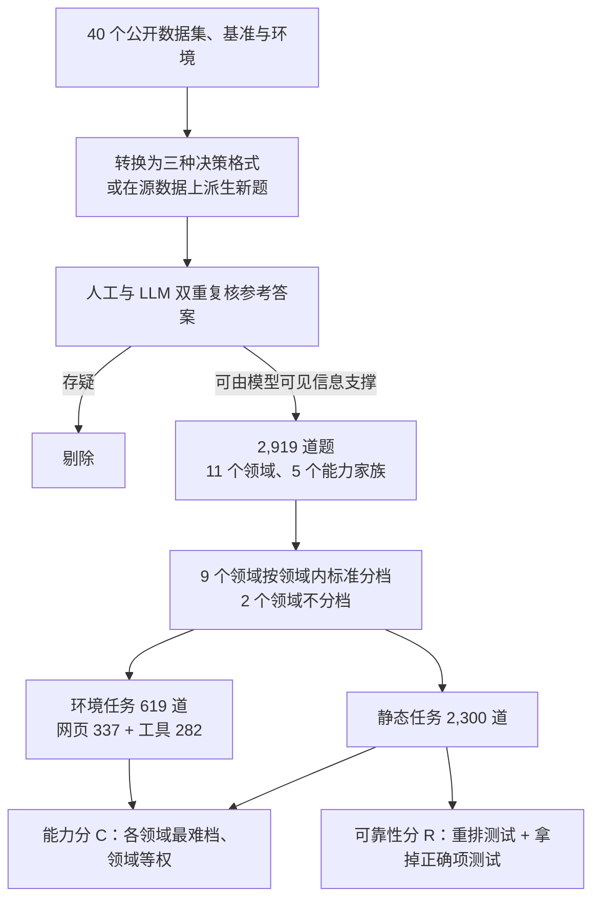
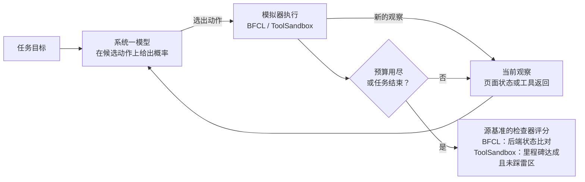
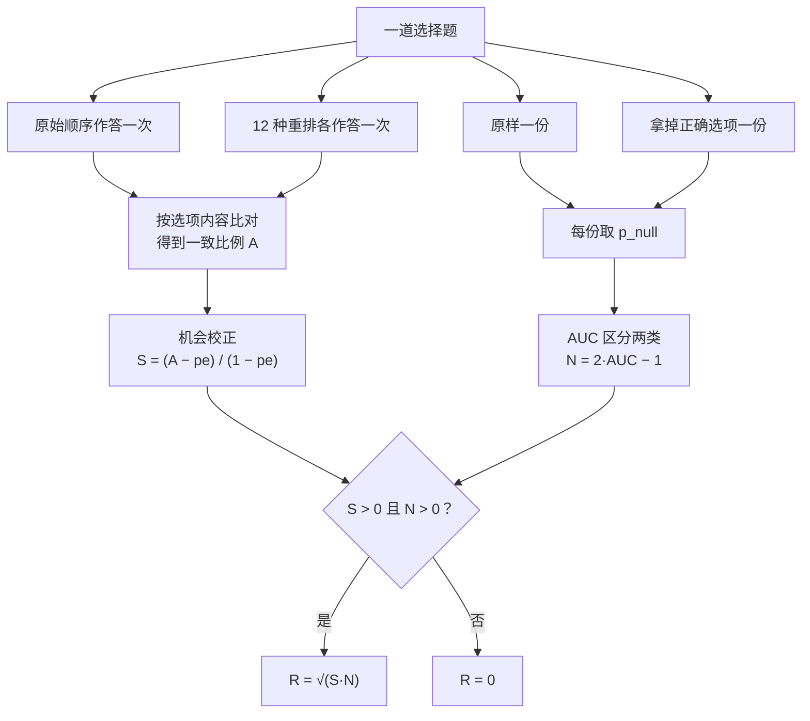
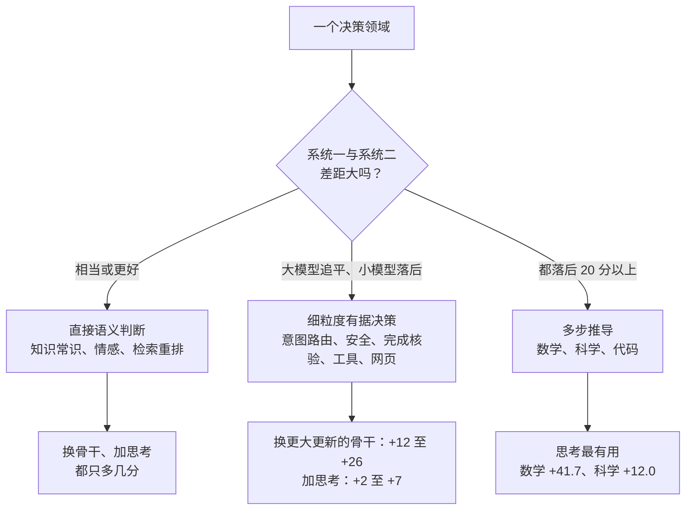

# SO-Arena：系统一决策模型的能力谱系与决策可靠性评测

> **原题**：SO-Arena: Benchmarking the Capability Spectrum and Reliability of System One Models
> **作者**：Lichen Li、Ziping Dong（共同一作）、Sicheng Feng、Qi Li、Xinchao Wang（通讯作者）
> **机构**：论文正文未列单位；通讯作者 Xinchao Wang 任职于新加坡国立大学（NUS）
> **年份**：2026（arxiv ID 2611.15777，2026-11-11 提交）
> **分类**：cs.CL / cs.AI / cs.LG
> **链接**：https://arxiv.org/abs/2611.15777
> **代码**：https://github.com/holdrain/SO-Arena
> **项目页**：https://lichenlillc.github.io/SO-Arena
> **精读日期**：2026-11-14

## 阅读须知

### 这篇在领域里的位置

过去两年里，大语言模型最显眼的进步来自「想得更久」。推理模型在给出答案之前，会先生成一长串思考用的 token，把题目一步步拆开，再落到结论上。这条路线在数学、代码与科学题上带来了很大的提升，代价则是推理延迟与 token 费用都成倍上涨。论文借用心理学家卡尼曼「快思考与慢思考」的说法，把这类先推理后作答的模型称为系统二模型。

然而，软件系统里有大量决策并不需要长篇推理。一个请求该路由到哪个下游服务、在几样工具里该选哪一样、一个任务到底做完没有、一段检索出来的文字与问题相不相关，这些决策的候选项事先都已列好，程序需要的是又快又稳、可以直接拿来用的结构化输出。于是近一年出现了一类专门的「系统一决策模型」：给它当前状态、决策目标与候选集合，它一次前向传播就在候选项上给出一个概率分布，不生成任何文字。

这一类模型的源头，是论文里反复提到的 Jev 决策接口服务，它最早把「给定选项、返回概率」做成了通用接口。随后出现了 Kev、JevAny、GLiDE、KnowLine 等开源实现，大多在 Qwen 系列开源骨干上改造而来，参数规模从不到 1B 到 31B 不等。

评测这一支也已经起步。已有的几个基准测过准确率、校准、延迟与成本，有的覆盖了十个应用领域，有的加入了难度分层与受控扰动。SO-Arena 位于这一步之后：它在前人基础上补上了四件事，即参考答案的人工核验、领域内部的难度分档、在网页与工具沙盒里的交互执行，以及把「决策可靠性」从准确率里单独拆出来打分。

### 读完能回答什么

1. 系统一决策模型与推理模型在接口和用途上有什么不同，为什么路由、选工具、核验任务是否完成这类决策适合交给前者
2. SO-Arena 的排行榜分数为什么只取每个领域最难的一档，又为什么让十一个领域等权
3. 「选项重排稳定性」S、「缺失正确项识别力」N 与合成可靠性 R 各自怎样计算，为什么要做机会校正，为什么用几何平均合成
4. 在哪些领域系统一模型已经追平推理模型，哪些领域的差距靠换更强的骨干就能缩小，哪些领域只有让模型先「想一想」才补得上
5. 为什么能力分高不等于决策可靠：选项顺序稳定性大体跟着能力走，而察觉「选项里根本没有正确答案」的能力却几乎必须单独测量

### 阅读前置

本文假定读者用过大语言模型的接口，知道多项选择题式评测是怎么回事，知道 logits 与 softmax 的含义，也知道推理模型会先输出思考过程再给答案。

本文不假定读者熟悉 ROC 曲线下面积、机会校正一致性这类评测统计量，也不假定读者熟悉 BFCL、Mind2Web 这些智能体评测。这些概念在正文第一次出现时都会先铺垫、再展开。

### 缩写表

- **System One / System Two**（系统一 / 系统二）：借自卡尼曼《思考，快与慢》。论文里，系统一指一次前向传播直接给出候选项概率的决策模型；系统二指先生成显式推理 token 再作答的推理模型
- **choice / noul / score**：Jev 式接口的三种输出格式，依次是多选一、是非判断（接口把是非题型命名为 noul）、有序打分
- **C(m)**：模型 m 的能力分，也就是排行榜分数，取值 0 到 100
- **S(m)**：选项顺序稳定性（option order stability），做过机会校正，0 表示与随机乱选一样，1 表示完全不受顺序影响
- **N(m)**：缺失正确项识别力（null discrimination），定义为 2·AUC − 1
- **R(m)**：可靠性分，S 与 N 的几何平均
- **ROC / AUC**（Receiver Operating Characteristic / Area Under the Curve）：ROC 曲线与曲线下面积，用来衡量一个打分能把两类样本分开到什么程度
- **CoT**（Chain-of-Thought，思维链）：先写出中间推理步骤再作答的做法
- **BFCL**（Berkeley Function Calling Leaderboard，伯克利函数调用排行榜）：带模拟后端的多轮工具调用评测
- **ToolSandbox**：带状态的工具使用评测，用「必须按序发生的里程碑」与「绝不能发生的雷区」打分
- **Mind2Web / BreakingWeb**：前者是真实网站上的网页操作演示数据，后者是七个模拟应用里的多步网页任务
- **GSM8K / MATH500 / AIME**：小学应用题、竞赛数学五百题、美国数学邀请赛真题，难度依次递增
- **GPQA Diamond**（Graduate-Level Google-Proof Q&A）：研究生水平、难以靠搜索作答的科学选择题，Diamond 是其中最难的子集
- **MMLU-Redux**：对 MMLU 多学科选择题做过人工复核、标出错题的版本
- **TREC DL**（TREC Deep Learning track）：经典的段落检索相关性评测
- **BM25**：基于词频的经典检索打分算法
- **H100**：英伟达的数据中心 GPU，论文所有本地延迟都在单张 H100 80 GB 上测

## 一、问题

把系统一模型放进生产系统，通常是让它做路由器、守门员或核验员。这几种角色有一个共同的危险：它一旦判断错了，错误会沉默地往下游传。路由错了，请求被送到错误的服务；核验员把没做完的任务判成已完成，智能体便提前收工；安全分类器漏判一条有害内容，后面没有人会再看一眼。聊天模型说错话，人眼还能当场看出来，而决策模型的错误往往要到很久以后才暴露。

于是工程师面对一个很实际的取舍。直接用推理模型，准确率高，但每一次决策都要等它想完，延迟与费用都高出一个数量级；改用系统一模型，单次决策在一张 H100 上不到 0.3 秒，可是不知道它在自己这一类决策上会掉多少分，也不知道它的选择稳不稳。要做这个取舍，需要一份能回答「在哪类决策上、掉多少、稳不稳」的评测。

已有评测在这里有几处不够用。第一，多数只报一个总准确率，强弱模型在简单题上都接近满分，差距被平均掉了。第二，源数据集的参考答案本身就有错，MMLU 的错题已有专门的复核工作记录在案，拿错答案打分会冤枉模型。

第三，多数评测只考静态判断，不考模型在网页或工具环境里一步步行动，而前一步错了会改变后一步看到的状态。第四，几乎没有评测单独考察可靠性：同一道题把选项换个顺序，模型会不会改答案；把正确选项拿掉，模型会不会察觉「这里没有对的」。

### 具体要解决的技术问题

论文先把「决策」形式化。一道决策题记为

$$x = (s, q, \mathcal{C})$$

- $s$ 是提供给模型的信息，可以是一段文字、结构化记录、检索出来的段落，也可以是一段交互历史
- $q$ 是决策目标，也就是这道题要模型判断什么
- $\mathcal{C} = \{c_1, \ldots, c_K\}$ 是允许的 K 个候选结果及其说明

模型返回候选项上的概率分布 $p_\theta(\cdot \mid x)$，每一项非负、加起来等于 1。这个分布可以来自专门训练的决策头，也可以直接从语言模型在答案 token 上的 logits 读出来。

输出格式有三种。多选一（choice）取概率最大的那一项作为预测；是非判断（noul）的结果空间只有「是」与「否」，模型返回「是」的概率；有序打分（score）的候选项是带等级的描述，例如一到五星，预测等级取概率最大那一档的等级。由于等级之间的语义距离未必相等，打分题只对「差一档」给有限的部分分，不按数值差计算误差。

在这个接口之上，论文要回答三个问题：模型在十一个领域、各个难度档上的能力如何；单次决策要多久；在受控改动候选集合时，模型的决策是否可靠。

### 前人的几条路线

第一条路线是通用能力评测，代表作是 MMLU、BIG-Bench Hard、Humanity's Last Exam 与 HELM。它们覆盖面广，HELM 还把校准与效率纳入了考量。与之相对地，它们考的是学科知识与解题，而不是「根据给定证据、在给定选项里做决定」这种工程场景里的判断。

第二条路线是专门针对系统一决策模型的评测。已有工作测过能力、校准、延迟与成本，有的覆盖十个应用领域并研究局部决策如何组合成智能体工作流，有的加入了难度分层与受控扰动。SO-Arena 直接承接这一条，它的增量在于领域内难度分档、历史相关的完成核验，以及单独的可靠性分。

第三条路线来自「让模型当评委」的研究。这方面的工作早已记录了位置偏差（答案放在第一个就更容易被选中）、长度偏差与自我偏好，RewardBench、JudgeBench、VerifyBench 则分别考察偏好判断、事实与逻辑正确性判断、答案与参考是否一致。位置偏差的发现，直接启发了 SO-Arena 的选项重排测试。

与此同时，校准研究区分了「准确率高」与「置信度可信」，选择性分类研究了「什么时候该弃权」。这两条线启发了 SO-Arena 的缺失正确项测试：一个可靠的决策者，在没有正确选项时应当表现出来。

第四条路线是智能体环境评测，包括 Mind2Web、WebArena、τ-bench 以及更新的 VerifierBench。它们考察的是执行任务、在策略约束下与工具交互、编写可执行的检查器。SO-Arena 把决策模型放在其中两个角色上：作为每一步从菜单里选动作的执行者，以及作为判断一段执行记录是否达成要求的核验员。

## 二、方法

SO-Arena 不是一个新模型，而是一套评测。它的「方法」由三部分组成：题目从哪里来、怎样组织成统一的决策题；能力分怎样计算；可靠性怎样测。下面按这个顺序展开。

### 题目来源与质量控制

题目取自 40 个公开数据集、基准与环境，典型来源包括情绪识别的 GoEmotions、数学的 MATH500、科学推理的 GPQA Diamond、网页交互的 Mind2Web，以及工具使用的 BFCL 与 ToolSandbox。有些题目直接转换格式，有些则是在源数据上派生出来的新题，例如在 BrowseComp-Plus 的历史搜索记录上出「子目标是否已被证据支持」的核验题。

质量控制的核心原则是：参考答案必须能由模型看得到的信息支撑。作者保留源数据的标签作参考答案，再用人工与大语言模型双重复核，把参考答案存疑的题目剔除。每道题都记录来源、版本与原始编号，凡参考答案由模型生成的，都在元数据里单独标出。附录还交代，全集里共有 18 条参考答案事后被订正，受影响的评测已经重跑或重新计分。

### 五个能力家族、十一个领域

2,919 道题分属五个能力家族、十一个领域。其中九个领域按各自领域的标准分出难度档，另外两个（情感与情绪理解、知识与常识）被认为难以系统地改变决策复杂度，因而不分档。需要强调的是，难度档只在领域内部有意义：数学的「难」与安全的「难」不是一回事，不能跨领域比较。

| 能力家族 | 领域 | 题数 | 分档依据（易 → 难） |
|---|---|---|---|
| 语义理解 | 情感与情绪理解 | 200 | 不分档 |
| 语义理解 | 意图与路由 | 300 | 单句意图判断 → 整段客服对话中追踪两个目标 → 在大型领域本体里挑出所有适用组件 |
| 知识与推理 | 数学 | 200 | GSM8K 按计算步数、MATH500 按等级，另设 AIME 极难档 30 题 |
| 知识与推理 | 代码理解 | 200 | 按代码规模、分支循环数与测试通过率分档，判断一段解法是否对所有合法输入都正确 |
| 知识与推理 | 科学推理 | 200 | ARC-Challenge → MMLU-Redux 自然科学 → GPQA Diamond |
| 知识与推理 | 知识与常识 | 200 | 不分档 |
| 安全与政策合规 | 安全 | 500 | 直接请求 → 意图被语境掩饰；直接规则匹配 → 多跳引用与相互牵制的例外条款 |
| 证据评估 | 检索与重排 | 300 | TREC DL → BRIGHT 与 Touché → ACORD 法律条款匹配 |
| 证据评估 | 任务完成核验 | 200 | 直接检查当前状态 → 整合有限的记录与证据 → 必须检查执行历史 |
| 智能体任务完成 | 工具与 API 使用 | 282 | BFCL 单步请求 → ToolSandbox 场景 → BFCL 多轮任务的首轮请求 |
| 智能体任务完成 | 文本网页交互 | 337 | Mind2Web 单步 → BreakingWeb 中档 → BreakingWeb 难档 |

### 开放答案的数学题怎样变成选择题

系统一模型只能在给定选项里挑，不能写出一个数字，因此开放答案的数学题必须先改成选择题。作者给每道题配三个干扰项，200 道题共 600 个。其中 350 个取自一个小型基座模型（Qwen3.5-4B-Base）在不推理的情况下采样 16 次得到的错误答案，22 个取自 GSM8K 标准解法里的中间结果，其余 228 个是按规则构造的「差一点就对」的数值。

选项按数值大小排序，正确答案出现的位置在全集上做了平衡。凡是选项有重复、标签存疑，或者光看选项就能猜出正确答案的题目，一律剔除。这样做的目的，是让干扰项尽量像「模型真会犯的错」，而不是一眼能排除的离谱数字。

### 静态任务与环境任务

静态任务里，模型面对一个固定的输入作答。多项选择题照原样使用，分类任务把源数据的标签列成选项，多标签任务拆成每个候选标签各一道是非题，打分题保留源数据的原生量表。凡是需要自由文本作答的源任务，一律不收。

环境任务里，模型面对的是网页或工具环境的当前观察，任务目标给定，它要么评估一个动作，要么从候选动作中选一个。单步网页任务只看一个录下来的页面状态，判断某个动作是否推进了目标，或者从四个动作里选出最好的那个，干扰项取自同一页面上的其他控件。

多步网页任务要求模型沿着一条经回放验证可以完成任务的参考路线，在每一个录下来的状态上做决定。如果模型走了另一种顺序或无害的绕路，只要回放证明仍然能完成，同样算对。填写一个字段时，模型先选字段，候选值超过 64 个时再选分组，最后选出确切的值，这样一个大菜单就被拆成了几次小决策。

工具任务则是真正的交互：BFCL 或 ToolSandbox 的模拟器执行模型选出的动作，把结果作为下一步的观察返回给模型。每个回合有决策次数与工具调用次数的预算，BFCL 难档的上限是 96 次决策、12 次调用；超出时间、内存或输出限制的工具调用返回错误且不产生任何效果。回合结束后用源基准自己的检查器打分，预算耗尽的回合照常评分。

全集最终包括 2,300 道静态任务与 619 道环境任务。后者含 337 道网页任务（100 道单步判断、237 道参考路线任务）与 282 个工具使用回合。

### 历史相关的完成核验

这是整套评测里设计得最用心的一部分，值得单独讲。它要考的是一种很隐蔽的失误：只看最终状态的核验员，会被「结局一样、过程不同」的执行记录骗过去。

作者在 VirtualHome 家居模拟环境里先跑通五个基础任务，然后在每条成功的执行记录后面追加一段「审计后缀」。这段后缀会改变电器的开关状态，把两件目标物品挪走，再视情况一件不放、放回一件或两件都放回原位。于是一条记录完全可能在结尾时物品都在该在的位置，可在中间某次打开电器的那一刻，物品其实并不在位。

模型要判断三个条件。C1 要求后缀里至少有一次「打开」动作，并检查每一次打开之前所有物品是否都已就位；C2 要求后缀里至少有一次「关上」动作，并检查第一次关上之前物品是否就位；C3 只检查最后一步之后所有原始目标是否成立。三个条件组成一个三位的真假组合，题目给出四个组合供选，每个干扰项恰好把正确组合翻转一位。

关键在于反事实对照。对每条参与评测的记录，作者都另外验证了一条「反事实见证」：它到达完全相同的最终状态，C1 或 C2 的真假却不同。换句话说，光看结局是不可能答对的，模型必须真的去看执行历史。这一档共 20 题，每个条件在其中恰好一半为真。

### 能力分 C：只取最难档、领域等权

排行榜分数以原始任务为计分单位。记 $c_i(m) \in [0, 1]$ 为模型 m 在任务 i 上得到的分数，$\mathcal{T}_d$ 为领域 d 用于排行榜的任务集合，D 为领域数，则

$$C(m) = \frac{100}{D} \sum_{d=1}^{D} \frac{1}{|\mathcal{T}_d|} \sum_{i \in \mathcal{T}_d} c_i(m)$$

$\mathcal{T}_d$ 的取法是这个公式的要点：分档领域只取最难的一档，数学取难档与极难档两档，不分档领域取全部题目。之所以只看最难档，是因为强弱模型在简单档上往往都接近满分，把简单题算进去只会把差距冲淡。

之所以领域等权，是因为各领域题数相差很大，安全领域有 500 题，而数学只有 200 题。若按题数加权，排行榜就会变成「安全分类排行榜」。等权之后，十一个领域各占总分的十一分之一。

### 可靠性：重排稳定性 S

一个可靠的决策者，不应因为选项换了个顺序就改变答案。作者把每道题按原始顺序出一次，再按 12 种不同顺序各出一次，并按选项的内容而不是位置来识别模型选了什么。记 $A(m)$ 为模型在这 12 次重排中保持原答案的比例，再做机会校正：

$$S(m) = \frac{A(m) - p_e}{1 - p_e}, \qquad p_e = \frac{1}{M} \sum_{i=1}^{M} \frac{1}{K_i}$$

- $M$ 是参与测试的题数，共 939 题
- $K_i$ 是第 i 题的选项数，$p_e$ 就是一个完全随机乱选的模型「碰巧保持一致」的期望比例

机会校正的意义在于：二选一的题，随机乱选也有一半概率前后一致，直接报 $A$ 会让二选一题多的模型显得更稳。校正之后，随机乱选得 0 分，完全一致得 1 分。需要注意，S 衡量的只是一致性，不是正确性：一个每次都坚定地选错的模型，S 也可以是 1。

### 可靠性：缺失正确项识别力 N

一个可靠的决策者，在所有选项都不对时，应当表现出「这里没有正确答案」。作者把每道题出两份：一份原样，一份把正确选项拿掉。对每一份，从模型那里得到一个「选项里没有正确答案」的概率 $p_{\text{null}} = 1 - p(\text{inc})$，其中 $p(\text{inc})$ 是模型估计「至少有一个正确选项在列」的概率。对于自带「无正确答案」输出的模型，例如 StartLux Instant，则直接用它自己的这一输出。

接下来要问：$p_{\text{null}}$ 能不能把「拿掉正确项的那一份」和「原样的那一份」分开？衡量这件事的标准工具是 ROC 曲线下面积 AUC。AUC 的直观含义是：随机抽一份缺正确项的、再随机抽一份不缺的，前者 $p_{\text{null}}$ 更高的概率，平局算一半。论文把它线性变换为

$$N(m) = 2 \cdot \text{AUC}(m) - 1$$

于是 N 在随机水平时为 0，完美区分时为 1。这一测试共用 597 道题。

### 合成可靠性 R

两项合成一个可靠性分，用的是几何平均，并且只有两项都高于随机水平时才给正分：

$$R(m) = \begin{cases} \sqrt{S(m) \cdot N(m)}, & S(m) > 0 \text{ 且 } N(m) > 0 \\ 0, & \text{其他} \end{cases}$$

之所以用几何平均而不用算术平均，是因为两项缺一不可。算术平均允许「很稳但完全察觉不到缺项」的模型靠稳定性把分数拉上来，几何平均则让任何一项接近零时总分也接近零。

### 21 个被测模型与延迟测法

被测模型共 21 个：16 个开源权重的系统一模型，参数从 0.4B 到 31B；1 个会按请求自动决定是否思考的模型 StartLux Auto；2 个闭源决策接口 Jev API 1.14 与 OpenAI Decisions；以及 2 个闭源系统二参照 GPT-6 Sol 与 GPT-6 Luna，都设为中等推理强度。每个模型都按开发者文档的设置运行，只有两处例外：Laya 官方包会把每个选项截断到 48 个 token，评测时取消了这一截断；SII-4B 在延迟与可靠性测试里额外启用了 flash-linear-attention。

延迟在 1,109 道单问题选择题上测量，覆盖七个静态领域的全部难度档。每个模型独占一张 H100，一次只处理一个请求，计时从请求交给模型的官方入口开始，到选项概率回到主机为止，因此包含分词时间，对以服务形式运行的模型还包含本地 HTTP 往返。正式计时前先空跑一遍全集热身，再计时三遍取平均。闭源接口无法在同一硬件上计时，只能报端到端时间，其中包括网络与服务商的排队。

## 三、实验

### 排行榜与延迟

下表把正文表 2 的总分与附录表 5 的平均延迟合在一起，按能力分从高到低排列。延迟一栏只对本地运行的开源模型有意义，闭源接口标为「接口」。

| 模型 | 规模 | 类型 | 能力分 C | 平均延迟（毫秒） |
|---|---|---|---|---|
| GPT-6 Sol | 未公开 | 系统二参照 | 82.3 | 接口 |
| GPT-6 Luna | 未公开 | 系统二参照 | 79.7 | 接口 |
| KnowLine-31B | 31B | 系统一 | 70.2 | 177 |
| GLiDE | 27B | 系统一 | 70.2 | 113 |
| Sieve-31B-v3 | 31B | 系统一 | 67.7 | 265 |
| Decider-27B | 27B | 系统一 | 66.7 | 153 |
| Kev-27B | 27B | 系统一 | 61.4 | 90.3 |
| Jev API 1.14 | 未公开 | 系统一接口 | 60.4 | 接口 |
| StartLux Instant | 4B | 系统一 | 59.0 | 35.1 |
| StartLux Auto | 4B | 自动思考 | 58.6 | 3,084 |
| JevAny-27B | 27B | 系统一 | 58.4 | 93.9 |
| Clef-27B | 27B | 系统一 | 56.9 | 108 |
| H2O Lightning | 4B | 系统一 | 54.9 | 26.5 |
| OpenAI Decisions | 未公开 | 系统一接口 | 53.6 | 接口 |
| Decider Flash | 4B | 系统一 | 52.0 | 39.8 |
| Clef-Flash-9B | 9B | 系统一 | 51.6 | 53.5 |
| Jeva-4B | 4B | 系统一 | 51.6 | 60.9（选项缓存热）/ 79.0（冷） |
| JevAny-4B | 4B | 系统一 | 50.9 | 25.2 |
| SII-4B | 4B | 系统一 | 48.0 | 40.6（启用 fla） |
| Kev-4B | 4B | 系统一 | 46.1 | 25.2 |
| Laya | 0.4B | 系统一 | 30.9 | 6.0 |

两个系统二参照仍然领先：最强的系统一模型 GLiDE 与 KnowLine-31B 比 GPT-6 Luna 低约 9.5 分，比 Sol 低约 12 分。作为交换，所有纯系统一的开源模型平均每题都在 0.3 秒以内作答，论文称比两个 GPT-6 参照快几十倍。

StartLux Auto 是一个有意思的对照。它与 StartLux Instant 同为 4B，能力分却几乎一样（58.6 对 59.0），而平均延迟从 35 毫秒涨到 3 秒，99 分位更长达 21.9 秒。这说明「让模型自己决定要不要想」并没有在总分上换来回报，原因在下文的分领域分析里可以看到：思考只在少数领域有用。

### 最难档上的分化

总分把十一个领域揉在一起，看不出模型在哪里掉分。下表摘出几个代表模型在推理类与智能体类领域最难一档上的分数，单位是百分制。

| 模型 | 数学极难档（AIME） | 代码难档 | 科学难档（GPQA） | 完成核验难档 | 工具难档 | 网页难档 |
|---|---|---|---|---|---|---|
| GPT-6 Sol | 100 | 93 | 91 | 100 | 66 | 53 |
| GPT-6 Luna | 97 | 86 | 88 | 100 | 68 | 48 |
| GLiDE | 30 | 57 | 55 | 100 | 65 | 49 |
| KnowLine-31B | 40 | 67 | 52 | 90 | 56 | 44 |
| Jev API 1.14 | 30 | 59 | 71 | 20 | 59 | 41 |
| StartLux Instant | 40 | 56 | 46 | 55 | 54 | 31 |
| StartLux Auto | 47 | 54 | 51 | 35 | 46 | 31 |
| Laya | 20 | 51 | 24 | 30 | 0 | 2 |

有三点值得看。其一，AIME 档是四选一，随机猜也有 25 分，而最强的系统一模型只有 30 到 40 分，几乎贴着随机水平；系统二参照则接近满分。其二，网页难档对所有人都难，连 GPT-6 Sol 也只有 53 分，GLiDE 的 49 分与之相差无几。

其三，完成核验难档的分化最为剧烈：GLiDE 与两个系统二参照都是满分，Jev API 1.14 只有 20 分，比随机猜还低。这一档只有 20 题，下文「局限」一节会回头讨论它对排行榜的影响。

### 系统一在哪些领域追平系统二

为了看清差距落在哪里，作者拿 GPT-6 Luna 与两个系统一模型逐领域比较：4B 档最强的 StartLux Instant 与 27B 档最强的 GLiDE。这一分析用的是各分档领域的中档与难档，加上两个不分档领域的全部题目，共 2,061 题，差值附有按题目自助抽样得到的 95% 置信区间。

与此同时，作者量了两种「增益」。骨干增益比较同一家族的小号与大号模型：四个家族的小号都基于 Qwen3.5，大号都基于更新的 Qwen3.8-27B，取四个家族的平均。思考增益则比较 StartLux Auto 在「始终思考」与「从不思考」两种模式下的分数。

| 领域 | Luna 分数 | GLiDE 与 Luna 之差 | StartLux Instant 与 Luna 之差 | 骨干增益 | 思考增益 |
|---|---|---|---|---|---|
| 知识与常识 | 90.0 | +5.0 [+1.5, +9.0] | −1.5 | +4.4 | +3.0 |
| 情感与情绪 | 84.8 | +4.8 [+1.2, +8.5] | +3.0 | +3.4 | −2.2 |
| 检索与重排 | 76.5 | −5.8 [−11.2, −0.2] | −8.2 | +3.9 | +1.8 |
| 意图与路由 | 79.5 | +0.1 | −8.9 | +12.0 | +2.0 |
| 安全 | 75.2 | +4.0 | −7.1 | +16.2 | +3.4 |
| 任务完成核验 | 98.2 | +0.9 | −22.9 | +17.4 | +7.3 |
| 工具与 API 使用 | 75.8 | −3.6 | −11.2 | +25.6 | +2.6 |
| 文本网页交互 | 64.4 | +3.1 | −28.8 | +23.9 | +1.8 |
| 数学 | 100.0 | −26.7 | −38.3 | +14.4 | +41.7 |
| 科学推理 | 91.3 | −21.3 | −27.3 | +8.3 | +12.0 |
| 代码理解 | 88.6 | −25.7 | −26.4 | +7.7 | +5.7 |

根据这张表，作者把十一个领域分成三类。

第一类是直接语义判断，包括知识与常识、情感与情绪、检索与重排。这里系统一模型与 Luna 相当，甚至更好：GLiDE 在知识与常识、情感两个领域高出约 5 分，置信区间都在零以上。换更强的骨干或让模型思考，在这一类上都只多出几分。

第二类是细粒度的有据决策，包括意图与路由、安全、任务完成核验、工具使用与网页交互。这里 GLiDE 与 Luna 的差距都在 4 分以内，而 StartLux Instant 最多落后 29 分。换上更大、更新的骨干带来 12 到 26 分的提升，远大于思考带来的 2 到 7 分。换句话说，这一类的瓶颈是模型「懂不懂」，而不是「想没想」。

第三类是多步推导，包括数学、科学推理与代码理解。这里两个系统一模型都落后 Luna 20 分以上。思考在数学上的作用最为惊人：StartLux Auto 从「从不思考」的 50.8 分升到「始终思考」的 92.5 分，几乎追平 Luna；在科学推理上也有 12 分。这与先前「思维链主要在数学与符号推理上起作用」的发现一致。

### 可靠性结果

可靠性在 18 个系统一模型上测量，即 16 个开源模型与 2 个系统一接口，不含 StartLux Auto 与两个系统二参照。

先看重排稳定性 S。18 个模型里有 14 个高于 0.8。其中 Jeva-4B 的 S 等于 1 是结构决定的：它把每个选项单独编码，选项顺序根本影响不到它的打分。其余 13 个落在 0.83 到 0.94 之间。对顺序敏感的有四个：Laya 只有 0.35，SII-4B、Kev-4B 与 OpenAI Decisions 在 0.68 到 0.72 之间。

再看缺失正确项识别力 N。它的分布宽得多，从接近随机到约 0.8。规模并不能单独决定它：同一家族里大号的 N 确实都高于小号，可某些 4B 模型的 N 却高过某些 9B 和 27B 模型。

两者合成的 R 排名与能力排名明显错位。R 最高的两个模型是 JevAny-27B 与 Jev API 1.14，它们在 18 个系统一模型的能力排名中分别只排第八和第六。反过来，能力分最高的系统一模型，在可靠性上只排第七。

### 可靠性由什么决定

作者分别把 S 与 N 对能力分做二次曲线拟合，看能力能解释多少。S 大体跟着能力走，多数模型都贴近趋势线，覆盖九成模型的带宽半宽只有 0.07。翻转率进一步说明了原因：模型在原本答错的题上改答案的频率，远高于在原本答对的题上。换句话说，不稳定主要出现在模型本来就不会的地方。

N 与能力的关系则松散得多，同样口径下的带宽半宽达到 0.18。Kev-27B、Jev API 1.14 与 JevAny-27B 三个模型的 N，都高过能力分最高的四个系统一模型（GLiDE、KnowLine-31B、Sieve-31B-v3、Decider-27B），十二组两两比较的差值置信区间全部在零以上。作者由此得出全文最重要的结论：能力分能说明一个模型的选项顺序稳定性，却几乎说明不了它能否察觉「没有正确答案」，后者必须直接测。

### 值得单独拎出来的几个结果

第一，思考并非处处有益。在情感与情绪领域，StartLux Auto 始终思考反而比从不思考低 2.2 分。附录的「只看难档」分析里，任务完成核验难档的思考增益更是从 +7.3 变成了 −15.0，尽管这一档只有 20 题，结论不宜外推。

第二，检索与重排虽然被归入「系统一与系统二相当」的第一类，但 GLiDE 实际落后 Luna 5.8 分，置信区间 [−11.2, −0.2] 并不跨零。严格说，这一领域的差距小但存在，归类时被作者放宽了。

第三，闭源决策接口会拒答。OpenAI Decisions 拒绝了 4 道静态题与 12 个环境回合，多数出现在安全领域，因为这些题的上下文里本身就带有有害内容与「绕过安全限制」的指令，尽管评测只是让它做分类。它还在病人门户、学习管理系统与 Reddit 的网页任务里拒绝了 6 次填值请求，可能因为页面上有诊断与疫苗接种记录。按规则，拒答一律计零分。对于想把这类接口用作安全分类器的工程师，这是一个很实际的提醒。

第四，Laya 在 30 道网页任务上因为输入超过它 8,192 token 的上下文窗口而直接得零分，这部分解释了它在网页难档只有 2 分。作者没有截断输入去迁就它，这是评测口径上的一个合理选择。

## 四、局限

### 作者承认的

论文没有单独的局限一节，但正文与附录里交代了不少适用边界，这里把它们集中列出。

难度档只在领域内部定义，没有跨领域校准。正文与图注反复提醒，数学的难档与安全的难档不可直接比较，因此「系统一模型在难档上下降」这句话，在不同领域里的含义并不相同。

任务完成核验的难档只有 20 题。附录承认，只看难档时，这一领域的骨干增益从 17.4 分落到 3.8 分，思考增益从 +7.3 变为 −15.0，意图与路由的骨干增益也从 12.0 降到 4.9。小样本让这些结论的稳定性有限。

部分参考答案由模型生成，例如 BrowseComp-Plus 核验题的新标注，作者在元数据里做了标注；全集还有 18 条参考答案事后被订正。情感打分与情绪标签本身存在歧义，所以这部分分数应理解为与评分者、标注者的一致程度，而不是绝对的对错。

能力评分与延迟、可靠性测试是两次独立运行。在 939 道重排测试题的原始顺序上，两次运行对多数开源模型给出相同分数的题目在 907 到 938 道之间，但 StartLux Auto 因为思考是采样得到的，一致题数降到 875。闭源接口的延迟包含网络与排队，不能与本地 H100 上的数字直接比较。同一查询下的检索对彼此不独立，置信区间会因此偏窄。

### 读完能看出来的

第一，「系统二」这一端只有同一家厂商的两个闭源模型，而且都设在中等推理强度。全文的核心叙事是「系统一离系统二还有多远」，可这把尺子的另一端完全由一个厂商、一种推理设置来定义，没有开源推理模型，也没有高推理强度的对照。

第二，骨干增益把两件事混在了一起。四个家族的小号都基于 Qwen3.5，大号都基于更新的 Qwen3.8-27B，所以「大号比小号强多少」同时包含了参数变大与骨干换代两个因素。论文把它称作「更大、更新的骨干」，措辞上没有回避，但读者不能把它当作纯粹的规模效应。

第三，思考增益只在一个 4B 模型上测量。StartLux Auto 的结果很有启发，可是更大的系统一模型加上思考会怎样，这篇论文没有回答。

第四，「只取最难档、领域等权」的设计放大了小样本领域的权重。完成核验难档只有 20 题，每题约占这一领域的 5 分，折算到总分约 0.45 分。GLiDE 在这一档得 100 分，Jev API 1.14 得 20 分，两者在这一项上的差距就折合总分约 7 分，占了二者总分差距 9.8 分的大半。排行榜上的名次因此对这 20 道题相当敏感。

第五，开放答案的数学题改成四选一之后，AIME 档多数系统一模型落在 25 分的随机水平附近，这一档对系统一模型几乎没有区分度。与此同时，选择题形式对系统二模型偏于宽松，因为推理模型可以把选项逐一代回去验证，这与它在开放作答时的真实难度并不相同。

第六，缺失正确项测试里，多数模型的 $p_{\text{null}}$ 来自额外的一道是非题：「选项里有没有正确答案」。这测的其实是模型回答另一道题的能力，不完全等同于它在原题上会主动弃权。对于自带「无正确答案」输出的两个模型，作者在两种方式里挑了区分得更好的那一种，这个选择对它们略有利。

第七，可靠性只测了两种扰动，即重排与拿掉正确项，没有测选项措辞改写、增加干扰项、上下文里混入无关噪声，也没有测校准。系统一接口输出的本来就是概率，下游程序往往直接拿概率设阈值，概率本身是否可信，是工程上同样关心的一项可靠性。

第八，全部题目取自 40 个公开数据集，许多已经公开多年，论文没有讨论被测模型的训练数据是否覆盖了这些来源。延迟也只按单请求逐条测量，没有测批量吞吐与单位成本，而系统一模型在生产里往往正是高并发、批处理的用法。

## 一句话

SO-Arena 用分档决策题测 21 个模型：系统一模型快几十倍、语义判断追平推理模型，但能力强不等于能察觉没有正确选项。
