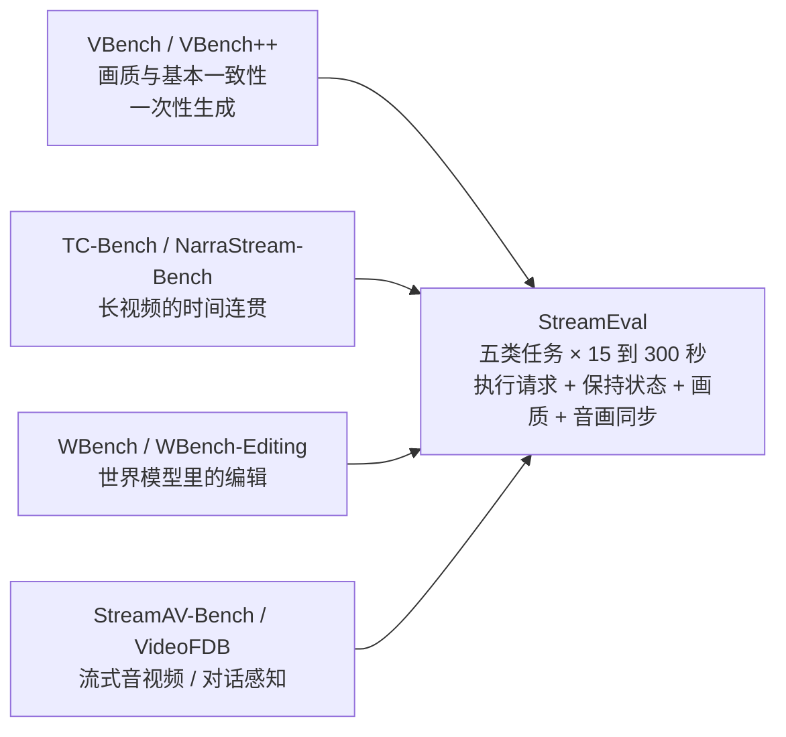
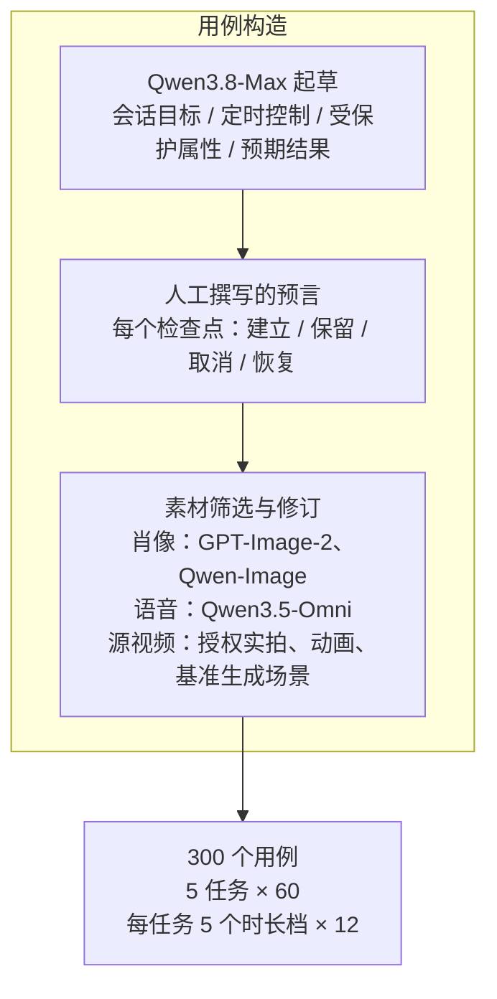
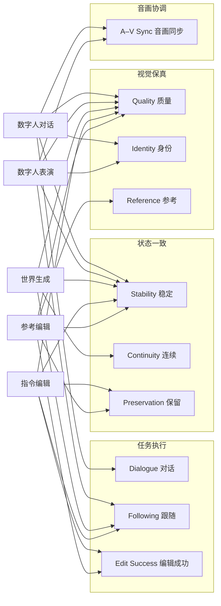
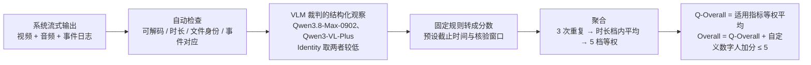

# StreamEval：评测可交互的流式视频生成模型

> **原题**：StreamEval: Evaluating Interactive Streaming Video Generation Models
> **作者**：StreamEval Team（论文署名为团队名，未列个人作者）
> **机构**：未在摘要页标明；评测用的裁判模型与素材生成模型均为通义千问系列（Qwen3.8-Max、Qwen3-VL-Plus、Qwen3.5-Omni、Qwen3-ASR）
> **年份**：2026（arxiv ID 2610.28402，2026 年 10 月 20 日提交）
> **分类**：cs.CV
> **链接**：https://arxiv.org/abs/2610.28402
> **精读日期**：2026-10-22

## 阅读须知

### 这篇在领域里的位置

视频生成这个方向在过去三年经历了两次重心转移。第一次是从「生成一段几秒钟的短片」转向「生成更长、更连贯的视频」，相应地出现了 VBench、VBench++ 这一类衡量画质与基本一致性的评测，以及 TC-Bench、NarraStream-Bench 这一类专门考察时间维度行为的评测。第二次转移发生在最近一年：生成不再是一次性的离线过程，而是逐帧或逐段地流式产出，并且允许用户在生成进行当中插入新的请求，比如让数字人回答一句新问的话、让世界模型里的镜头向左转、让正在播放的视频里的某件衣服换成参考图里的样子。这类系统通常被称为可交互的流式视频生成，它的核心难点不再只是「画得好不好」，而是「能不能在正确的时间执行正确的请求，同时不把先前建立起来的内容和状态弄丢」。

这篇论文的位置就在第二次转移的评测端。此前已经有一些零散的尝试，比如 WBench 与 WBench-Editing 关注世界模型里的编辑，StreamAV-Bench 关注 180 秒长度的流式音视频，VideoFDB 关注对话场景下的感知，但没有一个评测把「执行请求」和「保持状态」这两件事放到同一个框架下，跨越多种任务和多种时长去统一衡量。StreamEval 要填的就是这个空。它本身不提出新的生成模型，它提出的是一套考题和一套判分规则，然后用这套规则把目前能找到的 37 个系统都考了一遍。

### 读完能回答什么

读完这份笔记之后，读者应当能回答下面几个问题：

1. 可交互的流式视频生成与普通的视频生成在评测上有什么本质区别，为什么画质指标不够用。
2. StreamEval 的 300 个测试用例是怎么构造出来的，一个用例里具体包含哪些东西。
3. 四个评测维度和十个任务专属指标分别衡量什么，分数是怎样从视觉语言模型的判断变成 0 到 100 的数字的。
4. 目前最好的系统在五类任务上各自做到了什么程度，哪一类能力普遍最弱。
5. 这套评测自己承认的短板在哪里，拿它的分数做决策时要留多少余地。

### 阅读前置

假定读者熟悉扩散模型或自回归模型生成视频的基本流程，知道什么是视觉语言模型以及用模型当裁判的做法，但不必做过数字人、世界模型或视频编辑的具体工作。涉及这些子方向的术语，正文会在第一次出现时先解释。

### 首次出现的缩写表

- **VLM**（Vision-Language Model，视觉语言模型）：既能看图或看视频、又能用文字作答的模型，这篇论文用它来当裁判。
- **ASR**（Automatic Speech Recognition，自动语音识别）：把语音转成文字的技术，论文用它来核对合成语音是否清楚。
- **A–V Sync**（Audio–Visual Synchronization，音画同步）：说话时嘴型开合与声音包络是否对得上。
- **WER**（Word Error Rate，词错误率）：语音识别结果与原文相比错了多少词的比例，论文要求合成语音的 WER 不超过 0.25。
- **Q-Overall**（Quality-Overall，质量总分）：一个任务下所有适用指标的等权平均。
- **Overall**（总分）：Q-Overall 加上一个最多 5 分的「支持自定义数字人」加分。

## 一、问题

先说这个问题为什么值得做。过去一年里，几家公司和若干开源项目相继推出了可以边生成边互动的视频系统：有的做数字人，用户说一句话，数字人实时回答并配上嘴型和表情；有的做世界模型，用户给出「向前走、镜头右转、天黑下来」这样的连续控制，系统持续生成对应的场景；有的做直播编辑，视频一边播放，用户一边下达「把这个人的外套换成红色」这样的指令，或者递上一张参考图要求换成那个样子。这些系统的宣传往往集中在画面有多真实、人物长得有多稳定。可是从用户的角度看，一个数字人画得再好，如果问它问题它答非所问，或者答得太晚；一个世界模型画面再精美，如果让镜头右转它却不动，或者转过去之后先前放在桌上的杯子不见了；一个编辑系统换装效果再漂亮，如果把不该动的背景一起改了，或者用户说「撤销」之后它恢复不回原样，那么这些系统都不能算真正可用。换句话说，可交互生成的价值在于「听话」和「记性」，而现有评测几乎只量「好看」。

于是这篇论文把问题重新定义成：给定一段预先写好的互动脚本，脚本里规定了初始素材、陆续到达的多模态请求、每个时间点应当发生的状态变化和应当保留的内容，一个流式生成系统在这场 15 到 300 秒的互动里，到底有多大比例的请求被按时、按要求执行了，先前的内容和状态又保住了多少。画质和音画同步仍然要量，但它们只是四个维度中的两个。

前人在这个方向上的工作大致分成四路。第一路是通用视频生成评测，以 VBench 和 VBench++ 为代表，它们把画质拆成若干可自动计算的子项，但假定视频是一次性生成、没有外部干预的。第二路专门量时间维度，比如 TC-Bench 和 NarraStream-Bench，关注长视频里前后是否连贯，仍然不涉及中途到达的请求。第三路是面向世界模型的 WBench 与 WBench-Editing，开始考察「让场景发生某种变化」，但局限在世界生成这一类任务。第四路是 StreamAV-Bench 和 VideoFDB，前者看 180 秒的流式音视频，后者看对话场景下模型能不能感知到用户，它们各自覆盖一个任务。StreamEval 与它们的关系可以画成下面这张图：

这张图的意思是，StreamEval 不是推翻前面几路，而是把它们各自关心的那一项要求，放进同一场互动脚本里一起考。

## 二、方法

StreamEval 的方法可以分成三层来理解：先是测试用例长什么样、怎么造出来；然后是五类任务和四个维度、十个指标分别量什么；最后是分数怎样从模型裁判的观察变成可比较的数字。

### 2.1 一个测试用例里有什么

每个测试用例是一份脚本化的互动过程，时长从 15 秒到 300 秒不等。脚本规定三样东西：初始素材，比如一张数字人的肖像、一段人物设定、一段源视频；陆续到达的请求，可能是一句语音、一行文字或一张参考图，每个请求带有到达时间；以及明确的要求，分成两类，一类是「要建立什么状态」，另一类是「要保留什么内容」。论文把每个检查点上应当建立、保留、取消或恢复的内容称为一份「预言」（oracle），判分时就拿系统的输出去对照这份预言。

全部 300 个用例平均分到五类任务，每类 60 个；每类之内再按 15、30、60、120、300 秒五个时长档各放 12 个。聚合分数时五个时长档权重相等，而不是按时长加权，这样一个系统不会因为长视频做得好或坏而被过度放大。300 个用例一共覆盖 240 个相互独立的「源家族」，另有 60 个纯文本对话的变体复用已有家族。所有视频类用例加起来要求系统真正流式生成 525 分钟。脚本里一共写了 1,347 个在线事件，不含初始化和源视频的连续帧；论文在其中 200 个用例上做过统计，共 562 个在线事件，输入类型涵盖语音、文字和视觉参考，每个输入往往同时带着多项执行要求和保留要求。

构造过程值得单独说一说，因为它决定了这套评测的可信度。起草由 Qwen3.8-Max 完成，它给出会话目标、带时间戳的控制指令、需要保护的属性和预期结果；随后由人工写出每个检查点的预言；最后，媒体输入要按这些要求筛选和修订。数字人与世界场景的肖像由 GPT-Image-2 和 Qwen-Image 合成，表情丰富的语音由 Qwen3.5-Omni 生成，人物设定与经过核实的事实配对；直播编辑的源视频来自授权的真实拍摄、动画和基准自身生成的场景，具体来源包括 Wikimedia Commons、NASA 和 Blender Studio。为了保证素材本身没有问题，所有合成语音都经 Qwen3-ASR 转写并要求 WER 不超过 0.25，图像由 Qwen3.8-Max 审查主体是否清晰、有没有解剖或渲染缺陷，编辑源视频则检查有没有镜头切换、画面冻结和不合适的目标。用例在功能上覆盖三种形态：单个操作、组合请求，以及「出错后恢复」的场景。数字人的风格横跨写实、风格化三维、动漫、黏土和定格动画；对话语音包含干净语音、带背景噪声和带混响的三种；编辑场景包含室内与室外、单目标与多目标。

### 2.2 五类任务

五类任务的划分对应五种实际产品形态。数字人对话要求数字人根据用户说的话作出符合上下文的回答，同时保持人物设定和对话历史。数字人表演不要求它自己想台词，而是按脚本念出规定的话并做出规定的视觉动作，比如看向某处、做某个手势。世界生成要求系统在连续到来的控制下让场景演化，同时不改动与控制无关的内容。指令编辑是在一段不断向前播放的源视频上，按文字指令做出改动，并且满足保留要求。参考编辑则是按一张参考图改变外观，同时保留非目标内容和源视频原有的运动。

### 2.3 四个维度与十个指标

四个维度是任务执行、状态一致、视觉保真和音画协调。它们不是直接打分的对象，而是十个具体指标的归类。每个任务只用其中适用的指标，所有指标都映射到 0 到 100。

两个指标是所有任务共用的。Quality（质量）把输出切成五秒一段，每段由裁判评定缺陷等级：没有缺陷记 5，一个轻微缺陷记 4，多个轻微缺陷记 3，一个严重缺陷记 2，多个严重缺陷记 1；等级 r 映射成分数 25(r−1)，于是 5 对应 100、1 对应 0。Stability（稳定）量的是时间上保持一致、并且 Quality 不低于 3 的片段覆盖了多长的时长，它被 Quality 门控，也就是说画面本身不及格的片段不算稳定。

对话任务用 Dialogue（对话）衡量计划中的轮次里有多少轮同时满足回答、内容、对话性和时机四项要求，用 Identity（身份）衡量数字人是不是一直是同一个人。Identity 的判法是把初始化肖像（对于只能用自带形象的系统，则用该系统自己的开场帧）与采样出来的输出帧交给两个裁判，分别是 Qwen3.8-Max-0902 和 Qwen3-VL-Plus，取两者中较低的那个评级：明显换了人或有三处以上明显的特征变化记 1，两处明显变化记 2，一处明显变化或三处以上轻微变化记 3，一到两处轻微变化记 4，没有变化记 5，同样映射成 25(r−1)；裁判拿不准是不是同一个人时，评级封顶在 3。A–V Sync（音画同步）衡量要求出声的事件里有多大比例满足「嘴部开合与音频包络的相关系数不低于 0.3」，相关系数在整个系统统一的时间偏移下计算，偏移允许落在正负 200 毫秒之内，偏移的 95% 区间用 2,000 次自助抽样估计；采样是稀疏的，对话任务每 500 毫秒取一个点，表演任务每 250 毫秒取一个点。

表演任务的核心指标是 Following（跟随）：控制事件里有多大比例，数字人在指定目标上做出了要求的注视、表情、姿态或手势。世界生成的 Following 定义略有不同，它数的是在线控制里有多少产生了要求的场景操作，目标可见帧里完全或部分呈现了要求的结果就算通过；Continuity（连续）则是生成时长里满足运动、镜头、物体恒存、转场和空间关系要求的比例。指令编辑有三个专属指标：Following 检查操作和目标是否对，外观只要大致匹配、没有严重泄漏就算过；Edit Success（编辑成功）要求完整地满足范围、激活状态、截止时间、持续性和受保护内容五项检查；Preservation（保留）对照同时刻的源视频，评估非目标内容、当前的源运动和恢复情况。参考编辑把 Following 换成 Reference（参考），衡量在参考图生效的检查点上，声明的外观属性有没有被采纳；Edit Success 和 Preservation 的含义与指令编辑相同。

### 2.4 从裁判到分数

判分流程是先自动检查再模型裁判。自动检查包括媒体文件能否解码、时长是否在范围内、文件身份是否正确、事件是否对应。然后视觉语言模型按固定的结构化问题观察输出，再由预先写好的规则把这些结构化观察转换成分数，截止时间和核验窗口都是事先定死的，裁判只负责「看到了什么」，不负责「值多少分」。裁判本身经过校准：用有针对性的正例和反例探针检验，要求每一类上假阳性率不超过 5%，假阴性率不超过 10%，无法判定的比例不超过 10%。

聚合公式写出来是这样的：记 s_{c,r,m} 为用例 c、第 r 次重复、指标 m 的单次得分，则

S_m = (1/|D|) Σ_{d∈D} (1/|C_{d,m}|) Σ_{c∈C_{d,m}} (1/3) Σ_{r=1}^{3} s_{c,r,m}

其中 D 是五个时长档，C_{d,m} 是时长档 d 里适用指标 m 的用例集合。每个用例对每个模型跑三次，先平均三次重复，再在时长档内平均用例，最后五个档等权平均。Q-Overall 是一个任务下所有适用指标的等权平均，范围 0 到 100；在对话和表演两类任务里，支持自定义数字人的系统再加 5 分，不支持的加 0，所以这两类任务的 Overall 范围是 0 到 105。这个加分的用意是区分「能用用户自己的形象」和「只能用厂商给定的形象」，后者在 Identity 上天然占便宜，因为它对照的是自己的开场帧。

## 三、实验

### 3.1 评测对象与协议

论文一共评测了 37 个不同的系统，落到 47 个任务配置上，因为有些系统同时参加了多类任务。数字人对话 15 个配置：Vidu S2 Avatar、Tavus CVI Full、LiveAvatar FULL、Runway Characters、Vivix A1、AptAvatar、Avatar-Forever、AvatarForcing、AVTR-1、LiveTalk、MuseTalk、Quark Live Avatar、SoulX-FlashHead、SoulX-FlashTalk、SoulX-LiveAct。数字人表演 7 个：Vidu S2 Avatar、LiveTalk、AptAvatar、Avatar-Forever、AvatarForcing、Quark Live Avatar、SoulX-LiveAct。世界生成 17 个，其中 12 个文本条件、5 个图像条件：AlayaWorld、HappyOyster 1.0 Adventure、HY-World 1.5 WorldPlay、LingBot-World 2.0、Matrix-Game 3.5、Causal Forcing、Context Forcing、Helios、Krea Realtime、LongLive 2.0、MemFlow、Reward Forcing、Rolling Forcing、Self-Forcing、ShotStream、Yume 1.5、Zing-0.5。指令编辑 5 个：Vidu S2 Editing、JoyAI-Video-Edit、EditaLive、SANA-Streaming、XMax X2.0。参考编辑 3 个：Vidu S2 Editing、JoyAI-Video-Edit、XMax X2.0。其中 LiveAvatar FULL 和 Tavus CVI Full 只能用厂商自带的固定形象，它们的 Identity 对照各自的开场帧评定，结果表里用灰色标出，并且不拿自定义形象的 5 分加分。

协议与前面的聚合规则一致：每类任务 60 个用例，五个时长档各 12 个，每个用例对每个模型独立跑三次。

### 3.2 数字人对话

| 系统 | Overall | Q-Overall | Quality | Dialogue | Identity | A–V Sync | Stability |
|---|---|---|---|---|---|---|---|
| Vidu S2 Avatar | 93.98 | 88.98 | 96.78 | 75.29 | 90.12 | 84.87 | 97.83 |
| Tavus CVI Full（固定形象） | 86.65 | 86.65 | 75.04 | 73.91 | 对照开场帧 | 94.44 | 99.95 |
| AVTR-1 | 84.14 | 79.14 | 82.97 | 54.97 | 88.54 | 未列 | 未列 |
| MuseTalk 1.5 | 79.66 | 未列 | 95.34 | 54.34 | 88.44 | 38.09 | 97.11 |
| AptAvatar 14B | 75.01 | 未列 | 68.03 | 35.98 | 未列 | 70.32 | 94.74 |
| LiveTalk 1.3B | 73.60 | 未列 | 61.75 | 54.40 | 未列 | 62.80 | 未列 |
| LiveAvatar FULL（固定形象） | 65.07 | 65.07 | 76.27 | 未列 | 对照开场帧 | 0.00 | 100.00 |

表里「未列」表示本次抓取到的论文内容没有给出该格的数字。Vidu S2 Avatar 在对话任务上领先，Quality 96.78 与 Stability 97.83 都接近满分，Dialogue 也有 75.29。Tavus CVI Full 的 A–V Sync 94.44 是所有系统里最高的，但它不能换形象，所以 Overall 没有加分。最值得注意的是 MuseTalk 1.5：Quality 95.34、Stability 97.11、Identity 88.44 都很高，可是 A–V Sync 只有 38.09，Dialogue 只有 54.34，这正是论文想说明的「画得好不等于答得好」。LiveAvatar FULL 的 Stability 满分而 A–V Sync 为 0，说明一个系统可以把画面稳稳守住却完全对不上嘴型。

### 3.3 数字人表演

| 系统 | Overall | Following | Quality | Identity | A–V Sync | Stability |
|---|---|---|---|---|---|---|
| Vidu S2 Avatar | 81.71 | 36.90 | 63.68 | 86.12 | 99.60 | 97.25 |
| LiveTalk 1.3B | 75.85 | 16.59 | 71.27 | 83.89 | 86.44 | 96.06 |
| AptAvatar 14B | 70.37 | 13.04 | 55.55 | 81.33 | 98.89 | 78.06 |
| Quark Live Avatar 14B | 62.83 | 11.70 | 未列 | 未列 | 98.89 | 55.30 |
| SoulX-LiveAct 18B | 53.51 | 未列 | 未列 | 未列 | 未列 | 未列 |
| AvatarForcing 1.3B | 49.26 | 未列 | 未列 | 未列 | 未列 | 未列 |
| Avatar-Forever 22B | 44.18 | 6.37 | 未列 | 未列 | 未列 | 未列 |

这张表的信息集中在 Following 一列：七个系统的分数从 6.37 到 36.90，最高的也不到四成。也就是说，让数字人在规定时间看向规定的地方、做规定的手势，目前多数时候做不到。与此同时 A–V Sync 普遍很高，Vidu S2 Avatar 达到 99.60，说明念台词对嘴型已经基本解决，难的是按时执行动作指令。

### 3.4 世界生成

| 系统 | Overall | Quality | Stability | Following | Continuity |
|---|---|---|---|---|---|
| MemFlow | 33.36 | 40.93 | 40.38 | 22.59 | 29.54 |
| Rolling Forcing | 33.01 | 45.19 | 44.47 | 17.78 | 24.61 |
| Krea Realtime | 31.61 | 35.61 | 42.79 | 25.93 | 22.12 |
| HY-World 1.5 WorldPlay | 31.44 | 未列 | 未列 | 未列 | 未列 |
| HappyOyster 1.0 Adventure | 30.84 | 58.34 | 56.67 | 5.56 | 2.78 |
| Matrix-Game 3.5 | 29.87 | 未列 | 未列 | 未列 | 34.50 |
| Zing-0.5 | 28.96 | 未列 | 未列 | 未列 | 未列 |
| AlayaWorld | 28.65 | 未列 | 未列 | 未列 | 未列 |
| Context Forcing | 25.44 | 未列 | 未列 | 未列 | 未列 |
| LongLive 2.0 | 25.02 | 未列 | 未列 | 未列 | 未列 |
| Yume 1.5 | 24.88 | 未列 | 未列 | 未列 | 未列 |
| Helios | 22.79 | 未列 | 未列 | 未列 | 未列 |
| ShotStream | 21.02 | 33.80 | 20.55 | 未列 | 9.34 |
| Reward Forcing | 20.63 | 未列 | 未列 | 23.33 | 未列 |
| Causal Forcing | 15.82 | 未列 | 未列 | 15.23 | 未列 |
| Self-Forcing | 15.54 | 未列 | 未列 | 未列 | 未列 |
| LingBot-World 2.0 | 15.16 | 未列 | 未列 | 未列 | 未列 |

世界生成是五类任务里整体分数最低的一类，第一名 MemFlow 的 Overall 也只有 33.36。排名在不同维度之间来回变动：HappyOyster 1.0 Adventure 的 Quality 58.34 和 Stability 56.67 都是全场最高，可是 Following 只有 5.56，Continuity 只有 2.78，等于画面精美但几乎不听指挥，也记不住场景。Krea Realtime 的 Following 25.93 是文本条件世界生成里最高的，而这个最高值本身说明四个控制里只有一个被执行。Matrix-Game 3.5 的 Continuity 34.50 最高，ShotStream 则是 Quality 33.80 配上 Stability 20.55 和 Continuity 9.34，画面与时间连贯明显是两回事。

### 3.5 指令编辑

| 系统 | Overall | Following | Edit Success | Preservation | Quality | Stability |
|---|---|---|---|---|---|---|
| Vidu S2 Editing | 45.43 | 72.10 | 57.20 | 60.93 | 22.99 | 13.94 |
| JoyAI-Video-Edit | 42.39 | 63.89 | 43.52 | 83.33 | 11.63 | 9.57 |
| SANA-Streaming | 16.95 | 未列 | 4.63 | 44.26 | 15.15 | 9.22 |
| EditaLive 14B | 10.29 | 12.04 | 4.26 | 23.15 | 7.86 | 4.12 |
| XMax X2.0 | 9.70 | 11.30 | 2.59 | 28.52 | 5.14 | 0.97 |

指令编辑里 Following 与 Edit Success 的差距很能说明问题：Vidu S2 Editing 的 Following 有 72.10，也就是多数时候改对了目标，但要求完整满足范围、激活状态、截止时间、持续性和受保护内容五项检查的 Edit Success 只有 57.20。JoyAI-Video-Edit 的 Preservation 83.33 是全场最高，它最擅长不碰不该碰的东西，但 Quality 只有 11.63。这一类任务的 Quality 和 Stability 普遍很低，最高分也只有 22.99 和 13.94，说明在源视频持续播放的同时做编辑，画面本身还很难保持干净。

### 3.6 参考编辑

| 系统 | Overall | Reference | Edit Success | Preservation | Quality | Stability |
|---|---|---|---|---|---|---|
| Vidu S2 Editing | 39.02 | 31.20 | 15.00 | 64.44 | 37.72 | 46.74 |
| JoyAI-Video-Edit | 14.33 | 26.11 | 8.89 | 26.67 | 未列 | 3.46 |
| XMax X2.0 | 9.47 | 20.56 | 1.11 | 10.00 | 未列 | 7.51 |

参考编辑是三类里最难的：三个系统的 Edit Success 最高只有 15.00。论文用这张表说明三种要求互相牵制：采纳参考图里的外观（Reference）、保留源视频的内容（Preservation）、完整完成编辑（Edit Success）是三件不同的事。Vidu S2 Editing 的 Preservation 有 64.44，可 Edit Success 只有 15.00；JoyAI-Video-Edit 的 Reference 26.11 不低，但 Preservation 掉到 26.67，它更愿意贴近参考图，代价是改坏了不该改的部分。

### 3.7 反直觉的地方

整篇实验最反直觉的一点，是画质、身份保持与请求执行之间几乎看不出正相关。对话任务里 MuseTalk 1.5 画质接近满分而音画同步只有 38.09；世界生成里 HappyOyster 画质第一而跟随倒数；参考编辑里贴近参考图和保住源内容此消彼长。论文没有报告统计意义上的相关系数，但这些例子足以说明，用画质榜单去挑可交互系统会挑错。另一个值得记住的数字是论文摘要里反复强调的三个「最高分」：表演任务的 Following 最高 36.90，文本条件世界生成的 Following 最高 25.93，参考编辑的 Edit Success 最高 15.00。这三个最高分加在一起，构成了论文的核心判断：在时间约束和保留约束之下可靠地执行请求，是这一代系统共同的短板。

## 四、局限

作者自己承认的局限有三条。第一，覆盖范围有限：未来需要扩展更多样的人物身份和环境，加入全局重置，以及「在并发编辑仍然生效时做选择性恢复」这类更复杂的状态操作。第二，素材一部分是合成的：肖像与语音由模型生成，只有编辑源视频来自授权实拍，身份和环境的多样性因此受限。第三，没有人工评价：整套分数由模型裁判按规则产出，作者把「收集人工两两比较并检验它与任务规则的一致程度」列为下一步。

读完之后能看出来、但论文没有强调的问题还有几处。其一，裁判、素材生成器和被评测对象之间可能存在系统性偏好：裁判是 Qwen3.8-Max-0902 和 Qwen3-VL-Plus，肖像由 Qwen-Image 与 GPT-Image-2 合成，语音由 Qwen3.5-Omni 合成，起草脚本的也是 Qwen3.8-Max；如果某个被测系统与这些模型的训练分布更接近，它可能在裁判眼里占便宜。校准探针把假阳性和假阴性控制在 5% 和 10% 以内，但探针本身的分布未必覆盖真实输出的分布。其二，许多指标依赖「部分达成也算通过」的宽松判定，比如世界生成的 Following 只要目标帧里部分呈现结果就算过，指令编辑的 Following 允许外观只是大致匹配，这会把不同系统之间的差距压扁，也让「最高分只有 25.93」这个数字实际上比看起来更差。其三，五个时长档等权聚合是一个有争议的选择：300 秒的会话里包含更多事件、更难保持状态，等权意味着长会话的失败被稀释了。其四，很多系统是闭源商业产品，评测只能通过接口进行，调用方式、延迟预算和重试策略都会影响「是否按时执行」，论文没有说明这些系统是在什么样的接口条件下跑的，复现性因此打折。其五，表里有相当多的格子在本次抓取的内容里没有数字，读者引用具体分数时应当回到原文核对。

## 一句话

StreamEval 用 300 份脚本化互动在五类任务上考了 37 个流式视频系统，发现画质与身份保持已不是瓶颈，按时按要求执行请求并保住状态才是，三类任务的最高执行分只有 36.90、25.93 和 15.00。
