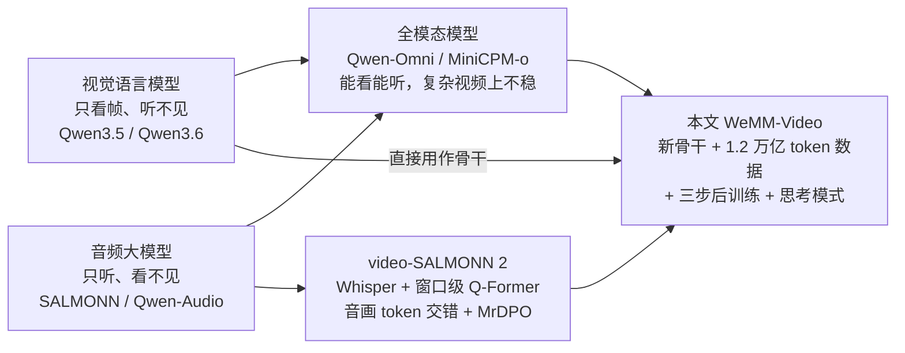
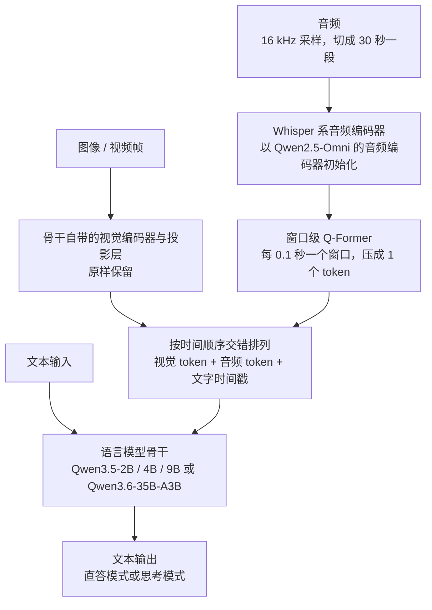
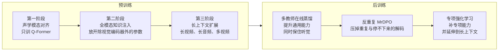
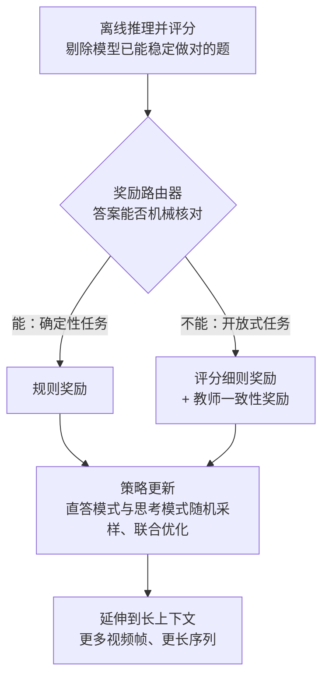

# WeMM-Video：推进开源全模态视频理解的前沿

> **原题**：WeMM-Video: Pushing the Frontiers of Open-Source Omni-Modal Video Understanding
> **作者**：Changli Tang、Jie Yang、Tianyi Wang、Lei Li、Daoze Zhang、Zijie Xin、Zhan Liu、Li Li、Jinchang Xu、Fengyun Rao、Chao Zhang、Jing Lyu（前六位为核心贡献者，Tianyi Wang 为项目负责人，Fengyun Rao 为通讯作者）
> **机构**：腾讯微信视觉团队（WeChat Vision, Tencent）；清华大学
> **年份**：2026（arxiv ID 2611.26409）
> **分类**：cs.CV / eess.AS
> **链接**：https://arxiv.org/abs/2611.26409
> **精读日期**：2026-11-22

## 阅读须知

### 这篇在领域里的位置

这篇论文属于「全模态视频理解」这一类工作，也就是让一个模型同时读入视频的画面与音轨，再用文字回答问题。这个方向是由两条支线汇合而成的。一条是视觉语言模型，它们把图像与视频帧接进大语言模型，这几年在无声视频上已经做得相当扎实。另一条是音频大模型，它们把语音、音乐与环境声接进大语言模型，能听却不能看。

把两条支线合在一起的模型被称为全模态模型，开源一侧的代表是阿里的 Qwen-Omni 系列、面壁智能的 MiniCPM-o，以及清华的 video-SALMONN 系列。本文正是沿着 video-SALMONN 2 的结构往下做的：第一作者 Changli Tang 与清华大学的 Chao Zhang 同时也是 SALMONN 与 video-SALMONN 2 的作者。

需要事先说明的是，这是一篇随模型发布的技术报告，而不是一篇提出新算法的论文。它没有新的网络结构，也没有消融实验；它的内容是把已有的结构、一份很大的数据和一套三步的后训练流程组合起来，开源四个规模的权重，再用一百二十多项评测说明效果。读的时候把预期放在「工程上怎样搭、搭完效果到哪里」会比较合适。

### 读完能回答什么

1. 一段带声音的视频是怎样变成语言模型能读的 token 序列的？音频每秒占多少个 token，画面与声音靠什么对齐？
2. 预训练为什么要分三个阶段？每个阶段解冻哪些参数、上下文窗口怎样变化？
3. 后训练的三步（多教师在线蒸馏、反重复 MrDPO、专项强化学习）各自针对的是哪一种缺陷？
4. 「思考模式」相比「直答模式」在哪些评测上帮助最大，又在哪些评测上反而变差？
5. 给一个视觉语言骨干加上听觉之后，它原有的无声视频、图像与纯文本能力保住了多少？

### 阅读前置

本文假定读者熟悉 Transformer 与大语言模型的基本用法，知道视觉语言模型大致是「视觉编码器加投影层加语言模型」的结构，也听说过 LoRA 这类参数高效微调。本文不假定读者做过语音或音频建模，也不假定读者读过 Q-Former、DPO、在线蒸馏的原始论文，这些概念第一次出现时都会先铺垫再展开。

### 首次出现的缩写表

- **LLM**（Large Language Model，大语言模型）。
- **VLM**（Vision-Language Model，视觉语言模型）：能读图像与视频帧的大模型，本文的骨干 Qwen3.5 与 Qwen3.6 都属于这一类。
- **Omni-modal**（全模态）：在本文里指同一个模型能同时接收文本、图像、音频、视频四种输入。本文的输出只有文本。
- **ASR**（Automatic Speech Recognition，自动语音识别）：把语音转写成文字。
- **WER / CER**（Word Error Rate / Character Error Rate，词错误率 / 字错误率）：语音识别的评价指标，越低越好；英文常用前者，中文常用后者。
- **Q-Former**（Querying Transformer）：一个小型 Transformer，用一组可学习的查询向量去「询问」编码器输出，把很长的特征序列压成很短的一串 token。
- **Instruct / Thinking**（直答模式 / 思考模式）：同一套权重的两种回答方式，前者直接给答案，后者先写出一段推理再给答案。
- **CoT**（Chain-of-Thought，思维链）：先写推理过程、再给结论的做法，思考模式产出的就是这种内容。
- **OPD**（On-Policy Distillation，在线策略蒸馏）：让学生模型先按自己当前的水平生成回答，再由教师模型在这些回答上给出监督。
- **DPO**（Direct Preference Optimization，直接偏好优化）：给模型成对的「较好回答」与「较差回答」，训练它提高前者的概率、压低后者的概率。
- **MrDPO**（Multi-round DPO，多轮直接偏好优化）：video-SALMONN 2 提出的做法，把 DPO 分成多轮来做，每一轮换一批新的负样本。
- **RL**（Reinforcement Learning，强化学习）。
- **LoRA**（Low-Rank Adaptation，低秩适配）：冻结原始权重，只在线性层旁边训练一对低秩小矩阵的微调方法。
- **A3B**：模型名 35B-A3B 里的后缀。论文没有解释这个命名，按 Qwen 系列的惯例，它表示一个混合专家（MoE）模型总参数约 350 亿、每次前向只激活其中约 30 亿。
- **SOTA**（State of the Art，当前最好水平）。
- **STEM**（Science, Technology, Engineering, Mathematics）：理工科类题目的统称。
- **IoU**（Intersection over Union，交并比）：时间定位任务里，预测时间段与标准时间段的重合程度。

## 一、问题

现实里的视频几乎都带着声音。短视频里的口播、直播间主播介绍商品的话、短剧里谁对谁说了哪一句、镜头外传来的一声响动、背景音乐与画面气氛是否相称，这些信息都不在画面上。一个只看帧的模型面对这类内容时，相当于在看一部被静音的片子：它或许能说出画面里有两个人，却说不出其中哪一位在讲话、讲了什么。

过去几年，开源社区在这个方向上已经有了不少全模态模型，可它们在复杂的真实视频上仍然不稳。论文把问题归纳成三种表现：其一，漏掉关键的音画细节；其二，听到的声音无法与画面里对应的事件对上；其三，凭空说出视频里并不存在的声音或画面，也就是跨模态幻觉。

差距有多大，可以从论文自己的表里读出来。在带音轨的 Video-MME-v2 上，此前的两个开源全模态模型 Qwen3-Omni-30B-A3B-Instruct 与 MiniCPM-o-4.5-9B 分别只有 36.3 与 28.1 分，而闭源的 Gemini-3.0-Flash 是 63.2 分。于是，开源一侧还需要一个新的模型把这段差距补上一部分，这是这篇报告的出发点。

### 具体要解决什么

把上面的动机落到一个可以检验的技术目标上，本文要做的事情是：训练一族模型，输入可以是文本、图像、音频、无声视频或带音轨的视频，输出是文本；这族模型要在音画联合理解上明显强于已有的开源模型。

与此同时，还有一个容易被忽略的约束。这族模型是在现成的视觉语言骨干上加装听觉得来的，加装之后，骨干原有的无声视频、图像与纯文本能力不应当明显退步。换句话说，论文既要证明「新长出的耳朵好用」，也要证明「原来的眼睛和脑子没有因此变差」。

### 前人走过的几条路线

第一条路线是视觉语言模型。它们只读视频帧，画面理解很强，这也是本文选它们做骨干的原因。它们处理声音的常见办法，是先用语音识别把人声转成字幕，再把字幕当文本喂给模型；这样做会丢掉非语音的声音、说话人的身份，以及语气这一类信息。

第二条路线是音频大模型，例如 SALMONN 与 Qwen-Audio。它们把语音、音乐、环境声都接进了语言模型，能回答「这段录音里发生了什么」，但它们看不到画面，自然也无从判断声音与画面之间的关系。

第三条路线是全模态模型，例如 Qwen2.5-Omni、Qwen3-Omni 与 MiniCPM-o。它们把视觉与听觉放进了同一个模型，其中一些还能直接输出语音。这条路线的方向是对的，问题在于前面提到的三种不稳：漏细节、对不上、会幻觉。

第四条路线是本文的直接前身 video-SALMONN 2。它确立了「Whisper 音频编码器加窗口级 Q-Former，音画 token 按时间交错」的结构，并提出用多轮 DPO 来改进音画联合描述。本文在结构上基本照搬了它，改动集中在骨干、数据规模与后训练流程上。

### 数据上的缺口

除了模型本身，论文还点出了一个数据层面的瓶颈。感知类的数据可以靠大规模描述来堆，推理类的数据却不行：能够核对答案的音画联合推理题，在自然存在的数据里本来就很少。

另一个缺口来自骨干。Qwen3.5 与 Qwen3.6 是视觉语言模型，它们原生没有任何听觉能力。于是，在做音画联合训练之前，必须先用一批专门的音频数据把声音的表示空间建起来，并与语言模型对齐。这两个缺口分别对应了后面数据构成里的两块内容。

## 二、方法

### 总体结构

整个模型可以看成「一个现成的视觉语言模型，旁边加装一条音频通路」。输入的四种模态各自被转成 token，排进同一条序列，由语言模型自回归地生成文本。

四个规模的模型用了两代骨干。2B、4B、9B 三个版本分别建在 Qwen3.5-2B、Qwen3.5-4B、Qwen3.5-9B 之上，最大的 35B-A3B 版本建在 Qwen3.6-35B-A3B 之上。

视觉这一侧，作者什么都没有改。无论是静态图像还是视频帧，都沿用骨干自带的视觉编码器与投影机制。之所以这样设计，是因为骨干在图像与视频上已经预训练得很好，改动它只会带来退步的风险。

### 音频通路：从波形到每秒 10 个 token

音频这一侧是新加的，由两个部件串起来。第一个部件是音频编码器。它采用 Whisper 的结构，Whisper 是 OpenAI 的语音识别模型，它的编码器擅长把声音波形转成一串带语义的特征向量。本文的编码器权重取自 Qwen2.5-Omni 里已经训练过的那一个，输入音频统一为 16,000 Hz 采样，并被切成 30 秒一段分别编码。

第二个部件是窗口级 Q-Former，它要解决的问题是「编码器吐出的特征太密，直接喂给语言模型太占位置」。普通的 Q-Former 不管输入多长，都只输出固定数量的 token，这对长短不一的音频并不合适。窗口级的做法是把特征序列按时间切成一个个小窗口，在每个窗口内部各做一次压缩。

本文的窗口长度是 0.1 秒，每个窗口压成 1 个音频 token，四个规模的模型都是如此。于是，音频在语言模型里的占用是每秒 10 个 token：一分钟的音轨是 600 个 token，一小时的音轨是 36,000 个 token。这个密度决定了模型能听多长的内容，也决定了它能保留多细的声学细节。

### 画面与声音怎样对齐

对于带音轨的视频，视觉 token 与音频 token 并不是各自排成一整段再拼接，而是按时间先后交错排列：同一小段时间里的画面 token 与声音 token 挨在一起，后面再接下一小段时间的内容。

除此之外，序列里还插入了用文字写出的时间戳。这样一来，语言模型在读到某个声音 token 时，既能从位置上知道它与哪几帧画面相邻，也能从时间戳文字上直接读到「现在是第几秒」。前文提到的「声音与画面事件对不上」这一痛点，在结构上主要靠这两件事来应对。

### 两种回答模式

同一套权重支持两种回答方式。直答模式不写推理过程，直接给出答案，延迟低，适合感知类的简单问题。思考模式会先生成一段逐步的推理，再给出答案，论文把这种在同一个模型里兼容两种方式的做法称为混合思考范式。

论文对思考模式的期望有两条：一是在复杂的视频任务上提高准确率，二是通过让推理过程落在音画证据上来减少跨模态幻觉。两种模式之间具体怎样切换，论文没有写；可以确定的是，后训练的强化学习阶段会对两种模式随机采样、一起优化。

### 训练数据：约 1.2 万亿 token

训练语料的总量约为 1.2 万亿 token。按模态划分，音画联合数据占比最大，为 45.4%；按任务划分，描述（captioning）类任务占比最大，为 37.7%。其余各项的比例只画在论文的图 3 里，正文没有给出数字。

| 数据板块 | 内容 | 要补上的能力 |
|---|---|---|
| 细粒度视觉描述 | 竞技体育、电竞、游戏、舞蹈、户外活动等动作密集的视频，配上稠密的描述 | 快速的肢体动作与细微的状态变化 |
| 音画联合描述 | 电影、短剧、访谈、综艺、直播带货等原生带声音的视频，描述沿一条时间线同时写画面动作、对白与环境声 | 声音与画面在时间上的对应 |
| 专门的音频语料 | 大规模语音识别、音乐理解、通用音频理解 | 骨干原本没有的听觉 |
| 跨媒体理解 | 两段视频的比较、视频与配乐是否相称、电商商品与广告是否一致 | 多路输入与流式输入 |
| 知识与推理问答 | 带思考过程的视觉语言理工科与知识推理数据，加上一批原生的音画推理题 | 音画联合推理 |

描述类数据在进入训练之前要过三道处理：自动质量打分、语义去重、有害内容过滤。知识与推理这一块的思路值得多说一句。既然可核对的音画推理题很少，作者便采取了两头凑的办法：大量使用现成的、带思考过程的图文推理数据来保住并增强骨干的解题能力，再配上数量较少的原生音画推理题，把这种能力迁移到带声音的场景里。

### 预训练：三阶段课程

预训练分成三个阶段，上下文窗口逐段放大，参与训练的参数也逐段放开。这样安排的原因是，音频通路刚接上时是随机状态，如果一开始就放开整个模型去训练，未对齐的音频 token 会干扰骨干已有的能力。

| 阶段 | 目的 | 训练哪些参数 | 上下文窗口 | 数据 |
|---|---|---|---|---|
| 第一阶段：声学模态对齐 | 把音频表示接到语言模型上 | 只训练窗口级 Q-Former，语言模型与各编码器全部冻结 | 较小 | 基础的音频与文本配对，覆盖语音识别与通用音频描述 |
| 第二阶段：全模态知识注入 | 建立统一的跨模态表示，是预训练的主体 | 除视觉编码器之外全部解冻 | 扩大 | 文本、视觉、音频、音画联合数据混合 |
| 第三阶段：长上下文能力扩展 | 学会处理很长的输入 | 与第二阶段相同 | 进一步扩大 | 长视频、长录音、多视频场景 |

视觉编码器自始至终没有解冻。作者给出的理由是，继承来的视觉编码器已经提供了足够强的视觉表示。三个阶段的上下文窗口具体是多少 token，论文没有给出。

### 后训练：三步各治一种毛病

预训练结束之后，模型已经有了基本的全模态能力，但作者指出它还留着三个问题。第一，通用的语言能力与图文能力还有提升空间，尤其是复杂的感知与推理。第二，生成不稳定，模型可能写出过长的推理，或者陷入重复。第三，一些专项能力不够，论文点名的有音画说话人识别、视频与配乐匹配、结构化的音乐理解，以及复杂的音画推理。

针对这三个问题，后训练依次做三件事，顺序是有讲究的：先提升通用能力，再修掉重复解码，最后才做强化学习。

#### 第一步：多教师在线蒸馏

蒸馏指的是让一个学生模型去模仿教师模型的输出。在线策略蒸馏是其中的一种做法：先让学生按自己当前的水平生成回答，再由教师在这些回答上给出监督。这样学生学到的是「自己容易走偏的地方应当怎样纠正」，而不只是背诵教师写好的标准答案。

本文的特别之处在于教师不止一位，而且按模态分工。文本任务与图文任务由更强的外部教师来监督，目的是提升通用的感知与推理能力。音频任务与音画任务则由同一族模型里的教师来监督，目的是把已经学到的听觉能力保住，不让它在蒸馏通用能力的过程中被冲掉。

此外还有一条跨模态的蒸馏：把文本任务上的知识迁移到音频任务上，用来加强对语音的理解和对口头指令的遵循。直观地说，同一个问题用文字提出与用语音提出，模型的回答应当大体一致，文字一侧较强的表现可以用来带动语音一侧。至于外部教师具体是哪些模型、蒸馏的损失函数是什么形式，论文没有交代。

#### 第二步：反重复 MrDPO

作者观察到，骨干模型有一种不容忽视的倾向：解码时陷入重复、停不下来。这个毛病在预训练和蒸馏之后依然存在，而且会妨碍接下来的强化学习。论文没有展开原因，一个合理的解释是：强化学习要靠模型自己采样出回答再打分，如果其中混着无穷无尽的重复，训练的效率与稳定性都会受损。

解决办法是 DPO。这种方法需要成对的样本：对同一个输入 x，有一个较好的回答 y⁺ 和一个较差的回答 y⁻。它的标准损失函数是：

$$\mathcal{L}_{\mathrm{DPO}}=-\log\sigma\left(\beta\left[\log\frac{\pi_\theta(y^+\mid x)}{\pi_{\mathrm{ref}}(y^+\mid x)}-\log\frac{\pi_\theta(y^-\mid x)}{\pi_{\mathrm{ref}}(y^-\mid x)}\right]\right)$$

其中 π_θ 是正在训练的模型，π_ref 是训练开始时冻结下来的参考模型，σ 是 sigmoid 函数，β 是控制强度的系数。这条式子的含义是：相对于参考模型，让好回答的概率上升得比坏回答更多。需要说明，这是 DPO 的通用形式，本文自己没有写出公式。

本文把陷入重复的回答当作 y⁻。这些负样本是离线挖出来的：事先让模型在视频、音频、图文三类任务上大量推理，从中筛出出现重复解码的困难样本。之所以离线挖而不是边训练边采，是因为重复解码属于相对少见的情况，在线采样很难高效地碰到足够多的例子。

「多轮」体现在这个过程要反复做几遍。为了让多轮优化保持稳定，每一轮只更新 LoRA 适配器，一轮结束后把适配器合并进主干权重，下一轮再重新初始化一组新的适配器。

#### 第三步：专项强化学习

最后一步用强化学习来补专项能力。训练样本同样靠离线推理来筛：先让模型把候选题目做一遍并评分，把它已经能稳定做对的题目剔除，只留下有难度的那部分。

奖励怎样给，取决于任务的答案能不能被机械地核对。答案确定的任务，例如选择题或时间定位，用规则来打分。开放式的任务，例如描述，则用两种奖励：一种按评分细则打分，另一种看模型的回答与教师的回答是否一致。一个动态的奖励路由器负责为每道题分派合适的奖励。

强化学习还被延伸到了长上下文的设置里，也就是在训练时覆盖更多的视频帧、使用更长的序列。这样做的目的有两个：让模型适应很长的多模态输入，并且在这种输入下继续保持生成稳定。具体采用的是哪一种强化学习算法，论文没有说明。

### 设计与痛点的对应关系

把前面的内容收拢一下，可以看到每一个痛点大致对应着哪一项设计。

| 痛点 | 对应的设计 |
|---|---|
| 漏掉音画细节 | 动作密集的细粒度视觉描述数据；沿时间线同时写画面、对白与环境声的联合描述数据 |
| 声音与画面对不上 | 音画 token 按时间交错，并插入文字时间戳 |
| 跨模态幻觉 | 思考模式下把推理落在音画证据上 |
| 可核对的音画推理数据稀少 | 带思考过程的图文推理数据，加上少量原生音画推理题 |
| 骨干原生没有听觉 | 专门的音频语料；预训练第一阶段只训练 Q-Former 做对齐 |
| 加装听觉后原有能力退步 | 视觉编码器全程冻结；蒸馏时由同族教师保住听觉、外部教师提升通用能力 |
| 重复、停不下来的解码 | 离线挖负样本的多轮 DPO |
| 专项能力不足 | 按任务分派奖励的强化学习 |

## 三、实验

### 评测设置

评测覆盖五个部分，共 123 项基准，论文摘要里说的「一百二十多项」即由此而来。

| 评测部分 | 基准数 | 细分维度 | WeMM-Video 采用的模式 |
|---|---|---|---|
| 全模态视频（带音轨） | 33 | 通用音画理解、音画幻觉、视频与音乐、音画交互、音画描述 | 35B-A3B 报告两种模式，其余只报告思考模式 |
| 无声视频 | 32 | 通用、长视频、细粒度感知、时间定位、空间理解、流式、多视频 | 同上 |
| 音频 | 18 | 通用音频、音乐、语音识别、歌词识别、语音交互 | 全部用直答模式 |
| 图像 | 28 | 理工科与谜题、通用问答、文字与文档、空间、多图、计数、指令遵循 | 全部用思考模式 |
| 文本 | 12 | 知识、指令遵循、长上下文、理工科、数学推理 | 全部用思考模式 |

对比的对象分两组。闭源一组是 Gemini-3.0-Flash（中等思考强度）、Seed2.0-Mini-0428（中等思考强度）与 Qwen3.5-Omni-Flash；开源一组是 Qwen3-Omni-30B-A3B-Instruct 与 MiniCPM-o-4.5-9B，在无声视频、图像、文本上还加入了骨干 Qwen3.5-9B 与 Qwen3.6-35B-A3B。其他模型的数字，有官方结果的用官方结果，没有的由作者自己评测。

有一个版式上的细节需要注意：在表 1 与表 3 里，Gemini-3.0-Flash 这一列被标成灰色的参考列，加粗最优结果时不把它计入。因此表里的粗体多数落在 WeMM-Video 上，并不意味着它超过了 Gemini。

### 旗舰模型对闭源模型：带音轨的视频

下表摘录了表 1 的主要行。「十七项平均」一行是我按表中数字自行计算的，论文没有给出平均值。

| 基准 | Gemini-3.0-Flash | Seed2.0-Mini-0428 | Qwen3.5-Omni-Flash | WeMM-Video-35B-A3B 直答 | WeMM-Video-35B-A3B 思考 |
|---|---|---|---|---|---|
| Video-MME（带音轨） | 88.6 | 83.6 | 79.3 | 84.2 | 86.4 |
| Video-MME-v2（带音轨） | 63.2 | 51.7 | 36.6 | 47.5 | 54.9 |
| Daily-Omni | 82.4 | 82.5 | 81.8 | 81.5 | 83.4 |
| WorldSense | 63.8 | 61.3 | 57.9 | 59.6 | 62.7 |
| AV-SpeakerBench | 75.9 | 68.5 | 65.2 | 66.5 | 72.6 |
| Video-Holmes | 71.2 | 62.1 | 61.7 | 63.2 | 63.4 |
| OmniVideoBench | 63.3 | 51.3 | 43.7 | 48.6 | 55.3 |
| SciVideoBench | 75.2 | 60.1 | 51.3 | 57.8 | 69.4 |
| MMOU（test-mini） | 84.7 | 65.8 | 69.9 | 71.4 | 74.5 |
| FutureOmni | 65.3 | 52.2 | 55.4 | 58.4 | 56.2 |
| JointAVBench | 68.4 | 64.7 | 69.0 | 67.4 | 65.9 |
| 通用音画理解十七项平均 | 70.0 | 61.8 | 57.2 | 61.3 | 64.9 |
| AVHBench 判断题（幻觉） | 78.5 | 75.8 | 77.5 | 80.3 | 80.0 |
| SVHalluc（幻觉） | 86.4 | 75.4 | 63.6 | 75.3 | 80.3 |
| MUSIC-AVQA | 76.2 | 74.2 | 82.1 | 79.6 | 79.5 |
| DVD-Bench 英文（说话人准确率） | 81.2 | 75.3 | 72.5 | 76.2 | 79.1 |
| DailyOmni（基于描述的问答） | 51.8 | 50.9 | 44.0 | 51.9 | 62.2 |

在通用音画理解的十七项里，思考模式下的旗舰模型有十六项高于 Seed2.0-Mini-0428，只在 OmniCompass-AV 上落后；同样有十六项高于 Qwen3.5-Omni-Flash，只在 JointAVBench 上落后。这两个「十六比一」是论文正文明确写出的结论，核对表格后成立。

与 Gemini-3.0-Flash 相比，情况则反过来。十七项里旗舰模型只在 Daily-Omni 一项上领先 1.0 分，其余十六项都落后，平均差 5.1 分。差距最大的是 MMOU（10.2 分）、FutureOmni（9.1 分）、EvaOmni（8.6 分）与 Video-MME-v2（8.3 分）；差距最小的是 AVUT Human（0.5 分）与 WorldSense（1.1 分）。论文摘要里的说法是「缩小了与 Gemini-3.0-Flash 的差距」，这个措辞与数字是相符的。

在描述类任务上，旗舰模型有两项明显超过了包括 Gemini 在内的所有对手。「基于描述的问答」这类评测的做法是先让模型为视频写一段描述，再只凭这段描述去回答问题，以此衡量描述里保留了多少信息。在 DailyOmni 上旗舰模型为 62.2 分，Gemini 为 51.8 分；在 WorldSense 上两者分别为 36.6 分与 32.4 分。

### 小模型对开源基线：带音轨的视频

下表摘录了表 2。同样，平均值一行是我自行计算的。

| 基准 | Qwen3-Omni-30B-A3B-Instruct | MiniCPM-o-4.5-9B | WeMM-Video-2B 思考 | WeMM-Video-4B 思考 | WeMM-Video-9B 思考 |
|---|---|---|---|---|---|
| Video-MME（带音轨） | 77.3 | 69.2 | 72.4 | 83.9 | 85.1 |
| Video-MME-v2（带音轨） | 36.3 | 28.1 | 37.7 | 48.1 | 51.6 |
| Daily-Omni | 70.7 | 80.2 | 76.5 | 82.5 | 83.6 |
| WorldSense | 54.0 | 55.7 | 52.4 | 60.3 | 63.4 |
| AV-SpeakerBench | 50.4 | 56.7 | 56.2 | 68.6 | 71.1 |
| OmniVideoBench | 45.4 | 37.2 | 39.2 | 49.7 | 52.8 |
| SciVideoBench | 49.9 | 32.7 | 39.6 | 59.2 | 64.2 |
| MMOU（test-mini） | 60.5 | 40.9 | 45.7 | 63.3 | 71.7 |
| FutureOmni | 55.1 | 56.1 | 45.2 | 50.9 | 53.7 |
| 通用音画理解十七项平均 | 52.2 | 48.5 | 49.9 | 59.9 | 62.8 |
| SVHalluc（幻觉） | 65.2 | 68.9 | 73.9 | 80.2 | 86.8 |
| DailyOmni（基于描述的问答） | 19.4 | 26.6 | 51.1 | 58.6 | 59.7 |

9B 版本在十七项里有十五项高于 Qwen3-Omni-30B-A3B-Instruct，一项持平，只在 FutureOmni 上落后。4B 版本的战绩与此相同，也是十五胜一平一负。2B 版本在十七项里赢了七项，平均分比 30B 的基线低 2.3 分，论文对它的表述是「在不少基准上持平或超过」，与数字相符。

读这张表时有一处需要留意：WeMM-Video 的三个小模型报告的都是思考模式，而对手 Qwen3-Omni-30B-A3B-Instruct 是直答模型。三个小模型在直答模式下的成绩，论文以篇幅为由没有列出。

### 思考模式带来多少

旗舰模型同时报告了两种模式，可以直接相减。在通用音画理解的十七项上，思考模式平均比直答模式高 3.6 分。提升最大的是偏重推理的几项：SciVideoBench 高 11.6 分，EvaOmni 高 9.0 分，Video-MME-v2 高 7.4 分，OmniVideoBench 高 6.7 分，AV-SpeakerBench 高 6.1 分。

思考模式并非处处有利。在 FutureOmni 上它比直答模式低 2.2 分，在 JointAVBench 上低 1.5 分。到了无声视频上，三十一项单一数值的基准里有六项是直答更高，其中空间理解基准 VSI-Bench 上直答为 62.7 分、思考为 57.2 分，差了 5.5 分。

### 无声视频：加了耳朵之后眼睛有没有变差

这一部分最值得看的对比，是旗舰模型与它自己的骨干 Qwen3.6-35B-A3B。下表摘录表 3 的若干行。

| 基准 | Gemini-3.0-Flash | Seed2.0-Mini-0428 | Qwen3.5-Omni-Flash | Qwen3.6-35B-A3B（骨干） | WeMM-Video-35B-A3B 思考 |
|---|---|---|---|---|---|
| Video-MME | 86.4 | 78.1 | 77.0 | 82.5 | 80.4 |
| Video-MME-v2 | 55.6 | 44.4 | 33.7 | 45.3 | 45.2 |
| MLVU | 87.9 | 81.6 | 81.9 | 86.2 | 85.3 |
| LVBench | 73.8 | 63.4 | 65.7 | 71.4 | 71.6 |
| EgoSchema | 64.8 | 78.4 | 70.0 | 77.2 | 74.2 |
| TemporalBench | 50.9 | 44.9 | 30.6 | 43.3 | 45.9 |
| F-16-NBA | 90.1 | 94.8 | 87.3 | 82.8 | 89.9 |
| TimeLens-Charades（平均 IoU） | 58.8 | 56.9 | 40.8 | 47.4 | 54.8 |
| VSI-Bench | 53.3 | 49.4 | 55.2 | 56.1 | 57.2 |
| OVO-Bench（流式） | 69.3 | 70.6 | 55.7 | 61.0 | 63.9 |
| CrossVid（多视频） | 53.2 | 49.9 | 40.4 | 45.2 | 50.2 |

在三十一项单一数值的基准上，思考模式的旗舰模型有二十项高于骨干、十一项低于骨干。高出较多的集中在时间定位、细粒度动作与多视频这几类，例如 TimeLens-Charades 高 7.4 分、F-16-NBA 高 7.1 分、CrossVid 高 5.0 分，这些恰好是训练数据里专门加料的方向。

低于骨干的十一项多数只差零点几分，较明显的是 EgoSchema 低 3.0 分、Video-MME 低 2.1 分、MVBench 低 1.5 分。论文对此的表述是「没有因为接入声学模态而明显损失视觉能力」，并称与骨干「持平」。从数字看，持平大体成立，但通用与长视频这两类上确实存在小幅的回落。

9B 版本与它的骨干 Qwen3.5-9B 相比，三十一项里赢了二十一项、输了十项。输得较多的是 VSI-Bench（低 3.8 分）、MVBench（低 3.0 分）与 VideoVista（低 2.5 分）。

### 音频

音频评测全部在直答模式下进行，下表摘录表 5。语音识别与歌词识别两类是错误率，越低越好。

| 基准 | Qwen3.5-Omni-Flash | Qwen3-Omni-30B-A3B-Instruct | MiniCPM-o-4.5-9B | WeMM-Video-9B | WeMM-Video-35B-A3B |
|---|---|---|---|---|---|
| MMAU | 80.4 | 77.5 | 76.9 | 77.0 | 78.0 |
| MMAU-Pro | 64.8 | 60.2 | 62.7 | 70.9 | 70.6 |
| MMSU | 72.2 | 69.0 | 67.4 | 76.8 | 76.0 |
| MusTBench（音乐） | 42.2 | 32.4 | 24.0 | 42.0 | 46.6 |
| LibriSpeech test-clean（WER） | 1.3 | 1.2 | 1.4 | 1.5 | 1.6 |
| WenetSpeech net（CER） | 4.4 | 4.7 | 5.9 | 5.4 | 5.7 |
| MIR-1K 人声（歌词 CER） | 4.9 | 5.9 | 25.9 | 8.1 | 7.9 |
| VoiceBench | 87.8 | 85.5 | 68.3 | 89.0 | 88.4 |
| Speech-IFEval | 88.2 | 77.6 | 64.8 | 95.7 | 96.5 |
| Audio MultiChallenge | 58.2 | 52.2 | 45.4 | 59.2 | 62.0 |

这张表呈现出一种分化。在 MMAU-Pro 与 MMSU 这两项音频问答上，以及在语音交互与口头指令遵循上，WeMM-Video 领先：例如 Speech-IFEval 上旗舰模型为 96.5 分，Qwen3.5-Omni-Flash 为 88.2 分。论文把语音交互上的领先归因于「有针对性的优化」，对应的应当是前面的跨模态蒸馏与专项强化学习。在 MMAU 上，它则比闭源的 Qwen3.5-Omni-Flash 低 2.4 分。

与之相对地，在最基础的转写任务上它并不占优。语音识别的四个数据集里，它在 GigaSpeech 与 VoxPopuli 上与最好的结果持平或略优，在 LibriSpeech 与 WenetSpeech 上则落后；歌词识别的两个数据集上，它的错误率都高于两个 Qwen-Omni 模型。

### 图像与文本

图像与文本两部分的作用，是检验骨干原有的能力保住了多少。先看图像：旗舰模型与骨干 Qwen3.6-35B-A3B 在二十八项上的比较结果是十三胜、一平、十四负。领先较多的是 WorldVQA（28.6 对 19.9）与 SimpleVQA（62.0 对 58.9）；落后较多的是 RefCOCO（89.5 对 92.0）、MMMU-Pro（72.9 对 75.3）与 CharXiv RQ（75.7 对 78.0）。

再看文本。旗舰模型与骨干在十二项上是七胜五负，指令遵循类明显更好，例如 IFBench 上为 70.7 对 63.7；数学与理工科类则有所回落，IMOAnswerBench 上为 74.8 对 78.9，GPQA 上为 83.8 对 86.0。

9B 版本在文本上的回落更明显。与骨干 Qwen3.5-9B 相比，十二项里它只赢了三项指令遵循类的基准，其余九项全部低于骨干。

| 文本基准 | Qwen3.5-9B（骨干） | WeMM-Video-9B 思考 | 差值 |
|---|---|---|---|
| IFBench | 64.5 | 70.7 | +6.2 |
| IFEval | 91.5 | 93.2 | +1.7 |
| MMLU-Pro | 82.5 | 81.6 | -0.9 |
| GPQA | 81.7 | 77.8 | -3.9 |
| AA-LCR（长上下文） | 63.0 | 59.0 | -4.0 |
| IMOAnswerBench | 67.8 | 62.8 | -5.0 |
| HMMT Nov 25 | 82.9 | 75.0 | -7.9 |

论文对图像与文本两部分的总结都是「与各自的骨干持平，并在指令遵循上进一步提升」。对旗舰模型而言这个说法基本成立，对 9B 版本的数学推理而言则偏乐观。

### 几处反直觉的结果

第一处与声音的贡献有关。Video-MME 与 Video-MME-v2 各有带音轨与无声两个版本，把同一个模型在两个版本上的分数相减，可以粗略看出声音帮了多少。这组差值是我自行计算的，而且两种设置下的帧数等条件未必完全一致，只能当作参考。

| 模型 | Video-MME 带音轨减无声 | Video-MME-v2 带音轨减无声 |
|---|---|---|
| WeMM-Video-35B-A3B 思考 | +6.0 | +9.7 |
| WeMM-Video-9B 思考 | +6.6 | +11.0 |
| Gemini-3.0-Flash | +2.2 | +7.6 |
| Seed2.0-Mini-0428 | +5.5 | +7.3 |
| Qwen3.5-Omni-Flash | +2.3 | +2.9 |
| Qwen3-Omni-30B-A3B-Instruct | +6.8 | +6.6 |
| MiniCPM-o-4.5-9B | -1.2 | +1.3 |

WeMM-Video 从声音里得到的增益属于最高的一档，在更难的 Video-MME-v2 上尤其明显；而 MiniCPM-o-4.5-9B 在 Video-MME 上加了声音反而略降。换句话说，这族模型在带音轨评测上的领先，相当一部分确实来自「把声音用起来了」，而不只是来自更强的视觉骨干：旗舰模型在无声的 Video-MME 上其实比 Gemini 低 6.0 分，加上音轨之后差距缩到 2.2 分。

第二处与规模有关。9B 版本的通用音画理解十七项平均为 62.8 分，旗舰的 35B-A3B 为 64.9 分，只差 2.1 分；在 Daily-Omni、WorldSense 与幻觉基准 SVHalluc（86.8 对 80.3）上，9B 版本还更高。音频表里也是如此，MMAU-Pro、MMSU 与 VoiceBench 三项都是 9B 略高。如果 A3B 确如命名惯例所示，意味着每次只激活约 30 亿参数，那么这两个模型在实际参与计算的参数量上本来就相近，这个结果便不那么意外了。

第三处是思考模式的副作用。前面已经看到它在 VSI-Bench 上让旗舰模型低了 5.5 分，在 FutureOmni 上低了 2.2 分。FutureOmni 这一项尤其特殊：WeMM-Video 的三个小模型在这一项上全部低于两个开源基线，这是表 2 通用部分里唯一一项全族落败的基准。论文没有讨论原因。

第四处在音画描述上。video-SALMONN 2 测试集报告的是总错误率，越低越好。这一项上 Gemini-3.0-Flash 为 37.7，是表 1 几个模型里最差的；WeMM-Video 旗舰模型直答为 27.5、思考为 28.3，思考模式并没有带来好处；而 9B 版本的 30.9 还不如开源基线 Qwen3-Omni-30B-A3B-Instruct 的 27.9。

## 四、局限

### 作者在文中承认或点明的

这篇报告没有单独的局限章节，以下几点散见于行文之中。

其一，旗舰模型仍然落后于 Gemini-3.0-Flash。作者的措辞始终是「接近」与「缩小差距」，并把 Gemini 一列作为灰色参考列处理。

其二，骨干模型存在重复、停不下来的解码倾向，而且这个倾向在预训练与蒸馏之后依然存在。作者为此专门加了一步 MrDPO，至于处理之后残留多少，论文没有报告任何衡量重复率的数字。

其三，可核对的音画联合推理数据天然稀少。作者的应对是借用图文推理数据再迁移，这等于承认原生的音画推理监督仍然不足。

其四，接入声学模态会带来视觉能力的退化，这是此类模型的通病。作者的表述是「没有受到太多影响」，而不是「没有影响」。

### 读完能看出来、但论文没有正面讨论的问题

第一，全文没有任何消融实验。数据、多教师蒸馏、MrDPO、强化学习这四样东西各自贡献了多少，从报告里无从得知。读者能确认的只有「四样加在一起的最终效果」，而不能据此判断其中哪一步值得在自己的项目里照做。

第二，方法部分的细节缺口很多。三个预训练阶段的上下文窗口各是多少、外部教师是哪些模型、蒸馏与强化学习各用什么损失与算法、评分细则由谁来打分、训练用了多少算力，这些都没有交代。作者开源的是权重与评测复现流程，训练数据与训练代码不在其列，因此这份报告可以复现评测，难以复现训练。

第三，教师的身份不明会影响对结果的解读。通用能力来自「更强的外部教师」，强化学习里还有「与教师一致」这一项奖励。如果这些教师与表里的对比模型存在重合或同源，那么部分领先就应当理解为蒸馏的结果；论文没有提供可以排除这一点的信息。

第四，对比条件并不完全对等。小模型一侧是思考模式对直答基线；闭源的 Gemini 与 Seed 用的是「中等思考强度」这一档，换成别的档位结果如何没有报告；其他模型的数字混用了官方结果与作者自测，表里没有逐格标明来源，帧数、分辨率等设置是否一致也就无法确认。

第五，思考模式的代价没有被衡量。它在推理类任务上平均多拿几分，同时要多生成一段推理文字，可论文没有给出延迟、输出 token 数或显存占用。对于论文自己提到的直播带货、短剧分析这类线上场景，这恰恰是决定用哪种模式的关键数字。

第六，专项优化的方向与评测的类别高度重合。后训练点名加强的是说话人识别、视频配乐匹配、音乐理解与口头指令遵循，评测里正好有对应的类别，而且领先最明显的也在这些类别上。这本身无可厚非，但读者应当把这些分数理解为「针对性训练之后的表现」；训练语料是否与各基准的测试集做过去重，论文也没有说明。

第七，相当一部分评测依赖闭源模型做裁判。音画交互与音画描述两类里，多数基准由 GPT-4o、GPT-6.1-Sol 或 GPT-6-Luna 打分。裁判模型一旦更新或下线，这些分数就难以原样复现。

第八，「全模态」只体现在输入一侧。这族模型只输出文本，不能像 Qwen-Omni 或 MiniCPM-o 那样直接说话；语言上也只覆盖中文与英文。

第九，基础转写能力不占优。语音识别与歌词识别上它落后于 Qwen-Omni 系列，一种可能的解释是每秒 10 个音频 token 的压缩率偏高，保留不住逐字转写所需的细节；也可能只是音频数据的配比偏向理解而非转写。论文没有分析这一点，以上只是推测。

第十，小规模版本缺少与骨干的对照。图像与文本两张表只列了 Qwen3.5-9B 与 Qwen3.6-35B-A3B 两个骨干，没有列 Qwen3.5-2B 与 Qwen3.5-4B。于是 2B 版本上一些偏低的数字，例如长上下文基准 AA-LCR 的 14.0 分与 RefCOCO 的 63.7 分，究竟是骨干本来如此还是加装听觉后的退步，无法判断。

## 一句话

腾讯微信开源四档全模态视频模型：视觉骨干加装听觉，经三步后训练，音画理解居开源首位，仍逊于 Gemini。
