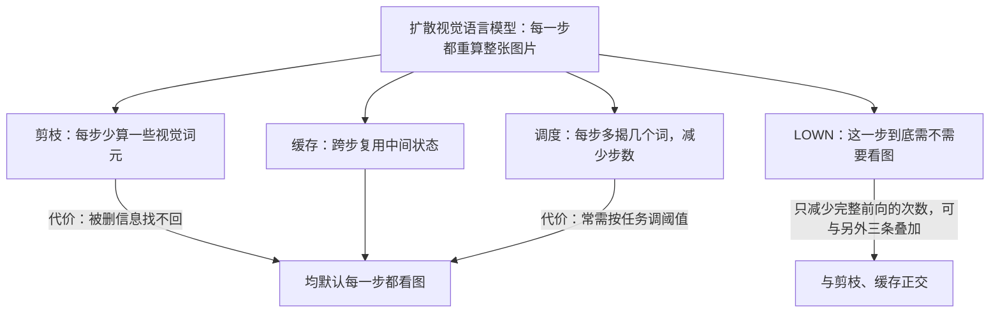
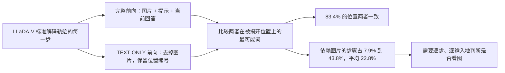
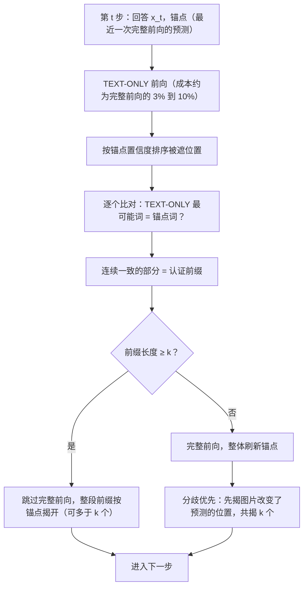
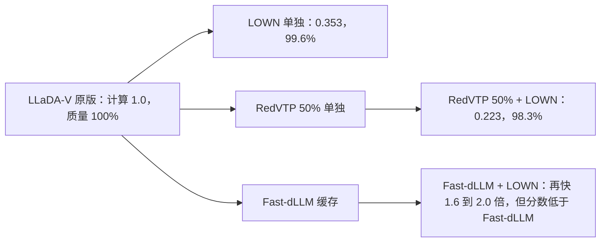

# 只在需要时看图：用一致性证书调度扩散视觉语言模型的图像访问

> **原题**：Look Only When Needed: Certificate-Guided Visual Routing for Efficient Diffusion VLMs
> **作者**：Donghyeon Cho、Joowon Kim、Seungho Shin、Eunho Yang（通讯作者）
> **机构**：KAIST（韩国科学技术院）、AITRICS
> **年份**：2026（arxiv ID 2610.36671）
> **分类**：cs.CV / cs.AI / cs.LG
> **链接**：https://arxiv.org/abs/2610.36671
> **精读日期**：2026-11-01

## 阅读须知

### 这篇在领域里的位置

过去几年，大语言模型几乎都是「自回归」的：从左到右一个词一个词地生成。近一年多，另一种生成方式逐渐长成了规模，叫作扩散语言模型。它的做法是先把整段回答全部盖住，再经过若干步「去噪」，每一步揭开一部分最有把握的位置，直到全部揭开。LLaDA、Dream 这些模型已经做到与同尺寸的自回归模型相当，LLaDA-V、LaViDa 等工作又把它扩展到了能看图的视觉语言模型。

扩散视觉语言模型有一个突出的推理负担。自回归模型可以用键值缓存，把已经算过的前文存下来不再重算；扩散模型用的是双向注意力，每一步回答里的内容都在变，精确的键值缓存用不上，于是每一步都要把整张图片对应的视觉词元和全部文字重新算一遍。而在本文测试的基准上，视觉词元占了输入的 89% 到 97%。

此前的加速工作大致有三条路。第一条是视觉词元剪枝，把图片里不太重要的词元删掉，让每一步算得更少；第二条是缓存中间状态，跨步复用一部分计算；第三条是每一步多揭开几个词，减少总步数。这篇论文提出了第四条正交的路：既不删图片、也不改每步的计算，而是问一个更直接的问题，「这一步到底需不需要看图」。

### 读完能回答什么

1. 扩散视觉语言模型为什么每一步都要重算整张图片？这笔开销在总计算里占多大比例？
2. 作者是怎样量出「图片其实很少改变模型的决定」的？这个比例在不同任务之间差别有多大？
3. LOWN 的「锚点」和「证书」分别是什么？为什么用一次不带图的便宜前向，就能判断这一步是否需要看图、能揭开多少个词？
4. LOWN 和视觉词元剪枝、键值缓存为什么可以叠加使用，叠加后的收益从哪里来？
5. 在哪些任务上 LOWN 省得最少，又在哪些任务上质量损失最明显？

### 阅读前置

本文假定读者了解 Transformer 的基本结构，知道注意力、键值缓存和「前向计算」是什么，也大致了解视觉语言模型会把图片编码成一串视觉词元，与文字词元拼在一起送入语言模型。

本文不假定读者熟悉扩散语言模型的解码方式，也不假定读者了解视觉词元剪枝的具体方法，这些都会在首次出现时先铺垫再展开。

### 缩写表

| 缩写 | 全称与含义 |
|---|---|
| DVLM | Diffusion Vision-Language Model，扩散视觉语言模型。以掩码扩散方式生成回答、能理解图片的模型 |
| LOWN | Look Only When Needed，本文方法，「只在需要时看图」 |
| LLaDA / LLaDA-V | 一种掩码扩散语言模型及其视觉语言版本，是本文的主实验模型 |
| LaViDa / VidLaDA | 另外两个基于扩散的图像、视频语言模型，用来检验方法能否迁移 |
| FULL 前向 | 带着视觉词元、提示词和当前回答的完整前向计算 |
| TEXT-ONLY 前向 | 去掉视觉词元、只算提示词和当前回答的前向计算，成本只有完整前向的 3% 到 10% |
| FLOPs | 浮点运算次数，本文用解码阶段的相对 FLOPs 衡量计算量 |
| KV 缓存 | Key-Value Cache，键值缓存，复用之前步骤里算过的注意力键和值 |
| RedVTP / ZOO-Prune / D3ToM | 三种视觉词元剪枝或合并方法，是本文的对比基线 |
| KLASS | 一种按置信度与跨步稳定性决定每步揭开多少词的解码调度方法 |
| Fast-dLLM | 一种针对扩散语言模型的分块近似键值缓存方法 |
| MathVista / DocVQA / ChartQA 等 | 本文使用的十个图像基准，涵盖选择题、文档与图表理解、数学推理和开放式描述 |

## 一、问题

扩散语言模型吸引人的地方，是它能在一步里并行确定多个位置的词，理论上比逐词生成更快。然而落到视觉语言模型上，这个优势被一个朴素的事实抵消了：每一步去噪都要把整张图片重新处理一遍。

以 LLaDA-V 为例，视觉词元占输入的 89% 到 97%，而一次不带图片的前向只需要完整前向 3% 到 10% 的计算量。换句话说，解码时绝大部分算力花在了反复处理同一张没有变化的图片上。对于需要在线服务的多模态应用来说，这意味着更高的延迟和更贵的推理成本。

已有的加速方法各有代价。剪枝会永久丢掉被删除的那部分视觉信息，在需要读细节的任务上质量下降明显；而且剩下的视觉词元依然每一步都要处理。缓存方法与多揭词的调度方法，则是在「每一步都看图」的前提下让每一步更便宜或步数更少。没有一种方法去追问：这一步看不看图，模型的决定会不会不同。

### 1.1 具体的技术问题

把上面的动机落到可以验证的技术陈述上，论文要回答的是：在扩散视觉语言模型的每一个解码步，能否用一个廉价的检验判断「这一步不看图片也会做出同样的决定」，从而跳过完整前向；同时，这个检验能否顺带决定这一步可以安全地揭开多少个词？

这个问题有两个约束。第一，检验本身必须足够便宜，否则省下的计算又被检验吃掉。第二，最好不需要训练，也不需要针对每个任务调阈值，这样才能即插即用地叠加到已有模型和其他加速方法之上。

### 1.2 前人的几条路线

**视觉词元剪枝**。这类方法最早在视觉 Transformer 和自回归视觉语言模型上发展起来，思路是删掉冗余的视觉词元，缩短输入。针对扩散视觉语言模型，RedVTP 用仍被遮住的回答词元对图片的注意力来决定保留哪些视觉词元；D3ToM 用已经解码出的词来指导视觉词元的选择与合并；ZOO-Prune 结合投影层的敏感度和多样性来挑选。

它们做对的地方在于每一次前向确实变便宜了。不足之处在于被删掉的信息再也找不回来，而在文档、图表这类要读细节的任务上，被删的往往正是答案所在；同时，保留下来的视觉词元依然要在每一步重算。

**缓存与多揭词的调度**。缓存方法跨步复用中间状态，例如 Fast-dLLM 用分块的近似键值缓存；调度方法在置信度足够高、跨步预测稳定，或者对图片的注意力支持时，一步多揭开几个词，例如 KLASS 和 Prophet。

它们做对的地方在于不丢视觉信息。不足之处在于它们仍默认每一步都需要看图；而且调度方法常常需要针对任务设定阈值，KLASS 就为不同基准报告了不同的阈值。

## 二、方法

### 2.1 扩散视觉语言模型怎样解码

先交代扩散语言模型的基本解码过程，因为 LOWN 的每一个设计都是在这个过程上动手脚。

记视觉词元为 $v$，提示词为 $c$，回答为 $y$。解码从一段完全被遮住的回答开始，在 $T$ 个去噪步里逐步揭开。第 $t$ 步时，部分被遮住的回答记作 $x_t$，其中仍被遮住的位置集合记作 $M_t$。模型对 $(v, c, x_t)$ 做一次完整前向，在每个被遮住的位置 $i$ 上给出最可能的词和它的置信度：

$$\hat{y}^{\mathrm{full}}_{t,i} = \arg\max_w p_\theta(y^i = w \mid v, c, x_t),\qquad \hat{s}^{\mathrm{full}}_{t,i} = \max_w p_\theta(y^i = w \mid v, c, x_t)$$

LLaDA-V 的标准做法是每一步都做这样一次完整前向，然后揭开置信度最高的 $k$ 个位置，其中 $k$ 等于回答长度除以 $T$。也就是说，每一步固定揭开 $k$ 个词，一共走 $T$ 步。

### 2.2 先量一量：图片到底多久改变一次决定

在提出方法之前，作者先做了一个测量。沿着 LLaDA-V 自己的标准解码轨迹，在每一步同时做两次前向：一次完整前向，一次去掉视觉词元、但保留原始位置编号的 TEXT-ONLY 前向。解码轨迹完全由完整前向决定，TEXT-ONLY 的结果只记录、不参与决策。

测量得到三个发现。第一，在模型实际揭开的位置上，两种前向给出相同最可能词的比例平均是 83.4%，也就是说在大多数步里，光看文字就能做出和看图一样的决定。第二，85.0% 的最终词，在被揭开之前就已经作为最可能词出现在同一位置上了，可基线仍然在每一步带着图片重算这些位置。

第三个发现是需求随任务和步骤而变。在十个基准中的八个上，两种前向的分歧在去噪早期最大，随着回答成形逐渐减少；但这并非普遍规律。至少有一个词因图片而改变的步骤占比，从 MMBench 的 7.9% 到 DocVQA 的 43.8% 不等，平均 22.8%。这意味着「每隔几步看一次图」这样的固定日程很难贴合实际需要，看不看图应当按输入、按步骤自适应地决定。

| 基准 | 视觉词元占比 | 决定不变的比例 | 依赖图片的步骤占比 |
|---|---|---|---|
| MMBench | 91.3% | 92.1% | 7.9% |
| ScienceQA | 91.6% | 91.8% | 8.2% |
| MathVista | 89.0% | 89.0% | 17.9% |
| ChartQA | 96.1% | 75.5% | 24.5% |
| LLaVA-Bench | 96.2% | 76.3% | 37.8% |
| DocVQA | 96.6% | 71.8% | 43.8% |
| 十个基准平均 | 94.4% | 83.4% | 22.8% |

### 2.3 锚点与证书

LOWN 把上面那个测量变成了一个每步都运行的检验。它有两个核心概念。

**锚点**。每当 LOWN 做一次完整前向，就把这次前向在所有仍被遮住位置上的最可能词 $\bar{y}$ 和置信度 $\bar{s}$ 存下来，称为锚点。锚点代表「最近一次看图时，模型对每个空位的判断」。

**证书**。之后的每一步，LOWN 都先做一次便宜的 TEXT-ONLY 前向，然后把仍被遮住的位置按锚点置信度从高到低排好，逐个检查：如果某个位置当前的 TEXT-ONLY 最可能词与锚点一致，即 $\hat{y}^{\mathrm{text}}_{t,i} = \bar{y}_i$，这个位置就算「通过认证」。

这个一致性检验同时近似地检查了两件事。其一，这个词不需要图片也能确定，因为 TEXT-ONLY 前向没看图；其二，锚点在回答状态变化之后依然有效，因为 TEXT-ONLY 用的是当前的回答状态，而锚点来自更早的状态。论文强调，这个检验不依赖任何绝对的置信度阈值。

按置信度排序后，从头开始连续通过认证的那一段，称为认证前缀 $\mathcal{U}^{\mathrm{text}}$；遇到第一个不一致的位置，前缀就截止。因此前缀有多长，完全由当前输入和当前步骤决定，而不是一个预设的常数。论文还加了一道防止重复词的保护，细节在附录。

### 2.4 证书引导的解码

每一步的决策只看认证前缀的长度，规则只有两条：

- 前缀长度至少为 $k$（基线每步揭开的数量）：跳过完整前向，把前缀里所有认证过的位置都揭开为锚点里的词。注意这里揭开的是整个前缀，可能多于 $k$ 个，这就是 LOWN 能比基线走更少步数的原因。
- 前缀长度不足 $k$：说明锚点已经不能为这一步认证足够多的词，于是做一次完整前向，用它的结果整体替换锚点，再揭开 $k$ 个位置。揭开的顺序是「分歧优先」：先揭 TEXT-ONLY 与完整前向预测不一致的位置，也就是最依赖图片的那些词，其余位置按完整前向的置信度排序。

两个分支每步都至少揭开 $k$ 个词，所以 LOWN 的步数永远不会超过基线的 $T$ 步，走 TEXT-ONLY 分支时还可能更少。之所以每次完整前向都整体替换锚点，是因为证书的误差会随锚点变老而上升：锚点越旧，它与当前状态下的新预测分歧越多。

### 2.5 成本分析

设一次对 $n$ 个词元的前向需要 $\mathcal{C}(n)$ 次浮点运算。完整前向的输入长度是 $N_F = |v| + |c| + |x_t|$，TEXT-ONLY 前向是 $N_T = |c| + |x_t|$。基线做 $T$ 次完整前向，成本为 $T \cdot \mathcal{C}(N_F)$。LOWN 做 $n_T$ 次 TEXT-ONLY 前向，其中 $n_F$ 步还额外做了完整前向。相对成本可以写成：

$$R = \frac{n_F}{T} + \frac{n_T}{T}\cdot\frac{\mathcal{C}(N_T)}{\mathcal{C}(N_F)} = f + \sigma\rho$$

- $f = n_F / T$：完整前向的频率，证书负责把它压低
- $\sigma = n_T / T \leq 1$：相对步数，整段前缀揭开负责把它压低
- $\rho = \mathcal{C}(N_T)/\mathcal{C}(N_F)$：一次 TEXT-ONLY 前向的相对成本，由输入本身决定，视觉词元占比越高它越小

这个分解也说明了 LOWN 为什么能和剪枝叠加。剪枝把每次完整前向的成本降到原来的 $\pi$ 倍，单独使用时相对成本就是 $\pi$；与 LOWN 叠加后变成 $\pi f + \sigma\rho$。剪枝让每次看图更便宜，LOWN 让看图的次数更少，两者作用在不同的因子上。

## 三、实验

### 3.1 实验设置

**模型**。主实验用 LLaDA-V，迁移实验用 LaViDa，视频实验用 VidLaDA-8B。LLaDA-V 上的单独实验采用批大小 1、贪心解码，不开键值缓存；图片只编码一次，完整前向复用视觉嵌入，TEXT-ONLY 前向去掉这些嵌入但保留其余词元原来的位置编号。

**基准**。十个图像基准：MathVista、ScienceQA、ChartQA、MME、MMBench、DocVQA、GQA、LLaVA-Bench、CapArena、DeCapBench，覆盖选择题、文档与图表理解、数学推理和开放式描述；视频上用 EgoSchema 和 MLVU。

**对比方法与公平性**。对比的是 RedVTP、ZOO-Prune、KLASS 和 D3ToM。由于这些方法只能在离散的超参数网格上取值，论文给每个对比方法选「计算量不少于 LOWN 的最便宜设置」，也就是说对手总是获得至少与 LOWN 相同的计算预算。

### 3.2 主要结果

下表摘自论文表 1 的上半部分，所有方法都在 LLaDA-V 上，对手的计算量不少于 LOWN。最后一列是十个基准上相对 LLaDA-V 的平均 FLOPs。

| 方法 | MathVista | ChartQA | DocVQA | MMBench | LLaVA-Bench | 十项平均（相对基线） | 平均 FLOPs |
|---|---|---|---|---|---|---|---|
| LLaDA-V 原版 | 59.10 | 78.16 | 83.91 | 70.88 | 58.20 | 100.0% | 1.000 |
| RedVTP 剪枝 | 51.70 | 74.32 | 83.39 | 56.70 | 56.90 | 93.0% | 0.392 |
| ZOO-Prune 剪枝 | 53.70 | 76.44 | 78.73 | 67.27 | 54.30 | 94.2% | 0.405 |
| KLASS 调度 | 56.70 | 73.64 | 75.36 | 68.81 | 42.50 | 91.9% | 0.423 |
| **LOWN** | 56.00 | **78.36** | 82.31 | **69.93** | **57.40** | **99.6%** | **0.353** |

LOWN 在平均只用 35.3% 计算量的情况下，保住了基线 99.6% 的分数，并且在十个基准里的八个上是加速方法中最高的。

这个 99.6% 的平均里，包含了四个 LOWN 反而高于基线的基准。论文主动指出，如果把每个基准的得分上限截在 100%，不让这些超出去抵消其他地方的损失，平均是 98.6%。按实际挂钟时间，单独使用 LOWN 时，十个基准的生成时间平均减少 57.4%，最多减少 73.2%。

**与剪枝叠加**。在 RedVTP 保留 50% 视觉词元的设置上叠加 LOWN，平均保住 98.3% 的分数，计算量降到基线的 22.3%，并在全部十个基准上胜过同等预算的其他方法。一个直观的例子是 MathVista：RedVTP 保留 50% 再加 LOWN，得 54.9 分、用 0.195 倍计算；而 RedVTP 单独把保留率压到 30%，只得 51.7 分、却用了 0.354 倍计算。也就是说，「温和剪枝加 LOWN」在质量和计算上同时优于「激进剪枝」。

**与键值缓存叠加**。下表是论文表 2，比较 Fast-dLLM 单独使用和叠加 LOWN 的效果。

| 方法 | MathVista 分数 | 用时（秒） | LLaVA-Bench 分数 | 用时（秒） | DeCapBench 分数 | 用时（秒） |
|---|---|---|---|---|---|---|
| LLaDA-V 原版 | 59.10 | 7.56 | 58.20 | 6.99 | 33.18 | 14.64 |
| Fast-dLLM | 57.30 | 2.14 | 63.00 | 2.02 | 35.19 | 4.22 |
| Fast-dLLM + LOWN | 57.10 | 1.23 | 58.00 | 1.25 | 33.35 | 2.10 |

叠加后用时再减少 38% 到 50%，相对原版模型快 5.6 到 7.0 倍。但质量方面要看清楚：三个任务上叠加后的分数都低于 Fast-dLLM 单独使用，在 LLaVA-Bench 上低了 5.0 分。

**迁移到其他模型**。LOWN 不改任何规则直接用在 LaViDa 上，平均保住 99.7% 的分数，计算量降到 17.4%；在 MMBench 和 GQA 上只用约 9% 的计算就与基线持平。在视频模型 VidLaDA 上，计算量降到约 26%，EgoSchema 从 60.6 略降到 60.2，MLVU 从 41.8 升到 43.3。

### 3.3 消融：自适应日程到底有没有用

**与固定日程、随机日程对比**。下表摘自论文表 4。「每 n 步看一次」是固定日程；「随机」日程让看图的次数与 LOWN 平均相同，但随机挑选步骤。

| 日程 | MathVista | LLaVA-Bench | DeCapBench |
|---|---|---|---|
| LOWN | 56.00（0.325） | 57.40（0.454） | 34.43（0.391） |
| 每 2 步看一次 | 57.00（0.541） | 56.10（0.516） | 33.43（0.522） |
| 每 4 步看一次 | 52.00（0.321） | 49.00（0.274） | 27.79（0.284） |
| 每 8 步看一次 | 48.50（0.211） | 41.30（0.154） | 19.09（0.164） |
| 随机，次数与 LOWN 相同 | 53.40（0.349） | 53.80（0.456） | 30.48（0.389） |

在相同的看图次数下，LOWN 比随机日程的质量高 4.9% 到 13.0%。在计算量相近时，「每 4 步看一次」在 MathVista 上比 LOWN 低 4 分。这组对比直接支持了「何时看图」比「看几次」更重要。

**两个决策的拆分**。论文把 LOWN 拆成两个部分：「视觉路由」是用证书决定哪些步做完整前向，「自适应接受」是 TEXT-ONLY 步整段前缀揭开加上完整前向步的分歧优先顺序。只用视觉路由、仍按基线每步揭 $k$ 个，就已经省下 27% 到 68% 的计算；再加上自适应接受，又省下剩余成本的 21% 到 43%，并在十个基准中的七个上分数更高。

论文还专门检查了「这是不是只是少走了几步」：把 LLaDA-V 的步数直接减半或减到四分之一，各基准的质量都明显下降，例如 LLaVA-Bench 从 58.2 跌到 45.4 和 26.2。所以 LOWN 的收益不能用「少走步数」来解释。

**证书的可靠性**。在 LOWN 自己的运行中，TEXT-ONLY 步上被揭开的词，与「此时再做一次完整前向」会给出的词相比，不一致的比例是 2.2% 到 4.7%。92% 到 97% 的这类词用的是上一步刚刷新的锚点，最老的锚点也不超过 5 步。作为参照，一个「只在图片真的改变了某个揭开决定时才看图」的理想日程，平均成本是 0.33 倍，而 LOWN 实测是 0.35 倍，已经相当接近。

### 3.4 值得单独讨论的几个结果

**不看图有时反而更好**。在 ScienceQA 和 CapArena 上，仅仅是视觉路由这一项，就让分数超过了每一步都看图的基线；分歧优先的揭开顺序又让 ChartQA 和 DeCapBench 超过了基线。论文的解释是，分歧优先让最依赖图片的词先被确定，而不是被推迟到后面，这改善了生成顺序。这提示了一个有趣的方向：扩散解码的揭开顺序本身就影响质量，而「哪些词依赖图片」是一个有用的排序信号。

**数学推理是明显的薄弱点**。在 MathVista 上，LOWN 从基线的 59.10 降到 56.00，掉了 3.1 分，是十个基准里损失最大的一个；「每 2 步看一次」的固定日程反而有 57.00 分。MME 也从 1719 降到 1655，下降约 3.7%。99.6% 的平均数会把这些损失平均掉，关注推理任务的读者应当单独看这几项。

**图表与文档省得最少**。在需要持续读取细节的任务上，图片依赖贯穿始终，LOWN 必须频繁做完整前向。论文给出的极端例子是一道 DocVQA 题：问表格里的一个数字，LOWN 在 15 步里有 14 步做了完整前向，成本是基线的 0.90 倍，而整个 DocVQA 基准平均是 0.45 倍。

## 四、局限

### 4.1 作者承认的局限

论文在结论中列出了三点。第一，LOWN 复用与 TEXT-ONLY 一致的锚点预测，被复用的词可能与一次新的完整前向结果不同，而且锚点越旧，这种差异越多。第二，在图表和文档阅读这类视觉依赖持续存在的任务上，需要做完整前向的步骤更多，节省也就更少。

第三，看多少次图由一致性检验在解码过程中决定，所以一条回答的计算量无法在解码前确定。作者指出，与视觉词元剪枝组合可以部分缓解这一点，因为剪枝的保留率提供了一定的成本控制手段。

### 4.2 读者能看出的问题

**TEXT-ONLY 前向是分布外的输入**。模型从未在「去掉视觉词元、但保留原位置编号」的输入上训练过，TEXT-ONLY 前向本质上是一种借用。实验显示它在 LLaDA 系列上效果很好，但它是否在其他架构，例如视觉词元以不同方式注入的模型上同样可靠，论文没有讨论。本文测试的三个模型都属于 LLaDA 一系，迁移性的证据范围有限。

**「免阈值」的说法要打一点折扣**。LOWN 确实没有需要调的置信度阈值，但它依赖基线的每步揭开数 $k$ 作为是否看图的门槛，还有一道防重复的保护规则。这些设计选择在不同模型、不同回答长度下是否同样合适，论文没有做敏感性分析。

**平均数掩盖了推理任务上的损失**。99.6% 的平均里，有四个基准高于基线，截断之后是 98.6%；而 MathVista 掉了 3.1 分，与键值缓存叠加后 LLaVA-Bench 又掉了 5 分。对推理正确性要求高的应用，在采用前应当针对自己的任务单独评估，而不是依赖平均保留率。

**部署条件与实验条件有距离**。主要实验用批大小 1、贪心解码；在线服务通常会批量推理。TEXT-ONLY 与完整前向的长度差距很大，而且每条请求何时需要完整前向各不相同，在批处理中如何调度、实际吞吐能提升多少，论文没有给出数据。计算量节省主要以理论 FLOPs 报告，挂钟时间只在单条推理下测量。

**收益依赖视觉词元的占比**。LOWN 的节省很大程度上来自 $\rho$ 很小，也就是视觉词元在输入中占绝对多数。如果模型使用更紧凑的视觉编码，或者提示与回答很长、视觉词元占比下降，TEXT-ONLY 前向的相对成本会上升，收益随之缩小。LaViDa 上视觉词元占比只有约 83%，正好可以说明这种依赖，只是论文没有把它作为一个变量系统地研究。

## 一句话

LOWN 每步先跑不看图的前向，与上次看图的预测一致就跳过看图，以 35% 计算保住 LLaDA-V 99.6% 分数。
