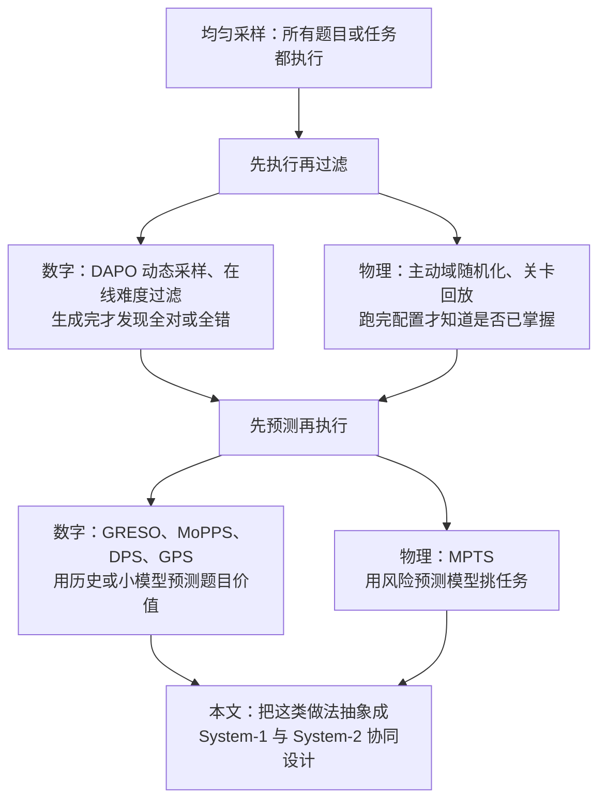
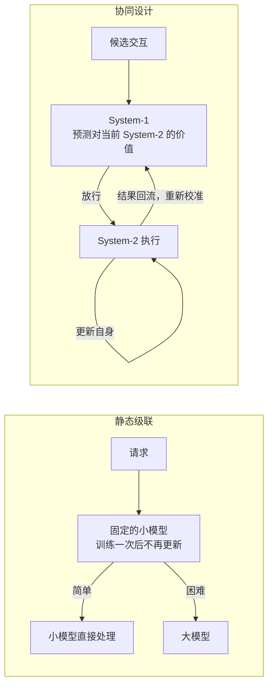
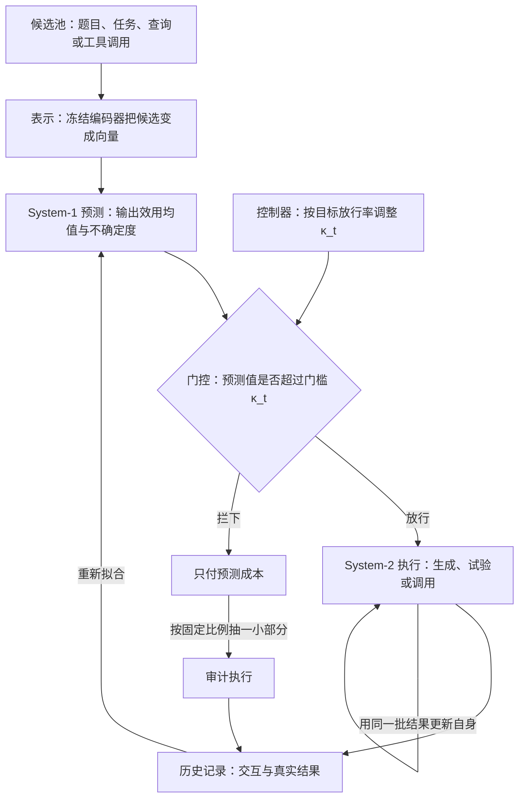
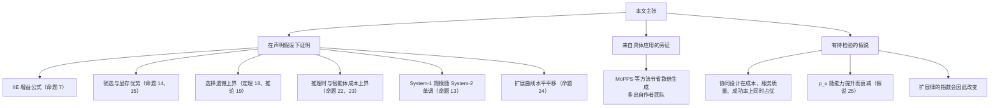
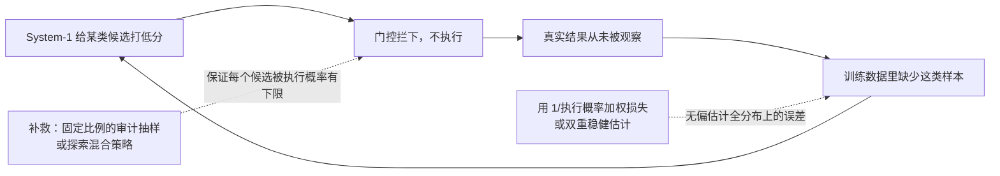

# 先估值，再付费：让轻量 System-1 决定昂贵的 System-2 执行什么

> **原题**：Does Scaling Toward AGI Depend on What System-1 Lets System-2 Execute?
> **作者**：Qi Wang、Yun Qu、Lizhou Cai、Heming Zou、Haoang Chi、Yiqin Lv、Xiang Li、Haiyan Feng、Mengyu Ge、Yize Geng、Yuhang Jiang、Yixiu Mao、Xiangyang Ji（通讯作者）
> **机构**：论文页面只给出上标编号，没有写出机构名称。从作者名单与其引用的前作看，主体应是清华大学季向阳团队，这一点属于推断
> **年份**：2026（arxiv ID 2610.39497）
> **分类**：cs.AI
> **链接**：https://arxiv.org/abs/2610.39497
> **精读日期**：2026-11-02

## 阅读须知

### 这篇在领域里的位置

这是一篇「观点文章」（Perspective），不是方法论文。全文没有一组自己的实验，篇幅主要花在两件事上：先提出一个立场，再用一串带假设的命题把这个立场形式化。

它所针对的现象，在大模型后训练里已经很常见。用强化学习训练推理模型时，每一道题都要让模型生成好几条完整的思维链，再用自动判分器打分。可如果某道题模型全对或全错，这一组生成就产生不了任何学习信号，算力等于白花。过去两年，这个方向上出现了一条清晰的演进线：先是「生成之后再过滤」，后来变成「生成之前先预测」。

本文作者团队本身就是「生成之前先预测」这条线的主要贡献者之一，发表过预测题目难度的 MoPPS、预测任务风险的 MPTS 等工作。这篇文章想做的，是把这些具体技巧上升为一条普遍原则：让一个便宜的预测器（作者称为 System-1）先给每个候选交互估值，只把值得做的交给昂贵的执行者（System-2）。作者进一步猜测，「值得做的交互占多大比例」可能是描述扩展规律的一个新坐标。

### 读完能回答什么

1. 本文说的 System-1 和 System-2，与「快思考、慢思考」的通常说法有什么不同？
2. 为什么在 GRPO 训练里，全对或全错的题目白白消耗算力？「生成后过滤」与「生成前预测」在成本上差在哪里？
3. 「效用相关交互密度」ρ_u 是什么？为什么理想情况下节省的倍数是 1/ρ_u，现实中又会被哪些因素打折？
4. 预测器只能从自己放行的样本里学习，这个「自我审查」问题为什么危险？作者给出的补救是什么？
5. 这篇文章哪些结论是证明过的，哪些只是假说？它目前缺少什么证据？

### 阅读前置

本文假定读者了解大语言模型的基本训练流程，知道强化学习微调大致是「生成、打分、按分数更新」的循环，也了解什么是推理时的思维链。

本文不假定读者熟悉 GRPO 的公式细节、贝叶斯信息增益、主动推断或模型预测控制。这些概念都会在首次出现时先铺垫再展开，且只讲到理解本文所需的程度。

### 缩写表

| 缩写或符号 | 全称与含义 |
|---|---|
| AGI | Artificial General Intelligence，通用人工智能 |
| System-1 / System-2 | 本文按「执行角色」定义：System-1 是给候选交互打分的轻量预测器，只输出分数不输出答案；System-2 是真正执行交互的昂贵模型或智能体 |
| RLVR | Reinforcement Learning with Verifiable Rewards，可验证奖励的强化学习，用自动判分器给模型输出打分 |
| GRPO | Group Relative Policy Optimization，组相对策略优化。同一道题生成一组回答，用组内相对得分作为优势值 |
| CoT | Chain-of-Thought，思维链 |
| DAPO | 一种 RLVR 训练方法，其「动态采样」会丢弃全对或全错的题目组 |
| MoPPS / GRESO / DPS / GPS | 几种在生成之前预测题目价值的提示词采样方法，前三者与 GPS 多出自本文作者团队 |
| MPTS | Model Predictive Task Sampling，模型预测式任务采样，用于具身智能体的任务选择 |
| ρ_u | 效用相关交互密度：候选交互中，真实效用超过预设下限的那部分所占比例 |
| ρ_info / ρ_adv | ρ_u 的两个特例：以信息增益为效用时记作 ρ_info；以「组内结果有对有错」为效用时记作 ρ_adv |
| IIE | Interaction Information Efficiency，交互信息效率：每单位系统成本换来的效用 |
| fp / fn | false positive / false negative。fp 指无用候选被放行的比例，fn 指有用候选被拦下的比例 |
| KV 缓存 | Key-Value Cache，键值缓存 |
| MPC | Model Predictive Control，模型预测控制 |
| EFE | Expected Free Energy，期望自由能，主动推断理论里的行动选择准则 |
| VoI | Value of Information，信息价值 |
| CVaR | Conditional Value-at-Risk，条件风险价值，衡量分布最坏尾部的平均损失 |

## 一、问题

过去十几年，通往更强人工智能的主路线一直是「把执行者做大」：更大的模型、更多的数据、更长的推理、更多的智能体。作者把这个昂贵的执行者统称为 System-2。问题在于，执行者越强，它每做一次交互的成本也越高，而这些交互的价值却很不均匀。

所谓交互，作者给了一个很宽的定义：智能系统与数据、计算或环境之间的任何一次信息交换。对语言模型，它是一次生成；对机器人，它是一条轨迹；对调用工具的智能体，它是一次工具调用。这些交互有一个共同点：成本必须先付，价值要事后才知道。

于是，作者提出的核心问题是：System-2 能否在执行之前就知道一次交互值不值？System-2 自己回答不了这个问题，因为估值的成本必须远低于执行的成本，否则估值本身就把省下来的钱花光了。

### 1.1 浪费发生在哪里：数字与物理两种情形

先看数字情形。在 RLVR 训练里，GRPO 对每道题生成 G 条回答，每条回答得到一个奖励 r_g。算法用组内均值和标准差把奖励标准化，得到每条回答的「优势值」：

$$A_g = \frac{r_g - \mu_r}{\sigma_r + \epsilon}$$

这里 μ_r 是组内奖励均值，σ_r 是组内标准差，ε 是防止除零的小常数。一旦整组回答全对或全错，每个 r_g 都等于均值，所有优势值都是零，这道题就贡献不了任何梯度。可是那 G 条回答的生成成本已经一分不少地付掉了。

作者给出了一个衡量「这道题有没有用」的简洁公式。设模型当前在这道题上的通过率为 p，那么一组 G 条回答「有对有错」的概率是：

$$u_{\mathrm{adv}} = 1 - p^G - (1-p)^G$$

为了直观，这里代入几个数字（本笔记自行计算，非论文数据）。取 G = 8：通过率为 0.5 时，这个概率约为 0.99；通过率升到 0.9 时，降到约 0.57；通过率到 0.98 时，只剩约 0.15。换句话说，模型越熟练，题库里能产生信号的题目就越少。

再看物理情形。具身智能体常用「域随机化」训练：在模拟器里随机改变光照、物体、摩擦等参数，让策略见过足够多的变化。物理交互不能随意并行，每条轨迹都要按真实时间跑完。参数空间维度越高，「挑哪些任务来练」就和「练多少个任务」同样重要。

### 1.2 前人的两条路线

在这两种情形里，已有工作都经历了从「先执行再过滤」到「先预测再执行」的转变。下图把这条演进线和本文的位置画在一起。

「先执行再过滤」的问题在于，它必须为无用的那部分付全价，才能发现它无用。「先预测再执行」把这笔钱换成了一次小模型的前向计算，但前提是预测得足够准。

### 1.3 静态级联与协同设计

作者特别区分了两种把便宜模型和昂贵模型配对的方式。一种是业界常见的「静态级联」：一个训练好就不再更新的小模型给请求分类，把难的交给大模型。作者举了一个商业产品作为例子，它自称「第一个 System One 模型」。

另一种是作者主张的「协同设计」。在这种设计里，System-1 预测的是「这个交互对当前这个 System-2 有多大价值」，而 System-2 每次更新之后，这个价值都会变。因此 System-1 必须持续用 System-2 的执行结果重新校准。两者的区别不在于有没有两个模型，而在于有没有反馈与联合优化。

## 二、方法

本文的「方法」不是一个可以直接运行的算法，而是一套形式化框架。作者称之为「条件交互」（conditional interaction），流程是一个四步循环：预测、门控、执行、更新。

### 2.1 条件交互策略

框架的核心是一条选择规则。设 û(i) 是 System-1 对候选交互 i 的预测效用，κ_t 是第 t 步的门槛，β 是控制选择锐度的参数。那么选中 i 的概率正比于：

$$\pi_{\mathrm{CI}}(i) \propto \exp\big(\beta\,\hat{u}(i)\big)\cdot \mathbf{1}\big[\hat{u}(i)\ge \kappa_t\big]$$

这条式子有两个部分，各管一件事。指示函数那一项是「门」：预测效用低于门槛的候选直接被排除。指数那一项决定在门内的候选之间如何偏好：β 越大，越倾向于只选最好的那个；β 趋于零时，门内的候选被一视同仁。

作者证明了几个极限情形。当 β 趋于无穷时，策略退化为「选预测效用最大的那一个」。当门槛高于所有候选的预测值时，门内为空，策略选择「什么都不做」。这些结论都不难，但把边界说清楚了。

### 2.2 效用：要明确声明「有用」指什么

效用这个词在本文里是一个可替换的槽位。作者用作范例的效用是「期望贝叶斯惊奇」：执行这次交互、观察结果之后，模型对参数的信念平均会改变多少。直觉上，结果完全可预料的交互，这个值接近零。

不过作者反复强调，信息增益只是选择之一。在课程学习里，效用可以是预期的性能提升；在决策里，可以是信息价值；在机器人鲁棒训练里，可以是适应失败的风险。不同效用的最优解不同，不能混用。本文所有效率结论都对任意一种声明好的效用成立，前提是预测器的排序足够准。

### 2.3 效率指标：IIE 与产出率

为了衡量门控值不值，作者定义了交互信息效率 IIE：在一串候选上，被执行交互获得的总效用，除以总成本。总成本包括两部分：每个候选都要付的预测成本 c_pred，以及被执行候选的执行成本。

作者特别指出，IIE 是一个比值，可以靠「花很少、得很少」来抬高。因此它必须与「产出率」一起报告：每个候选平均换来多少效用。一个过于激进的门可以把 IIE 做得很好看，同时让学习者饿着肚子。

### 2.4 主目标：一个分数背包问题

作者把各种门控技巧统一到一个优化问题下。给定一份候选清单、每个候选的预测效用和成本，在总预算 Γ 内选择执行哪些，使期望效用最大。这在运筹学里叫「分数背包问题」。

它的最优解是一条门槛规则：按「效用除以成本」从高到低排序，放行比值超过某个价格 λ 的候选。等成本时，这条规则就退化为上面那个共同门槛 κ_t。这一步把门控从经验技巧变成了一个有明确最优解的资源分配问题。

### 2.5 两个系统如何一起学习

作者用两个算子描述协同学习。设 θ 是 System-2 的参数，φ 是 System-1 的参数。一个算子用经过门控采样的交互更新 θ；另一个算子用已执行交互的真实效用拟合 φ。每一轮先更新 System-1，再让 System-2 沿着新门控放行的梯度走一步。

两个系统跑在不同的时钟上：System-1 适应得快，System-2 进步得慢。作者承认，「更好的预测改变了被执行的交互，进而改变了 System-1 收到的监督」，这个耦合循环可能发散。双时间尺度随机逼近理论给出了一些收敛条件，但对一般架构的收敛保证仍然是开放问题。

下图是作者给出的具体实现结构：表示、预测、门控、学习四个部件，外加一条审计通道。

门槛 κ_t 本身也是动态的。作者给了一个简单的更新：若实际放行比例高于目标放行率，就把门槛调高一点，反之调低。这相当于把门槛当作一个对偶变量来维持放行率。

### 2.6 System-1 应该多大

协同设计还有一个容量分配问题：System-1 越大，误判越少，但预测成本越高。作者在「误差曲线固定」的假设下证明了一个方向性结论。当 System-2 变贵（执行成本乘以 k）时，System-1 的最优大小只会不变或变大，不会变小。

背后的道理是：System-2 变贵会稀释预测本身的成本，却会放大误判的代价，因为误放行一个无用候选要付的执行费随 System-2 一起涨。作者也明确说，这个结论只给方向不给速率，而且一旦 System-2 变强改变了预测问题本身，结论就不一定成立。

### 2.7 三个解释视角

作者还从三个理论视角解释「为什么一个小预测器能判断一个大执行的价值」，并声明这些只是解读，不是推导。

第一是主动推断。在偏好均匀、成本单独计算的条件下，主动推断里的「期望自由能」最小化等价于选择信息增益最大的行动。条件交互可以看作它的一个带成本门、带摊销预测器的特例。

第二是决策视角。生成一段思维链要付 L 个词元的成本，但真正改变信念的是判分器给出的结果，往往只有一比特。世界模型要模拟整个结果，代价接近执行本身；而 System-1 只需要估计一个标量，所以它的瓶颈是「估值」而不是「模拟」。

第三是控制视角。整个循环在结构上类似模型预测控制：预测、规划、只执行第一步、观测后重新规划。不同之处在于，被控制的对象（System-2 的参数）和控制器的模型是一起演化的。

## 三、实验

这篇文章没有实验。作者自己的说法是，它给出的是「在声明假设下证明的结论」、「来自具体应用的旁证」和「有待检验的假说」三类内容。下面先把三类内容的边界画清楚，再逐条列出主要结论，最后用一组自算的数字让公式落地。

### 3.1 主要形式化结论

| 结论 | 内容 | 关键假设 | 没有说的 |
|---|---|---|---|
| IIE 增益（命题 7） | 完美且免费的预测器下，效率提升为 1/ρ_u；若无用交互比有用交互更贵，提升更大 | 无用交互效用为零 | 误判时提升会按 fp、fn、c_pred 打折 |
| 筛选增益（命题 14） | 相对「全部执行再过滤」，成本比例为 ρ_u + r，r 是预测成本与执行成本之比 | 完美筛选 | 编码成本在短生成时可能主导 r |
| 显存（命题 15） | 预测式打分的峰值显存与候选池大小无关 | 同步评估 | 流式执行的过滤器也能做到，此时只剩时间优势 |
| 遗憾上界（定理 18） | 预测误差 ε 小于效用间隔一半时，遗憾为零；否则线性增长 | 一致误差、正间隔 | 对盲区之外的样本才成立，盲区误差单独计入 |
| 推理时成本（命题 22） | 单次探测门控的计算量不超过 ρ_tt + (1 + c_pred)/C + δ_FP，精度损失不超过 δ_FN | 存在准确的停止预测器 | 作者承认这两条前提都未被测量 |
| 智能体成本（命题 23） | 成本上界与 ρ_u、预测成本、误判率线性相关 | 动作可分离 | 长界面操作里单个点击无用、合起来必要，假设失效 |
| 扩展曲线平移（命题 24） | 门控后的损失曲线等于原曲线在对数算力轴上左移 ln(1/ρ_u) | ρ_u 恒定、预测完美、等成本 | 只是常数倍节省，不改变指数 |

### 3.2 一组数字：理想与现实的差距

为了直观感受这些公式，这里代入一组假想数字（本笔记自行计算，非论文数据）。设题库里只有 25% 的题目能产生信号，即 ρ_u = 0.25，所有题目执行成本相同。

在完美且免费的预测器下，效率提升是 1/0.25，也就是 4 倍。若预测成本是执行成本的 1%，按命题 14，成本比例变为 0.26，提升约 3.8 倍。

再让预测器犯错：10% 的无用题被误放行，10% 的有用题被误拦下。按命题 7 第二部分的公式，提升降到约 2.9 倍。与此同时，产出率下降了 10%，因为被误拦的那部分有用题再也不会被训练。这正是作者强调「效率与产出率必须一起报告」的原因。

### 3.3 作者提出的检验方案

既然没有实验，作者把重点放在「怎样才能证伪」。对扩展假说，检验方法是：在门控与不门控两条训练曲线上，都用独立的审计池测量 ρ_u，再把损失画在「信息算力」坐标上。如果两条曲线重合，说明门控只带来常数倍节省；如果门控曲线更陡，才支持「指数改变」的说法。

对推理时的结论，检验方法是：先测出「把预算从短默认值提高到满预算时答案变对」的查询比例，再跑满预算的基线和单次探测门控，比较精度损失是否超出审计样本测得的误拦比例。

### 3.4 值得单独拎出来的几点

第一，作者自己承认，现有的节省证据与「零假设」一致。也就是说，MoPPS 等方法的数倍节省，目前只能说明门控带来常数倍的加速，还不能说明它改变了扩展律的形状。全文最有野心的那个主张，恰恰是证据最少的。

第二，温度参数解决不了探索问题。一个反直觉的细节是：只要指示函数在，被拦下的候选在任何有限 β 下的被选概率都是零。调软门控只会在门内随机化，门外的候选永远不会被执行。要让预测器有机会纠错，必须显式加入探索混合或固定比例的审计抽样。

第三，假阴性不会直接拉低 IIE。被误拦的有用交互只是没被付钱，所以效率指标看不出损失；损失体现在产出率上。这意味着只看效率指标去调门槛，很容易调出一个「效率很高但学不到东西」的系统。

## 四、局限

### 4.1 作者承认的局限

最重要的一条，作者称之为「门控审查了自己的训练数据」。一旦 System-1 决定执行哪些交互，它也就决定了自己能从哪些样本里学习。被打低分的候选不会被执行，结果不会被观察到，分数也就永远不会被纠正。这在统计上叫「非随机缺失」，与算法决策里的「选择性标签」问题同构。

作者给出的补救在原则上可行：因为门控是自己设计的，每个候选被执行的概率已知，可以用逆概率加权校正。但审计比例要多大、加权带来的方差会吃掉多少筛选收益、在策略不断漂移时误差能否下降，作者都说这是最需要理论的地方。

其余几条作者承认的局限依次是：ρ_u 的衰减曲线从未被测量过；推理时的效率主张连间接证据都没有；两系统耦合循环的收敛性没有一般保证；框架只考虑单个学习者，在多智能体、自我对弈和辩论中，一次交互对发起者无用却可能对旁观者有用。

另外，作者也划定了门控不适用的场景：候选价值均匀、预测成本接近执行成本、执行本来就便宜、误拦代价灾难性（如安全攸关的控制），以及效用本身定义错了。最后一种最隐蔽，因为预测器会系统性地拦下那些本可以暴露定义错误的交互。

### 4.2 读者能看出的问题

第一，标题提出的是一个关于 AGI 扩展的大问题，正文给出的回答却完全没有新的测量。核心的 1/ρ_u 结论本质上是一条记账恒等式：如果能免费且准确地跳过无用的那部分，就能省下那部分的钱。命题写得严谨，假设也列得诚实，但数学深度有限，真正的难点（预测器能否在漂移中保持准确）恰好被留作开放问题。

第二，旁证几乎全部来自作者团队自己的前作。MoPPS、DPS、MPTS、在线批次选择、示例选择等被引用来「说明」框架的工作，作者名单与本文高度重叠。这些工作本身可能都很扎实，但它们不能算作对本框架的独立验证，作者也只说它们「说明而非验证」了框架。

第三，「无用交互不改变学习者」这个假设比看上去更强。在 GRPO 里，全对题的梯度确实为零；但在更一般的训练中，已掌握的样本可能在防止遗忘、维持校准上有作用。门控会改变训练分布，从而改变模型学到什么，而不只是改变学得多快。作者把这些效应列为「可能解释曲线差异的混杂因素」，却没有讨论它们可能带来的负面影响。

第四，测量 ρ_u 本身就不便宜。按作者的协议，需要一个独立于门控的审计池，对每个候选重复执行多次以得到置信区间，并且随着策略更新反复重测。这笔开销会抵消一部分节省，文中没有估算它的量级。

第五，文中有一些修辞性内容，例如「超级鹦鹉假说」的三阶段时间线，以及用一款商业产品说明业界对 System-1 的兴趣。作者自己也加了「示意性」「单个产品不能说明行业趋势」之类的限定，读者可以把这些段落当作背景，不必当作论据。

## 值得跟读

若想看这个框架的具体落地，可以从作者引用的几篇实际方法读起：

1. **MoPPS**（Qu et al., 2026a，Can Prompt Difficulty be Online Predicted for Accelerating RL Finetuning of Reasoning Models?）：用在线贝叶斯后验跟踪每道题的通过率，在生成之前预测哪些题有信号，是本文最主要的旁证。
2. **DAPO**（Yu et al.）：「生成之后再过滤」的代表，动态采样丢弃全对或全错的题组，是理解本文成本对比的基线。
3. **GRESO**（Zheng et al., 2026）：用奖励历史跳过可能零方差的题目，来自另一个团队，可以作为相对独立的参照。

## 一句话

主张让便宜预测器先为每次交互估值、只让昂贵模型执行值得的部分，理论完整但尚无实测。
