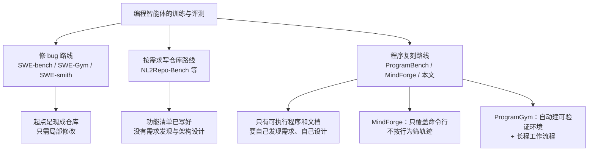
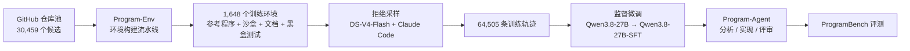
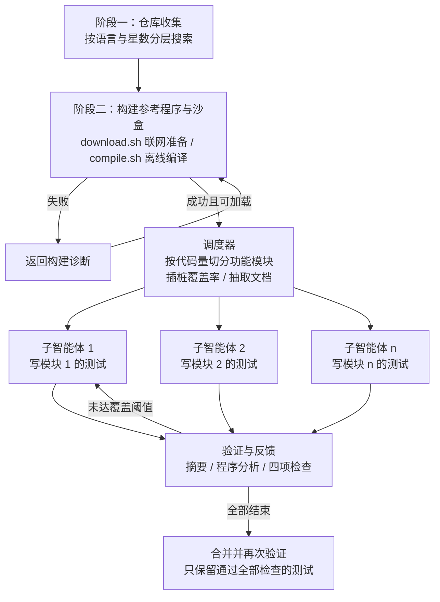
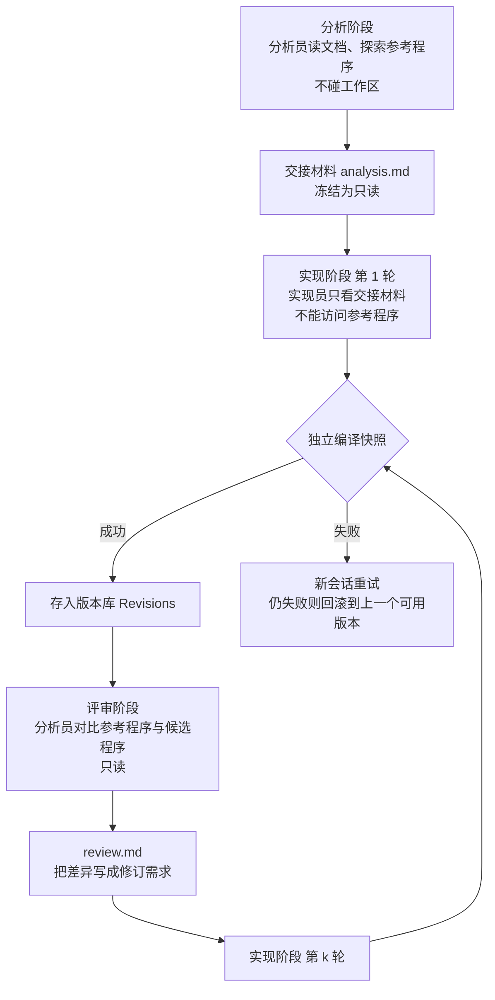

# ProgramGym：为「从零复刻一个程序」的编程智能体批量搭建训练场

> **原题**：ProgramGym: Scaling Training Environments for Long-Horizon Program Reproduction Agents
> **作者**：Chengyi Yang, Renxu Bao, Jue Hou, Zongpei Teng, Ziheng Wang, Yujie Lin, Chengsong Huang, Junnan Zhu, Delai Qiu, Yining Wang, Shengping Liu, Fei Long, Jinsong Su
> **机构**：厦门大学（主体，通讯作者为龙飞、苏劲松）、华盛顿大学圣路易斯分校、中国科学院自动化研究所、云知声
> **年份**：2026（arxiv ID 2610.13395，2026 年 10 月 9 日提交）
> **分类**：cs.SE / cs.AI / cs.CL
> **链接**：https://arxiv.org/abs/2610.13395
> **精读日期**：2026-10-12

## 阅读须知

### 这篇在领域里的位置

过去两三年里，「让大模型当程序员」这件事大致沿着三条路线推进。第一条是修 bug，也就是 SWE-bench 那一类任务：给模型一个现成的仓库和一条问题描述，让它改几处代码，使仓库里的测试通过。第二条是按需求文档写仓库，例如 NL2Repo-Bench：给模型一份写得很细的需求说明，让它从空目录开始把整个项目写出来。

这两条路线有一个共同点，就是「要做什么」已经被别人想清楚了。修 bug 时代码骨架是现成的，写仓库时功能清单是现成的，模型主要负责把既定的东西落成代码。可是一个真正的软件工程师从零开发一个程序时，最花心思的恰恰是另外两件事：弄清楚到底需要哪些行为，以及决定系统该怎么设计。

第三条路线「程序复刻」正是为了考这两件事而出现的。代表性的评测是 ProgramBench：给模型一个只能运行、看不到源码的参考程序，再给它这个程序的使用文档，让它在断网的沙盒里自己摸索程序的行为，然后用任意编译型语言重写出一个外部表现一致的程序。ProgramBench 发布时，所有旗舰模型在 200 个任务里一个都没有完整做出来。

本文 ProgramGym 处在这条路线的「训练」一侧。评测已经有了，可是用来训练的环境几乎没有，于是作者做了两件事：一是一条能把开源仓库自动变成可验证训练环境的流水线，二是一套适合长时间开发的智能体工作流程。

### 读完能回答什么

1. 「程序复刻」和修 bug、按需求写仓库相比，难在哪里，为什么现有的训练资源用不上？
2. 怎样把一个 GitHub 仓库自动变成「有参考程序、有沙盒、有黑盒测试」的训练环境，测试的质量又靠什么保证？
3. 为什么作者要把智能体拆成分析、实现、评审三个互相隔离的会话，而不是让一个会话从头干到尾？
4. 微调和换工作流程，各自带来了多少提升，哪一个更大？
5. 为什么测试通过率能超过一半，而完整复刻成功的任务仍然几乎为零？

### 阅读前置

本文假定读者熟悉大语言模型的基本用法，知道什么是监督微调、什么是上下文窗口，也大致用过 Claude Code、Codex 这类编程智能体。读者不需要专门做过软件测试或程序分析，文中出现的覆盖率插桩、静态分析等概念都会在首次出现时先做铺垫再解释。

### 缩写与术语表

- **ProgramBench**：程序复刻评测集，200 个任务，给参考程序与文档，要求从零重写出行为一致的程序。
- **ProgramGym**：本文提出的整体框架，由 Program-Env 和 Program-Agent 两部分组成。
- **Program-Env**：本文的环境构建流水线，把开源仓库自动加工成训练环境。
- **Program-Agent**：本文的智能体工作流程，分析、实现、评审三段式，配合版本管理。
- **SWE-bench / SWE-Gym / SWE-smith**：修 bug 类任务的评测集与训练环境，起点都是一个现成的仓库。
- **NL2Repo-Bench**：按自然语言需求文档从零写仓库的评测集。
- **MindForge**：同期一项程序复刻训练工作，只覆盖命令行程序，未公开环境与轨迹。
- **SFT**（Supervised Fine-Tuning，监督微调）：用示范轨迹直接训练模型模仿。
- **Rejection sampling（拒绝采样）**：让模型多次尝试，只保留通过筛选标准的那些轨迹作为训练数据。
- **mini-SWE-agent**：一个极简的编程智能体外壳，ProgramBench 官方用它评测旗舰模型。
- **Tests Passed / Almost Resolved / Resolved**：ProgramBench 的三个指标，分别是平均测试通过率、通过率不低于 95% 的任务占比、全部测试通过且未被判作弊的任务占比。
- **Handoff（交接材料）**：Program-Agent 中在不同会话之间传递的书面记录。
- **K**：Program-Agent 的实现轮数预算。
- **DS-V4-Flash-0731**：DeepSeek-V4-Flash 的 0731 版本，本文用它来构建环境、采集轨迹，也作为一个被评测的模型。

## 一、问题

这个问题之所以值得做，是因为编程智能体正在从「改代码的助手」走向「独立开发的工程师」，而后者需要的能力，现有的训练数据几乎没有覆盖。今天的模型在修 bug 上已经相当熟练，因为 SWE-bench 这一类任务有大量可执行的训练环境，模型可以反复练习「读仓库、改几行、跑测试」。与之相对地，从零开始做一个程序时，没有人告诉你功能清单，你得自己去试、去观察、去归纳，再自己决定模块怎么划分、数据结构怎么选。这种能力没有训练场，模型就只能停留在听话的代码编辑器阶段。

具体的痛点在评测数字上已经很直观。ProgramBench 发布时，没有任何旗舰模型完整复刻出哪怕一个程序；即使是表现最好的模型，平均也只能通过一半左右的测试。换句话说，模型能写出「看起来差不多」的程序，却很难把一个真实程序的全部可观察行为都对上。

### 1.1 任务的严格表述

为了把高层动机落到可验证的技术问题上，先把任务说清楚。作者设想一个从开源仓库里取出的、源码可见的代码库，记作 $R_i$。一条环境构建流水线 $\Phi$ 会把它加工成一个训练环境，这个环境包含四样东西：

- 参考程序 $B_i^\star$：从源码编译出来、但只给执行权限的程序，智能体能运行它，却看不到它的代码；
- 使用文档 $D_i$：从仓库里抽出的 README 等说明；
- 黑盒行为测试集 $\mathcal{T}_i$：一组用相同输入同时喂给参考程序和候选程序、比较外部表现的测试；
- 运行沙盒 $S_i$：一个断网的容器，里面预装好编译工具链和依赖，智能体就在这里工作。

智能体可以选择任何编译型语言，最终要交出源码和一个编译脚本，编译出候选程序 $\hat{B}_i$。测试集比较 $\hat{B}_i$ 与 $B_i^\star$ 在选定输入上的外部行为，这些比较结果就是训练时的行为监督信号。

这里有一个需要先说清楚的限制：测试集只覆盖有限个输入，所以全部通过也只说明「在测到的那些行为上一致」，并不等于两个程序在语义上完全等价。这个限制在后面的「局限」一节还会再谈。

### 1.2 前人路线与各自的缺口

围绕这个任务，前人大致走了三条路，彼此之间的关系可以用下面这张图概括。

第一条是修 bug 路线。SWE-Gym、SWE-smith 这些工作已经证明，只要能大规模生成可执行环境，智能体在修 bug 上的表现就会明显提升。可是这些环境的起点都是一个现成的代码库，任务是做局部修改，它们给不出「这个程序整体上该表现成什么样」的监督，所以无法直接拿来训练程序复刻。

第二条是按需求写仓库路线。它确实让模型从空目录开始写代码，但需求文档已经把功能规格写死了，任务因此被简化成「照单实现」，需求发现和架构设计这两个最难的环节被提前替模型做掉了。

第三条是程序复刻路线本身。在本文之前，同期的 MindForge 也尝试为这个任务构建训练环境，但它只覆盖命令行程序，而且它不按「复刻出来的程序行为对不对」来筛选训练轨迹，于是功能上错误的复刻也可能被当成成功的示范拿去训练。这个缺口正是本文要补的。

### 1.3 两个必须解决的难题

于是，作者把要解决的问题归结为两个。

第一个是**可验证环境的规模化**。每个仓库的语言、依赖和构建方式都不一样，要用一条统一的流水线把参考程序可靠地编出来，本身就不容易。更难的是测试：测试既要覆盖足够多的功能，又要能把错误的复刻拒之门外，而一次性生成的测试往往漏掉重要行为，或者断言写得太弱，什么实现都能蒙混过关。

第二个是**长程开发的稳定性**。通用的智能体外壳能调用工具，但它本身并不会协调「先探索、再实现」的节奏。智能体可能还没把参考程序摸清楚就开始写代码；随着上下文越来越长，它又可能忘掉早先观察到的需求。要解决这些问题，就需要一个显式的开发流程，把行为证据保存下来，并把实现、评审和修订组织起来。

## 二、方法

ProgramGym 由两部分组成，分别对应上面两个难题：Program-Env 负责把仓库变成训练环境，Program-Agent 负责让智能体在长时间开发中不跑偏。两者的关系如下。

### 2.1 Program-Env：把仓库加工成训练环境

Program-Env 是一条三阶段的流水线，中间有一个「调度器」负责衔接。它没有从头写一个新的智能体，而是直接借用 Claude Code、Codex 这样的通用外壳来干活，自己只在外面加一层「验证、反馈、再修」的循环。之所以这样设计，是因为构建和写测试这两件事本身就需要灵活的探索能力，通用外壳已经做得很好，作者真正要补的是「怎么判断它做对了没有、做错了怎么告诉它」。

**阶段一：仓库收集。** 作者用 GitHub 搜索接口，按编程语言和星数区间分层检索，排除已归档和 fork 出来的仓库，校验元数据、去重、只保留许可证信息有效的仓库。已经被现有代码评测集用过的仓库也会被剔除，以免训练数据和评测数据撞车。每个保留下来的仓库被锁定在一个固定的提交上，并且必须有明确的构建配置。这一步得到了 30,459 个候选仓库。

**阶段二：构建参考程序与沙盒。** 每个仓库的依赖和工具链各不相同，所以作者让 Claude Code 为每个仓库写两个脚本：download.sh 负责联网下载依赖，compile.sh 负责在断网状态下编译。把「联网准备」和「离线编译」分开，是为了保证最终交给智能体的沙盒确实能在断网的条件下复现构建。外层循环会验证这两个脚本：只有两者都成功、并且编出来的可执行文件能正常加载，流程才进入下一步；否则就把失败诊断交回给智能体修改。验证通过的可执行文件就是参考程序 $B_i^\star$，准备好的镜像则成为运行沙盒 $S_i$ 的基础。

**调度器：承上启下。** 构建成功之后，调度器做三件准备工作。第一，按代码规模决定开几个并行分支，每个分支分到一个功能模块。第二，给可执行文件插桩，以便测量测试覆盖了多少代码。这里的「插桩」，指的是在编译时往程序里加入计数代码，运行测试后就能知道哪些代码行被执行过。第三，抽取 README 等文档，形成使用文档 $D_i$。

**阶段三：黑盒测试构建。** 这是整条流水线里最费力、也最关键的部分。每个分支由一个运行 Claude Code 的子智能体负责，它在一个外层循环里反复写测试。每一轮结束后，流水线把反馈整理成三份结构化文档：

- **摘要**：记录这一轮做了什么、还剩什么没解决、为什么没解决，让下一轮不必从头回忆；
- **程序分析**：先用动态分析（也就是看覆盖率）找出还没被测到的功能，再用静态分析把这些功能追溯到程序对外的入口，告诉智能体「从哪个命令行参数或子命令进去，就能测到这段代码」；
- **验证结果**：用四项检查筛出有问题的测试。

这四项检查是保证测试质量的核心，值得逐一说清楚：

1. **通过检查**：测试必须在参考程序上通过。连标准答案都过不了的测试，本身就是错的。
2. **双跑检查**：同一个测试在参考程序上跑两次，结果必须一致。结果时好时坏的测试不稳定，不能当监督信号。
3. **空实现检查**：把被测程序换成一个什么有意义的输出都不产生的「空程序」，测试必须失败。如果连空程序都能通过，说明这个测试根本没在约束程序行为。
4. **弱断言检查**：用静态检查工具找出断言写得太宽松的测试，例如只检查程序没崩溃、不检查输出内容。

下一轮开始时，子智能体先读这些反馈，修好被标记的问题测试，再去扩展尚未覆盖的功能。当某个模块的覆盖率达到阈值，或者轮数用完，这个子智能体就结束。所有分支结束后，各自的测试集合并到一起，再整体验证一次，最终的测试集 $\mathcal{T}_i$ 只保留通过全部四项检查的测试。

用数学语言表达，最终测试集可以写成：

$$
\mathcal{T}_i=\{\,t\in\tilde{\mathcal{T}}_i \mid t(B_i^\star)=\text{pass} \wedge t^{(1)}(B_i^\star)=t^{(2)}(B_i^\star) \wedge t(B_\varnothing)=\text{fail} \wedge \text{断言足够强}\,\}
$$

其中 $\tilde{\mathcal{T}}_i$ 是候选测试集，$B_\varnothing$ 是空实现，$t^{(1)}$ 与 $t^{(2)}$ 表示同一测试的两次独立运行。这个式子没有新的数学，只是把四项检查写成了一个集合过滤条件，读者可以把它理解为「四道闸门全部放行的测试才留下」。

### 2.2 Program-Agent：像工程师一样分阶段开发

环境建好之后，下一个问题是智能体怎么在里面干活。作者观察到，在长时间的程序复刻里，单一会话的工作方式有两个毛病：一是上下文被压缩以后，早先观察到的行为证据会丢失；二是最后交出的程序甚至可能编译不过。于是，作者参照软件工程师的迭代习惯，在 Claude Code 之上设计了 Program-Agent。

**角色隔离的三阶段流程。** Program-Agent 把工作拆成两个角色（分析员和实现员）和三个阶段（分析、实现、评审），每个阶段都在一个独立的新会话里进行。之所以要隔离会话，是为了避免不同阶段的记忆互相污染；阶段之间不传完整的对话历史，只传书面的交接材料。

- **分析阶段**：分析员阅读文档、探索参考程序，但不允许修改工作区。所有观察到的行为证据和实现建议写进 analysis.md，并冻结成只读文件，供后续所有阶段参考。不让分析员动代码，是为了保证它收集需求时不带偏见。
- **实现阶段**：实现员在一个独立会话里，只根据冻结的交接材料写代码，看不到参考程序。第一轮的目标是交出一个能编译的基线版本，避免从根上编译失败；后面各轮则逐条解决评审提出的问题。每一轮的进展记在 delivery.md 里。
- **评审阶段**：分析员把参考程序和刚编出来的候选程序放在一起比较，把确认过的行为差异写成可执行的修订需求，记在 review.md 里。评审时，候选程序和工作区都是只读的，以防它「自己给自己找补」。

为什么实现阶段不能看参考程序？作者在附录里专门解释了这一点：如果实现员也能随时去试参考程序，它很可能在主要目标完成之后，继续没完没了地去对齐边角行为，交付因此一拖再拖，整个分阶段流程也会退化成无序的试错。把进一步的行为探索交给评审阶段，每轮都把差异写成明确的需求，进度反而更稳、更可追溯。

**固定的迭代预算。** Program-Agent 先做一次分析，然后让实现和评审交替进行固定的 $K$ 轮。这个预算同时解决了单会话方式的两个常见问题：一是过早收工、交出半成品，二是无休止地做低价值探索，把长程任务拖垮。

**版本管理。** 多轮实现下来，共享的工作区可能积累错误的修改，以至于 compile.sh 再也编不出可执行文件。为此，Program-Agent 把「独立编译」当作每一轮实现的关口：它把已提交的源码导出成一个干净的快照，在开发工作区之外编译。编译成功的快照被存进版本库，并交给下一轮评审；如果某个阶段超时、缺少必要产物或编译失败，就开一个新会话在有限次数内重试，还是不行，就回滚到上一个验证过的版本。每一个成功的版本都成为后续的恢复点，这让多阶段的复刻过程不会因为某一轮的失误而前功尽弃。

### 2.3 训练数据怎么来

最后补上训练这一环。作者用 DS-V4-Flash-0731 驱动 Claude Code，在全部 1,648 个环境里做拒绝采样，按测试通过率筛选轨迹。由于 Claude Code 在一次长任务中会重置或切换上下文，一次任务级的尝试可能产生好几段上下文各自独立的交互片段，作者把每一段都当作一条单独的训练轨迹，总共得到 64,505 条。这个数字不等于 64,505 次独立的环境尝试，读的时候要留意。

训练时对 Qwen3.8-27B 做全参数微调，训练两个轮次（epoch），框架是 ms-swift。序列被打包成最长 262,144 个词元的块，以容纳很长的交互轨迹，超长的样本直接丢弃。损失只算在模型自己生成的回复上，用户输入、环境反馈和工具输出只作为条件上下文；此外，调用了当前环境里并不存在的工具的那些回复，损失也被置零，这样无效的工具调用不会被模型学去，而同一条轨迹里其余有效的部分仍然保留。

## 三、实验

### 3.1 环境的规模与质量

先看 Program-Env 造出了什么。最终得到 1,648 个训练环境，覆盖 C、C++、Go 和 Rust 四种语言，按功能分成八类，其中开发者工具和命令行与系统工具是最大的两类。构建这些环境一共调用了 5,918 个写测试的子智能体，总共消耗约 1,368 亿个词元，平均每个环境约 8,300 万个词元，绝大部分花在写测试上。

测试质量方面，平均覆盖率为 72.99%，中位数为 81.63%，一共有 665,512 个通过验证的测试用例，平均每个仓库约 404 个。值得一提的是，其中 98.50% 是流水线根据源码功能从头写出来的，只有 1.50% 改写自仓库原有的测试。从测试的交互类型看，几乎所有子智能体（99.24%）都写了输入输出类测试，82.82% 写了命令行参数类测试，68.77% 写了帮助信息类测试，另外还有配置、子命令和终端界面（TUI）类测试。

为什么候选仓库有三万多个，最后只剩一千多个环境？作者给了两个原因。其一是过滤：很多仓库在 Linux 上编不过，或者需要显示器、输入设备，或者编译和插桩超过 3,600 秒的上限。其二是成本：每个环境平均要花八千多万个词元，处理全部候选超出了预算。

### 3.2 主要结果

ProgramBench 的三个指标前面已经介绍过：Tests Passed 是各任务测试通过率的平均值，Almost Resolved 是通过率不低于 95% 的任务占比，Resolved 是全部测试通过且未被判定作弊的任务占比。下表摘录主要结果，旗舰模型一栏来自 ProgramBench 原作者，使用的是 mini-SWE-agent 外壳。

| 模型 | 智能体外壳 | Tests Passed (%) | Almost Resolved (%) | Resolved (%) |
|---|---|---|---|---|
| GPT 5.4 | mini-SWE-agent | 37.70 | 0.00 | 0.00 |
| Claude Sonnet 4.6 | mini-SWE-agent | 47.50 | 1.00 | 0.00 |
| Claude Opus 4.7 | mini-SWE-agent | 50.90 | 3.00 | 0.00 |
| Gemini 3.5 Flash | mini-SWE-agent | 53.60 | 3.00 | 0.00 |
| Claude Opus 4.7 (xhigh) | mini-SWE-agent | 55.10 | 4.50 | 0.00 |
| DS-V4-Flash-0731 | Claude Code | 57.68 | 4.50 | 0.00 |
| DS-V4-Flash-0731 | Program-Agent | 58.97 | 5.00 | 0.00 |
| Qwen3.8-27B | Claude Code | 34.87 | 3.50 | 0.50 |
| Qwen3.8-27B | Program-Agent | 55.71 | 5.50 | 0.50 |
| Qwen3.8-27B-SFT | Claude Code | 42.84 | 1.50 | 0.00 |
| Qwen3.8-27B-SFT | Program-Agent | 56.25 | 4.50 | 0.50 |

这张表可以拆成两组对照来读，每组只变一个因素。

**第一组：外壳不变，只看训练的作用。** 都用 Claude Code 时，经过 Program-Env 轨迹微调的 Qwen3.8-27B-SFT 达到 42.84%，比原版的 34.87% 高出约 8 个百分点，也超过了 GPT 5.4 在 mini-SWE-agent 下的 37.70%。这说明 Program-Env 提供的沙盒和黑盒测试，确实能为程序复刻提供有效的训练监督。

**第二组：模型不变，只看工作流程的作用。** 把外壳从 Claude Code 换成 Program-Agent，原版 Qwen3.8-27B 从 34.87% 升到 55.71%，提升约 21 个百分点；微调版从 42.84% 升到 56.25%。两者都超过了 Claude Opus 4.7（50.90%）和 Gemini 3.5 Flash（53.60%）在 mini-SWE-agent 下的成绩。换句话说，同样的模型权重，换一套像工程师一样分阶段的工作方式，能从参考程序里还原出多得多的行为。

把两组放在一起看，一个耐人寻味的事实是：工作流程带来的提升（约 21 个百分点）远大于微调带来的提升（约 8 个百分点），而在 Program-Agent 之下，微调版只比原版高 0.54 个百分点。这意味着在本文的设置里，训练环境的主要价值或许在于提供可验证的监督与可复用的轨迹，而决定成绩上限的，更多是智能体如何组织长程工作。

### 3.3 迭代预算与成本

作者还考察了实现轮数 $K$ 的影响。用 Qwen3.8-27B-SFT 加 Program-Agent，$K=1$ 时 Tests Passed 为 43.49%，$K=3$ 时为 54.13%，$K=5$ 时为 56.25%，大部分收益在第三轮之前就拿到了。$K=5$ 时已经和 DS-V4-Flash-0731 用 Claude Code 的 57.68% 相当。

| 实现轮数 K | Tests Passed (%) |
|---|---|
| 1 | 43.49 |
| 3 | 54.13 |
| 5 | 56.25 |

在成本上，作者报告 Program-Agent 用更少的输出词元还原了更多的程序行为：三种预算下的输出词元都少于原版模型用 Claude Code 时的消耗。作者的解释是，Program-Agent 把词元花在有结构的修订上，而不是一条越拉越长的单会话轨迹上。

### 3.4 智能体行为的变化

作者统计了不同设置下智能体每一轮使用的动作类型。在 Claude Code 下，两个模型主要在「执行」和「试探」；换成 Program-Agent 后，「阅读」和版本管理（git）类动作明显增多，而且在经过 Program-Env 训练的模型上增加得最多。作者据此认为，Program-Agent 把智能体的行为引向了探索与修订。

### 3.5 值得单独拎出来的反直觉结果

有两个结果和直觉相反，值得单独讨论。

第一，**测试通过率过半，完整复刻却几乎为零。** 表中所有设置的 Tests Passed 都在 35% 到 59% 之间，可 Resolved 最高只有 0.5%，旗舰模型全部是 0。这说明「大部分行为对上」和「全部行为对上」之间隔着一道很深的沟：剩下那些边角行为，往往最难被发现，也最难被正确实现。整体复刻一个程序，至今仍是一个没有解决的问题。

第二，**微调之后 Almost Resolved 反而下降。** 在 Claude Code 外壳下，微调使平均通过率从 34.87% 升到 42.84%，但通过率不低于 95% 的任务占比却从 3.50% 降到 1.50%。一个合理的解读是，模仿训练让模型在大量任务上「多做对一些」，却没有让它在少数任务上「做到几乎全对」；平均分和尖子任务的数量，衡量的是两种不同的能力。论文没有深入分析原因，这一点在读结论时要留个心眼。

## 四、局限

### 4.1 作者承认的局限

**测试不等于等价。** 作者明确说明，黑盒测试只覆盖有限个输入，全部通过只代表在测到的行为上一致，不代表语义上完全等价。平均覆盖率约 73%，意味着每个仓库仍有相当一部分代码没有被测试触及，其中一部分是因为这些代码本来就无法从黑盒接口访问到。

**难度分布偏向简单任务。** 按作者的复杂度评分，1,648 个任务里有 1,492 个简单、151 个中等、只有 5 个困难。作者解释这是有意为之：太难的任务几乎采不到成功轨迹，对训练帮助不大；而且这个评分衡量的是仓库规模，不完全等于复刻难度。等模型能力上来，同一条流水线可以往中等和困难任务扩展。

**成本高，覆盖有限。** 每个环境平均八千多万词元，三万多个候选仓库只处理了一千多个。流水线虽然是全自动的，但想把规模再扩大一个数量级，需要相当可观的算力预算。

**没有和最相近的工作正面比较。** MindForge 没有公开环境和轨迹，作者因此无法在同一协议下做直接对比。

### 4.2 读完能看出来的潜在问题

**构建环境、采集轨迹、被评测，用的是同一个模型家族。** 环境由 DS-V4-Flash-0731 驱动 Claude Code 构建，训练轨迹也由它采集，而它本身又在 ProgramBench 上拿到了表中最高的分数。这本身不是错误，但意味着测试的写法、轨迹的风格都带着这个模型的偏好，微调后的 Qwen 学到的，有一部分可能是「DS-V4-Flash 的做事习惯」。

**两种外壳的对比并不完全对等。** 旗舰模型的成绩来自 mini-SWE-agent，本文模型用的是 Claude Code 或 Program-Agent，并且有 8 小时、8 核、16 GB 内存的资源配置。外壳和预算不同，跨栏比较「超过旗舰模型」时需要打折扣。更公平的对照，是让旗舰模型也跑一遍 Program-Agent，论文没有做。

**工作流程的收益几乎盖过了训练的收益。** 在 Program-Agent 下，微调版只比原版高约 0.5 个百分点，这让人想问：如果工作流程本身就能带来二十个百分点，训练环境的边际价值究竟有多大？或许训练的价值要在更强的模型、更难的任务或者强化学习的设置里才能完全显现，但本文的数据还不足以回答。

**训练只用了监督微调。** 程序复刻天然有可自动验证的奖励信号，也就是测试通过率，非常适合强化学习。本文只做了拒绝采样加监督微调，没有利用这些环境做强化学习，这是一个明显的后续方向，也是现有结论的边界。

**可复现性依赖尚未发布的资源与闭源外壳。** 作者承诺会发布 ProgramGym，但截至论文提交时环境和代码尚未公开；流水线和智能体都建立在 Claude Code 之上，构建成本又以千亿词元计，独立团队完整复现的门槛不低。

## 一句话

自动把开源仓库变成带黑盒测试的程序复刻训练场，再配一套分析、实现、评审隔离的工作流程，让 27B 模型逼近旗舰。
