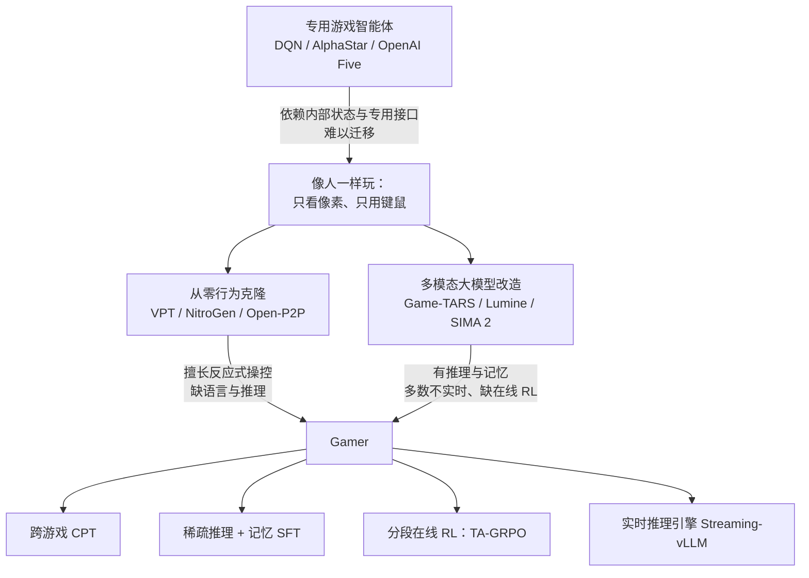
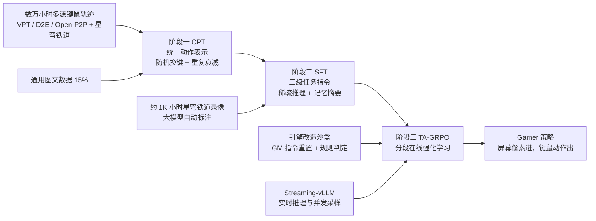
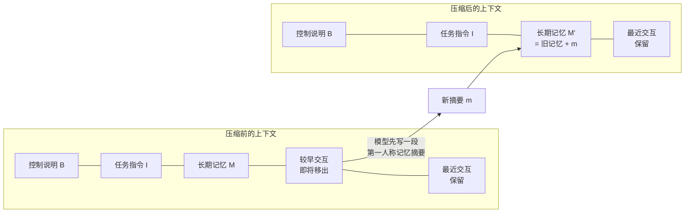
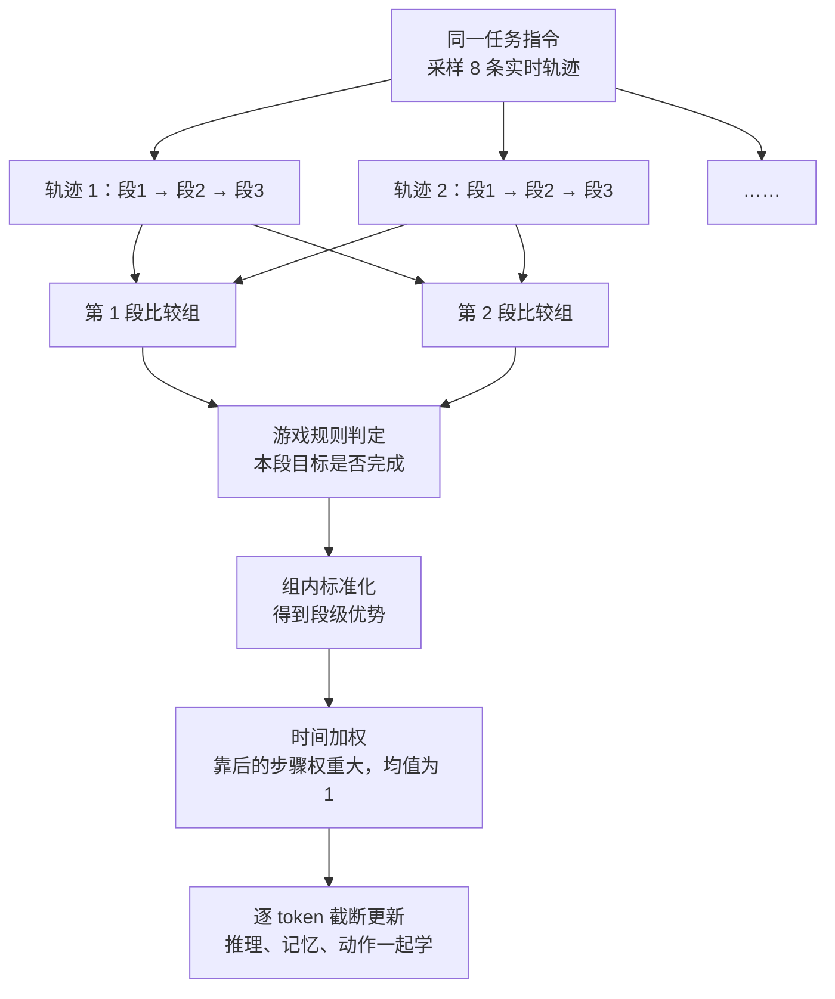
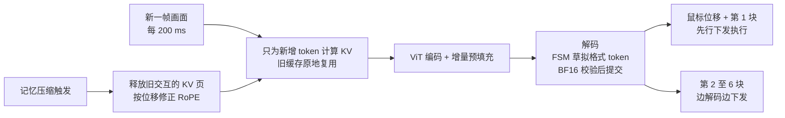
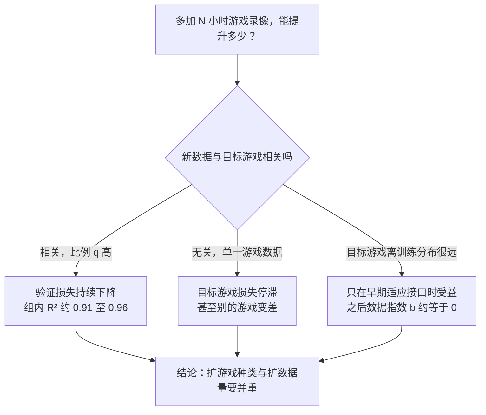

# Gamer：面向长时程实时游戏的通用视觉-语言-动作基础模型

> **原题**：Gamer: A Generalist Vision-Language-Action Foundation Model for Long-Horizon Real-Time Game Agent
> **作者**：Run Luo、Kuan Zhang、Qi Deng、Yukun Chen、Zhihao Yang、Yufei Zhang、Renrong Hu、Yi Zhang、Guiyu Ma、Tianyu Fan、Longze Chen、Hao Sun、Jiaming Li、Jiaming Yang、Xiaohao Liu、Tao Tan、Minzheng Wang、Hangtian Jia、Shuai Yuan、Lvdi Wang、Xiao Liu、Chao Ma、Yuting Zou、Yinhe Zheng、Xiaobo Xia、Dawei Jiang、Shaoqing Ren
> **机构**：米哈游崩坏 AI 研发团队（miHoYo Honkai AI R&D Team），部分作者为实习期间完成
> **年份**：2026（arxiv ID 2611.18397）
> **分类**：cs.CL（主分类）
> **链接**：https://arxiv.org/abs/2611.18397
> **精读日期**：2026-11-16

## 阅读须知

### 这篇在领域里的位置

让人工智能打游戏，是一条走了十多年的老路。早期的做法是给每个游戏单独训练一个策略：DeepMind 的 DQN 打 Atari，AlphaStar 打星际争霸，OpenAI Five 打 Dota 2。这些系统的成绩很亮眼，但它们大多直接读取游戏内部状态，或者使用为该游戏量身定做的动作接口，换一个游戏便要从头再来。

最近两三年，方向转向了「像人一样玩」：只看屏幕像素，只用键盘鼠标。一条支线是从零开始做大规模行为克隆，代表是 OpenAI 的 VPT（在 Minecraft 上）以及后来的 NitroGen、Open-P2P；另一条支线是把多模态大模型改造成会按键的智能体，代表是字节的 Game-TARS、在原神上训练的 Lumine，以及 Google DeepMind 的 SIMA 2。本文属于第二条支线，并且试图把它往「能实时运行、能在商业 3D 游戏里做完长任务、能在线强化学习」这三个方向同时推进一步。

本文的作者是米哈游自己的团队，评测主战场是他们自家的《崩坏：星穹铁道》。这一点决定了这篇论文的独特之处：作者能改造游戏引擎、用 GM 指令重置任务、用游戏内部规则判定任务是否完成，于是能在一款完整的商业游戏里做在线强化学习，这是外部研究者很难复制的条件。

### 读完能回答什么

- 一个多模态大模型怎样把「按住 W 走两秒、同时把鼠标往左甩」这样的操作写成文本 token，又为什么要把一次观察切成六个动作块
- 为什么同样多的游戏录像时长，喂给模型带来的收益可以差很多，GameScaling 的缩放律如何把「数据组成」写进公式
- 长任务远远超过上下文窗口时，Gamer 怎样用「记忆摘要」把前后串起来，又怎样在这种分段的轨迹上做 GRPO 强化学习
- 为什么作者坚持说推理延迟不只是部署问题，而是在线强化学习能否学好的前提
- 在暂停游戏、给足思考时间的条件下，通用大模型其实比 Gamer 更强，这件事该怎样理解

### 阅读前置

本文假定读者熟悉 Transformer 与自回归语言模型的基本训练方式，知道 KV 缓存（KV cache）在推理时的作用，并且大致了解 PPO 一类策略梯度强化学习的思路。读者未必做过游戏智能体，也未必熟悉 GRPO 或推理引擎 vLLM 的内部实现，这些在正文里会先铺垫再展开。

### 缩写表

- **VLA**（Vision-Language-Action，视觉-语言-动作模型）：输入图像与文字、直接输出可执行动作的模型，最早流行于机器人领域。
- **MLLM**（Multimodal Large Language Model，多模态大模型）：能同时读图和读文字的大语言模型，本文的底座是 Qwen3-VL 与 Qwen3.5。
- **CPT**（Continued Pre-Training，继续预训练）：在已经训练好的模型上，用新领域的大量数据接着做预训练式的学习。
- **SFT**（Supervised Fine-Tuning，监督微调）：用带标注的「输入-目标输出」对训练模型，让它学会按指令行事。
- **RL**（Reinforcement Learning，强化学习）：模型自己与环境交互，根据结果的好坏调整策略。
- **GRPO**（Group Relative Policy Optimization，组相对策略优化）：同一题目采样多份回答，用组内相对得分代替价值网络来估计优势的强化学习方法，由 DeepSeekMath 提出。
- **TA-GRPO**（Temporal-Aware GRPO，时序感知 GRPO）：本文对 GRPO 的改造，用于分段的长时程轨迹。
- **HSR**（Honkai: Star Rail，《崩坏：星穹铁道》）：米哈游的回合制角色扮演游戏，本文的主要训练与评测环境。
- **RT / 暂停评测**：RT 指 real-time，模型思考时游戏照常推进；暂停评测指 time-paused，模型思考时游戏暂停。论文里把后者缩写为 TP，本笔记为避免与张量并行混淆，一律写作「暂停评测」。
- **TP1 / TP4**（Tensor Parallelism，张量并行）：把一个模型的矩阵运算拆到 1 张或 4 张 GPU 上并行计算。
- **MoE**（Mixture of Experts，混合专家）：每个 token 只激活一部分参数的稀疏模型，如 Qwen3.5-35B-A3B 表示总参数 35B、每次激活约 3B。
- **FSM**（Finite-State Machine，有限状态机）：本文用它预先猜出输出里格式固定的 token。
- **RoPE**（Rotary Position Embedding，旋转位置编码）：通过旋转向量来编码 token 位置的方法，Qwen 系列都采用它。
- **BF16 / W8A8**：BF16 是 16 位浮点数格式；W8A8 指权重与激活都量化为 8 位整数。
- **ViT**（Vision Transformer）：多模态模型里负责把图像编码为 token 的视觉编码器。
- **GM 指令**（Game Master command）：游戏开发者用来直接修改游戏状态的后台命令，例如传送角色、设置任务进度。

## 一、问题

为什么要花力气让一个模型学会打商业游戏？表面上看这是娱乐，实际上它对应着两个很实在的需求。第一个需求来自游戏公司本身：一款持续更新的大型游戏每个版本都要做大量回归测试，新任务能不能走通、新小游戏有没有卡死的状态，过去主要靠人工测试员一遍遍地玩。如果有一个能看屏幕、按键盘、按任务说明行动的智能体，就能把很大一部分测试自动化。

第二个需求更长远。研究者普遍希望有一种「通用交互智能体」，既能在电脑界面上操作，也能在三维世界里行动，最终迁移到机器人身上。可是在真实世界里训练机器人，试错成本高、环境又难以控制；现代 3D 游戏恰好兼具复杂性与可控性：画面复杂、地形立体、任务分好几层、反馈常常延迟，同时又能随时重置、随时判定成败。于是游戏成了训练这类智能体的理想沙盒。

过去几年，这个方向已经走到了这样一个位置：通用多模态大模型看得懂游戏画面，也能讲出下一步该做什么，但真让它们在一个不暂停的游戏里实时操作，表现会大幅下滑。原因很朴素：一个大模型思考一次要一两秒，等它把动作发出去，游戏画面早已变了，角色可能已经撞墙或者被打倒。长任务里这种延迟一再累积，便导致早早失败。

把上面的动机落到一个可验证的技术问题上，本文要做的事情可以这样表述：只使用屏幕像素作为输入、标准键盘鼠标作为输出，训练一个单一模型，使它能在多款游戏之间迁移基础操控，能在一款商业 3D 游戏里完成长达几十分钟、包含导航对话战斗解谜的任务，并且在游戏不暂停的实时条件下保持这种能力，同时整套系统要能支撑在线强化学习。

前人在这个问题上主要走过三条路线。第一条路线是专用智能体，在 Atari、Minecraft、星际争霸上已经达到甚至超过人类水平。它们做对的地方是证明了强化学习在游戏里的威力；不够用的地方在于，它们往往读取游戏内部状态、使用专门的动作空间或者专门的接口，几乎无法迁移到别的游戏。现代商业游戏一般也不会对外开放内部状态。

第二条路线是从零开始的大规模行为克隆。行为克隆（behavior cloning）的意思是，把人类玩家的录像与按键记录当作「标准答案」，让模型去模仿每一步的操作。VPT 用一个逆动力学模型给网上的 Minecraft 视频反推出按键标签，再拿这些伪标签训练策略；NitroGen 与 Open-P2P 把这种做法推广到更多游戏。这条路线擅长学习反应式的底层操控，但模型从零训练，没有语言理解与推理能力，难以听懂「去找某某 NPC 对话」这类任务说明。

第三条路线是把多模态大模型改造成游戏智能体。Game-TARS 在字节自己的 Seed-VL 上做继续预训练与微调，Lumine 在 Qwen2-VL 上针对原神训练，SIMA 2 则在 Gemini 上做微调与强化学习。这条路线继承了大模型的语言与推理能力，并且已经开始使用原生键盘鼠标作为动作空间。它的不足在于：多数系统不能实时运行，训练配方里缺少在线强化学习，或者没有开源。

下面这张图把三条路线与本文的关系画了出来。

除了这三条路线各自的短板，作者还指出了一个常被忽视的问题：推理延迟不只影响部署体验，还会污染在线强化学习的数据。如果模型发出动作时画面已经变化，那么采集到的轨迹里，「看到的状态」与「动作实际作用的状态」对不上，奖励信号也随之失真。换句话说，在一个不暂停的游戏里做强化学习，推理引擎的速度本身就是学习算法的一部分。

## 二、方法

Gamer 的整体做法可以概括为「一个模型、一种动作格式、三段训练、一套实时引擎」。模型底座是 Qwen3-VL-8B（缩放实验另用 Qwen3.5 系列），全程不加额外的动作输出头，键盘鼠标操作直接写成语言模型词表里的 token。训练分为继续预训练、监督微调与强化学习三段，三段共享同一种输入输出格式；推理与在线采样则由自研的 Streaming-vLLM 承担。

### 2.1 统一的观察与动作表示

要让一个模型在多款游戏之间共享知识，首先得有一种所有游戏都适用的动作格式。作者的选择是退到最底层的设备接口：所有游戏都通过屏幕输出画面、通过键盘鼠标接收输入，那么就用屏幕截图作为观察，用原生按键与鼠标位移作为动作。

不同游戏里同一个键的含义不同，比如 E 键在一个游戏里是交互，在另一个游戏里可能是技能。为了解决这个问题，每个游戏附带一份控制说明，记为 $\mathcal{B}$，它把每个物理按键映射到它在该游戏中的功能，并且被放进模型的输入里。模型于是能结合说明来理解当前按键的含义。

时间上的切分是这样设计的：模型每 200 毫秒看一帧画面，也就是 5 Hz 的观察频率；每个 200 毫秒的区间内部再切成六个动作块，每块约 33 毫秒，于是动作频率达到约 30 Hz。之所以要「一次观察、六个动作块」，是因为游戏操作需要的时间精度远高于视觉判断需要的频率：按住移动键、短促点击、拖拽、组合键，都需要比 200 毫秒更细的时间粒度，但每 33 毫秒就看一次画面、思考一次，计算量又承受不起。

一个区间的动作写成如下形式：

$$a_t = \left(\Delta \mathbf{P}_t,\ \mathcal{K}_{t,1},\ \dots,\ \mathcal{K}_{t,6}\right)$$

- $\Delta \mathbf{P}_t$：这一区间内鼠标的累计位移，包括水平、竖直与滚轮三个分量，是三个数字。
- $\mathcal{K}_{t,j}$：第 $j$ 个动作块里处于按下状态的键盘按键与鼠标按钮的集合，$j$ 从 1 到 6。

相邻两块都出现的键视为一直按住，后一块里消失的键视为松开，这样就能表达「按住」与「点按」的区别。整个动作被包在 `<|action_start|>` 与 `<|action_end|>` 两个特殊标记之间，按文本 token 逐个生成，不需要额外的输出头。

### 2.2 去偏：随机换键与重复衰减

游戏录像数据有两种天然的偏差，会让模型学偏。第一种偏差是按键频率极不均匀：移动键 W 出现得远多于其他键，模型容易记住「多数时候按 W」，而不是理解「W 在这里表示前进」。第二种偏差是大量重复：作者统计，超过 85% 的动作步与前一步完全相同，因为玩家常常长时间按住同一组键在走路或等待。

针对第一种偏差，作者采用随机换键（random key remapping）。具体做法是：对每条轨迹随机抽一个可重新绑定按键之间的一一映射，把控制说明、历史动作与目标动作都按这个映射一致地替换，而画面与鼠标位移保持不变。这样模型不能再靠「某个键出现得多」来猜答案，只能去读控制说明，理解按键的功能。

针对第二种偏差，作者沿用 Game-TARS 的做法，对连续重复的动作降低损失权重：

$$\omega_t = \gamma^{\,n_t - 1},\qquad \gamma = 0.9$$

- $n_t$：当前动作已经连续重复的次数，动作一旦变化便重置为 1。
- $\omega_t$：第 $t$ 步动作 token 的损失权重。

这样一来，新发出的动作拿到完整权重，持续重复的动作权重逐步变小。录像本身保留完整，动作持续多久的信息并未丢失，但监督信号被引导到「停下、转向、交互」这类行为切换的时刻，而这些时刻才是真正需要学的地方。

### 2.3 GameScaling：把数据组成写进缩放律

继续预训练阶段有一个实际问题：手里有很多游戏的录像，该按什么比例混合，再多加一千小时数据能换来多少提升？作者在配套工作 GameScaling 里做了一组受控实验来回答这个问题。实验在 Qwen3.5 的 0.8B、2B、9B、27B 四种尺寸上，配合 50 到 1600 小时六档数据量，以及五种 Minecraft 占比不同的数据配比，一共 120 个配置，花费约 4.5 万 H200 GPU 小时。

他们拟合的验证损失公式在常见的「模型大小 + 数据量」缩放律上加入了数据组成项：

$$\mathcal{L}_{\mathrm{val}}(N,D,q)=E+\frac{C_N}{N^{a}}+\frac{C_D\,q^{\eta}}{D^{b}}+\frac{C_q}{(q+\epsilon)^{c}}$$

- $N$：模型参数量。
- $D$：游戏录像时长，单位是小时。
- $q$：训练数据里与目标验证分布相关的那部分比例，取值在 0 到 1 之间。
- $E$、$C_N$、$C_D$、$C_q$、$a$、$b$、$c$、$\eta$：拟合得到的常数；$\epsilon$ 是一个很小的正数，防止 $q=0$ 时公式发散。

这条公式里最有信息量的是数据项中的 $q^{\eta}$。拟合出的 $\eta$ 为正，意味着在模型大小固定时，增加录像时长带来的收益，取决于新数据里有多少与目标游戏相关。换句话说，「看过更多游戏录像」与「看过更多与目标相关的录像」是两回事，后者才决定提升幅度。

### 2.4 监督微调：稀疏推理与跨上下文记忆

继续预训练教会模型「怎么操控」，监督微调则教它「按任务目标行事」。这一阶段在输入里加入两样东西：任务指令 $I$ 与长期记忆 $M$。任务指令分三个难度：简单级是局部操作，例如走近一个 NPC；中等级是子目标，例如绕过障碍再完成交互；困难级是一整段任务，例如穿过好几个区域并解决途中的挑战。

本文一个关键的设计是「稀疏推理」。长时间的游戏过程中，绝大多数步骤只是持续走路或重复攻击，不需要思考；只有路线走错、目标切换、资源取舍这些关键时刻才需要想一想。于是模型每一步输出的推理部分 $r_t$ 有三种可能：

- 空：常规步骤，直接输出动作。
- 当前推理：对眼下局面的判断与短期计划，例如改走另一条路。
- 记忆摘要：把即将移出上下文的信息浓缩成一段文字，留给以后用。

无论哪种情况，推理之后都必须紧跟一个可执行动作。模型自己决定什么时候需要思考，不另设分类器或路由模块，所有这些都在同一个自回归输出里完成。

记忆机制则是这样运作的：上下文窗口里保留最近若干轮交互（论文配置为最近 20 帧画面）。当较早的交互即将被挤出窗口、或者任务进入新阶段时，模型先根据当前能看到的全部信息写一段记忆摘要，然后那部分旧交互才被丢弃。记忆总量超出预算时，最早的完整摘要按时间顺序被移除。

这套记忆机制在后面三处被反复复用：监督微调时用来训练模型写摘要，强化学习时用来把长轨迹切成段并在段间传递任务状态，实时推理时用来让 KV 缓存保持在有限大小。

### 2.5 TA-GRPO：分段的长时程强化学习

先铺垫一下 GRPO。传统的 PPO 需要一个价值网络来估计每个状态的期望回报，训练成本高，在长任务上也难以估准。GRPO 的思路更简单：对同一道题采样一组回答，各自打分，然后用「这个回答的分数比组内平均高多少」来作为优势，省掉了价值网络。

把 GRPO 搬到长时程游戏里会遇到两个障碍。第一个障碍是一局任务可能持续上百分钟，整条轨迹远远超出上下文窗口，无法当作一个「回答」整体打分。第二个障碍是，若想让同一组轨迹从完全相同的中间状态出发，就要反复存档读档，在商业游戏里代价很高。

TA-GRPO 的处理方式是：用前面那套记忆压缩把每条长轨迹自然地切成若干段，段与段之间靠记忆摘要相连；然后把「同一任务、处于同一压缩阶段」的各条轨迹的对应段放在一组里比较。各段不要求起点状态完全一致，这样就免去了恢复游戏状态的开销，代价是组内各段的难度与起点会有差别。

每段的得分来自游戏规则可以验证的结果，例如这一段的当前目标是否完成。组内得分标准化后得到段级优势：

$$\hat{A}_{i}^{(k)}=\frac{R_i^{(k)}-\operatorname{mean}\big(\{R^{(k)}\}\big)}{\operatorname{std}\big(\{R^{(k)}\}\big)}$$

- $R_i^{(k)}$：第 $i$ 条轨迹在第 $k$ 段的验证得分。
- $\hat{A}_{i}^{(k)}$：这一段在组内的相对优势。

段级得分只说明这一段整体好不好，并不说明段内哪一步做得对。为此 TA-GRPO 给段内越靠后的步骤越大的权重，并把权重归一化到平均值为 1，从而把段级优势重新分配到每一步。作者也明说，这只是一个时间上的先验，并不意味着靠后的动作真的贡献更大。

最后的策略更新采用逐 token 的截断式目标，与标准 GRPO 一致。之所以不用整句共享的概率比，是因为推理文字的长度差别很大，整句概率比的量级会被长度主导。这样一来，同一个学习信号可以同时更新记忆摘要、稀疏推理与底层动作。

### 2.6 Streaming-vLLM：让推理跟上游戏

前面提到，延迟会同时损害部署表现与强化学习质量。作者因此自研了推理引擎 Streaming-vLLM，作为训练、评测与部署共用的后端。它在开源推理引擎 vLLM 的基础上做了四件事。

第一件事是有状态的 KV 缓存复用。每一轮交互的上下文与上一轮高度重叠，只是末尾多了一帧画面与一段动作。若每轮都重新编码全部历史，大部分计算都是重复的；Streaming-vLLM 为每个游戏环境保留已有内容的 KV 缓存，只为新追加的 token 计算新状态。记忆压缩丢掉旧交互后，保留下来的 token 位置前移，作者直接按位移量旋转已缓存的键向量来修正 RoPE 相位，而不重新计算。

第二件事是针对不同架构的执行优化。稠密模型与 MoE 模型共用同一套接口，底层则分别使用算子融合、通信重叠、CUDA Graph 回放，以及在 H200 上用 C++ 与裸 PTX 写成的低开销后端（论文称为 megakernel）。

第三件事是有限状态机草拟加 BF16 校验。动作输出里有大量格式固定的部分：思考标记的开闭、动作包的起止、数字之后的空格与分隔符、空按键组。有限状态机先把这些可预测的 token 草拟出来，再由目标模型用 BF16 精度一次性校验，只提交被接受的前缀。鼠标坐标的数值仍由模型自己生成，因此策略本身没有被改变，只是串行解码的轮数减少了。

第四件事是流式下发动作。鼠标字段与第一个动作块一旦校验完毕，就先发给客户端执行，其余动作块继续解码。客户端按顺序执行六个块，按下、按住、松开的语义保持不变。

在多环境并发方面，每个游戏环境都有自己的短期历史、长期记忆、KV 页面表与动作截止时间，共享的调度器在吞吐与单环境的及时性之间做平衡。实时评测与强化学习采样走的是同一条推理路径，所以训练时采集到的轨迹与部署时的执行条件一致。

### 2.7 数据构建与训练环境

监督微调需要的「任务说明、关键决策时的推理、记忆摘要」在原始录像里都不存在，作者用大模型自动补标。原始的星穹铁道录像约有 6.8 万段、1.1 万小时；经过去除损坏、帧不连续、音画不同步、坐标越界与长时间无操作的片段，再平衡各类场景之后，保留约 3200 段、1000 小时用于标注。

标注由闭源模型 GPT-5.6-Luna 分三遍完成。第一遍以约 10 秒为窗口找出关键决策点并写推理，得到约 120 万条推理标注；第二遍把最长 288 秒的片段按每秒一帧拼成带时间戳的拼图，切出约 6.3 万个任务段，中位时长约 40 秒；第三遍按约 16 秒一段写第一人称记忆摘要，得到约 22.3 万条。之后按覆盖的决策点数量自下而上组装成三级指令：1 到 2 个决策点为简单级，3 到 5 个为中等级，6 个以上为困难级。

| 训练阶段 | 数据 | 用途 | 规模 | 采样占比 |
|---|---|---|---|---|
| CPT | VPT、D2E、Open-P2P 及星穹铁道录像 | 跨游戏操控 | 公开数据约 2.4K 小时；星穹铁道约 332 小时 | 85% |
| CPT | LLaVA-OneVision、Zebra-CoT、GameQA、Embodied-Reasoner、Cambrian-S | 保持通用图文与具身理解 | 约 63 亿 token | 15% |
| SFT | 星穹铁道操作级 / 子目标级 / 任务级 | 三级指令跟随 | 约 26.1 万 / 21.1 万 / 23.4 万条 | 37.0% / 29.8% / 33.1% |
| RL | 在线验证轨迹 | 策略优化 | 约 1.46 万条 | 不适用 |

在线强化学习的环境是作者改造过的游戏沙盒。他们让游戏引擎对外暴露任务相关的状态变化与完成条件，用规则判定代替学习出来的奖励模型；又接入 GM 指令，在每局开始前把游戏设到预定的任务状态。所有这些特权访问都只在环境后端，策略本身仍然只看屏幕、只按键鼠。规模上，32 个并行的 Windows 游戏实例由 64 张 H200 支撑的推理池服务，每轮采集 128 条轨迹、每组 8 条。

## 三、实验

实验分四块：在公开游戏基准上检验继续预训练带来的跨游戏操控能力；在星穹铁道的两个长支线任务与一组小游戏上检验三段训练的效果；对比实时采样与低帧率采样对强化学习的影响；最后单独评测推理引擎的准确率与延迟。

### 3.1 公开基准上的跨游戏操控

四个公开基准离训练数据的距离依次变远：MCU（Minecraft 任务集）与 ViZDoom 属于训练覆盖过的游戏；OmniGameArena 是没见过但交互方式相近的 3D 游戏；GameWorld 在画面、操控与任务结构上差别最大。每个基准都报告实时分数，括号里是实时减去暂停评测的差值。

| 模型 | MCU | ViZDoom | OmniGameArena | GameWorld | 平均 |
|---|---|---|---|---|---|
| GPT-5.6-Sol | 8.7（-73.3） | 2.7（-24.0） | 14.5（-31.1） | 44.3（-9.6） | 17.6（-34.5） |
| Claude-Opus-5.0 | 8.7（-48.0） | 2.0（-18.8） | 16.4（-28.0） | 42.0（-10.8） | 17.3（-26.4） |
| DeepSeek-V4-Flash-Vision | 7.3（-28.7） | 3.3（-9.7） | 11.6（-15.5） | 28.5（-13.3） | 12.7（-16.8） |
| Qwen3.5-27B（未训练） | 4.0（-5.3） | 2.9（-2.7） | 7.6（-2.1） | 25.2（-4.1） | 9.9（-3.6） |
| Gamer-8B-CPT | 47.7（-13.0） | 14.4（-2.2） | 21.9（-3.0） | 34.0（+0.7） | 29.5（-4.4） |
| Gamer-35B-A3B-CPT | 65.3（+18.6） | 11.9（+1.7） | 18.7（-6.7） | 30.2（-0.1） | 31.5（+3.4） |

在实时条件下，两个继续预训练后的模型平均分 29.5 与 31.5，都高于表中最强的通用大模型约 17.6。差距最明显的是 MCU，Gamer 拿到 47.7 与 65.3，而通用模型都在 9 分以下。与此同时，在离训练分布最远的 GameWorld 上，GPT-5.6-Sol 的 44.3 仍明显高于 Gamer 的 34.0。

这张表里有一个值得单独拎出来讨论的现象。把括号里的差值加回去，就能还原出暂停评测时的分数：GPT-5.6-Sol 的暂停平均分约为 52.1，Claude-Opus-5.0 约为 43.7，而 Gamer-8B-CPT 只有约 33.9。也就是说，在给足思考时间的理想条件下，通用大模型其实玩得更好；Gamer 在实时条件下的领先，主要来自它掉分少，而掉分少又主要来自它快。这正好印证了作者的核心论点：在实时游戏里，延迟本身就是能力的一部分。但它也提醒读者，Gamer 的「理解与决策」水平并没有超过前沿通用模型。

另一个反直觉之处是 MoE 模型的实时分数反而高于暂停分数，平均高出 3.4 分，在 MCU 上高出 18.6 分。作者的解释是 MoE 推理更快，与持续变化的环境交互得更及时，减少了控制误差的累积。这个解释说得通，但实时分数高于暂停分数本身说明暂停评测的设置对这类模型也未必是「理想上限」，两种设置测到的东西并不完全一样。

### 3.2 缩放律的拟合与边界

GameScaling 的缩放律在训练覆盖的分布上拟合得很好：Minecraft 验证损失的 $R^2$ 为 0.982，其他训练游戏为 0.995；去掉不同配比之间的均值差异后，剩余的组内 $R^2$ 仍分别有 0.912 与 0.959，说明模型大小与数据量确实解释了大部分变化。

真正有意思的是作者主动报告的反例。对于离训练分布很远的游戏，验证损失在早期适应接口之后便不再下降，甚至回升，而训练损失还在继续下降。用同一公式去拟合，数据指数 $b$ 接近 0；表面上 $R^2$ 有 0.855，可那主要来自配比之间的静态差异，组内 $R^2$ 只有 0.079。换句话说，对于真正陌生的游戏，多堆录像几乎没有用处，总体拟合分数高并不代表加数据会继续进步。

### 3.3 星穹铁道长支线任务

两个评测支线都没有出现在训练数据里，但模型见过同一款游戏的其他内容，所以这是「熟悉的游戏、新的任务」，不是零样本迁移。第一个支线是 Opportunity Makes the Thief（Part I），有 30 个里程碑，时间预算 30 分钟；第二个支线是 Bestial Ferocity，有 55 个里程碑，含三个修理自动机的解谜，时间预算 100 分钟。两个支线名称照论文英文原文保留。每个任务评测三次取平均，准确率指成功的里程碑执行占全部评测执行的比例，而不是整条支线一口气走完的比例。

| 模型 | 支线一准确率 | 支线二准确率 | 支线二解谜 |
|---|---|---|---|
| Gemini-3.8-Flash | 16.7 | 45.5 | 0.0 |
| GPT-5.6-Sol | 16.7 | 41.8 | 0.0 |
| Claude-Opus-5.0 | 13.3 | 29.1 | 0.0 |
| DeepSeek-V4-Flash-Vision | 23.3 | 27.3 | 0.0 |
| Qwen3-VL-8B（底座） | 0.0 | 13.9 | 0.0 |
| Gamer-CPT | 34.4 | 47.9 | 0.0 |
| Gamer-SFT | 72.2 | 69.1 | 22.2 |
| Gamer-RL | 80.0 | 83.6 | 11.1 |

三段训练的增益层层递进。监督微调在两个支线上分别比继续预训练多出 37.8 与 21.2 个百分点，强化学习又在此基础上多出 7.8 与 14.5 个百分点。分项来看，导航是强化学习提升最大的一项：支线一从 47.6% 升到 69.1%，支线二从 55.2% 升到 80.2%。

值得注意的是解谜一项。所有通用大模型与继续预训练后的 Gamer 都是 0，监督微调后升到 22.2%，强化学习之后却回落到 11.1%。论文正文没有讨论这一回落，在每项只评三次的条件下，它可能是噪声，也可能说明强化学习的奖励主要奖励了导航与推进，并没有覆盖到解谜这类需要多步推理的环节。

### 3.4 星穹铁道小游戏

小游戏评测包含 7 种类型、共 40 个实例，涵盖图案拼接、逻辑推理、空间推理、时序规划与对时机敏感的操作。总分是七类成功率的不加权平均，避免实例多的类型主导结果。

| 模型 | 七类平均 |
|---|---|
| GPT-6.1-Sol | 17.1 |
| GPT-5.6-Sol | 12.0 |
| Claude-Opus-5.0 | 9.9 |
| Qwen3-VL-8B（底座） | 3.2 |
| Gamer-CPT | 15.0 |
| Gamer-SFT | 39.2 |
| Gamer-RL | 49.7 |

监督微调把平均分从 15.0 拉到 39.2，并且七类全部取得非零成功率，而底座模型只有三类非零。强化学习再提高 10.5 个百分点，最突出的是「导航罗盘」一类，从 50.0% 跳到 95.8%。

同样有一处回落值得记下：「雅努斯迷宫」在监督微调后是 52.4%，强化学习后降到 23.8%。与前面解谜的回落放在一起看，强化学习带来的提升并不是在所有机制上都均匀的，某些类型可能被牺牲了。

### 3.5 实时采样对强化学习的影响

为了证明「延迟会污染强化学习」，作者在八个导航任务上比较两种采样方式：一种是 Streaming-vLLM 的实时采样，另一种把控制频率降到约 0.6 帧每秒，模拟标准 vLLM 的速度。两种设置下游戏都照常推进。

结果是实时采样在训练早期就拿到更高奖励，最终奖励水平也更高。更重要的是，好几条低帧率的训练曲线在后期出现了奖励崩塌。作者的解释是：低帧率下控制误差不断累积，产生越来越偏的轨迹，这些轨迹进入在线优化之后又反过来破坏后续的策略更新。论文只给了曲线，没有给出数值表格。

### 3.6 推理引擎的准确率与延迟

首先要确认的是，各种缓存与压缩手段没有损害模型对视频流的理解。作者在 StreamingBench 的实时视觉理解子集与 OVO-Bench 上，用相同底座、相同硬件与相同缓存预算做对比。

| 方法 | 底座 | StreamingBench | OVO-Bench | 延迟 | 显存峰值 |
|---|---|---|---|---|---|
| DSCache | Qwen3-VL-8B | 83.21 | 58.2 | 0.53 秒 | 21 GB |
| Streaming-vLLM | Qwen3-VL-8B | 83.29 | 62.3 | 0.08 秒 | 22 GB |
| DSCache | Qwen3.5-9B | 80.56 | 56.3 | 1.56 秒 | 21 GB |
| Streaming-vLLM | Qwen3.5-9B | 83.77 | 60.9 | 0.16 秒 | 22 GB |

在准确率持平或更高的前提下，查询延迟降低了约一个数量级，显存占用基本相同。

然后是真实键鼠工作负载上的逐项加速，测试配置为 H200 上的 Qwen3.5-35B-A3B MoE 模型。

| 累计配置 | 单步延迟（毫秒） | 步频（Hz） | 理论控制频率（Hz） |
|---|---|---|---|
| 基线（单卡） | 1306 | 0.77 | 4.62 |
| + 有状态流式引擎（四卡） | 1265 | 0.79 | 4.74 |
| + 基础算子融合 | 1043 | 0.96 | 5.76 |
| + 并行重叠 | 832 | 1.20 | 7.20 |
| + CUDA Graph | 537 | 1.86 | 11.16 |
| + megakernel 低开销后端 | 88 | 11.41 | 68.46 |
| + 部分 W8A8 量化 | 86 | 11.65 | 69.90 |
| + FSM 引导解码 | 65 | 15.36 | 92.16 |

累计下来，单步延迟从约 1.31 秒降到 65 毫秒，提速 20.1 倍。其中贡献最大的一步是 megakernel 后端，把延迟从 537 毫秒压到 88 毫秒；单纯上四卡张量并行几乎没有收益，因为视觉编码、预填充与解码三部分的计算与通信开销各不相同，加速其中一项并不能等比例缩短整体时间。

需要说明的是，表中的「理论控制频率」等于步频乘以六个动作块，是推理吞吐换算出来的上限，并不是客户端实际的游戏帧率。客户端仍按标称的 30 Hz 协议执行动作。

## 四、局限

### 作者承认的局限

第一，评测只覆盖了选定的几类环境与任务结构。作者认为统一的观察-动作接口为扩展到更广的交互环境打下了基础，但跨更多环境扩充相关数据带来的收益，取决于训练经验的覆盖面与组成，这一点在缩放实验里已经看得出来。

第二，Streaming-vLLM 只在被评测的 GPU 平台上实现了实时交互。论文里的实时数字建立在 H200 与 A800 这类数据中心显卡上，若要在资源更受限的设备上部署，还需要模型压缩与进一步的运行时优化。

第三，快速连续的交互并不等于能解决复杂的策略问题。作者承认，在需要深度思考的环境里，推理能力可能仍是瓶颈，并提出未来可以做分层智能体：用一个大模型做慢速的深思熟虑，用一个小模型做快速的反应执行。

### 读完能看出的潜在问题

第一，评测规模偏小，统计波动可能不小。长任务评测只有两个支线，小游戏只有 40 个实例，每个任务评测三次。论文没有报告置信区间，几处强化学习后的回落，例如解谜从 22.2% 降到 11.1%、雅努斯迷宫从 52.4% 降到 23.8%，正文都没有解释，读者难以判断这是噪声还是系统性的取舍。

第二，与通用大模型的比较需要谨慎解读。前面已经算过，暂停评测下前沿通用模型的平均分明显高于 Gamer，Gamer 的实时优势主要来自推理快、动作格式贴合游戏。通用模型通过远程接口调用，延迟里还包含网络开销，它们也没有针对 30 Hz 键鼠格式做过适配。因此「超过 GPT 与 Claude」这一结论，更准确的表述是「在实时键鼠操控这个特定设定下超过」。

第三，核心能力依赖游戏开发方才有的条件。强化学习所需的规则判定、GM 指令重置与引擎改造，只有掌握游戏源码的一方能做；星穹铁道的 1.1 万小时录像与按键记录也不是公开数据。作者开源的是推理引擎与缩放实验的继续预训练检查点，星穹铁道上的最终模型与训练数据并未提及开源，外部研究者很难完整复现本文的主要结果。

第四，数据标注依赖闭源模型。约 120 万条推理、6.3 万个任务段与 22.3 万条记忆摘要都由 GPT-5.6-Luna 生成，标注质量直接决定监督微调能教给模型什么。论文提到用人工示例约束措辞，但没有报告标注的抽检准确率。

第五，TA-GRPO 的两处设计更像工程上的折中。按压缩阶段分组时，组内各段的起点状态与难度不同，组内比较的公平性会受影响；段内按时间先后加权只是一个先验，作者自己也承认它不代表靠后的动作贡献更大。这两点在本文的任务上效果尚可，但在奖励更稀疏、因果链更长的任务上是否依然稳定，还没有证据。

第六，算力门槛很高。仅缩放实验就花了约 4.5 万 H200 GPU 小时，在线强化学习需要 64 张 H200 来服务 32 个游戏实例。这样的规模对游戏公司内部的自动化测试是可接受的，但对学术界而言门槛不低。

## 一句话

米哈游用统一键鼠动作格式、稀疏推理加记忆的三段训练和实时推理引擎，让 8B 模型在星穹铁道里实时完成长任务。
