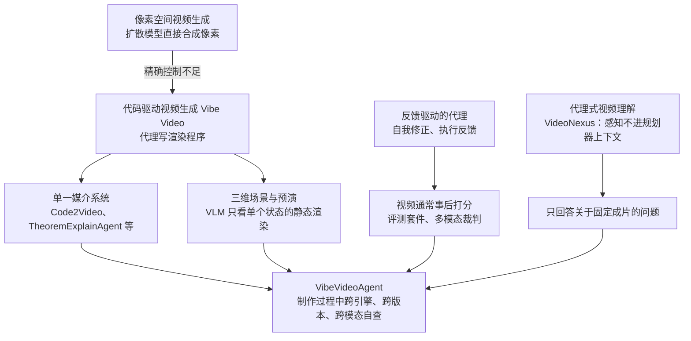
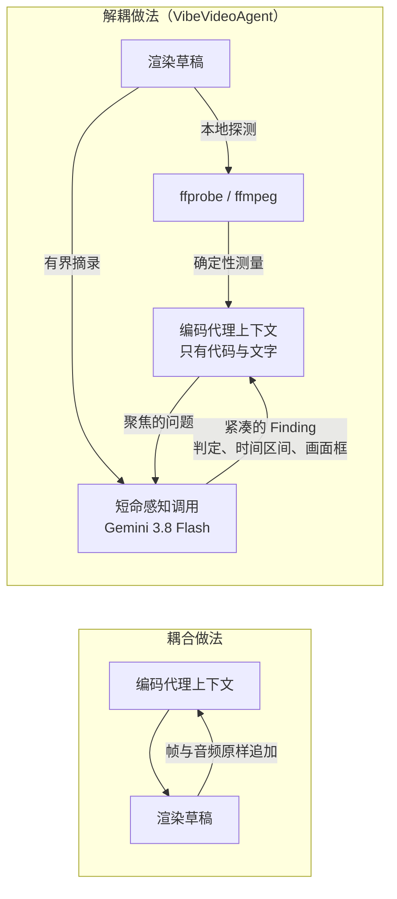
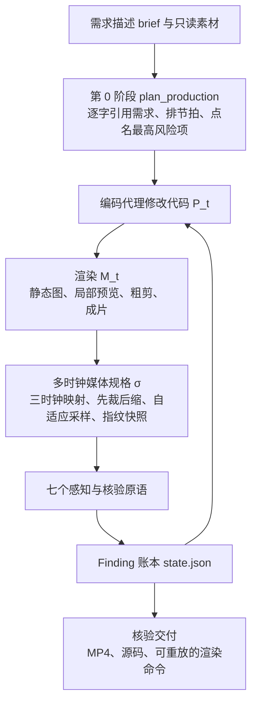
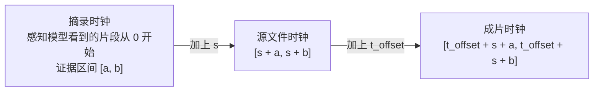
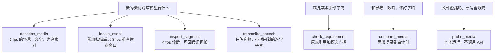
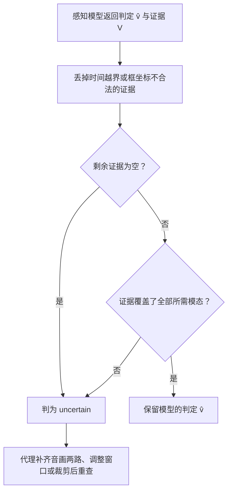

# VibeVideoAgent：为代码驱动的视频生成补上感知回路

> - **原题**：VibeVideoAgent: Closing the Perceptual Loop for Code-Driven Video Generation
> - **作者**：Xuanyu Zheng、Luoyuan Zhang、Yancheng Long、Haoyang Xu（以上共同一作）、Muxi Diao、Yuzhe Chen、Kaiyu Jiang、Bin Wen（通讯作者）、Tingting Gao
> - **机构**：KlingAI Research（快手可灵）
> - **年份**：2026（arxiv ID 2611.34237）
> - **分类**：cs.CV
> - **链接**：https://arxiv.org/abs/2611.34237
> - **精读日期**：2026-11-26

## 阅读须知

### 这篇在领域里的位置

视频生成这几年有两条并行的路。第一条是像素空间的生成模型，也就是大家熟悉的文生视频扩散模型，它们直接合成每一帧的像素，纹理和动态都相当逼真，但当创作者需要精确的字体排版、忠实的数据图表、严格的多镜头连续性或者精确的音画同步时，这类模型给出的控制力很有限。

第二条路近一两年才成形，叫代码驱动的视频生成，社区里也叫 Vibe Video。它不让模型直接画像素，而是让一个编码代理去写渲染程序，例如网页 Canvas、React 上的 Remotion、Manim 数学动画、Blender 的 Python 脚本，再配上 FFmpeg 的音频流水线。程序跑完之后，得到的既是一段可以播放的视频，也是一整套之后还能再改的工程源码。

这篇论文站在第二条路上。它没有提出新的生成模型，而是给现成的编码代理（Claude Code、Codex CLI 这一类）配上一副「眼睛和耳朵」。在它之前，同一团队已经做了评测集 VibeVideoBench，用来衡量代理写视频程序的能力；也做了 VideoNexus，让规划器把看视频的活交给独立的感知调用，自己只读结论。

VibeVideoAgent 把这两件事接了起来。评测发现，代理常常交出「程序跑通但画面不对」的视频；于是作者把 VideoNexus 那种「感知不进主上下文」的思路，从回答一段固定视频的问题，搬到了一边改代码、一边看草稿的创作过程里。

### 读完能回答什么

1. 为什么在代码驱动的视频生成里，「程序成功运行」不等于「视频做对了」，这类缺陷为什么不会报错。
2. 为什么不把渲染出来的帧和音频直接塞回编码代理的上下文，VibeVideoAgent 用什么办法绕开这个问题。
3. 「多时钟媒体规格」解决的是什么问题，改完一处缺陷之后，系统怎样确认它真的修好了、又没有弄坏旁边的镜头。
4. check_requirement 的「模态门控」是什么，为什么只凭画面证据不能判定「音画同步」这类需求通过。
5. 为什么同一套工具让 Claude Opus 5.5 和 GPT-6 Astra 的两项指标一起上涨，却让 Claude Sonnet 5.5 的细则通过率下降。

### 阅读前置

本文假定读者用过基于大模型的编码代理，例如 Claude Code 或 Codex CLI，知道它们靠工具调用读写文件、运行命令，并在一次长任务里不断累积对话历史。本文也假定读者大致知道，多模态模型可以看图片、听音频。

本文不假定读者做过视频生成、音视频工程或视频理解。文中涉及的响度单位、静音检测、帧率采样、哈希指纹等概念，都会在第一次出现时解释。

### 缩写表

| 缩写 | 全称与解释 |
|---|---|
| Vibe Video | 代码驱动视频生成的社区叫法：用自然语言描述需求，由编码代理写渲染程序产出视频 |
| VLM | Vision-Language Model，视觉语言模型，能同时理解图像和文字；本文的感知模型是 Gemini 3.8 Flash |
| MCP | Model Context Protocol，模型上下文协议，一种把外部工具接到大模型代理上的标准接口 |
| CLI | Command-Line Interface，命令行界面；文中指 Claude Code 与 Codex CLI 这类在终端里运行的编码代理 |
| TTS | Text-to-Speech，语音合成，把旁白文字转成人声 |
| LUFS | Loudness Units relative to Full Scale，相对满刻度的响度单位，广播与流媒体衡量节目响度的标准 |
| fps | frames per second，每秒帧数 |
| SHA-256 | 一种哈希算法，给文件算出一个指纹，文件内容只要变一个字节，指纹就会变 |
| A–V sync | Audio–Visual synchronization，音画同步 |
| L1 / L2 / L3 | VibeVideoBench 的三层指标：L1 技术交付规格合规率，L2 二元评分细则通过率，L3 五个感知维度的 1 到 5 分 |
| VQ / VA / CL / TM / AQ | L3 的五个维度：画面质量、视觉美感、内容逻辑、时序与运动、音频质量与音画同步 |
| pp | percentage point，百分点 |

## 一、问题

设想你让一个编码代理做一段二十秒的讲解视频：图表随着旁白逐步出现，旁白说到「峰值」时峰值标记正好亮起，结尾回到开头的画面，形成无缝循环。代理写好渲染脚本，运行，退出码为零，输出了一个能正常播放的 MP4。从软件工程的角度看，这一步已经「通过」了。

然而打开视频一看，旁白比图表慢了两秒，几个标签叠在一起，镜头转到了主角背后。这些问题没有一个会让程序报错，于是代理也就不知道自己做错了什么。这正是代码驱动视频生成目前卡住的地方：代码写得很流畅，视频却常常做不对。

过去几年，这个方向的系统大多绑定一种媒介或一种引擎：有的只做 Manim 教学视频，有的只把论文转成带旁白的幻灯片，有的只做 Blender 三维场景。其中一部分系统会让视觉模型看一眼渲染结果，但通常只看某一个程序状态的静态截图，或者在最后对整片打分。

一旦视频变长、镜头变多、音画需要对齐，这种「做完再看」的方式就显得太晚了。前面一个布局或骨骼绑定的错误，要等全片渲染完才被发现，往往意味着整个工程推倒重来。所以问题不在于代理会不会写代码，而在于它在创作过程中缺一个能及时看见、听见自己作品的回路。

### 1.1 三个具体的痛点

作者把编码代理在视频创作中的失败归结为三个问题，它们都落在常规程序反馈够不着的地方。

第一，程序成功运行，几乎说明不了观众看到了什么。在软件工程里，缺陷通常表现为编译错误或测试失败，代理可以据此修改。视频则不同：一个脚本可以干净地退出并写出合法的 MP4，而画面里的人物把背包拎在手里而不是背在肩上，三维摄像机绕着主角转到了别处，旁白落后它所解释的图表两秒。

第二，把原始媒体直接给编码代理看，会污染它的上下文。这里的上下文，指代理在一次长任务中累积起来的全部对话与工具输出；它既是代理的记忆，也是每一步推理都要重新读一遍的负担。

创作过程中有参考视频、设计稿、分镜预览、好几版粗剪。如果每次渲染都把帧和音频原样追加进上下文，上下文会随渲染次数不断膨胀；而几百行渲染代码的长期维护，恰恰需要一个干净、聚焦的上下文。

论文用一个估算式说明这种膨胀。在耦合的做法里，第 $t$ 步检查一段时长为 $\Delta t$、帧率为 $f$ 的媒体，会往上下文里追加大约

$$|o_t^{\text{coupled}}| \approx \Delta t\,(f\,\tau_v + \tau_a)$$

个 token。

- $\tau_v$：每帧画面折合的 token 数
- $\tau_a$：每秒音频折合的 token 数

反复预览、多镜头调试、同步检查叠加起来，这些 token 会堆在几百行代码旁边，既抬高注意力的计算成本，也拖累代理在长任务里维护代码的能力。

第三，只在流水线末端做评审太晚，而且跟不上版本的变化。只看最终的全分辨率成片时，一个基础的布局、绑定或时序错误，会逼着整个工程重写。

与此同时，修改代码往往会让后面所有剪辑点的时间整体平移。于是只重看一个片段，既可能接受一个其实没修好的修复，也可能漏掉相邻镜头里新冒出来的回归问题。

### 1.2 前人的几条路线

围绕「让模型看见自己做出来的东西」，前人大致走过四条路。它们之间的关系如下图所示。

第一条是代码驱动的可视化与视频生成本身。视觉编程（visual programming）这类工作先证明了，语言模型可以通过可执行代码去组合视觉模块；此后代码生成被用来画图表、做网页和交互页面、做动画。

到了视频层面，TheoremExplainAgent 和 Code2Video 用 Manim 渲染教学视频，并加入分镜和版面审查；Paper2Video 和 PresentAgent 把文档变成带旁白的演示。这些系统做对的地方，是用代码换来了精确可控；不够用的地方，是它们大多绑定一种媒介或一种引擎。

第二条是代理式的三维场景合成与预演。预演（previsualization）是影视行业的说法，指正式拍摄或精细渲染之前，先用粗模把镜头快速走一遍。有几套三维系统会用视觉模型检查渲染视图，用于评审、编辑搜索或多代理迭代。

然而这些系统看的都是单个程序状态下的静态渲染图。同一团队的 VibePrevisBench 发现，代理在多镜头的四维预演里之所以失败，往往是因为它无法把代码里的场景逻辑与屏幕上实际出现的东西对应起来。

第三条是依靠反馈不断改进的代理。自我修正与反思、代码的执行反馈、专门为代理设计的计算机交互界面，都属于这一类。加上视觉反馈之后，Visual Sketchpad 让多模态模型检查自己画的草图，Vision-as-a-Tool 给编码代理提供检查静态 HTML、SVG 和三维资产的工具。

不过对生成出来的视频，现有做法通常还是事后打分：要么用评测套件，要么请多模态大模型当裁判。打分发生在作品完成之后，帮不了正在创作的代理。

第四条是代理式的视频理解。面对长视频，代理要决定看哪里：检索帧、查询记忆、放大细节、用工具搜索。本文直接继承的是 VideoNexus，它证明了规划器可以指挥在独立上下文里运行的感知调用，自己只读紧凑的、带时间定位的报告，上下文里不留任何视觉 token。

然而这些方法回答的，都是关于一段固定的、已经完成的视频的问题。创作的情形与此不同，这正是下一小节要讲的缺口。

### 1.3 落到一个可以验证的问题

把上面几条路线放在一起，缺口就清楚了。创作与理解的区别在于：媒体是可变的、未完成的，分散在素材、预览和成片三种时间轴上；需求常常同时涉及声音和画面；每一次代码修改都会挪动事件发生的时间。

于是本文要回答的问题可以写成这样：能否在不训练任何模型、不绑定任何渲染引擎的前提下，让一个通用编码代理在制作的每个阶段检查自己的草稿，并且同时做到三点。

- 原始媒体不进入编码上下文。
- 跨音画两种模态的需求能被可靠地核验。
- 修改前后的两个版本能在各自的时间轴上对比，确认修复真的生效。

## 二、方法

### 2.1 整体思路：把「看」从「写」里拆出去

VibeVideoAgent 的核心设计是一个解耦的感知回路。编码代理始终只接触代码和文字结论，从不直接接收帧或音频；凡是需要看、需要听的事情，都交给一个无状态的感知工作者，在一个独立、短命的上下文里完成，用完即弃。

先把任务形式化。编码代理拿到一份公开的需求描述（brief），记作 $\mathcal{B}$，以及一组只读的输入素材 $\mathcal{A}=\{A_1,\dots,A_m\}$；素材可以是文档、数据表、图片、音频或参考视频。

在第 $t$ 步，代理维护两样东西：

- $P_t$：可变的代码库，也就是渲染工程本身
- $C_t$：推理上下文，即代理的工作记忆

代理可以随时运行渲染代码，得到一个中间产物或最终产物：

$$M_t=\mathcal{R}(P_t,\omega_t)$$

- $\mathcal{R}$：渲染过程，也就是执行渲染程序
- $\omega_t$：这次渲染的范围，例如单独一帧设计稿、第二个镜头的三秒预览，或者混好音的完整粗剪

在解耦回路里，每一次感知查询都返回一条紧凑的结构化「发现」，论文称之为 Finding：

$$f_t=\Phi\bigl(\mathcal{E}(M_t,\sigma_t),\,q_t\bigr),\qquad |f_t|\ll|\mathcal{E}(M_t,\sigma_t)|$$

- $\Phi$：无状态的感知工作者，本文固定用 Gemini 3.8 Flash；与之并列的还有一个本地的确定性分析器 $\Psi$，它不调用任何模型
- $\mathcal{E}(M_t,\sigma_t)$：按照采样规格 $\sigma_t$ 从媒体里截出的一段有界摘录
- $q_t$：一个聚焦的感知问题或核验问题

一条 Finding 由四部分组成：编号、带类型的判定、一句简短摘要，以及一组证据 $\mathcal{V}$。每条证据都标明它来自哪段媒体、哪个时间区间、哪种模态（画面或声音）、画面里哪个归一化的框，再附一句文字说明。

帧和音频只存在于那次短命调用的内部，调用一结束就被丢弃。于是编码上下文 $C_t$ 始终保持小而专注于代码。

整套系统的骨架如下：计划闸门在最前面，七个原语建立在统一的媒体规格之上，所有 Finding 写进一本可审计的账本，再反过来指导代码修改。

### 2.2 统一的多时钟媒体规格

创作中的媒体，与问答任务里的那一段视频很不一样：它们处在不同的完成阶段，又跑在不同的时间轴上。一位创作者可能同时手里有一段 45 秒的原始素材，一张 1920×1080 的静态角色设定图，一段只为第三场渲染的 4 秒预览（这一场在成片里从第 12 秒开始），以及一版 30 秒的粗剪。

VibeVideoAgent 用同一个媒体规格来指称所有这些东西：

$$\sigma=\bigl(\texttt{path},\,[s,e],\,t_{\text{offset}},\,\mu,\,f_{\text{req}},\,\texttt{crop},\,\mathcal{S}_{\text{src}}\bigr)$$

- path：媒体文件的路径
- $[s,e]$：在该文件自身时间轴上的起止时间；静态图片取 $s=e=0$
- $t_{\text{offset}}$：局部渲染在成片里的起点，例如上面那段预览的 12.0 秒
- $\mu$：要送去感知的模态，可以是画面、声音、两者，或者交给系统自动判断
- $f_{\text{req}}$：请求的采样帧率
- crop：画面裁剪区域，按原始像素给出
- $\mathcal{S}_{\text{src}}$：这段媒体背后声明的可编辑源文件，例如 scene.py

围绕这个规格，作者建立了四条不变式。

**三时钟映射。** 区间 $[s,e]$ 一律按源文件自己的时钟给出。送给感知模型的片段，则在它自己的「摘录时钟」上从零开始计时。之所以这样设计，是因为面对预先剪好的片段时，如果让模型去猜它在原文件里的绝对时间，模型很容易编造时间戳。

模型报回来的每段证据区间 $[a_i,b_i]$，再被确定性地映射回源文件时间 $[s+a_i,\,s+b_i]$；如果给了 $t_{\text{offset}}$，还会进一步映射到成片的时间轴上。

**先裁后缩。** 把 1080p 或 4K 的画面直接缩小送给模型，小标签、下标、手势和三维接触点都会糊掉。所以给出裁剪框时，提取器先在原始分辨率下裁出那块区域，再把它放大到视频最多 1280 像素、静态图最多 2048 像素；返回的框坐标也相对于裁剪后的视图。

**自适应采样与模态路由。** 模态设为自动时，服务会先检查文件里有哪些流，只有当问题同时需要视觉和听觉时，才把两路都送过去。有效采样率取四者中的最小值：

$$f_{\text{eff}}=\min\!\left(f_{\text{req}},\;f_{\max},\;\frac{B_{\text{frames}}}{e-s},\;f_{\text{native}}\right)$$

- $B_{\text{frames}}$：每次调用允许送入的帧数上限
- $f_{\max}$：全局帧率上限，取 16 fps
- $f_{\text{native}}$：视频的原生帧率

换句话说，窗口越长，每秒能分到的帧就越少；想看得细，就得把窗口收窄。

**不可变快照与出处缓存。** 草稿每渲染一次就会被覆盖，所以提取器在采样时会先确认文件已经写稳，再把摘录存成一份以 SHA-256 指纹命名的不可变快照，同时记下所声明源文件的指纹。

一旦对同样的字节、用同样的参数重复提问，系统直接从任务内的 Finding 缓存作答，不再调用感知模型。这既省钱，也让后面的修订比对有了一个不会被覆盖的「事发现场」。

### 2.3 七个感知与核验原语

与其给视觉模型一个开放式提示，问它「看看这段视频怎么样」，VibeVideoAgent 提供七个与渲染技术栈无关的原语。它们围绕创作者在制作过程中会问自己的四个问题来组织。

**第一组：我的素材或当前草稿里有什么。** 均匀的密集采样会浪费预算，单次的稀疏扫描又会漏掉短暂的转场，所以探索按从粗到细的顺序进行。

- describe_media 以每秒一帧的密度，给出场景、文字和声音的索引；对静态图则给出版面结构。它还被明确告知：稀疏采样下没看到的事件，不能当作不存在。
- locate_event 搜索某个物体、动作或声音。如果扫描是稀疏的（低于 8 fps），它会自动在最多两个候选窗口里以 8 fps 重查，把事件的起点和剪辑点钉准。
- inspect_segment 针对选定的时间窗口或像素裁剪区回答一个诊断问题，采样 4 fps，必要时可以把最多六张证据帧返回给编码代理。
- transcribe_speech 只上传音频，返回带时间戳的逐字转写，用于剪辑对白，或者让动画对齐旁白。

**第二组：草稿满足某条需求了吗。** 开放式的视觉模型评语有一个通病：它会对没人问的美学问题指指点点，同时又放过细微的约束，跨模态的时序约束尤其容易被放过。

check_requirement 的做法是每次只检验一条明确、可观察的断言，默认 2 fps，并且必须附上这条需求在 brief 里的原文出处，以及它需要的模态集合 $\mathcal{M}_{\text{req}}$。此外，它拒绝检查输入目录里的文件，保证核验的对象永远是代理自己产出的草稿，而不是作为参考的原始素材。

这个原语的关键在于一个确定性的后验校验器。感知模型给出原始判定 $\hat v$（通过、失败或不确定）和证据集 $\mathcal{V}$ 之后，校验器先丢掉时间越界或框坐标不合法的证据，再按下面的规则给出最终判定：

$$v_{\text{final}}=\begin{cases}\texttt{uncertain}&\text{若 }\mathcal{V}=\emptyset\text{ 或 }\mathcal{M}_{\text{req}}\not\subseteq\mu(\mathcal{V})\\ \hat{v}&\text{其他情况}\end{cases}$$

- $\mu(\mathcal{V})$：剩余证据实际引用到的模态集合

举一个例子。断言「旁白说到 peak 时，峰值标记可见」同时需要画面与声音两种模态。如果摘录里没有音轨，或者感知模型只引用了画面证据，那么不管它说通过还是失败，判定都会被改写为不确定。代理必须补上两路信号或者放宽窗口，才能宣布这条需求成功。论文把这一机制称为模态门控。

**第三组：和参考一致吗，我的修改修好了吗。** 参考比对和修复确认，本质上都是在比较两段时间对不齐的产物。修掉一处延迟或剪短一段旁白，后面所有时间戳都会平移；照着参考视频重建的作品，节奏也只是近似。

compare_media 在同一次调用里放进两段摘录，各自在自己从零开始的时钟上计时，而且要求证据同时来自两段，否则判为不确定。它有两种模式。

- 参考模式：比较一张参考图或一段参考片段与当前草稿，在指定的关注属性上（版面、镜头路径、配色、编舞）给出「变了」「没变」或「不确定」。
- 修订模式：传入此前某个缺陷的 finding_id，取出当初失败时存下的不可变摘录（先校验指纹），与新渲染配对，并继承原 Finding 所要求的模态，判断问题是已解决还是仍存在，同时报告附近有没有出现新的回归。

修订模式里还有一道指纹护栏。如果新旧两段媒体的 SHA-256 完全相同，「已解决」会被强制改写成「没变」，专门拦住那种改了代码却忘了重新渲染的情况。

与此同时，账本还会比对所声明源文件的指纹差异。于是每一个缺陷都能追溯到：它是哪次渲染里发现的，哪次代码修改之后被解决的。

**第四组：文件能播吗，信号合规吗。** 有些事情多模态模型天生做不到：它发现不了第 587 帧的一个坏包，量不出以 LUFS 计的响度，察觉不到 0.3 秒的空白静音，也没法从稀疏采样里确认循环视频首尾是否逐像素衔接。

probe_media 在本地用 ffprobe 和 ffmpeg 运行，不调用任何 API。除了流的元数据，它还报告四项测量：

- 严格的全流解码，遇到错误立即停止
- 响度：整合响度、响度范围、真峰值
- 静音：低于 -50 dB 且持续至少 0.25 秒的区间
- 运动：精确帧数、最长的一段冻结帧，以及首尾两帧的 RGB 差值，用来检查循环的接缝

### 2.4 分阶段的制作协议

好的感知工具只回答了「怎么看」，没有回答「什么时候看」。如果放任不管，代理可能先写完一个几分钟长的完整工程才第一次检查，也可能从头到尾都没有检查过风险最大的那条需求。所以 VibeVideoAgent 给七个原语配了一套轻量的分阶段协议，围绕一本本地的计划账本运转。

**第 0 阶段：计划闸门。** 代理读完 brief、列出输入目录之后，在做任何代码编辑、渲染或媒体调用之前，必须先调用 plan_production 记下一份计划。这一点不靠自觉：一个挂在工具调用之前的运行时钩子会强制执行。

计划里的每条需求都必须逐字引用 brief 原文，由程序对照 $\mathcal{B}$ 检查；同时写明它对应的可观察现象和所需模态，并链接到至少一个有序的制作节拍（beat）。这样做的好处，是把「用户要求了什么」与「留给代理自由发挥的创作选择」明确分开。

与此同时，代理还要点名风险最高的那条需求 $r_{\text{first}}$，也就是一旦失败返工最多的那条，以及能够检验它的最小渲染 $p_{\min}$。

**第 1 到第 4 阶段：预览、组装、修复、交付。**

- 最小预览：探索陌生的素材，渲染 $p_{\min}$，先核验 $r_{\text{first}}$，通过之后再搭其余节拍。检验字体或角色设计用一张静态图，检验运动或镜头用一小段片段，检验旁白同步用一小段带声音的切片。
- 粗剪组装：在便宜的粗剪上核验跨镜头的性质，例如镜头顺序、转场、字幕可读性、语音与图形的同步。
- 定向修复：判定为不确定时，代理去调整窗口、帧率、裁剪或模态，而不是凭空猜一个修改；判定为失败时，Finding 会指明该在哪里打补丁。补丁打完只重渲受影响的片段，再用 compare_media 确认已解决，并检查被平移的相邻部分。
- 核验交付：对编码好的 MP4 跑 probe_media，重新核验那些可能被合成或混音破坏的需求，把不可变的输出连同源文件和一条可重放的渲染命令登记在案，然后提交。

### 2.5 一个完整的例子

论文附录记录了 Claude Opus 5.5 在任务 W0448 上的一次完整运行，正好把上面的机制串了起来。任务要求一段 20 秒、1920×1080、30 fps 的无对白人生小传，分童年、青年、朝九晚五、家庭、老去、告别六个阶段，用一个反复出现的红色按钮开场和收尾，形成无缝循环。

动笔之前，plan_production 从 brief 里逐字抽出 13 条需求、排出 7 个节拍，并把「人物在不同年龄之间保持同一身份」标为风险最高的决定。代理先只渲染一张人物各年龄的阵容静态图，用预览阶段的 check_requirement 检验，结果通过。

随后代理把验证过的角色绑定扩展到 600 帧的第一版成片。这一版干净地跑完了，开场、办公室和老去几段的检查也都通过，但组装阶段报出了三处失败。

青年那段，主角接住背包之后把它拎在手里，而不是甩上肩膀。家庭那段，人物起身之前笔记本电脑的盖子没有合上，孩子 C 也已经站在门口，并不是从画外跑进来。代理修改 render.py 之后，用双时钟的 compare_media 确认了两个补丁的效果，最后用解码和循环接缝的探测收尾。

这个例子里还有一处耐人寻味的细节。告别那段，大衣挂在空椅子旁边的衣架上；这没能满足代理自己写下的更严格的可观察描述「搭在椅子上」，却符合 brief 原文「在空椅子旁放上 P 的大衣」。系统把这两者区分了出来，没有把它误判为失败。

按 Flash 裁判的打分，这个任务的 L2 从原生代理的 76.0% 升到了 96.0%。

## 三、实验

### 3.1 评测设置

评测集是 VibeVideoBench，共 239 个任务，分 12 个中英文制作类别，包括数据叙事、论文讲解、动效设计、交互式三维演示、游戏模拟、叙事动画、按参考重建、随音乐剪辑等。代理拿到自然语言 brief 和只读素材，不能调用任何像素生成接口，必须自己写渲染软件，交付一个可播放的 MP4 和一个可编辑的源码仓库。

打分由两个官方的多模态裁判完成：Gemini 3.8 Flash 和 Gemini 4 Argon。论文主要报告两者的等权平均，指标分为三层。

- L1：技术交付规格的合规率，例如分辨率、帧率、时长是否符合要求
- L2：几千条二元评分细则的通过率
- L3：五个感知维度的 1 到 5 分及其平均，五个维度是画面质量 VQ、视觉美感 VA、内容逻辑 CL、时序与运动 TM、音频质量与音画同步 AQ

实验采用严格的单变量对照。每个编码模型都在自己的原生命令行里运行：Claude Opus 5.5 和 Claude Sonnet 5.5 用 Claude Code，推理强度设为 max；GPT-6 Astra 用 Codex CLI。所有运行都在配置相同的 16 核 Linux 隔离环境里，渲染库一致，输入文件只读。

加了 VibeVideoAgent 的运行，都注册同一个 MCP 服务，并挂一个工具调用前置钩子，禁止直接读取原始媒体、禁止开子代理、禁止临时调用外部 API。于是所有感知都必须经过那七个可审计的原语，感知模型固定为 Gemini 3.8 Flash。

隐藏的评分细则和裁判都放在创作文件系统之外，只有在输出 MP4 和源码快照被 SHA-256 冻结之后才运行。这保证代理在创作时既看不到评分标准，也没法在交付后再偷偷修改。

### 3.2 主要结果

| 编码模型 | 配置 | L1 规格 | L2 细则 | VQ | VA | CL | TM | AQ | L3 均值 |
|---|---|---|---|---|---|---|---|---|---|
| Claude Opus 5.5 | 原生代理 | **99.92** | 98.87 | 4.04 | 4.08 | 4.09 | 4.03 | 3.89 | 4.03 |
| Claude Opus 5.5 | + VibeVideoAgent | 98.59 | **99.35** | **4.37** | **4.43** | **4.46** | **4.42** | **4.45** | **4.43** |
| Claude Sonnet 5.5 | 原生代理 | **99.18** | **96.36** | 3.97 | 4.02 | 4.03 | 3.96 | 3.85 | 3.97 |
| Claude Sonnet 5.5 | + VibeVideoAgent | 95.75 | 94.61 | **3.98** | **4.05** | **4.15** | **4.07** | **4.25** | **4.10** |
| GPT-6 Astra | 原生代理 | 98.93 | 98.67 | 4.07 | 4.09 | 4.08 | 3.98 | 3.94 | 4.03 |
| GPT-6 Astra | + VibeVideoAgent | **99.51** | **99.15** | **4.26** | **4.31** | **4.29** | **4.20** | **4.26** | **4.27** |

表中 L1、L2 为百分比，L3 为 1 到 5 分，均为两位裁判的平均，加粗表示同一模型两种配置中较好的一个。

三个模型的 L3 均值都上升了：Opus 提高 0.40，Astra 提高 0.24，Sonnet 提高 0.13。

涨得最多的是时序与跨模态的维度。三个模型的 AQ 都是增幅最大的一项，Opus 提高 0.56，Sonnet 提高 0.40，Astra 提高 0.32，其次是 TM 和 CL。

原因不难理解。原生代理常常能写出合法的 FFmpeg 或 TTS 流水线，旁白却落在转场后面，在镜头边界被截断，或者留下一段死寂；带模态门控的 check_requirement、transcribe_speech 和 probe_media，恰好能在制作过程中把这些问题揪出来。

接下来要面对一个自然的质疑：Gemini 3.8 Flash 既是感知模型，又是两位裁判之一，增益会不会只是「自己人给自己人打高分」。论文为此分裁判报告了结果。

| 裁判 | 编码模型 | 指标 | 原生 | + VibeVideoAgent | 逐任务胜 / 负 |
|---|---|---|---|---|---|
| Flash | Opus 5.5 | L3 | 4.14 | 4.60 | 124 / 11 |
| Flash | Sonnet 5.5 | L3 | 4.10 | 4.43 | 正文未报告 |
| Flash | Astra | L3 | 4.11 | 4.59 | 121 / 16 |
| Argon | Opus 5.5 | L2 | 98.36% | 99.15% | 正文未报告 |
| Argon | Opus 5.5 | L3 | 3.91 | 4.25 | 132 / 37 |
| Argon | Astra | L2 | 98.38% | 99.00% | 正文未报告 |

在独立且更严格的 Argon 裁判下，Opus 的 L3 依然提高了 0.33，逐任务的胜负比是 132 比 37。增益在 Argon 下比在 Flash 下小一些，这与「同源裁判略有偏袒」的担心相符，但方向是一致的。

与此同时，同一个 MCP 接口在 Claude Code 和 Codex CLI 两种运行时里都能工作：加上 VibeVideoAgent 之后，Opus 拿到了表中最高的 L2 和 L3，Astra 拿到了最高的 L1。

### 3.3 三种截然不同的使用风格

论文还记录了每个任务的遥测数据，从中能看出三个模型使用这套工具的方式很不一样。

| 编码模型 | 感知调用 / 采纳的 Finding | 采样的帧 / 音频 | 编码输出 token / 任务 | 预览闸门执行率 | 失败检查后改代码的比例 | 双时钟复查判为已解决 |
|---|---|---|---|---|---|---|
| Opus 5.5 | 12.0 / 6.2 | 386 帧 / 171 秒 | 147.9k | 93.9% | 77.4% | 58.3% |
| Sonnet 5.5 | 12.2 / 7.8 | 303 帧 / 138 秒 | 206.8k | 84.3% | 75.3% | 42.5% |
| Astra | 50.6 / 23.1 | 1,297 帧 / 660 秒 | 179.3k | 100.0% | 84.2% | 65.6% |

Opus 那一格的 93.9% 只统计有 Finding 被采纳的轨迹（138/147），按全部 239 个任务计算是 57.7%。三个模型在全部任务上都完成了开头的 plan_production。

Opus 的风格是有选择地检查、打小补丁。它在 77.4% 的失败检查之后修改了代码，双时钟复查的解决率是 58.3%，而编码输出是三者中最少的。在 Argon 裁判下，它的 26 个叙事动画任务全部拿到了 100% 的 L2。

Astra 的风格是频繁检查、多轮小改。它每个任务调用感知 50.6 次，双时钟解决率最高，为 65.6%（419/639）。它的编码输出摊在平均 7.0 个版本上，每版约 25.7k token，都是局部差分：修补漏掉的细则项，不去碰已经正常的代码。

Sonnet 的情况最值得注意：它能发现缺陷，却修得很粗。它一共报出 312 个失败和 214 个不确定的判定，据此修改让 AQ 提高了 0.40。

然而 Sonnet 的编码输出最多，修订比对只解决了 42.5%（34/80），因为它常常整个重写渲染脚本，而不是只改一个函数。重写改善了节奏与同步，却把次要的静态细节冲掉了，在 Argon 裁判下 L2 从 95.87% 掉到 92.37%。

由此作者得出一个结论：感知反馈要同时提高细则合规和感知质量，前提是代理把修改保持在局部。

### 3.4 消融实验

做消融时有一个现实的困难。原生 Opus 已经在 80% 以上的任务上拿到 100% 的 L2，随机抽一个子集，几乎看不出各变体之间的差别；可如果按 VibeVideoAgent 的增益去挑任务，又会因为选择偏差和向均值回归而夸大效果。

作者的办法是在跑任何消融之前，只依据原生基线的诊断信息和公开的任务元数据，确定性地选出 36 个任务，约占全集的 15%。这 36 个任务分四层：细则瓶颈 12 个，依赖参考素材 8 个，音画与时序瓶颈 10 个，作为对照的中位基线 6 个。所有消融都用 Claude Opus 5.5。

| 变体 | L1 | L2 | VQ | VA | CL | TM | AQ | L3 均值 |
|---|---|---|---|---|---|---|---|---|
| 原生代理（无感知工具） | 100.00 | 96.06 | 3.87 | 3.90 | 3.89 | 3.76 | 3.80 | 3.84 |
| 去掉 check_requirement | 98.43 | 98.35 | 4.27 | 4.26 | 4.31 | 4.26 | 4.33 | 4.29 |
| 去掉 compare_media | 97.38 | 99.11 | 4.20 | 4.37 | 4.39 | 4.26 | 4.28 | 4.30 |
| 去掉 probe_media | 95.81 | 99.03 | 4.26 | 4.33 | 4.40 | 4.31 | 4.36 | 4.33 |
| 只留工具（去掉计划闸门与预览闸门） | 98.95 | 99.03 | 4.26 | 4.27 | 4.43 | 4.29 | 4.34 | 4.32 |
| 完整的 VibeVideoAgent | 98.43 | **99.50** | **4.34** | **4.41** | **4.46** | **4.39** | **4.41** | **4.40** |

完整系统的 L2 最高，比原生高 3.44 个百分点，五个 L3 维度也全部最高，L3 均值比原生高 0.56。每去掉一个部件，伤到的都是不同的方面。

- 去掉 check_requirement，细则的精确度和内容连贯性受损最多：L2 下降 1.15 个百分点，CL 和 VA 各降 0.15。没有原文出处、也不要求双模态证据的随意检查，会漏掉细微的约束，也会接受只凭一种模态得出的猜测。
- 去掉 compare_media，修复与时序受损：L3 降到 4.30，VQ、TM、AQ 降得最多。失败检查之后真去改代码的比例从 94.0% 降到 78.3%，修改引入的运动问题、参考不符和音频平移都得不到复核。
- 去掉 probe_media，可播放性受损：L1 降得最多，少了 2.62 个百分点。原因是稀疏的帧采样替代不了精确解码、LUFS 响度、-50 dB 静音检测和冻结帧分析。
- 去掉分阶段协议、只保留七个原语，L2 下降 0.47 个百分点，L3 降到 4.32。预览闸门的执行率从 97.2% 直接掉到 0，双时钟解决率从 70.6% 降到 52.2%：没被提前检验的版面和绑定决定，变成了后期代价高昂的重写。

### 3.5 上下文到底省了多少

每个任务里，感知工作者为 Opus 处理了 386 帧和 171 秒音频，为 Astra 处理了 1,297 帧和 660 秒音频，后者约合 33.5 万个提示 token。这些全都发生在编码会话之外。

存进状态文件的 Finding 平均只有 0.3k 到 1.4k 个 token。作者估计，如果把同样的媒体放进一个 30 到 50 轮的编码历史里，让它随每一轮被反复重读，每个任务要花掉数千万个输入 token。

在一个能够精确计量单轮响应大小的 8 任务小套件上，返回的 Finding 比被感知的媒体小 6.5 倍，在长篇论文讲解任务 PA02 上小 12.0 倍。同一套件上，L2 在 Flash 裁判下从 90.2% 升到 96.0%，在 Argon 裁判下从 85.0% 升到 94.5%。

### 3.6 几处反直觉的结果

第一处是 L1 不升反降。Opus 加上 VibeVideoAgent 之后，L1 从 99.92% 降到 98.59%；Sonnet 从 99.18% 降到 95.75%。在消融子集上，完整系统的 L1 是 98.43%，反而低于原生代理的 100%，也低于只留工具时的 98.95%。

论文正文没有专门解释这一现象。一个合理的推测是，更多轮的修改与重渲，增加了在交付规格上出错的机会，例如时长或编码参数，而 probe_media 只能部分兜住。换句话说，「多看几眼」并不是对每一层指标都免费的。

第二处是 Sonnet 的 L2 下降。同一套工具让 Opus 和 Astra 的细则通过率都上升，却让 Sonnet 下降了 1.75 个百分点。前面已经讲过原因：Sonnet 倾向于整段重写，修好了音画同步，却把原本正确的静态细节一并冲掉了。

这提醒读者，感知工具带来的收益不只取决于工具本身，还取决于编码模型改代码的粒度。同样一条「这里错了」的反馈，交给习惯打局部补丁的模型和习惯推倒重写的模型，结果可以完全不同。

第三处是返回的 Finding「只」比被感知的媒体小 6.5 倍。这个倍数看上去并不夸张，原因在于送进感知模型的本来就是受帧数上限约束的有界摘录，而不是整段原片。真正的节省来自另一面：这些媒体 token 不会留在编码上下文里，随着轮次一遍遍累积。

## 四、局限

### 4.1 作者承认的局限

感知只在有限的帧率（最高 16 fps）和选定的区间上采样，所以亚帧级的瑕疵，或者从来没有被检查过的时间窗口，仍可能漏网，即便有 8 fps 的细化和全流解码也一样。系统会把没观察到的区间和缺失的模态报为不确定，交付检查也只能证明文件能正确播放，不能证明视频里没有语义缺陷。

修改前后指纹绑定的片段对比，只能说明「一次声明过的修改之后，渲染出来的症状变了」，这是观察，而不是对程序分支的因果证明。如果代理改了一个被多处共用的动画辅助函数，又跳过了相邻检查，那些从未被看过的节拍也可能受到影响。

此外，外部感知模型 Gemini 3.8 Flash 在密集重叠的文字或细微的三维深度顺序上可能看错，除非代理主动要求裁剪或证据帧。中间渲染会增加计算量和延迟，商业 API 的行为也可能随提供方更新而变化。

### 4.2 读完能看出来的潜在问题

**裁判与感知同源。** 感知模型是 Gemini 3.8 Flash，两位裁判之一也是 Gemini 3.8 Flash。作者分裁判报告，并展示了 Argon 下仍有提升，这一点处理得比较坦诚；但 Argon 与 Flash 出自同一家，两者的偏好可能高度相关，若能再看到不同家族的裁判或人工评审，结论会更稳。

**评测集与方法出自同一团队。** VibeVideoBench、VibePrevisBench、VideoNexus 与本文的作者有大量重叠。这并不意味着结果有问题，但外部团队在其他评测集上的复现会更有说服力。

**天花板效应明显。** 原生 Opus 已经在 80% 以上的任务上拿到 100% 的 L2，全集上 L2 只从 98.87% 升到 99.35%。真正拉开差距的主要是 L3 这种 1 到 5 分的主观评分，而主观评分本身方差较大。

**没有报告方差与成本。** 正文没有说明每个配置跑了几次，也没有置信区间；36 任务的消融里，有些差距只有零点零几分，单次运行下未必显著。作者说记录了墙钟时间和 token 消耗，但正文没有给出加上 VibeVideoAgent 之后每个任务的耗时与费用；Astra 每个任务调用感知五十多次、处理约 33.5 万个提示 token，这部分开销对实际使用者相当关键。

**依赖闭源模型。** 编码模型和感知模型全是商业闭源模型，作者自己也把开源感知模型列为未来的工作。

**需求的可观察描述由代理自己写。** W0448 的大衣例子说明，代理写下的可观察描述可能比 brief 原文更严，也可能更松。系统会核对引文是否逐字出自 brief，却无法保证代理据此写出的「可观察现象」忠实于原意；描述一旦写偏，核验就会在错误的标准上给出通过或失败。

**修改粒度是隐含的前提。** Sonnet 的结果表明，这套框架的收益取决于编码模型是否习惯打局部补丁。对更小、更爱整段重写的模型，加上感知工具甚至可能让部分指标变差。作者把「为小模型提供修改局部性的指引」列为未来工作，说明这个问题尚未解决。

## 一句话

让编码代理边做视频边自查：看画面、听声音交给隔离的感知调用，只回传带时间戳的结论，三家模型的视听质量都提高了。
