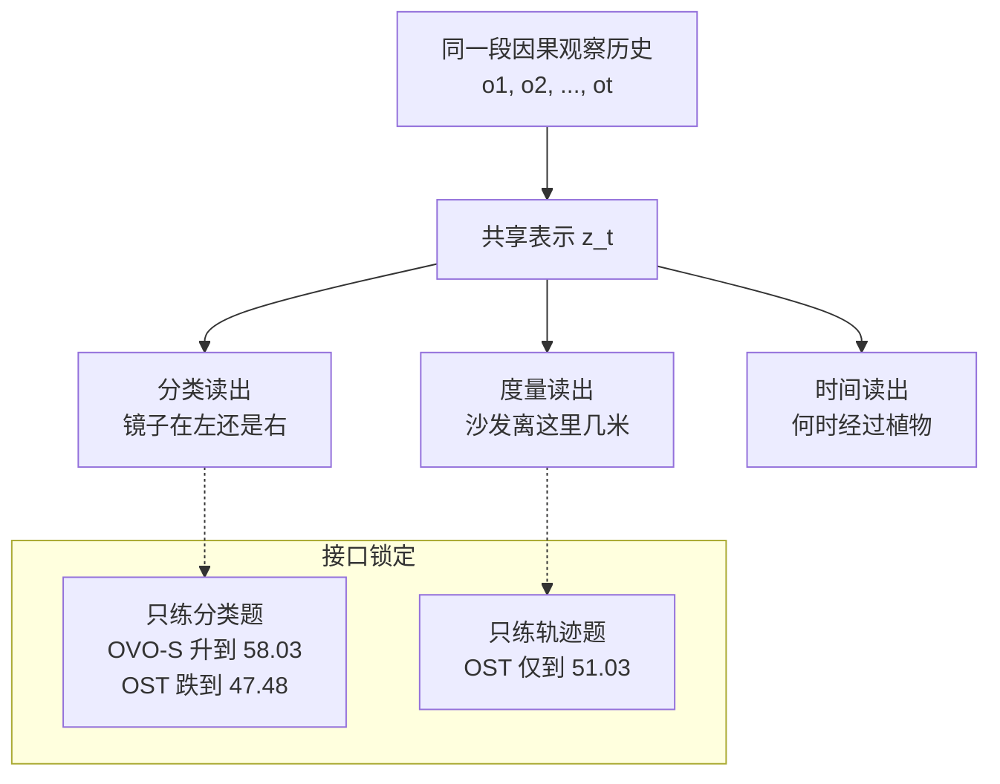
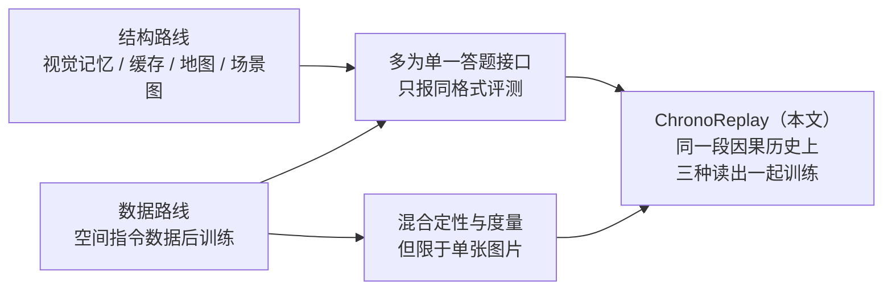
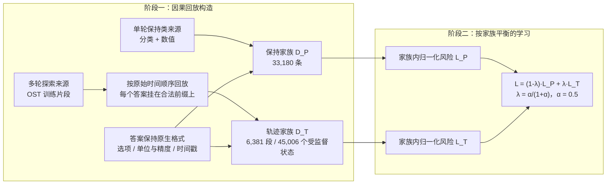
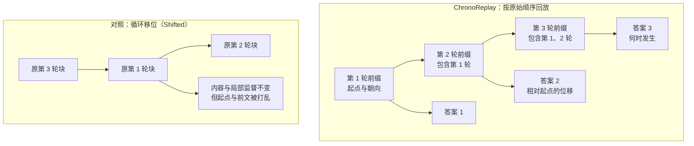
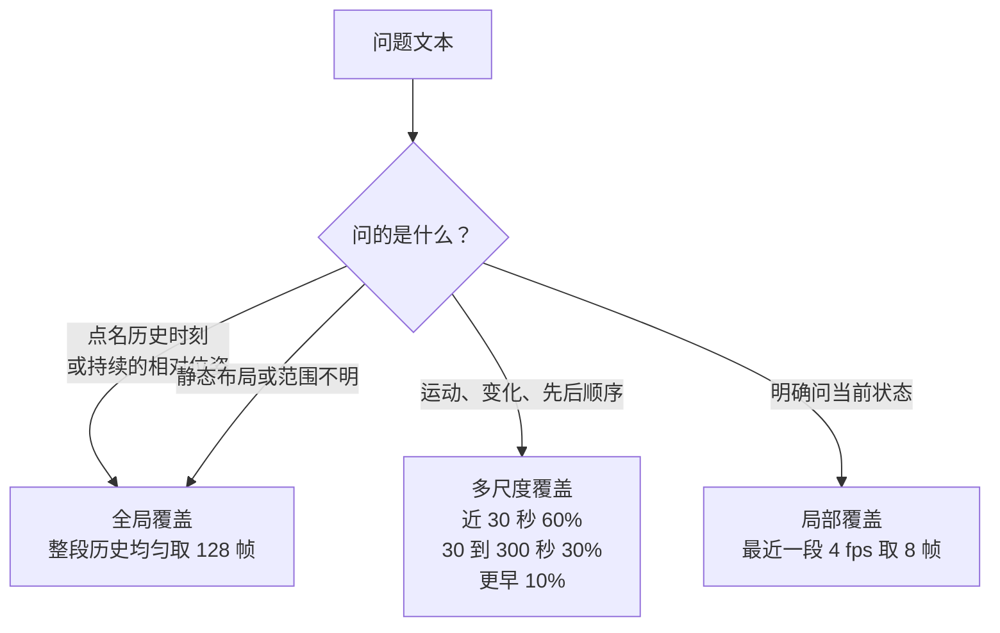

# ChronoReplay：流式空间智能不能只练一种答题方式

> **原题**：ChronoReplay: One Answer Interface Is Not Enough for Streaming Spatial Intelligence
> **作者**：Yihao Hu, Yitong Lin, Pan Wang, Zhihao Wen, Hang Wang, Yiwen Zhao, Deyuan Liu, Yutong Li, Mingda Wan, Yuchen Mao, Tao Lin
> **机构**：摘要页与正文均未列出
> **年份**：2026（arxiv ID 2610.34283，2026 年 10 月 25 日提交）
> **分类**：cs.CV
> **链接**：https://arxiv.org/abs/2610.34283
> **代码**：https://github.com/yihaohu0118/ChronoReplay
> **精读日期**：2026-10-28

> 说明：本文与昨天精读的 Trajectory2Gym 出自同一批作者，两篇的核心论点一脉相承：训练效果取决于监督信号保留了哪些区分，而不只是数据有多少。

## 阅读须知

### 这篇在领域里的位置

这篇论文属于「流式空间智能」这条线。流式空间智能指的是：模型一边接收一段持续的视频，一边要回答关于空间的问题，而且只能用提问那一刻之前看到的画面。家用机器人、可穿戴助手都需要这种能力，它们随着用户在房间里走动，随时可能被问「镜子在我左边还是右边」「沙发离这里多远」「我们什么时候经过那盆植物」。

过去两年，这条线上的进展主要来自两个方向。一个是结构方向，给视觉语言模型加上视觉记忆、有界缓存、快速权重、地图或场景图，好让它记住长视频里的东西。另一个是数据方向，用空间问答指令数据对模型做后训练。ChronoReplay 属于数据方向，但它指出这个方向上的大多数做法都只练一种答题方式，并试图用一套训练配方让同一个模型同时答好三种问题，既不加新的记忆模块，也不加新的标注。

### 读完能回答什么

1. 什么是「接口锁定」，为什么只用一种答题格式训练空间模型，会让它在别的格式上没有进步甚至退步。
2. 为什么一个距离或时间类的答案离开了它之前的观察历史就会产生歧义，「按原始时间顺序回放」如何解决这一点。
3. ChronoReplay 的三个设计：原生格式的答案、按原始时间顺序回放、按家族平衡的损失，各自具体怎么做。
4. 在 OVO-S、OST、UCS 三个基准上分别提升多少，哪些对照实验分离出了各个组件的贡献。
5. 推理时自适应选帧带来的提升，与训练带来的提升相比有多大，这说明了什么。

### 阅读前置

本文假定读者熟悉视觉语言模型（VLM）的基本结构与监督微调，了解多任务学习中「不同任务争抢同一组参数」这个问题。读者未必做过视频理解或三维空间推理，相关概念会先铺垫再展开。

### 缩写表

- **VLM**（Vision-Language Model，视觉语言模型）：能同时读图像或视频与文字、并用文字作答的模型。本文的底座是 Qwen3-VL-8B-Instruct。
- **SFT**（Supervised Fine-Tuning，监督微调）：用「输入与目标答案」的配对数据训练模型。
- **OVO-S**（OVO-S-Bench）：流式空间推理评测，题目以选择题为主，分四个层级共十二个任务家族，涵盖自我视角感知、物体恒存与全局布局。
- **OST**（OST-Bench）：多轮探索中的空间状态评测，考察智能体自身状态、可见信息、时间定位、计数以及智能体与物体之间的关系，答案有判断、估计、时间、计数等多种形式。
- **UCS**（UCS-Bench）：时间戳因果的空间问答评测，共 8,114 题，涉及轨迹、位姿、远近、物体身份与数量。
- **ScanNet / ARKitScenes**：两个常用的室内三维扫描数据集，本文的训练与评测场景多来自它们。

## 一、问题

### 为什么这个问题值得做

设想一个家用机器人跟着你在公寓里走了一圈，随后被问三个问题：镜子在我左边还是右边？沙发离这里多远？我们什么时候经过了那盆植物？同一段行走，三种答案形式：一个选项、一个以米为单位的数字、一个时间点。要从视频流里答对它们，模型得把不同视角下的同一物体对应起来，累积观察者自己的移动，还要在不断变化的参照系里恢复空间关系，而且只能用提问之前的画面。

如今的流式空间评测已经在同一段因果历史上同时出这三类题。可现有的训练配方大多只针对一种答题形式，并在与之同格式的评测上报告结果。即便有方法混合了定性与定量的空间问题，也是在单张图片上训练的。一个模型能否在同一段因果历史上同时答好分类、度量与时间三类问题，此前没有被检验过。

### 两个具体挑战

论文从 Qwen3-VL-8B 出发做了单一家族训练的诊断实验，发现了两个挑战。第一个是作者所称的「接口锁定」：训练会提升它主导的那种答题方式，却不均衡地迁移到其他方式。只用分类题训练，OVO-S 升到 58.03，OST 却从 50.52 跌到 47.48；只用轨迹类题训练，OST 几乎不动，只到 51.03。

背后的道理并不难理解。训练模型回答「物体在哪一侧」，并不要求它保留决定这个答案的具体位移量；反过来，监督一个距离估计，也可能对「左右」这类分类关系几乎没有约束。两种答题方式要求表示保留的区分不同，只练一种，另一种就得不到照顾。

第二个挑战是，一个度量或时间类的答案，只有放在产生它的那段历史下才成立。设想两个观察者，一个先面朝北再向前走，另一个先面朝东再向前走。两人最近看到的画面相同，局部位移也相同，可之后被问到一个早先见过的物体时，答案却不一样。如果训练时把答案从它合法的前缀上剥离下来，监督本身就是有歧义的。

### 前人路线及其不足

结构路线的思路是让模型记得住。代表性做法包括压缩的视觉记忆、分层摘要、循环记忆桥、主动响应机制、有界的键值缓存，以及三维场景词元、体素化的全局地图、不断演化的场景图等。这些方法解决的是「记住了什么」，却不回答「同一份记忆能否同时支撑几种不同的答题方式」。

数据路线的思路是用空间指令数据把模型练出来，包括几何感知的视觉特征、多视角或三维重建输入，以及大规模的空间指令与强化学习数据。这些配方大多只监督一种答题格式。少数混合定性与度量问题的工作停留在单张图片上，没有触及流式视频里「答案依赖历史」这一层。

从更一般的角度看，这其实是一个多任务学习问题：当多个目标争抢同一组参数时，共享表示会保留哪些区分，损失如何平衡，在一个分布上微调又会从另一个分布上抹掉什么。论文把这个问题放到了流式空间推理的语境里来回答。

## 二、方法

### 问题的形式化

在时刻 $t$，模型收到因果观察历史 $h_t = (o_1, \ldots, o_t)$。一个空间问题 $q$ 带着它原生的答题接口 $\kappa$ 到来，$\kappa$ 可以是一组选项、一个带单位的度量值，或一个时间戳。模型先把历史编码成表示，再按接口读出答案：

$$z_t = f_\theta(h_t), \qquad \hat{y}^{(\kappa)}_t = g_\theta(z_t, q, \kappa)$$

- $f_\theta$：视觉语言模型对历史的编码，参数为 $\theta$。
- $z_t$：时刻 $t$ 的表示，不一定是某个显式模块，可以分布在整个模型里。
- $g_\theta$：按接口 $\kappa$ 生成答案的读出过程。
- $y^{(\kappa)}_t$：任务定义的真实答案。

如果一族「问题与接口」的所有原生答案都能从同一个 $z_t$ 读出来，就称这个表示在这一族上是可复用的。这是一条功能上的要求：只要通向不同答案的历史在表示里仍然可以区分即可。

论文指出空间历史有两个性质让这件事变难。其一，不同接口相互细化：分类答案只区分空间区域，度量答案还要分辨区域内部的差别，只保留粗划分的表示撑不起更细的读出。其二，状态依赖历史的起点：最近一段相同、起点不同的两段历史，必须映射到不同的状态。

### 整体流程

ChronoReplay 由两个阶段组成。第一阶段构造「因果回放」数据池：每个答案保持原生格式，每个片段按原始时间顺序排列。第二阶段做按家族平衡的学习：把单轮保持类数据与多轮轨迹类数据各自的风险归一化，再显式设定两者在共享参数上的相对分量。

### 组件一：原生格式的答案

第一个设计问题是：答案空间各不相同的数据，怎样合在一起训练？常见做法是把所有答案改写成统一的规范格式。ChronoReplay 选择保留每个答案在其来源接口中的取值空间：分类答案保留候选项结构；度量答案保留数值大小、正负、单位与标注精度；时间答案保留时间戳、事件序号和与转折相关的量；参照系信息始终与问题绑定。所有答案都由原有的自回归解码器直接生成。

作者给出的理由来自一个简单的信息论事实。对某个接口 $\kappa$，记表示为 $Z = F_\theta(C)$，其中 $C$ 是因果前缀，读出过程为 $G_\kappa$，总体风险为：

$$\mathcal{R}_\kappa(F_\theta, G_\kappa) = \mathbb{E}\big[-\log G_\kappa(Y^\kappa \mid Z, Q)\big]$$

在表示固定、读出足够灵活时，最优风险等于条件熵 $H(Y^\kappa \mid Z, Q)$。换句话说，想把风险压低，表示 $Z$ 就必须保留还原该答案所需的信息。论文同时证明，无损的重新编码不会改变这一信息要求。

需要强调的是，作者把原生格式定位为「保留来源任务语义的设计选择」，并不声称它在所有情况下都更好。后面的对照实验也确实显示，格式的选择会在不同评测之间重新分配收益，而不是一边倒地占优。

### 组件二：按原始时间顺序回放

答案格式固定之后，第二个问题是：一个度量或时间答案，离开了它的历史还有什么意义？ChronoReplay 的做法是，把来源片段里出现的各种接口的监督都放到该片段的视频时间轴上，按原始顺序回放，每个答案都挂在它合法的因果前缀之后。作者称之为时间起点对齐。

记 $c_{ij}$ 为第 $i$ 个片段第 $j$ 轮的合法因果前缀，包括这一轮之前能看到的所有观察，以及此前的问答历史。一个片段表示为：

$$\mathcal{E}_i = (c_{ij}, q_{ij}, y_{ij}, \kappa_{ij})_{j=1}^{m_i}, \qquad c_{ij} \preceq c_{i,j+1}$$

- $q_{ij}$：这一轮的空间问题。
- $\kappa_{ij}$：它的原生接口。
- $y_{ij}$：在当前前缀下成立的答案。
- $\preceq$：前缀包含关系，后一轮的前缀一定包含前一轮的前缀。
- $m_i$：这个片段里受监督的轮数。单轮保持类样本 $m_i = 1$，多轮轨迹样本更长。

因为前缀层层嵌套，一个片段会产生 $m_i$ 个共享同一起点、历史逐渐变长的受监督状态。模型于是学的是「累积」本身，也就是位移或事件顺序如何一轮一轮地变化，而不是一张张孤立的快照。

把模型作用在相继的前缀上，就隐式地得到一条状态轨迹 $z_{ij} = F_\theta(c_{ij})$。这条轨迹完全留在模型内部，第一个前缀定义了片段的起点。ChronoReplay 没有加任何地图、记忆模块或额外的状态损失。

### 组件三：按家族平衡的损失

答案和历史都定好之后，剩下的选择是每个家族能把共享参数推动多少。两个家族的规模差别很大：保持家族有 33,180 条单轮样本，其中分类 30,635 条、数值 2,545 条；轨迹家族有 6,381 段有序片段，共 45,006 个受监督的度量、计数、判断与时间轮次。如果按原始行数混在一起，某一个家族就会主导参数，等于在联合训练内部重演接口锁定。

ChronoReplay 先在每个家族内部把风险归一化。记 $\ell^P_r$ 为保持样本 $r$ 的原生损失，$w_r$ 为来源定义的权重；$\ell^T_{ij}$ 为轨迹片段 $i$ 第 $j$ 个受监督状态的损失，$\mathcal{T}$ 为所有这样的 $(i, j)$。两个家族的风险为：

$$\mathcal{L}_P = \frac{\sum_{r} w_r \ell^P_r}{\sum_r w_r}, \qquad \mathcal{L}_T = \frac{1}{|\mathcal{T}|}\sum_{(i,j) \in \mathcal{T}} \ell^T_{ij}$$

再按显式设定的比例相加：

$$\mathcal{L}_{\text{replay}} = (1 - \lambda)\,\mathcal{L}_P + \lambda\,\mathcal{L}_T, \qquad \lambda = \frac{\alpha}{1 + \alpha}$$

其中 $\alpha$ 是轨迹家族相对保持家族的损失分量。主实验取 $\alpha = 0.5$，于是轨迹家族占总分量的 1/3，保持家族占 2/3，后者再在分类与数值之间平分。实现上，三个子家族的权重总和被设成相同的 13,187。

此外还有两处细节。每个受监督轮次取答案词元损失的平均值，防止长回答仅凭词元多就占据主导；轨迹家族内部各轮等权，因此一个片段的贡献与它受监督的轮数成正比。作者用这三层设计分别管住回答长度、监督频次与家族比例。

### 训练配置

所有模型都从同一个公开的 Qwen3-VL-8B-Instruct 版本出发，训练语言模型与视觉合并层，冻结视觉编码器，做一轮监督微调。训练与评测按物理场景严格隔离：同一次扫描衍生出的不同帧率、裁剪或编码的视频，事先被归为同一个场景身份。数据池共 39,561 条序列，其中保持家族的数值部分来自 945 条 ARKitScenes 相机旋转目标，以及相机位移、相机与物体距离各 800 条。轨迹家族用的是 OST 公开的训练片段。

## 三、实验

### 评测设置

评测用三个答题形式各不相同的基准。OVO-S 以选择题为主，考察自我视角感知、物体恒存与全局布局；OST 考察多轮探索中的状态估计，答案形式多样；UCS 是 8,114 道时间戳因果的问答。对比时固定观察方式：OVO-S 均匀取 128 帧，OST 用完整的场景互斥协议，UCS 用全部题目。已发表模型的分数作为各自协议下的参考点，所有机制结论都只依赖同一底座 Qwen3-VL-8B 的配对比较。

### 主要结果：三个基准一起提升

| 设置 | OVO-S | OST | UCS | 三基准均值 |
|---|---|---|---|---|
| 官方 Qwen3-VL-8B | 48.98 | 50.52 | 45.33 | 48.28 |
| 只练分类题 | **58.03** | 47.48 | 46.72 | 50.74 |
| 只练轨迹题 | 52.03 | 51.03 | 49.22 | 50.76 |
| **ChronoReplay** | 53.89 | **63.93** | **52.77** | **56.86** |

在固定观察方式下，同一个 ChronoReplay 检查点让三个基准同时提升：OVO-S 加 4.91 分，OST 加 13.41 分，UCS 加 7.44 分，三基准均值从 48.28 升到 56.86，是所有对比设置里最高的。两个单一家族的变体均值都只有 50.7 左右。

不过这张表里有一个容易被略过的数字：只练分类题时 OVO-S 是 58.03，比 ChronoReplay 的 53.89 还高 4.14 分。也就是说，联合训练换来了三个基准的整体均衡，但在分类题为主的 OVO-S 上并没有达到单练分类的高度。作者也提醒，两个单一家族变体的来源与任务覆盖不同，所以这组比较只能诊断「跨读出的偏科」，不能把差异全部归因于答题格式。

### 三个基准内部的细节

OVO-S 的十二个任务家族全部提升，53.89 在数值上与已发表的 Qwen3-VL-235B-A22B 参考分 53.64 相当。最难的第四层级从 35.16 升到 40.17，但仍是得分最低的一层。作为参照，Gemini-3.1-Pro 在其协议下报告的是 59.19。

OST 的十五个子类型全部为正。涨幅最大的三项是方向估计（加 26.86）、顺序判断（加 20.57）与距离的时间定位（加 18.36）。共同点是答案必须由多轮累积的状态拼出来，而不能只看当前画面。

UCS 的八个子类别全部为正。涨幅最大的是数量（加 10.73）、物体轨迹（加 8.46）和观察者自身轨迹（加 7.38）。作为参照，人类在 UCS 上的成绩是 91.0，模型与人仍有很大差距。

### 对照实验：各组件分别贡献多少

| 对照 | 替代做法 | ChronoReplay | 比较范围 | 结论 |
|---|---|---|---|---|
| 训练目标 | 普通词元 SFT 均值 54.10 | 56.86 | 三个基准 | 三项都更好 |
| 训练目标 | 按自然轮次加权 均值 55.57 | 56.86 | 三个基准 | 三个种子里每项都更好 |
| 时间顺序 | 循环移位 61.81 | 64.22 | OST | 两组种子平均高 2.41 |
| 答案格式 | 规范格式 58.03 | 58.75 | OST 与 UCS | 原生在 UCS 高 2.92，规范在 OST 高 1.48 |
| 家族分量 | α = 1.0 为 60.92 | 61.20 | OVO-S 与 OST | α = 0.5 略好 |
| 硬件拓扑 | 四卡重训 57.20 | 56.86 | 三个基准 | 差 0.34，可复现 |

几组对照里，最扎实的是训练目标那一组。在联合数据、时间顺序、原生答案与训练预算都固定的前提下，普通的词元级监督微调得到 51.8、60.7、49.8，按自然轮次加权得到 52.9、62.3、51.5，ChronoReplay 在三个基准上都更高。与按自然轮次加权相比的优势在三组配对种子里每次都重现，平均配对增益分别为 OVO-S 0.92±0.27、OST 1.43±0.19、UCS 1.17±0.25。

时间顺序的对照把每个片段的轮次块循环移位，保留每个块的内容、答案与家族权重，只改变起点和每个答案之前的上下文。按原始顺序回放在两组种子里都领先，OST 分别高 2.42 与 2.41 分。作者明确说，OST 上 13.41 分的总提升属于整套配方，这组配对实验单独量出的、来自保留原始时间顺序的贡献是 2.41 分。

答案格式的对照结果是交叉的：原生格式在 UCS 上高 2.92 分，规范格式在 OST 上高 1.48 分，两基准均值原生略高（58.75 对 58.03）。作者据此认为，格式会在不同评测之间重新分配收益，而不是全面提升。他们保留原生格式的理由是保留来源任务语义，并不主张它是普遍更优的编码。

论文还给了一个定性案例。同一个 OST 片段里有两个共享参照状态的问题：第四轮问「浴缸和叠好的毛巾什么时候同时在观察者左边」，第五轮问「以第二轮的朝向为前方，观察者向左还是向右移动了」。ChronoReplay 答出「第二轮」和「左」，都对；循环移位的对照模型在完全相同的画面下答成「第四轮」和「右」，正是起点被打乱后应有的错误。

### 观察方式是另一个独立因素

论文最后把「训练带来的提升」与「推理时怎么选帧带来的提升」拆开。推理时的自适应选帧只看问题文本，按规则决定取帧范围：问当前状态的，取最近一段的密集帧；问运动、变化或先后顺序的，用多尺度采样，最近 30 秒占 60%，30 到 300 秒占 30%，更早的历史占 10%；问静态布局或历史参照的，从整段历史里均匀取。

| 检查点 | 观察方式 | L1 | L2 | L3 | L4 | 总分 | 平均帧数 |
|---|---|---|---|---|---|---|---|
| 官方底座 | 均匀 128 帧 | 54.07 | 57.21 | 49.48 | 35.16 | 48.98 | 128 |
| ChronoReplay | 均匀 128 帧 | 58.60 | 61.68 | 55.11 | 40.17 | 53.89 | 128 |
| ChronoReplay | 自适应 | 67.26 | 65.10 | 57.26 | 42.30 | 57.98 | 80.5 |

训练带来 4.91 分，在此之上自适应选帧再加 4.09 分，平均只用 80.5 帧，比均匀取帧省了约三分之一的视觉开销。自适应选帧的提升主要落在第一层级（加 8.66），第四层级也有 2.13 分的提升，但仍是最难的一层。

这里值得单独记一笔：同样的自适应选帧用在未经训练的官方底座上，OVO-S 从 48.98 升到 54.08，提升 5.10 分，比 ChronoReplay 训练本身在 OVO-S 上的 4.91 分还多一点。这说明在流式空间问答里，「给模型看哪些帧」与「怎么训练模型」至少同等重要，也是作者坚持把两者分开报告的原因。

## 四、局限

### 作者承认的局限

作者明确说「接口锁定」是一个观察到的经验现象，不是一个已被分离出来的内部机制。单一家族的诊断实验由于来源与任务覆盖不同，不能把差异完全归因于答题格式；原生格式也不是普遍更优的编码。主结果只用了一个随机种子，配对种子只用在训练目标与时间顺序两组对照上。

适用范围上，作者承认评测只覆盖室内场景，其他环境未经检验；本方法没有加任何记忆机制，观察方式被当作独立因素单独处理。伦理声明里还指出，能长时间记住人、物与位置的流式空间模型可能被用于监控或不安全的具身决策，作者没有对这类高风险用途做审计，也不主张它适合安全攸关的部署。

### 读完能看出来的潜在问题

最大的一处需要留意：轨迹家族用的就是 OST 公开的训练片段，而 OST 正是提升最大的基准（加 13.41 分）。虽然评测时扣掉了 243 个与训练重叠的 ScanNet 场景，场景层面是互斥的，但题型、提问方式与答案格式都与训练数据同源。相比之下，与训练数据来源较远的 OVO-S 只提升了 4.91 分。把 13.41 分理解为「跨接口迁移」的证据时，需要打一个折扣。

在 OVO-S 上，只练分类题的变体比完整方法高 4 分多。这意味着联合训练并没有真正消除接口之间的此消彼长，而是在三者之间找了一个更均衡的点。论文以三基准均值作为主要标准，这个选择本身就偏向均衡方案。

整篇实验只用了一个底座模型 Qwen3-VL-8B。接口锁定的程度、最优的家族比例 $\alpha$，在更大或更小的模型上是否相同，都没有检验。家族比例只比较了 0.5 与 1.0 两个值，差距也只有 0.28 分。

推理时的自适应选帧是根据问题文本里的关键词手工设计的规则，只在 OVO-S 上使用，OST 与 UCS 保持原协议。规则虽然在评测前就已固定，也不看答案和类别，但它在其他提问风格的数据上是否同样有效，论文没有给出证据。再加上这套规则单独就能让底座模型涨 5.10 分，读者在比较 OVO-S 的系统分数时，应当把训练与选帧两部分分开看。

## 一句话

只练一种答题方式会偏科，ChronoReplay 以原生答案、时序回放与家族平衡，让一个模型同时答好三类空间题。
