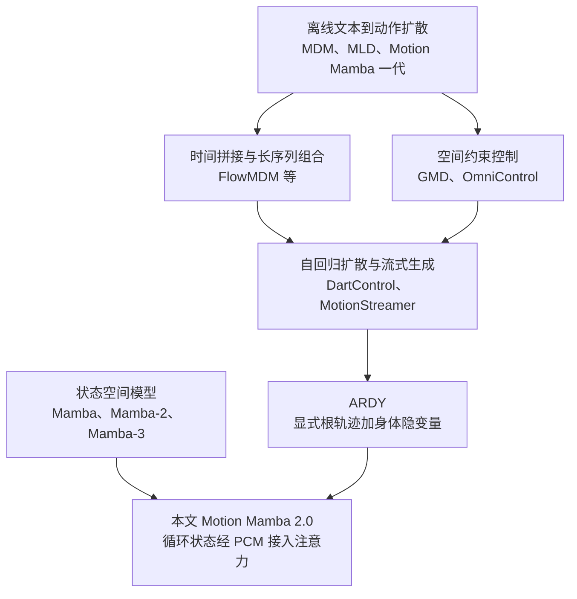
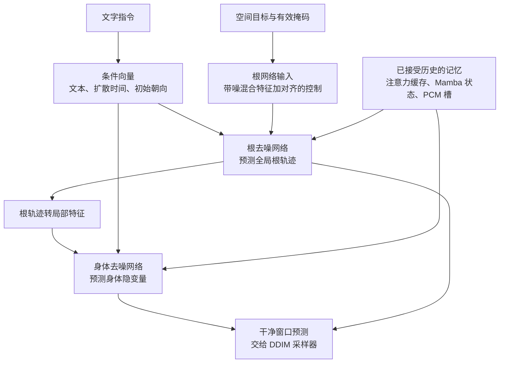
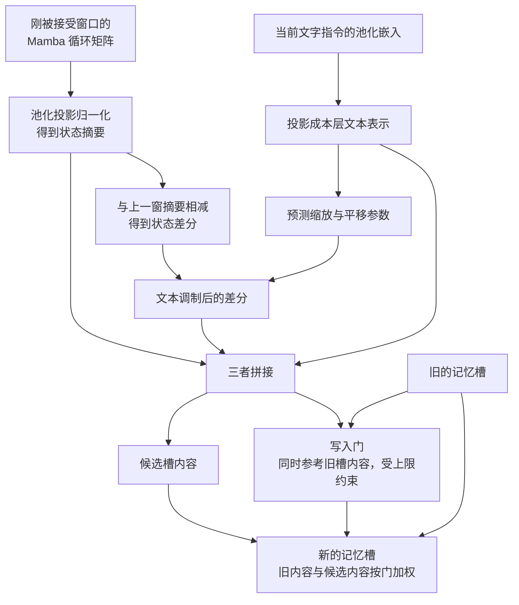
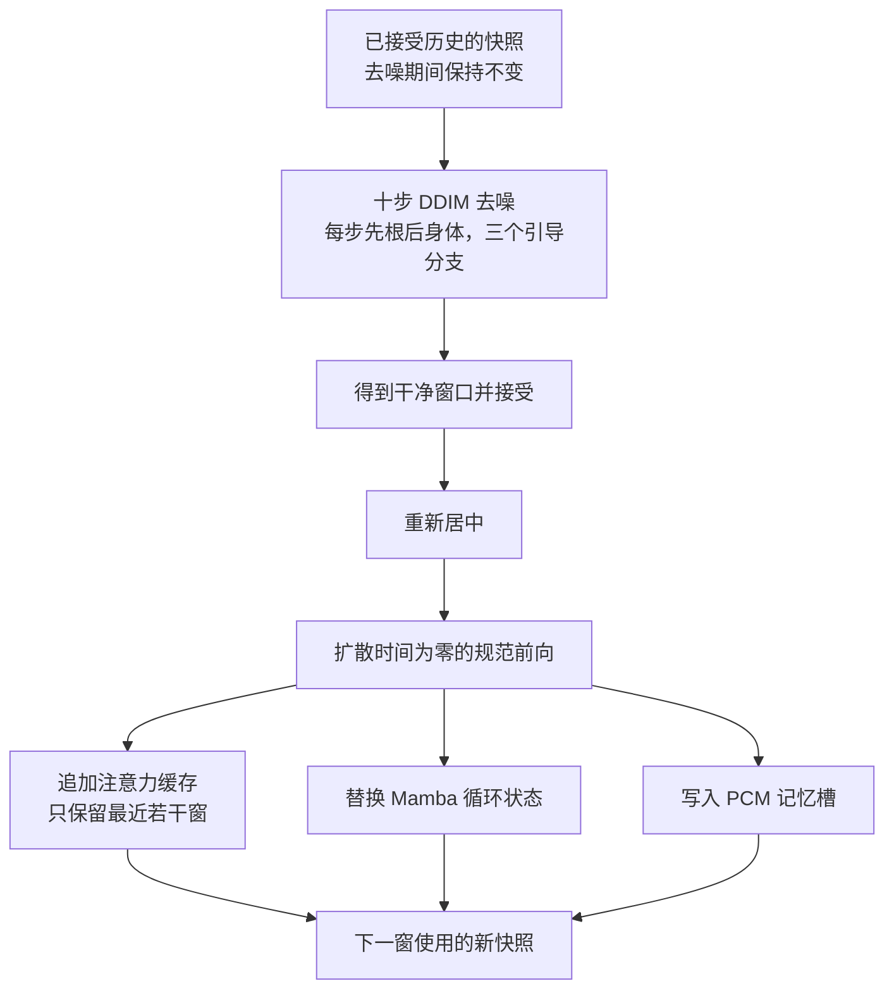

# Motion Mamba 2.0：面向长时程人形机器人控制的自回归扩散 Mamba

> **原题**：Motion Mamba 2.0: Autoregressive Diffusion Mamba for Long-Horizon Humanoid Control
> **作者**：Yue Huang、Tianshan Zhang、Zeyu Zhang、Jayeon Kang、Akide Liu、Sungjoon Choi、Dacheng Tao、Hao Tang
> **机构**：北京大学计算机学院、高丽大学人工智能系、莫纳什大学、南洋理工大学
> **年份**：2026（arxiv ID 2611.29897）
> **分类**：cs.RO / cs.CV
> **链接**：https://arxiv.org/abs/2611.29897
> **精读日期**：2026-11-24

## 阅读须知

### 这篇在领域里的位置

这篇论文属于「文本与空间条件驱动的人体动作生成」这一方向，并且落在其中面向人形机器人的那一支。过去几年，这个方向的主流做法是用扩散模型从一句文字描述生成一段几秒钟的动作片段，代表工作是 MDM 与 MLD；这类方法一次生成一整段，生成开始之后便无法再接收新的指令。

为了让动作能够一边生成一边接受新指令，后来的工作转向「自回归扩散」：每次只生成一小窗动作，再把已经生成的部分当作历史接着往下生成。本文直接继承的 ARDY 就是这条路线上的工作，它把根节点轨迹显式保留、把身体姿态压缩成隐变量。与此同时，作者自己在 ECCV 2024 发表过 Motion Mamba，用状态空间模型 Mamba 做离线的文本到动作生成。

本文是 Motion Mamba 的期刊扩展版，位置可以这样概括：它把 Mamba 的循环状态接到 ARDY 式的自回归根身扩散里，再加一个把循环状态翻译成注意力可读内容的记忆模块，目标是让机器人在几十秒的连续生成里仍然能准确走到指定位置、做出指定动作。

### 读完能回答什么

1. 自回归扩散做长时程动作生成时，「有界注意力缓存」与「压缩循环状态」各自丢掉了什么信息，为什么把两者简单并排放进网络并不够。
2. 持久内容记忆 PCM 的写入与读出分别是怎样计算的，文本条件与状态差分在其中起什么作用。
3. 「只在接受后更新历史」这条规则解决的是扩散采样里的哪一种混淆。
4. 6.138 倍的推理加速是相对于谁而言的，三项执行优化各自贡献了多少。
5. 这套系统在真实的 Unitree G1 上完成度如何，生成器与跟踪控制器之间的分工是什么。

### 阅读前置

本笔记假定读者熟悉 Transformer 的注意力机制、扩散模型的加噪与去噪过程，以及无分类器引导的基本做法。笔记不假定读者做过动作生成、状态空间模型或人形机器人控制，相关概念在首次出现时会先作铺垫。

### 首次出现的缩写表

- **Mamba**：一种状态空间序列模型，用一个固定大小的循环状态概括已经读过的序列，状态的更新方式随输入变化。本文使用的是它的第三代 Mamba-3。
- **PCM**（Persistent Content Memory，持久内容记忆）：本文提出的模块，把 Mamba 的循环状态转写成若干个注意力可以读取的记忆槽。
- **ARDY**：本文直接继承的自回归扩散基线，采用「显式根轨迹加身体隐变量」的混合表示。
- **G1**：宇树科技的 Unitree G1 人形机器人，本文使用它的 29 自由度版本。
- **CFG**（Classifier-Free Guidance，无分类器引导）：扩散采样时把有条件预测与无条件预测按比例外推的做法。本文同时有文本与空间两种条件，因此每一步要算三个分支。
- **DDIM**：一种确定性的扩散采样器，可以用远少于训练步数的步数完成采样。本文推理时用 10 步。
- **DiT**（Diffusion Transformer）：以 Transformer 为骨干的扩散去噪网络。
- **Root CE / End CE**：根节点与末端关节在截止时刻的位置控制误差，单位厘米。
- **Cmd.**：指令匹配率，衡量生成动作的粗粒度根运动状态（例如前进、转向、静止）是否与指令一致。
- **R@3**：检索指标，用一个独立训练的文本动作匹配模型，检查正确的动作是否排在前三。
- **L2-FID**：在 L2 归一化的动作特征上计算的分布距离，越低表示生成动作的分布越接近真实动作。
- **SONIC**：一个现成的大规模人形机器人动作跟踪控制器，负责让真实机器人跟随生成的参考动作。
- **GMR**（General Motion Retargeting）：把人体动作映射到机器人骨架的重定向方法。
- **CUDA Graph**：英伟达 GPU 上把一串计算核的调用录制下来、之后整体回放的机制，用来减少主机端反复下发任务的开销。

## 一、问题

设想一个由文字和键盘鼠标驱动的人形机器人：使用者先让它向前走，走到一半让它左转，再让它停下来挥手，同时还指定了它十几秒之后应当到达的位置。要支撑这样的交互，动作生成模型必须同时满足三件事。它要听得懂当前的文字指令，要照顾到尚未到来的空间目标，还要让新生成的动作与已经做出的动作平滑衔接。离线的文本到动作生成不需要面对这些要求，因为它在生成开始之前就知道全部指令；交互式生成则不然，未来的指令在生成开始时并不存在。

自回归扩散为这个问题提供了一个可行的接口：模型每次只生成一小窗动作，本文是 52 帧、约 2.08 秒，生成完便交给下游执行，再带着历史去生成下一窗。然而这条路线上有两个困难纠缠在一起。第一个困难关于历史。模型若想参考过去的动作，最直接的办法是把过去的特征放进注意力的缓存里；缓存若有上限，较早的动作特征便被丢弃，缓存若没有上限，存储与计算便随着时间无限增长。第二个困难关于速度。扩散模型每生成一窗都要反复去噪许多步，即便单次网络前向很小，重复执行累积的开销也相当可观。

这两个困难并不能互相替代地解决。减少采样步数可以省时间，却不会让模型看到更久远的历史；反过来，给模型一个紧凑的历史表示，也并不会让去噪本身变快。论文因此把问题拆成两部分：一部分是历史应当怎样表示，另一部分是同一套计算应当怎样更高效地执行。

在历史表示上，状态空间模型提供了注意力缓存之外的另一种选择。它不保存每一个历史时刻的特征，而是用一个固定大小的循环状态把读过的序列概括起来，状态随着新输入不断演化。于是出现了一个值得注意的不对称：循环状态携带的是一份持续演化的压缩上下文，注意力缓存允许的是对显式特征的直接检索，两者暴露历史的方式并不相同。把这两个分支并排放进同一个网络，循环状态里的历史并不会因此变得可以被注意力读取。

扩散过程还带来一个额外的要求，这是本文问题陈述里最容易被忽略的一点。在为同一窗动作去噪时，相继出现的若干个带噪候选是「同一段时间的不同备选」，并不是「被接受的动作流里相继的几个时刻」。倘若模型在去噪途中就把这些中间候选写进循环状态或缓存，采样迭代的次序便与物理时间混在了一起。论文因此把「预测」与「提交历史」之间的界线当作流式建模的一部分来设计，而不是留给实现细节去处理。

落到一句可检验的陈述上，本文要解决的问题是：在存储与每窗计算量都不随生成时长增长的前提下，让自回归根身扩散模型在长达近 40 秒的连续生成里保持对终点空间约束的准确满足与对指令的响应，并且把每窗的生成时间压到可交互的范围。

## 二、方法

### 流式建模与动作表示

整段输出被切成若干个窗口，每个窗口含 $C$ 个 token，每个 token 代表连续的 $P$ 帧。在第 $t$ 个窗口，模型拿到的条件有三样：文字指令 $s_t$、空间目标 $\mathbf{g}_t$ 以及标记哪些目标有效的掩码 $\mathbf{v}_t$。此外还有一份记忆 $\mathcal{M}_{t-1}$，它完全由此前已经被接受的动作构造而来。整段动作的条件分布于是按窗口分解：

$$
p_{\theta}(\mathbf{x}_{0:T}\mid\mathbf{s},\mathbf{g},\mathbf{v})=\prod_{t=0}^{T}p_{\theta}\bigl(\mathbf{x}_{t}\mid s_{t},\mathbf{g}_{t},\mathbf{v}_{t};\mathcal{M}_{t-1}\bigr)
$$

这里需要留意空间目标的时间位置。目标可以落在当前窗口之内，也可以落在当前窗口之后；后一种情况下它只作为条件信息提供给模型，模型并不需要提前把中间的动作都生成出来。

动作表示沿用 ARDY 的混合方案。每一帧的根节点由三维位置 $\mathbf{p}$ 与朝向角 $\psi$ 描述，朝向以余弦和正弦的形式写入，于是每帧的根特征是 5 维。身体部分包含关节旋转、关节位置与速度以及足部接触标记，这些特征由一个因果的动作编解码器压缩成隐变量。一个 token 便是一段根轨迹补丁 $\mathbf{r}_i$ 与一个身体隐变量 $\mathbf{b}_i$ 的拼接。这样设计的理由在于，根轨迹显式保留之后，空间控制可以直接作用在坐标上，而关节姿态经过压缩之后维度大为降低。编解码器在去噪网络训练期间保持冻结。

### 根与身体的两阶段去噪

每一次扩散去噪的计算分成前后两步。第一步由根网络 $\mathcal{F}^{r}_{\theta}$ 预测干净的全局根轨迹；第二步把预测出的根轨迹转成局部特征，连同带噪的身体隐变量一起交给身体网络 $\mathcal{F}^{b}_{\theta}$，由它预测干净的身体隐变量。两个网络的参数彼此独立，各层的记忆也各自维护。

这一分解带来两点好处。其一，全局的平移与朝向被单独拿出来预测，空间条件可以直接施加在上面：凡是有效的根观测，会直接替换掉对应位置的带噪坐标。其二，根的预测在每一个去噪步都先于身体刷新，因此两者在整个采样过程中始终保持耦合，而不是各自生成完再拼到一起。

### 混合序列层与 Mamba-3 循环

根网络与身体网络都由若干扩散 Transformer 层堆叠而成。在每一层的序列混合器内部，注意力与 Mamba 处理的是同一份经过条件调制与归一化的特征。两者的分工很清楚：注意力负责从缓存里检索最近的动作特征，Mamba 则从已接受历史留下的状态接着往下扫描。两条支路的输出由一个逐层可学习的门加权合并。

Mamba-3 的循环并不是本文的贡献，论文只是把它当作时间建模的组件来用。它的核心是一个矩阵形式的隐状态 $\mathbf{H}_i$，每读入一个位置便衰减一次旧状态，再加入新的输入：

$$
\mathbf{H}_{i}=\alpha_{i}\mathbf{H}_{i-1}+\beta_{i}\mathbf{u}_{i-1}\widetilde{\mathbf{B}}_{i-1}^{\top}+\gamma_{i}\mathbf{u}_{i}\widetilde{\mathbf{B}}_{i}^{\top}
$$

其中 $\alpha_i$ 是由步长与衰减率算出的遗忘系数，$\mathbf{u}_i$ 是当前位置的值向量，$\widetilde{\mathbf{B}}_i$ 是经过旋转的状态输入向量，$\beta_i$ 与 $\gamma_i$ 是梯形积分规则给相邻两个输入分配的权重。对本文而言要紧的只有一点：为了能在下一个窗口续上这次扫描，需要随身携带的东西包括循环矩阵、累计相位以及上一个位置的输入向量，它们的总大小与已经生成了多长的动作无关。

### 持久内容记忆 PCM

有了注意力缓存与 Mamba 状态之后，两者各自的短处也就清楚了。缓存只保留最近 $W$ 个已接受窗口的键和值，更早的特征会被逐出。Mamba 状态虽然概括了全部已接受历史，但它是一个矩阵，本身并不是注意力可以检索的 token。PCM 要做的事情，就是学习一个从循环状态到注意力内容的映射，把压缩的历史翻译成若干个可以被注意力读取的槽。

写入发生在一个窗口被接受之后。在第 $\ell$ 层，PCM 维护 $S$ 个记忆槽 $\mathbf{P}^{\ell}_{t}$，初始为零。它首先把刚刚接受的循环矩阵池化、投影并归一化，得到状态摘要，再计算这份摘要相对于上一个窗口的变化：

$$
\overline{\mathbf{s}}_{t}^{\ell}=\Pi^{\ell}(\mathbf{H}_{t}^{\ell}),\qquad \mathbf{d}_{t}^{\ell}=\overline{\mathbf{s}}_{t}^{\ell}-\overline{\mathbf{s}}_{t-1}^{\ell}
$$

摘要 $\overline{\mathbf{s}}$ 刻画的是累积到目前为止的上下文，差分 $\mathbf{d}$ 刻画的则是最近一次被接受的状态转移。接下来，当前文字指令的池化嵌入被投影成这一层专用的表示，并预测出一组逐特征的缩放与平移参数，用来调制归一化后的差分。这一步的用意是让「同样的状态转移」在「不同的指令」之下写出不同的记忆内容。摘要、被文本调制的差分与文本表示三者拼接起来，经过一个小网络得到候选的槽内容 $\mathbf{Z}^{\ell}_{t}$。

最后由一个门来决定写入多少。这个门同时看到刚才拼接的联合表示与上一时刻的槽内容，输出每个位置的写入率：

$$
\mathbf{P}_{t}^{\ell}=(1-\mathbf{w}_{t}^{\ell})\odot\mathbf{P}_{t-1}^{\ell}+\mathbf{w}_{t}^{\ell}\odot\mathbf{Z}_{t}^{\ell},\qquad \mathbf{w}_{t}^{\ell}=\eta\,\sigma\bigl(f_{w}^{\ell}(\cdot)\bigr)
$$

其中 $\eta$ 是写入率的上限，取值在 0 到 1 之间，它限制了每次更新里新内容所占的比重，使槽的内容随会话缓慢累积，而不是被最近一窗完全覆盖。

读出发生在下一个窗口去噪的时候，并且只读不写。基础注意力的键和值由三部分组成：一组可学习的静态「汇点」token、缓存里的历史特征以及当前窗口的带噪特征。PCM 增强版的注意力只是在汇点之后再插入投影过的记忆槽，查询向量保持不变。两路注意力的差值经过一个可学习标量控制之后加回去，再加上 Mamba 支路的输出：

$$
\mathbf{Y}^{\ell}=\mathbf{A}^{\ell}_{0}+\tanh(\rho_{\ell})\bigl(\mathbf{A}^{\ell}_{P}-\mathbf{A}^{\ell}_{0}\bigr)+\sigma(\zeta_{\ell})\mathbf{M}^{\ell}
$$

这里 $\mathbf{A}^{\ell}_{0}$ 是基础注意力的输出，$\mathbf{A}^{\ell}_{P}$ 是加入记忆槽之后的注意力输出，$\mathbf{M}^{\ell}$ 是 Mamba 支路的输出，$\rho_\ell$ 与 $\zeta_\ell$ 是两个逐层可学习的标量。之所以采用残差形式，是因为把 $\rho_\ell$ 初始化为零可以严格还原没有 PCM 时的输出。论文特意指出这与「把槽的值初始化为零」并不等价：即便值为零，多出来的键仍然会改变注意力的归一化。

需要说明的是 PCM 的设计边界。论文多次强调，这些槽提供的是「可用的动作上下文」，目的是支撑长时程下的终点约束满足与指令响应；它们并不是为了逐字复现任意一条早期指令，也不保证能找回任何一个已被逐出缓存的具体事件。

### 只在接受后更新历史

前面提到，同一窗口的若干带噪候选并不代表时间上的先后。论文据此规定：每一次去噪计算读到的都是同一份不可变的历史快照，去噪过程中即便产生了临时的状态提案，也一律不提交。

采样结束、干净窗口被接受之后，模型把这一窗重新居中，再在扩散时间为零的条件下做一遍规范的前向计算。正是这一遍计算同时完成三件事：把新特征追加到各层的注意力缓存，替换各层的 Mamba 循环状态，以及执行 PCM 的写入。根网络与身体网络的更新一并提交；倘若这一遍计算失败，两个网络都保留原先的状态。

由于缓存最多只增长到 $W$ 个窗口，循环状态与记忆槽的大小又是固定的，每生成一个新窗口所需的内存与计算便不随已经过去的时间增长。论文同时提醒，这一上界说的是计算上下文，它并不意味着任意长时间的动作都没有误差。

### 保持状态不变的高效推理

论文的第二项贡献是一套执行层面的优化，原则是不改变采样过程与历史更新的语义，只让同样的计算跑得更快。这里只作概述，具体的实现细节请参看原文附录。

优化分为三项。第一项是执行流程的精简：去噪阶段既然只读不写，那些不会被预测或后续提交用到的状态提案与诊断量便无须生成。第二项是算子融合：把 Mamba 状态转移之前的若干步预处理合并成一次遍历，减少中间结果在显存里的往返。第三项是 CUDA Graph 回放：根网络与身体网络各自录制一张计算图，每张图把文本条件、空间条件与无条件三个引导分支串行地一并录入，之后每个去噪步整体回放，从而省去主机端一次次下发小任务的开销。采样更新、随机数处理、重新居中以及状态提交都留在图外。

### 训练目标

训练采用预测干净窗口的方式，损失由四项相加而成，四项的系数都取 1。第一项在根轨迹补丁与身体隐变量上计算 Smooth L1 损失。第二项在解码之后的身体姿态上计算 L1 损失。第三项只在落入当前生成窗口之内的已观测目标坐标上计算 L1 损失，更远的目标在其对应帧进入输出窗口之前只作为条件输入。第四项是一致性约束，它比较两种途径得到的关节位置：一种是由解码出的关节旋转经过正向运动学算出来的，另一种是解码特征里直接给出的。

## 三、实验

### 数据与设置

训练数据由三个来源合并而成，统一成 29 自由度的 G1 表示，每帧 414 维物理特征，帧率 25 Hz。BONES Seed 提供原生的机器人参考动作，共 124,658 条；HumanML3D 与 HiPHI 提供人体动作与文字描述，重定向到 G1 之后分别有 14,612 条与 17,549 条。算上镜像样本，训练池合计 156,819 条、约 588.92 小时。

重定向的质量以映射目标的残差来衡量。就踝关节而言，各片段残差的中位数在 HumanML3D 上是 1.49 厘米，在 HiPHI 上是 0.93 厘米；骨盆残差的中位数分别是 0.99 厘米与 0.56 厘米。

训练使用 AdamW 优化器，共 100,000 次更新，全局批大小 512，三个数据来源按 70:15:15 的比例采样。有两处设置值得记住。其一，训练时的历史动作取自真实序列，模型并不在自己生成的历史上滚动训练，采样到的最长历史是 196 帧、合 7.84 秒。其二，所有对比方法与结构变体都由作者在同一份 G1 数据上、以同样的 100,000 次更新预算重新训练，没有使用任何方法原本发布的预训练权重。

评测时，每个时长与每种方法使用 128 组留出的初始状态与 3 个噪声种子，合计 384 次滚动生成。每次试验指定一个根节点目标与一个腕部或踝部目标，两者从一开始就给出，截止时刻在滚动的末尾。采样使用 10 步确定性 DDIM，文本与空间的引导强度都取 2。

### HiPHI 上的长时程结果

主实验在重定向后的 HiPHI 上比较了 2.08 秒到 39.52 秒四个时长。下表摘录其中几种有代表性的方法，Root CE 与 End CE 的单位是厘米，时延是 RTX 4090 上每个被接受窗口的毫秒数。

| 方法 | Root CE（1 窗） | Root CE（4 窗） | Root CE（9 窗） | Root CE（19 窗） | End CE（19 窗） | Cmd.（19 窗） | R@3（19 窗） | 时延（19 窗） |
|---|---|---|---|---|---|---|---|---|
| DartControl | 44.84 | 64.66 | 91.05 | 291.58 | 295.86 | 40.32% | 15.53% | 28.2 |
| TACD | 21.81 | 30.49 | 40.19 | 54.43 | 59.40 | 28.03% | 17.81% | 208.0 |
| MotionStreamer | 17.89 | 16.93 | 6.17 | 7.78 | 21.67 | 18.85% | 13.02% | 159.8 |
| ARDY | 5.89 | 7.44 | 8.15 | 10.09 | 14.84 | 23.53% | 15.32% | 105.1 |
| Motion Mamba 一代 | 50.58 | 56.81 | 78.67 | 125.74 | 130.17 | 25.77% | 17.18% | 310.5 |
| Motion Mamba 2.0 | 2.78 | 2.53 | 2.87 | 7.55 | 13.64 | 46.05% | 23.68% | 333.4 |

从表中可以读出两层意思。在 18.72 秒以内，本文方法的根位置误差始终保持在 3 厘米以下，明显低于 ARDY 的 6 到 8 厘米。到了 39.52 秒，误差上升到 7.55 厘米，相对 MotionStreamer 的 7.78 厘米只低 3.0%，相对 ARDY 的末端误差 14.84 厘米低 8.1%；也就是说，最长时程上的控制精度优势已经收窄。

与之相对，指令匹配率的差距在长时程上反而拉大。在 39.52 秒，本文方法的 Cmd. 为 46.05%，其余方法里最高的是 MoLingo 的 41.34%，ARDY 只有 23.53%。分布质量方面，本文方法在后三个时长取得最低的 L2-FID，分别为 0.401、0.402 与 0.409；在单窗设置下则是 CMDM 以 0.337 领先，本文为 0.410。

### 短时程的两个基准

在 BONES Seed 的原生 G1 轨迹上，8.32 秒时本文方法的 Root CE 为 1.86 厘米，ARDY 为 4.96 厘米，相对下降 62.5%；End CE 由 10.16 厘米降到 6.86 厘米。在重定向后的 HumanML3D 上，8.32 秒时 Root CE 与 End CE 为 2.17 与 7.03 厘米，ARDY 为 4.75 与 9.82 厘米。

语义类指标则并不一致地占优。在 BONES Seed 上，本文方法 8.32 秒的指令匹配率是 51.42%，低于 DartControl 的 61.79%。在 HumanML3D 的单窗设置下，本文的 R@3 为 84.29%，低于 MotionStreamer 的 96.40%。论文自己把这一现象表述为「精确的约束控制」与「单窗文本检索」之间存在差别。

### 结构消融

消融比较了五种配置：去掉 Mamba 支路的 Minimal、有 Mamba 而无 PCM 的 Native、PCM 写入时不用文本的变体、PCM 写入时不用状态差分的变体，以及完整模型。下表是 HiPHI 上 39.52 秒的结果。

| 配置 | Root CE | End CE | Cmd. | R@3 | L2-FID |
|---|---|---|---|---|---|
| Minimal（无 Mamba） | 60.00 | 64.86 | 35.27% | 17.26% | 0.439 |
| Native（Mamba，无 PCM） | 9.36 | 15.54 | 32.20% | 17.44% | 0.416 |
| Native + PCM（无文本） | 8.62 | 14.62 | 33.34% | 21.18% | 0.467 |
| Native + PCM（无差分） | 8.30 | 14.18 | 32.65% | 21.11% | 0.488 |
| 完整模型 | 7.55 | 13.64 | 46.05% | 23.68% | 0.409 |

最大的一步改进来自循环状态本身：加入 Mamba 之后，39.52 秒的根位置误差从 60.00 厘米降到 9.36 厘米，而单窗设置下两者的差别要小得多。在此基础上，PCM 把根位置误差再降 19.3%，到 7.55 厘米。

PCM 两个组成部分的作用主要体现在指令匹配上。去掉文本条件或去掉状态差分之后，控制误差仍然好于 Native，可是指令匹配率都停留在 33% 上下，只有两者齐备时才升到 46.05%。这支持了论文的说法：把压缩状态接到注意力上这件事本身对空间控制有用，而文本调制与差分特征合在一起才带来长时程上的指令响应。

### 推理效率

效率实验固定模型权重，只比较执行方式，硬件是一块 RTX 4090，批大小为 1，10 步去噪，三个引导分支，四个窗口的历史。计时覆盖一个完整的 52 帧窗口，从恢复状态一直到解码与导出；模型加载、预热与计算图录制不计入。

| 流程精简 | 算子融合 | 图回放 | p50 时延（毫秒） | p95 时延（毫秒） | 配对加速比 |
|---|---|---|---|---|---|
| 否 | 否 | 否 | 1685.35 | 2471.65 | 1.000 |
| 是 | 否 | 否 | 1102.82 | 1647.52 | 1.525 |
| 是 | 是 | 否 | 1069.52 | 1588.74 | 1.578 |
| 是 | 否 | 是 | 285.20 | 352.22 | 5.943 |
| 是 | 是 | 是 | 276.14 | 345.82 | 6.138 |

完整方案把中位时延从 1685.35 毫秒降到 276.14 毫秒，中位配对加速比为 6.138，95% 置信区间是 6.094 到 6.290。对一个 2.08 秒的动作窗口而言，这相当于实时因子 0.133。从分项来看，绝大部分收益来自图回放：它把主机端的普通下发次数从 83,777 次减到 5,519 次，降幅 93.4%；算子融合在图回放之上只再带来 1.029 倍。论文也明确写道，整体加速不能归功于融合算子一项。

一致性方面，优化后的执行路径在四次各 100 个窗口、种子不同的滚动生成里，输出与提交的状态都与原始路径逐位相同。

### 真实机器人

真机实验在 Unitree G1 上进行，共四类任务 100 次试验。动作生成与文本编码运行在远端的一台 RTX 4090 服务器上，生成的参考动作经由一台中间工作站以 50 Hz 转发给机器人，机载的 SONIC 控制器负责跟踪，生成模型并不在机器人本体上运行。

| 任务 | 完整成功 | 成功率与 95% 置信区间 | 阶段完成 | 文本切换成功 | 跌倒 |
|---|---|---|---|---|---|
| T1 连续动作组合 | 18/20 | 90.0%（69.9 到 97.2） | 136/140 | 117/120 | 0 |
| T2 表现性动作 | 19/20 | 95.0%（76.4 到 99.1） | 99/100 | 78/80 | 0 |
| T3 键盘控制行走 | 29/30 | 96.7%（83.3 到 99.4） | 59/60 | 30/30 | 0 |
| T4 鼠标控制行走 | 28/30 | 93.3%（78.7 到 98.2） | 58/60 | 29/30 | 0 |

四类任务合计 94 次完整成功，97 次满足稳定性标准，没有观察到跌倒。交互控制的响应也有量化：以键盘为例，从系统收到指令到服务器端生成好对应参考动作的中位时延是 246 毫秒，到机器人身上出现满足指令的持续运动的中位时延是 351 毫秒，速度的均方根误差为 0.041 米每秒，朝向的平均绝对误差为 4.6 度。

### 两处反直觉的结果

第一处是 PCM 并非在所有指标上都带来改进。在 HiPHI 的单窗设置下，没有 PCM 的 Native 取得 0.368 的 L2-FID，完整模型是 0.410；在 HumanML3D 的单窗设置下，连 Mamba 都没有的 Minimal 取得 92.97% 的 R@3，完整模型只有 84.29%。换句话说，记忆模块换来的是长时程下的控制与指令响应，短时程的文本检索与分布质量反而略有让步。

第二处是指令匹配率随时长的变化。所有方法的 Cmd. 在单窗时都相当高，本文方法是 86.96%，到 4 个窗口时便跌到 48.82%，此后大体持平。因此本文在长时程上的优势，更准确的说法是「跌得比别人少」：39.52 秒时 46.05% 的匹配率虽然是所有方法里最高的，绝对值仍然不到一半。

## 四、局限

### 作者承认的

论文的局限一节很短，只说明当前框架专注于可控的人形动作生成，尚未处理物体操作，今后将研究把行走与操作协调起来的全身任务。

除此之外，作者在正文各处做了不少克制的限定，可以一并视为自述的边界。PCM 的槽并不保证找回任意一个已被逐出缓存的事件；存储有界并不意味着任意长时间的动作没有误差；276.14 毫秒是稳态的每窗生成时间，不等于从用户发出指令到看见动作的延迟；结构消融表里的时延一栏不能横向比较，因为 Minimal 配置没有使用融合算子与图回放。

### 读完能看出来的

其一，加速比的参照系需要分清。6.138 倍是相对于本模型自己未经优化的执行方式而言的。优化之后，每窗约 280 毫秒的时延仍然是 ARDY 与 MotionStreamer 的两到三倍，后两者大约在 100 毫秒上下，最快的 DartControl 约 30 毫秒。这套方法是以更高的计算代价换取更准的控制，而不是又快又准。

其二，对比基线全部由作者自行在 G1 数据上以 100,000 次更新重新训练。这样做保证了条件一致，却也意味着各基线的数字取决于作者的适配质量与这一固定预算是否适合该方法。例如 Motion-Agent 与 IRG-MotionLLM 这两种基于大语言模型的方法，在这一设置下每窗时延超过十秒、指标也偏低，它们在原始设置下的表现未必如此。

其三，训练与测试之间存在分布差距。训练时历史动作取自真实数据，最长 7.84 秒；测试时模型在自己生成的历史上滚动到 39.52 秒。18.72 秒到 39.52 秒之间根位置误差从 2.87 厘米升到 7.55 厘米，说明误差随时长在累积，更长的时程上表现如何，论文没有给出数据。

其四，统计上的把握有限。论文提到的三个种子是采样噪声的种子，并未说明每种结构变体是否训练了多次，因此消融表里若干较小的差距难以判断是否稳定。真机实验每类任务只有 20 到 30 次，置信区间相应较宽，例如 T1 的成功率区间是 69.9% 到 97.2%，并且真机上没有与其他生成方法的对照。

其五，部署形态依赖外部条件。生成模型运行在远端的桌面级显卡上，机器人本体只运行跟踪控制器；生成的参考动作是运动学层面的，动力学上是否可行要靠 SONIC 来保证。论文评测的是「生成加跟踪」这一整套系统，失败的 6 次试验里哪些出自生成、哪些出自跟踪，文中没有拆分。

其六，文本检索指标的可比性有限。R@3 所用的评估模型由作者为每个基准独立训练，HiPHI 用 32 个生成候选，另外两个基准用 1 个生成候选加 31 个真实干扰项，论文自己也说明这一指标只能在基准内部比较。

## 一句话

Motion Mamba 2.0 用记忆槽把循环状态接入注意力，接受后才更新历史，使 G1 动作近 40 秒内保持厘米级终点控制。
