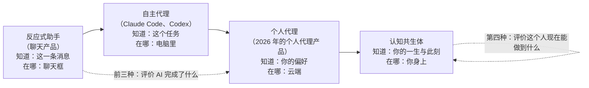
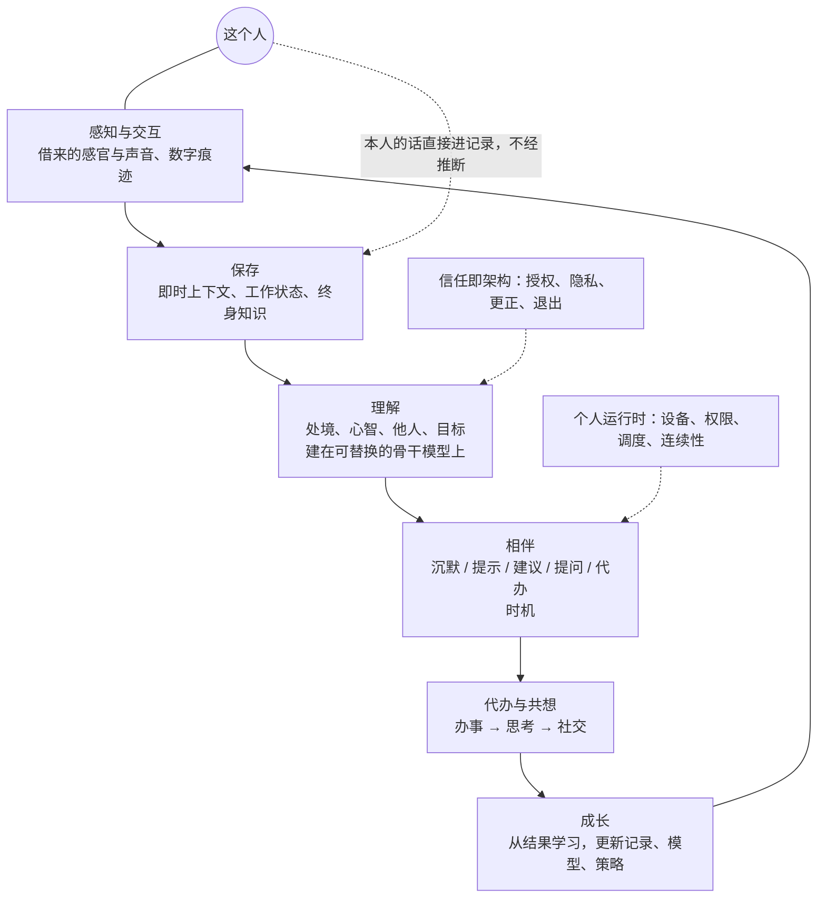
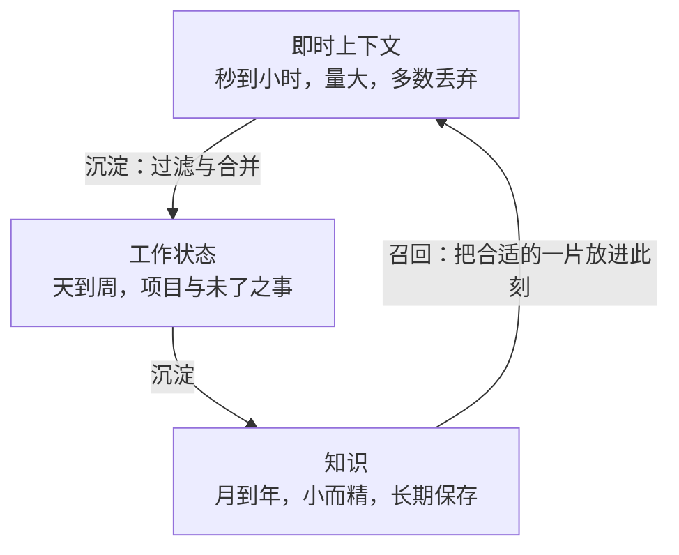
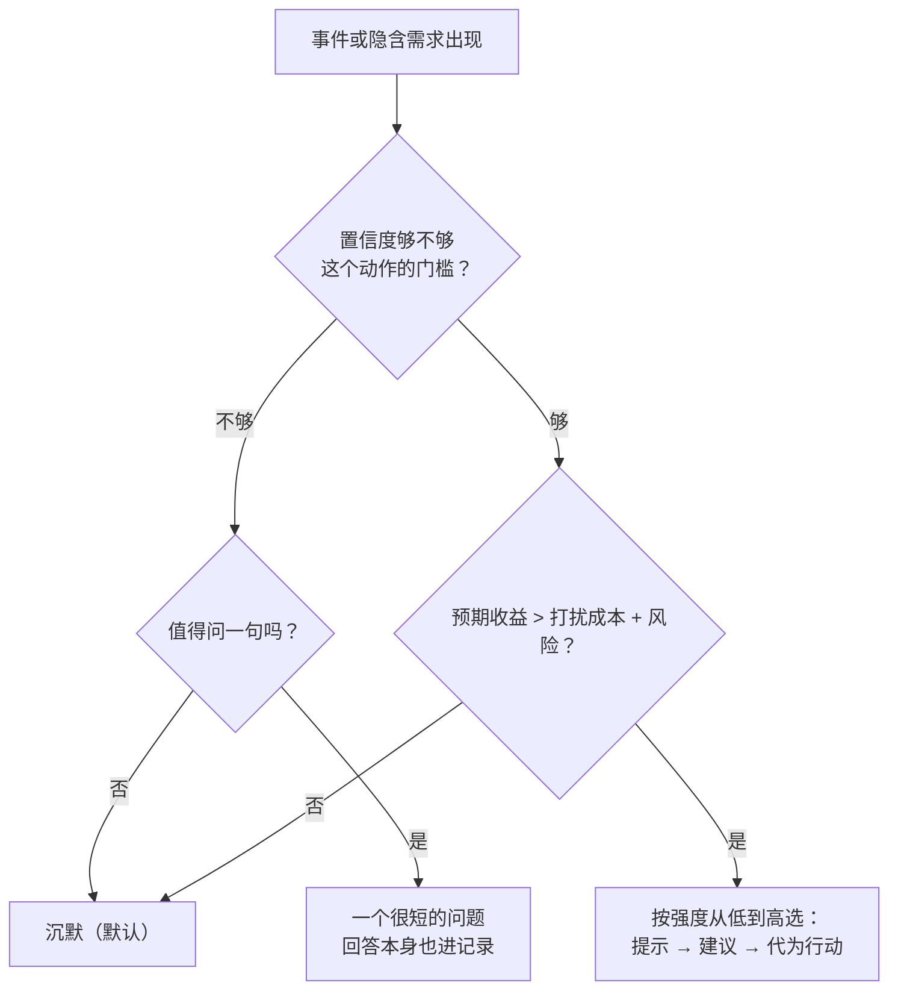
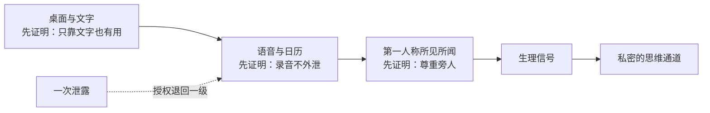
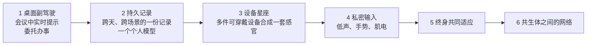

# 从自主代理到认知共生体：迈向 AI 增强的人类智能

> **原题**：From Autonomous Agents to Cognitive Symbionts: Toward AI-Augmented Human Intelligence
> **作者**：Hao Fei
> **机构**：牛津大学（University of Oxford）
> **年份**：2026（arxiv ID 2611.05376）
> **分类**：cs.CL
> **链接**：https://arxiv.org/abs/2611.05376
> **精读日期**：2026-11-08

## 阅读须知

### 这篇在领域里的位置

这是一篇立场论文（perspective paper），正文五十九页，没有提出新算法，也没有做实验。它讨论的是个人 AI 这条线：过去几年，大模型从聊天机器人长成了会用工具的代理，又长成了能在后台连续跑长任务的自主代理，2026 年还出现了一批记得用户偏好、替用户打理事务的「个人代理」。这条线的评价标准始终没有变，衡量的是 AI 自己完成了多少事。

作者认为这条路只走了一半。他提出与「机器能有多聪明」（AGI）并列的另一半目标：AI 能让某一个具体的人变得多聪明，并给它起名为 AI 增强的人类智能（AHI）。实现这个目标的系统，他称为「认知共生体」（cognitive symbiont）。整篇论文的工作，就是给这个范式下定义、画出设计空间、列出风险与治理办法，并说明将来该怎样验证。

### 读完能回答什么

1. 作者所说的「认知缺口」是什么，为什么他认为个人 AI 的瓶颈已从模型能力转到了人与 AI 的耦合
2. 认知共生体必须具备哪六项性质，它和钢铁侠的 Jarvis、和今天的个人代理差在哪里
3. 「共生回路」由哪几个环节组成，每一环最难的研究问题是什么
4. 共生体何时该开口、何时该沉默，作者怎样把这件事写成一个带约束的决策问题
5. 这种「帮人变强」的 AI 会带来哪些新型风险（例如考场作弊），作者提出了怎样的治理原则，又说什么结果能证明他错了

### 阅读前置

假定读者用过大模型聊天产品和编程代理，知道检索增强、长期记忆、工具调用这些常见概念。不预设读者读过人机交互或认知科学的文献，文中引到的相关理论会在首次出现时交代。

### 缩写表

- **AGI**（Artificial General Intelligence，通用人工智能）：以「机器本身能有多聪明」为目标的那一半。
- **AHI**（AI-augmented Human Intelligence，AI 增强的人类智能）：本文提出的另一半目标，衡量 AI 能让一个具体的人变得多能干。
- **Symbiont（认知共生体）**：本文提出的系统形态，终身陪伴、嵌在人的日常活动中、实时、私密、低打扰、主动。
- **RAG**（Retrieval-Augmented Generation，检索增强生成）：先检索资料再让模型生成回答的做法，本文把它列为「记忆」这条技术线的代表之一。
- **sEMG / EMG**（surface electromyography，表面肌电）：从皮肤表面读取肌肉电信号，可用来识别细微手势或默念，文中当作私密输入的通道。
- **JITAI**（Just-in-Time Adaptive Intervention，适时自适应干预）：移动健康领域研究「何时、以多大强度干预用户」的框架，作者借它来讨论共生体的出手时机。

## 一、问题

作者用一个研究者的一天开场，来说明他想解决的痛点。早上她冒出一个想法，还没写下来就忘了；下午开会，同事问起她三年前发表过的一个结果，她想不起那个数字；晚上面对一个决定，她记不起自己上一次遇到类似情形时是怎么想的。

另有两种情形属于同一类：在陌生国家不知道怎样得体地婉拒邀请，以及刚经历失败的人，需要的是一个了解自己经历的人说的一句话，得到的却是一段泛泛的鼓励。作者强调，这五件事没有一件是智力不够造成的。

前三件是「取用失败」：人本来知道的东西，在需要它的那一刻没能到场。后两件是知识和支持上的缺口，当事人当场无法自己补上。在每一种情形里，掌握相关知识的 AI 其实都存在，只是它不在场：它不知道这个人是谁、在哪里、想做什么、此刻是什么心情，也没有一种自然的方式在当下和他交流。

由此作者给出全文的核心判断：个人 AI 的瓶颈已经移动了。AI 在孤立任务上的能力一直在涨，可 AI 与某一个具体的人之间的「耦合」几乎没变。这里的耦合指 AI 对这个人知道多少、能多快插手、插手时打扰多大，以及这个人有多信任它。

耦合不足有三个可以观察到的症状。第一，每次对话都要从头解释背景；第二，帮助来得太晚或太吵；第三，人们不会把任何重要的事交给它。作者认为，下一步要做的是更紧的耦合，这和训练一个更大的模型是两个不同的问题。

为了把问题讲清楚，作者把人与 AI 的关系分成四种角色，下面这张图把它们串起来。

从上到下读这四种角色，有三样东西在一起变化。AI 知道的内容从一条消息扩大到一个人的一生；它所在的位置从聊天窗口挪到电脑、挪到云端，最后挪到人的身上。

它提供的价值也在变：从给信息，到替人办事，到按这个人的习惯办事，最后到让这个人自己变得更能干。作者特别指出，前三种角色评价的对象都是 AI，只有第四种把评价对象换成了人。

接着作者把相关技术分成五条线，逐一说明每条线已经给了共生体什么、还缺什么。

| 技术线 | 已经提供的 | 仍然缺少的 |
|---|---|---|
| 基础模型 | 理解语言、图像、声音并推理的「大脑」 | 没有持续性，没有时间感，没有身体，训练目标是「平均的人」 |
| 代理与运行框架 | 规划、用工具、操作电脑、跑长任务的「手」 | 只按任务、只按请求行动；没有感官，没有对人的模型，不会「什么都不做」 |
| 记忆与上下文 | 跨会话记忆、个性化工具箱 | 记住的是对话而不是生活；不区分「本人说的」和「推断的」；删除问题没解决 |
| 世界模型 | 预测环境和人下一步会做什么 | 多是第三人称、短时程、一次性地建模人，察觉不到自己已经过时 |
| 可穿戴与嵌入式硬件 | 可穿戴的感官、私密输出、本地算力 | 续航、显示、生理信号解读；各设备是独立产品，不是一套感官 |

作者的结论是，这五条线各自都在变强，但没有一条以「增强某一个具体的人」为目标。把它们组织到这个目标之下，就是本文概念框架的任务。

## 二、方法

本文的「方法」不是算法，而是一套概念框架。作者的写法是先给定义，再列性质，然后画一张设计空间图，并沿着这张图逐节展开。

### 2.1 认知缺口：全文的不变量

作者先定义「自我上下文」：一个人在某时刻所有与其处境相关的事实，包括经历过什么、知道什么、承诺过什么、和谁是什么关系、身体状态、在哪里、在做什么。它由三部分组成：外部能观察到的，本人自己说的，以及从这两者推断出来的。

与之相对的是「工作上下文」：受工作记忆、注意力、时间和情绪限制，一个人此刻真正能调用的，只是自我上下文中很小的一部分。两者之差决定了全文的核心量，认知缺口：

$$G_t = U(x_t;\,C^h_t) - U(x_t;\,c_t)$$

- $x_t$：此刻面对的具体情境
- $C^h_t$：这个人完整的自我上下文
- $c_t$：他此刻能调用的那一小部分
- $U$：在这个情境下取得的结果，只在单个情境内比较，不跨情境相加

认知缺口衡量的不是智力，而是每个人每天都在付的代价：忘掉的、没注意到的、来不及想清楚的、说不出口的。共生体的任务就是缩小这个缺口，在恰当的时刻把这个人自己够不着的那部分上下文递回到他手里。

作者特意强调，这不需要读心。需要的只是把 $C^h_t$ 中合适的一片放进 $c_t$，或者替他把「如果时间够、他本来会去做」的推理和杂事做掉。

### 2.2 共生体的定义与六项性质

在此基础上，作者给出认知共生体的定义：一个 AI 系统，它（一）在一个人的一生中持续存在；（二）依据获得授权的观察和本人的陈述，维护一个近似其自我上下文的模型；（三）通过私密的双向通道，在他的日常活动中在场。

它还要（四）在每一刻从「沉默、提示、建议、提问、代为行动」五种参与方式中选一种来缩小认知缺口；（五）从结果中学习；（六）把最终的判断和目标留给本人。第六条是作者划下的边界：共生体扩展的是人能带进某个情境的东西，判断和目标始终属于人。

评价单位也随之改变。作者把「人加共生体」当作被评价的整体，定义增强增益为有共生体时与没有共生体时的结果之差。

他用一句话划清了与 AGI 的界线：AGI 提高的是机器自己的表现，AHI 提高的是「人加机器」这个整体的表现。

接着是六项必要性质，作者用 Jarvis 来检验它们。

| 性质 | 含义 | 缺了会怎样 | Jarvis | 今天的个人代理 |
|---|---|---|---|---|
| 终身 | 一段关系、一份记忆，跨越多年 | 每次从零开始，缺口无法跨时间缩小 | 有 | 部分 |
| 嵌入 | 在真实活动中在场，不在聊天窗口里等 | 帮助只能事后才来 | 有 | 无 |
| 实时 | 在事情进行中、帮助还有用时插手 | 对的话在错的时间说等于没说 | 有 | 无 |
| 私密 | 交流内容属于本人，送达方式可以不惊动旁人 | 不敢倾诉，每次提示都打扰身边的人 | 有 | 部分 |
| 低打扰 | 从不要求停下、掏手机或解释背景 | 使用成本吃掉收益 | 有 | 无 |
| 主动 | 没被问也能判断该不该开口 | 人不会去问自己不知道缺了什么 | 有 | 部分 |

这些性质彼此拉扯：主动和低打扰冲突，终身和私密冲突。作者说，这两组张力正是后文最核心的研究问题。

Jarvis 六项全过，但作者认为共生体要比它多走六步。第一，Jarvis 靠主人自建的实验室和战衣感知世界，共生体只能靠几件平价可穿戴设备，却能多出生理信号、第一人称视频、本人自述这些 Jarvis 没有的通道。

第二，Jarvis 主要掌握日程、系统和战场，共生体的重心却是主人的目标、情绪和盲点。第三，Jarvis 只执行和报警，很少帮主人做人生决定、走出挫折、与人与文化打交道，而这恰是共生体最独特的地方。

另外三步是成长、普及和信任：Jarvis 对主人的理解在几部电影里几乎没变，共生体必须越相处越懂人；Jarvis 只属于一个人，共生体是给所有人的范式；Jarvis 的忠诚由剧本给定，共生体的忠诚必须由架构保证。

### 2.3 共生回路：设计空间的地图

作者用一个围绕人的回路来组织全部研究空间，后文第五到第十二节就是沿着这个回路逐环展开的。

作者对现状的判断是：代理和记忆研究主要覆盖了「保存」这一环和「代办」的低端。最薄弱的是四处：理解中的心智层、参与的时机、在线学习与整套系统的演进，以及把信任当作架构来设计。

### 2.4 保存：一份记录的三种时间尺度

共生体要记住的东西，按寿命分三层。最外层是即时上下文，秒到小时级，量大，用完多半丢弃，比如这场对话谈到哪里、编辑器里停在哪个报错、眼镜看到了谁。

最内层是知识，月到年级，小而精、长期保存，比如关于这个人和他的世界的事实、人际关系、偏好、承诺，以及他当初做某件事给出的理由。两者之间是工作状态，天到周级，比如正在推进的项目、没谈完的讨论、本周要做的决定。

两股流把三层连起来：沉淀把材料从上下文往知识方向搬，召回把合适的知识放回此刻的上下文。召回这一步，正是定义里从完整自我上下文到此刻工作上下文的那一步。

### 2.5 理解：两条通往心智的路

作者认为理解一个人的心智有两条彼此独立的证据来源，共生体两条都要。观察之路从行为、选择、表情、环境和生理信号推断，长处是能看见本人看不见的规律，比如他每次和某位同事开完会都睡不好；短处是同一个行为可能有很多原因。

自述之路取本人说的话，长处是只有本人能说清自己感受到什么、为什么；短处是叙述会随心情变化，也会美化讲述者。作者规定，感受和理由以自述为准，跨时间的规律以观察为准。

两者冲突时，正确做法是标出分歧、降低推断的权重、在合适的时机问一句，而绝不让模型压过本人。作者还指出，今天的大多数系统只走观察之路，从交互历史推断偏好，而私密的低打扰通道正是共生体能走第二条路的前提。

### 2.6 相伴：把「沉默」写进决策

这是我认为全文最具体、最可操作的一节。作者先区分两个时间尺度：快回路处理当下，比如一个名字、一个数字、「他刚才说的和上周矛盾」，必须跟上对话的节奏，只能用设备端的小模型加上慢回路提前备好的材料。

慢回路处理背景，比如检索、推理、更新模型、准备会后摘要。它可以慢，但要提前想到这个人接下来可能需要什么。

在此基础上，作者把「何时出手、怎样出手」写成一个带约束的选择：

$$a^*_t = \arg\max_{a\in\mathcal{A}_t}\ \mathbb{E}[\Delta U(a)\mid b_t] - \lambda_t\cdot \mathrm{Interrupt}(a,\mathrm{attention}_t) - \rho\cdot\mathrm{Risk}(a),\quad \text{s.t. } \mathrm{conf}(b_t)\ge\theta(a)$$

- $\mathcal{A}_t$：可选动作，**永远包含沉默**，沉默的打扰成本为零
- $b_t$：系统此刻对情境的判断
- $\mathrm{Interrupt}$：打扰成本，随这个人当下的注意力状态变化
- $\mathrm{Risk}$：单独计算的风险，因为一次错误的提醒比没有提醒更糟
- $\theta(a)$：置信度门槛，动作越「响」门槛越高，代为行动的门槛最高

作者还提出「注意力预算」：共生体一天能消耗的注意力是有限的，应当像管理电量一样管理它。目标是干预得准，而不是干预得多。公式里的各项权重作者没有给出数值，留作第十七节的研究变量。

### 2.7 帮什么：三层阶梯

共生体在场之后做什么，作者用一个三层阶梯来回答。底层是办事：订行程、购物比价、管日历和邮件、填表付款、做文档和写代码。共生体不重造这些能力，而是交给现成的代理和工具，自己只保留三件事：把任务定义对、填上这个人的默认偏好、判断何时必须问本人。

同一件事为什么能办得更好，作者举了订机票的例子。普通代理要问从哪出发、预算多少、偏好什么时间；共生体已经知道他周一上午有个挪不动的会、不爱坐红眼航班、想住在会场附近好见某位同事、上次转机太短误过机，于是要么什么都不问，要么只问那一个只有本人能答的问题。

中层是「一起想、一起感受」：做决定、定目标、学习、创作、情绪稳定、导师式的陪伴，以及在临床边界内的心理支持。顶层是「与他人相处」：实时的社交认知、艰难的谈话、文化与方言，以及两个共生体之间的往来。

作者指出三点规律：每层都建立在下一层之上，一个连机票都订不好的共生体不会有人愿意戴；每往上一层，评价对象就离「任务完成」更远、离「这个人被改变了多少」更近；三层用的是同一套机器，区别只在于用到个人模型有多深、允许的干预门槛有多高。

### 2.8 信任：逐级授权的曲线

作者把信任当作架构问题而非宣传问题。数据授权是一级级爬上去的：从桌面和文字，到语音和日历，到第一人称的所见所闻，到生理信号，最后到私密的思维通道。每上一级，系统都要先证明一件事，比如上到语音这一级，先要证明录音不会外泄。

行动权限沿一条平行的曲线上升：只看，建议，起草，可撤销的执行，最终执行。三条原则管着分级访问：每一级都必须有用，绝不能拿「全给我才能帮你」当条件；高一级的数据不自动用于低一级的任务；处理尽量在本地，越私密的数据离身体越近。

这也回答了人们最常先问的问题：系统是不是必须什么都看才有价值？作者的答案是不必。

### 2.9 成长：个人数据飞轮与它的刹车

更多授权数据带来更准的模型，更准的模型带来更有用的帮助，更有用的帮助赢得更多信任，信任又带来更多数据。作者说这是个人 AI 的核心技术押注，但在论文里它只是一个带两道刹车的研究假设。

第一道刹车是「回声」：共生体影响了这个人，又把被影响后的行为读成「他本来就是这样」，于是对一幅自己画出来的肖像越来越确信。作者的对策是每次更新模型时都把系统自己做过的动作当作输入：

$$M_{t+1} = \mathcal{U}(M_t;\ o_{t+1},\ r_{t+1},\ a_t)$$

其中 $o$ 是新的观察，$r$ 是新的自述，$a_t$ 是系统自己上一步的动作。忽略 $a_t$ 的更新，会把一次干预的结果当成这个人的性格。

### 2.10 运行成本：认知占空比

全天候在场常被理解为全天候计算，作者明确区分了两者：「全天」指的是随时可用，不是每时每刻满负荷运算。他提出「认知占空比」的设计：大部分时间只跑轻量的事件检测，比如有人叫他的名字、会议开始、压力上升、他低声说了一句话。

事件才唤醒较重的计算，夜里的空闲时间用来离线整理记忆。作者据此判断，这个范式是否划算取决于占空比而不是模型大小；如果推理成本继续下降，「每人一个常开的共生体」会先变得负担得起，然后瓶颈再次转移，转到信任上。

## 三、实验

本文**没有实验，也没有任何基准数字**，作者在文中明说「不报告基准数字」。取而代之的是第十七节的评估框架与研究议程，下面把它当作「将来该怎样证明」来读。

### 3.1 评价什么：从 AI 换成人

作者说全文最重要的一步，是把衡量的对象从「AI 有多聪明」换成「人变得多能干」。除了增强增益，他再补三个量：

| 指标 | 定义 | 回答的问题 |
|---|---|---|
| 增强 $\Delta_{aug}$ | 人加共生体，减去人单独 | 有它比没它好多少 |
| 协同 $\Delta_{syn}$ | 人加共生体，减去「人单独」与「AI 单独」中较好的那个 | 这对组合是否胜过两者中更强的一方 |
| 保留 $\Delta_{ret}$ | 用过一段时间、再把它拿走后的人，减去用之前的人 | 人自己是否真的变强了 |
| 个性化差 $\Delta_{pers}$ | 人加共生体，减去人加「同一模型但没有个人上下文」的版本 | 收益有多少来自对这个人的了解 |

协同这一项并不总是正的。作者引用一项元分析：人与 AI 的组合常常不如两者中更强的那一方单独做。保留这一项则直接对应依赖与技能退化的担忧。

### 3.2 能力路线图

作者把能力按六个阶段排开，并写明每升一级需要拿出什么证据。他强调这不是产品时间表，而是能力的累积顺序。

第一阶段之所以是桌面上的会议副驾驶，是因为会议时间压力大、信息密、时机决定一切，最适合作为第一个试验场。升级的证据例如：提示真的在会议里被用上了、需要问的问题变少了；第二阶段的证据是需要重新解释背景的次数变少、一次更正能正确地传播到相关记录。

### 3.3 什么会证明他错

我认为这是全文最诚实的一段。作者列出若干条件，只要其中之一成立，本文的主张就应收窄：

- 更多个人上下文在多数任务上带不来可测量的收益，第一阶段的个性化差为零
- 适时的主动干预并不比「有问才答」更好
- 长期使用普遍侵蚀了人们想保留的能力
- 价值只能以不可接受的监视或算力代价换来
- 人们不肯授权桌面以上的任何数据
- 每次更换骨干模型都会丢掉这段关系，且无法避免

另有两条关于治理：辅助政策和「确实没有帮忙」的证明做不可靠，以至于共生体与作弊工具无从区分；或者在主要竞争场合，增强带来的收益多是相对的，普及的结果只是一场军备竞赛而没有净收益。

## 四、局限

### 作者自己承认的局限与风险

作者把风险当作范式的一部分来写，并指出增强型 AI 的风险与只完成任务的 AI 在结构上不同，原因有四。第一是归属：共生体的效果表现为这个人自己的表现，比如考试中的答案、谈判中的一句话，于是「这算不算他自己的」成了新问题。

第二是隐蔽：不惊动旁人的私密送达，同样也把帮助藏了起来，让考官、面试官、朋友都看不见。第三是波及：一个人的生活记录里也装着别人的生活，共生体读的是主人遇到的每一个人。

第四是位置：共生体提供的一部分价值只在与他人比较时才成立，比如录取、招聘、谈判。在这些场合一个人的增强就是另一个人的损失，所有人都会被迫跟进。作者引用的调查显示，若认知植入物普及，六成美国成年人预计会感到这种压力。

针对这些风险，作者的治理原则是「内容私密，状态可申报」：人与共生体之间说的话属于本人，任何场合都无权索要；但此刻有没有在被辅助、辅助到什么程度，是另一类事实，考场、法庭、比赛、谈判可以要求申报，而且在这些场合默认主动申报。

场合可以宣布辅助政策，从「完全不辅助」「只做无障碍辅助」「只用本人记录」到「完全辅助」，共生体识别后切换模式并留下记录。作者也直言其局限：「确实没有帮忙」的证明只能证明被申报的那台设备守了规矩，证明不了这个人没带第二台设备，对一心作弊的人，架构帮不上多少忙。

作者还明确了不该最先服务的三类人：拥有全天感知设备的儿童，处于急性心理危机、且共生体是其唯一支持的人，以及被雇主、机构强制使用的人。理由是共生体的前提是本人授权，被强制使用的共生体就是监控器。

### 读者能看出的潜在问题

**整篇论文没有任何实证。** 「瓶颈已从能力转到耦合」这一核心判断，配的是一张作者自己注明「概念示意、并非测量」的曲线图。六项性质、共生回路、各阶段路线图，都是从论证推出来的，还没有一项经过实验检验。读者应当把它当作研究议程来读，而不是当作已被证明的结论。

**最关键的变量都没有给出数值。** 干预策略里的收益、打扰成本、风险权重和置信度门槛，作者都明说留作研究变量。可是共生体能不能被人接受，恰恰取决于这些数值能否调对。目前的框架说明了「该权衡什么」，还没有说明「怎样调准」。

**隐私与价值之间的张力被低估了。** 作者给出了逐级授权、本地优先、内容私密这些原则，但完整的个人记录本身就是极高价值的攻击目标，也是平台锁定的根源。作者在信任一节承认「共生体本身是攻击目标」，可在当下的商业环境里，谁有动力去造一个数据只留在本地、随时可以带走的共生体，文中没有回答。

**对依赖与技能退化的风险，证据尚不足以判断方向。** 作者引用了导航依赖、对生成式 AI 的信任与批判性思维下降等研究，也注意到其中一项经典结论没能被复现。用户在多大程度上会「被增强」、又在多大程度上会「被替代」，要靠作者自己提出的保留指标去长期测量，而这类长期研究既昂贵又难做。

**读者群偏向知识工作者。** 作者自己承认第一批采用者是知识工作者，因为最容易验证效果；而他说收益最大的老年人和有障碍的人，所需的设备、授权和支持条件恰恰最难满足。路线图从「桌面会议副驾驶」起步，也意味着前几个阶段的证据，可能很难外推到作者真正想帮助的那些人。

## 一句话

AI 的另一半终局是让具体的人变强；本文提出认知共生体的定义、设计空间与治理框架，但尚无实证。
