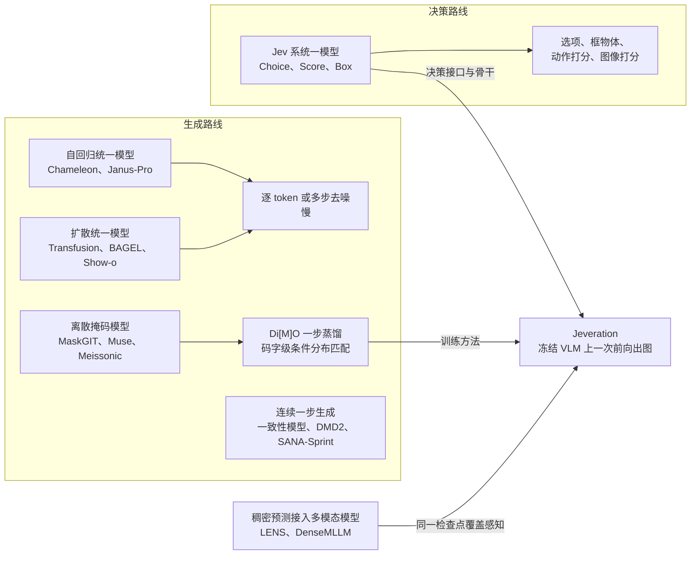
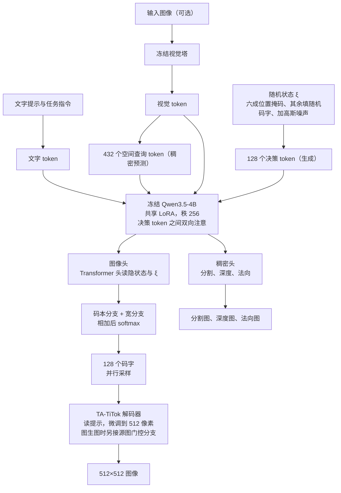
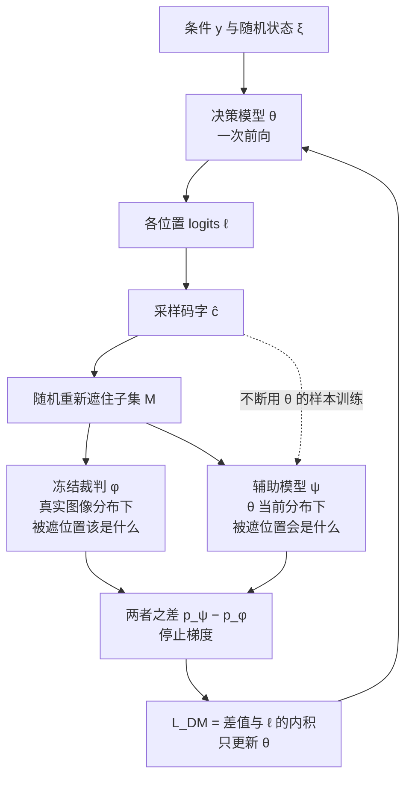
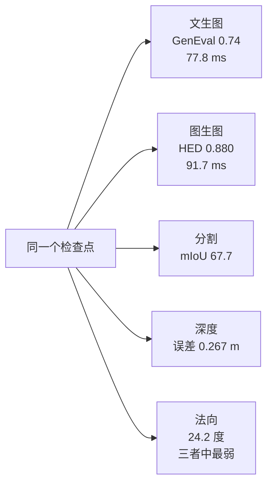

# Jeveration：系统一决策模型也能一次前向生成整张图

> **原题**：Jeveration: System One Models Now Generate
> **作者**：Yuhe Liu、Qi Li（共同一作）、Shihua Zhang、Xinchao Wang（通讯作者）
> **机构**：新加坡国立大学（NUS）
> **年份**：2026（arxiv ID 2611.24738）
> **分类**：cs.CV
> **链接**：https://arxiv.org/abs/2611.24738
> **精读日期**：2026-11-19

## 阅读须知

### 这篇在领域里的位置

这篇论文站在两条脉络的交汇处。第一条是图像生成：过去几年，生成一张图基本只有两条路，一条是自回归模型逐个 token 往外吐，另一条是扩散模型从噪声出发反复去噪。两条路都要让网络按顺序跑很多遍，于是又衍生出一大批「少步」与「一步」蒸馏方法，想把几十步压成几步乃至一步。

第二条脉络是近一年兴起的「系统一决策模型」。这类模型以 Jev 决策接口为源头：给它输入和一组候选项，它一次前向传播就返回带类型的决策，例如多选一（Choice）或打分（Score），不生成任何推理文字。本站 2026-11-14 那篇 SO-Arena 精读讲的就是这类模型的评测。到目前为止，它们只被用来做判断，例如挑选项、框物体、给机器人动作打分、给生成好的图片打分。

Jeveration 把两条脉络接到了一起。它的主张是：系统一模型不只会判断，也可以「生成」，而且生成一整张 512×512 的图只要一次前向传播。从技术谱系上看，它是离散一步生成（Di[M]O 一路）在冻结视觉语言模型上的一次移植，同时把图像到图像生成与稠密预测也收进了同一个检查点。

### 读完能回答什么

1. 为什么让模型在每个图像位置上各自独立地挑一个码字，拼出来的图会支离破碎，这个缺口在数学上叫什么
2. 「共享随机状态」是怎样让并行做出的各个决策指向同一张图的
3. 为什么直接拿目标图片去监督，模型会学会忽略这个随机状态，作者用什么两阶段训练绕开了它
4. 一个冻结的 Qwen3.5-4B 加上一套共享的 LoRA，是怎样同时承担文生图、图生图和稠密预测三类任务的
5. 78 毫秒、比 Janus-Pro-7B 快 122 倍这个数字，在什么口径下成立，又有哪些地方需要打折扣

### 阅读前置

假定读者熟悉 Transformer 的基本结构、交叉熵与 KL 散度，也大致知道 LoRA 是什么。不假定读者专门做过图像生成，因此离散图像分词器、掩码生成模型、分布匹配蒸馏这些概念会在正文里从头讲起。不假定读者读过 SO-Arena 那篇，系统一模型的基本概念会在「问题」一节重新交代。

### 首次出现的缩写表

- **VLM**（Vision-Language Model，视觉语言模型）：能同时读图像与文字的大模型。本文用的是 Qwen3.5-4B，全程冻结不训练
- **System One / 系统一模型**：一次前向传播直接返回结构化决策的模型，不先写推理过程。名字借自卡尼曼「快思考」与「慢思考」的划分
- **Jev**：TypeSafe AI 推出的决策接口与模型，系统一模型这一类的源头，输出类型有 Choice（多选一）、Score（打分）、Box（框）等
- **AR**（Autoregressive，自回归）：一个 token 接一个 token 生成，后一个以前面所有为条件
- **LoRA**（Low-Rank Adaptation，低秩适配）：冻结原模型权重，只在旁边加一对小的低秩矩阵来训练。本文秩取 256
- **TA-TiTok**（Text-Aware TiTok）：一种一维图像分词器，把一张图压成 128 个离散码字，解码器还会读文字提示
- **Di[M]O**：一种把掩码扩散模型蒸馏成一步生成器的方法，本文第二阶段训练直接沿用它的损失
- **DM**（Distribution Matching，分布匹配）：让生成器产出的样本分布去贴合目标分布的训练目标
- **CFG**（Classifier-Free Guidance，无分类器引导）：采样时把有条件与无条件预测做外推，以加强对提示的遵循
- **GenEval / DPG-Bench / HPSv2.1**：三个文生图评测。GenEval 查物体、数量、颜色、位置是否画对；DPG-Bench 用长而密的提示查复杂语义是否落实；HPSv2.1 是人类偏好打分模型
- **HED**（Holistically-nested Edge Detection）：一种边缘检测器，这里用来从输出图里抽边缘，与参考图比 F1
- **mIoU**（mean Intersection over Union，平均交并比）：语义分割的标准指标
- **δ₁**：深度估计指标，预测与真值之比落在 1.25 以内的像素占比
- **NYUv2**：室内场景 RGB-D 数据集，常用于分割、深度与表面法向估计

## 一、问题

今天的图像生成很强，但很慢，而且慢在结构上。自回归模型画一张图，要把几百个图像 token 一个一个吐出来；扩散模型画一张图，要把一团噪声去噪二三十遍。无论哪一种，网络都得按顺序跑很多次，后一次要等前一次的结果。于是在单卡、批大小为一的交互场景里，一张图动辄要几百毫秒到几秒，Janus-Pro-7B 在 H200 上画一张 384 像素的图要九秒半。

这件事之所以要紧，是因为生成越来越多地嵌在交互里：边打字边出图的编辑器、对话里随手插一张示意图的助手、需要一秒钟内给出视觉反馈的产品。过去几年的主流解法是蒸馏，把多步模型压成少步乃至一步，SANA-Sprint、DMD2、FLUX.1-schnell 都走这条路。然而这些一步模型大多是专门的生成网络，与负责理解图像的多模态大模型是两套东西；而那些把理解与生成合在一起的「统一模型」，又大多保留了逐 token 或多步去噪的生成方式，速度仍然上不去。

与此同时，另一个方向上出现了「系统一决策模型」。它的思路是：软件里大量决策并不需要长篇推理，给定输入和候选项，模型一次前向就在候选项上给出分布即可。这类模型在挑选项、框物体、给动作打分上已经证明了自己，它们背后的视觉语言模型也带着大量从预训练里学来的视觉与语义知识。作者由此提出一个问题：既然这些模型一次前向就能在候选集合上做选择，那么把「候选集合」换成图像分词器的码本，让模型在每个图像位置上各挑一个码字，是不是就能一次前向画出一整张图？

### 具体要解决的技术问题

把上面的设想落到可以验证的层面，问题是这样的。先用一个离散图像分词器把图像表示成 N 个码字 c = (c₁, …, c_N)，每个码字取自一个固定大小的码本。给定条件 y（一段文字提示，或者一张源图加一段指令），要求模型在一次前向传播里同时决定所有 N 个码字，解码出来的图既要符合提示，又要整体连贯。

作者第一次尝试的做法最直接：让模型在每个位置输出一个类别分布，然后各位置独立采样。结果画出来的图是碎的，不同区域像是来自不同的画，彼此拼不上。他们训练出的第一阶段掩码模型，如果只允许它一次前向出图，GenEval 只有 0.32，不到最终模型 0.74 的一半。

问题的根源可以写成一个式子。独立采样意味着模型的分布是各位置边缘分布的乘积：

q_ind(c | y) = ∏ᵢ qᵢ(cᵢ | y)

在这个约束下，模型能达到的最好近似（按前向 KL 散度衡量）与真实分布之间仍有一个去不掉的缺口：

min KL(p ‖ q_ind) = Σᵢ H(cᵢ | y) − H(c | y)

这里 H 表示在真实分布 p 下、给定 y 时的熵。等号右边这个量叫「总相关」（total correlation），衡量的是一张图里各个码字之间彼此依赖的程度。一张连贯的图恰恰需要这种依赖：天空的这一块是蓝色，旁边那一块就不该是夕阳的橙色。独立模型只能把每个位置的边缘分布学对，至于不同位置是否来自「同一张图」，它无从协调。

换句话说，一个提示对应着许多张合理的图，模型在每个位置上都在这些图之间「摇摆」，于是每个位置各自摇到了不同的图上。第二个附带的问题是工程上的：既然要做成一个通用的系统一模型，那么文生图、图生图、稠密预测这些输入不同、条件不同的任务，最好能用同一套架构、同一个检查点处理。

### 前人路线

围绕「快速出图」与「理解生成合一」，前人大致走了四条路，下面逐一交代它们做对了什么、卡在哪里。

**统一多模态模型。** 这一路的目标是让同一个模型既能看图又能画图。Chameleon、Emu3、Janus 与 Janus-Pro、Unified-IO 2 用自回归方式逐个吐图像 token；Show-o 用掩码预测，一轮猜出一批 token；Transfusion 与 BAGEL 则在连续的图像潜变量上做扩散。还有 MetaQueries、BLIP3-o 一类，把理解模型的表示接到一个单独的扩散生成器上。这些工作证明了理解与生成可以共享知识，但它们画一张图都要按顺序跑很多步，速度是共同的短板。

**一步生成与蒸馏。** 这一路专攻速度。连续空间里有一致性模型（Consistency Models）与 MeanFlow，直接学从噪声到图像的一步映射；DMD 与 DMD2、SANA-Sprint、TwinFlow 则把多步教师蒸馏成一步或少步学生。统一模型里也有加速工作，例如 Show-o Turbo 用一致性蒸馏把 Show-o 压到四步。这些方法做到了快，但多数针对连续潜空间的扩散模型，对离散码字的生成器帮助有限。

**离散掩码生成及其一步蒸馏。** MaskGIT、Muse、Meissonic 把图像变成离散码字后，训练模型在部分码字被遮住时猜出被遮住的部分，采样时分几轮逐步揭开。这种「掩码模型」天然能学到码字之间的依赖，因为它猜每个位置时都看得到别的位置。Di[M]O 进一步提出把这样的多轮掩码模型蒸馏成一步生成器，做法是在码字级别匹配条件分布，并借助一个辅助模型估计学生自身的分布；Soft-Di[M]O 又用软嵌入让这个过程可微。Jeveration 的训练核心几乎就是从这一支借来的。

**系统一决策模型。** Jev 一次并行返回 Choice、Score 等带类型的输出，它的 Box 接口预测物体框的四条边。此后出现了一批开源决策模型和面向特定领域的变体：Qwen-Audio-Jev 回答关于音频的类型化问题，JevVLA 给机器人动作打分和纠正，Visual Jev Rewards 给生成图像打分以奖励另一个生成器。这一支证明了「一次前向、并行输出结构化决策」可以覆盖很多任务，但所有输出都是判断，没有一个是「生成一整张图」这样需要大量位置彼此协调的输出。



把这四条路放在一起看，空白就清楚了：快的一步生成器不是统一模型，统一模型又不够快，而系统一模型虽然一次前向就出结果，却从没被要求输出一个需要上百个位置彼此协调的对象。Jeveration 想填的正是这块空白。

## 二、方法

整体思路可以用一句话概括：在一个冻结的视觉语言模型的输入末尾挂上一串「决策 token」，让它们在一次前向传播里各自决定一个图像码字（或者一个像素区域的类别、深度、法向），并且让所有决策 token 都从同一个随机状态出发，好让它们指向同一张图。下面按「形式化、架构、训练」三步展开。

### 把图像看成一次联合决策

作者先把三类视觉输出统一成系统一模型的「类型化决策」。生成图像时，决策是在 N 个码字位置上的一次联合 Choice；做语义分割时，决策是每个空间位置在语义类别上的 Choice；做深度和表面法向估计时，决策是每个位置上的实数 Score。

这三者有一个关键差别。稠密预测对每张输入只有一个正确答案，因此决策可以是确定性的；而一个提示对应着许多合理的图像，所以图像决策必须是随机的，每次抽取都应当得到一张不同的图。正是这种随机性，让「各位置独立决定」变得危险。

### 共享随机状态

作者的解法是给每张图抽一个随机状态序列 ξ，并让每一个码字位置都以它为条件：

q_θ(c | y) = E_{ξ∼p₀} [ ∏ᵢ q_{θ,i}(cᵢ | y, ξ) ]

这里各符号的含义如下：

- y：条件，即文字提示，或源图加指令
- ξ：随机状态，每张图抽一次，从先验 p₀ 里采样，所有位置共用
- q_{θ,i}(cᵢ | y, ξ)：参数为 θ 的模型在第 i 个位置上给出的码字分布
- 外层期望：对 ξ 取平均，得到的是整个模型的图像分布

这个式子的妙处在于，给定 y 和 ξ 之后，各位置仍然是独立采样的，因此一次前向就能并行出全部码字；但因为所有位置都依赖同一个 ξ，把 ξ 积分掉之后，整体分布就成了许多个「独立分布」的混合，从而能够表达位置之间的依赖。直观地说，ξ 相当于先替所有位置「定好要画哪一张图」，各位置再各自把自己那一块画出来。

于是问题被转化成：如何让模型真正学会读懂 ξ，并据此协调各位置的选择。这是第三步训练要解决的事，先看架构。

### 架构

Jeveration 的骨干是 Qwen3.5-4B，连同它的视觉塔一起全程冻结。所有任务共享一套秩为 256 的 LoRA 适配器，再加上各任务自己的输出头，可训练参数总共约 10 亿。

输入序列由三部分组成。文字 token 编码提示与任务指令；如果有输入图像，冻结的视觉塔把它编码成视觉 token；最后是决策 token。在骨干的全注意力层里，决策 token 彼此之间是双向注意的，而前面的输入前缀仍然保持因果注意。这个安排让每个决策 token 都能看到所有输入，也能看到其他所有决策 token，于是一次前向里各位置可以「互相商量」。



**图像生成这一支。** 图像分词器是冻结的 TA-TiTok，一张图压成 N = 128 个码字，码本有 8,192 个条目。与常见的二维网格分词器不同，TiTok 是一维的，128 个码字并不对应图上 128 个固定小方块，而是整张图的一种紧凑编码。生成时在输入末尾挂 128 个决策 token，第 i 个负责决定码字 cᵢ。

这 128 个决策 token 的初始嵌入就是随机状态 ξ 的载体。ξ 的构造沿用 Di[M]O 的设定：每个位置以概率 ρ = 0.6 被掩码，其余位置填上均匀随机抽取的码字，然后给所有嵌入加上尺度 σ = 0.1 的高斯噪声。之所以长成这个样子，是因为第一阶段训练的掩码模型习惯看「部分被遮住的码字序列」，让随机状态长得像这种输入，第二阶段就能从掩码模型平滑地接手。

骨干跑完之后，一个 Transformer 结构的输出头读取这些决策 token 的最终隐状态，同时再读一遍 ξ，为每个位置输出一个特征 uᵢ。从 uᵢ 到码字分布有两个分支：

- 码本分支 f_cb：先把 uᵢ 投影到码字的嵌入空间，再用一个以分词器码本初始化的分类器打分。它继承了码本本身的几何结构
- 宽分支 f_wide：初始化为零，直接把 uᵢ 映射成 8,192 维的码字 logits，给输出头留出码本结构之外的自由度

两个分支的输出相加后取 softmax：q_{θ,i}(· | y, ξ) = softmax(f_cb(uᵢ) + f_wide(uᵢ))。推理时，全部 128 个码字在一次前向后并行采样，交给分词器的解码器还原成图。这个解码器原本就会读文字提示，作者把它微调到 512 像素输出；做图生图时，还额外加了一个带门控的分支把源图喂给解码器。

**稠密预测这一支。** 做稠密预测时，决策 token 变成与输入图像视觉 token 一一对齐的空间查询，共 432 个。每个查询的初始值是一个学出来的向量加上它所对应视觉 token 的一个投影。骨干跑完后，各任务的输出头把每个查询的隐状态解码成它所负责那块区域的分割类别、深度或法向。

### 学会做决策：两阶段训练

为什么不能直接拿目标图片训练？原因很简单：随机状态 ξ 是独立于目标图片抽出来的，二者之间没有任何关系。如果拿 ξ 作输入、拿某张目标图的码字作答案做交叉熵，模型会发现 ξ 对预测答案毫无帮助，最省事的做法就是忽略它，于是又退回到只学边缘分布、拼出碎图的老路上。

作者的办法是先学会「图像长什么样」，再用学到的分布去评判和引导一次前向的决策。

```mermaid
flowchart LR
    subgraph 第一阶段：学图像分布
        A1["真实图像码字 c"] --> A2["随机遮住一部分 M"]
        A2 --> A3["掩码模型 φ<br/>从可见码字与条件 y<br/>猜被遮住的码字"]
        A3 --> A4["交叉熵 L_mask<br/>8 万步只做生成<br/>再 1.2 万步加入全部任务"]
    end
    subgraph 第二阶段：学一次前向决策
        B1["决策模型 θ<br/>从 φ 初始化"] --> B2["5,000 步分布匹配 L_DM"]
        B2 --> B3["1,700 步加入置信度引导修正 L_corr"]
    end
    A4 --> B1
    B3 --> R["推理：只跑 θ 一次前向"]
```

**第一阶段：学图像分布。** 骨干冻结，把整套架构当作一个掩码模型来训练。对一张图的目标码字 c，随机遮住一个子集 M，让模型根据没被遮住的码字和条件 y 猜出被遮住的部分，损失是被遮住位置上的平均交叉熵：

L_mask(φ) = E [ (1/|M|) Σ_{i∈M} −log p_{φ,i}(cᵢ | c_{M̄}, y) ]

因为模型猜每个位置时都看得到其他可见的码字，它学到的正是码字之间的依赖关系。这个阶段训出的模型记作 φ，它在第二阶段扮演「什么样的图才算合理」的裁判。这一阶段先只做生成任务训练 8 万步，再加入全部任务训练 1.2 万步。

**第二阶段：分布匹配。** 决策模型 θ 从 φ 初始化，任务变成：只给 (y, ξ)，一次前向就产出一整张图的码字。训练的每一步是这样的：

1. θ 从 (y, ξ) 预测各位置的 logits ℓ_{θ,i}，并采样出一套码字 ĉ
2. 把 ĉ 随机重新遮住一部分 M
3. 让两个掩码模型分别根据同样的可见码字去猜被遮住的位置
4. 冻结的 φ 代表「真实图像分布」，给出 p_{φ,i}
5. 辅助模型 ψ 代表「θ 当前的输出分布」，给出 p_{ψ,i}

辅助模型 ψ 一开始是 φ 的副本，之后不断用 θ 产出的样本、按同样的掩码损失继续训练，于是它始终跟着 θ 走，反映的是 θ 此刻会画出什么样的图。



当 θ 的输出分布与真实图像分布一致时，两个掩码模型的预测就会一致。沿用 Di[M]O 的做法，作者把两者之差作为一个停止梯度的权重，与 θ 的 logits 做内积，构成损失：

L_DM(θ) = E [ (1/|M|) Σ_{i∈M} sg(p_{ψ,i} − p_{φ,i})ᵀ ℓ_{θ,i} ]

其中 sg 表示停止梯度。这个式子的作用是：在 ψ 认为 θ 会画、而 φ 认为不该画的码字上压低 logits，在相反的码字上抬高 logits。

这一步之所以能逼出「协调」，关键在于被遮位置的预测依赖于同一个样本里的其他码字。如果 θ 画出来的各块彼此拼不上，φ 看到这些可见码字后给出的判断就会与 ψ 不同，损失不为零。只有当 θ 的码字彼此契合时，两个裁判的看法才会一致。为了让码字彼此契合，θ 唯一可用的协调手段就是共享的 ξ，于是它被逼着去读懂 ξ。

**第二阶段末段：置信度引导的修正。** 在第二阶段最后的 1,700 步里，作者又加了一项直接监督。对每个批次里的部分样本，把 θ 自己最没把握的那一半位置（按 q_{θ,i}(ĉᵢ | y, ξ) 排序，最低的 50%，记作 R）重新遮住，交给冻结的 φ 用四轮、CFG 系数 3 的方式补全，得到一个修正后的参考答案 c_ref。然后要求 θ 从同样的 (y, ξ) 直接预测这些修正后的码字：

L_gen = L_DM + λ · L_corr，其中 L_corr 是 R 上对 c_ref 的平均交叉熵，λ = 1

注意这里的参考答案并不是一张随便的目标图，而是在 θ 自己的样本基础上修出来的，因此它与当前的 ξ 是相关的，不会出现「模型学会忽略 ξ」的问题。φ、ψ 和修正过程都只在训练时出现，推理时只跑 θ 的一次前向。

**稠密任务的监督**则直接用真值：分割用交叉熵，深度用 L1 误差，法向用 1 − cos。

## 三、实验

### 设置

所有主结果都来自同一个检查点。文生图训练数据由两部分组成：FLUX-Reason-6M 里的图像，以及用 Qwen-Image 给 text-to-image-2M 提示集渲染出的图。图生图用从图像派生的条件（边缘、深度、灰度）和合成的风格配对；稠密任务用 NYUv2。整个训练在一台装有四张 NVIDIA RTX PRO 6000 的机器上跑了约四天，第一阶段约 9.2 万步，第二阶段约 6,700 步。

评测方面，文生图用 GenEval（553 个提示，每个四张）、DPG-Bench（1,064 个提示，按 2×2 拼图打分）和 HPSv2.1（3,200 个提示）。图生图在每个任务 341 个留出样本上，从输出图里抽结构（HED 边缘、深度、Canny 边缘）与参考图比较；风格迁移在 223 个样本上算与配对目标的 PSNR。延迟是在一张 H200 上、批大小为 1、从提示到解码出图的端到端时间，预热两次后取五次调用的中位数。

### 文生图主结果

下表摘取论文表 1 的主要行。「步数」指生成器按顺序被调用的次数，自回归模型则按 token 数计。

| 模型 | 统一模型 | 参数（B） | 步数 | 分辨率 | GenEval | DPG | HPSv2.1 | 延迟（ms） |
|---|---|---|---|---|---|---|---|---|
| PixArt-α | 否 | 0.6 | 20 | 512 | 0.49 | 71.6 | 29.98 | 378.8 |
| SANA-0.6B | 否 | 0.6 | 20 | 512 | 0.65 | 84.3 | 29.86 | 587.3 |
| SANA-Sprint 0.6B | 否 | 0.6 | 1 | 1024 | 0.72 | 78.63 | 28.74 | 121.2 |
| SDXL-DMD2 | 否 | 2.6 | 1 | 1024 | 0.56 | 74.09 | 28.20 | 204.0 |
| FLUX.1-schnell | 否 | 12.0 | 1 | 1024 | 0.69 | 85.97 | 29.63 | 345.6 |
| Z-Image-Turbo | 否 | 6.2 | 8 | 1024 | 0.76 | 84.99 | 29.76 | 1,965.2 |
| Janus-Pro-1B | 是 | 1.5 | 576 | 384 | 0.73 | 82.63 | 27.73 | 7,593.2 |
| Janus-Pro-7B | 是 | 7.0 | 576 | 384 | 0.80 | 83.91 | 28.47 | 9,508.4 |
| Show-o Turbo-512 | 是 | 1.3 | 4 | 512 | 0.63 | 83.35 | 27.35 | 94.1 |
| Show-o-512 | 是 | 1.3 | 50 | 512 | 0.68 | 67.27 | 27.85 | 1,631.0 |
| MMaDA-8B | 是 | 8.0 | 15 | 512 | 0.63 | 69.97 | 23.74 | 3,860.9 |
| **Jeveration** | 是 | 5.2 | 1 | 512 | **0.74** | 78.24 | 28.06 | **77.8** |

先看速度。Jeveration 端到端 77.8 毫秒，是表中最快的一个。相对最慢的 Janus-Pro-7B 快 122 倍，这就是摘要里那个数字的来源；相对 Janus-Pro-1B 快 98 倍。

再看与它最接近的对手。同为 512 像素的统一模型 Show-o Turbo-512 走四步，用时 94.1 毫秒，GenEval 0.63；Jeveration 把 GenEval 提高了 0.11，延迟降到 77.8 毫秒。与 512 像素的多步生成专用模型相比，Jeveration 的 GenEval 更高（0.74 对 0.49 到 0.65），速度快五到八倍。

与生成 1024 像素的一步模型相比，Jeveration 的 GenEval 也高于 SANA-Sprint（0.72）、FLUX.1-schnell（0.69）和 SDXL-DMD2（0.56）。不过在这一组里，比较需要附加条件，下文「局限」一节会再说。

表里有两列 Jeveration 并不占优，值得单独指出。DPG-Bench 上它是 78.24，低于 SANA-0.6B 的 84.3、FLUX.1-schnell 的 85.97，也低于 Show-o Turbo 的 83.35；HPSv2.1 上它是 28.06，低于 PixArt-Σ 的 30.49 与 SANA 系列的 29 以上。也就是说，它在「画对了没有」的 GenEval 上表现亮眼，而在「长提示里的复杂语义是否都落实了」与「人看着是否喜欢」两项上，与好的生成专用模型仍有距离。

### 图生图

同一个检查点可以把边缘图、深度图变成写实图像，可以给灰度照片上色，也可以把照片改成动漫、吉卜力、水彩风格。

| 设置 | HED 边缘 F1 | 深度 δ₁ | 上色边缘 F1 | 风格 PSNR |
|---|---|---|---|---|
| Jeveration | 0.880 | 0.802 | 0.937 | 15.40 |
| 直接复制输入 | 0.828 | 0.713 | 0.998 | – |
| 解码器不接源图 | 0.792 | 0.767 | 0.757 | 14.37 |

「直接复制输入」是一个检查指标是否合理的基线：把条件图原样当作输出，看结构指标能拿多少。上色任务里复制灰度图本身就保住了全部边缘，所以有 0.998；边缘和深度任务里复制条件图拿不到满分，而 Jeveration 在这两项上都超过了它。图生图每次请求仍是一次前向，91.7 毫秒，只比文生图多 14 毫秒。

### 稠密预测

| 模型 | 分割 mIoU | 深度绝对误差（米） | 深度 δ₁ | 法向平均角误差（度） |
|---|---|---|---|---|
| Jeveration | 67.7 | 0.267 | 0.898 | 24.2 |
| 同骨干，三个单任务模型 | 67.8 | 0.246 | 0.915 | 21.2 |
| 同骨干，一个三任务模型 | 67.3 | 0.253 | 0.912 | 23.0 |
| DeepLabV3+ R50（文献值） | 53.5 | 0.393 | – | 22.0 |

在 NYUv2 的 13 类分割上，Jeveration 的 67.7 mIoU 与同骨干、只做稠密任务的模型（67.8 与 67.3）基本持平，比 DeepLabV3+ 高 14.2；深度误差 0.267 米，比 DeepLabV3+ 的 0.393 米低 32%。每次预测也是约 78 毫秒的一次前向。

法向是三者里最弱的一项。24.2 度不仅落后于同骨干的稠密专用模型，也落后于 DeepLabV3+ 的 22.0 度。作者的解释是，细碎的局部几何对「多个任务共享容量」最为敏感。

### 消融

下表各块是互相独立的实验，数字只在块内可比。

| 实验 | 变体 | GenEval | HPSv2.1 |
|---|---|---|---|
| 随机状态 | 随机 ξ（采用） | 0.73 | 28.27 |
| | 固定 ξ | 0.70 | 26.63 |
| 修正目标 | 加修正（采用） | 0.74 | 28.03 |
| | 不加修正 | 0.73 | 27.92 |
| 图像头分支（第一阶段掩码模型） | 宽分支 + 码本分支（采用） | 0.64 | 25.42 |
| | 只有宽分支 | 0.60 | 25.34 |
| | 只有码本分支 | 0.59 | 25.04 |

**共享随机状态是第一功臣。** 没有第二阶段的决策训练，第一阶段掩码模型一次前向只有 0.32 GenEval；有了决策训练之后到 0.73。把随机状态换成固定状态，GenEval 从 0.73 降到 0.70，HPSv2.1 从 28.27 降到 26.63。后一项降得尤其多，说明随机性不只带来多样性，也直接改善了画面质量。

**修正目标只是锦上添花。** 去掉它，GenEval 几乎不变，HPSv2.1 从 28.03 降到 27.92。作者的读法是：分布匹配已经决定了构图，修正只是在细节上再补一笔。

**两个分支互补。** 在第一阶段掩码模型上，两个分支合用的 0.64 好于只用宽分支的 0.60 和只用码本分支的 0.59。作者推测码本分支继承了分词器码本的结构，宽分支提供了这个结构之外的容量。

### 两个值得单独拎出来的发现

第一个发现关于「信息到底在哪里」。在图生图里，即使解码器完全不看源图，只凭模型给出的 128 个码字，也能恢复大部分输入结构（HED 0.792、深度 0.767）。这说明视觉语言模型确实把输入的布局转进了自己的决策里，而不是全靠解码器从源图抄。

补充材料里的对调实验把这一点讲得更透。把码字换成另一个样本的、源图保持正确，HED 从 0.896 跌到 0.552，深度从 0.825 跌到 0.346；反过来码字正确、源图换掉，HED 只跌到 0.652，深度几乎不动（0.767）。可见 128 个码字承载了大部分结构，源图只负责补细节。

第二个发现关于多任务。直觉上，让同一套适配器同时学生成、图生图、分割、深度、法向，生成质量应当被拖累。实际上，联合训练的 Jeveration 与只训练文生图的版本几乎一样：GenEval 0.74 对 0.73，HPSv2.1 28.06 对 28.28，DPG 78.24 对 78.61。



## 四、局限

### 作者自己承认的

论文没有专门的局限一节，作者明确承认的只有一处：表面法向估计落后于同骨干的稠密专用模型。他们把原因归于细碎的局部几何对多任务共享容量最敏感，但没有进一步验证这个解释。

除此之外，作者在结论里把这项工作定位为「图像生成的第三种范式」，并期待它扩展到更多视觉任务与模态。至于它在哪些场合不适用，论文没有讨论。

### 读完能看出来的

**速度对比的口径需要打折扣。** 122 倍是相对最慢的 Janus-Pro-7B 而言的，而后者要逐个吐 576 个 token、只画 384 像素，本来就是表里最慢的一种。与真正同类的一步或少步模型比，优势要小得多：对 Show-o Turbo-512 是 94.1 毫秒对 77.8 毫秒；对 SANA-Sprint 是 121.2 毫秒对 77.8 毫秒，而 SANA-Sprint 画的是 1024 像素、参数只有 0.6B。分辨率不同时，「谁快」与「谁的 GenEval 高」都不能直接对比。

**质量上仍有明显短板。** Jeveration 只出 512 像素，靠 128 个码字表示一整张图，细节上限受这个一维分词器的容量约束。DPG-Bench 与 HPSv2.1 两项都低于好的生成专用模型，说明它在长而复杂的提示与审美上还有差距。论文也没有报告 FID 一类衡量分布与多样性的指标，「每次抽取得到不同而连贯的图」这一说法缺少定量支撑。

**消融的差距很小，且没有方差。** 修正目标带来的提升是 GenEval 0.73 到 0.74、HPSv2.1 27.92 到 28.03，联合训练与单任务训练的差距也在同一量级。这些都是单次实验，没有给出多次运行的波动范围，很难判断它们是否超出了噪声。

**稠密预测的评测面比较窄。** 只在 NYUv2 一个室内数据集、13 类分割上测，对比的外部基线是较老的 DeepLabV3+ R50，没有与当前专门的深度或分割模型比较。法向这一项甚至不如这个老基线。

**训练数据依赖其他生成器。** 文生图数据一部分来自 FLUX-Reason-6M，另一部分是用 Qwen-Image 渲染的图。这意味着 Jeveration 的画质在一定程度上是从别的生成模型那里间接学来的，上限也受这些「老师」约束；若要在商业场景使用，还要考虑这些数据的许可条件。

**方法上的新意要分开看。** 第二阶段的损失、随机状态的构造（ρ = 0.6、σ = 0.1）都直接沿用 Di[M]O，第一阶段是标准的掩码生成训练。论文自己的增量主要在三处：把这套离散一步蒸馏搬到冻结的视觉语言模型上并配上决策 token，加上置信度引导修正，以及用一个检查点同时覆盖生成与稠密预测。「系统一模型也能生成」这个框架很有号召力，但读者应当清楚，生成能力的核心机制来自已有的离散一步蒸馏。

**可复现性。** 论文没有提到是否开源代码与权重。好在骨干、分词器、训练数据都是公开的，训练成本也不高（四张卡跑四天），复现门槛在同类工作里算低的。

## 一句话

冻结 VLM 加共享随机状态与 Di[M]O 式蒸馏，让系统一决策模型一次前向生成 512 像素图并兼做稠密预测。
