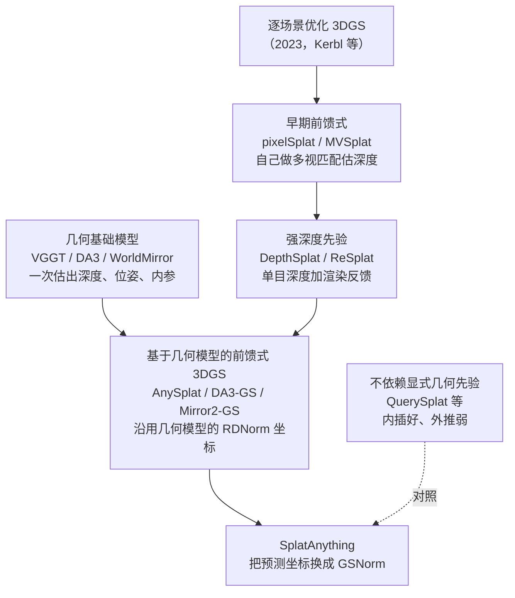
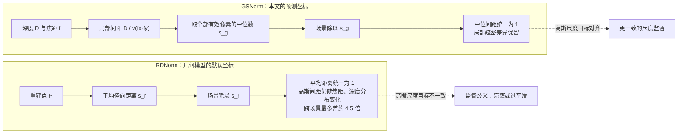
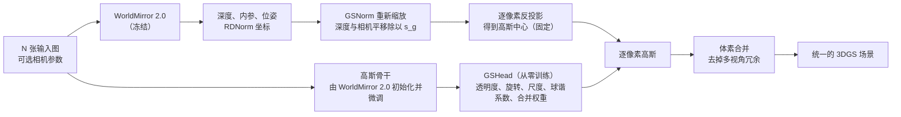
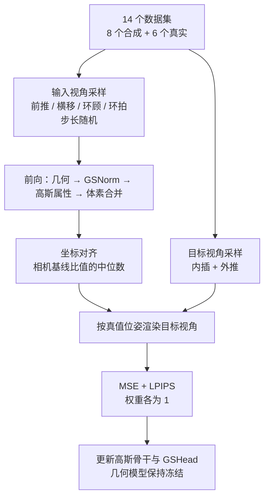

# SplatAnything：用高斯间距归一化让前馈式 3DGS 适配任意场景

> **原题**：SplatAnything: Gaussian Spacing Normalization for Feed-forward 3DGS across Arbitrary Scenes
> **作者**：Hao Yu, Zhenwei Wang, Yongzhen Hu, Yuning Gong, Junta Wu, Xiaowei Zhou, Hujun Bao, Tengfei Wang, Chunchao Guo, Sida Peng
> **机构**：浙江大学、腾讯混元
> **年份**：2026（arxiv ID 2611.08264，2026 年 11 月 5 日提交）
> **分类**：cs.CV
> **链接**：https://arxiv.org/abs/2611.08264
> **精读日期**：2026-11-09

## 阅读须知

### 这篇在领域里的位置

这篇论文属于三维重建与新视角合成领域里「前馈式 3D 高斯泼溅」这一条线。3D 高斯泼溅（3DGS）是 2023 年提出的一种场景表示方法，它用成千上万个带颜色、带透明度的三维椭球去拼出一个场景，渲染又快又清楚，但每拿到一个新场景，都要花几分钟到几十分钟单独优化一遍。前馈式 3DGS 想省掉这一步：训练一个网络，看一眼输入照片，几秒钟内直接吐出整套高斯。

这条线大致走过三步。第一步是 pixelSplat、MVSplat 这类工作，它们在两三张照片之间做匹配，自己估深度，再在每个像素上放一个高斯。第二步是 DepthSplat、ReSplat，引入更强的单目深度先验与渲染反馈来修正几何。第三步是近一年的主流做法：先用一个大规模预训练的「几何基础模型」（例如 VGGT、Depth Anything 3、WorldMirror）把深度、相机位姿和内参一次估出来，再在这套几何上预测其余的高斯属性，代表作有 AnySplat、DA3-GS 与 Mirror2-GS。SplatAnything 站在第三步之上，它不换几何模型、不改网络大结构，而是指出这一范式里一个被忽略的坐标尺度问题，并用一个很小的改动把它修掉。

### 读完能回答什么

1. 为什么前馈式 3DGS 在不同尺度、不同相机的场景之间泛化困难，「高斯尺度监督有歧义」具体指什么
2. 几何基础模型常用的径向距离归一化（RDNorm）到底归一化了什么，又漏掉了什么
3. 高斯间距归一化（GSNorm）的归一化因子怎么算，为什么只需要深度和焦距
4. 为什么「预测完之后再按间距把高斯尺度校准一下」这种事后补救反而更差
5. 作者新设计的评测基准如何控制外推难度，为什么 PSNR 上这篇并不总是第一

### 阅读前置

假定读者熟悉卷积网络与 Transformer 的基本结构，知道针孔相机模型里焦距、主点、深度之间的关系，也大致了解「渲染图与真值图之间算损失、反向传播」这一训练套路。不预设读者做过三维重建，也不预设读者了解 3DGS 的渲染细节，相关概念会在正文首次出现时先铺垫再展开。

### 缩写表

- **3DGS**（3D Gaussian Splatting，3D 高斯泼溅）：用大量三维高斯椭球表示场景、再把它们投影到屏幕上混合成图像的方法。
- **前馈式 3DGS**（Feed-forward 3DGS）：不做逐场景优化，由网络一次性从照片预测出整套高斯的做法。
- **SH**（Spherical Harmonics，球谐函数）：3DGS 里用来表示「从不同方向看颜色不同」的一组系数。
- **RDNorm**（Radial Distance Normalization，径向距离归一化）：用所有重建点到参考相机原点的平均距离作为全场景尺度，把场景整体缩放到这个距离为 1。
- **GSNorm**（Gaussian Spacing Normalization，高斯间距归一化）：本文提出的归一化方式，用相邻高斯中心间距的中位数作为全场景尺度。
- **CDNorm / DNorm**（Camera Distance Normalization / Depth Normalization）：附录里对比的另外两种归一化，分别以相机间距离、深度中位数作尺度。
- **WorldMirror 2.0**：腾讯混元的几何基础模型，能从多张照片估计深度、内参和相机位姿，本文以它为冻结的几何前端。
- **GSHead**（Gaussian Splatting Head）：接在骨干网络后面、逐像素输出高斯属性的轻量预测头。
- **LPIPS**（Learned Perceptual Image Patch Similarity）：用深度网络特征衡量两张图感知差异的指标，越低越好。
- **DISTS**（Deep Image Structure and Texture Similarity）：同时考虑结构与纹理的感知相似度指标，越低越好。
- **PSNR**（Peak Signal-to-Noise Ratio，峰值信噪比）：逐像素误差换算出的指标，越高越好，但偏爱平滑的结果。
- **H20**：英伟达面向中国市场的数据中心 GPU，本文训练与测速都在它上面完成。

## 一、问题

设想一个做三维内容的团队，手里有一个前馈式 3DGS 模型。拿桌面上一只杯子拍几张照片，它重建得很好；换成在街上走一圈拍下的整条街景，同一个模型给出的结果却要么满是窟窿，要么糊成一片。这种「换个场景尺度就失灵」的现象，正是前馈式 3DGS 难以真正落地的原因之一：逐场景优化的 3DGS 虽然慢，但每个场景都单独调过，不会出这种问题；前馈模型快，却要求一个网络覆盖从几厘米到几百米的所有场景。

过去几年，这个方向的主流路线已经从「自己估深度」转向「借几何基础模型的深度」。几何基础模型在海量数据上训练过，深度和位姿估得又准又稳，于是前馈式 3DGS 的几何部分越来越可靠，剩下的难点集中到其余高斯属性，尤其是每个高斯该有多大。作者认为，旧路线卡住的地方恰恰在这里：几何模型为了数值稳定而采用的那套坐标归一化，并不适合拿来预测高斯的大小。

### 3DGS 与前馈预测

3DGS 要解决的问题，是如何用一种既能快速渲染、又能表达精细外观的方式去描述一个三维场景。它的做法是把场景拆成大量三维高斯，每个高斯有四组属性：中心位置、透明度、协方差（决定椭球的大小和朝向）以及球谐系数（决定颜色）。渲染时把所有高斯投影到屏幕上，按远近顺序混合，就得到一张图。

前馈式 3DGS 在这个框架上做的事，是让网络直接预测这四组属性。当下最常见的做法叫「逐像素预测」：每张输入图的每个有效像素，按它的深度反投影到三维空间，就成为一个高斯的中心；网络再为这个像素预测透明度、旋转、尺度和颜色。中心既然由深度决定，网络真正需要学的，主要是「这个高斯该撑多大」。

### 高斯尺度为什么必须对上邻居间距

逐像素预测有一个直观的约束：相邻两个像素反投影出的两个高斯中心之间有一段距离，作者把它叫作「高斯间距」。如果每个高斯撑得比这段距离小，相邻高斯之间就会露出缝隙，渲染出来是窟窿；如果撑得远大于这段距离，大量高斯互相重叠，细节会被抹平。所以，合适的高斯尺度必须与局部高斯间距相称。

这段间距可以从针孔相机模型直接推出来。一个像素在深度 D 处、焦距为 f 时，它与水平方向相邻像素反投影点之间的距离约为 D 除以 f。换句话说，离相机越远、焦距越短（视场越宽或分辨率越低），相邻高斯就隔得越开。作者把横竖两个方向取几何平均，得到一个标量来刻画局部间距：

$$
d_i(\mathbf{u}) \approx \frac{D_i(\mathbf{u})}{\sqrt{f_{x,i}\, f_{y,i}}}
$$

其中 $D_i(\mathbf{u})$ 是第 $i$ 张图在像素 $\mathbf{u}$ 处的深度，$f_{x,i}$ 与 $f_{y,i}$ 是以像素为单位的横纵焦距。这个式子成立的前提是局部深度近似不变，也就是相邻两个像素看到的大致在同一深度上。

### 径向距离归一化漏掉了什么

几何基础模型输出的深度和位姿本身没有绝对尺度，同一个场景放大十倍，照片看起来一模一样。为了让数值落在稳定范围内，这类模型普遍采用径向距离归一化：把所有重建点到参考相机原点的平均距离算出来，整个场景除以这个数，使平均距离变成 1。前馈式 3DGS 直接沿用这套坐标，在里面预测高斯属性。

问题在于，RDNorm 统一的是「点离相机平均有多远」，而高斯尺度真正要对齐的是「相邻点之间隔多远」。前者与后者之间还隔着一个焦距：两个场景即便平均距离都被归一化成 1，只要相机焦距、分辨率或深度分布不同，归一化之后的高斯间距仍然可以差出好几倍。作者统计了不同场景类别在 RDNorm 下的中位高斯间距，最大相差约 4.5 倍。

这就带来了监督上的歧义。两块看起来几乎一样的局部图像，在一个场景里对应的「正确高斯尺度」是 0.01，在另一个场景里却是 0.045，网络无法从图像本身分辨出该取哪个。最后它只能学一个折中值：偏小的预测在间距大的地方留下窟窿，偏大的预测在采样密集的地方造成过度平滑。

前人的几条路线各有所长。早期方法与强深度先验路线在内插视角上渲染得不错，但几何精度有限，一旦目标视角远离输入相机就会出现严重伪影。基于几何基础模型的路线解决了几何精度，却把几何模型的归一化坐标原封不动地继承下来。不依赖显式几何先验的路线在内插上能拿到很高的画质，可学到的几何在大幅外推时同样不可靠。SplatAnything 要回答的具体问题，是在保留几何基础模型优势的前提下，能否换一个更适合预测高斯尺度的坐标系。

## 二、方法

SplatAnything 的核心改动只有一处：把预测高斯属性时所用的坐标尺度，从「平均径向距离为 1」换成「中位高斯间距为 1」。其余部分基本沿用现成组件，这也使它的贡献边界很清楚。

### 符号

- $N$：输入图像张数，训练时 4 到 32 张，评测时 1 到 64 张。
- $\mathbf{P}_i(\mathbf{u})$：第 $i$ 张图像素 $\mathbf{u}$ 处的重建三维点，位于参考相机坐标系中，尚未做场景级归一化。
- $\Omega_i$：第 $i$ 张图中深度有效的像素集合。
- $s_r$：RDNorm 的归一化因子，即所有有效点到参考相机原点距离的平均值。
- $s_g$：GSNorm 的归一化因子，即所有有效像素局部间距的中位数。
- $\mathbf{t}_i$：第 $i$ 个相机的平移向量，归一化时与点、深度一起缩放。

### 高斯间距归一化怎么算

GSNorm 的想法很直接：既然高斯尺度要对齐局部间距，那就让场景的代表性间距在所有场景里都等于 1。具体做法是，对所有输入视角、所有有效像素，按上一节的公式算出局部间距（此时用的是未归一化的深度），取中位数作为归一化因子：

$$
s_g = \operatorname{median}_{i,\ \mathbf{u}\in\Omega_i}\left(\frac{D_i(\mathbf{u})}{\sqrt{f_{x,i}\, f_{y,i}}}\right)
$$

然后把三维点、深度和相机平移统一除以 $s_g$。由于中位数对正数缩放是等变的，除完之后场景的中位间距恰好为 1，这一步不需要任何迭代。

这里有两个值得注意的设计。其一，它只统一了一个场景级的代表值，并没有把每个像素的间距都压成一样，于是近处密、远处疏这种有意义的局部差异被完整保留下来。其二，它用中位数而不是平均数，因为天空、远景这类极大深度会把平均数拉偏，中位数对这类离群值更稳。

与之相对地，RDNorm 的因子 $s_r$ 只依赖点的位置，不依赖焦距；附录里的 DNorm 用深度中位数做尺度，同样忽略了焦距；CDNorm 用相机之间的距离做尺度，在相机几乎不动时会退化。GSNorm 是这几种里唯一把焦距，也就是图像采样密度，纳入尺度定义的方案。

### 整体架构

整条流水线分成几何与外观两段。几何段使用冻结的 WorldMirror 2.0：输入若干张图（可选地附带相机内外参），输出每张图的深度、内参和相机位姿，此时它们处在 RDNorm 坐标里。随后用 GSNorm 把深度与相机平移换到新的坐标系，再按相机参数把每个有效像素反投影成一个三维点，作为高斯中心。

外观段负责预测其余属性。作者从 WorldMirror 2.0 的几何骨干复制一份作为「高斯骨干」并做微调，后面接一个从零训练的轻量 GSHead，逐像素输出透明度、旋转、尺度和球谐系数。尺度在对数空间预测、经指数函数还原后截断到 0.3 以内；旋转用四元数表示并归一化；透明度经 sigmoid 压到 0 到 1 之间。

最后还有一步体素合并。GSNorm 统一的是单张图内的采样间距，但多张图看到同一片区域时，会在相近位置堆叠多个高斯，堆叠密度随输入张数变化。作者沿用 AnySplat 的做法，额外预测一张逐像素权重图，在局部体素内把冗余的高斯合并成一个。GSNorm 与体素合并因此分别处理两种尺度变化：前者管跨场景的采样尺度，后者管多视角叠加带来的密度变化。

### 训练

训练目标很朴素：在目标视角渲染一张图，与真值图算像素级均方误差和 LPIPS 感知损失，两项权重都取 1。模型训练两万步，用 64 块 H20，每次输入 4 到 32 张图，输入分辨率在 504 到 1024 之间随机变化；高斯骨干与 GSHead 的学习率分别为 5×10⁻⁶ 与 2×10⁻⁵，前 500 步做预热。

训练数据横跨 14 个数据集，其中 8 个合成、6 个真实。合成数据里规模最大的是 OmniWorld（10464 个场景）与 OmniObject3D（5914 个物体），真实数据包括 ScanNet++、ARKitScenes、Matterport3D 等室内扫描，以及 BlendedMVS、MapFree 这类户外或物体数据。这种混搭让训练集本身就覆盖了从桌面物体到城市街景的尺度跨度。

训练里有一个容易被忽略却必不可少的步骤：坐标对齐。几何模型估出的相机轨迹和深度带着任意的全局尺度，而监督用的是真值相机位姿，两者直接拼在一起会错位。作者的办法是，拿预测轨迹与真值轨迹里对应相机对之间的基线长度相除，取这些比值的中位数作为全局缩放，把预测深度换到真值尺度后再反投影。

视角采样同样经过设计。输入视角按四种典型拍摄轨迹采样：向前推进、横向平移、原地环顾、绕物环拍，再随机调整采样步长，使输入既有密集重叠的，也有宽基线的。目标视角则一部分取在输入之间做内插，一部分刻意偏离轨迹或向前推近，用来训练外推能力。

## 三、实验

### 新的评测基准

作者认为现有评测有两个缺陷：数据集集中在少数几个、而且多半与训练数据同源；目标视角大多落在输入相机之间，只考内插不考外推。为此他们搭了一个新基准，覆盖 7 个数据集：ScanNet、NRGBD、DL3DV、Tanks and Temples、Mip-NeRF 360、ETH3D 与 DTU，从室内房间、桌面物体到大型户外场景都有，分辨率从约 480p 到 1K。

基准的关键在于把「输入有多稀疏」和「目标有多难」分开控制。输入视角取自拍摄轨迹上一段紧凑的连续弧线，弧线宽度在只给 4 张图时确定（要求相邻视角共视度的第 20 百分位不低于 0.35），之后 8、16、32、64 张都在同一段弧线里加密，于是只有观测密度在变，覆盖范围不变。目标视角取自弧线之外，用一种考虑遮挡的双向共视度筛选，只保留与输入重叠在 0.2 到 0.6 之间的视角，重叠越低外推越难。

之所以要用双向共视度，是因为单向指标会被某些相机运动骗过。比如相机朝场景向前推进时，目标视角看到的东西几乎都在输入里出现过，单向重叠很高，可从输入的角度看，目标只覆盖了很小一块，视角变化其实很大。取两个方向的较小值，才能如实反映难度。对于不吃相机位姿的方法，评测时用真值输入位姿估计一个相似变换把预测高斯对齐过去，再从真值目标视角渲染，保证所有方法在同一个坐标系里比较。

### 主要结果

主表报告 4 到 64 张输入视角的平均结果，主要看 LPIPS 与 DISTS 两个感知指标。下表摘取几个跨度最大的数据集，与各设置下最强的对手比较（数值越低越好）。

| 设置 | 数据集 | 最强对手（LPIPS） | SplatAnything（LPIPS） | DISTS 对比 |
|---|---|---|---|---|
| 不给位姿 | DL3DV | Mirror2-GS 0.188 | 0.156 | 0.246 → 0.221 |
| 不给位姿 | Tanks and Temples | YoNoSplat 0.338 | 0.299 | 0.306 → 0.252（对 Mirror2-GS） |
| 不给位姿 | Mip-NeRF 360 | Mirror2-GS 0.528 | 0.463 | 0.283 → 0.233 |
| 不给位姿 | DTU | DA3-GS 0.582 | 0.483 | 0.347 → 0.229（对 Mirror2-GS） |
| 给位姿 | DL3DV | ReSplat 0.159 | 0.148 | 0.239 → 0.215（对 Mirror2-GS） |
| 给位姿 | Mip-NeRF 360 | Mirror2-GS 0.506 | 0.440 | 0.272 → 0.219 |
| 给位姿 | DTU | Mirror2-GS 0.532 | 0.364 | 0.315 → 0.184 |

最值得看的是与 Mirror2-GS 的对比。Mirror2-GS 用的是同一个 WorldMirror 2.0 几何前端，可以近似看作「同样的几何、RDNorm 坐标」的版本，SplatAnything 在七个数据集上的 DISTS 全部更低，差距最大的在 DTU 这种小尺度物体场景和 Mip-NeRF 360 这种大范围环拍场景，恰好是尺度偏离训练分布最远的两端。

不过并非全面领先。在 ETH3D 上，SplatAnything 的 DISTS 最好，LPIPS 却不如 QuerySplat、YoNoSplat（不给位姿时 0.049 对 0.031 与 0.033）和 ReSplat（给位姿时 0.037 对 0.027）。另外，ETH3D 上各方法的 LPIPS 普遍只在 0.03 到 0.15 左右，远低于其他数据集，这个数量级本身有些反常，论文没有解释。

### 反直觉的地方：PSNR 并不站在它这边

附录给出了按输入张数平均的 PSNR，结论与感知指标并不一致。给位姿时，ReSplat 在 4 到 32 张输入下的 PSNR（19.03 到 19.67 dB）都高于 SplatAnything（18.39 到 19.12 dB），只有 64 张时被反超。不给位姿时，YoNoSplat 在 4 到 32 张输入下也都略高（例如 16 张时 18.73 对 18.61 dB）。

作者的解释是 PSNR 偏爱模糊：在大幅外推下，模糊的结果像素误差小，清晰但略有错位的结果反而吃亏。这个解释与 3DGS 社区的普遍经验一致，作者也因此仿照 SHARP 把 LPIPS 与 DISTS 作为主指标。但读者应当注意到，指标的选择本身会影响「谁是第一」，而表现最好的方法 PSNR 也只有 18 到 19.7 dB，说明在这个外推设定下，所有方法离真值都还很远。

单张图输入的结果同样有起伏。与专做单目新视角合成的 SHARP 相比，SplatAnything 在 DL3DV、Tanks and Temples、ETH3D、DTU 上更好，但在 ScanNet、NRGBD 和 Mip-NeRF 360 上落后（例如 NRGBD 的 LPIPS 0.284 对 0.174）。一个为多视角设计的通用模型在单图场景里打不过专用模型，并不意外，只是标题里的「任意场景」需要打个折扣。

### 消融：归一化空间

最能支撑论文论点的是归一化空间的消融。下表在同一架构、同一训练设置下只换坐标系，报告不同输入张数下的 LPIPS。

| 归一化空间 | 1 张 | 4 张 | 8 张 | 16 张 | 64 张 |
|---|---|---|---|---|---|
| RDNorm | 0.394 | 0.278 | 0.272 | 0.268 | 0.250 |
| RDNorm + 事后尺度校准 | 0.400 | 0.309 | 0.308 | 0.300 | 0.265 |
| CDNorm | 1.027 | 0.284 | 0.280 | 0.280 | 0.260 |
| DNorm | 0.413 | 0.284 | 0.278 | 0.273 | 0.254 |
| GSNorm（本文） | 0.367 | 0.245 | 0.237 | 0.232 | 0.229 |

GSNorm 在所有输入张数下都最好，相对 RDNorm 的 LPIPS 降幅在 7% 到 13% 之间。CDNorm 在单张图时完全崩溃，原因很简单：只有一个相机，相机间距离为零，归一化因子失去意义。DNorm 与 RDNorm 几乎一样，说明只看深度、不看焦距是不够的；作者用一个约 100 度宽视场、相机几乎不动的场景演示了 DNorm 与 CDNorm 如何因为间距估计过大而出现大片窟窿。

这里最有意思的一行是「事后尺度校准」。它的做法是仍在 RDNorm 坐标里训练和预测，预测完再把高斯尺度统一乘一个系数，使其对上场景的中位间距。直觉上这应该能补救大半，结果却比不校准还差。原因在于，歧义发生在训练阶段：网络在 RDNorm 坐标里从一开始就学到了一个折中的尺度映射，事后乘一个全局系数改变不了这个映射本身，只是把窟窿换成了过平滑。这个结果说明，尺度问题必须在预测之前解决，而不能在预测之后修补。

### 消融：训练设计

作者还逐项拿掉四个训练设计。影响最大的是固定高斯中心：如果让 GSHead 额外预测中心偏移，8 张输入时 LPIPS 从 0.237 升到 0.251，因为网络会为了降低渲染误差把高斯挪离几何先验，造成几何漂移，外推时尤其明显。不微调高斯骨干（0.242）与不用多样化视角采样（0.247）也各有损失。

一个出人意料的结果是数据规模。把训练集从 14 个数据集缩到只剩 HyperSim（364 个室内合成场景），8 张输入时 LPIPS 只从 0.237 升到 0.243，降幅远小于固定中心那一项。这在某种程度上支持了作者的主张：一旦坐标尺度对齐，模型对数据覆盖面的依赖就没有想象中那么大。当然，也可能是冻结的几何前端已经吸收了大部分跨域能力，外观部分本来就不需要太多数据。

### 速度

附录在单块 H20 上测了前向推理时间。4 张输入约 0.41 秒，64 张约 11 秒，比同骨干的 Mirror2-GS（0.25 秒与 6.1 秒）慢一些，多出的时间应当主要来自那份单独微调的高斯骨干，论文没有拆分说明；但比 DA3-GS、QuerySplat、TokenGS 这些更重的方法快得多，后者 64 张输入要 36 到 41 秒。

## 四、局限

### 作者承认的局限

作者在结论里写明了两点。第一，SplatAnything 依赖几何基础模型给出的几何先验，当输入极其稀疏或拍摄条件恶劣、几何本身估不准时，效果会随之下降。第二，它只重建输入视角里看得见的区域，没被拍到的地方会留下空洞；作者计划在后续工作里引入生成式先验去补全这些区域。

### 读者能看出来的问题

GSNorm 只统一了一个场景级的中位数。对于深度跨度极大的场景，例如近处是桌面、远处是窗外街景，近景与远景的间距可以相差上百倍，中位数只能照顾到其中一部分，其余部分仍要靠网络自己从图像里判断尺度。论文的分析建立在「局部深度近似不变」的一阶近似上，这个近似在物体边缘与掠射角表面会失效，作者没有讨论这些区域的表现。

几何前端是作者团队所在机构自己的 WorldMirror 2.0，并且全程冻结。这让「同骨干的 Mirror2-GS」成为最干净的对照，但也意味着 GSNorm 的增益在其他几何模型（例如 VGGT 或 Depth Anything 3）上能否同样成立，论文没有验证。

评测基准由作者自行设计，目标视角的筛选标准、重叠区间、数据集组合都由他们决定，其他方法也都在这套设置下重新跑过。新基准本身的设计是合理的，但「在作者的基准上领先」与「在社区公认的基准上领先」之间仍有距离；ETH3D 上 LPIPS 数值异常偏低、64 张输入时 ETH3D 与 DTU 结果缺失，也说明基准细节还有待打磨。

可复现性方面，论文没有给出代码或模型权重的链接，训练用了 64 块 H20 和 14 个数据集的混合，普通实验室很难完整复现。另外，正文与附录里有几处明显的笔误：例如把单图结果写成「Table 6」、附录里连续三次引用「Table 7」，公式里的高斯中心符号也前后不一，读的时候需要对照上下文理解。

最后，即便是最好的方法，在这个外推设定下的 PSNR 也只有 18 到 19.7 dB，说明「任意场景、任意视角」仍是一个远未解决的目标。SplatAnything 解决的是其中一个清晰、可度量的子问题：让高斯尺度的学习目标在不同场景之间保持一致。这个改动很小，代价几乎为零，对所有基于几何基础模型的前馈式 3DGS 都有借鉴价值。

## 一句话

前馈式 3DGS 应在「中位高斯间距为 1」的坐标里预测高斯，而不是沿用几何模型的径向距离归一化，这样尺度监督才一致。
