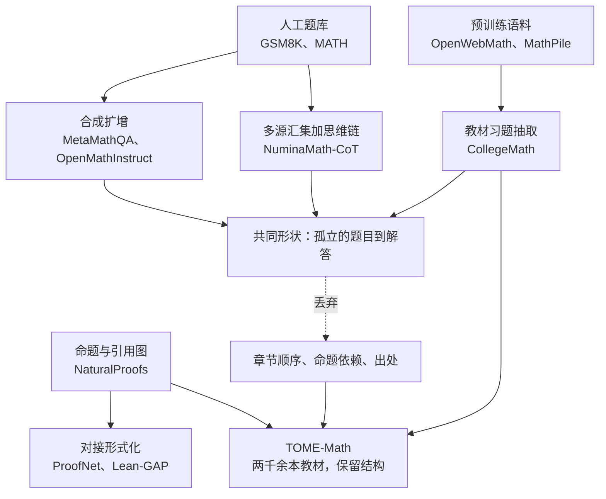
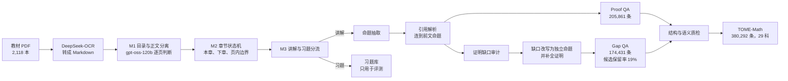
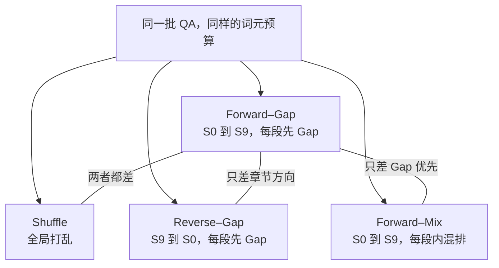
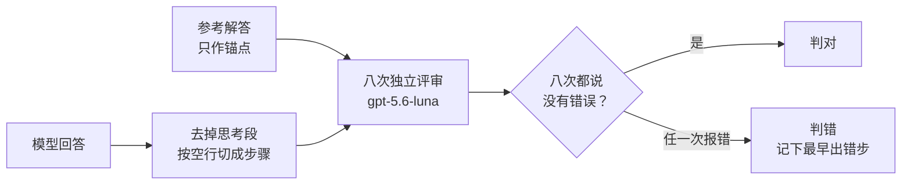

# 从结构化教材规模化构造数学证明监督（TOME-Math）

> **原题**：Scaling Mathematical Proof Supervision from Structured Textbooks
> **作者**：Youqing Fang, Zhouqi Hua, Yinhao Tang, Yuzhe Gu, Lingkai Kong, Bin Liu, Weiming Zhang, Kai Chen, Yanan Sun, Wenwei Zhang
> **机构**：中国科学技术大学、复旦大学、上海人工智能实验室、上海交通大学
> **年份**：2026（arxiv ID 2610.40394）
> **分类**：cs.CL / cs.AI
> **链接**：https://arxiv.org/abs/2610.40394
> **项目页**：https://tome-math.github.io/
> **精读日期**：2026-11-12

## 阅读须知

### 这篇在领域里的位置

大语言模型的数学能力，过去几年主要沿着两条路往前推。一条是推理时多花算力，例如让模型写很长的思维链，再用强化学习奖励正确答案；另一条是训练数据本身，也就是在监督微调阶段给模型喂什么样的「题目与解答」。这篇论文站在第二条路上，而且它关心的不只是数据的数量，更是数据的组织方式。

数据这一侧的工作大致经历了三个阶段。最早是人工编写的题库，例如小学应用题集 GSM8K 与竞赛题集 MATH；随后是在这些种子题上用大模型改写与扩增，得到几十万乃至上千万条合成数据，例如 MetaMathQA 与 OpenMathInstruct。

再往后，研究者开始从教材、论文与网页里挖掘更接近大学数学的材料。TOME-Math 属于这一阶段：它把两千一百多本大学数学教材整本拆开，却刻意保留章节顺序、定理之间的引用关系与原文出处，然后追问一个此前少有人系统回答的问题，即这些结构本身能不能在推理与训练时被拿来用。

### 读完能回答什么

1. 为什么作者认为「孤立的题目与解答」浪费了教材的价值，教材里有哪几层结构值得保留
2. Gap QA 是什么，它与直接从教材里抽出来的 Proof QA 有什么不同，为什么要专门为证明里一句「显然」补出一道题
3. 按教材章节从前往后排列训练顺序，在小规模实验里比打乱顺序好多少，到了全量训练还剩多少
4. 「悲观验证器」如何给长证明打分，它的误判率大约是多少，这对解读实验数字意味着什么
5. 这份数据集带来的提升里，哪些可能来自结构，哪些可能来自更强模型的蒸馏与更多的训练词元

### 阅读前置

本文假定读者熟悉大语言模型的监督微调流程，知道 pass@k 这一类基于多次采样的评测指标，也大致了解用大模型担任评判者的做法。

本文不假定读者做过数学推理方向，也不假定读者熟悉具体的数学科目。文中出现抽象代数、微分几何、拓扑这类科目名称时，把它们当作数据的分组标签看待即可，不需要懂其中的数学。

### 缩写表

- **SFT**（Supervised Fine-Tuning，监督微调）：用「输入与标准输出」成对的数据继续训练一个预训练模型
- **QA**（Question-Answer pair，问答对）：本文中一条训练记录的基本单位
- **TOME**（Textbook-Oriented Mathematical Evidence，面向教材的数学证据）：本文数据集的名字
- **Proof QA**：从教材原文中抽出的「命题加证明」记录，命题包括定义、引理、定理等
- **Gap QA**：把原证明中省略的推理步骤改写成一个独立命题，再补全其证明后得到的记录
- **TOME-LF**（TOME-LongForm）：作者自建的 300 道长证明评测题，取自训练时完全没有见过的教材
- **TOME-Obj.**（TOME-Objective）：作者自建的 145 道客观题评测，只按最终答案判对错
- **OCR**（Optical Character Recognition，光学字符识别）：把 PDF 页面图像转成可处理的文字
- **MoE**（Mixture of Experts，混合专家）：每个词元只激活一小部分参数的模型结构，本文底座即为此类
- **pass@k**：每道题采样 k 个回答，其中至少一个正确的概率；pass@1 近似单次答对率，pass@16 近似「十六次里能否碰对一次」
- **MiniF2F / ProofNet / MATH-500 / AIME**：公开数学评测集，依次偏向竞赛证明、本科教材证明、竞赛计算题与美国数学邀请赛真题

## 一、问题

今天训练一个数学能力强的模型，最常见的做法是收集大量「题目与解答」，然后做监督微调。这种格式便于规模化，因为任何来源的数学材料都可以被压平成同一种形状。然而压平的代价也很明显：一本教材里原本存在的先后顺序、概念之间的依赖、某个定理为何要在此处出现，全部在这一步被丢掉了。

这种丢失对小学应用题或许无伤大雅，因为每道题大体自成一体。可是到了大学数学，情形就不同了。一个拓扑学定理的证明往往依赖前两章的若干引理，证明里一句「显然」背后可能藏着三行没写出来的推导；把这样的证明单独拎出来当作一条训练样本，模型看到的是一段跳步严重、前提缺失的文字。

过去几年，数据侧的主流路线确实证明了「数据怎么造」会显著影响效果，例如题目的多样性、解答的格式、生成解答所用教师模型的强弱。这些发现指向一个更一般的原则：数学监督的价值并不只由样本数量决定，也取决于样本如何构造、如何组织。可是在组织方式这一维上，几乎所有大规模数据集都仍然停留在孤立的题目与解答。

### 前人的几条路线

第一条路线是人工题库加合成扩增。GSM8K 与 MATH 提供人工编写的题目与解答，MetaMathQA 与 OpenMathInstruct 在此基础上用大模型改写题目、重新生成解答，把规模推到几十万乃至上千万条。这条路线做对的地方在于规模与多样性，不够用的地方在于题目来源集中在小学与竞赛，几乎不触及大学数学里以证明为主的内容。

第二条路线是把教材与论文当作原料。OpenWebMath 与 MathPile 把教材、论文、网页整理成预训练语料；CollegeMath 从九本教材里抽出四千余道习题与简短答案。这一路线接触到了大学数学，但前者只是一堆文本，没有题与解的结构；后者规模很小，而且只保留习题，不保留讲解部分的定理与证明。

第三条路线专注于证明本身。NaturalProofs 保留了命题、证明与命题之间的引用图，ProofNet 与 Lean-GAP 把教材数学对接到形式化语言 Lean。这一路线最接近本文的关切，可惜来源只有一两本教材，或者规模停留在几百道题。

### 本文要回答的具体问题

把上面的动机落到可以验证的层面，本文提出三个问题。第一，能否把上千本教材规模化地转成证明监督，同时保留章节层级、命题之间的依赖与出处。第二，这些保留下来的结构在推理时能否帮助模型挑选更有用的参考材料。

第三，这些结构在训练时能否作为课程顺序来使用，也就是按教材章节的先后去排列训练样本，是否比随机打乱更好。作者把「保留结构」拆成三个层次来讨论：层级结构指章节与命题的原始组织，依赖结构指定理证明与其中省略步骤之间的连接，课程结构指按教材顺序与证明粒度来排列监督信号。

## 二、方法

本文的方法分为两大块。前一块是一条把教材 PDF 转成结构化证明记录的数据流水线，后一块是在这份数据上做的三类利用方式：推理时按结构检索、训练时按章节排课程、以及扩大来源教材的覆盖面。

### 2.1 原料：两千一百多本教材

教材来源先按大学课程大纲筛选，再经领域专家审阅，规范化与去重之后得到 2,118 本 PDF，覆盖 29 个数学科目。语言上以中文与英文为主，也有不少中英混排的书；本科阶段中文略多，研究生阶段英文占三分之二。

科目之间的分布并不均匀。数学分析一科就有 307 本书、六万六千余条记录；图论只有 25 本书，却产出两万四千余条记录，平均每本将近一千条。产量最高的单本书是 Jukna 的《极值组合学》，贡献了三千余条，约占全库百分之零点八。

### 2.2 结构恢复：从 PDF 到有序的章节

流水线的第一步是让 PDF 变得可读。作者用 DeepSeek-OCR 把每本书转成带图片的 Markdown 文本，于是后续模块面对的不再是页面图像，而是一页一页的文字。

第二步是恢复目录与章节。这里的难点在于，OCR 之后的文本只是一长串页面，哪一页属于哪一章并没有标注。作者先用开源模型 gpt-oss-120b 逐页判断「这一页是目录、正文还是封面与前言」，抽出层级目录；然后以目录为条件，用一个状态机顺序读正文。

这个状态机对每一页只回答三种状态之一：整页属于当前章、整页属于下一章、或者章节边界落在这一页之内。之所以设计成状态机，是因为章节切分本质上是一个顺序决策，每一页的判断依赖前一页停在哪里；落在页内的边界还会被复查一次，复查失败就退回重判。

第三步是把每一章里的讲解与习题分开。讲解部分后续用于生成训练数据，习题部分则单独存成一个习题库，只用于评测，不进入训练数据的生成路径。这一分流决定了后面评测的干净程度，因为评测题与训练记录来自同一本书的不同部分，而评测用的书在训练时整本排除。

### 2.3 Proof QA：把教材里的命题与证明抽出来

拿到每一章的纯讲解文本之后，流水线进入以命题为中心的四个阶段。第一阶段是命题抽取：模型读一个小节，输出结构化的命题记录，每条记录包含类型（定义、引理、定理等）、编号、标签、标题、命题的 LaTeX 原文与证明的 LaTeX 原文。

第二阶段是引用解析。作者先把整本书抽出的命题汇成一个「命题库」，再让模型为每个带证明的命题找出它依赖的前文结果。这里既包括原文里明写的「由定理 3.2」这类显式引用，也包括没有写编号、但语义上用到了前文某个结论的隐式引用。

这两个阶段合起来，产出的就是 Proof QA：题目是一个命题（连同理解它所需的前文命题），答案是教材里的原证明。全库共有 205,861 条这样的记录。

### 2.4 Gap QA：为证明里的「显然」补一道题

本文最有特色的设计是第三与第四阶段。教材证明经常跳步，作者写下「显然」「易知」，读者就要自己补上几行推导。对于学生，这是练习；对于语言模型，这些空白恰恰是它最容易学不会、也最容易在生成时胡乱跳过的地方。

第三阶段因此是证明缺口审计。模型逐条检查每个证明，寻找三类缺口：未经验证就使用的引理假设、省略的坐标或算子变换、以及用「显然」「易见」一类措辞掩盖的跳跃。每个候选缺口会被记录下来，包括缺口陈述、缺失的逻辑、对应的子命题与难度等级。

第四阶段是自洽改写。被认定为实质性缺口的子命题会被改写成一个独立的数学命题：声明所有符号、注入所需定义、保持原书语言，然后由模型补全它的证明。这样得到的记录就是 Gap QA。

Gap QA 的筛选相当严格。流水线一共生成了 918,235 条候选，最终只保留 174,431 条，保留率约为百分之十九。换句话说，每五条候选里有四条在质检中被淘汰。

### 2.5 质检与模型分工

质检分两个层面进行。结构层面检查目录层级是否合法、页面边界是否含糊、跨页的题目是否连续、题与答是否对齐、题目是否自成一体。语义层面则由一个以原文为条件的 gpt-oss-120b 评审，从完整性、准确性、LaTeX 格式、自洽性与原子性五个维度审核候选命题。

其中准确性被当作硬性条件。凡是编造了原文没有的证明步骤、改动了数学关系、或者写入了原文不支持的内容，都按失败处理，而不是按文风瑕疵处理。

至于各环节用哪个模型，作者做了一番成本与质量的权衡。按设计阶段的记录，全程用 Gemini 3.1 Pro 思考模式，每本书约需 40 到 50 美元；全程用 Flash-Lite 约 5 美元；全程用 Gemini 3 Flash 思考模式约 10 美元。最终方案是混合分工：推理密集的抽取与审计交给 Flash 思考模式，引用语义解析交给更便宜的 Flash-Lite，每本书约 7 美元。

从最终产出来看，Proof QA 有百分之八十八点九由 Gemini 3 Flash 思考模式生成；Gap QA 则有百分之五十三点七由 gpt-5-mini 生成。这一点在后面讨论局限时还会回来，因为它意味着训练数据里相当一部分文字出自较强的闭源模型之手。

### 2.6 每条记录携带的结构信息

最终每条记录都带着书名、章节与原文位置，Proof QA 还带着命题编号与已解析的引用。除此之外还有一组结构元数据：课程阶段、结构难度、涉及的概念数、前置依赖的深度，以及生成模型自报的置信度。

这些元数据是后面一切实验的基础。没有章节位置，就无法按教材顺序排课程；没有引用关系，就无法按依赖去检索；没有书名，就无法按整本书划分训练集与评测集。

### 2.7 三种利用结构的方式

有了这份带结构的数据，作者从三个角度检验结构是否有用。第一个角度不训练模型，只在推理时把检索到的教材材料放进上下文，比较「按结构检索」与「随便从同一本书里取」的差别。

第二个角度是课程学习。所谓课程学习，指的是不把训练样本随机打乱，而是按某种由易到难或由前到后的顺序呈现给模型，就像学生按教材章节顺序学习一样。作者为此定义了一个归一化的章节进度：对来自某本书的样本，设它在第 i 章（从 0 数起），全书共 N 章，则它的进度为 i 除以 N，再按十分位切成十个阶段 S0 到 S9。

之所以要归一化，是因为不同教材章数不同，第三章在一本十章的书里算靠前，在一本四章的书里就已过半。归一化之后，不同书的样本可以在同一个阶段里交错排列，既大致保留各自书内的先后，又不必在书与书之间强加一个任意顺序。

在这个进度之上，作者设计了四种排程，它们使用完全相同的样本与词元预算，只有呈现顺序不同。Forward–Gap 从 S0 走到 S9，每个阶段内先放 Gap QA 再放其余样本；Reverse–Gap 从 S9 倒走回 S0，阶段内同样 Gap 优先；Forward–Mix 正向行进，但阶段内把两类样本混排；Shuffle 则是全局打乱。

这样设计的好处是可以做干净的对照。Forward–Gap 与 Reverse–Gap 只差章节方向，Forward–Gap 与 Forward–Mix 只差「Gap 优先」这一条规则，与 Shuffle 的比较则同时改变了两者。

第三个角度是来源广度。作者在固定词元预算下，比较「从 8 本书里取足数据」与「从 16 本书里各取一半」的差别，用来回答「同样多的数据，来自更多的书是否更好」。

## 三、实验

### 3.1 实验设置

所有实验都以 Qwen3-30B-A3B-Base 为底座。这是一个总参数三百亿、每个词元只激活约三十亿参数的混合专家模型，而且是未经指令微调的基础版本。所有微调变体都从同一个检查点出发，未微调的检查点本身也作为一条基线。

全量训练的配置是：AdamW 优化器，学习率 8e-5 余弦衰减到 8e-6，序列长度 131,072 并做全局打包，有效批大小 64，每个语料只训练一个完整轮次，硬件是两台各八张 H200 的机器。

### 3.2 评测方式与悲观验证器

主评测集 TOME-LF 来自六个样本量最大的科目：抽象代数、微分几何、离散数学、数学分析、概率论与拓扑。作者从这六科里留出 64 本书，整本排除在训练之外（因此删掉了 15,661 条记录，训练集剩 364,631 条），再从这些书的原生习题里挑出 300 道证明为主的题，各科 50 道，前半本与后半本各占一半。

长证明的打分是本文评测的关键。作者采用所谓悲观验证：每个回答被切成若干步，连同题目与参考解答一起交给 gpt-5.6-luna 独立评审八次，每次都要指出第一处实质性错误的位置，没有错误就记为负一。只有八次评审全都说「没有错误」，这个回答才被判为正确。

这里的「悲观」二字，指的是一票否决而非多数表决。这样做的初衷是宁可错杀、不可放过，因为长证明里一处隐蔽的漏洞，单次评审很容易看漏。参考解答只作为锚点，不同证法、调换顺序与合法捷径都被允许。

一票否决会不会太严？作者专门做了人工校准。他们从评测回答里分层抽取 600 个，请数学博士或同等资历的研究者盲审，另有第二位标注者独立复核其中 180 个，分歧交第三人裁决。

| 指标 | 数值（加权，含 95% 置信区间） |
|---|---|
| 人工判对的比例 | 47.9%［44.6, 51.2］ |
| 误判为对（验证器说对、人说错） | 8.7%［6.3, 11.5］ |
| 误判为错（验证器说错、人说对） | 18.1%［15.3, 21.1］ |
| 验证器与人的一致率 | 85.9%［83.8, 87.9］ |
| 两位人工标注者之间的一致率 | 89.4%，Cohen κ 0.771 |

按八票中「无错」票数分层看，结果更有意思。八票全过的回答，人工判对的比例是 91.3%；可是恰好只有一票报错、其余七票都说没问题的那一层，人工判对的比例高达 68.4%。也就是说，一票否决把这一层里约三分之二本来正确的证明判成了错，这正是误判为错达到百分之十八的主要来源。

除 TOME-LF 之外，作者还用了自建的 145 道客观题 TOME-Obj.，以及四个公开评测：MiniF2F 与 ProofNet 用自然语言证明的形式评测，同样由 gpt-5.6-luna 判分；MATH-500 与 AIME 2026 只看最终答案。

### 3.3 全量对比：与三个公开语料比

第一组实验回答的是最直接的问题：用 TOME-Math 全量微调，与用其他公开数学语料微调相比如何。三个对照语料分别是 OpenMathInstruct-1（182 万条）、MetaMathQA（39.5 万条）与 MathInstruct（26.2 万条），训练配置完全相同，各训一个轮次。

| 微调语料 | TOME-LF | TOME-Obj. | MiniF2F | ProofNet | MATH-500 | AIME-26 | 平均 |
|---|---|---|---|---|---|---|---|
| 不微调（底座） | 13.25 | 32.93 | 34.45 | 17.14 | 68.80 | 8.44 | 29.17 |
| OpenMath1（182 万） | 20.16 | 33.86 | 22.87 | 19.25 | 70.40 | 8.21 | 29.13 |
| MetaMath（39.5 万） | 28.73 | 34.66 | 40.70 | 22.55 | 71.20 | 9.98 | 34.64 |
| MathInstruct（26.2 万） | 35.87 | 40.69 | 52.05 | 32.93 | 73.05 | **11.98** | 41.10 |
| **TOME-Math（36.5 万）** | **43.86** | **43.96** | **57.43** | **42.98** | **76.55** | 10.19 | **45.83** |

TOME-Math 在六项里有五项第一，只在 AIME 2026 上排第二。六项平均从底座的 29.17% 升到 45.83%，提升 16.66 个百分点，摘要里写的 16.7 即由此四舍五入而来。

与最强的公开基线 MathInstruct 相比，差距最大的是两项证明评测：TOME-LF 高出约 8 个点，ProofNet 高出约 10 个点。在客观题、MiniF2F 与 MATH-500 上也有领先，作者据此认为收益并不局限于自家评测的分布。

值得注意的是，作者在这里措辞相当克制。他们明确写道，由于这些语料在多个方面都不同，这组对比本身并不能把「教材结构」单独确立为原因，结构的作用要靠下面的受控实验来检验。

### 3.4 推理时按结构检索

第二组实验完全不训练模型。作者用未微调的底座去做 TOME-LF 的 300 道题，比较五种上下文策略：不给任何材料（Closed）、从同一本书里随机取（Random Same-Book）、只从本章与前几章取（Local Chapter）、按章节位置与依赖关系检索命题（Props Only）、在此基础上再加入 Gap QA（Props + Gap）。

为了让比较公平，四种带上下文的策略使用相同的词元预算、相同的提示模板与相同的验证器，而且候选池里所有与目标题目或其参考答案重合的内容都事先剔除。于是这组实验比的是「同样多的材料，挑得准不准」，而不是「给的材料多不多」。

| 上下文策略 | 平均 pass@1 | 抽象代数 | 微分几何 | 离散 | 分析 | 概率 | 拓扑 |
|---|---|---|---|---|---|---|---|
| Closed | 13.25 | 8.50 | 5.25 | 13.25 | 25.75 | 20.00 | 6.75 |
| Random Same-Book | 14.00 | 9.75 | 6.50 | 12.50 | 24.75 | 20.50 | 10.00 |
| Local Chapter | 14.71 | 10.50 | 6.75 | 14.50 | 25.50 | 20.00 | 11.00 |
| TOME（Props Only） | 15.54 | 11.00 | 8.50 | 15.00 | 27.25 | 20.50 | 11.00 |
| TOME（Props + Gap） | **17.38** | **12.75** | **10.00** | **15.25** | **31.75** | **21.75** | **12.75** |

结果呈现出一条清楚的阶梯：材料越有结构，效果越好。完整策略比不给材料高出 4.13 个点，而且六科全都提升，数学分析与拓扑各涨了 6 个点。其中 Gap QA 单独贡献了 1.84 个点，说明那些被补出来的局部证明义务，确实提供了命题本身之外的有用信息。

与之相对地，随机取同书材料或只取邻近章节，有时反而让某些科目持平甚至下降，例如离散数学在随机取材时从 13.25 降到 12.50。这说明「材料来自同一本书」本身并不够，关键在于是否按依赖关系挑中了相关的那几条。

### 3.5 课程学习：按章节顺序训练

第三组实验检验章节顺序作为训练课程的效果。为了不让多学科混合干扰结论，作者为六个科目各训一个独立模型，每科三档词元预算：75 万、180 万与 240 万。三档的书与样本严格嵌套，8 本书包含在 16 本里，16 本又包含在 24 本里。

需要说明的是，这一组的数据量很小。以 75 万词元档为例，每科只有约两千条样本；240 万词元档每科也只有五千到七千条，六科合计不到四万条。评测用的是 pass@16，即十六次采样中至少一次被验证器接受的比例。

| 词元预算 | Shuffle 平均 pass@16 | Forward–Gap 平均 pass@16 | 差距 |
|---|---|---|---|
| 75 万 | 41.04 | 45.38 | +4.34 |
| 180 万 | 42.52 | 48.98 | +6.46 |
| 240 万 | 43.21 | 50.93 | +7.72 |

两条结论同时成立。一方面，所有排程都随数据增多而提升，即使只有 75 万词元，每一种微调都比底座好；另一方面，Forward–Gap 在全部 18 个「科目乘预算」的格子里都是最好的，而且它对 Shuffle 的领先随数据增多而扩大。

再拆开看，受控对比把大部分收益归给了章节方向。Forward–Gap 比 Reverse–Gap 在三档上分别高 5.65、7.41 与 8.50 个点；而在都正向行进的前提下，「Gap 优先」比阶段内混排只多出 2.37、1.91 与 1.53 个点。换句话说，在这组小规模实验里，从前往后学是主因，先学补出来的缺口是锦上添花。

### 3.6 来源广度与跨科迁移

第四组实验把「书的数量」从「数据的数量」里剥离出来。作者固定 75 万词元的 Forward–Gap 设置，比较两种取法：从 8 本书里取足（窄而密），与从 16 本书里各取一半（宽而疏）。

结果是宽而疏在每一科都更好，提升幅度在 1.6 到 4.8 个点之间，平均 3.3 个点，拓扑与微分几何受益最大。作者据此把来源广度视为一条独立的扩展维度：同样的监督预算，摊到两倍数量的书上，效果更好。

跨科迁移的实验则把每科训出的 75 万词元模型拿去做其他五科的题。作者用「迁移系数」衡量效果，即源科模型在目标科上的得分，除以目标科自己的专科模型在本科上的得分。

这一系数的宏观平均是 0.92，意思是一个只学过别科的模型，平均能拿到本科专家九成以上的成绩。30 个有序组合里有 8 个超过 1.0，其中拓扑模型与微分几何模型做概率题，都达到了 1.29。作者认为这说明各科学到的是可复用的证明模式，而不是只在本科有效的套路。

### 3.7 全量消融

最后，作者回到全量数据，逐一去掉配方中的三个组成部分，观察每一项的贡献。

| 变体 | TOME-LF | TOME-Obj. | MiniF2F | ProofNet | MATH-500 | AIME-26 |
|---|---|---|---|---|---|---|
| 去掉 Gap QA（只正向） | 38.72 | 38.91 | 50.73 | 36.21 | 73.84 | 9.12 |
| 去掉课程（Shuffle） | 39.87 | 40.42 | 53.76 | 39.12 | 75.22 | 9.58 |
| 去掉 Gap 优先（Forward–Mix） | 40.12 | 41.37 | 55.61 | 41.02 | 75.88 | 9.93 |
| 完整配方（Forward–Gap） | **43.86** | **43.96** | **57.43** | **42.98** | **76.55** | **10.19** |

每去掉一项，六个评测全都下降。去掉 Gap QA 的影响最大，四项证明评测掉了 5 到 7 个点，这支持了「显式补出局部证明义务」的价值。

### 3.8 两处值得单独拎出来的结果

第一处是全量消融与小规模课程实验的结论方向并不一致。小规模实验里，章节方向是主因，Gap 优先只是补充；可是到了全量消融，在 TOME-LF 上把 Gap 优先换成阶段内混排要掉 3.74 个点，再把正向课程换成全局打乱只多掉 0.25 个点。作者在正文里把全量结果表述为「Gap 优先是主要的排序信号，正向章节进程是补充」，却没有正面解释为什么数据放大之后章节方向的作用几乎消失。

一种可能的解释是，章节顺序的好处在数据少、训练步数少的时候最明显，数据一多，模型无论以何种顺序都能见到足够多的前置知识，顺序的边际价值随之缩小。但这只是读者的推测，论文没有提供能检验它的实验。

第二处是数据多不一定好。OpenMathInstruct-1 的样本数是 TOME-Math 的近五倍，可是用它微调之后，MiniF2F 反而从底座的 34.45 降到 22.87，AIME 也略有下降。这些样本主要来自小学与竞赛计算题，大量这类监督似乎把模型往「算出一个数」的方向推，削弱了它写证明的能力。作者用这一点论证「监督的来源与形式比样本数更重要」，这一推论是成立的。

## 四、局限

### 作者自己交代的

作者在全量对比处明确承认，四个语料在来源、格式、规模等多个方面都不同，所以表 2 的领先不能单独归因于教材结构。他们把因果检验交给了受控的检索与课程实验，这一区分是诚实的。

验证器的误差也由作者自己量化了出来。悲观验证器整体有约百分之九的误判为对与约百分之十八的误判为错，后者主要集中在「八票里只有一票报错」的那一层。所有长证明评测的绝对数值都应当带着这个误差去读。

数据质量方面，作者在附录里如实报告了一些不太好看的数字。在九个自动审计维度里，「有据可依」与「与原文证据对齐」这两项的通过率都不到一半，失败率为百分之二十八点六；人工复核标记中，「找不到原文逐字证据」覆盖了全库的百分之四十八点四。再加上竞赛数学一科的记录有七成多落在最低质量档，而全量训练时作者保留了所有质量档，没有再做筛选。

此外，作者也注明了 AIME 2026 只有 30 道题，置信区间宽达正负八九个点；检索实验里中间几种策略在各科内并非严格单调，只有最完整的策略在每一科都最好。

### 读完能看出来的

第一，对照基线偏旧，而且训练量不对等。三个对照语料都是 2023 年前后的数据集，表 1 里列出的更新、更强的 NuminaMath-CoT 与 OpenMathInstruct-2 并没有进入对比。与此同时，TOME-Math 的训练集有约 1.71 亿词元，而 MetaMath 只有 0.97 亿、MathInstruct 只有 0.64 亿；在批大小与序列长度固定、各训一轮的设置下，TOME-Math 实际上得到了接近两到三倍的优化步数。

第二，数据里混着相当分量的蒸馏成分。Proof QA 的文字虽然以教材原文为准，却由 Gemini 3 Flash 思考模式抽取与整理；Gap QA 的证明则直接由 gpt-5-mini 等模型补全。对照语料的解答出自更早、更弱的模型。于是，TOME-Math 的领先里有多少来自教材结构，有多少来自「用 2026 年的强模型写证明给一个 30B 模型模仿」，目前的实验无法分开。

第三，评测与训练数据同源。TOME-LF 的题目虽然来自整本留出的教材，但科目、文体与参考解答的风格都与训练数据高度一致，而 TOME-Math 恰恰在这一项上领先最多。公开评测上的领先幅度要小一些，这一点在解读「泛化」时值得放在心上。

第四，去掉 Gap QA 的消融同时也删掉了近一半的数据。Gap QA 占全库约百分之四十六，去掉它之后训练词元与训练步数都明显减少，所以这一项的下降里混着数据量的效应，并不能完全算作「补出证明缺口」这一设计的功劳。

第五，课程实验的规模过小。每科只有两千到七千条样本，训练配置里还提到某次运行总共只有 18 步。在步数这样少、学习率又按余弦衰减的情况下，样本出现的先后会与学习率的高低纠缠在一起，顺序效应很难与优化动态区分开。全量消融中章节方向的作用缩小到 0.25 个点，也提示小规模课程实验的结论不宜直接外推。

第六，跨科迁移的系数有超过 1.0 的情况，例如拓扑模型做概率题比概率专科模型还好。这固然可以解读为迁移效果强，但每个格子只有 50 道题，专科模型的分母又来自另一组实验，这类比值本身的方差不小，读的时候不宜过度解读单个格子。

第七，评判依赖单一闭源模型。所有证明类评测都由 gpt-5.6-luna 判分，外人无法完全复现；人工校准表的表注措辞读起来像是预先写好的报告规范，读者可以留意正式版本是否对这部分有所更新。

第八，可复现性与版权。整条流水线依赖 Gemini 与 GPT 系列的商业接口，按作者给出的每本书约 7 美元估算，重跑一遍两千多本书约需一万五千美元，这还不算 Gap QA 那九十多万条候选的生成成本。两千多本教材大多受版权保护，作者承诺公开语料，但由教材改写而来的数据以何种许可发布、能否发布，论文里没有交代。

## 一句话

把 2,118 本大学数学教材拆成保留章节顺序与命题依赖的 38 万条证明监督，补出省略步骤，微调后六项均分升 16.7 点。
