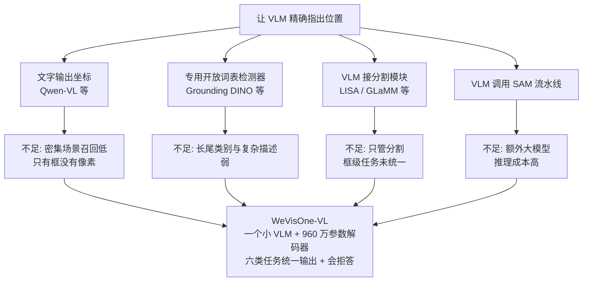
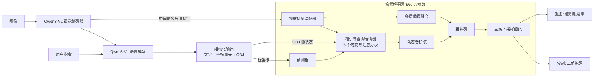
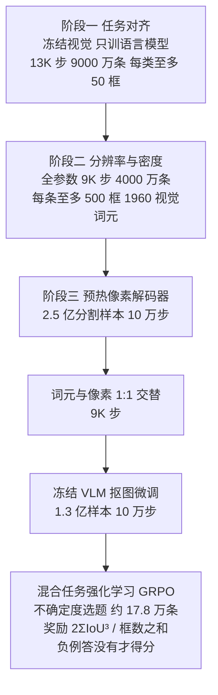

# WeVisOne-VL：从物体到像素的统一视觉感知

> **原题**：WeVisOne-VL: Unified Visual Perception from Objects to Pixels
> **作者**：Tianming Liang, Junyi Pan, Yuxi Li, Canmiao Fu, Zhipeng Huang, Chong Sun, Chen Li, Jing Lyu
> **机构**：微信团队（模型名 WeVisOne 即 WeChat Vision All-in-One；摘要页未列具体机构）
> **年份**：2026（arxiv ID 2610.31329，2026 年 10 月 22 日提交）
> **分类**：cs.CV
> **链接**：https://arxiv.org/abs/2610.31329
> **精读日期**：2026-10-24

## 阅读须知

### 这篇在领域里的位置

这是一篇技术报告，属于「让视觉语言模型做精细感知」这一类工作。视觉语言模型（Vision-Language Model，VLM）是一种同时读图和读文字、再用文字作答的大模型，过去两年在看图问答、看图描述上进步很快。然而，一旦要求它精确地指出「东西在哪里」，比如框出图中每一个人、数清货架上有几瓶水、把一只猫从背景里干净地抠出来，它的表现就明显不如专门训练的检测或分割模型。

围绕这个短板，业界大致走出了几条路：让 VLM 直接用文字输出坐标，给 VLM 外挂一个分割解码器，或者干脆让 VLM 去调用 SAM 之类的专用模型。WeVisOne-VL 的位置在于，它试图用一个小模型、一套统一的输出格式，把检测、指代定位、计数、文字定位、分割和抠图六类任务一并做好，并且特别强调「图里没有就说没有」的拒答能力。

### 读完能回答什么

1. 现有 VLM 在精细感知上为什么不可靠，几条主流补救路线各卡在哪里。
2. WeVisOne-VL 如何用坐标词元和一个特殊的 `<OBJ>` 词元，把框级输出和像素级输出接到同一个自回归模型上。
3. 一个只有 960 万参数的像素解码器，是如何借用大模型的隐状态和视觉特征画出掩码与透明度遮罩的。
4. 三阶段课程式监督微调加混合任务强化学习，各自解决了什么问题，奖励函数为什么要把 IoU 取三次方。
5. 在「目标根本不存在」的提问上，它的拒答率为什么能比同类模型高出几十个百分点。

### 阅读前置

本文假定读者熟悉 Transformer 和大语言模型的基本训练方式，知道监督微调与强化学习的大意，也大致听说过目标检测里的边界框和 IoU。读者未必做过分割、抠图或视觉定位，相关术语都会先铺垫再展开。

### 缩写表

- **VLM**（Vision-Language Model，视觉语言模型）：同时接收图像与文字输入、以文字输出的模型。
- **NTP**（Next-Token Prediction，下一个词元预测）：大语言模型的标准训练与生成方式，一次预测一个词元。
- **SFT**（Supervised Fine-Tuning，监督微调）：用标注好的输入输出对继续训练模型。
- **RL**（Reinforcement Learning，强化学习）：让模型自己生成答案，根据奖励信号调整。
- **GRPO**（Group Relative Policy Optimization，组相对策略优化）：一种强化学习算法，对同一题采样一组答案，用组内相对好坏作为优势信号，不需要单独的价值网络。
- **IoU**（Intersection over Union，交并比）：预测框与真实框重叠面积除以两者并集面积，衡量定位准确度。
- **OCR**（Optical Character Recognition，光学字符识别）：本文中特指在图上定位文字区域。
- **SAM**（Segment Anything Model）：Meta 提出的通用分割模型，可按点或框提示分割任意物体；文中还提到其后续版本 SAM2、SAM3。
- **ViT**（Vision Transformer）：VLM 中负责把图像切块编码的视觉编码器。
- **MAD**（Mean Absolute Difference，平均绝对误差）：抠图任务的常用指标，越低越好。
- **cIoU / gIoU**：分割任务的两种 IoU 汇总方式，前者按全体像素累计，后者按样本平均。
- **F1**：精确率与召回率的调和平均；检测任务里常在 IoU 0.5 等阈值下计算，F1 Mean 是多个阈值的平均。

## 一、问题

### 为什么这个问题值得做

精细感知是很多真实产品的地基。拍照搜同款需要先把商品框出来，修图里的一键抠图需要准确到发丝的透明度遮罩，内容审核需要找出画面角落里不起眼的违规物件，机器人抓取需要知道物体的精确位置。这些场景对「大致看懂这张图」并不满意，它们要的是「这个东西就在这里、边界就到这里」。

问题在于，今天最通用、最好用的模型是 VLM，而 VLM 恰恰在这里不可靠。报告点出了三种典型失误：一是凭空「看见」不存在的物体，二是遇到陌生的描述时误解用户意图，三是在拥挤画面里漏掉不显眼的实例。对一个要上线的系统而言，第一种失误尤其致命：用户问「图里有没有蓝色的车」，模型却框出一辆红车，这比说「没有」更糟糕。

### 前人路线及其不足

为了让 VLM 能指出位置，业界大致走了四条路。

第一条路是**让 VLM 直接用文字输出坐标**，以 Qwen-VL 系列为代表。模型像写句子一样写出框的四个坐标值，好处是完全复用语言模型的能力，能理解复杂的指代描述；不足是在物体很多的密集场景里召回偏低，而且只能给出框，给不出像素级的形状。

第二条路是**专门的开放词表检测器**，以 Grounding DINO 为代表。它在密集物体上表现很好，但对长尾类别和复杂的开放描述理解有限，毕竟它背后没有一个大语言模型。

第三条路是**在 VLM 上接一个分割模块**，以 LISA、GLaMM 为代表。模型输出一个特殊词元，再由一个解码器据此画出掩码。这条路打通了语言与像素，但通常只管分割，没有把检测、计数、文字定位等框级任务统一起来。

第四条路是**让 VLM 调用 SAM 之类的专用大模型**组成流水线。效果可以很好，可是需要额外部署一个大模型，端到端推理成本高，环节也多。



## 二、方法

WeVisOne-VL 的核心想法可以用一句话概括：所有任务都写成「结构化的下一个词元预测」，需要像素级输出时，让模型在框的后面多吐出一个 `<OBJ>` 词元，再由一个很小的解码器把这个词元「翻译」成掩码或透明度遮罩。

### 底座与坐标词元

模型以 Qwen3-VL 为底座，提供 2B 和 4B 两个规模。为了让坐标表达更省词元，作者新增了从 `<0>` 到 `<1000>` 的专用词元，用来表示归一化到 0 到 1000 之间的坐标。于是一个边界框写作四个坐标词元 `[x0, y0, x1, y1]`，一个点写作两个，`<box>` 之类的结构标签把它们包起来；当目标不存在时，模型直接输出 `None`。

之所以要专门设坐标词元，原因在于普通文字写数字会被切成好几个词元，一个框可能要十几个词元才写完；改用专用词元后，一个坐标就是一个词元，长序列里写几百个框也不至于把上下文撑爆。

### 结构化输出的样子

以指代检测为例，用户问「左边那辆红车」，模型回答的是一段带结构标签的文字：

```
the red car on the left <box>[250, 150, 400, 280]</box>
```

需要分割或抠图时，模型在框的四个坐标之后紧跟一个 `<OBJ>`：

```
<box>[100, 50, 300, 500]<OBJ></box>
```

这个 `<OBJ>` 本身不携带文字含义，它的作用是让模型在这一位置产生一个隐状态。这个隐状态汇集了模型对「这一个实例」的全部理解，随后交给像素解码器。

### 960 万参数的像素解码器

像素解码器要做的事情，是把「一个实例的语义理解」加上「它大致在哪个框里」，变成一张全分辨率的掩码或透明度遮罩。它有三个输入：`<OBJ>` 词元的隐状态，模型刚预测出的边界框，以及从 Qwen3-VL 视觉编码器中间若干层取出的多层特征。

解码器由三部分串成：

- **视觉特征适配器**：从 ViT 中间层取出尚未合并的多层特征，投影到统一维度，再用几层深度可分离卷积和层级嵌入做加工，得到一组多尺度像素特征。
- **框引导的查询解码器**：用 `<OBJ>` 的隐状态初始化实例查询，经过 6 个可变形注意力块，在预测框的引导下到多尺度特征上取信息。可变形注意力的好处是只在参考框附近采样少量位置，计算便宜又聚焦。
- **实例条件化的稠密预测**：先把多层像素特征自顶向下融合，再由一个小网络根据实例查询生成「动态卷积核」，把核作用在像素特征上得到粗掩码，最后经过三级上采样逐步细化到全分辨率。分割任务输出二值掩码，抠图任务输出 0 到 1 之间的连续透明度。

整个解码器只有 960 万参数，远小于 SAM 系列动辄上亿的规模。它能这么小，是因为最难的「这是哪个东西」已经由大模型想清楚了，解码器只需负责「边界画得准」。



### 训练数据与数据引擎

训练用到约一亿张图像、约 36 亿个边界框标注，来源包括 GRIT、CC3M、LAION、SA-1B 和各任务的专门数据集。大部分标注由作者称为数据引擎的自动流水线产出：先借助知识图谱（维基百科、WordNet）发现概念，再用 SAM3 与检测器给出候选框、由 Qwen3-VL 核验；指代描述用 SAM3 Agent 和 Rex-Omni 生成后再做语义整合；掩码由 SAM2 预测并人工抽检；抠图标注由 BiRefNet、MatAnyone2 等专家模型给出。

数据引擎里最值得注意的一环是**难例与负例构造**。负例指的是「图里没有任何物体同时满足所有条件」的提问，比如图里只有红车却问「蓝色的车」，或者问「穿白衣又穿红短裤的人」而没有人两者兼备。这类负例通过有控制地改动描述条件、以及收集模型实际答错的案例来构造，后面会看到，它们是拒答能力的来源。

### 三阶段课程式监督微调

训练分三个阶段，由易到难，像课程一样排布。

**第一阶段：任务对齐。** 冻结视觉编码器和视觉语言投影层，只训练语言模型，共 13K 步、9000 万条样本。目的是让模型学会新加的坐标词元、各类任务指令、结构化输出格式，以及在没有目标时说 `None`。这一阶段每个类别最多给 50 个框或点，视觉词元 16 到 512 个，上下文 4096，原因是一开始就塞几百个框会让模型「输出崩溃」，只会重复。

**第二阶段：分辨率与密度扩展。** 全部参数解冻，共 9K 步、4000 万条样本。每条回答最多可有 500 个框或点，视觉词元升到 1960 个，上下文扩到 8192。目的在于看清小物体、应付拥挤场景。

**第三阶段：词元与像素交替优化。** 先用 2.5 亿条分割样本、10 万步预热像素解码器，损失为 20 倍焦点损失加 Dice 损失；再以 1 比 1 交替训练下一个词元预测和像素任务 9K 步，联合损失为下一个词元预测损失加 10 倍分割损失；最后冻结 VLM，用 1.3 亿条抠图样本、10 万步专门微调解码器去做透明度预测，损失由 L1、梯度、拉普拉斯金字塔和难区域四项加权组成。

### 混合任务强化学习

监督微调之后，作者用 GRPO 做混合任务强化学习。GRPO 对同一个「图像加提示」采样一组答案（这里是 8 个），用组内相对好坏当作优势信号来更新模型。

**选什么样的题来练。** 作者用不确定度挑题：对每道题，看监督微调后的模型多次作答的平均奖励 μ 和奖励的标准差 σ，计算 U = 4·μ·(1−μ)·σ。这个式子在「不太会也不全不会」、且答案波动大的题上取值最高，正是最值得练的那一类。按此筛出约 14 万条，再加上有针对性的样本，强化学习语料共约 17.8 万条。

**奖励怎么算。** 对一次完整的结构化回答，先在同类语义内用匈牙利算法把预测框与真实框一一配对，再计算 r = 2·Σ IoU³ / (真实框数 + 预测框数)。这个奖励同时惩罚多框和漏框：多预测的框和漏掉的框都会增大分母。IoU 取三次方的用意，是让「框得非常准」比「框得差不多」得到明显更高的回报，把模型往高质量定位上推。分割和抠图任务在强化学习阶段只奖励框，不评价掩码与透明度。负例提问则只有在模型回答「没有」时才得满分。



## 三、实验

报告在三十多个基准上做了评测，下面挑主要几类列出，对比对象是同量级的开源视觉定位模型。

### 目标检测

| 基准 | 指标 | WeVisOne-2B | WeVisOne-4B | Rex-Omni-3B | LocateAnything-3B |
|---|---|---|---|---|---|
| COCO | F1@0.5 | 72.6 | 74.0 | 72.0 | 70.1 |
| COCO | F1 Mean | 55.2 | 57.1 | 52.9 | 54.7 |
| LVIS | F1 Mean | 53.3 | 55.3 | 46.9 | 50.7 |
| Dense200 | F1 Mean | 61.4 | 71.3 | 58.3 | 58.7 |
| VisDrone | F1 Mean | 40.4 | 44.7 | 35.8 | 39.9 |

在常规的 COCO 上，4B 模型比最强对手只高一两个点；差距拉开的地方在长尾类别（LVIS）和密集场景（Dense200、VisDrone）。Dense200 上 4B 比 2B 高出近 10 个点，说明模型规模对拥挤画面帮助很大。

### 计数与文字定位

| 基准 | WeVisOne-2B | WeVisOne-4B | 对手 |
|---|---|---|---|
| CountQA（完全匹配） | 90.9 | 93.7 | LocateAnything-3B 88.7 |
| PixMo-Count（完全匹配） | 88.1 | 89.6 | LocateAnything-3B 82.8 |
| MixCount（完全匹配） | 32.2 | 40.4 | LocateAnything-3B 15.2 |
| TotalText（F1 Mean） | 42.5 | 52.0 | Rex-Omni-3B 40.6 |
| SROIE（F1 Mean） | 62.1 | 68.1 | Rex-Omni-3B 44.8 |

MixCount 这类混合类别计数，各家都不高，但 4B 模型比对手翻了一倍多。文字定位上，收据类的 SROIE 提升最明显。

### 指代分割与抠图

| 基准 | 指标 | WeVisOne-2B | WeVisOne-4B | 对手 |
|---|---|---|---|---|
| RefCOCO val | cIoU | 79.7 | 81.4 | Youtu-VL-4B 80.7 |
| RefCOCO+ val | cIoU | 73.1 | 76.5 | Youtu-VL-4B 76.2 |
| RefCOCOg val | cIoU | 74.4 | 77.7 | Youtu-VL-4B 76.5 |
| ReasonSeg val | gIoU | 60.9 | 71.2 | UniPixel-7B 60.5 |
| WeRefMat（指代抠图） | MAD↓ | 15.8 | 9.8 | SAM2-Matting 51.9 |
| AM-2K（框提示抠图） | MAD↓ | 5.7 | 5.0 | SAM2-Matting 12.1 |

在 RefCOCO 系列的经典指代分割上，它与同量级对手基本持平，只略高一点；需要推理的 ReasonSeg 上 4B 比 7B 的 UniPixel 高出 10 个点以上。抠图上，误差只有 SAM2 抠图方案的一半左右，按文字指代抠图时差距更大。

### 最突出的结果：会拒答

| 基准 | WeVisOne-2B | WeVisOne-4B | 对手 |
|---|---|---|---|
| RefCOCOg-Rej（拒答率） | 50.2% | 67.4% | LocateAnything-3B 0.6% |
| WeRef-Bench 拒答子集 | 92.9% | 96.4% | LocateAnything-3B 73.0% |
| Ref-ZOM（拒答率） | 62.4% | 86.0% | Youtu-VL-4B 1.3%，UniPixel-7B 0.3% |

这一组数字是整篇报告最有说服力的部分。在「图中根本没有符合描述的目标」的提问上，多数同类模型的拒答率只有百分之零点几到一点几，也就是说它们几乎总会硬框出一个东西；WeVisOne-4B 则在三个基准上分别拒答了 67.4%、96.4% 和 86.0%。这种差别直接来自训练设计：数据引擎专门构造了负例，强化学习又规定只有答「没有」才能得分。报告没有给出逐项消融，所以无法把功劳精确分到监督微调和强化学习各自头上。

### 反直觉之处

有一处值得单独记一笔：在框提示抠图的 P3M-500-NP 和 PPM-100 上，2B 模型的误差（6.6、5.3）反而低于 4B（7.3、6.1）。由于抠图阶段冻结了 VLM、只训解码器，而两个规模用的是同一个 960 万参数的解码器，这个结果并不奇怪：当提示已经是一个框时，抠图质量主要取决于解码器而非底座大小；只有在需要先理解文字指代的 WeRefMat 上，4B 才显出优势（9.8 对 15.8）。

## 四、局限

### 作者承认的局限

作者列了三点。其一，训练里通用数据比例有限，模型的通用对话与理解能力可能比底座 Qwen3-VL 有所下降。其二，模型被训练成直接输出结构化结果，不做链式推理，面对需要多步推理的复杂指令可能吃力。其三，目前只支持单轮预测，不能在对话中逐步澄清。作者还特别指出，基准里的提示都清晰、规范、无歧义，而真实用户的指令往往含糊、犹豫，可靠部署需要更强的意图推理，这也是他们计划接入多轮智能体框架的原因。

### 读完能看出来的潜在问题

第一，**消融不足**。报告用三阶段课程和强化学习讲了一个完整的故事，但没有给出逐项拆掉某一环后的对照实验，例如不做强化学习、不用坐标专用词元、不用 IoU 三次方，各自会掉多少。于是很难判断哪些设计真正关键，哪些只是工程选择。

第二，**大量标注来自其他模型**。数据引擎重度依赖 SAM2、SAM3、Rex-Omni、BiRefNet 等专家模型生成标注，人工只做抽检。这样做规模大、成本低，但也可能把这些模型的系统性偏差一并学进来，而评测时的部分基准（尤其是作者自建的 WeRef-Bench、WeRefMat）又可能与训练数据的分布相近，自建基准上的大幅领先需要打一点折扣。

第三，**拒答与召回之间的取舍没有讲透**。拒答率高固然好，但模型同样可能在「其实有、只是不显眼」的目标上也选择拒答。报告给了拒答率，却没有同时给出在这些拒答基准上的误拒比例，使用者需要自己在业务数据上验证这条边界。

第四，**训练成本高、复现门槛高**。一亿张图、36 亿个框、几亿条分割与抠图样本，外加多阶段训练，普通团队几乎无法复现训练过程；好在作者开源了模型，下游使用者可以直接拿来微调或评估。

## 一句话

WeVisOne-VL 以坐标词元加 OBJ 词元驱动小解码器，统一检测到抠图六类感知，并靠负例与强化学习学会拒答。
