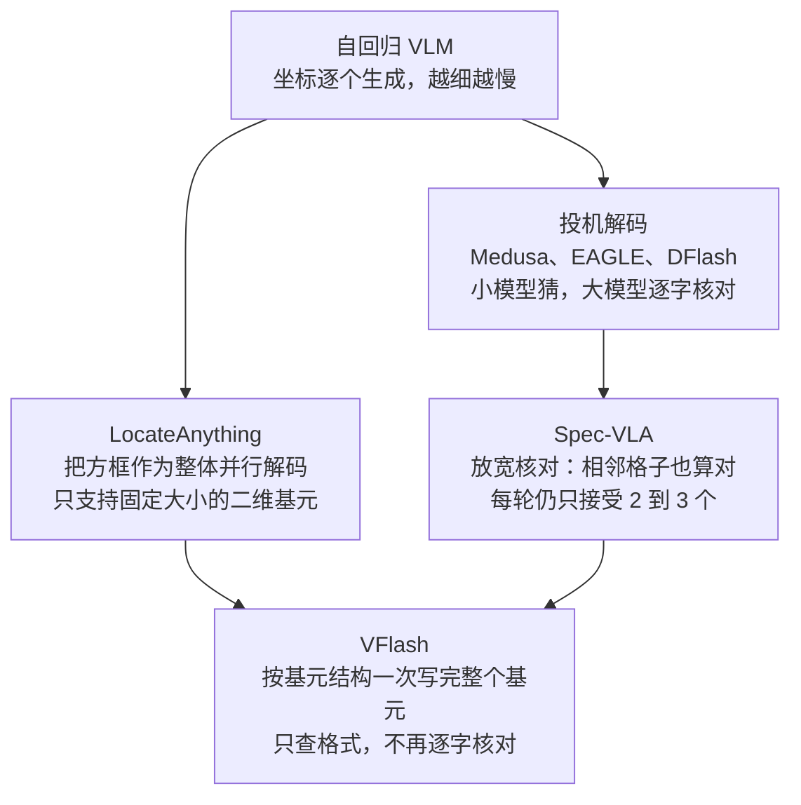
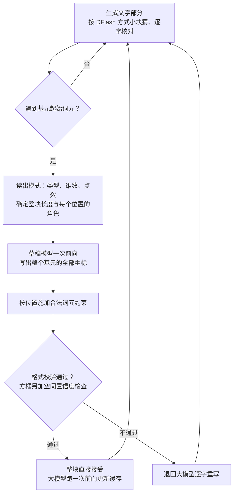
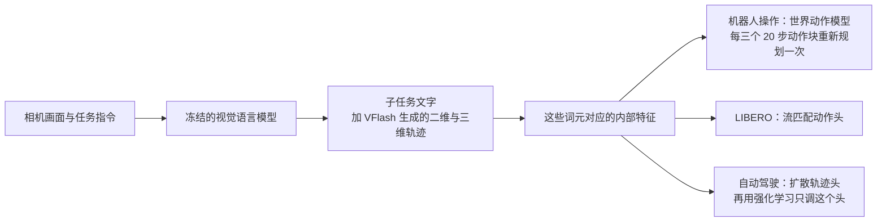

# VFlash：一次前向画出整条轨迹，让视觉规划又快又准

> **原题**：VFlash: Fast, Accurate Visual Planning via Flash Primitive Decoding
> **作者**：Yu-Cheng Chou、Shihao Wang、Jin Huang、Chi-Pin Huang、Chiao-An Yang、Xianzhe Fan、Jing Wang、Zhiqi Li、Yuanguo Kuang、Ruijie Zheng、Johan Bjorck、Sifei Liu、Hang Su、Abhishek Badki、Lei Zhang、Alan Yuille、Linxi "Jim" Fan、Jan Kautz、Zhiding Yu 等 19 人
> **机构**：论文页面没有列出机构。从作者名单和致谢看，主体是 NVIDIA 的研究团队，Alan Yuille 来自约翰斯·霍普金斯大学，这一点属于推断
> **年份**：2026（arxiv ID 2611.08449）
> **分类**：cs.RO / cs.CV
> **链接**：https://arxiv.org/abs/2611.08449
> **精读日期**：2026-11-06

## 阅读须知

### 这篇在领域里的位置

如今的机器人和自动驾驶系统，常把一个视觉语言模型当作「大脑」：它看图、读指令，然后告诉下游的动作模型该做什么。这个大脑不一定非用文字表达计划，它也可以直接画出来：在图上框出要抓的杯子，或者画一条机械臂末端该走的路线。这些框、点、轨迹，本文统称为「视觉基元」，用它们表达的计划叫「视觉规划」。

问题在于，视觉语言模型是一个字一个字往外吐的。一条十个点的三维轨迹，每个点三个坐标，再加上分隔符，就是几十个词元，要串行跑几十次前向。机器人上用的嵌入式芯片，跑一次前向就要三四十毫秒，一条轨迹画下来要一两秒，规划根本跟不上动作。

加速语言模型生成，最常见的办法是「投机解码」：先让一个小模型一口气猜好几个词，再让大模型一次检查。本文在这条路上往前走了一步：既然轨迹的格式事先就知道，那就让小模型一次把整条轨迹全猜出来，而且不再让大模型逐字核对，只检查格式对不对。

有意思的是，这篇论文和几天前读的那篇 System-1 论文用了同一个说法。作者把这种「快速、结构化地给出空间预测」的能力称作视觉规划的 System-1 模式，还引用了同一款名为 Jev 的商业产品。

### 读完能回答什么

1. 投机解码是怎么加速的？为什么它在生成坐标时效果大打折扣，每轮只能接受两个词元左右？
2. VFlash 的「基元闪解码」凭什么能一次前向写出几十上百个坐标词元？
3. 为什么一个只有五层的小草稿模型，画出的三维轨迹反而比它所依附的 40 亿参数大模型更准？
4. 不再逐字核对，会在什么地方出问题？方框预测为什么必须保留「退回逐字生成」的后路？
5. 在嵌入式芯片上，整套系统快了多少？下游机器人操作的成功率提升，有多少能归功于更好的规划？

### 阅读前置

本文假定读者了解 Transformer 和自回归生成的基本原理，知道「前向计算」「键值缓存」是什么，也大致知道视觉语言模型如何把图片和文字一起输入。

本文不假定读者熟悉投机解码、扩散语言模型或机器人策略模型的细节。这些都会在首次出现时先铺垫再展开。

### 缩写表

| 缩写 | 全称与含义 |
|---|---|
| VLM | Vision-Language Model，视觉语言模型 |
| AR | Autoregressive，自回归：一个词元接一个词元地生成 |
| 投机解码 | Speculative Decoding：小模型先猜若干词元，大模型一次并行检查，接受猜对的部分 |
| DFlash | 一种用小型块扩散模型当草稿模型的投机解码方法，本文的直接前作 |
| FPD | Flash Primitive Decoding，基元闪解码，本文的核心方法 |
| 视觉基元 | 方框、二维或三维轨迹、点的运动等结构化空间输出 |
| WAM | World Action Model，世界动作模型：把视频预测模型改造成输出机器人动作的策略 |
| ADE / FDE | Average / Final Displacement Error，轨迹各点的平均误差与终点误差 |
| SR@5 | 落在真实位置 5 厘米以内的轨迹点所占比例 |
| PDMS / RFS | 自动驾驶基准 NAVSIM 与 Waymo 的综合评分 |
| Jetson Thor / DGX Spark | NVIDIA 的机器人嵌入式平台与桌面级 AI 主机 |

## 一、问题

想象一个机械臂要把杯子放进抽屉。上层的视觉语言模型先看图，说出子任务「打开抽屉」，再画一条机械臂末端的三维轨迹，最后交给下游的动作模型去执行。场景每变一次，规划就要重画一次。

按自回归的方式画轨迹，每个坐标都要串行跑一次 40 亿参数的前向。论文实测，在 Jetson Thor 上每次前向 35 到 39 毫秒。以一条 84 个词元的驾驶轨迹为例（本笔记自行估算），光是解码就要三秒左右。在这样的延迟下，机器人只能画粗糙的计划，或者很久才更新一次。

### 1.1 投机解码为什么在坐标上不灵

先铺垫投机解码的原理。大模型每生成一个词元都要跑一次完整前向，而小模型便宜得多。于是让小模型先一口气猜出后面几个词元，大模型再用一次前向同时检查这些猜测，从第一个猜错的位置截断，前面猜对的部分全部接受。只要小模型猜得准，大模型就能一次「走」好几步。

DFlash 更进一步，用一个小型扩散模型当草稿模型，一次前向就能猜出一整块。但它仍然沿用「猜错一个就截断」的规则。这条规则对文字合理，对坐标却很苛刻：草稿模型把坐标写成 512，大模型想的是 513，几何上只差一格，可按规则就算猜错，后面的全部作废。

论文在机器人任务上量出了这个落差：DFlash 在生成子任务文字时，平均每轮能接受 5.5 个词元；到了轨迹坐标，每轮只剩 2.2 个。整体只能把解码时间砍掉一半左右。

### 1.2 前人的路线

LocateAnything 已经发现方框可以整体并行生成，但它只处理大小固定的二维方框。Spec-VLA 想到了放宽核对，坐标落在相邻格子也算对，可它仍然逐个核对，每轮只接受两到三个词元。VFlash 把两者推到底：按基元的结构整块生成，而且整块直接接受。

## 二、方法

### 2.1 关键观察：基元的格式事先就知道

这是整篇论文的出发点。一个方框永远是四个数：左上角的横纵坐标、右下角的横纵坐标。一条十个点的三维轨迹，就是十组三个数，夹在固定的开始与结束标记之间。也就是说，只要知道要画的是什么基元、有多少个点，整块输出每个位置该放什么，在生成之前就已经确定了。

论文把这些信息称作「模式」（schema），包括基元类型、坐标维数和长度。长度可变的基元，比如轨迹，由模型先发出一个工具调用来声明点数。模式确定后，输出块的长度和每个位置的角色就都定了。

| 基元 | 输出格式 |
|---|---|
| 方框 | 〈box〉u1 v1 u2 v2〈/〉 |
| 二维加三维轨迹 | 〈2D〉(u v) × P〈/〉〈3D〉(x y z) × P〈/〉 |
| 稠密点运动 | 每个查询点若干位数字组成的固定宽度格子，重复 P 次 |

### 2.2 基元闪解码

有了固定格式，就能把整个基元当成一个生成单位。草稿模型拿到大模型若干层的特征，以及基元的起始词元，把后面所有位置先全部遮住，然后在一次双向的前向里，同时预测出每个位置的坐标。块的长度由基元本身决定，不再是固定窗口。

这里有两个对齐原则。边界对齐：一个块恰好覆盖一个完整的基元，不会把一条轨迹切成两半。位置对齐：块里每个位置的角色事先确定，是第几个点的哪个坐标，还是分隔符。位置对齐让模型可以在生成时对每个位置施加约束，比如坐标位置只能出现坐标词元，这些约束直接作用在已经算好的分数上，不增加额外的计算。

坐标的写法也要配合。论文的基座模型给每个坐标准备了 1,001 个专用词元，一个坐标恰好占一个位置。对于用普通数字文本写坐标的模型，作者给每个坐标固定一个符号位加五个数字位，高位不够就用遮罩填充，生成后再还原成原来的文本格式。

### 2.3 训练：学真实标注，而不是学大模型的输出

传统投机解码的草稿模型，学的是「大模型接下来会写什么」，目标是和大模型一模一样。VFlash 反其道而行：先把大模型在空间任务上微调好、冻结，再训练一个五层的非因果草稿模型，训练标签直接来自人工标注的真实坐标，而不是大模型的输出。

损失函数对一个基元里的每个位置一视同仁。传统做法会给靠前的位置更高的权重，因为只要前面错一个，后面都会被截断；VFlash 整块接受，后面的位置同样重要。

这个设计的含义是：VFlash 不再保证输出和大模型一致，它追求的是空间上更准。论文把这称作「无损」和「有用」的区别：文字部分仍然逐字核对、保持和大模型一致，空间基元则只看画得准不准、对下游动作有没有用。

### 2.4 速度从哪里来

按论文的式子，自回归方式每个坐标要一次大模型前向；VFlash 每个基元只需要一次草稿前向，加一次用于更新缓存的大模型前向。两次前向的耗时会随基元长度略有增加，但次数不变，所以计划画得越细，相对收益越大。

## 三、实验

论文的基座是作者自己定制的 40 亿参数具身视觉语言模型，由 Qwen3-4B 加 MoonViT 视觉编码器组成。为了做干净的对比，每个任务都先把自回归模型在该任务数据上微调好，再在同样的数据上训练草稿模型。表中的「自回归」和「VFlash」共用同一个大模型，只差解码方式。

### 3.1 视觉基元本身准不准

| 任务 | 自回归 | VFlash | 变化 |
|---|---|---|---|
| 二维轨迹，VABench-V，Hausdorff 距离 | 0.125 | 0.116 | 误差降 7% |
| 三维轨迹，AgiBot，平均误差（米，仅三维） | 0.083 | 0.042 | 误差降约一半 |
| 三维轨迹，AgiBot，5 厘米内的点（二维加三维） | 40% | 74% | 大幅提升 |
| 方框，Dense200，平均 F1，直接接受 | 60.10 | 39.09 | 掉了约 20 分 |
| 方框，Dense200，平均 F1，带退回机制 | 60.10 | 61.78 | 持平略高，快 2.6 倍 |
| 稠密点运动，DAVIS，平均误差（米） | 1.227 | 0.893 | 误差降 27% |
| 稠密点运动，WorldTrack，终点误差（米） | 0.261 | 0.300 | 误差升 15% |

这张表里最反直觉的是三维轨迹。一个只有五层的草稿模型，画出的轨迹比它所依附的 40 亿参数大模型准得多：只预测三维时平均误差降 18% 到 49%，同时预测二维和三维时降 28% 到 61%。

论文给出的线索是：大模型一旦要先写二维坐标再写三维坐标，三维部分的误差就会比只写三维时高出 15% 到 51%，大概是因为一长串坐标逐个生成，前面的小偏差会一路累积。VFlash 一次并行写出两段，没有这种累积，所以加不加二维几乎不影响三维精度。再加上草稿模型直接学的是真实标注，而不是模仿大模型，它反倒绕开了大模型的毛病。

方框则是另一面。不加任何检查、直接接受草稿模型的方框，在拥挤场景里平均 F1 掉了 20 分。必须加上置信度检查，把可疑的方框交回大模型逐字重写，才能保住精度。这说明「只查格式就接受」并不是放之四海而皆准。

稠密点运动的结果也是有好有坏：DAVIS 上误差明显下降，WorldTrack 的终点误差却上升了 15%，三个数据集上「轨迹点落在阈值内的比例」都低了 7% 到 12%。

### 3.2 下游任务

下游实验里，视觉语言模型始终冻结，动作模型通过交叉注意力读取它生成计划时的内部特征。三类任务用的动作模型各不相同，但接法一样：

| 下游任务 | 对照 | VFlash |
|---|---|---|
| MolmoSpaces 机器人操作，平均成功率 | 原版世界动作模型 62.6% | 70.2% |
| 同上，改用自回归画的计划 | 61.0% | 70.2% |
| LIBERO-PRO（加扰动的操作基准） | 冻结的 Qwen3-VL-4B 作条件 | 高 6.8 个百分点 |
| NAVSIM 自动驾驶综合分（强化学习后） | Qwen-Drive-1.0-RL 90.7 | 90.7 |

MolmoSpaces 那一行需要小心解读。基线是原版的世界动作模型，用的是它自带的文本编码器；VFlash 那一列把编码器换成了作者自己的视觉语言模型，再加上生成的计划。两者差的不止是规划的快慢。

更有说服力的是同一个表里的消融：同样的动作模型、同样的计划格式，只把计划从 VFlash 画的换成自回归画的，成功率从 70.2% 掉到 61.0%，甚至比原版基线还低。这说明计划本身的质量很关键，画得不准的计划反而会拖累动作模型。

### 3.3 速度

| 平台 | MolmoSpaces 每步延迟缩短 | NAVSIM 每步延迟缩短 |
|---|---|---|
| Jetson Thor 与 DGX Spark | 5.1 到 5.2 倍 | 3.4 到 3.6 倍 |
| H100 | 3.6 倍 | 2.6 倍 |

提速几乎全部来自解码这一环。在 Thor 上，自回归解码占每一步时间的 75% 到 87%，VFlash 把这一环压缩了 12 到 42 倍，图像编码和动作模型的耗时不变。驾驶轨迹从 36 个词元增加到 84 个，VFlash 的解码时间只从 72 毫秒升到 78 毫秒，计划画得更细几乎不额外花时间。

摘要里那个「约 25 倍」，来自稠密点运动任务的单次生成测时，作者自己也标注为初步测量。

## 四、局限

### 4.1 作者承认的局限

论文没有专门的局限一节。作者在多处给出了保留：25 倍的提速是初步的单次测时；方框的直接接受会明显掉精度，需要退回机制；稠密点运动上部分指标变差。结论里提到的未来工作，是在固定延迟预算下同时生成多种互补的基元，看能否进一步改善控制。

### 4.2 读者能看出的问题

第一，放弃逐字核对，就放弃了投机解码最大的保障。传统投机解码的卖点是「无损」：加速之后输出分布和大模型完全一样。VFlash 的空间基元只做格式校验，格式对就收，坐标是否合理、轨迹会不会穿墙，校验器并不管。方框在拥挤场景里掉 20 分，就是这种风险的直接体现。

第二，「解码」和「预测头」的界限变模糊了。VFlash 的草稿模型本质上是一个接在冻结大模型特征后面、用真实标注训练、一次输出整条轨迹的小网络，这和机器人领域常见的回归头或扩散动作头相当接近。论文没有和「直接在大模型特征上训练一个轨迹回归头」这类更朴素的方案对比，只在稠密点运动上比了一个流匹配变体。草稿模型比大模型更准，部分可能正是因为它就是一个专门的预测头。

第三，「通用解码框架」与「逐任务训练」之间有落差。为了做干净的消融，每个任务都单独微调了大模型、单独训练了草稿模型。一个草稿模型能否同时服务多种基元和多种任务，论文没有给出直接证据。

第四，下游比较存在混杂。MolmoSpaces 的主结果同时换了编码器又加了计划，提升不能全部归功于 VFlash；各项成功率也没有报告方差或多次运行的区间。

第五，大量结论建立在作者自己定制的基座模型和自己选的评测上，对比的自回归基线也是同一个模型，外部模型只作为参考行出现。换成别家的视觉语言模型，三维轨迹「草稿比大模型更准」的现象能否复现，还需要验证。

## 值得跟读

1. **DFlash**（Chen et al., 2026）：用块扩散草稿模型做投机解码，是 VFlash 的直接前身。
2. **LocateAnything**（Wang et al., 2026）：把方框当作整体并行解码，VFlash 的方框置信度检查也沿用它的做法。
3. **Spec-VLA**（Wang et al., 2025c）：在机器人动作词元上放宽核对的投机解码，是与本文最接近的对照思路。

## 一句话

按已知格式一次写出整条轨迹、不再逐字核对，三维轨迹更准，机器人每步延迟降到五分之一。
