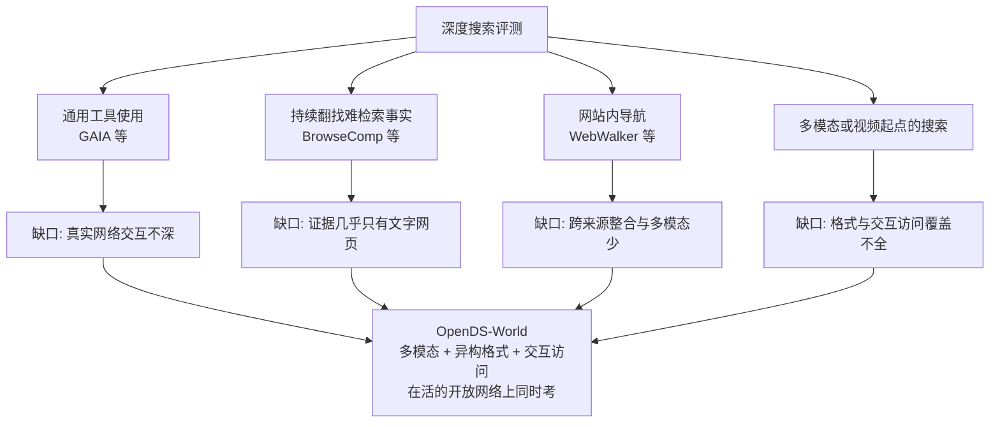
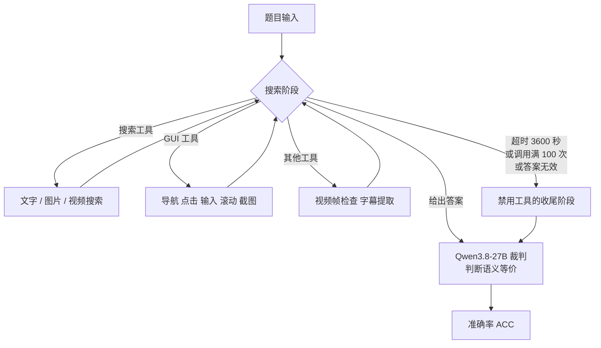
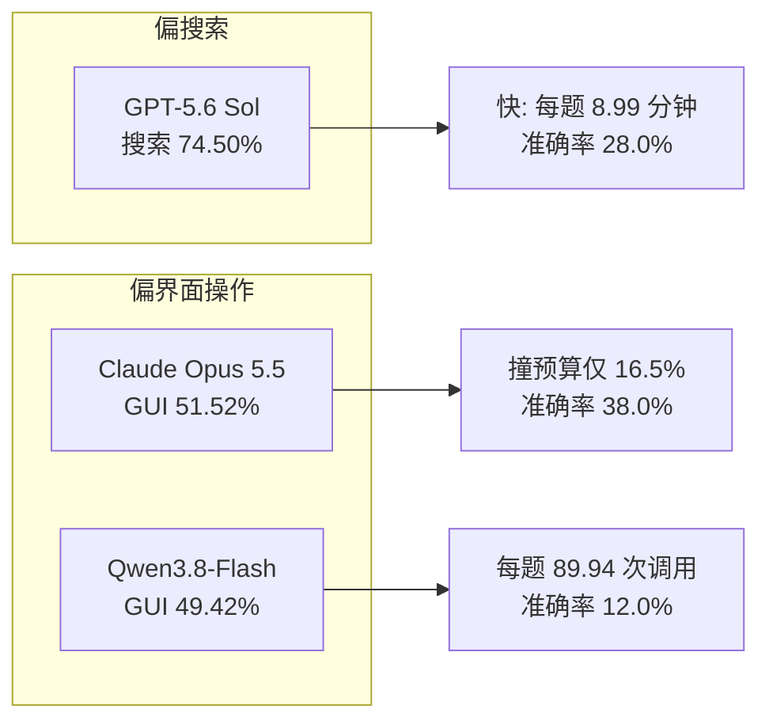

# 真实网络环境中的深度搜索：OpenDS-World 基准

> **原题**：Deep Search in Real-World Web Environments
> **作者**：Xiaomin Yu, Hongliang Chen, Zhe Huang, Shilin Yan, Shao-Rong Su, Xuqiao Ma, Feiyang Wang, Jiayu Chen, Jiwei Fang, Yu Yan, Yini Huang, Chen Chen, Ruoxi Cheng, Yuzhi He, Yuhui Zhang, Xiaoxing Hu, Chen Liu, Jianbo Lin, Yijiang Li, Xiaobin Hu, Menglong Li, Zhuoran Lu, Weishi Wang, Zhongqi Yue, Chengwei Qin
> **机构**：摘要页未列出
> **年份**：2026（arxiv ID 2610.30181，2026 年 10 月 19 日提交）
> **分类**：cs.IR / cs.MM / cs.SE
> **链接**：https://arxiv.org/abs/2610.30181
> **精读日期**：2026-10-23

## 阅读须知

### 这篇在领域里的位置

这篇论文属于「智能体评测基准」这一类工作，具体落在「深度搜索」（Deep Search）这个分支上。所谓深度搜索智能体，指的是一种由大语言模型驱动、能够自己调用搜索引擎和浏览器、一步步找证据并最终给出答案的系统。过去两三年里，这一方向的评测大致经历了三个阶段：最早是在固定语料上做多跳检索问答，随后出现了 GAIA 这类把工具使用和推理结合起来的综合题，再往后是 BrowseComp、WebWalker 一类专门考察「在网上持续翻找难以检索的事实」的基准。

这些基准各自抓住了一个侧面，然而真实网络的困难往往是几个侧面叠在一起出现的。于是这篇论文提出 OpenDS 任务和配套的 OpenDS-World 基准，要求智能体在真实、在线、未经裁剪的开放网络里，同时应付多种模态、多种文件格式和需要交互操作才能拿到的证据。换句话说，它把前人分开考的几门课合成了一张卷子，并且坚持在活的网络上考。

### 读完能回答什么

1. OpenDS-World 和 BrowseComp、GAIA 这类已有基准相比，多考了哪三样东西，为什么这三样要放在一起考。
2. 这 200 道题是怎样从一段视频出发、沿着证据链在网上扩展、最后「倒过来」改写成问题的。
3. 在统一的工具与预算下，12 个前沿模型的准确率分布如何，最好的模型为什么也只有 39.0%。
4. 人类在不准用任何大模型工具的条件下只有 21.1% 的准确率，这个数字应当怎样理解。
5. 工具调用失败只占调用次数的一小部分，却吃掉了大块执行时间，这对设计搜索智能体意味着什么。

### 阅读前置

本文假定读者熟悉大语言模型的基本用法，知道「工具调用」（tool calling，模型在生成过程中输出结构化指令去调用外部函数）是怎么回事，也大致了解检索增强生成的思路。读者未必专门做过网页智能体或信息检索评测，所以涉及这两个领域的术语都会先铺垫再展开。

### 缩写表

- **OpenDS**（Open-Web Deep Search，开放网络深度搜索）：本文定义的任务名称，指在真实开放网络中进行多步证据搜索与推理、最终给出唯一事实答案的问答任务。
- **OpenDS-World**：依照 OpenDS 任务构建的基准，共 200 道题。
- **GUI**（Graphical User Interface，图形用户界面）：本文中的 GUI 工具指能够点击、输入、滚动、截图的浏览器操作工具。
- **LLM**（Large Language Model，大语言模型）。
- **LLM judge**（大模型裁判）：用一个语言模型来判断被测模型的答案与参考答案是否语义等价，本文用的是 Qwen3.8-27B。
- **ACC**（Accuracy，准确率）：本文的主要指标，即答对题目的比例。
- **HTML / PDF / XML / Parquet**：常见的网页、文档、结构化标记和列式数据文件格式，本文用它们举例说明「异构格式」。
- **Wikidata**：维基媒体的结构化知识库，本文用它来保证每道题的起点实体是唯一可确认的。

## 一、问题

### 为什么这个问题值得做

今天的大模型产品几乎都带着一个「深度研究」按钮：用户提一个问题，系统在网上跑十几分钟，回来交一份带引用的报告。这类功能的价值完全取决于一件事，即系统在真实网络里能不能把证据找全、找对。一旦某条关键证据藏在一个需要点几下才展开的页面里，或者夹在一份 PDF 的表格中，或者只出现在一段视频的某一秒，系统就很容易漏掉它，然后用一个看似合理、实则错误的答案收场。对用户而言，这种错误比直接说「找不到」更危险，因为它带着引用，看起来可信。

过去几年，评测这类系统的主流做法是构造难检索的问题，再在网上或者固定快照里让模型去找。这条路线确实推动了进步，可它有一个越来越明显的盲区：题目里的证据大多是文字，大多来自普通网页，大多能被搜索引擎直接索引到。真实网络并不长这样。信息散落在图片、音频、视频里，藏在各种格式的文件中，还有不少必须通过翻页、填参数、拖动时间轴、调用查询接口才能拿到。只要评测回避这些情形，分数就会系统性地高估系统在真实场景中的能力。

### 具体要解决的技术问题

论文把上述盲区归结为三个相互纠缠的维度，并据此定义了 OpenDS 任务。

第一个维度是**多样的模态**。证据可能以文字、图片、音频或视频的形式出现，智能体需要从中读出信息，而不只是读网页正文。

第二个维度是**异构的格式**。证据可能存放在 HTML、PDF、XML、Parquet 等格式各异的资源里，每种格式都有不同的处理方式。论文统计，整个基准涉及 42 种不同的格式。

第三个维度是**交互式访问需求**。有些证据无法通过一次检索直接得到，而要靠交互操作才能取出，例如在页面之间跳转、给表单填参数、在视频里按时间定位、操作图形界面、发起结构化查询、下载文件。论文一共归纳了七种访问类型。

在这三个维度之上，OpenDS 任务的形式是一道事实问答题：题目有唯一、可验证的答案，智能体必须在活的开放网络里自主探索，从多个彼此独立的来源中发现并串联证据，最后给出这个答案。

### 前人路线及其不足

为了看清这篇论文站在哪里，可以把已有工作按「考什么」分成几条线。

一条线考的是**通用工具使用**，以 GAIA 为代表。它把推理、工具调用和少量网络检索混在一起出题，覆盖面广，但每道题对真实网络交互的要求不深，很多题在固定资源里就能解决。

另一条线考的是**持续翻找难检索事实**，以 BrowseComp 为代表。它的题目刻意设计成「答案容易验证、却很难找到」，逼着智能体反复改写查询、长时间浏览。它做对的地方是把搜索的持久性拉到了前台，不够的地方在于证据几乎全是文字网页。

还有一条线考的是**网站内部的导航**，以 WebWalker 这类工作为代表。它关心智能体能不能在一个网站里一层层点进去找到信息，抓住了交互的一面，却较少涉及跨多个独立来源的证据整合，也较少涉及多模态。

此外，近期也有一些多模态深度搜索和以视频为起点的工作，以及专门考察「未被索引的信息」的工作。论文的判断是：这些工作各自覆盖了某一个能力，而真实网络里的研究任务需要把信息发现、交互访问、资源处理和跨来源推理在多步过程中协调起来，这一点还没有基准系统地考过。

## 二、方法

这篇论文的「方法」主要是基准的构建方法和评测协议，而不是一个新模型。下面先讲题目如何造出来，再讲题目如何验证，最后讲模型在什么样的环境里作答。

### 题目构建的三个阶段

整个构建流程可以概括为「从一个真实锚点出发，沿证据在网上向外扩展，再把终点倒过来写成问题」。

**第一阶段：真实世界锚点。** 锚点就是一道题的起点实体。作者先从 8 个领域中挑出 500 段候选视频，要求锚点必须从视频的视听内容中才能识别出来。之所以这样设计，是为了堵住「只靠文字检索就能解题」的捷径：如果起点只能看视频、听声音才能认出，智能体就必须真正处理多模态内容。与此同时，每个锚点都要能唯一对应到 Wikidata 中的一个有效条目，以保证起点本身没有歧义。

**第二阶段：开放网络证据扩展。** 有了锚点之后，专业标注员用 Google 搜索构造查询，从锚点出发一步步找到下一个相关实体，形成一条证据链。这里有一个关键原则：每个新节点虽然是从某个具体来源发现的，但它的成立不依赖那一个来源，而必须能被网上多个独立来源分别印证。扩展一直持续，直到抵达一个唯一而稳定、适合作为参考答案的终点节点。

**第三阶段：问题倒置。** 终点节点成为参考答案。证据链上的中间节点不会在题目里直接写出来，而是各自被改写成一个间接的指代描述。于是，题目读起来像是一串谜面，智能体需要先解开第一个指代，才能找到下一步该查什么。

### 题目的验证

每道题都要经过十位独立审核员的核验。核验分两个方面：一是证据有效性，即证据链上的每一环是否真实成立；二是题目有效性，即题目是否表述清楚、答案是否唯一。审核员会拿网上更多独立来源去交叉核对。凡是存在事实错误、证据不足、关系不一致、题意含糊、参考答案不唯一或者违反构建原则的题目，一律剔除。

### 最终数据集的面貌

经过筛选，基准共有 200 道题，标注了 787 个网页条目，分布在 8 个领域：科学与社会各 33 题，日常生活 30 题，文化 27 题，自然 22 题，历史 19 题，经济与技术各 18 题。

从证据属性看，这套题确实把三个维度都压了上去。模态方面，99.5% 的题涉及文字，44.5% 涉及图片，35.5% 涉及视频，16.0% 涉及音频。格式方面，96.0% 的题至少涉及两种资源格式。访问方面，67.0% 需要在链接、页面或嵌套内容之间导航，60.0% 需要传输或下载文件之类的产物，47.5% 需要按时间定位，42.0% 需要通过填参数改变页面状态；而 95.5% 的题同时需要多种访问方式。

难度分级的方式比较特别：作者不是凭主观判断，而是看人类作答结果。每道题由五名人类独立作答，至少两人答对的算「低难度」，共 54 题；恰好一人答对的算「中难度」，共 61 题；无人答对的算「高难度」，共 85 题。

| 属性 | 比例或数量 |
|---|---|
| 题目总数 | 200 |
| 标注网页条目 | 787 |
| 涉及文字 / 图片 / 视频 / 音频 | 99.5% / 44.5% / 35.5% / 16.0% |
| 至少两种资源格式 | 96.0%（共 42 种格式） |
| 需要页面导航 | 67.0% |
| 需要传输产物 | 60.0% |
| 需要时间定位 | 47.5% |
| 需要参数化状态更新 | 42.0% |
| 同时需要多种访问方式 | 95.5% |
| 难度 低 / 中 / 高 | 54 / 61 / 85 |

### 统一的工具环境与执行协议

为了让不同模型的分数可以直接比较，所有模型都在同一套工具、同一个系统提示词和同样的预算下作答。

工具分三类。搜索工具负责文字、图片和视频搜索，用来定位可能的信息来源。GUI 工具负责网页导航、读取内容、点击、输入、滚动和截图，相当于让模型亲手操作浏览器。其他工具包括视频帧检查和字幕提取，用来处理视频证据。

预算有两条硬限制：每道题最多 3,600 秒，也就是一小时；所有工具合计最多调用 100 次。搜索阶段在三种情况下结束：超时、工具调用次数用完，或者模型给出答案。如果是前两种情况，或者模型没能给出有效答案，系统会进入一个禁用工具的收尾阶段，让模型根据已经掌握的信息给出最终回答。

评分用的是大模型裁判：Qwen3.8-27B 接收参考答案和被测模型的答案，判断两者在语义上是否等价。

## 三、实验

### 主要结果

作者在统一环境下评测了 12 个前沿模型。下表按总准确率排列，括号里是答对的题数，Token 一列是该模型在全部 200 题上消耗的 token 总量，单位为百万。

| 模型 | 总准确率 | 低难度 | 中难度 | 高难度 | Token（百万） |
|---|---|---|---|---|---|
| GPT-6 Astra | **39.0%**（78） | 59.26% | 40.98% | 24.71% | 187 |
| Claude Opus 5.5 | 38.0%（76） | 53.70% | 40.98% | 25.88% | 339 |
| Gemini 3.8 Flash | 36.5%（73） | 51.85% | 34.43% | 28.24% | 976 |
| Claude Fable 5.1 | 33.5%（67） | 48.15% | 32.79% | 24.71% | 481 |
| GPT-5.6 Sol | 28.0%（56） | 46.30% | 31.15% | 14.12% | 186 |
| Qwen3.8-Max | 25.5%（51） | 40.74% | 26.23% | 15.29% | 839 |
| GLM-5.3-Flash | 23.5%（47） | 42.59% | 16.39% | 16.47% | 389 |
| DeepSeek-V4.1-Flash | 20.5%（41） | 33.33% | 13.11% | 17.65% | 599 |
| Kimi K3 | 17.5%（35） | 27.78% | 14.75% | 12.94% | 310 |
| GLM-5.3（思考模式） | 13.5%（27） | 22.22% | 6.56% | 12.94% | 345 |
| DeepSeek-V4-Pro（思考模式） | 12.5%（25） | 27.78% | 11.48% | 3.53% | 297 |
| Qwen3.8-Flash | 12.0%（24） | 22.22% | 13.11% | 4.71% | 752 |

最好的 GPT-6 Astra 也只答对 78 题，在 122 题上失败，失败率 61.0%。前三名的差距很小，GPT-6 Astra、Claude Opus 5.5 和 Gemini 3.8 Flash 之间只差 2.5 个百分点。按难度看，12 个模型的平均准确率从低难度的 39.66% 降到中难度的 23.50%，再降到高难度的 16.76%。这说明用人类作答结果来分级是有效的：人做不出来的题，模型也普遍更难做出来。

### 人类基线

人类评测的设置相当严格。50 名参与者每五人负责同一组 20 题，200 题分成 10 个互不重叠的组，合计 1,000 次独立作答。作答者没有参与过他们所答题目的构建和筛选，只能用 Chrome 这类普通浏览器上网搜索，不准使用任何基于大模型的系统或工具。单题不限时，作答后要提交答案、所用时间，以及 0 到 5 的主观难度打分。

结果是：1,000 次作答里答对 211 次，准确率 21.10%。200 题中有 57.50% 至少被五人中的一人做出来，42.50% 无人做出，只有 14.50% 被多数人（至少三人）做出。人们平均每次作答花 38.8 分钟，每人完成 20 题平均用了 12.92 小时，中位数 9.44 小时，合计约 646 小时。主观难度均值 3.884，中位数 4，43.00% 的作答打了最高的 5 分。

### 反直觉的结果：模型分数高于人类

最显眼的一点是，最好的模型（39.0%）明显高于人类（21.1%）。这个对比需要谨慎理解。一方面，模型有并行搜索、快速读长文档、不疲倦的优势，在这种需要大量翻找的题上占便宜是合理的。另一方面，人类是在不准用任何大模型工具的条件下作答，而且题目的难度分级本身就是由人类结果决定的；也就是说，这个基准在构造上就偏向「人很难做」的题。因此，「模型超过人类」更准确的说法是：在没有 AI 辅助的普通网民面前，前沿模型的耐力和覆盖面已经占优，但距离可靠地完成真实网络研究仍然很远。

### 成本与准确率并不挂钩

另一个值得单独拎出来的结果是：花得多不等于答得好。Gemini 3.8 Flash 消耗了 976 百万 token，是 GPT-6 Astra 的五倍多，准确率却低 2.5 个百分点。Qwen3.8-Flash 平均每题调用工具 89.94 次，几乎撞满 100 次上限，准确率只有 12.0%。GPT-5.6 Sol 每题平均调用 52.42 次、只用 8.99 分钟，速度最快，准确率排第五；GPT-6 Astra 每题平均调用 51.05 次、用 18.66 分钟，调用次数相近而耗时翻倍，准确率最高。DeepSeek-V4-Pro 每题平均 43.36 分钟，GLM 5.3 的中位耗时达 51.15 分钟，准确率都在 13% 左右。

### 何时停下：自然结束与撞上预算

论文把每次作答的结束方式分成「自然结束」（模型自己给出答案）和「撞上预算」（超时或调用次数用完）。强模型多数是自然结束：GPT-6 Astra 为 69.0%，GPT-5.6 Sol 为 65.0%，Claude Opus 5.5 为 60.5%。弱模型则大量撞上预算：Qwen3.8-Flash 只有 6.5% 自然结束，80.0% 撞上调用次数上限；DeepSeek-V4.1-Flash、GLM 5.3、DeepSeek-V4-Pro 撞上预算的比例分别是 78.0%、73.0%、72.5%。撞的是哪一条限制也因模型而异：Claude Fable 5.1、Kimi K3、GLM 5.3 分别有 28.0%、29.5%、41.0% 的题是单纯超时。

与此同时，自然结束并不等于答对。GPT-6 Astra 有 69.0% 的题是自己停下的，准确率却只有 39.0%，这意味着它有相当一部分题是自信地停下、给出了错的答案。作者把这称为「结束与正确之间持续存在的落差」。

### 工具失败的隐性代价

工具调用失败在次数上不多，在时间上却很贵。按模型不同，失败只占全部调用的 2.83% 到 9.42%，却占用了 19.27% 到 61.90% 的工具执行时间。以 GPT-6 Astra 为例，失败调用占 6.34%，却耗掉了 42.57% 的执行时间。原因不难理解：一次失败往往意味着页面加载超时、下载卡住或者交互操作没有响应，这些都要等到超时才算数。

失败之后怎么办，不同模型的习惯也不同。多数模型倾向于换一个工具：Claude Opus 5.5 约 83%、Gemini 3.8 Flash 约 81%、GPT-5.6 Sol 约 79% 的失败后选择切换工具。Kimi K3 和 GLM 5.3 则更常用同一个工具改参数重试，比例分别约 38% 和 37%。

### 工具使用的风格差异

各模型调用工具的构成差别很大。GPT-5.6 Sol 有 74.50% 的调用是搜索，GUI 只占 17.77%，是典型的「多搜少点」；Claude Opus 5.5 有 51.52% 的调用是 GUI 操作，更像亲手翻网页。模型还普遍有「连着用同一类工具」的倾向：Gemini 3.8 Flash 搜索之后接着搜索的比例达 84.63%，Qwen3.8-Flash 操作页面之后接着操作页面的比例达 84.97%。随着难度从低到中，所有模型的平均调用次数都在上升；从中到高，有的继续上升，有的持平甚至下降，后者往往意味着模型过早放弃。

## 四、局限

### 作者承认或在分析中点出的问题

论文没有单列「局限」一节，但在分析中点出了几处。其一，模型的排名随难度变化，部分模型在高难度题上几乎失效，例如 Qwen3.8-Flash 和 DeepSeek-V4-Pro 在高难度上只有 4.71% 和 3.53%。其二，自然结束与答对之间存在持续落差，模型普遍不擅长判断「什么时候该停」。其三，工具失败带来不成比例的时间开销，说明执行环境本身也引入了模型控制之外的低效。其四，对好几个模型来说，多数题目以撞上预算告终，这既可能说明预算偏紧，也可能说明模型搜索低效，论文没有把两者分开。作者把这些都表述为后续研究的机会，并提到这个基准可以为长程搜索和递归自我改进的研究提供基础。

### 读完能看出来的潜在问题

第一，**活的网络带来可复现性问题**。基准坚持在实时网络上评测，这正是它的价值所在，可网页会改版、视频会下架、接口会变化。今天能答对的题，半年后可能证据链断掉或者答案改变。论文强调了构建时的多源印证，却没有说明如何长期维护题目，也没有给出证据快照，后来者复现同样的分数会越来越难。

第二，**人类基线的可比性有限**。人类不准用大模型工具、单题不限时，而模型有一小时和一百次调用的硬上限，双方的条件差异很大。此外，难度等级由人类结果定义，「高难度」等于「五个人都没做出来」，这让人类分数在构造上就被压低。用「模型超过人类」来概括结论容易引起误读。

第三，**裁判模型的可靠性没有充分交代**。评分完全依赖 Qwen3.8-27B 判断语义等价。对于数字、日期、专有名词这类事实答案，大模型裁判通常可靠，但遇到格式差异或部分正确的答案时可能出现误判。论文的公开文本中没有看到裁判与人工判分一致性的报告。

第四，**题目起点全是视频**。为了堵住纯文字捷径，所有锚点都必须从视频的视听内容识别，这让「视频理解」成为每道题的第一道关卡。这样做有其道理，但也意味着基准的分数会在相当程度上受视频处理能力影响，与「在文字网页上做深度研究」这类常见使用场景的相关性需要另行验证。

第五，**规模偏小**。200 道题足以拉开模型差距，但前三名只差 2.5 个百分点，相当于 5 道题，置信区间会相当宽。论文报告的是单次运行的结果，没有看到多次运行的方差，排名的稳定性值得保留意见。

## 一句话

OpenDS-World 用 200 道从视频出发、跨多模态多格式且需交互取证的真实网络题，测得最强模型仅 39.0%。
