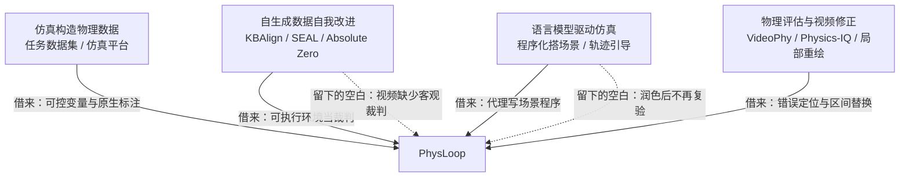
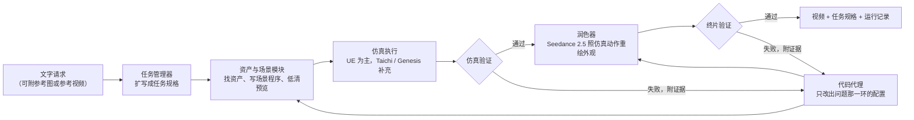
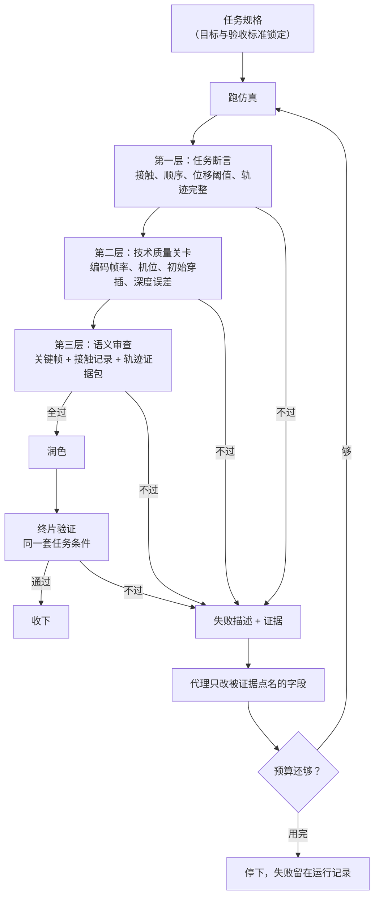
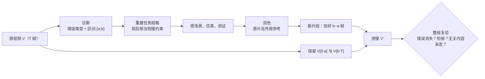
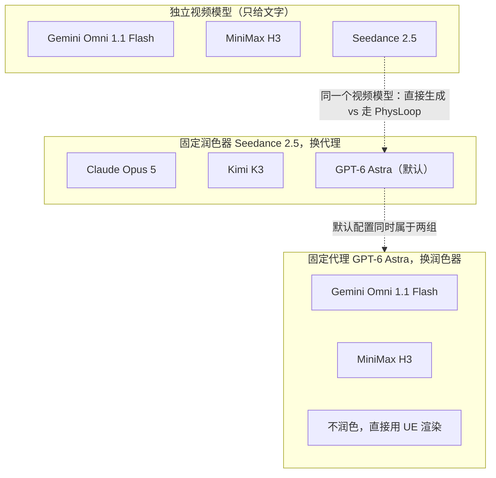

# PhysLoop：借大语言模型的物理常识，为视频生成模型造物理数据、修物理错误

> **原题**：PhysLoop: Harnessing LLMs' Physics Awareness for Self-Improving Video Generation Models
> **作者**：Yuxuan Chen、Xiaojie Li、Hao Chen、Juncheng Ma、Kewei Zhang、Zhongjing Du、Guoqiang Wei、Fangfang Wang、Zhen Dong、Zhiyang Dou、Liming Zhao、Yan Zeng、Jianwei Zhang、Daquan Zhou（通讯作者为 Jianwei Zhang 与 Daquan Zhou）
> **机构**：北京大学、字节跳动 Seed、加州大学圣塔芭芭拉分校、麻省理工学院、汉堡大学、杭州师范大学
> **年份**：2026（arxiv ID 2611.16748，2026-11-12 提交）
> **分类**：cs.CV / cs.AI
> **链接**：https://arxiv.org/abs/2611.16748
> **代码**：https://github.com/DAGroup-PKU/PhysLoop
> **项目页**：https://chenyx24.github.io/PhysLoop-site/
> **精读日期**：2026-11-15

## 阅读须知

### 这篇在领域里的位置

如今的视频生成模型已经能拍出相当逼真的画面。单看任意一帧，光影、材质与景深都挑不出毛病，镜头运动也连贯自然。然而一旦把视频从头看到尾，物理上的破绽就会露出来：杯子落地却没有碎，台球桌上平白多出一颗球，多米诺骨牌倒到最后却没有碰倒那只花瓶，下落的物体忽然像慢镜头一样飘着走。

过去两年，学界围绕「视频里的物理」做了几类工作。第一类是评测，专门出题考视频模型懂不懂重力、碰撞与因果，例如 VideoPhy 与 Physics-IQ。第二类是把物理仿真器接进生成流程，先在仿真里算出物体怎么动，再让视频模型照着这条轨迹画。第三类来自语言模型那边，研究模型怎样用自己生成的数据训练自己，也就是所谓的自我改进。

PhysLoop 站在这三条线的交汇处。它让一个大语言模型扮演工程师，在虚幻引擎里搭场景、跑仿真、检查结果，再把检查过的仿真视频交给视频模型润色成真实画面。作者把这套流程用在两件事上：一是成批造出物理上可信的训练视频，二是修补已有视频里的物理错误。

需要先说清楚的是，论文标题里的「自我改进」目前只做到了前半程。PhysLoop 造出了十万条视频，也证明了这些视频在物理上比视频模型直接生成的更靠谱，但论文没有用这批数据去训练任何一个视频模型。它把自己定位为通向递归自我改进的「质量控制部件」，而闭环本身留给了后续工作。

### 读完能回答什么

1. 为什么让视频模型多生成一些视频、再用视觉语言模型挑一挑，并不能给它提供可靠的物理监督
2. PhysLoop 为什么坚持「先仿真验证、后外观润色」的顺序，润色之后为什么还要再验一次
3. 验证器怎样把「这段视频物理上对不对」翻译成程序能够判定的断言
4. 在修片任务上，三个独立视频模型的成功率都不到 20%，PhysLoop 却能做到 86%，差距从哪里来
5. 标题说的「自我改进」实际做到了哪一步，离真正的递归自我改进还差哪些环节

### 阅读前置

本文假定读者在使用层面了解文生视频模型，知道给一段文字或一张参考图就能生成几秒视频。本文也假定读者知道大语言模型智能体的基本形态，即模型通过调用工具、读取工具返回的结果来一步步完成任务。

本文不假定读者用过游戏引擎或物理仿真器，也不假定读者熟悉 VBench、VideoPhy、Physics-IQ 这些视频评测。这些概念在正文第一次出现时，都会先交代它是什么、为什么需要它，再展开细节。

### 缩写表

- **LLM**（Large Language Model，大语言模型）：本文里承担「代理」角色的模型，默认是 GPT-6 Astra，对照组还有 Claude Opus 5 与 Kimi K3。
- **VLM**（Vision-Language Model，视觉语言模型）：能同时看图和读文字的模型，常被拿来给生成视频打分。
- **RSI**（Recursive Self-Improvement，递归自我改进）：模型自己找弱点、自己造数据、自己训练，再用更新后的自己开始下一轮的设想。
- **UE**（Unreal Engine，虚幻引擎）：Epic Games 的游戏引擎，本文用 5.7 版作为主仿真器与渲染器。
- **Taichi** 与 **Genesis**：两个开源物理仿真框架，本文用它们补充虚幻引擎不擅长的物理类型。
- **Harness**（外壳框架）：把模型套进去干活的那一层外壳，包括工具、流程、检查规则与运行记录。本文把 PhysLoop 称为一个 harness。
- **Refiner**（润色器）：一个以「参考视频」模式工作的视频生成模型。它拿仿真渲染出的视频当动作参考，只改外观、不改动作。默认是字节跳动的 Seedance 2.5。
- **Collision proxy**（碰撞代理体）：仿真里代替精细模型参与碰撞计算的简化几何体。
- **Meshy**：一个按文字或图片生成三维模型的在线服务。
- **PC**（Physical Commonsense，物理常识分）与 **SA**（Semantic Adherence，语义贴合分）：由 VideoPhy 项目的 VideoCon-Physics 评分模型自动打出。
- **IQ**（Imaging Quality，成像质量）与 **AQ**（Aesthetic Quality，美学质量）：由 VBench 评测套件自动打出。
- **P-IQ**（Physics-IQ Verified）：一个拿真实拍摄的物理实验视频做参照、看生成的后续画面与真实结果有多接近的外部基准。

## 一、问题

视频里的物理错误，往往比画质问题更难被容忍。画面糊一点，观众尚能接受；可一颗台球撞完之后凭空分裂成两颗，或者一杯水倒出来却在半空停住，整段视频立刻就失去了可信度。对于广告与影视，这意味着成片不能用；对于想把视频模型当作「世界模型」去训练机器人或做规划的团队，这样的错误更是根本性的，因为模型对世界的预测本身就是错的。

过去几年，主流的做法是继续加大数据量与模型规模。物理表现确实随之改善，但改善得并不稳定：同一个模型，这一次能把多米诺骨牌拍对，下一次就可能漏掉最后一块。之所以如此，是因为互联网视频里虽然到处都是物理现象，却没有任何标注告诉模型「这里发生了一次碰撞」「这里的速度应该变慢」，模型只能从海量画面里自己去猜规律。

要定向补强某一类物理行为，最直接的办法是专门准备一批训练视频，系统地覆盖这一类事件在不同条件下的样子。论文用一只下落的玻璃杯来说明难处：想要改变释放高度、初速度或者落点的地面材质，每一次都得重新布置实验；而两次实验之间难免还有别的东西也变了，于是很难分清结果的差异究竟来自哪一个因素。真实拍摄既难以扩大规模，也难以保证可控与可标注。

于是，人们自然会想到让视频模型自己造数据。可是这里有一个先决条件：必须有人能可靠地判断一段生成视频在物理上对不对。现有的视觉语言模型做这件事并不可靠，它们容易被好看的画面打动，又只能稀疏地看几帧，对随时间展开的物理错误往往视而不见。换句话说，多生成视频并不等于给模型提供了更好的训练数据。

### 具体要解决的技术问题

把上面的动机落到可以检验的技术目标上，论文要解决的是两个相互关联的问题。

第一个问题是**受控生成**。输入是一段描述物理事件的文字，有时附带参考图片或参考视频。输出要求是一段视频，其中被请求的事件确实发生，涉及的物体一个不多、一个不少，接触的先后顺序与最终状态都符合描述，同时画面看起来要像真实拍摄。此外，生成这段视频所用的全部配置都要记录下来，以便之后改一个参数再生成一个变体。

第二个问题是**局部修片**。输入是一段已有的生成视频，其中某一段时间里存在可以辨认的物理错误。输出要求是只替换出错的那一段，替换后错误消失，新片段与前后画面衔接自然，出错区间以外的内容一帧都不改。

这两个问题共享同一个底层需求：要找到一种办法，把「物理上是否正确」变成可以被程序判定、可以被追溯的信号。只有这样，生成或修好的视频才能被放心地拿去当作训练数据。

### 前人的几条路线

**第一条路线是用自生成数据做自我改进。** 在语言模型领域，KBAlign 与 SEAL 让模型用自己生成的数据来适配新知识，Absolute Zero 则让模型自己出题、自己解题，并靠可执行环境来验证题目与答案。后者的启发在于，只要有一个能够执行并给出客观反馈的环境，自我改进就有了可靠的裁判。到了视频领域，已有工作用视觉语言模型的反馈来指导离线微调，或者在具身规划任务里收集成功轨迹再训练。这条路线的短板在于，视频的物理正确性恰恰缺少一个像代码执行那样客观的裁判。

**第二条路线是用仿真构造物理数据。** 一些数据集围绕稳定性、支撑关系、时序与因果推理来出题；另一些工作专门改变物体的隐含物理属性，看模型能否从运动中推断出来。还有可复用的仿真平台，能直接导出带标注的场景与多模态观测，甚至有工作把三维高斯资产、网格与流体放进同一个仿真里交互。这条路线做对了「可控」与「可标注」，但仿真画面与真实拍摄之间始终有一道外观上的鸿沟，题目集合也往往是固定的。

**第三条路线是让语言模型驱动仿真来生成物理视频。** 有的工作让语言智能体通过程序搭建场景并访问仿真器，有的用视觉反馈与物理约束修正语言模型生成的场景布局，避免物体互相穿透或悬空。在视频生成上，有人把仿真出的轨迹当作动作引导，也有人用带工具执行与验证的智能体规划来修正生成决策。这条路线与 PhysLoop 最接近，它留下的空白在于：仿真轨迹引导视频模型画出最终视频之后，最终视频是否还保留了仿真里验证过的动力学，往往无人再查。

**第四条路线是物理评估与视频修正。** 评测这一支把感知质量与物理行为分开打分，或者拿真实实验录像做参照，或者在时间轴上定位错误发生的时刻。修正这一支则有补全缺失区域的视频修复、按指定轨迹或光流控制运动的方法，以及针对文字与画面不一致做局部重绘的方法。这些方法各自提供了某种控制手段，但画面连贯、或者严格按给定轨迹运动，都不能证明物理上是正确的。



PhysLoop 的回答是，把物理仿真器当作那个客观的裁判。语言模型本身懂不少物理，但它把这些知识落到具体场景时并不稳定：每一个选择单看都合理，组合起来却可能得出错误的结果。既然如此，就不要让语言模型直接去「想象」视频，而是让它在一个可执行的物理环境里把事件搭出来、跑出来，由仿真器提供约束和可观测的结果，再由验证器对照任务要求逐条核对。

## 二、方法

### 整体：一个代理、五个部件、一份运行记录

PhysLoop 的输入是一段文字请求，可以附带参考图片或参考视频。输出是一段生成或修好的视频，外加它的任务规格与完整的运行记录。整个流程由一个代码代理来驱动，这个代理就是一个大语言模型，它通过调用外壳框架提供的工具来完成每一步。

外壳框架里有五个主要部件。任务管理器负责把用户请求转成任务规格；资产管理与场景生成模块负责找模型、搭场景；仿真执行模块负责跑物理；验证器负责检查结果；视频润色器负责把仿真画面变成真实画面。两次验证分别夹在润色的前后：仿真验证在润色之前，终片验证在润色之后。



### 第一步：把一句话请求扩写成任务规格

用户的请求通常很简短，比如「一只玻璃杯从桌上掉下来摔碎」。代理要做的第一件事，是把它扩写成一份任务规格，写明目标事件是什么、搭建时做了哪些假设、验证时要检查哪些条件。如果请求里没有说杯子从多高掉下、落在什么地面上，代理就必须自己选定，并把选择写进规格。

之所以要把假设和预期结果写在同一份规格里，是为了让后面的搭建与验证指向同一个任务。在生成评测集里，每道题的成功条件都写得很具体：要点名出现哪些物体、发生哪些关键接触、事件按什么顺序发生、最终停在什么状态。

### 第二步：找资产、搭场景、先看一眼

场景里的三维模型有三个来源：导入本地资产库的商业授权素材包、Poly Haven 上以 CC0 协议公开的环境贴图与材质，以及在资产库里找不到合适物体时用 Meshy 现场生成的模型。每个物体都会记录它的来源与授权等级。

在搭场景之前，外壳框架会先检查资产的尺寸与碰撞几何是否适合目标交互。这里有一个关键设计：外观用的精细网格与物理用的碰撞代理体分开处理。一只玻璃杯可以保留带有精细花纹的渲染网格，而决定它怎样与地面接触的则是一个单独的简化形体；一个敞口漏斗则配一个与可见内壁贴合的连续锥形碰撞壳。

接下来，代理写一段场景程序，把资产与程序化生成的几何体组合起来，规定每个物体放在哪里、彼此是什么关系。以下落的玻璃杯为例，程序只负责设定释放位置和撞击面，之后杯子怎样运动由物理求解器计算。场景程序也可以把同一个事件放进不同的环境，或者拼出资产库里没有的结构。

正式仿真之前，外壳框架会从每个计划中的机位渲染一张低分辨率预览图，用来检查物体有没有放错位置、关键的交互区域有没有被遮挡。如果发现问题，代理就调整布局或机位，再预览一次，直到满意才进入完整仿真。

### 第三步：仿真执行与多视角采集

虚幻引擎是框架里的主仿真器与渲染器，Taichi 与 Genesis 用来补充其他类型的物理。三者之间靠仿真适配器连接：适配器把场景配置翻译成各个仿真器能接受的输入，再把算出来的运动传回虚幻引擎，坐标系与时间轴都对齐。

多个机位共享同一条仿真时间线。除了彩色画面，框架还同时采集深度图与实例分割图，并记录每个物体的状态以及仿真器给出的接触与事件信号。每一帧都和它对应的仿真时刻、机位参数绑定，物理步进频率与渲染帧率分开存储，因此验证时可以把画面上看到的行为与背后的物理状态一一对上。

### 第四步：三层仿真验证

「仿真跑完了」并不等于「请求的事件发生了」。验证器的职责，就是拿仿真状态与画面观测去对照任务规格里预先写好的要求。论文附录把仿真阶段的验证分成三层。

**第一层是任务断言。** 任务规格里声明了一组机器可以检查的断言，内容包括：指定的两个物体之间是否发生了接触、接触了几次、先后顺序如何；某个物体的状态值或状态变化是否超过阈值；轨迹是否完整；需要的画面与状态文件是否齐全。接触的证据有两个来源，一是仿真器在可用时给出的碰撞事件，二是带方向的包围盒之间的距离测试，容差为 4 厘米。

以附录里的水车任务为例：一颗钢球从短滑道落下，砸中六叶水车的一片叶子，水车转动，另一片叶子把一颗彩色小球推下支架，小球顺着坡道滚进篮子。对应的断言写成这样：

```
event_exists: contact(drive_ball, blade_3)
event_exists: contact(blade_1, second_ball)
state_delta:  Δx(second_ball) ≥ 0.45 m
trajectory_integrity
artifact_complete
```

**第二层是技术质量关卡。** 这一层与具体任务无关，只检查技术上有没有出错：视频的编码、帧数与帧率是否正常；每个机位是否只按声明的方式移动；初始场景里有没有意外的接触；编译出来的物体摆放是否与仿真开始前的状态一致。如果有深度参照，还要求原生深度与声明的支撑面吻合，平均绝对误差不超过 1 厘米、95 分位误差不超过 2 厘米；关节在初始姿态下的位置误差要在 2 毫米以内、角度误差要在 0.1 度以内。

**第三层是语义审查。** 审查者拿到一份证据包，里面有每个机位按事件挑出的关键帧、接触记录、抽样的轨迹与约束状态，以及质量关卡的结果，再对照任务条件逐条核对。正文还提到，守恒检查会把外力、能量耗散与数值误差考虑在内。论文没有明确写出这位审查者是另一个模型还是人，从上下文看应是由模型担任，人只在需要时参与。

### 第五步：润色与终片复验

仿真验证通过之后，才轮到外观润色。润色器是一个视频生成模型，默认用 Seedance 2.5。它拿到三样东西：验证过的仿真视频作为动作参考，任务描述，以及规定目标外观的参考图。它的任务是保留仿真里的一切运动，只把画面换成真实拍摄的质感。

附录给出了水车任务的润色提示词，其中的「共同约束」一段很能说明设计意图：只能以参考视频为唯一的动作来源；所有物体的数量、身份、初始位置、轨迹、速度变化、接触时机与最终状态都要保持；只改场景、外观与材质；不许增加、复制、合并或删除物体，不许打乱或重复事件。

然而视频模型并不总是听话，润色可能悄悄改掉已经通过仿真验证的运动。因此润色之后还有一次终片验证，验证器拿同一套任务条件去检查润色后的视频，确认目标事件与物理关系在可见画面里依然成立。

### 失败了怎么办：带证据的回退

无论是仿真验证还是终片验证失败，验证器都会返回一份失败描述，附上仿真或画面上的证据。代理根据这份反馈和历史记录，回到出问题的那一环去改配置。如果是该发生的碰撞没有发生，可能要改场景或初始条件；如果是润色出了错，可能要换一组润色输入。

这里有一条很重要的纪律：在整个修改过程中，任务目标与验证标准保持不变。附录里的技能规则写得更直白，代理只能修改失败证据指向的那些配置字段，任务条件、验收规则与用量计数一律保留。这条规则防止了代理为了「通过」而悄悄放宽目标，比如把「小球滚进篮子」改成「小球滚向篮子」。

每个任务都在一份预算之内运行，预算限制了场景规格的修改次数、仿真器的启动次数、技术性重试次数以及墙钟时间。全部检查通过，或者某项预算用完，运行就结束；没能解决的失败会留在运行记录里。为了公平比较，PhysLoop 与独立视频模型在每个任务上最多都只能调用五次视频生成。



### 应用一：成批造训练数据

造数据时，代理会把任务相关的参数暴露在场景配置里，比如玻璃杯的释放高度与初速度。之后由代理或用户只改其中选定的几个参数、其余条件保持不变，就能得到同一个事件的不同实例。场景与机位也可以单独修改，同一次仿真还可以从多个机位分别渲染。

通过终片验证的视频与它的任务描述配成一对，作为视频生成模型的训练样本。每个样本都保留了生成它的配置，便于日后检查、扩展或重新生成。原始仿真渲染保留着同步的深度、分割与物体状态标注，但由于润色可能改动几何或物体位置，这些标注并不与润色后的视频逐像素对齐，所以论文把它们当作一份独立的资源，而不是润色视频的像素级监督。

附录列出了几类代表性的事件家族与它们的可变参数：

| 类别 | 代表事件 | 可变参数 |
|---|---|---|
| 刚体运动与接触 | 抛射、弹跳、滑动、滚动、台球碰撞 | 质量、初速度、摩擦、恢复系数 |
| 刚体机构 | 多米诺骨牌、单摆、牛顿摆 | 释放角度、约束长度、物体间距 |
| 弹性与可变形体 | 弹性体撞击、布料垂落、旗帜飘动 | 刚度、阻尼、杨氏模量、风速 |
| 磁相互作用 | 吸引与排斥 | 磁场模式、强度、初始间距 |
| 流体 | 容器间倾倒、溢出、涡旋 | 初始体积、释放高度、初始速度场 |
| 断裂 | 玻璃板与木箱受撞击 | 撞击物质量、发射速度、撞击位置、破坏阈值 |

参数网格的取值也很具体。例如斜面滚动与滑动的摩擦系数取 0.02、0.12、0.55 三档，牛顿摆的释放角取 25 度、35 度、45 度，玻璃板撞击的撞击物速度取每秒 1.5 米、3.0 米、5.0 米。由于参数一变，事件的时间与最终状态都可能跟着变，每个变体都保留各自独立的仿真时间线。

### 应用二：诊断与修片

修片时，代理先看一段已有视频，找出物理或事件层面的错误以及它发生的时间段，再规定要重建什么事件、替换哪一段。出错区间之前与之后的画面构成约束：它们决定了修正后的事件必须怎样与原片衔接，以及哪些内容必须原样保留。原片同时充当外观参考，告诉润色器重建出来的物体与环境应该长什么样。

替换只发生在原视频 $V$ 的一个区间 $[a,b)$ 里。这里 $V$ 一共有 $T$ 帧，$a$ 是替换起点，$b$ 是替换终点（不含）。新片段 $\hat{V}_{a:b}$ 的分辨率与帧率都与原片一致，帧数恰好是 $b-a$。最终输出按下式拼接：

$$V' = V_{0:a} \;\|\; \hat{V}_{a:b} \;\|\; V_{b:T}$$

其中 $\|$ 表示在时间轴上首尾相接。过渡处的融合只在替换区间内部进行，区间以外的原始帧完全不动，验证时还会逐帧解码确认它们没有被改。

如果错误已经改变了后面的事件，比如一颗本不该出现的球已经撞散了整个球堆，那么只换一小段是不够的。这时代理会重建整段视频，相当于 $a=0$、$b=T$，并在记录里注明用了哪种范围。

修好的片段要放回完整视频里评估，因为一段单独看起来合理的片段，仍可能与前后的事件互相矛盾。验证器检查三件事：目标错误是否被纠正，与前后画面是否衔接，无关内容是否保留；附录还补充了一条，即不能引入新的严重错误。



## 三、实验

### 数据与评测集

论文发布了一个训练集和两个评测集。**PhysLoop-100K** 是训练集，包含十万条通过验证的视频，来自 2,500 个不同的物理事件。平均每个事件有 40 条视频，从 3 到 5 个视角拍摄，覆盖 2 到 4 个可分多档设置的关键参数。

数据集的划分以事件为单位：同一个事件的所有视角与参数变体都分在同一边。这样做是为了避免同一个事件的不同视角分别出现在训练集与测试集里，造成评测虚高。

**PhysLoop-Gen** 是生成评测集，共 100 道题：68 道刚体题、12 道布料题、9 道流体题、11 道带参考图的题。题目难度按输入本身定义，即参与交互的物体数、必须发生的接触数、约束数与事件阶段数，而不是按某个模型做得好不好来定。

**PhysLoop-Repair** 是修片评测集，共 50 道题。原片由 Seedance 系列、MiniMax H3 与 Gemini Omni 1.1 Flash 生成，错误类型包括运动或接触失败、物体数量或身份改变、缺少支撑、事件顺序错误、材料反应不一致等。评测时只给原片和修片请求，错误位置与区间的标注只用于打分。

外部基准 **Physics-IQ Verified** 用的是真实拍摄的物理实验录像。模型要根据实验的前半段续写后半段，再看续写与真实结果有多接近。论文只做了单视角的诊断性评测：66 个案例，取左视角，取输出的前 120 帧，帧率每秒 24 帧。

### 比较的配置

论文一共比较了九种配置，每种在 PhysLoop-Gen 的 100 道题上各交一个最终结果，合计 900 条视频。它们可以分成三组来看。



### 指标

人工评测只在 PhysLoop-Gen 上进行。评分员看任务描述和一段视频，分别给物理合理性、视觉真实感、因果一致性打 1 到 5 分；另有两两对比，问评分员整体更喜欢哪一段，平局记半场胜利。任务是否完成单独判定：一道题只有在「通过」票严格多于「失败」票时才算完成，平局、无有效票或缺失输出都算失败。

自动指标作为辅助参考。物理常识分 PC 与语义贴合分 SA 由 VideoCon-Physics 在 32 帧抽样画面上打出；成像质量 IQ 与美学质量 AQ 由 VBench 在全部帧上打出。论文明确说，任务完成率是首要标准，人工评分是视频质量的主要依据。

### 主要结果

下表是人工评测与任务指标。物理、真实、因果三列是 1 到 5 分的平均，胜率、生成成功率、修片成功率是百分数，Physics-IQ 是基准分。

| 配置 | 物理合理 | 视觉真实 | 因果一致 | 胜率 | 生成成功 | 修片成功 | Physics-IQ |
|---|---|---|---|---|---|---|---|
| Gemini Omni 单独 | 3.11 | 3.82 | 3.18 | 18.94 | 49.00 | 14.67 | 31.66 |
| MiniMax H3 单独 | 3.63 | 4.27 | 3.55 | 44.93 | 53.00 | 18.00 | 28.14 |
| Seedance 2.5 单独 | 3.80 | **4.29** | 3.80 | 53.79 | 73.00 | 19.33 | 48.07 |
| Claude Opus 5 + Seedance 2.5 | 3.82 | 3.82 | 3.84 | 64.18 | 71.00 | 78.67 | **53.75** |
| Kimi K3 + Seedance 2.5 | 3.63 | 3.69 | 3.69 | 54.41 | 69.00 | 68.67 | 52.04 |
| GPT-6 Astra + Gemini Omni | 3.53 | 2.96 | 3.51 | 45.45 | 67.00 | 62.00 | 12.08 |
| GPT-6 Astra + H3 | 3.86 | 3.45 | 3.90 | 58.21 | 73.00 | 72.67 | 39.10 |
| GPT-6 Astra，不润色 | 3.94 | 2.59 | 3.95 | 34.33 | 80.00 | 60.67 | – |
| **GPT-6 Astra + Seedance 2.5（默认）** | **4.06** | 3.72 | **4.12** | **75.76** | **85.00** | **86.00** | 52.06 |

下表是自动指标，四列都已换算成百分制。

| 配置 | PC | SA | IQ | AQ |
|---|---|---|---|---|
| Gemini Omni 单独 | 20.79 | 39.17 | 71.17 | 50.40 |
| MiniMax H3 单独 | 22.98 | 38.68 | 68.47 | 50.62 |
| Seedance 2.5 单独 | 21.51 | 38.69 | 67.63 | 50.63 |
| Claude Opus 5 + Seedance 2.5 | 20.23 | 36.69 | 67.66 | 49.71 |
| Kimi K3 + Seedance 2.5 | 19.90 | 37.32 | 68.54 | 50.42 |
| GPT-6 Astra + Gemini Omni | 12.71 | 35.84 | 75.11 | 46.72 |
| GPT-6 Astra + H3 | 17.48 | 37.12 | 68.77 | 48.65 |
| GPT-6 Astra，不润色 | 12.53 | 34.88 | 72.42 | 45.75 |
| GPT-6 Astra + Seedance 2.5（默认） | 15.29 | 36.28 | 69.93 | 48.70 |

### 怎样读这些数字

**生成任务上，默认配置把成功率从 73% 提到 85%。** 对照组是同一个 Seedance 2.5 直接生成，因此这 12 个百分点的提升可以归于「先仿真、后润色」这条流程本身。人工评分也印证了这一点：物理合理性从 3.80 升到 4.06，因果一致性从 3.80 升到 4.12。

**代价是视觉真实感下降。** 默认配置的真实感只有 3.72，而 Seedance 2.5 直接生成是 4.29。论文说差距主要体现在材质质感与背景上，也就是说，润色器在严格遵守仿真动作的同时，没能把画面完全拉回到直接生成的水准。

**修片任务上的差距最大。** 默认配置的修片成功率是 86%，三个独立视频模型都不到 20%，最好的 Seedance 2.5 也只有 19.33%。一次成功的修片要同时满足三个条件：纠正错误、保留原片内容、与前后衔接。独立视频模型很难把三者同时做到，而 PhysLoop 把这些要求写成了一个明确的重建任务，并对仿真结果和润色结果都做了检查。

**仅靠搭场景和仿真，就已经完成了大部分任务。** 不润色的配置在生成任务上已有 80% 的成功率，说明场景构建与仿真本身就能实现多数被请求的事件。加上 Seedance 2.5 润色之后，生成成功率再涨 5 个点，修片成功率从 60.67% 涨到 86%，真实感从 2.59 涨到 3.72。修片任务对润色的依赖之所以更大，大概是因为替换进去的片段必须在外观上与原片对得上，而虚幻引擎的原生渲染做不到这一点。

**润色器的选择影响很大。** 同样以 GPT-6 Astra 当代理，换成 H3 或 Gemini Omni 润色，两项任务的成功率都比 Seedance 2.5 低。Physics-IQ 上的落差尤其明显：H3 是 39.10，Gemini Omni 只有 12.08，而默认配置是 52.06。

**代理的排名在不同指标上并不一致。** 固定 Seedance 2.5 当润色器时，Claude Opus 5 在 Physics-IQ 上拿到了全场最高的 53.75，但它在生成与修片两项任务上都不如 GPT-6 Astra。论文的解释是，「完成了请求的事件」与「和一段真实录像的具体动态吻合」衡量的是两种不同的能力：一个合理的事件，未必与参照录像里那一次的具体过程相同。

### 值得单独拎出来的几个结果

第一个反直觉之处，是自动物理常识分与人工判断方向相反。默认配置的 PC 只有 15.29，低于所有独立视频模型；不润色的配置人工物理分高达 3.94，PC 却是全场最低的 12.53。论文的解释是，自动评分器可能偏爱视频生成模型常见的视觉风格，而且只看 32 帧抽样，难以察觉随时间展开的物理错误。这个现象本身就是对「用视觉语言模型给物理打分」这条路的一个反证，恰好支撑了论文的出发点。

第二个值得注意的地方，是外观对整体偏好的影响之大。不润色的配置人工物理分 3.94、因果分 3.95，与默认配置相差无几，可它在两两对比里的胜率只有 34.33%，比 Seedance 2.5 单独生成的 53.79% 还低。评分员在被要求综合考虑时，显然很难不被画面质感左右。

第三个结果说明，润色器不仅可能帮倒忙，而且会帮得很厉害。以 GPT-6 Astra 当代理时，不润色的生成成功率是 80%，换上 Gemini Omni 润色之后反而降到 67%。也就是说，有 13 道本来已经做对的题，被润色这一步改坏了。这正是论文坚持在润色之后再做一次终片验证的理由。

### 案例

论文用两个例子说明「局部动作看着合理」为什么不足以判断任务完成。在多米诺骨牌的例子里，H3 拍出了骨牌依次倒下，但最后那只花瓶没有倒，交互链条在最后一环断了；Seedance 2.5 则把要求的 S 形排列换成了一条直线，违反了空间上的规定。

在台球的例子里，Gemini Omni 凭空加了几颗球，Seedance 2.5 多出一颗白球，都改变了任务要求的物体集合。这些错误关乎事件结果与场景一致性，光看画面逼不逼真是判断不出来的。相比之下，PhysLoop 的原生渲染版与润色版都正确地拍出了球堆被击散的过程，两者只在材质与光照上有差别。

### 成本与耗时

论文在十道分层抽样的生成题上统计了 token 用量，代理为 GPT-6 Astra，润色器为 Seedance 2.5，失败的尝试与修改也都计入。十道题合计输入 1.9905 亿 token，其中 1.9653 亿是缓存命中的输入，输出 58 万 token（含推理 token）。视频生成与上传的费用十道题合计 42.99 美元。

论文给出了 GPT-6 Astra 每百万 token 输入 10 美元、缓存输入 1 美元、输出 50 美元的单价，但最终金额画在图里，正文没有列出。按这些数字自行推算，十道题的 token 费用约为 250.7 美元，加上视频费用约 293.7 美元，也就是每道题接近 30 美元。若换成单价更低的 GPT-5.6 Sol，同样用量下每道题约 14 美元。

耗时方面，仿真在一台 Apple M4 的 Mac mini（16 GB 内存）上用虚幻引擎 5.7 运行。不计场景构建，虚幻引擎仿真与渲染约需 2 到 6 分钟（20 条记录的中位数为 3 分 25 秒），低清预检约 3 分钟，Seedance 润色约 2 到 3 分钟（28 条记录的中位数为 2 分 13 秒），合计约 7 到 12 分钟。

## 四、局限

### 作者承认的

**覆盖面受限于仿真器、资产与验证条件。** 仿真器不擅长的物理类型、资产库里没有的物体、验证条件没有写到的错误，PhysLoop 都处理不了或者发现不了。

**修片需要猜测看不见的东西。** 从一段视频重建场景，必须对看不到的几何形状、材质与初始状态做出假设，所以一次有效的仿真未必还原了原视频里的物理过程。润色也可能引入新错误；而当错误已经改变了后续事件时，局部替换就不够用。这些限制决定了哪些视频能被接受为学习信号，模糊的情况可能仍需要人工审查。

**递归自我改进的闭环尚未完成。** 要真正形成递归自我改进，需要把发现弱点、生成候选、验证与修复、挑选数据、更新模型这几步连成一轮又一轮的循环，而且每一轮更新后的视频模型应当影响下一轮针对哪些失败、生成哪些候选。作者承认，这样的流程能否在没见过的事件上带来持续的提升，同时保住视频质量与数据多样性，还有待未来的工作来证明；独立评估、追踪错误质量判断的后果、控制仿真与训练的成本，也都是必须解决的问题。

**人工评测还只是试点。** 附录写明，用于报告的人工评测是 2026 年 10 月 19 日的一份试点快照，包含 2,565 条单视频评分与 855 条两两对比（其中 849 条有效）。900 条视频都至少有一份评分，但只有 630 条拿到了三份以上，尚未达到每条三份的目标；分配编号也不能当作独立评分员人数的可靠统计。

**Physics-IQ 的结果只是诊断性的。** 论文只用了单视角的 66 个续写，而不是三视角协议的 198 个。同时，部分变体是在看过测试反馈之后开发的，因此作者把这些分数定性为诊断结果，要等选择规则冻结之后才算正式成绩。两类路线拿到的输入也不同：直接续写的模型看到真实录像的前三秒，走虚幻引擎的路线则拿到切换帧与一段场景描述，由代理据此重建场景。

### 读完能看出来的

**标题里的「自我改进」没有被实验验证。** 论文的核心主张是把语言模型的物理知识「蒸馏」进视频生成模型，可全文没有一项实验用 PhysLoop-100K 去微调任何视频模型，也就没有证据表明这批数据确实能让视频模型的物理表现变好。现有实验证明的是另一件事：PhysLoop 这条流程本身产出的视频物理更准。这两件事之间还隔着训练这一步，而训练恰恰是最不确定的一环，因为这些视频带着润色器特有的外观，真实感又明显低于直接生成。

**胜率这一列的来源与正文描述不符。** 正文说人工评测由多名评分员完成，方法身份隐藏、呈现顺序随机。但主结果表的表注写明，胜率来自一位作者做的 301 次未设盲的补充两两对比，平局记半场胜利。在所有指标里，默认配置领先最多的恰恰是这一列（75.76% 对 53.79%），而它也是证据最弱的一列，读的时候应当打折扣。

**评测集由作者自己出题，题型偏向仿真器的长处。** PhysLoop-Gen 的 100 道题里有 68 道是刚体题，流体只有 9 道，布料只有 12 道，而刚体碰撞正是游戏引擎最拿手的。题目的成功条件写成「哪些物体、哪些接触、什么顺序、什么终态」，也与 PhysLoop 基于接触断言的验证方式天然契合。论文没有按题型分别报告成功率，所以无法判断它在流体与布料这类更难仿真的题上表现如何。

**修片的对照组不够强。** 修片任务只拿三个通用视频模型做对照，而这些模型本来就不是为「只改一段、其余不动」设计的，很可能整段重画，自然难以保留原片内容。相关工作一节提到了视频修复补全、基于诊断的局部重绘等专门的编辑方法，但实验里一个都没有比。86% 对 19.33% 的差距，有相当一部分来自任务形式与对照组能力的不匹配。

**语义审查这一层仍然可能回到「模型当裁判」。** 论文的出发点是视觉语言模型判断物理不可靠，但三层验证里的语义审查若由模型来做，它面对的依然是关键帧与记录，只是多了仿真证据作为依据。任务断言里的接触判定也只是几何推断：附录明确说，基于 4 厘米距离阈值的接触不是求解器给出的真实接触冲量。对于需要精确接触的任务，这个容差可能放过一些擦边而过的情形。

**成本与可复现性。** 按论文给的用量推算，每道生成题的花费接近 30 美元，耗时 7 到 12 分钟还不含场景构建。论文没有交代造十万条训练视频总共花了多少，不过同一事件的变体复用场景配置，单条成本应当低得多。另外，整套流程依赖闭源的代理模型与闭源的润色 API，资产里还有商业授权的素材包，即便代码与数据都已公开，旁人想要原样复现生成过程仍有门槛。

## 一句话

让大模型在游戏引擎里把物理事件演对、验过，再交给视频模型润色外观，用来造物理训练数据和修补视频里的物理错误。
