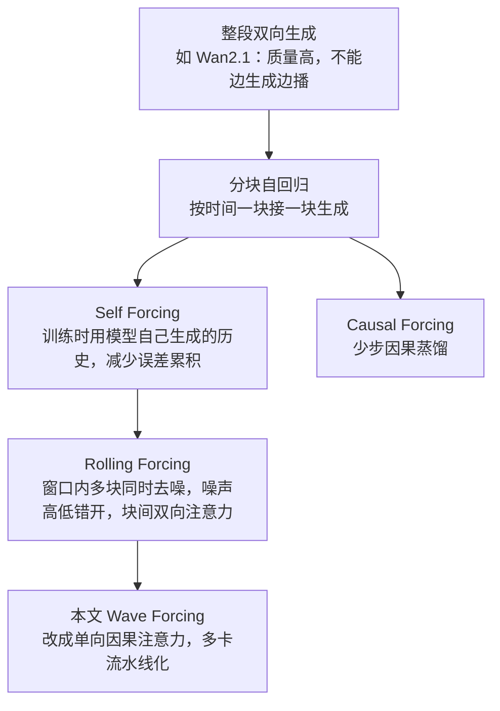
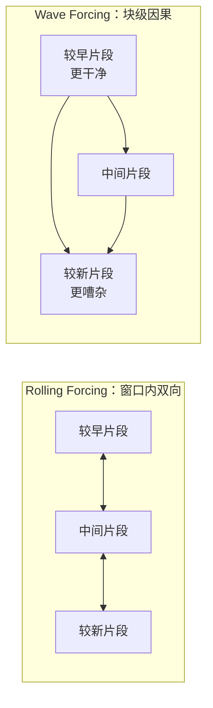
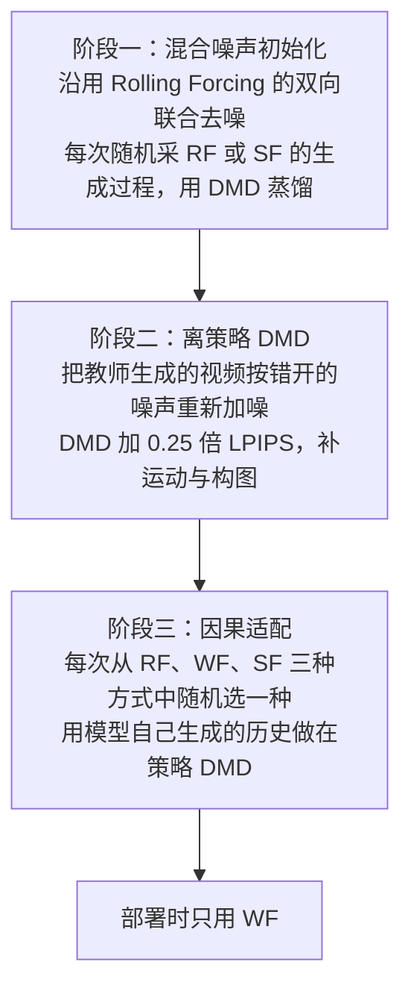
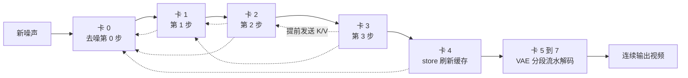

# Wave Forcing：让流式视频生成逼近理论极速

> **原题**：Wave Forcing: Towards Speed-of-Light Streaming Video Generation
> **作者**：Yijie Jin、Yuxuan Liu、Jiajun Xu、Ye Huang、Chuzhi Wang、Jiayang Li、Ruiyang Chen、Chenling Hong、Xu Wang、Zhijie Deng（通讯作者）
> **机构**：上海交通大学 DENG Lab 为主，另有西安交通大学、北京大学、华东师范大学、台湾清华大学的作者
> **年份**：2026（arxiv ID 2611.00859）
> **分类**：cs.CV / cs.DC
> **链接**：https://arxiv.org/abs/2611.00859
> **精读日期**：2026-11-03

## 阅读须知

### 这篇在领域里的位置

视频生成模型过去的主流用法是「一次生成一整段」：给一句提示词，模型把几秒钟的视频作为一个整体反复去噪，最后一起交出来。这种做法画面质量高，但不能边生成边播放，也做不了很长的视频。

近一年多，研究者开始把视频切成一小块一小块（下文称「片段」），按时间顺序一块接一块地生成，前面生成好的内容作为后面的条件。这条路线被称为「分块自回归」视频生成，代表工作有 Self Forcing、Causal Forcing 和 Rolling Forcing。它让视频可以像直播一样持续输出，也为将来的交互式世界模型打下基础。

这篇论文站在这条路线的最新位置上，关心的是一个工程味很重的问题：怎样让这种逐块生成跑得尽可能快。标题里的「Speed-of-Light」是 GPU 性能优化圈子的行话，指硬件与算法结构所允许的理论上限，不是字面意义上的光速。

### 读完能回答什么

1. 分块自回归视频生成为什么「哪怕只去噪一步，每出一块也要跑两次完整前向」？
2. 「1F1C」是什么意思？Wave Forcing 是怎样像流水线一样，让每一轮都产出一个片段的？
3. 为什么要把注意力改成「新片段只看旧片段、旧片段不看新片段」？这一改动带来了什么训练问题，又是怎么用三阶段训练补回来的？
4. 论文说 8 张 H200 上端到端每秒 134.8 帧，比单卡快 7.07 倍，这个数字是在什么条件下测的，又不能说明什么？
5. 波前并行和常见的 Ulysses、Ring 上下文并行有什么不同？为什么模型越大，它的优势越小？

### 阅读前置

本文假定读者了解 Transformer 的基本结构，知道注意力里的键值（K/V）缓存是什么，也大致了解扩散模型「从噪声出发、逐步去噪」的生成方式。

本文不假定读者熟悉视频扩散模型的具体架构，也不假定读者了解多 GPU 并行的各种切分方式。这些都会在首次出现时先铺垫再展开。

### 缩写表

| 缩写 | 全称与含义 |
|---|---|
| WF | Wave Forcing，本文方法：波前式分块视频生成 |
| WaveRT / WP | Wave Runtime / Wave Parallelism，本文的推理运行时及其并行方式 |
| SF / CF / RF | Self Forcing、Causal Forcing、Rolling Forcing，三种分块自回归视频生成方法，是本文的前作与对比对象 |
| 1F1C / NF1C | One Forward round, One Chunk：流水线填满后每一轮前向产出一个片段；NF1C 指每出一个片段要串行跑 N 轮前向 |
| store | 本文对「缓存刷新」前向的称呼：片段去噪完成后，再用干净结果跑一次前向，只为把它的 K/V 存进历史缓存 |
| K/V | Key/Value，注意力中的键和值 |
| DiT | Diffusion Transformer，用 Transformer 做去噪网络的扩散模型 |
| VAE | Variational Autoencoder，变分自编码器，这里负责把潜空间表示解码成真正的视频帧 |
| DMD | Distribution Matching Distillation，分布匹配蒸馏，把多步扩散模型蒸馏成少步模型的方法 |
| LPIPS | 一种基于深度特征的感知相似度指标，这里用作辅助损失 |
| CP | Context Parallelism，上下文并行，把一次前向的长序列切到多张卡上 |
| Ulysses / Ring | 两种上下文并行实现，分别靠全交换与环形传递 K/V |
| FA3 | FlashAttention-3，一种高效注意力内核 |
| W8A8 | 权重与激活都用 8 位整数的量化计算 |
| FPS | Frames Per Second，每秒帧数 |
| VBench | 一套常用的视频生成自动评测基准 |

## 一、问题

想让视频生成「直播」起来，有两个硬指标：画面要持续稳定地往外出，每一块之间要连贯自然。分块自回归方法解决了「能不能边生成边播放」，但在「播得多快」和「播久了会不会走样」上都还有明显短板。

速度上的短板来自一种结构性的串行。质量上的短板则表现为：视频越长，画面越容易变差，镜头会慢慢朝一个方向漂移，主角甚至会走出画面。

### 1.1 每出一块，为什么至少要跑两次前向

先铺垫一个概念。扩散模型生成一个片段，要从纯噪声出发，经过 S 次「去噪更新」才得到干净的结果。S 叫作去噪步数；经过蒸馏的模型可以把 S 压到 4 步甚至 1 步。

在分块自回归里，新片段生成时需要看前面已经生成的片段，这是通过注意力读取前面片段的 K/V 缓存实现的。问题在于，去噪过程中算出的 K/V 对应的是「带噪声的输入」，不是干净的画面。本文沿用的做法是：一个片段去噪完成后，再用干净的结果额外跑一次完整前向，只为了把干净的 K/V 存进历史。作者把这一次额外前向称为 store。

于是，每出一个片段，要依次跑完 S 次去噪和 1 次 store，一共 S + 1 次前向，而且必须串行。即便把去噪压到 1 步，每块也仍要跑两次。作者把这种模式记作 NF1C：跑 N 轮前向，才出 1 个片段。

### 1.2 前人的几条路线

Self Forcing 的贡献是让训练时的条件与推理时一致：训练时也用模型自己生成的历史作条件，而不是用真实视频，从而减轻「越生成越偏」的问题。

Rolling Forcing 走得更远。它在一个滑动窗口里同时处理几个片段，这些片段处在不同的去噪阶段：越早的越干净，越晚的越嘈杂。窗口里的片段之间是双向注意力，旧片段也会参考新片段。这种「混合噪声联合去噪」让长视频更稳定，但双向依赖意味着几个片段必须在同一次前向里一起算，难以拆开并行。

Wave Forcing 要回答的问题是：能不能保留「不同片段处在不同去噪阶段」这个好处，同时把它拆成真正的流水线，让多张卡各管一个阶段同时工作？

## 二、方法

本文的方法由三部分组成：生成结构（因果波前）、训练方法（三阶段训练）和执行系统（WaveRT）。作者强调三者必须一起设计，单改其中一个都不够。

### 2.1 因果波前：像装配线一样排布去噪

先看一个类比。汽车装配线上，每个工位只做一道工序；每辆车仍要经过所有工位，但只要流水线填满，每隔一个工位时间就有一辆车下线。

Wave Forcing 把同样的思路用在去噪上。设去噪步数为 S。在第 k 轮，第 i 个片段正在做第 s 步去噪，满足 k = i + s。换句话说，越早的片段走在越靠后的工序上，越新的片段走在越靠前的工序上。这些同时进行的任务在「片段 × 工序」的表格里排成一条斜线，并随轮次向前推进，作者称之为「波前」。

下表以 S = 4 为例（本笔记据论文公式整理），每格写的是该轮该工序在处理哪个片段：

| 轮次 | 去噪第 0 步 | 第 1 步 | 第 2 步 | 第 3 步 | store | 本轮去噪完成 |
|---|---|---|---|---|---|---|
| 0 | 片段 0 | | | | | 无 |
| 1 | 片段 1 | 片段 0 | | | | 无 |
| 2 | 片段 2 | 片段 1 | 片段 0 | | | 无 |
| 3 | 片段 3 | 片段 2 | 片段 1 | 片段 0 | | 片段 0 |
| 4 | 片段 4 | 片段 3 | 片段 2 | 片段 1 | 片段 0 | 片段 1 |
| 5 | 片段 5 | 片段 4 | 片段 3 | 片段 2 | 片段 1 | 片段 2 |

前几轮是流水线在「填充」，各道工序还没全部开工。填满之后，每一轮都有一个片段完成去噪，同时 store 工序替上一轮完成的片段刷新缓存，这就是 1F1C。要做到这一点，每个工序各自需要一张卡上的完整模型副本：S 步去噪加 1 次 store，一共 S + 1 个副本。

作者特别强调两点。第一，每个片段要做的计算一点没少，总前向次数仍是「片段数 × (S + 1)」；变快靠的是多卡同时干活。第二，第一个片段的出片延迟没有缩短，流水线要先「填满」。

### 2.2 关键改动：新片段只看旧片段

流水线能成立，前提是工序之间没有反向依赖。Rolling Forcing 的双向注意力恰恰有反向依赖：旧片段要参考新片段，于是它们必须一起算。

Wave Forcing 的改法是「块级因果注意力」。每个片段内部仍是完整的双向注意力；跨片段时，一个片段只能看到比自己更早、因而更干净的片段，看不到更新、更嘈杂的片段。

具体来说，第 s 道工序上的片段，其注意力上下文由四部分按顺序拼接而成：开头那个片段作为「锚点」的 K/V、有限长度的干净历史 K/V、本轮 store 正在刷新的 K/V，以及所有工序编号 ≥ s 的进行中片段的 K/V（包括自己）。由于历史长度有上限，注意力缓存的大小与视频总长无关。

这里有一个巧妙之处：新片段可以在前一个片段还没去噪完时就读取它的「半成品」状态。半成品虽然还带些噪声，但比自己干净，足以提供运动与外观上的参考。

图中箭头表示「被谁读取」：在 Wave Forcing 里，信息只从干净的一侧流向嘈杂的一侧。

### 2.3 三阶段训练：把模型教会新的看法

注意力的连接方式变了，模型原先学到的条件关系就不再适用。作者实测，直接把 Rolling Forcing 的权重换成因果注意力而不重新训练，短视频的质量分和运动幅度都会下降。于是作者设计了三阶段训练，教师模型是 Wan2.1-T2V-14B，学生是 1.3B 模型。

这里出现的 DMD 需要铺垫一下。分布匹配蒸馏的思路是：让少步学生模型生成的结果，在分布意义上贴近多步教师模型的结果，而不要求逐像素一致。它是把几十步的视频扩散模型压到四五步的常用工具。

第二阶段的作用是用教师视频直接监督运动和构图。第三阶段的作用是让模型习惯「看自己生成的历史」，因为部署时历史全部来自模型自己。三种生成方式混着训练，是为了覆盖不同的条件分布，尽管最后只部署 WF 一种。

值得一提的是训练规模很小。4 步模型三个阶段一共只有约 2000 次学生参数更新，批大小为 8。5 步模型直接从 Rolling Forcing 公开的权重出发，跳过了第一阶段。

### 2.4 WaveRT：把理论上的并发变成实际的提速

流水线的瓶颈在通信。第 s 道工序计算注意力之前，必须等所有更干净的工序把这一层的 K/V 发过来。如果每一层都等全部 K/V 到齐再算，通信时间就会完全暴露。

WaveRT 利用了一个不对称性：越干净的工序需要读的 K/V 越少，计算得越快，于是会自然「领先」于嘈杂的工序。WaveRT 让每道工序在算完本层的 Q、K、V 投影之后就立刻把 K/V 发出去，而接收方在真正需要做注意力的那一刻才检查是否到齐。只要发送的提前量大于传输耗时，通信就被完全藏在计算后面。

此外还有几项工程优化：用 CUDA 点对点传输直接把 K/V 写进接收方注意力缓冲区的最终位置，省去拼接；本地计算换用 SageAttention 和 8 位量化；VAE 解码单独放在几张卡上，按实测耗时切分成负载均衡的流水线。

图中虚线是 K/V 的流向：干净的工序把 K/V 发给所有更嘈杂的工序。作者也指出，这种发送关系的数量随步数 S 按平方增长。

## 三、实验

### 3.1 实验设置

质量实验全部基于 Wan2.1-T2V-1.3B，分辨率 832×480，每秒 16 帧，每个片段 3 个潜空间帧。对比对象是 Rolling Forcing 和 Causal Forcing。短视频用 VBench 的标准提示词，每条提示词只生成一个 129 帧视频；长视频用 200 条 MovieGen 提示词，各生成 100 秒视频。所有视频都用同一个随机种子 42。

作者发现 VBench 的分数会「骗人」：运动分很高的视频，可能是主角走出了画面，或者镜头一直朝一个方向漂。于是他们在 100 条以人物或主体为中心的提示词上，额外定义了两个诊断指标：主体保持（用 SAM3 跟踪主体是否始终可见）和镜头漂移（主体靠近画面边缘且背景持续朝同一方向运动时扣分）。

### 3.2 质量与运动

| 方法 | 步数 | GPU | VBench 总分 | 短视频运动 | 长视频质量 | 长视频运动 | 主体保持 ↑ | 镜头漂移 ↓ | 端到端 FPS |
|---|---|---|---|---|---|---|---|---|---|
| Rolling Forcing | 5 | 1 | 81.15 | 51.39 | 81.18 | 36.63 | 92.75 | 0.17 | 17.46 |
| Causal Forcing | 4 | 1 | 79.61 | 100.00 | 82.15 | 96.61 | 71.11 | 11.14 | 19.06 |
| Wave Forcing | 4 | 8 | 80.74 | 84.72 | 80.89 | 74.97 | 91.88 | 0.36 | 134.81 |
| Wave Forcing | 5 | 8 | 81.64 | 94.44 | 81.26 | 91.45 | 97.10 | 0.37 | 96.46 |

这张表的读法有几点。5 步 Wave Forcing 的总分与 Rolling Forcing 相当（81.64 对 81.15），差距很小；它真正拉开的是运动幅度，长视频运动分从 36.63 升到 91.45，同时主体保持还更好。

Causal Forcing 是一个有教育意义的反例。它的运动分是满分 100，长视频质量分也最高，但主体保持只有 71.11、镜头漂移高达 11.14。论文示例里，主角在第 30 秒和第 75 秒消失，画面只剩枕头和床头。高运动分在这里意味着镜头乱跑，而不是动作生动。

### 3.3 训练消融

| 4 步模型 | 长视频质量 | 长视频运动 | 主体保持 | 镜头漂移 |
|---|---|---|---|---|
| 去掉阶段二（离策略 DMD） | 76.68 | 15.73 | 76.53 | 0.26 |
| 第三阶段去掉 RF 分支 | 80.19 | 88.82 | 77.48 | 6.24 |
| 第三阶段去掉 WF 分支 | 80.34 | 48.12 | 95.64 | 0.10 |
| 第三阶段去掉 SF 分支 | 75.35 | 23.66 | 84.04 | 1.89 |
| 完整模型 | 80.89 | 74.97 | 91.88 | 0.36 |

阶段二的作用最明显：去掉它，运动分从 74.97 跌到 15.73，画面几乎不动，主体也会离开画面。

一个反直觉的结果是「去掉 WF 分支」。部署时用的明明是 WF，训练时却不练 WF，结果主体保持最高、镜头漂移最低，代价是运动分只剩 48.12。换句话说，训练里加入 WF 分支换来了更多运动，也带来一些稳定性损失。三个分支之间是此消彼长的取舍，作者选择了「没有哪一项明显不可用」的组合。

### 3.4 速度

速度实验在一台 8 卡 H200 机器上进行。4 步配置用 4 张卡去噪、1 张卡做 store、3 张卡做 VAE 解码。这里有一个重要前提：所有速度测试用的都是随机初始化的模型权重，作者说明是因为 14B 规模没有现成的权重，也没有足够算力训练。权重取值不影响计算量，所以速度数字本身是成立的，但 14B 规模的生成质量没有任何实测。

| 配置 | GPU | 每轮耗时中位数 | 端到端 FPS | 相对单卡 |
|---|---|---|---|---|
| 1.3B 单卡基线 | 1 | 无 | 19.06 | 1.00 倍 |
| 1.3B WF 图，同步通信 | 8 | 91.96 ms | 127.06 | 6.67 倍 |
| 1.3B WaveRT 完整版 | 8 | 78.88 ms | 134.81 | 7.07 倍 |
| 14B 单卡基线 | 1 | 无 | 5.51 | 1.00 倍 |
| 14B WaveRT + Sage + W8A8 | 8 | 354.45 ms | 33.50 | 6.08 倍 |

从表中可以拆出一个细节：仅仅换成 WF 的流水线结构、通信仍然同步，就已经拿到 6.67 倍；WaveRT 的提前发送和直写缓冲区，在此基础上再多 6.1%。也就是说，大部分提速来自生成结构本身，运行时优化是锦上添花。

为了直观，这里换算一下（本笔记自行计算）。每个片段 3 个潜空间帧，约对应 12 帧画面，也就是 16 FPS 下 0.75 秒的视频。1.3B 配置每 78.88 毫秒出一个片段，相当于以约 9 倍的实时速度生成。

### 3.5 和传统上下文并行的比较

上下文并行是把一次前向的长序列切到多张卡上，每张卡算一部分 token，再通过通信拼起注意力。Ulysses 和 Ring 是两种主流实现。波前并行则完全不同：每张卡放一份完整模型，按工序分工。

| 模型规模 | 计算后端 | Ulysses | Ring | 波前并行 | 相对较快的 CP |
|---|---|---|---|---|---|
| 1.3B | BF16 | 80.60 | 41.19 | 150.09 | 1.86 倍 |
| 1.3B | Sage+W8A8 | 61.17 | 45.96 | 154.75 | 2.53 倍 |
| 9B | BF16 | 46.41 | 38.94 | 45.70 | 0.985 倍 |
| 14B | BF16 | 26.72 | 23.90 | 28.71 | 1.075 倍 |

表中数字是只算 DiT 部分的 FPS。规律很清楚：模型越小，波前并行的优势越大；到 9B 时已经略输给 Ulysses，14B 时只领先 7.5%。原因在于小模型单次前向太快，上下文并行的通信开销占比很高；模型变大后计算占主导，切序列的通信就不那么亏了。

## 四、局限

### 4.1 作者承认的局限

作者在专门一节里列了五条局限。

第一是评测覆盖。VBench 分数不能完整刻画长视频质量，作者自定义的主体保持与镜头漂移只覆盖 100 条以主体为中心的提示词，依赖跟踪和几何启发式，阈值敏感性、对有意转场的处理，以及与人类判断是否一致，都还没有验证。

第二是输出路径。VAE 解码虽然做了流水化，仍有容量上限；1.3B 时 DiT 部分 147.58 FPS、端到端 134.81 FPS 的差距，可能来自解码、传输或排队，汇总计时分辨不出来。

第三是训练复杂。三阶段、三分支的训练流程相当繁琐，简化它是未来工作。

第四是扩展性。去噪步数固定时，流水线最多只能用 S + 1 张卡，单条流水线的规模有上限；模型越大，相对上下文并行的优势也越小。

第五是交互。高的稳态吞吐不等于低的「输入到画面」延迟。所有实验都是固定提示词；中途换提示词、控制镜头或动作时，哪些在途片段该响应、缓存怎么刷新，论文都没有涉及。

### 4.2 读者能看出的问题

第一，提速不等于省算力。总前向次数没有减少，8 张卡换来 7.07 倍端到端提速，平均每张卡的效率低于单卡；5 步配置只有 5.52 倍。这是用更多硬件换单条视频流更快的输出，不是更便宜的生成。

第二，在本文的测试规模下，单卡已经够实时播放。1.3B、480p、16 FPS 的设置里，单卡基线就有 17 到 19 FPS，本来就跑得过播放速度。8 卡跑出 134 FPS，对单个观众来说远超所需。它真正的价值应在更大的模型或更高的分辨率上，可那恰恰是只有随机权重测速、没有质量验证的部分。

第三，若目标是同时服务很多路视频流，把 8 张卡拿去各跑一条独立的流，总吞吐未必更差，且不需要跨卡通信。论文把多流服务列为未来工作，没有和这种朴素方案对比。

第四，质量结论的统计基础偏薄。每条提示词只生成一个视频、固定一个种子，没有方差或置信区间。同一个 5 步模型，只是把注意力内核换成 SageAttention，短视频运动分就从 94.44 掉到 80.56，可见这个指标本身波动不小，几分的差异未必可靠。

第五，所有质量结论都只在 1.3B 学生、14B 教师这一组设定下得到。三阶段训练能否迁移到别的基础模型，论文没有给出证据。

## 值得跟读

1. **Self Forcing**（Huang et al., 2025）：分块自回归视频生成「用自己生成的历史来训练」这一思路的起点，理解本文第三阶段训练的前提。
2. **Rolling Forcing**（Liu et al., 2026）：混合噪声联合去噪的来源，本文的直接前作与主要对比对象。
3. **DMD**（Yin et al., 2024）：分布匹配蒸馏，本文三个训练阶段共用的核心损失。

## 一句话

让新片段读取旧片段的半成品，把视频去噪排成多卡流水线，每轮出一块，8 卡端到端提速 7 倍。
