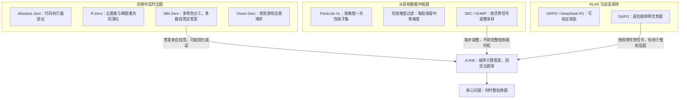
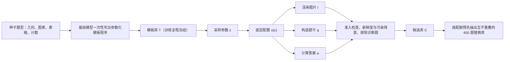
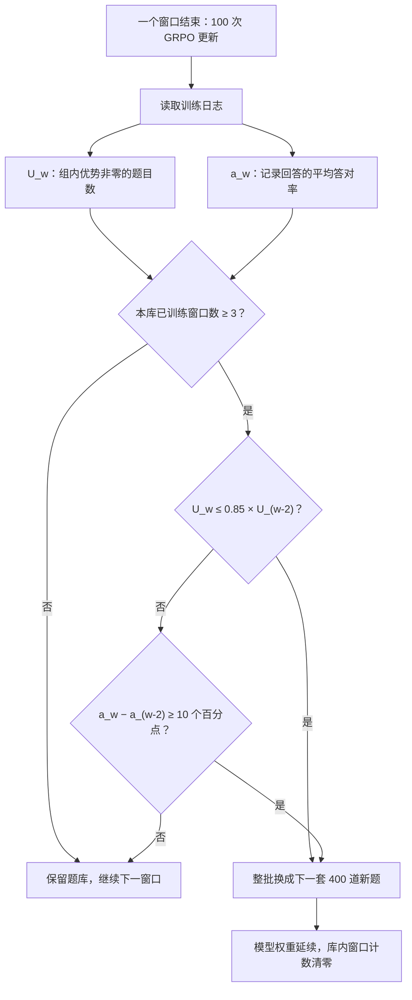
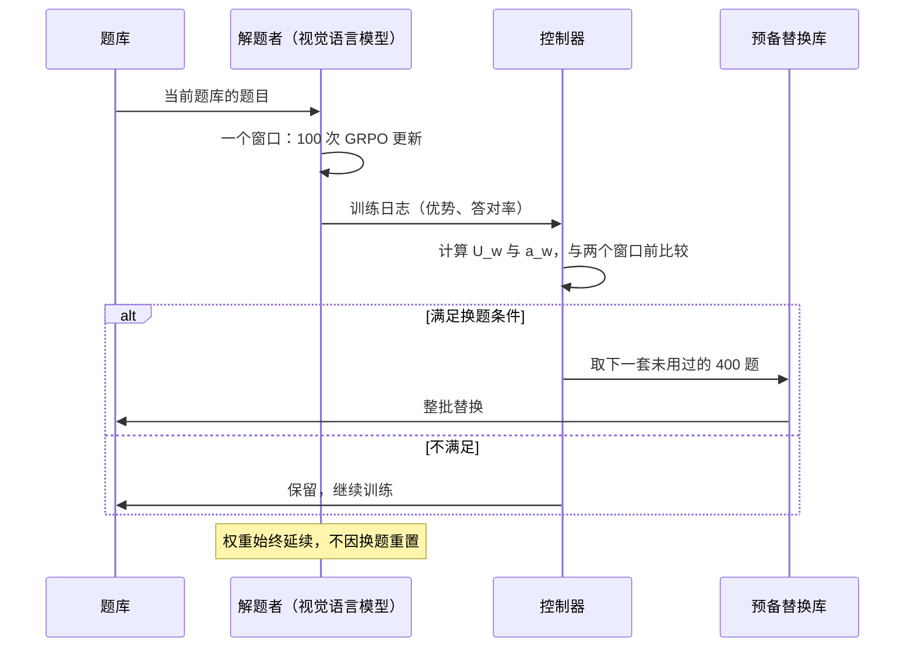
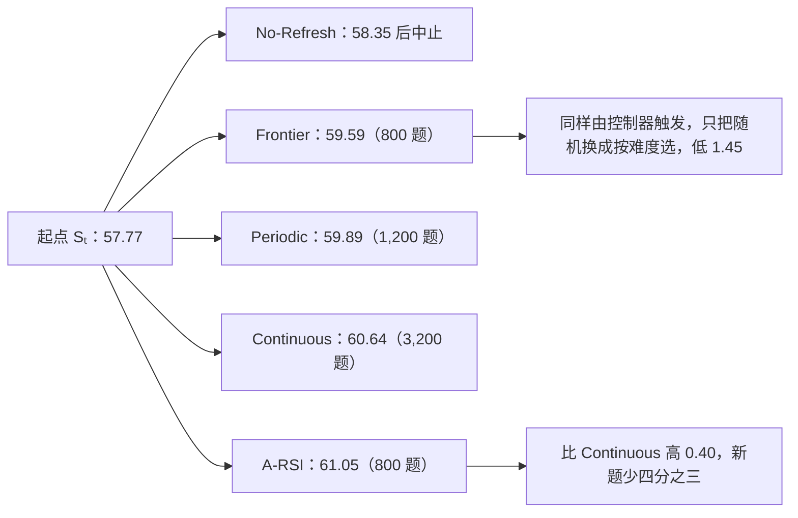
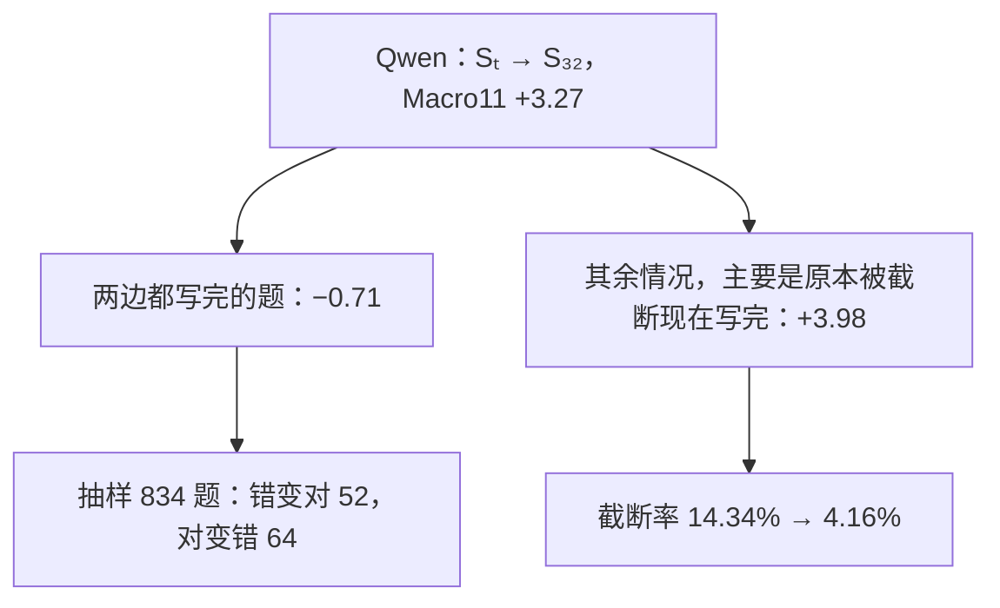

# A-RSI：让训练日志决定何时换题的零数据多模态自我改进

> **原题**：A-RSI: Adaptive Task Refresh for Zero-Data Multimodal Self-Improvement
> **作者**：Yu Liu、Youxing Li、Yuedong Tan（以上三位为共同一作，Youxing Li 为项目负责人）、Zhiwei Yang、Zihan Su、Hanqi Feng、Shaojie Zhang、Libin Liao、Zihao Wan、Chenxu Wu、Cong Cao、Fangfang Yuan、Yanbing Liu、Ziheng Chen、Pei Fu、Radu Timofte、Zongwei Wu、Nicu Sebe、Barnabas Poczos、Jian Luan（Cong Cao、Pei Fu 为通讯作者）
> **机构**：论文以机构标志列出，包括中国科学院信息工程研究所、小米、香港中文大学、维尔茨堡大学、卡内基梅隆大学、马克斯·普朗克智能系统研究所、特伦托大学、西安交通大学、哈佛大学
> **年份**：2026（arxiv ID 2610.38568）
> **分类**：cs.AI
> **链接**：https://arxiv.org/abs/2610.38568
> **精读日期**：2026-10-31

## 阅读须知

### 这篇在领域里的位置

「递归自我改进」（RSI）是一个听起来宏大、做起来很具体的方向。它关心的问题是：一个模型能否自己产生训练经验，再用这些经验把自己变强，然后用变强后的自己产生更好的经验，如此循环下去，而不依赖人类持续提供新数据。

这条路线大致分成两支。一支改的是模型外面的系统，例如 STOP 让程序改写优化自己的代码，Darwin Gödel Machine 让智能体不断改写自身的脚手架；另一支改的是模型权重本身，例如 STaR 用模型自己生成的推理过程做监督，自我博弈与自我奖励方法让模型同时充当出题者和评判者。

近两年，第二支和「可验证奖励的强化学习」（RLVR）合流，出现了一批「零数据」方法。Absolute Zero 让模型自己出编程题并用代码执行器检验答案；R-Zero 让出题者和解题者两个角色共同演化；多模态方向上，Vision-Zero 用生成的视觉游戏做自我博弈，MM-Zero 用多个角色分工出题、解题并以多数投票定答案。

这些方法的共同重心是「下一批该出什么题」。A-RSI 换了一个角度：它把出题方式固定下来，转而研究「什么时候该换一批新题」，并且坚持新题的答案必须能够独立核对，不能来自模型自己的投票。换句话说，这篇论文处在零数据自我改进与课程学习（curriculum learning）的交界处，研究的是一个此前很少被单独拎出来的控制问题。

### 读完能回答什么

1. 用多数投票给自己出的题定答案，为什么会把模型的错误喂回给模型？A-RSI 用程序计算答案是怎样绕开这个问题的？
2. GRPO 训练里「一组回答奖励全都一样的题不产生梯度」这个现象，怎样被改造成「当前题库已经学不出东西」的信号？
3. 换题的时机和选题的策略各自贡献了多少？为什么随机抽题反而赢过了按难度精挑细选？
4. Qwen 从 57.77 升到 61.05 的这 3.27 分里，有多少来自「学会在长度上限内把答案写完」，有多少来自「真正把原本答错的题答对」？
5. 论文自己明确声明了哪些结论没有被证据支持？

### 阅读前置

本文假定读者了解大语言模型的强化学习微调大致在做什么，知道策略梯度、奖励函数、采样多个回答这些基本概念，也知道视觉语言模型能够同时接收图片和文字。

本文不假定读者熟悉 GRPO 的具体公式、课程学习的各种变体，或者多模态推理基准的细节，这些内容都会在首次出现时先铺垫再展开。论文附录长达二十余节，本文只转述与主要结论相关的部分。

### 缩写表

| 缩写 | 全称与含义 |
|---|---|
| RSI | Recursive Self-Improvement，递归自我改进。模型用自己产生的经验改进自己，并循环往复 |
| A-RSI | Adaptive Recursive Self-Improvement，本文方法，「自适应」指换题时机随训练反馈而定 |
| RLVR | Reinforcement Learning with Verifiable Rewards，可验证奖励的强化学习。奖励来自可自动核对的结果，而不是人工打分 |
| GRPO | Group Relative Policy Optimization，组相对策略优化。对同一道题采样一组回答，用组内相对好坏计算优势，不需要单独的价值网络 |
| DAPO | 一种开源大规模强化学习训练方案，其中的「动态采样」会剔除组内奖励全同、因而不产生梯度的题 |
| VLM | Vision-Language Model，视觉语言模型 |
| SFT | Supervised Fine-Tuning，监督微调。MiMo-VL-7B-SFT 指经过监督微调的 MiMo 视觉语言模型 |
| Macro11 | 十一个评测基准准确率的等权平均，是本文的主要汇总指标 |
| LJ | LLM-Judged accuracy，用 Qwen2.5-14B-Instruct 判定最终答案是否正确的准确率 |
| SMT | Satisfiability Modulo Theories，可满足性模理论求解器，用来机器验证规格的若干性质 |
| S₀、Sₜ、Sᵢⱼ | 模型状态记号：S₀ 是公开的起始模型，Sₜ 是在初始题库上训练 100 步后的起点，Sᵢⱼ 是在第 i 个题库上第 j 个窗口结束时的模型 |
| MM-Zero / R-Zero / Absolute Zero / Vision-Zero | 本文对比与讨论的几种零数据自我改进方法 |
| PLR / PAIRED | 强化学习里两种按「学习价值」挑选训练环境的课程方法 |

## 一、问题

零数据自我改进最吸引人的地方，是它试图摆脱对人工标注数据的依赖。高质量的多模态推理数据贵而稀少，如果模型能自己出题、自己练习、自己变强，训练就不再被数据供给卡住。

然而这类循环在实践中会遇到两个朴素的麻烦。第一个麻烦是题目会被「练熟」：同一批题反复训练，模型早已掌握，继续训练只是在空转，甚至会因为没有梯度信号而让训练本身出错。第二个麻烦是答案的可靠性：很多方法用模型自己多次作答的多数投票来定标准答案，一旦模型在某类题上系统性地犯错，错误答案就会被当成标签，再用来训练模型，错误由此被固化。

过去的工作主要在回答「下一批题出什么」，例如出更难的题、出恰好处在模型能力边缘的题。它们较少回答另一个同样实际的问题：「什么时候该换题」。换得太晚，算力浪费在已经学不出东西的题上；换得太勤，又会消耗大量可能并不需要的新题。这篇论文要做的，就是把这两个问题拆开来分别处理。

### 1.1 具体的技术问题

把上面的动机落到可以验证的技术陈述上，论文同时回答两个问题。第一，在不查看任何验证集或测试集分数的前提下，能否只凭训练日志判断当前题库已经「饱和」，从而决定何时整批替换题库？第二，能否让新题的答案完全不依赖模型自己的判断，做到可以独立核对？

论文对这两个问题给出了各自的信息来源：换题的时机由训练过程中的动态决定，答案的正确性由出题程序本身决定。这种「时机来源」与「正确性来源」的分离，是全文最核心的设计原则。

### 1.2 前人的几条路线

**训练中实时出题的零数据方法**。Absolute Zero 让模型出编程题，用代码执行器检验，奖励「可学性」；R-Zero 让出题者与解题者共同演化，题目难度始终贴着解题者的能力；MM-Zero 用多个角色分工，以多数投票确定答案；Vision-Zero 用图像对比游戏做自我博弈，与 RLVR 交替进行。

这类方法做对的地方在于数据可以无限生成，难度也能随模型成长。它们的不足在于，出题本身在不断变化，很难单独分析「换题时机」的作用；而依赖投票定答案的方法，还会面临错误标签被固化的风险。

**从现有数据中挑题的方法**。ThinkLite-VL 用搜索估计难度，从一万一千道公开题里挑出一个较难的子集；在线难度过滤每个批次都保留难度适中的题；SEC 与 DUMP 用多臂老虎机算法，按优势信号的大小动态调整各类题的采样比例。

这类方法做对的地方在于答案来自现成标注，比较可靠。它们的不足在于数据来源是固定的，用完就没有了；而且它们几乎每一步都在调整采样，同样没有把「整批换题的时机」作为一个独立决策来研究。

**动态采样与课程学习**。DAPO 的动态采样会在每个批次里剔除组内奖励全同的题，因为这些题不产生梯度；强化学习里的 PLR 与 PAIRED 则按估计的学习价值挑选训练环境。A-RSI 借用了「组内奖励全同就没有信号」这一观察，但把它用在一个不同的层面：不是逐批剔除题目，而是统计整个题库还剩多少题能提供信号，以此决定是否整体换题。

## 二、方法

### 2.1 程序化出题：答案与题目出自同一个配置

A-RSI 的第一块是出题流水线，它的目标是保证每道题都有一个独立可核对的标准答案。

做法分两个阶段。第一阶段只发生一次，在训练开始之前：从几何、图表、表格、计数四类种子题型出发，让基础模型自己设计可复用的题目结构，并为每种结构写出参数化的程序。每个程序规定了允许的参数范围、要问的量，以及如何采样参数、画出图片、组织题干和计算答案。这些程序组成一个模板库 $\mathcal{T}$，在整个训练过程中保持不变。

第二阶段是执行这些冻结的模板来生成题目。生成器选一个模板 $\tau$，从它的分布 $p_\tau$ 中采样参数 $z$，程序先根据参数构造出底层的数据或几何配置 $s_\tau(z)$，再由同一个配置同时产出三样东西：

- 图片 $I = R_\tau(s_\tau(z))$，由渲染器 $R_\tau$ 画出
- 题干 $q = Q_\tau(s_\tau(z))$，由题干构造器 $Q_\tau$ 写出
- 标准答案 $a = E_\tau(s_\tau(z))$，由答案执行器 $E_\tau$ 算出

论文举了一个图表的例子。模板采样出两个类别的数值 $v_A=18$、$v_B=11$，画出对应的柱状图，问「A 比 B 大多少」，再从存储的数值直接算出答案 $a=7$。学习者只能看到图片和题干，看不到底层数值和答案，它的回答再与 $a$ 比对打分。

这种设计的关键在于，答案是从生成图片的同一份数据里算出来的，而不是让任何模型去「读图作答」再投票。因此新题不需要再调用模型来出题或定答案，错误标签被固化的风险也被大幅降低。当然，这仍然依赖模板程序本身写对、渲染与措辞没有引入歧义，论文为此另做了独立审计，后文会讲。

题目生成后还要经过准入检查：检查采样配置是否合法、答案计算是否正确、渲染与措辞是否有歧义，再经过新鲜度筛查和污染筛查，并排除留作诊断的题目。通过检查的候选题组成一个候选库 $\mathcal{C}$。训练开始前，系统就按固定的题型配额 $\mathbf{k}=(194,131,54,21)$（依次对应几何、图表、表格、计数，合计 400 道）从中预先抽好一串互不重叠的替换题库，抽取顺序是与模型无关的固定伪随机顺序。

### 2.2 奖励设计与 GRPO 训练

第二块是用这些题训练「解题者」，也就是被改进的视觉语言模型。训练算法是 GRPO。

GRPO 是近年推理模型强化学习的常用算法。它要解决的问题是，传统的策略梯度需要一个价值网络来估计「这个回答比平均水平好多少」，而训练价值网络既费显存又不稳定。GRPO 的做法是对同一道题采样一组回答（本文每题 $m=8$ 个），用这组回答奖励的均值与标准差做归一化，得到每个回答的「相对优势」，好于组内平均的回答被鼓励，差于平均的被抑制。

每个回答 $y$ 的奖励由三项组成：

$$r(y,a) = r_{\mathrm{ans}}(y,a) + \lambda_{\mathrm{fmt}}\, r_{\mathrm{fmt}}(y) + \lambda_{\mathrm{stop}}\, r_{\mathrm{stop}}(y)$$

- $r_{\mathrm{ans}}$：抽取出的答案与 $a$ 一致时为 1，否则为 0
- $r_{\mathrm{fmt}}$：回答使用规定的方框答案格式时为 1，否则为 0
- $r_{\mathrm{stop}}$：正常结束并给出最终方框答案时为 0，否则为 −1；写到长度上限被截断的回答，即使前面出现过方框表达式，也要受这项惩罚

这里没有按字数扣分，也没有奖励推理步数。论文给出了一个简单的保证：由于两个辅助项的系数是固定的，答对的回答在总奖励上一定排在答错的回答之前，即 $R(r_c) - R(r_w) \geq 1 - \lambda_{\mathrm{fmt}} - \lambda_{\mathrm{stop}} > 0$。不过这个保证只管「对与错之间」的排序；在都答错的回答里，把格式写对、把话写完仍然能拿到更高奖励。这一点后面会变得很重要。

### 2.3 饱和检测：用「还剩多少题有信号」判断题库是否用尽

第三块是全文的核心：一个只读训练日志的控制器，决定何时换题。

它的出发点是 GRPO 的一个性质。如果一组 8 个回答的总奖励完全相同，例如全对或全错，那么组内相对优势全部为零，这道题对这一步的参数更新没有任何贡献。随着训练推进，模型对题库越来越熟，越来越多的题会落入「全对」的状态，能提供信号的题就越来越少。

论文在每个训练窗口结束时（一个窗口是 100 次 GRPO 更新）从日志里算两个量：

- $U_w$：第 $w$ 个窗口里，至少有一个回答优势不为零的不同题目数量，也就是「还能提供信号的题有多少」
- $a_w$：该窗口所有记录回答的平均答对率

然后与 $\ell=2$ 个窗口之前的值比较。换题规则是：在当前题库上已经至少训练了 $n_{\min}=3$ 个窗口的前提下，只要满足下面两个条件之一，就整批换题：

$$\delta_w = 1 \iff n_w \geq n_{\min} \ \text{且}\ \big(U_w \leq \rho\, U_{w-\ell} \ \text{或}\ a_w - a_{w-\ell} \geq \eta\big)$$

其中信号保留阈值 $\rho = 0.85$，答对率提升阈值 $\eta = 0.10$。第一个条件的意思是「有信号的题比两个窗口前少了 15% 以上」，第二个条件的意思是「答对率两个窗口内涨了 10 个百分点以上」，后者被当作「对题库越来越熟悉」的代理信号。

论文反复强调，这只是一个操作层面的启发式规则，而不是「模型已经掌握题库」的证明。全错的题同样没有组内差异，回答分布变得集中也会让差异消失，动态重采样还会影响哪些题被记录到，所以 $U_w$ 描述的只是日志里观察到的训练信号。更关键的是，控制器全程不看任何验证集或测试集分数。

### 2.4 整批替换与继续训练

当控制器决定换题时，A-RSI 用预先抽好的下一套 400 道新题替换整个当前题库，新题从未在之前出现过。换题不会重置模型，模型权重从最后一个通过检查的窗口继续，所以之前所有窗口学到的东西都被保留下来；每个窗口都重新初始化优化器和学习率调度器。

论文还规定了几条工程上的安全规则。某个窗口训练失败时，从上一个通过检查的检查点用同样的题库和随机种子重试一次，再失败就停止整个训练。如果控制器要求换题，而预先准备的替换库已经用完，控制器会拒绝开始下一个窗口，而不是悄悄重复使用旧题或临时改变抽题规则。

这里值得注意的是，「自适应」只体现在换题的时机上。出题模板、各题型的配额、抽题的随机顺序全部在训练前固定，训练反馈不会改变出什么题，只会改变什么时候换。

## 三、实验

### 3.1 实验设置

**模型与起点**。主实验使用 Qwen3-VL-8B-Instruct。论文先在 500 道旧题上训练 100 步，得到起点 $S_t$，再从这里出发比较不同的换题策略，每条策略最多继续训练 8 个窗口。论文还在 MiMo-VL-7B-SFT 上重复了主要实验。

**五种对比策略**。所有策略都从同一个 $S_t$ 出发，优化设置完全相同，区别只在换题的时机和选题方式：

| 策略 | 何时换题 | 怎样选新题 |
|---|---|---|
| A-RSI | 控制器触发时 | 按配额随机抽 |
| Frontier | 控制器触发时 | 按难度前沿选题 |
| Periodic | 每两个窗口 | 按难度前沿选题 |
| Continuous | 每个窗口 | 按留出集准确率上下调整难度 |
| No-Refresh | 从不换 | 一直用旧题库 |

其中「难度前沿」是指用留出的合成题测出模型尚不能稳定解决的最简单难度等级，再从这一级及相邻等级抽题。

**评测**。论文在十一个完整测试集上评测：MMSI、MathVerse、MathVision、MMMU-Pro 的四选项、十选项与纯视觉三个版本、VisNumBench、MMMU、ChartQA、PhyX 与 SCEMQA。主指标 Macro11 是这十一个准确率的等权平均，生成长度上限为 8192 个词元。论文另外报告了用 Qwen2.5-14B-Instruct 判分的准确率（LJ），以及回答被截断的比例。

### 3.2 主要结果：少用新题，得分更高

下表合并了论文表 4 与表 7 的主要数字，都是 Qwen 在第 8 个继续窗口（$S_{32}$）的 Macro11。

| 策略 | 第 4 窗口 | 第 6 窗口 | 第 8 窗口 | 新题数量 | 每千道新题带来的提升 | 截断率 |
|---|---|---|---|---|---|---|
| 起点 $S_t$ | 57.77 | | | 0 | | 14.34% |
| No-Refresh | 58.48 | 58.35 | 训练中止 | 0 | | |
| Frontier | 59.76 | 59.83 | 59.59 | 800 | +2.28 | 8.14% |
| Periodic | 59.22 | 59.91 | 59.89 | 1,200 | +1.77 | 10.33% |
| Continuous | 59.47 | 59.74 | 60.64 | 3,200 | +0.90 | 8.44% |
| **A-RSI** | **59.84** | **60.40** | **61.05** | 800 | **+4.09** | **4.16%** |

A-RSI 在第 8 窗口达到 61.05，比起点高 3.27 分。它只用了 800 道新题，比每个窗口都换题的 Continuous 高 0.40 分，而后者用了 3,200 道新题，是它的四倍。按每千道新题带来的提升算，A-RSI 是 4.09 分，Continuous 只有 0.90 分。

一直不换题的 No-Refresh 则清楚地展示了「题库被练熟」的后果。它在第 4、第 6 窗口分别停在 58.48 和 58.35，几乎不再上涨；到第 7 个窗口时，日志里出现了 35 次零信号警告，100 次更新里只有 94 次正常完成，训练健康检查连续两次失败，训练被迫中止。在相同的第 6 窗口进度下，A-RSI 比它高 2.05 分。

Qwen 在全部十一个基准上的点估计都有提升，从 SCEMQA 的 +1.19 到 PhyX 的 +8.33 不等。MiMo 的提升小得多，从公开模型的 59.08 到 60.71。

### 3.3 控制器的实际决策

下表是论文表 14，记录了控制器在三个题库阶段的实际表现。「保留率」是窗口结束时有信号的题数除以开始时的题数。

| 模型 | 题库 | 开始时有信号的题 | 结束时 | 保留率 | 答对率变化 | 决策 |
|---|---|---|---|---|---|---|
| Qwen | 初始库 | 239 | 195 | 81.59% | +7.00 | 换题（已执行） |
| Qwen | 替换库 1 | 196 | 163 | 83.16% | +9.47 | 换题（已执行） |
| Qwen | 替换库 2 | 181 | 152 | 83.98% | +6.59 | 换题（离线重放） |
| MiMo | 初始库 | 245 | 153 | 62.45% | +14.28 | 换题（已执行） |
| MiMo | 替换库 1 | 199 | 143 | 71.86% | +14.50 | 换题（已执行） |
| MiMo | 替换库 2 | 152 | 150 | 98.68% | +6.63 | 保留（离线重放） |

这张表展示了控制器「自适应」的一面。同样是在第三个题库上训练了三个窗口，Qwen 的信号保留率跌到 85% 以下，规则要求换题；MiMo 的保留率仍有 98.68%，规则要求继续用。一个固定的「每三个窗口换一次」的日程会让两个模型都换题。

不过表里也藏着一个限制：最后一个阶段的决策只是离线重放，并没有真的据此继续训练；而前两次实际执行的换题，恰好都落在第三个窗口结束时，与固定的三窗口日程完全重合。

### 3.4 选题策略的消融

下表摘自论文表 5，比较了在相同训练进度下，不同的新题选择方式。

| 选题方式 | Macro11 | 与随机对照之差 |
|---|---|---|
| **每窗口换题，四个窗口后** | | |
| 随机抽题（对照） | 60.29 | |
| 优先抽模型答错过的题 | 57.67 | −2.63 |
| 抽「可学区间」内的题 | 58.39 | −1.90 |
| 只抽模型总是答错的题 | 57.89 | −2.40 |
| 难度阶梯控制器 | 59.47 | −0.82 |
| 难度只升不降控制器 | 59.81 | −0.48 |
| 考虑截断的控制器 | 60.24 | −0.05 |
| 各难度等级均匀抽 | 59.10 | −1.19 |
| **控制器触发换题，第 8 窗口** | | |
| 随机抽题（A-RSI） | 61.05 | |
| 难度前沿选题 | 59.59 | −1.45 |

所有「聪明」的选题方式都没有赢过随机抽题，按模型失败记录挑题的几种做法甚至落后两分以上。

### 3.5 值得单独讨论的几个结果

**分数的提升主要来自「把答案写完」**。这是全文最需要读者留意的结果，而且是论文自己做出来的。Qwen 的起点 $S_t$ 在 8192 词元上限下，有 14.34% 的回答被截断；到了 A-RSI 的 $S_{32}$，截断率降到 4.16%。

论文把 Macro11 的总提升拆成两部分：一部分来自「训练前后两个回答都正常写完」的题，另一部分来自其余情况，主要是训练前被截断、训练后写完了的题。拆分结果见论文表 16：

| 模型 | 比较起点 | 总提升 | 两边都写完的题贡献 | 其余情况贡献 |
|---|---|---|---|---|
| Qwen | $S_t$ | +3.27 | −0.71 | +3.98 |
| Qwen | $S_0$ | +4.40 | −0.75 | +5.15 |
| MiMo | $S_0$ | +1.63 | +0.99 | +0.64 |

对 Qwen 来说，在两边都正常写完的题上，训练后的模型反而略差，贡献是 −0.71 分；全部提升，甚至更多，都来自「原本写不完、现在写完了」的题。论文另抽了 1,000 道题做逐题核对：Qwen 在两边都写完的 834 道题里，由错变对的有 52 道，由对变错的有 64 道，净值为负。

MiMo 的情形不同，它在两边都写完的题上确有正贡献，但总提升本身就小得多。论文在结论里也直白地写道：零数据训练在较紧的生成上限下，有一部分收益其实是「学会写完」。

**随机抽题为什么赢**。论文在附录给出了三个由日志支持、但未经消融隔离的解释。第一，随机题库保留了模型写不完的题，而这些题恰好是「停止奖励」信号最强的地方：随机题库里 21.9% 的训练回答被截断，回答长度与优势的相关系数是 −0.31；挑选出的题库截断率只有 17%。第二，挑题会改变答案类型，例如「优先抽答错题」的题库里完全没有选择题，评测时的格式效应由此混进了比较。第三，随机题库在 4 到 8 个窗口内并不会饱和，每个窗口仍有大约 180 到 210 道题能提供信号。

把这三点和上一段放在一起看，可以得到一个连贯的解读：随机抽题之所以更好，很大程度上是因为它让模型更多地练习了「在长度上限内收尾」，而这正是 8192 词元评测最看重的行为。

**换题时机的作用并没有被证实**。A-RSI 与 Continuous、Periodic 的比较同时改变了「何时换」和「怎样选」两个因素，因此不能把差距归因于时机。论文专门指出，在选题方式都固定为难度前沿时，控制器触发的 Frontier 反而比固定每两窗口换题的 Periodic 低 0.30 分；而控制器实际执行的两次换题，又恰好与「每三个窗口换一次」的固定日程重合。论文没有做「固定三窗口日程加随机抽题」这一关键对照，所以控制器到底有没有比固定日程选出更好的时机，目前是未知的。

**MiMo 上的优势很微弱**。MiMo 的各策略在第 8 窗口的得分是：No-Refresh 60.01、Periodic 60.53、Continuous 60.69、A-RSI 60.71，彼此差距在 0.7 分以内；在第 4 窗口时，No-Refresh 的 60.97 甚至高于 A-RSI 的 60.40。MiMo 的 Macro11 在第 6 窗口达到 61.04 之后也有所回落。这些都说明，A-RSI 在第二个模型上的表现远不如在 Qwen 上那样清楚。

**与 MM-Zero 的长度敏感性对比**。论文用发布的 MM-Zero v5 权重做了对比：在 4096 词元上限下，MM-Zero v5 与 A-RSI 的得分几乎相同（57.09 对 56.99）；把上限翻倍到 8192 后，A-RSI 保住了相对基础模型 80% 的提升，MM-Zero v5 只保住 59%。论文据此认为 A-RSI 的收益对生成长度没那么敏感。这个比较本身有意义，但也提醒读者：比较零数据方法时，生成长度上限是一个会显著改变结论的变量。

## 四、局限

### 4.1 作者承认的局限

这篇论文在自我审视上非常坦率，附录专门设有「我们自己的提升是真的吗」和「证据支持什么、不支持什么」两节。作者承认的第一类局限是复现性：每种策略都只训练了一次，没有多随机种子的重复，细小的分差没有做显著性检验；主比较只覆盖 8 个窗口，没有在 16k 词元上限下评测；No-Refresh 在第 7 窗口中止，使预先登记的主要终点指标无法读取。

第二类是换题时机。作者写明，第一个换题点的阈值是参照已有日志设定的；在缺少「固定三窗口日程加随机抽题」对照的情况下，基于历史的时机判断与「使用新题」本身的作用仍然纠缠在一起，0.40 分的差距不能说明时机上的优势。

第三类是跨模型迁移。MiMo 只跑了一次，与 Continuous、Periodic 的差距很小；而且 MiMo 实验用的题库是按 Qwen 的难度前沿挑选的，这限制了关于跨模型族迁移的结论。

第四类是出题范围。程序模板库只覆盖几何、图表、表格和计数，没有函数图像、数值估计和空间推理题；各题型的配额和 19 个主题词参考了评测基准的构成，模板之外的多样性没有测量；初始题库里还包含经模型改写题干的题目。

第五类是校验的边界。作者在审计中发现，生产环境的答案检查器在 16,000 项检查中有 220 项不通过，问题出在 110 道选择题上，它会同时接受含糊的作答；修正后的候选检查器尚未替换进报告中的训练。SMT 求解器验证的是规格的四条性质，而不是完整的 Python 实现或渲染器。

### 4.2 读者能看出的问题

**「自我改进」的内容需要重新审视**。按论文自己的拆分，Qwen 的全部提升来自原本被截断的题，在两边都写完的题上反而略有退步。这意味着在主模型上，这套循环主要教会了模型「在长度上限内收尾」，而不是更会看图推理。收尾能力当然有实用价值，但它和标题里「多模态自我改进」给人的印象有相当距离。读者引用这篇论文的分数时，应当连同这层拆分一起引用。

**「零数据」的边界比字面更宽**。训练循环里确实没有外部训练样本和人工标注答案，但模板是由模型对着人选的四类种子题型写出来的，题型配额和主题词参考了评测基准，初始题库还经过模型改写。这些都不构成数据泄漏，却说明评测基准的构成在设计阶段已经影响了训练分布。PhyX 一项提升 8.33 分，远高于其他基准，是否与此有关，论文没有分析。

**「递归」的成分有限**。出题模板、配额和抽题顺序都在训练前冻结，训练反馈只决定换题时机；而时机的作用恰恰是本文没能证实的部分。严格来说，这更像是「在程序化合成数据上做 RLVR，并配一个换题规则」，递归改进的闭环只闭合了很小一段。

**单次运行与微小分差**。主结论里的许多差距在 0.4 分上下，MiMo 上的差距更小，而每个策略只训练了一次。中间检查点和评测题目都不是独立的训练重复，强化学习训练本身的随机波动完全可能达到这个量级。

**规则的阈值来自同一批日志**。0.85 的保留阈值和第一个换题点是参照已有日志设定的，随后又在同一条训练轨迹上评估效果，存在一定的事后拟合风险。MiMo 上的决策差异是一个有价值的反例检验，但最后一个阶段只是离线重放，没有真正执行。

**评测长度上限主导了结论**。基础模型在 8192 词元下就有 14% 的回答被截断，这让「写完」本身成为一个分量很重的得分来源。如果换成 16k 上限，或者对截断回答采用不同的处理方式，各策略之间的排序可能会改变，而论文没有给出主轨迹在 16k 下的结果。

## 一句话

A-RSI 按 GRPO 训练日志判断题库何时用尽并换随机新题，Qwen 提升 3.27 分，但多半来自学会把答案写完。
