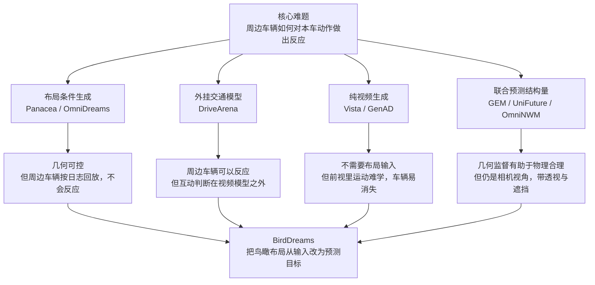
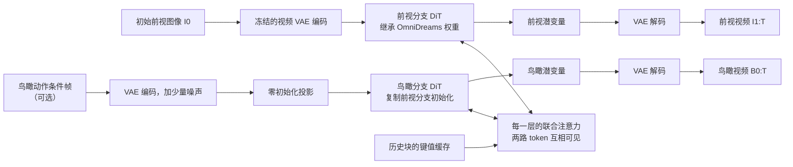
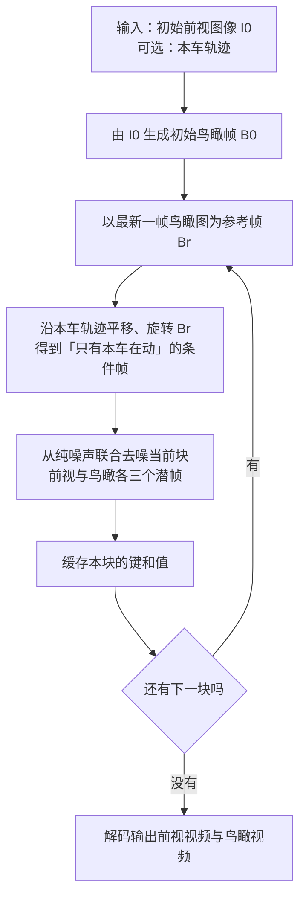
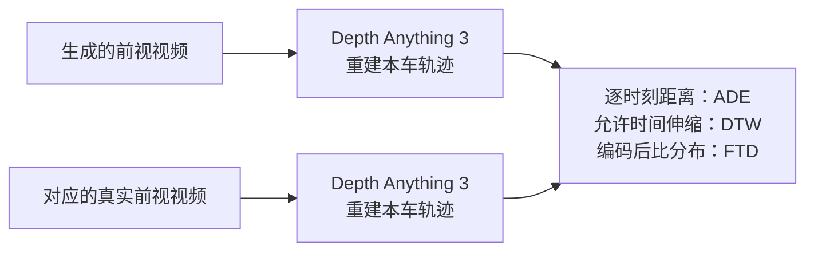

# BirdDreams：联合生成前视与鸟瞰视频的可反应驾驶世界模型

> **原题**：BirdDreams: Joint Perspective and BEV Video Generation for a Plausible, Reactive Driving World Model
> **作者**：Junyoung Seo, Jaewoo Seo, Seungryong Kim, Laura Leal-Taixé, Xiuming Zhang, Seung Wook Kim
> **机构**：英伟达（NVIDIA）、韩国科学技术院（KAIST）
> **年份**：2026（arxiv ID 2611.14815）
> **分类**：cs.CV
> **链接**：https://arxiv.org/abs/2611.14815
> **项目页**：https://research.nvidia.com/labs/sil/projects/birddreams/
> **精读日期**：2026-11-13

## 阅读须知

### 这篇在领域里的位置

自动驾驶的测试长期面对一个难处：真正危险、真正罕见的场景，很难在真实道路上安全地复现。于是业界一直在寻找替代品。最早的替代品是手工搭建的图形仿真器，场景由美术与程序员一点一点建出来，可控性很好，但画面与真实道路之间始终隔着一层。

后来出现了「驾驶世界模型」。它的做法是用海量真实行车视频训练一个视频生成模型：给它一帧当前画面，再给它一段本车打算怎么开的轨迹，它就生成接下来几秒车窗外会看到的画面。与图形仿真器相比，它的画面来自真实数据的分布，因此逼真得多。

驾驶世界模型这一支大约经历了三步。第一步是 DriveGAN、GAIA-1 这类早期工作，证明了用生成模型「想象」行车画面是可行的。第二步是把各种几何条件喂进去，例如高精地图、周边车辆的三维框与未来轨迹，让生成的画面在几何上可控，代表作有 MagicDrive、Panacea，以及英伟达自家的 OmniDreams。

第三步是当下正在发生的事情：研究者开始要求世界模型不只是「按剧本演」，而是要能对本车的不同决策做出合理反应，也就是所谓可反应（reactive）的闭环仿真。BirdDreams 位于这一步。它出自与 OmniDreams 相同的研究组，基座也直接取自 OmniDreams，但它把一个此前只当作输入的东西，即场景的俯视布局，改成了模型自己要预测的输出。

### 读完能回答什么

1. 为什么把周边车辆的未来轨迹当作输入喂给世界模型，会让这些车辆无法对本车的「另一种开法」做出反应
2. 「示意性鸟瞰视频」长什么样，它比普通的前视摄像头视频好学在哪里，又缺了什么
3. 两个视频分支是怎样通过联合注意力互相帮忙的，为什么训练时要给两路各自独立地加噪
4. 「鸟瞰感知的动作条件」如何把一条以米为单位的本车轨迹，变成模型能直接看懂的图像条件
5. 本车轨迹误差下降三成多、人类评测 57% 对 24% 的偏好，这些数字各自是在什么设置下测出来的，能说明多少问题

### 阅读前置

本文假定读者熟悉 Transformer 的基本结构与注意力机制，了解扩散模型「从噪声一步步去噪得到样本」的大意，也知道视频生成模型通常先用变分自编码器把画面压到潜空间、再在潜空间里做生成。

本文不假定读者做过自动驾驶，也不假定读者熟悉流匹配、Diffusion Forcing 这一类较新的训练技巧。这些概念在正文第一次出现时都会先铺垫、再展开。

### 缩写表

- **ego**（本车）：装着摄像头、由被测驾驶系统控制的那辆车。论文里的 ego trajectory 即本车轨迹
- **BEV**（Bird's-Eye View，鸟瞰视角）：从正上方往下看的俯视图。本文特指以本车为中心、按固定米制比例画出的示意图
- **HD map**（High-Definition map，高精地图）：标注了车道线、路沿、人行横道、停止线等几何要素的高精度地图
- **DiT**（Diffusion Transformer，扩散 Transformer）：用 Transformer 担任去噪网络的扩散模型
- **VAE**（Variational Autoencoder，变分自编码器）：把画面压缩成低维潜变量、也能从潜变量还原画面的网络
- **MoT**（Mixture-of-Transformers，Transformer 混合）：多个分支各自保留参数，但在注意力层里共享同一条序列的架构
- **DF**（Diffusion Forcing）：一种训练方式，序列里不同时间块可以带不同强度的噪声
- **RF**（Resampling Forcing）：一种微调方式，让模型在训练时就见到自己生成的历史里含有的误差
- **WAM**（World-Action Model，世界-动作模型）：既预测未来画面、也预测本车动作的模型
- **ADE / minADE**（Average Displacement Error，平均位移误差）：生成轨迹与真实轨迹在对应时刻的距离取平均；带 min 前缀表示多次采样取最好的一次
- **DTW**（Dynamic Time Warping，动态时间规整）：允许时间轴伸缩、再比较两条轨迹的距离度量
- **FVD / FID**（Fréchet Video Distance / Fréchet Inception Distance）：衡量生成视频、生成图像与真实数据在特征分布上的距离，越低越好
- **FTD**（Fréchet Trajectory Distance）：把轨迹编码成向量后计算的同类分布距离，衡量生成的驾驶轨迹像不像真实驾驶

## 一、问题

设想一个再普通不过的路口：本车本该礼让一辆横穿的车，可被测的驾驶系统决定直接开过去。仿真器此时要回答的问题是，那辆横穿的车会怎么办，是急刹、绕行，还是撞上来。这恰恰是自动驾驶测试最想知道的事情，因为在真实道路上，没有人愿意拿这种场景去试。

如果仿真器回答不了这个问题，或者回答得离谱，例如那辆车径直穿过本车继续开、或者干脆凭空消失，那么驾驶系统在仿真里通过了测试，也不能让人对它在真实道路上的表现多一分信心。换句话说，世界模型的价值不只在于画面逼真，更在于画面里其他交通参与者的行为可信。

过去两三年，驾驶世界模型在画面逼真度上进步很快，但在「周边车辆如何反应」这件事上，主流做法其实绕开了问题。以 OmniDreams 为代表的方法把高精地图与周边车辆的未来轨迹当作条件输入，模型只负责把这些几何信息「画」成逼真的视频。

这样做在复现录制场景时效果很好，然而一旦本车改走另一条路，周边车辆仍旧沿着录像里的轨迹行驶，等于在按剧本演戏，对本车的新动作毫无反应。于是问题落到一个更难的方向上：能不能不给周边车辆的未来轨迹，让世界模型自己学会它们会怎么动？BirdDreams 的出发点，是给模型换一个更容易学会运动的观察角度。

### 具体要解决的技术问题

把上面的动机落到一个可以验证的技术表述上，任务是这样的：给定一张前视摄像头图像，以及一段可选的本车轨迹，模型要生成一段未来的前视视频，并且同时满足三个要求。

第一个要求是本车在生成视频里的运动要精确跟随给定轨迹。轨迹以米为单位给出，即便是细微的转向，也要在画面里还原出来。

第二个要求是周边车辆的运动要合理，并且要对本车的动作做出反应。第三个要求是推理时不依赖高精地图，也不依赖周边车辆的状态输入，只给一张图就能开始生成。

### 前人的几条路线

第一条路线是**布局条件生成**。Panacea、OmniDreams 等方法把道路几何与车辆布局渲染成示意图，作为视频生成的条件。它的长处是几何可控，画面与布局严格对齐。

它的短处前面已经讲过：布局来自行车日志，回放时周边车辆的运动是录好的。本车一旦偏离原来的轨迹，周边车辆不会刹车，也不会让行。

第二条路线是**外挂交通模型**。DriveArena 用一个独立的交通仿真模型，根据本车动作去更新周边车辆的布局，再交给视频模型去画。这样周边车辆确实能反应了。

但车辆之间如何互动的判断，完全放在了视频模型之外。交通模型看不到画面里的红绿灯与路面细节，两部分也难以放在一起联合优化。

第三条路线是**纯视频生成**。Vista、GenAD 的动作条件扩展等方法只给本车动作，不给周边车辆布局，让模型自己从前视视频里学会一切。这条路离目标最近，但从前视视频里学车辆运动有三个天然障碍。

第一个障碍是运动与外观纠缠在一起。同一辆车在阳光下和阴影里，像素值完全不同，模型很难把「它挪动了」与「它的颜色变了」区分开来。

第二个障碍是遮挡频繁。前车挡住后车，路口交叉的车辆在画面里叠在一起，被挡住的车在生成时容易凭空消失。

第三个障碍是透视缩放。同样十个像素的位移，在画面近处可能对应半米，在远处可能对应十米。模型必须隐式地估计深度，才能理解每辆车实际开得多快。论文自己训练的一个不带布局输入的 OmniDreams 基线，就在复杂路口出现过车辆消失与不合理机动的问题。

第四类相关工作是**联合预测结构量**。GEM 联合去噪 RGB 图像与深度图，UniFuture 在视频去噪与深度预测之间交换特征，OmniNWM 联合生成全景 RGB、语义与深度，BEVWorld 则在学到的鸟瞰潜空间里做预测。

这些方法证明了「让模型同时预测一些几何量」有助于提升物理合理性。不过它们预测的多是与相机对齐的深度或语义，仍然带着透视缩放与遮挡的问题。与此同时，同期工作 CausalDrive 也在研究周边车辆对反事实本车动作的反应，目标与 BirdDreams 相同，路径不同。

把这四条路线并排放在一起，BirdDreams 的关键判断就清楚了：布局这件东西不该是外部塞进来的条件，而应当是模型对未来的预测本身。一旦模型必须自己画出「接下来几秒，每辆车在俯视图上的位置」，周边车辆怎么动就成了模型内部要解决的问题，自然也就能随着本车动作改变而改变。

## 二、方法

### 总体建模目标

BirdDreams 要学的是一个联合条件分布。用论文里的记号写出来是这样的：

$$p_{\phi}\left(I_{1:T},\,B_{0:T}\mid I_{0},\,c\right),\qquad c\in\{\mathcal{A}_{0:T},\,\varnothing\}$$

逐个解释其中的符号：

- $I_0$：初始前视图像，也就是推理时唯一必需的输入
- $I_{1:T}$：模型要生成的后续 $T$ 帧前视视频
- $B_{0:T}$：模型要生成的鸟瞰示意视频。注意它从第 0 帧开始，意味着连初始时刻的鸟瞰图也是模型从 $I_0$ 推出来的
- $\mathcal{A}_{0:T}=\{(p_t,\theta_t)\}_{t=0}^{T}$：可选的本车轨迹，其中 $p_t\in\mathbb{R}^2$ 是二维平面位置（单位为米），$\theta_t$ 是车头朝向
- $c$：条件。取为轨迹时，本车按轨迹开；取为空集时，本车怎么开也交给模型来预测
- $\phi$：模型参数

无论哪一种条件，周边车辆的运动与反应都由模型在两路视频里一并预测。推理时既不需要鸟瞰观测，也不需要高精地图或周边车辆状态。

### 示意性鸟瞰视频长什么样

在展开架构之前，先把这条新的视频流讲清楚，因为整篇论文的方法都围绕它展开。示意性鸟瞰视频是从数据集自带的标注渲染出来的，不是真实拍摄的画面。

每一帧都是一张正上方往下看的正交投影图，本车在正中央，车头朝上，覆盖一块边长约 69.3 米的正方形区域。道路要素画成折线与多边形，交通参与者画成带朝向的长方体。

颜色承担语义。路沿是品红色，人行横道是紫色，行人是黄色；车辆长方体的车头一端染红、车尾一端染蓝，这样一眼就能看出每辆车朝哪个方向开。

这样一种图像比前视视频好学，原因有三。其一，它没有纹理、光照与天气变化，模型不必为「这辆车今天是什么颜色」分心。其二，它的比例尺固定，图上任何地方挪动同样的像素数，都对应同样的物理距离。其三，从正上方看，路口交叉的车辆不再叠在一起，遮挡大幅减少。

与之相对地，它也丢掉了不少东西。红绿灯的颜色、路面的细节、69.3 米范围之外的远处车辆，都不在示意图里。这正是 BirdDreams 不只生成鸟瞰视频、还要同时生成前视视频的原因：两路信息互补，缺一不可。

### 双分支架构：因果的 Transformer 混合

为了让两路视频在生成过程中互相影响，BirdDreams 把两个视频扩散 Transformer 拼在一起，一个负责前视视频，一个负责鸟瞰视频。这种结构叫 Transformer 混合（MoT）。它要解决的问题是：两种模态差别很大，强行用一套参数处理会互相干扰，完全分开又无法交流。

MoT 的折中办法是，两个分支各自保留注意力投影、前馈层与输出头，以便各自专精；但在每一个 Transformer 块里，注意力的计算放在两路 token 拼成的同一条序列上。于是前视分支的查询可以看到鸟瞰分支的键和值，反过来也一样，这就是论文所说的联合注意力。

初始化方式很直接。前视分支继承预训练好的 OmniDreams 主干，鸟瞰分支则复制一份同样的权重作为起点。两路视频都用 Cosmos-Predict2.5 的预训练视频 VAE 编码成潜变量，VAE 的权重全程冻结。

时间维度上，潜变量被切成一块一块，每块三个潜帧。块内的注意力是双向的，当前时刻的前视与鸟瞰预测可以充分交换信息；块与块之间的注意力是因果的，后面的块只能看前面的块。这样一来，模型可以像语言模型逐词生成那样，一块一块往后生成视频。

整个模型约 40 亿参数。前视帧的分辨率是 848×480，鸟瞰帧是 480×480。

### 逐路独立加噪的 Diffusion Forcing

训练目标建立在流匹配之上，这里先铺垫一下。流匹配（flow matching）是扩散模型的一种表述方式，它要解决的问题是：如何让模型学会把一团纯噪声沿着一条路径「推」回干净数据。论文采用的整流（rectified flow）形式，把这条路径取成噪声与数据之间的直线插值：

$$x_{k}^{s}=(1-\sigma_{k}^{s})\,z_{k}^{s}+\sigma_{k}^{s}\,\epsilon_{k}^{s},\qquad \epsilon_{k}^{s}\sim\mathcal{N}(0,I)$$

- $s$：视频流的编号，取前视（persp）或鸟瞰（bev）
- $k$：时间块的编号
- $z_k^s$：第 $k$ 块、第 $s$ 路的干净 VAE 潜变量
- $\epsilon_k^s$：与之同形状的标准高斯噪声
- $\sigma_k^s\in[0,1]$：噪声强度。取 0 时完全干净，取 1 时完全是噪声
- $x_k^s$：加噪后的潜变量，也就是模型的输入

模型要预测的是这条直线上的「速度」，目标值为 $\epsilon_k^s-z_k^s$。损失是预测速度与目标速度之差的平方，先在每一路内部按潜变量元素数和块数取平均，再把两路等权相加。之所以要先各自平均，是因为前视帧比鸟瞰帧大，潜变量元素更多；若直接加总，前视一路会仅仅因为体积大而主导训练。

接下来是 Diffusion Forcing。传统视频扩散模型训练时，一段视频所有帧共用同一个噪声强度。Diffusion Forcing 的做法是让不同时间块各自独立地采样噪声强度，于是模型学会在「前面几块较干净、后面几块较嘈杂」的情况下去噪，这正是自回归生成时会遇到的情形。

BirdDreams 在此基础上再进一步：同一个时间块里，前视与鸟瞰两路的噪声强度也各自独立采样。于是训练中会出现大量「一路较干净、另一路较嘈杂」的样本。

这个设计的用意在于逼两个分支学会利用对方。鸟瞰一路较干净时，它能把道路几何与车辆位置传给前视分支；前视一路较干净时，它能把视觉细节传给鸟瞰分支；两路都嘈杂时，两个分支通过联合注意力一起去噪。与此同时，这个设计也为后面的「灵活条件」打下了基础。

### 鸟瞰感知的动作条件

这一节是论文在本车控制上的核心设计。先讲它要解决的问题：即便给了轨迹条件，视频世界模型也常常无法精确还原以米为单位的本车运动，细微的打方向尤其容易丢。过去的常见做法，例如 OmniDreams（Plücker）这一基线，是把相机运动编码成每个像素对应光线的 Plücker 坐标再喂进去，信号相当抽象。

BirdDreams 的观察是，在一张以本车为中心、比例尺固定的正交鸟瞰图里，本车的运动有极其简单的几何含义。本车前进一米，整幅图就均匀地往下平移固定的像素数；本车转向，整幅图就绕中心旋转相应角度。

于是可以这样构造条件：取最近一次预测出的鸟瞰帧作为参考帧 $B_r$，然后按照输入轨迹里每一个未来时刻的本车位姿，把这张参考帧平移、旋转过去。得到的一串图像展示的是，假如周围一切都静止不动、只有本车在动，场景在本车眼里会怎样移动。公式写出来是这样的：

$$\widetilde{B}_{t}(u)=B_{r}\left(\Pi\left[R(\theta_{r})^{\top}\left(R(\theta_{t})\,\Pi^{-1}(u)+p_{t}-p_{r}\right)\right]\right)$$

- $u$：目标图像上的一个像素位置
- $\Pi$：从本车坐标（单位为米）到鸟瞰像素的映射，$\Pi^{-1}$ 是反过来的映射
- $R(\theta)$：二维旋转矩阵
- $(p_r,\theta_r)$：参考帧时刻的本车位置与朝向
- $(p_t,\theta_t)$：输入轨迹在时刻 $t$ 给出的本车位置与朝向
- $\widetilde{B}_t$：重投影后的条件帧

这个公式做的事情，就是把目标帧的每个像素反查回参考帧里对应的位置去取颜色。它借鉴了 Gen3C「把渲染图按相机运动扭曲后当条件」的思路，但由于鸟瞰图本身是平面的，不需要估计深度。

条件帧如何进入模型也有讲究。它们先经 VAE 编码，加上一点噪声（$\sigma_{\mathrm{cond}}=0.1$），再通过一个零初始化的投影层，把学到的嵌入加到鸟瞰分支的输入 token 上。零初始化保证了训练刚开始时这条新通路不会扰乱预训练权重。

前视分支并不直接接收这个条件，而是通过联合注意力从鸟瞰分支那里间接获得。训练时还会随机丢掉动作条件，让同一个模型既能按给定轨迹生成，也能在没有轨迹时自己决定本车怎么开。

这里需要强调「软条件」三个字。重投影帧假设周围静止，而真实的未来里周边车辆在动、新的道路会进入视野。模型并不是照抄条件帧，而是以它为参照，预测真实的未来鸟瞰图，包括周边车辆的运动与新出现的内容。训练时的监督信号，正是真实的未来鸟瞰视频。

### 因果自回归推理

推理流程把前面几块拼在一起。模型先从初始前视图像 $I_0$ 生成初始鸟瞰帧 $B_0$，然后一块一块地联合生成剩下的前视与鸟瞰潜变量，期间 $I_0$ 的潜变量保持不动。

每生成一块，模型就把这一块的键和值缓存起来供后面的块使用，并把参考帧更新为这一块的最后一帧鸟瞰图。这样，下一块的动作条件就建立在模型刚刚预测出的场景变化之上，而不是一直沿用最初的那张图。

### 两阶段训练：先 DF，再 RF

自回归生成有一个老问题，叫暴露偏差。训练时，模型看到的历史永远是真实数据；推理时，历史却是模型自己生成的，带着误差。误差一块一块地累积，视频越往后越走样。

Resampling Forcing 就是针对这个问题的微调方法。它的做法是：对一整段序列采样一个共享的噪声强度 $\tau$（两路共用），把真实的历史块加噪，再让模型用一步欧拉法把它们去噪回来，得到一份「带着模型自身误差的历史」。这份历史在计算时截断梯度，只用作后续块的条件。

$$\widetilde{z}_{k}=\operatorname{sg}\left[x_{k}(\tau)-\tau\,v_{\phi}\left(x_{k}(\tau),\,\widetilde{z}_{<k},\,\tau\right)\right]$$

- $x_k(\tau)$：按噪声强度 $\tau$ 加噪后的第 $k$ 块，两路都包含在内
- $\widetilde{z}_{<k}$：已经重建好的、第 $k$ 块之前的历史
- $v_\phi$：模型预测的速度
- $\operatorname{sg}$：停止梯度

需要注意的是，共享的 $\tau$ 只用于构造历史。真正计算损失的目标块，仍旧按块、按路独立采样噪声，并沿用前面的流匹配损失。每个目标块只能看到自己的加噪 token 与之前重建的历史，所有目标块可以并行训练。

训练在 64 张 H100 上进行，总批量为 64，优化器为 AdamW，学习率 $3\times10^{-5}$，权重衰减 $10^{-3}$，采用 1000 步预热的线性学习率调度。

### 灵活条件

逐路独立加噪带来一个顺带的好处：同一个训练好的模型，可以接受多种输入组合。做法是把已知的观测潜变量固定不动，只对其余部分从噪声开始去噪。

若给定完整的前视视频，模型可以生成与之同步的鸟瞰视频，相当于一个视频到俯视布局的感知器；若给定完整的鸟瞰视频，模型可以据此生成前视视频，相当于一个布局条件的渲染器。

条件也可以只限于第一帧。给定初始前视图像，模型生成其余一切；给定初始鸟瞰图，模型连第一帧前视图像也一并生成。由此还能引出一个实用的功能：用户可以直接在初始鸟瞰图上加车、挪车、改朝向，再让模型生成对应的整段视频，而不必去摆弄三维包围框。

### 训练数据如何构造

每条训练样本都是一段真实的前视摄像头视频，配上一段从同一场景标注渲染出的鸟瞰视频。主力数据是 RDS-HQ-1M 的一个子集，约 670 小时行车记录；此外用于 nuScenes 评测的是其官方训练集，共 700 个场景、约 3.9 小时配对视频。

RDS-HQ-1M 子集提供道路布局标注、跟踪好的物体框、本车位姿与相机标定，道路几何由车道、路沿、人行横道与停止线拼出。nuScenes 则用其自带的高精矢量地图与三维框轨迹。

标注频率通常低于视频帧率，于是作者利用跟踪编号，在相邻两次标注之间插值出物体的位置与朝向。对于短暂被遮挡的车辆，也用同样的轨迹插值把它们补画进鸟瞰视频。渲染前还会删掉重复或过度重叠的车辆框。

这一点意味着，鸟瞰视频里的车辆比前视画面里看得见的车辆更完整。模型因此在训练中被要求「知道」那些在摄像头里暂时看不见、却真实存在的车。

## 三、实验

### 实验设置

评测用两个基准。第一个是 PhysicalAI-AV，作者从英伟达公开的 PhysicalAI-Autonomous-Vehicles 数据集评测集里随机抽出 200 段片段构成；第二个是 nuScenes，在其训练集上再做后训练后，于官方验证集全部 150 个场景上评测。

对比对象分两类。一类是公开的驾驶世界模型：Vista、UniFuture、GEM、DrivingDojo。另一类是 OmniDreams 的变体：不给轨迹时对比 OmniDreams（Vanilla），即不带外部布局输入、并在同一份数据上后训练的版本；给轨迹时对比 OmniDreams（Plücker），即用 Plücker 光线嵌入接收本车运动的版本。

评测分两种设置。不给本车动作时，模型只从起始帧往后滚动生成，指标同时考察画面质量与生成的本车运动是否合理；给本车动作时，额外提供真实的本车轨迹，指标考察模型执行轨迹的忠实程度。

指标基本沿用 DrivingGen 的评测协议，分两个方向。画面质量方面用 FVD、FID，以及基于 CLIP-IQA+ 的无参考图像质量分数。轨迹方面，由于大多数对比模型只生成前视视频、没有轨迹输出，作者统一用 Depth Anything 3 从生成视频与对应真实视频里各重建一条本车轨迹，再比较两者。

给动作时，每个场景生成一个样本。不给动作时，同一起点的未来本就可以有多种合理走法，于是每个场景用不同随机种子生成三个样本，各自计算后取最小值，记作 minADE 与 minDTW。

### 不给本车动作时的结果

表中每格为「PhysicalAI-AV / nuScenes」，箭头表示越低越好或越高越好。

| 方法 | minADE ↓ | minDTW ↓ | FTD ↓ | FVD ↓ | FID ↓ | 图像质量 ↑ |
|---|---|---|---|---|---|---|
| Vista | 14.65 / 8.70 | 890 / 512 | 9.02 / 14.24 | 388 / 460 | 27.34 / 30.75 | 0.363 / 0.360 |
| UniFuture | 17.53 / 7.16 | 1069 / 432 | 18.11 / 10.34 | 535 / 393 | 35.50 / 30.47 | 0.363 / 0.366 |
| GEM | 10.43 / 7.03 | 580 / 420 | 4.00 / 12.42 | 359 / 401 | 23.45 / 29.84 | 0.385 / 0.388 |
| DrivingDojo | 14.81 / 11.43 | 967 / 744 | 14.58 / 15.44 | 367 / 469 | 32.56 / 34.21 | 0.395 / 0.443 |
| OmniDreams（Vanilla） | 7.76 / 6.20 | 413 / 393 | 3.17 / 4.15 | 281 / 351 | 11.37 / 15.58 | 0.445 / 0.430 |
| **BirdDreams** | **6.15 / 3.91** | **258 / 205** | **1.77 / 0.43** | **271 / 309** | **10.70 / 11.48** | 0.428 / 0.439 |

在这一设置下，BirdDreams 在两个基准上的 minADE、minDTW、FTD、FVD、FID 全部排第一。与最直接的对照 OmniDreams（Vanilla）相比，minADE 在 PhysicalAI-AV 上降低 21%，在 nuScenes 上降低 37%，意味着它采样出的若干种未来里，有一种与真实录像中的本车行为贴得更近。

与此同时，FTD 的变化值得一看。在 nuScenes 上，它从 4.15 降到 0.43，几乎缩小了一个数量级，说明生成的本车轨迹在整体分布上更像真实驾驶。

### 给定本车动作时的结果

| 方法 | ADE ↓ | DTW ↓ | FTD ↓ | FVD ↓ | FID ↓ | 图像质量 ↑ |
|---|---|---|---|---|---|---|
| Vista | 9.65 / 6.65 | 343.6 / 298.9 | 4.75 / 12.11 | 341.2 / 407.8 | 21.23 / 25.89 | 0.396 / 0.405 |
| UniFuture | 10.33 / 4.28 | 361.2 / 175.3 | 7.87 / 10.08 | 608.0 / 349.2 | 44.63 / 33.11 | 0.361 / 0.371 |
| GEM | 6.59 / 5.55 | 235.6 / 245.0 | 1.99 / 9.06 | 336.1 / 386.1 | 24.50 / 32.29 | 0.394 / 0.406 |
| DrivingDojo | 9.87 / 3.81 | 390.1 / 225.2 | 9.21 / 8.26 | 410.3 / 406.8 | 27.28 / 40.61 | 0.404 / 0.411 |
| OmniDreams（Plücker） | 5.88 / 5.38 | 197.1 / 234.8 | 3.02 / 1.47 | 271.5 / 343.1 | 15.35 / 18.27 | 0.416 / 0.443 |
| **BirdDreams** | **3.83 / 3.42** | **95.2 / 133.3** | **0.48 / 0.56** | **238.9 / 294.0** | **11.81 / 14.80** | 0.435 / 0.436 |

给定轨迹后，BirdDreams 执行轨迹的忠实度明显更高。与 OmniDreams（Plücker）相比，ADE 在两个基准上分别降低 35% 与 36%；DTW 在 PhysicalAI-AV 上从 197.1 降到 95.2，约为对照的一半。

这组对比的意义在于，两者的基座、数据与生成方式大体相同，差别主要在于轨迹如何进入模型：一边是 Plücker 光线嵌入，一边是在鸟瞰图上平移旋转得到的条件帧。三成多的误差下降，可以较有把握地归到鸟瞰动作条件这一设计上。

轨迹更准的同时，FVD 与 FID 也更低，画面质量并没有为轨迹精度让路。在 nuScenes 上，DrivingDojo 的 ADE（3.81）与 BirdDreams（3.42）较为接近，但它的 FVD 与 FID 明显更差。

### 周边车辆能不能反应

上面两张表衡量的都是本车，而且用的都是录像里真实的本车轨迹。论文真正想证明的，是本车偏离录像时周边车辆会不会做出反应。为此作者做了反事实推演：从同样的起始画面出发，给一条与录像不同的本车轨迹，观察起始画面里那些车辆接下来怎么动。

定性例子里出现了几种合理的反应。不给本车动作时，本车与一辆横穿的车互相让行、都停了下来；给定本车动作时，本车直行，横穿的车停下等待；本车切入相邻车道后，原本跟在后面的车减速拉开距离。在没有任何反应余地的极端轨迹下，推演以碰撞收场，作者认为这在那种开法下本身就是合理的结局。

### 与基线的对照与人类评测

为了只比较周边车辆的行为，作者让两个模型拿到同样的静态道路几何。OmniDreams（HDMap）是去掉了周边车辆条件、只保留道路几何的重训版本；BirdDreams（HDMap）则把同样的道路几何作为鸟瞰条件加进来。之所以给 BirdDreams 也加地图，是因为标准版本在起始画面看不到的区域里，可能生成与真实地图不一致的道路。

在这一设置下，OmniDreams（HDMap）只能从前视视频里去预测周边车辆的行为。定性例子里，它出现了车辆在对向车流中「换边」、路口车辆沿冲突路径各开各的等问题。

由于反应行为的真实性很难用自动指标度量，作者做了成对的人类评测。25 名参与者每人看 15 对视频，这 15 对从 119 对候选中随机抽取，共得到 375 次判断。每对视频的起始画面、反事实本车动作与静态道路几何都相同。

参与者要回答哪一段视频里的周边车辆运动与行为更真实，并被告知：如果本车的开法让对方来不及躲避，出现险情乃至碰撞也算真实结果。选出更好的一段之后，还要为另一段勾选毛病。

| 评测项（占全部 375 次判断的比例） | BirdDreams（HDMap） | OmniDreams（HDMap） |
|---|---|---|
| 被判为更真实 | 57% | 24% |
| 被勾选「不可能的运动」（瞬移、滑行、穿模、凭空出现或消失） | 9% | 27% |
| 被勾选「不自然的驾驶」（逆行、车距不合理） | 6% | 24% |
| 被勾选「对本车或他车缺少应有反应」 | 11% | 19% |

另有 19% 的判断认为两者差不多。三类毛病里，差距最大的是「不可能的运动」与「不自然的驾驶」，这恰好对应前文所说前视视频里学运动的难处：遮挡导致车辆消失，透视缩放导致速度与间距失真。

### 同一起点，多种未来

同一个本车动作，周边车辆完全可能有不同的应对。作者固定起始画面、反事实轨迹与道路几何，只换随机种子，得到的推演里一次发生了碰撞、一次没有。这说明模型学到的不是一条确定的反应，而是一个反应的分布，这对用仿真去估计风险概率是必要的性质。

### 消融与扩展实验

**逐路独立加噪。** 作者把它与「同一块里两路共用一个噪声强度」的版本做比较，两者在时间块之间都独立采样。在 RDS-HQ-1M 验证片段上，独立加噪的 FVD 与 FTD 都更低。正文只给出了方向，具体数字画在图里。

**世界-动作模型的后训练。** 这是一个初步实验，想看联合的前视与鸟瞰建模能否帮助本车轨迹预测。作者在前视主干上加一个动作预测头，对 BirdDreams 与 OmniDreams（Vanilla）施以同样的后训练流程，各训练 22000 步，微调前视分支与动作头，BirdDreams 的鸟瞰分支冻结。

评测时两者都只看前视视频，外加 1.6 秒的本车历史运动，在 100 段留出片段上报告未来 3 秒六选一的 minADE。

| 模型 | minADE（3 秒，六选一） |
|---|---|
| OmniDreams（Vanilla） | 0.318 米 |
| BirdDreams | 0.295 米 |
| BirdDreams + 真实鸟瞰输入（诊断用，用到了额外的特权信息） | 0.274 米 |

**在鸟瞰图上编辑场景。** 借助灵活条件，用户可以在一份真实行车日志的初始鸟瞰图上加车、调位置与朝向，模型据此生成包括第一帧在内的前视视频与鸟瞰视频。论文的例子里，在路口本车前方放了一辆车，生成的推演里那辆车右转驶入横向道路，本车跟着它走。

### 值得单独拎出来的几个结果

第一个是图像质量这一列。不给动作时，BirdDreams 在 PhysicalAI-AV 上的单帧图像质量（0.428）低于 OmniDreams（Vanilla）的 0.445，在 nuScenes 上也低于 DrivingDojo 的 0.443。换句话说，BirdDreams 的优势不在于把每一帧画得更好看，而在于让画面里的东西动得更对。FVD 与 FID 的改进幅度远小于轨迹指标，也印证了这一点。

第二个是世界-动作模型实验里的一个细节。评测时鸟瞰分支的输入是纯高斯噪声（$\sigma=1$），并不迭代去噪，它只是参与联合注意力。即便如此，带鸟瞰监督训练过的前视主干，预测轨迹仍比对照好 7.3%。这暗示鸟瞰监督改善的是主干学到的表示本身，而不仅仅是推理时多了一路输入。不过提升幅度有限，样本只有 100 段，作者自己也称之为初步结果。

第三个是两个基准之间的差距。不给动作时，minADE 的相对改进在 nuScenes 上（37%）明显大于 PhysicalAI-AV（21%），FTD 的改进也是 nuScenes 上更夸张。nuScenes 的评测前多了一步在其训练集上的后训练，而那份训练数据只有约 3.9 小时，论文没有进一步分析这种差异从何而来，读的时候宜把 PhysicalAI-AV 上的数字当作更保守的参照。

## 四、局限

### 作者承认的

论文正文没有设立单独的局限一节，但在行文中交代了几处边界。

第一处是道路一致性。标准版本的 BirdDreams 只从一张前视图像出发，在图像里看不到的区域，生成的道路可能与真实地图不一致。因此在与基线比较周边车辆行为、以及做多样未来推演时，作者都改用了额外接收道路几何的 HDMap 版本。

第二处是度量手段。作者明言，反应行为的真实性很难用自动指标衡量，因此这一部分只能依靠定性例子与人类评测来支撑。

第三处是扩展实验的成熟度。世界-动作模型的后训练被明确标为初步实验，只在 100 段片段上评测，提升为 7.3%。

### 读完能看出来的

**训练依赖密集标注。** 鸟瞰视频是从高精地图与三维跟踪框渲染出来的，这意味着每一段训练视频都要配有这样的标注。没有地图与三维标注的海量普通行车视频，无法直接提供这套监督，数据规模的扩展因此受限于标注成本。

**鸟瞰示意图的信息边界。** 示意图以本车为中心、边长约 69.3 米，前方只覆盖大约 35 米。以每小时 100 公里计算，这段距离大约只够 1.3 秒。高速场景下，远处车辆的互动只能依靠前视分支，而那正是论文认为难学的部分。

与此同时，红绿灯状态不在示意图里，行人虽然画了出来，评测却集中在车辆上，行人对本车的反应没有被检验。

**单一前视摄像头与全方位鸟瞰之间的错位。** 鸟瞰图覆盖本车四周，前视摄像头只看前方。推理时初始鸟瞰帧 $B_0$ 是从一张前视图像推出来的，本车侧后方原本有没有车，模型其实无从得知。论文里「后车在本车切入后减速」这类例子，那辆后车的行为只体现在鸟瞰视频里，摄像头画面无法对照验证。

**轨迹指标依赖二次重建。** ADE、DTW、FTD 都建立在 Depth Anything 3 从视频里重建出的轨迹之上，重建本身的误差会混进指标。这样做是为了和只生成前视视频的模型公平比较，但也意味着这些数字衡量的是「视频看起来怎样动」，而且带着一层测量噪声。

**人类评测的规模与对手。** 25 人、375 次判断的样本量不算大，对手是作者自己重训的 OmniDreams（HDMap），不是外部方法。论文也没有与外挂交通模型的路线（例如 DriveArena）或同期的 CausalDrive 正面比较，因此「比其他让周边车辆可反应的方案更好」这一点并未得到检验。

**与公开模型的比较未控制变量。** BirdDreams 建立在 OmniDreams 的预训练之上，又在约 670 小时的数据上训练，Vista、GEM 等公开模型的数据与规模各不相同。表一、表二里与这些模型的差距，不能全部归因于鸟瞰监督。真正控制了变量的，是与 OmniDreams 两个变体之间的比较。

**可反应性缺少闭环量化。** 论文展示了周边车辆会反应，但没有给出碰撞率、交通规则违反率这一类闭环仿真里常用的定量指标，也没有报告推理速度。模型约 40 亿参数、用 64 张 H100 训练，能否支撑实时或大规模的闭环测试，正文没有交代。另外，主力训练数据 RDS-HQ-1M 子集与 OmniDreams 预训练权重的公开情况，正文也没有说明，复现门槛尚不清楚。

## 一句话

把鸟瞰布局从输入改为与前视视频一同预测的输出，世界模型因此更准地跟随本车轨迹，周边车辆也学会了反应。
