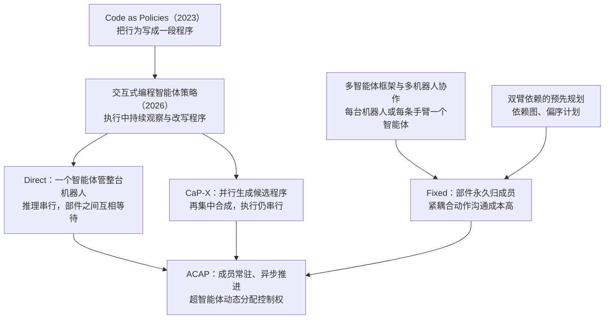
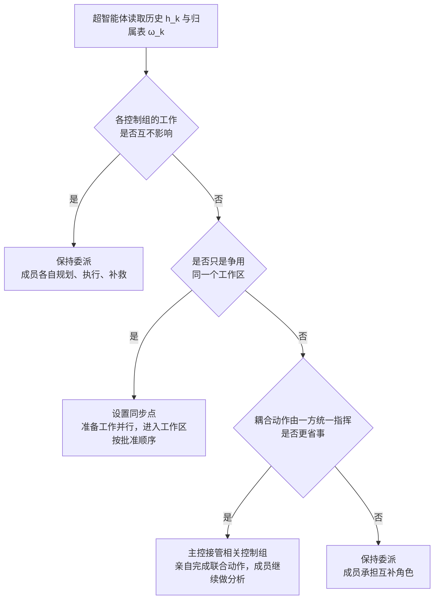
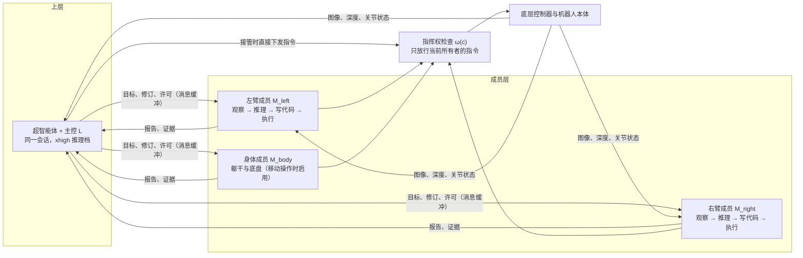
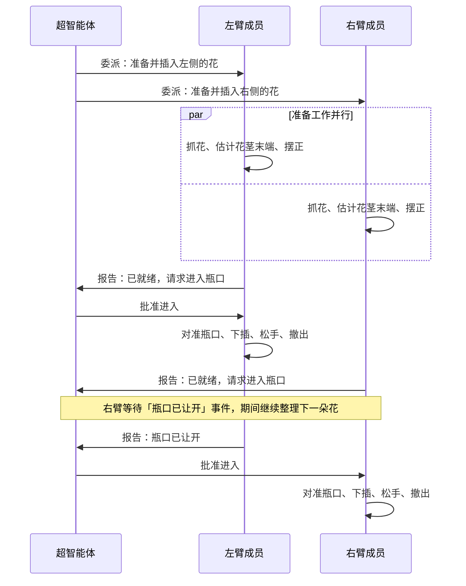
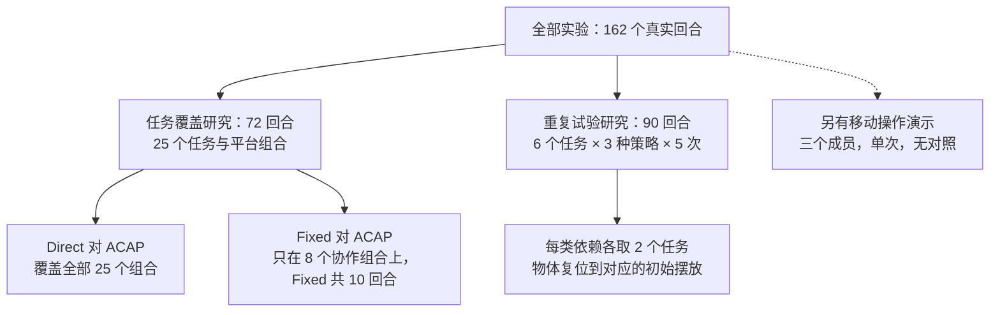

# ACAP：用一组异步的编程智能体高效地控制一台机器人

> **原题**：ACAP: Asynchronous Coding Agents for Efficient Robot Control
> **作者**：Zexin He、Rui Li、Yushi Lan、Chengkai Jin、Zhi Hou、Xingang Pan
> **机构**：南洋理工大学 S-Lab、牛津大学、ACE Robotics
> **年份**：2026（arxiv ID 2611.31205）
> **分类**：cs.RO / cs.MA
> **链接**：https://arxiv.org/abs/2611.31205
> **项目主页**：https://projects.zxhezexin.com/acap
> **精读日期**：2026-11-25

## 阅读须知

### 这篇在领域里的位置

让大语言模型控制机器人，过去几年大致有两条路线。第一条路线是从示教数据里学出一个端到端的视觉运动策略，输入相机画面，直接输出关节或末端的动作，Diffusion Policy、OpenVLA、π0 都属于这一类。第二条路线不训练新的策略，而是让一个会写代码的语言模型在现场写程序：它看图、建一个简单的几何模型、算出目标位姿、调用机器人的控制接口，再根据执行后的反馈修改程序。

第二条路线的起点是 2023 年的 Code as Policies，它把机器人的行为表达成一段语言模型生成的程序。到了 2026 年，这条路线演变成「编程智能体即策略」：智能体不再一次性写完程序，而是在整个任务过程中持续地观察、推理、写代码、执行、再观察，论文引用的 Agent as Policy（Jia 等，2026）与 CaP-X（Fu 等，2026）是这一阶段的代表。这篇 ACAP 就站在这一阶段之上，它不去改进智能体本身的能力，而是问一个组织层面的问题：一台机器人身上有两条手臂、一个躯干和一个底盘，这些部件的推理是否一定要挤在同一个智能体的同一条思路里。

它给出的答案是把一台机器人拆成一支小队。每个部件组配一个长期存在的成员智能体，各自观察、各自推理、各自发动作指令，再由一个上层的「超智能体」负责分派任务、协调依赖关系，并且在必要的时候把几个部件的控制权收回来亲自操作。

### 读完能回答什么

1. 单个编程智能体控制整台机器人的时候，时间主要耗在哪里，为什么让两条手臂同时运动并不能解决这个问题。
2. ACAP 里的成员智能体、主控智能体与超智能体各自负责什么，「控制权归属」与「共享工作区的进入许可」为什么要分成两件事。
3. 固定委派（每个部件永久交给一个成员）在叠毛巾、抬篮子这类双臂紧耦合任务上为什么反而比单智能体慢得多。
4. 论文报告的 28.2% 时间节省是怎样算出来的，其中有多少来自推理的重叠，有多少来自机器人动作的重叠。
5. 这套实验的结论在哪些地方还不够牢靠，比如样本量、推理档位的混杂、以及时间指标对少数长回合的敏感程度。

### 阅读前置

这份笔记假定读者了解大语言模型智能体的基本工作方式，也就是「观察、思考、调用工具、读取结果」的循环，并且对多智能体框架里的消息传递有大致印象。笔记不假定读者做过机器人，凡是涉及机器人的概念，例如末端执行器、控制组、底层控制器、相机反投影，都会在第一次出现时解释。

论文几乎没有公式，全篇只有两条：一条是超智能体的决策形式，一条是时间成本的定义。因此阅读的难点不在数学，而在分清几个角色之间的权限关系，以及看懂实验表格里几种时间口径的差别。

### 首次出现的缩写与术语表

| 名称 | 含义 |
|---|---|
| **ACAP** | Asynchronous Coding Agents as Policy，异步编程智能体即策略，本文提出的框架 |
| **Direct** | Direct Policy，直接策略。一个编程智能体负责整台机器人的推理与控制，是主要对照组 |
| **Fixed** | Fixed Delegation，固定委派。有主控也有成员，但只有成员能指挥各自的部件，控制权不能交还主控 |
| **控制组**（control group） | 一组被捆在一起指挥的执行器，例如「一条手臂加它的夹爪」，或者「躯干加底盘」 |
| **成员**（member，记作 M_c） | 常驻在某一个控制组 c 上的编程智能体 |
| **主控**（lead，记作 L） | 可以同时直接控制多个控制组的智能体 |
| **超智能体**（hyper-agent） | 对其他智能体的工作进行推理与协调的智能体；实验里它与主控是同一个会话 |
| **AUC** | Area Under Curve，曲线下面积。本文指「物理进度随时间变化的曲线」在 30 分钟内的归一化面积，分数越高说明进度来得越早 |
| **VLA** | Vision-Language-Action，视觉语言动作模型，端到端学习路线的代表形态 |
| **CaP** | Code as Policies，把机器人行为写成语言模型生成的程序的早期工作 |
| **SVD** | Singular Value Decomposition，奇异值分解。论文的数据集示例里用它拟合两组三维点之间的刚体变换 |
| **R1 / P-A 至 P-D** | 实验平台的代号。R1 是 Galaxea R1 Pro 人形移动操作机器人，P-A 到 P-D 是四套 AgileX PiPER 系列双臂装置 |

## 一、问题

让一个编程智能体控制机器人，最直观的代价是慢。智能体每做一个决定都要经历一轮推理：读入几张相机图像，写一段数值计算的程序，读取程序的输出，再决定下一条运动指令。一轮推理往往要几十秒，而机器人执行这条指令也许只要两三秒。于是整个任务的时钟，大部分是在「等智能体想完」当中流走的。

这件事在双臂机器人上尤其可惜。设想左手抓电池失败了，智能体需要花一分钟查看图像、诊断失败原因、重新规划抓取；在这一分钟里，右手本来可以去做一件毫不相干的事情，却只能停在原地。问题并不出在机器人的硬件上，因为底层接口完全允许两条手臂同时运动。问题出在决策上：两条手臂的所有决定都要排队经过同一条推理链，一条手臂的诊断于是堵住了另一条手臂的进度。

这篇论文要解决的技术问题因此可以表述得很具体：在所有策略使用相同的观察手段、相同的数值工具、相同的机器人控制接口的前提下，怎样组织多个编程智能体，才能缩短完成一项真实操作任务所需要的墙上时钟时间。

### 前人的几条路线

第一条路线是单智能体的直接策略，也就是论文里的 Direct。它的优点是所有信息都在同一个上下文里，智能体对两条手臂的状态一清二楚，做需要双臂配合的动作时不存在沟通成本。它的不足正是上文所说的排队：推理是串行的，任何一个部件的思考都会占用整台机器人的时间。

第二条路线是并行地生成程序，然后集中合成。CaP-X 的做法是让多个候选程序并行产生，再由中心汇总成一个。这种做法加快了「写程序」这一步，但各个候选之间并没有各自的身体部件与各自的持续记忆，汇总之后仍然是一条串行的执行链。

第三条路线来自多智能体框架与多机器人协作。AutoGen、MetaGPT 这类通用框架给智能体划分角色并规定通信方式；机器人领域则有把每台机器人交给一个智能体的做法，以及给每条手臂配一个语言模型、通过辩论协调的 BiCICLe（Palma 等，2026）。这些工作确实把推理分散开了，但是它们面对的多是「几台各自独立的机器人」，或者每一轮都用全新的提示词重新开始，成员没有跨任务阶段保留下来的程序与局部知识。

第四条路线关注双臂之间的物理依赖。LABOR、DAG-Plan、LLM+MAP 这些方法会事先挑选协调模式，或者生成一张依赖关系图、一份偏序计划，再按图执行。它们的局限在于协调方式在执行前就基本定下来了，而真实操作中依赖关系会随着物体状态的变化而改变：一次失败的抓取把篮子推歪了，原先的同步点就不再成立。

### 把推理分开之后冒出来的新问题

把一台机器人拆给几个智能体，独立的推理并不等于独立的物理动作。几个智能体共用同一副身体，一条手臂伸过去可能挡住另一条手臂的路径，躯干下蹲会同时改变两条手臂够得到的范围。最朴素的拆法是把每个控制组永久地交给一个成员，论文把它单独列为一个对照组，称为固定委派。

固定委派在互不相干的任务上工作得很好，可是一旦遇到叠毛巾、拧瓶盖这样需要两只手同时作用在同一个物体上的动作，它就要付出高昂的沟通代价。两个成员各自准备一段运动程序，互相汇报就绪状态，再约定一个共同的起始信号；其中任何一方的补救动作改变了物体的姿态，另一方的计划就随之作废，于是又要再来一轮沟通。论文真正要回答的，是在依赖关系不断变化的情况下，怎样让协调本身不成为新的瓶颈。

## 二、方法

ACAP 把两个问题分开处理。第一个问题是几个智能体怎样各自独立地向前推进，这由一套异步的运行框架来保证。第二个问题是它们的工作应当怎样协调，这交给一个超智能体根据现场反馈去判断，而不是由人事先写成规则。

### 2.1 控制组、成员与主控

论文用符号 𝒞 表示机器人上配置好的控制组的集合。一个控制组是一批被捆在一起指挥的执行器：在双臂实验里，𝒞 包含「左臂加左夹爪」与「右臂加右夹爪」两个组；在移动操作的演示里，又多出一个「躯干加底盘」的身体组。

每个控制组 c 都对应一个常驻的成员智能体，记作 M_c。此外还有一个主控智能体 L，它有权同时直接控制多个控制组。成员并不是一开始就全部启动，而是在需要的时候才被激活。

每个处于活动状态的智能体都按自己的节奏重复同一个循环：观察、推理、写代码、执行。一个成员在诊断抓取失败的时候，另一个成员可以同时规划放置位置，谁也不必等对方想完这一轮。机器人的底层控制器负责跟踪已经下达的运动目标，所以「一个部件在动」与「另一个智能体在想」这两件事在时间上可以叠在一起。

这里还有一个节省成本的设计。成员处理的是局部的子任务，于是可以使用较轻的推理档位；通盘考虑整个任务的超智能体则使用最重的推理档位。实验中主控使用名为 Astra 的模型并开到 xhigh 推理档，成员使用同一个模型的 medium 档。

### 2.2 超智能体的决策

超智能体是「对其他智能体的工作进行推理」的那一层。论文之所以不采用人工编写的协调规则，是因为规则里固化的是人对工作应当如何组织的假设，而一个足够强的编程智能体完全可以根据眼前的物理状况自己决定如何协调。

它的决策形式是全文两条公式中的第一条：

$$u_k \sim \pi_H(\,\cdot \mid h_k, \omega_k), \qquad \omega_k(c) \in \{\mathrm{L}, \mathrm{M}_c\},\quad c \in \mathcal{C}$$

公式里的每个符号含义如下。

- k 是超智能体的决策序号。它只数超智能体自己做了几次决定，成员们的循环并不受这个序号约束。
- π_H 是超智能体的策略，也就是那个语言模型加上角色提示词所形成的行为。
- h_k 是到第 k 次决策为止的交互历史，其中包含相机观察、成员发来的报告，以及各种数值计算的结果。
- ω_k 是当前的指挥权归属表。对每一个控制组 c，ω_k(c) 的取值只有两种：要么归主控 L，要么归该组自己的成员 M_c。
- u_k 是超智能体选出的动作。它可以是分派或修改一项工作，可以是向成员索要某项证据，可以是声明一个依赖关系，可以是批准某个成员进入共享工作区，也可以是安排主控亲自执行一个动作。

这条公式要表达的意思其实很朴素：超智能体不照着一张事先给定的任务图行事，它每一步都看着历史与当前的归属表，再决定下一步如何调度。

「委派」这个动作一次交给成员三样东西：一个目标、一个允许行动的范围，以及该控制组的指挥权。在这个范围之内，成员自己处理局部的规划与失败后的补救。随着依赖关系变化，超智能体有三种基本的应对方式：让各项工作继续互不相干地进行；在共享工作区前给成员的动作排出先后；或者把互相耦合的几个控制组收回主控手中，由主控完成一次联合动作。除此之外，如果两个成员的角色恰好互补，例如一只手固定瓶身、另一只手拧盖，超智能体也可以让这项协作留在成员手里。

### 2.3 支撑这一切的四个机制

框架本身只提供四个机制，它们的作用是让并发工作与控制权交接能够安全地发生。至于什么时候交接、交给谁，仍然由超智能体判断。

**常驻的上下文。** 每个成员在一个回合之内始终保留自己的观察记录、对话历史与生成过的程序，不论它中途被分派了几次任务，也不论它的控制组被主控收走过几次。于是成员可以从先前的工作接着做，不需要重启会话或者重建对局部场景的认识。更有用的一点是，当主控正在直接指挥某个成员的手臂时，这个成员并不闲着，它可以继续用自己的相机做分析。

**消息缓冲。** 成员向超智能体汇报，超智能体向成员下发目标、修订与相关证据。这些指令与报告会一直留在缓冲区里，直到接收方确认已经收到。之所以需要这一层，是因为几个智能体的速度各不相同，一方发消息时另一方可能正处在一轮推理的中途，缓冲保证了消息不会因为对方正忙而丢失。

**基于事件的等待。** 一个同步点要说明两件事：哪些动作必须等待，以及出现什么证据之后才可以继续。智能体可以等待一组事件中的任意一个，也可以等待它们全部发生，而等待期间其他工作照常进行。以四朵花插入同一只花瓶为例，一个成员在整理并摆正自己手里的花，另一个成员正在把花插进瓶口再把手撤出来。撤出之后发出的「瓶口已让开」的报告，就是批准下一次插入的同步事件。只有「进入瓶口」这一个动作需要等待许可，花的准备工作因此可以与对方的插入重叠进行。

**排他的指挥权。** 框架把「谁有权指挥某个控制组」与「谁被允许进入某个共享工作区」分成两件事。对每个控制组，框架只接受当前所有者发来的指令；在一次对机器人控制器的调用尚未结束时，所有权不能变更。回合开始时所有可用的控制组都归主控，委派把所有权转给成员，接管再把它交还主控。交接的时候控制器的目标值保持不变，所以责任可以换人，而机器人不必停下动作，也不会松开手里拿着的东西。新的所有者在行动之前要先检查一遍物理反馈。

### 2.4 一个完整的例子：四朵花与一只花瓶

把上面的机制放进一个任务里看会更清楚。任务是把四朵塑料花插进同一只花瓶，两条手臂各负责两朵。花瓶口很小，两只手不可能同时伸进去，因此「插入」这一步必须排队；而「拿起花、看清花茎末端在哪里、把花摆正」这些准备工作互不相干，完全可以同时做。

这个例子里还有一个值得记下的细节。在两朵花的那次记录中，先完成的成员并没有停下，而是用自己手腕上的相机去看另一朵花被遮挡的花茎末端，把这份观察提供给对方。可见成员的常驻上下文与独立的观察能力，让「空闲」的部件也能为整体进度做贡献。

### 2.5 两种对照策略到底差在哪里

实验的说服力取决于对照组的设计，因此有必要把三种策略的差别讲准确。三者使用的观察模态、数值工具与机器人控制接口完全相同。

Direct 只有一个智能体。它能够同时给两条手臂下达运动指令，但是规划与控制共用一个上下文，推理是串行的。

Fixed 已经具备多个智能体、主控的规划与同步机制，任务分派与时机都可以调整。它与 ACAP 唯一的结构差别是所有权不能回到主控手里，只有成员能够指挥自己的控制组。

ACAP 在 Fixed 的基础上多了一项选择权：超智能体既可以让执行留在成员手里，也可以在它认为合适的时候把几个控制组收回来直接操作。由此可见，Direct 与 ACAP 的比较衡量的是「分散推理」的收益，而 Fixed 与 ACAP 的比较衡量的是「可变的控制权」的收益。

## 三、实验

### 3.1 实验设计

所有实验都在真实机器人上进行，没有仿真。硬件是一台 Galaxea R1 Pro（2025 款），以及四套 AgileX PiPER 系列的双臂装置。每一个回合都从全新的智能体会话开始，不带任何先前回合的对话或任务专用程序；操作员只负责监控安全，不提供任务指导，也不动手帮忙。

任务按照控制组之间的依赖关系分成三类。完全并行（Fully Parallel）的任务里各个控制组独立完成各自的子任务，例如把电池分别放进各自最近的盘子。并行加顺序（Parallel-Sequential）的任务里，某些动作要等另一组的进度或者共享工作区的空位，例如上面的插花。协作（Collaborative）的任务里，几个控制组要共同支撑、移动或者折叠同一个物体，例如叠毛巾。

### 3.2 两个指标

第一个指标是时间成本。时间 T_i 从策略开始执行算起，到记录下任务结果为止，其中包含推理、计算、等待、运动与补救，但不包含执行之前的场景布置。全文第二条公式规定了任务覆盖研究里的时间成本 L_i：

$$L_i = \begin{cases} T_i, & \text{任务完成} \\ \max(T_i,\ 30\ \text{分钟}), & \text{其他情况} \end{cases}$$

这条定义的含义是，没有完成任务而提前停下的回合至少记 30 分钟，而超过 30 分钟的时长照实记录、不封顶。重复试验研究里则改用封顶的口径，即 L_i 与 30 分钟取较小者：30 分钟内完成的记实际用时，其余一律记 30 分钟。

第二个指标是物理进度与它的 AUC。标注员按照每个任务专门制定的评分细则，在视频里标出各个里程碑第一次达成的时刻，并给出 0 到 100 的进度分；例如四朵花的任务里，每有一朵花被放进瓶中记 25 分。标注界面隐藏了策略的名称，标注员并不知道自己看的是哪一种策略。把「到每个时刻为止达到过的最高分」连成一条曲线，在 30 分钟内积分再除以 30 分钟，就得到归一化的 AUC，它衡量的是进度来得早不早。

汇总时先在每个任务组合内部对重复的回合取平均，再对各个组合等权平均。论文把这种算法得到的结果称为「任务平衡」的时间成本，这样做是为了避免重复次数多的组合占去过多权重。

### 3.3 主要结果：分散推理省了多少时间

| 依赖类别（组合数） | Direct 时间（分钟） | ACAP 时间（分钟） | 相对减少 | Direct AUC | ACAP AUC |
|---|---|---|---|---|---|
| 完全并行（6） | 20.49 | 13.22 | 35.5% | 60.3 | 75.2 |
| 并行加顺序（11） | 20.27 | 13.86 | 31.6% | 67.4 | 73.1 |
| 协作（8） | 16.25 | 13.75 | 15.4% | 56.9 | 70.8 |
| 全部（25） | 19.04 | 13.67 | 28.2% | 62.3 | 72.9 |

表中「相对减少」一列的分类数字是这份笔记根据论文的两列时间自行算出的，论文正文只给出了总体的 28.2%。三类任务的排序符合直觉：部件之间越是互不相干，分散推理的收益越大；到了协作类任务，收益缩小到一成半左右。

完成率随时间的变化能够补充这张表。到第 15 分钟，ACAP 在全部组合上的任务完成率是 74.0%，Direct 是 40.7%；到第 30 分钟，ACAP 达到 100%，Direct 为 88.0%。物理进度的差距出现得更早，第 5 分钟时两种策略都还没有完成任何任务，而 ACAP 的平均进度分已经是 28.9，Direct 是 18.0。

### 3.4 协作任务：可变的控制权值多少

| 策略 | 时间（分钟） | 进度 AUC | 第 30 分钟完成率 |
|---|---|---|---|
| Direct | 16.25 | 56.9 | 87.5% |
| Fixed | 26.02 | 36.3 | 43.8% |
| ACAP | 13.75 | 70.8 | 100% |

这张表里最醒目的并不是 ACAP 领先，而是 Fixed 比单智能体的 Direct 还要慢出将近十分钟。换句话说，在双臂紧耦合的任务上，仅仅把推理拆给多个智能体不但没有帮助，反而造成了明显的损失。ACAP 在全部 8 个协作组合上的平均时间都低于 Fixed。

论文举了两个画面来说明超智能体的两种协调方式。叠毛巾时，两个成员先各自抓好毛巾的角，然后主控接管两条手臂完成共同的对折，成员在此期间继续做分析；完成时间与 Direct 相近，而 Fixed 还在反复地准备与收尾。拧瓶盖时，ACAP 让「固定瓶身」与「拧盖」这两个互补角色留在成员手里；这是三种策略中唯一完成任务的一次，两个对照组都在手臂交叉之后触发了硬件故障。

Fixed 的执行记录解释了它慢在哪里。抬水果篮的那一回合，从主控发出准备指令到第一条运动指令真正下发，中间隔了大约 156 秒，时间花在各成员的本地计算与检查上。抬牛奶盒的那一回合，其中一个成员设置的等待条件没有识别出共同的起始信号，后来靠一条纠正指令才继续下去。两个回合最终都完成了，但是把两份「我已就绪」的报告变成一个同时发生的动作，需要额外的好几轮协调。

### 3.5 重复试验：结论稳不稳

| 任务 | Direct 时间 | Direct AUC | Fixed 时间 | Fixed AUC | ACAP 时间 | ACAP AUC |
|---|---|---|---|---|---|---|
| 擦水并摆放毛巾（完全并行） | 23.73 ± 3.84 | 60.5 | 15.16 ± 2.98 | 72.0 | 12.54 ± 1.95 | 73.7 |
| 方块与电池分拣（完全并行） | 21.61 ± 3.07 | 62.5 | 17.44 ± 9.45 | 65.8 | 14.30 ± 5.87 | 75.2 |
| 插四朵花（并行加顺序） | 27.06 ± 3.79 | 46.7 | 25.59 ± 5.13 | 34.8 | 22.89 ± 6.78 | 56.6 |
| 组装三明治（并行加顺序） | 22.96 ± 9.06 | 40.3 | 26.50 ± 7.82 | 42.3 | 12.17 ± 4.70 | 69.2 |
| 叠毛巾（协作） | 19.74 ± 7.98 | 63.6 | 27.85 ± 4.10 | 40.9 | 16.47 ± 3.36 | 65.1 |
| 抬牛奶盒（协作） | 13.50 ± 9.34 | 75.2 | 29.82 ± 0.41 | 35.6 | 12.45 ± 2.37 | 70.1 |
| 六个任务平均 | 21.43 | 58.1 | 23.73 | 48.6 | 15.14 | 68.3 |

时间的单位是分钟，采用 30 分钟封顶的口径，正负号后面是五次试验的样本标准差。ACAP 在六个任务上的平均时间全部低于 Direct，任务平衡之后的降幅是 29.4%，与任务覆盖研究的 28.2% 十分接近。

分离得最干净的是擦水并摆放毛巾这个任务：两种策略五次都完成了，而 ACAP 的每一次都比 Direct 的每一次更早结束。协作类的两个任务合计十次试验，ACAP 完成十次，Direct 完成八次，Fixed 只完成三次。值得注意的是，Fixed 在擦水任务上五次全部完成，可见它分派独立工作的能力没有问题，困难集中在两只手必须共同折叠或支撑物体的时候。

### 3.6 时间究竟省在哪里

论文对执行记录做了时间拆解，这是全文最有分量的一张表。「推理工作量」指各个智能体处于活跃应答状态的时长之和；几种「重叠」指两件事在墙上时钟上同时发生的时长。

| 时间分项（ACAP 相对 Direct，分钟） | 任务覆盖研究 | 重复试验研究 |
|---|---|---|
| 多出来的推理工作量 | +4.95 | +6.29 |
| 智能体之间推理的重叠 | −8.17 | −9.51 |
| 推理与机器人执行的重叠 | −1.35 | −1.44 |
| 控制组之间执行的重叠 | −0.18 | −0.14 |
| 墙上时钟时间之差 | −4.80 | −5.23 |

这张表有两点值得细读。其一，ACAP 的推理总量其实比 Direct 多出五到六分钟，它是在做更多推理的同时更早结束的，多出来的推理被重叠消化掉了。其二，机器人两条手臂同时在动所节省的时间只有十秒上下，几乎可以忽略；绝大部分收益来自「几个智能体同时在想」，其次来自「一个在想、另一个在动」。这正好回应了开头的判断：瓶颈在推理的排队，而不在运动的排队。

第二张拆解表比较 Fixed 与 ACAP 在两个重复的协作任务上的差别。

| 时间度量（分钟） | Fixed | ACAP |
|---|---|---|
| 推理工作量 | 46.92 | 23.29 |
| 并发的推理 | 14.78 | 6.86 |
| 协调等待 | 13.86 | 2.85 |
| 墙上时钟时间 | 28.83 | 14.46 |

### 3.7 两个反直觉的结果

第一个反直觉之处就在上面这张表里：Fixed 并发推理的时间是 ACAP 的两倍多，墙上时钟时间却也是 ACAP 的两倍。也就是说，更多的并行并没有换来更短的用时。原因在于 Fixed 的并行推理当中有相当一部分是成员们在反复修订、反复对表，这些推理虽然重叠着进行，物理进度却停在原地。与此同时，Fixed 花在显式等待上的时间接近十四分钟，而 ACAP 不到三分钟。

第二个反直觉之处藏在附录的逐任务表格里。25 个任务组合中有 2 个是 ACAP 反而更慢的：物品归格（T09）上 Direct 用了 11.37 分钟，ACAP 用了 15.21 分钟；R1 上的抬篮子（T19）上 Direct 用了 9.94 分钟，ACAP 用了 13.01 分钟。重复试验里抬牛奶盒的进度 AUC 也是 Direct 更高（75.2 对 70.1）。论文正文强调三类任务上的平均都有改进，这一点属实，但是读者应当知道，改进是平均意义上的，并非每个任务都如此，而一个本来就很快的任务加上团队组织的固定开销之后可能得不偿失。

### 3.8 移动操作与数据集

论文还在 R1 Pro 上演示了三个成员的配置：两条手臂各一个成员，再加一个负责底盘与躯干的身体成员，身体成员使用与手臂成员完全相同的任务分派与汇报接口。任务是从几处不同的台面上取花，再放进地面上的篮子。身体的运动会同时改变两条手臂的工作空间，所以超智能体在批准躯干下降之前，先等两条手臂都报告「花已拿稳、手臂已就绪」；后来左臂成员报告从当前位置够不到篮子，超智能体便改了顺序，让右臂先放，身体重新对位，左臂再放。这次演示完成了任务，不过它只有一次，也没有对照组，从附录的时间戳看，最后一朵花放好是在回合开始后的 32 分 02 秒。

随论文一起发布的数据集包含全部 162 个真实回合，覆盖三种策略。每个回合保存了任务指令、带时间戳的观察、智能体生成的程序、数值输出、动作请求、机器人反馈与任务结果；多智能体的回合还保存了任务分派、消息与控制权交接的记录。附录给出的几个例子很能说明编程智能体是怎样「用代码思考物理」的。

其中一个例子是估计花茎末端的三维位置。花茎太细，深度相机的读数不可靠，于是成员让手保持抓取姿态大致不变地抬高一段距离，在抬高前后各拍一张图。花茎末端在两张图里的像素位置各确定一条从相机出发的射线，而机器人测得的手部位移约束了两次末端位置之间的差，成员生成的一段 NumPy 程序据此用最小二乘解出两条射线上的深度，得到末端的大致三维坐标。另一个例子更有意思：主控命令夹爪把牛奶盒抬高 20 毫米之后，看到图像固定位置上的深度几乎没变，便判断盒子滑脱了；这时右臂成员写了一段 OpenCV 程序去跟踪盒子上印刷的图案，发现这些点上升了大约 19 毫米，主控接受了这份证据并撤回了滑脱的诊断。

## 四、局限

### 作者自己承认的

论文在附录里只明确列出了一条局限。回合记录显示智能体会在策略层面考虑碰撞：推理可能的干涉、为共享工作区排序、根据观察检查间隙、修改运动计划。但是当前的框架没有一个专门的、运动层面的碰撞检查层。作者设想今后补上一个控制层，把机器人的完整几何（包括加装的相机与其他附件）与环境几何都纳入，对计划中的运动做检查并在执行中监控，这部分留给后续工作。

正文里还有一处可以算作间接的承认：Direct 与 ACAP 的比较「包含了成员使用较轻推理档位」这一因素。也就是说作者清楚这项比较不是只改变了组织结构。

### 读完能看出来的

**样本量小，且没有显著性检验。** 任务覆盖研究的 72 个回合分给 25 个组合，扣掉 Fixed 的 10 个回合之后，Direct 与 ACAP 合计 62 个回合对应 50 个「组合乘策略」的格子，这意味着多数格子只有一次试验。真实机器人的单次试验方差很大，这一点从重复试验的标准差就能看出来，例如 Direct 在抬牛奶盒上是 13.50 ± 9.34 分钟，ACAP 在插四朵花上是 22.89 ± 6.78 分钟，而后者与 Direct 的 27.06 ± 3.79 明显重叠。全文没有报告任何置信区间或假设检验。

**时间指标对少数长回合敏感。** 任务覆盖研究里失败的回合至少记 30 分钟，超过 30 分钟的又不封顶，于是个别回合对平均值的影响很大：P-C 上的插花（T10）Direct 记了 55.06 分钟，酒店托盘准备（T04）Direct 记了 38.17 分钟。这份笔记用附录的逐任务数据重新算了一遍，去掉这两个组合之后，Direct 与 ACAP 的平均分别是 16.64 与 13.05 分钟，降幅从 28.2% 缩小到 21.6%；如果改看 25 个组合的中位数，则是 15.62 对 12.50 分钟，降幅约 20%。改进的方向没有变，但是幅度比标题数字温和。需要说明的是，这几个数字是笔记自行计算的，不是论文报告的。

**组织结构与推理档位混在一起。** ACAP 的成员用的是 medium 档，Direct 用的是 xhigh 档，两者之间同时改变了「是否分散」与「推理多重」两个变量。较轻的档位本身就更快，所以 28.2% 当中有多少来自异步组织、多少来自成员想得更少，从现有的实验里分不出来。一个让 Direct 也使用 medium 档的对照，或者让成员使用 xhigh 档的 ACAP，都可以回答这个问题，但论文没有做。

**只算了时间，没有算开销。** 时间拆解表明 ACAP 的推理总量比 Direct 多五到六分钟，而且是多个会话同时运行，令牌消耗与金额成本必然更高。论文没有给出任何令牌数或费用，因此「高效」一词在这里只指墙上时钟，不指计算资源。

**绝对速度仍然很慢，且没有与学习式策略比较。** ACAP 完成一项桌面任务平均需要将近 14 分钟，其中包括把电池放进盘子这样的简单动作。论文的全部对照都是编程智能体策略的不同组织方式，没有任何一个 VLA 或者示教学习的基线，因此它回答的是「编程智能体路线内部怎样更快」，而没有回答「这条路线相对其他路线处在什么位置」。

**依赖一个没有交代来历的前沿模型。** 实验统一使用名为 Astra 的模型，正文只说明了推理档位，没有说明它的提供方与版本，也没有换用其他模型的结果。超智能体「该不该接管」的判断质量显然取决于模型的能力，一个较弱的模型未必能做出同样的协调决定，所以结论能否迁移到别的模型上是未知的。

**超智能体的判断只有个案展示。** 论文展示了叠毛巾时选择接管、拧瓶盖时选择保留委派这两个成功的个案，但是没有统计超智能体在所有回合里各做了多少次接管、其中有多少次事后看是不必要的或者错误的。另外，主控与超智能体在实验里是同一个会话，主控亲自操作两条手臂的时候，协调这一层是否会被占住，论文没有讨论。

**标注的可靠性没有量化。** 物理进度由人工标注，界面隐藏了策略名称，这是好的做法。但是正文与附录都没有说明标注员的人数，也没有报告标注员之间的一致性；评分细则允许根据「物理质量」给出中间分，这部分主观判断对 AUC 的影响无从估计。

**安全依赖人在场。** 两个对照组在拧瓶盖时都因为手臂交叉触发了硬件故障，所有回合都有操作员监控安全。在没有运动层碰撞检查的情况下，让几个智能体各自给同一副身体下指令，这套系统目前只适合在有人看护的实验环境里运行。

**移动操作只是一次演示。** 三成员配置只跑了一个任务、一个回合，没有对照，用时超过 32 分钟。它证明了成员接口可以扩展到身体部件，但还不足以说明在移动操作上同样存在效率收益。

## 值得跟读

- **Agent as Policy for Robotic Manipulation**（Jia 等，arXiv 2609.12541）：ACAP 所依托的「编程智能体即策略」范式的出处，也是 Direct 这个对照组的原型。
- **CaP-X**（Fu 等，2026）：编程智能体做机器人操作的评测与改进框架，采用并行生成程序再集中合成的做法，可以与 ACAP 的常驻成员对照着读。
- **Why Do Multi-Agent LLM Systems Fail?**（Cemri 等，NeurIPS 2025，arXiv 2503.13657）：系统分析多智能体系统的失败模式，Fixed 对照组暴露的协调成本与其中的结论相互印证。

## 一句话

把一台机器人拆给几个常驻的编程智能体异步推理，再由超智能体动态收放控制权，真机用时平均减少约 28%。
