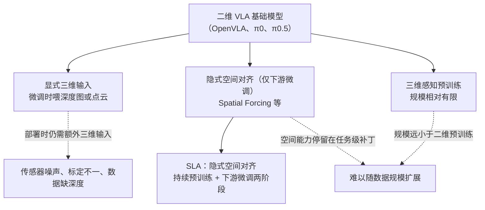
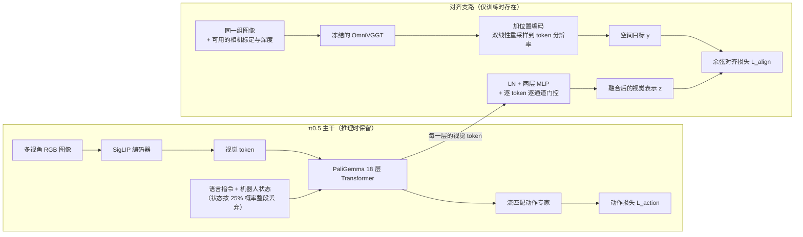
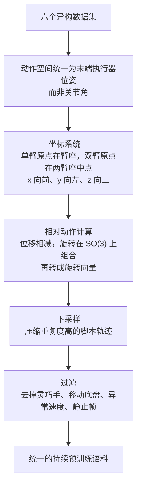
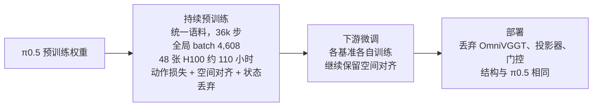
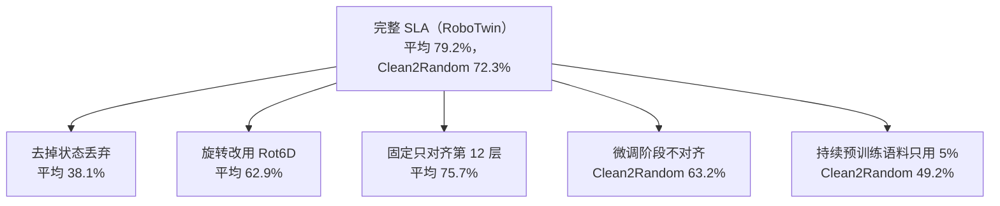

# SLA：用持续预训练把空间理解养进机器人基础模型

> **原题**：SLA: Scaling Spatial-Language-Action Model via Continual Pre-training
> **作者**：Fuhao Li, Wenxuan Song, Qizhou Huang, Ziyang Zhou, Jingbo Wang, Junwu E, Pengwei Wang, Yan Wang, Shunbo Zhou, Haoang Li
> **机构**：香港科技大学（广州）、OLA Dimensions、北京智源人工智能研究院、清华大学
> **年份**：2026（arxiv ID 2611.08373）
> **分类**：cs.RO
> **链接**：https://arxiv.org/abs/2611.08373
> **精读日期**：2026-11-07

## 阅读须知

### 这篇在领域里的位置

这篇论文属于机器人操作领域里「视觉-语言-动作模型」（VLA）这一条线。过去两三年，这条线的主流做法是拿一个在海量图文数据上预训练好的视觉语言模型做底座，再接一个专门输出机械臂动作的模块，然后用大量机器人示范数据去训练，代表作有 OpenVLA、π0 与 π0.5。这类模型听得懂指令、认得出物体，但它们的视觉表示来自二维图文预训练，对「物体离夹爪还有几厘米、桌面有多高」这类三维几何关系天生不敏感。

为了补上三维这一课，社区大致走过两步。第一步是在下游微调时直接喂深度图或点云，让模型多一路三维输入；第二步是作者团队自己此前的工作 Spatial Forcing，它不改输入，而是在微调时让 VLA 的中间视觉特征去对齐一个冻结的三维感知模型的特征，从而把几何知识「隐式」地压进表示里。SLA 位于第三步：它把 Spatial Forcing 那套隐式对齐从下游微调提前到了大规模的持续预训练阶段，并且在下游微调时继续保留，想让空间理解成为基础模型本身的能力，而不是每个任务各自外挂的补丁。

### 读完能回答什么

1. 为什么二维图文预训练出来的 VLA 缺乏三维空间理解，作者用什么实验证明了这一点
2. SLA 的「隐式空间对齐」具体对齐的是什么、拿什么当老师，为什么推理时完全不增加开销
3. 自适应层选择与状态随机丢弃各自解决什么问题，消融实验里它们的影响有多大
4. 空间对齐放在持续预训练、下游微调、还是两处都放，效果差别有多大，数据规模又起了什么作用
5. 在异构的多机器人数据上统一动作表示时，为什么作者选择旋转向量而不是欧拉角

### 阅读前置

假定读者熟悉 Transformer 的基本结构、视觉语言模型如何把图像切成视觉 token，以及预训练加微调的基本范式。不预设读者做过机器人学习，也不预设读者了解三维重建模型或流匹配这类生成方法，这些概念会在正文首次出现时先铺垫再展开。

### 缩写表

- **VLA**（Vision-Language-Action model，视觉-语言-动作模型）：输入相机画面与语言指令，直接输出机器人动作的模型。
- **VLM**（Vision-Language Model，视觉语言模型）：在图文数据上预训练、能看图说话的模型，VLA 通常以它为底座。
- **SLA**（Spatial-Language-Action model，空间-语言-动作模型）：本文提出的模型名，强调在 VLA 之上加入空间理解。
- **π0 / π0.5**：Physical Intelligence 公司发布的两代 VLA 基础模型，π0.5 是 SLA 的初始化起点。
- **PaliGemma**：Google 的视觉语言模型，π0.5 的语言骨干来自它，共 18 层 Transformer。
- **SigLIP**：一种图像编码器，把每张图编码为一组视觉 token。
- **VGGT**（Visual Geometry Grounded Transformer）：一种只看 RGB 图像就能推断深度、相机位姿等三维信息的前馈式三维感知模型。
- **OmniVGGT**：VGGT 的扩展版，除了 RGB 还能吃进相机内外参与深度图这类「有就用、没有也行」的几何标注，本文用它当空间老师。
- **DPT**（Dense Prediction Transformer）：一种把 Transformer 特征解码成逐像素预测（例如深度图）的头部结构，本文用它做探针。
- **EEF**（End-Effector，末端执行器）：机械臂最末端的夹爪，EEF 位姿指夹爪在空间里的位置与朝向。
- **SO(3)**：三维旋转构成的数学群，「在 SO(3) 上组合」即用旋转矩阵相乘来计算两个朝向之间的相对旋转。
- **MLP**（Multi-Layer Perceptron，多层感知机）与 **LN**（Layer Normalization，层归一化）：对齐分支里用来变换特征维度的两个常规组件。
- **SR**（Success Rate，成功率）：评测里完成任务的比例。
- **Rot6D**：用旋转矩阵前两列共六个数表示朝向的一种连续表示。
- **Clean2Clean / Clean2Random**：RoboTwin 2.0 的两种评测设定，前者在干净场景训练、干净场景测试，后者在干净场景训练、随机化场景测试。

## 一、问题

机器人要可靠地抓取、递交、放置物体，光认得出「这是一个苹果」还不够，它还必须知道苹果离夹爪多远、碗沿有多高、另一只手此刻在哪里。今天最强的一批 VLA 在语义上已经相当聪明，能听懂「把黑色胶带放进篮子、别碰胡萝卜」这样的指令，但它们的眼睛是在二维图文对上练出来的。于是一旦场景的几何发生变化，例如桌面升高几厘米、有人把水果扔到别处、目标在抓取途中被挪动，这些模型的成功率便明显下滑。

过去的补救路线主要有两条，下面先把它们的关系画出来，再逐条展开。

第一条路线是在下游微调时直接加入三维模态。PointVLA、GeoVLA 把点云特征接进动作预测，BridgeVLA 把三维观测投影成多视角图像，FALCON 则从空间基础模型里抽几何 token 融进动作头。这条路线的思路直接，但部署时依然需要额外的几何输入。

与之相伴的是三个现实困难。其一，深度相机测出的深度图和点云往往噪声大、残缺多；其二，不同机器人的传感器型号、安装位置、标定状态五花八门。

第三个困难最致命：现有的大规模机器人数据集里，有相当一部分根本没有深度信息。换句话说，只要方法依赖显式三维输入，它就没法吃下这批数据，也就谈不上随数据规模扩展。

第二条路线是作者团队先前提出的 Spatial Forcing，它属于「训练期表示监督」这一类，同类工作还有 ROCKET、VEGA、Mind-VLA。这类方法要解决的问题是，能否不改模型输入、只在训练时给中间表示加一个辅助目标，就把三维知识压进去。

Spatial Forcing 的具体做法是：让 VLA 中间层的视觉 token 去对齐一个冻结的三维感知模型输出的特征。由于老师只在训练时出场，部署时模型结构与原来一模一样，也不需要深度相机。

这条路线的不足在于它只用在下游微调阶段。每做一个新任务，空间能力都要重新在少量示范上现学一遍，它始终是任务级的外挂，而不是基础模型自带的、可以迁移的能力。

还有一类工作尝试在预训练阶段就引入三维，例如用以自我为中心的空间嵌入、三维标注或物体位姿估计做监督。作者的评价是，这些三维感知预训练的规模与动辄上万小时的二维 VLA 预训练相比仍然偏小。

于是这篇论文要回答的技术问题可以落成一句可验证的话：**在不改动 π0.5 推理结构、不要求部署时提供任何三维输入的前提下，能否通过在上万小时异构机器人数据上做带空间对齐的持续预训练，让 VLA 获得可迁移的三维空间理解，并且这种收益会随着数据规模增长？**

这里需要先交代「持续预训练」这个概念。持续预训练是指在一个已经预训练好的基础模型上，继续用某一领域的大规模数据训练一段时间，目的是在保留原有知识的同时，系统性地加强某种能力。数学推理模型 Llemma、智能体基础模型 AgentFounder 都走过这条路。

在机器人领域，此前的持续预训练工作多半只关心「换什么数据」，例如 ET-VLA 用合成数据迁移到新机器人，AXIS 研究性能如何随数据量变化。SLA 的不同之处在于，它关心的是「持续预训练时给表示加什么监督」。

## 二、方法

### 2.1 动机实验：二维 VLA 的视觉特征里几乎没有深度

作者先做了一个探针实验来证明问题确实存在。探针（probing）是一种检验表示里含有什么信息的常用手段：把模型全部冻结，只在其特征之上训练一个很小的读出头，如果小头能读出某种信息，说明这种信息已经编码在特征里。

具体做法是冻结一个 VLA（OpenVLA-OFT），只训练一个 DPT 头，让它把 VLA 的视觉特征解码成深度图。结果显示，仅从二维图像学出来的视觉特征解码不出有意义的空间结构；而经过空间对齐的特征则能解码出清晰得多的深度。

这个实验给出了整篇论文的出发点：动作是以视觉 token 为条件生成的，如果视觉 token 里本来就缺几何信息，动作头再强也无从利用。与此同时，作者不愿意通过加传感器或加深度估计模块来补，因为那会改变原模型的结构，可能破坏它在预训练中学到的通用知识。

### 2.2 整体架构：主干照旧，旁边挂一条只在训练时存在的对齐支路

SLA 以 π0.5 为初始化。π0.5 的结构可以概括为三段：SigLIP 把多视角相机图像编码为视觉 token，PaliGemma 的 18 层 Transformer 把视觉 token、语言 token 与机器人状态一起处理，最后一个基于流匹配的动作专家生成一整段连续动作。

这里的「流匹配」（flow matching）是一种生成方法，它学习如何把一团随机噪声沿着一条平滑路径逐步变换成目标数据。在 π0.5 里，它被用来一次性生成未来若干步的动作序列，这段序列称为一个动作块（action chunk）。

SLA 在这条主干旁边加了一条对齐支路，下图把两条支路画在一起。

对齐支路要做的事情可以分三步讲。第一步是准备老师信号：把同一组多视角图像（以及可用的相机参数、深度图）送进冻结的三维感知模型，取它最后一层的逐像素特征，加上位置编码，再用双线性插值重采样到与 VLA 视觉 token 相同的网格分辨率，得到每个 token 位置上的空间目标。

下面逐个说明这一步里出现的符号：

- $\mathcal{I}$：一组多视角相机图像，几何标注（如相机参数）隐含在其中
- $f^{\mathrm{3D}}$：冻结的三维感知基础模型，本文取 OmniVGGT
- $E$：位置编码，作用是让目标保留空间位置顺序
- $\mathcal{R}$：双线性重采样，把老师的特征网格对齐到 VLA 的 token 网格
- $\mathbf{y}_i$：第 $i$ 个视觉 token 位置上的空间目标

第二步是准备学生信号。VLA 每一层 Transformer 之后都有一份视觉 token，作者把每一层的视觉 token 先做层归一化、再过一个两层 MLP 把维度变换到老师的维度。这组归一化与 MLP 参数在各层之间共享。

随后，各层投影后的特征按一个门控加权求和，得到融合表示 $\mathbf{z}$：

$$\mathbf{z}=\sum_{\ell=1}^{L}{}^{(\ell)}\mathbf{g}\odot\mathrm{MLP}\!\left[\mathrm{LN}\!\left({}^{(\ell)}\bm{x}^{\mathcal{V}}\right)\right]$$

- $L$：Transformer 层数，π0.5 里是 18
- ${}^{(\ell)}\bm{x}^{\mathcal{V}}$：第 $\ell$ 层之后的视觉 token
- ${}^{(\ell)}\mathbf{g}$：第 $\ell$ 层的门控，逐 token、逐通道各有一个 0 到 1 之间的权重
- $\odot$：逐元素相乘

第三步是让学生对齐老师。对齐损失是每个 token 上 $1$ 减去学生与老师特征的余弦相似度，再在所有视角的所有视觉 token 上取平均。梯度会更新 VLA 本身、MLP 投影器和门控参数，而老师始终冻结。

最终的训练目标是动作损失与对齐损失的加权和：

$$\mathcal{L}=\mathcal{L}_{\mathrm{action}}+\alpha\,\mathcal{L}_{\mathrm{align}}$$

其中 $\alpha$ 控制空间对齐的强度。这个设计的关键好处在于，对齐损失只改变 VLA 内部表示的「内容」，不改变它的「结构」。于是 SLA 可以直接加载 π0.5 的预训练权重继续训练，部署时也把老师、投影器、门控全部丢掉，推理流程与原版 π0.5 完全一致，不需要深度图，也不需要相机标定。

### 2.3 外部空间老师：为什么选 OmniVGGT

持续预训练的语料来自六个不同的数据集，几何标注的可得程度参差不齐：有的数据集提供标定好的相机内外参与深度图，有的只有部分标注，有的只有 RGB。

如果把这些标注全部丢掉，等于浪费了现成的几何约束；如果要求标注齐全才能用，又会把大量有价值的示范排除在外。因此老师模型必须能适应「标注有多少用多少」的局面。

OmniVGGT 恰好为此而设计。它建立在 VGGT 之上，交替使用单帧内注意力与跨视角注意力，把局部结构与多张图之间的关系融合起来；它的 GeoAdapter 模块用相机与深度两个分支分别编码可用的几何标注，缺失时用占位 token 填充。

此外，OmniVGGT 训练时就经历过各种几何输入组合（包括纯 RGB），所以面对任意子集的标注都能给出统一的潜在表示。作者据此认为它的骨干特征足以充当 VLA 视觉 token 的空间监督信号。

### 2.4 自适应层选择：不再手工挑哪一层来对齐

Spatial Forcing 当初需要手工指定对齐 VLA 的哪一层，而手工挑层意味着每换一种数据都要做一轮实验。对于混合了仿真厨房、真实双臂、合成脚本轨迹的异构语料，某一层对某个数据域合适，对另一个未必合适。

SLA 借鉴门控注意力（Gated Attention）的思路，为每一层的每一个视觉 token 学一个依赖特征内容的门控：

$${}^{(\ell)}\mathbf{g}_{i}=\sigma\!\left(W_{g}\,{}^{(\ell)}\bm{x}_{i}^{\mathcal{V}}+\mathbf{b}_{g}\right)$$

其中 $W_g$、$\mathbf{b}_g$ 是可学习的权重与偏置，在各层之间共享，$\sigma$ 是逐元素的 sigmoid。门控看到的是投影之前的原始视觉 token，所以它可以根据当前画面的内容，决定哪一层、哪几个通道应当为空间监督多出力。

这些门控同样属于训练专用的辅助支路，部署时不参与任何计算。

### 2.5 状态随机丢弃：逼模型去看画面

机器人的本体状态（关节角、夹爪位姿等）是非常精确的信息，但它也容易变成捷径。策略可能学会「看到某个状态就输出示范里对应的那段轨迹」，而不去关心画面里物体是否已经挪了位置。

为了堵住这条捷径，SLA 在两个训练阶段都对每个样本独立地以一定概率把整段状态 token 从输入里删掉，指令与图像 token 保留不动。推理时状态照常输入，丢弃只发生在训练中。

作者的逻辑是，空间对齐让视觉 token 里有了几何信息，状态丢弃则让策略不得不使用这些信息，两者配合才能真正提升对场景变化的反应。消融里取得最好效果的丢弃概率是 25%。

### 2.6 持续预训练语料：1.7M 条示范如何变成同一种语言

作者汇集了六个公开数据集作为持续预训练语料，原始规模约 171 万条示范、1,504 个任务、14,330 小时。

| 数据源 | 示范条数 | 任务数 | 小时数 | 性质 |
|---|---|---|---|---|
| InternData-A1 | 630K | 70 | 7,430 | 脚本生成的合成轨迹，场景与纹理丰富 |
| AgiBotWorld-Beta | 168K | 217 | 2,970 | 真实操作，任务与场景覆盖广 |
| RoboCasa365-Pretrain | 630K | 300 | 2,090 | 仿真厨房家务 |
| RoboCOIN | 183K | 808 | 1,300 | 真实双臂，多种平台 |
| DROID | 95K | 86 | 510 | Franka 单臂，真实多样环境 |
| MolmoAct | 7.9K | 23 | 30 | Franka 单臂，任务集中 |

为了公平评测，语料里刻意排除了下游基准的数据，避免评测泄漏。真正的难点在于，不同机器人的关节数量、坐标约定、旋转表示各不相同，必须先统一成同一套动作语言，下图是处理流程。

第一步是用末端执行器位姿代替关节角。关节角的含义取决于机械臂有几个关节、怎么排列，不同机器人之间无法共享；而夹爪在空间里的位置与朝向，描述的是动作的物理效果，与机械臂构型无关。观测用绝对 EEF 状态，预测目标用相对于当前位姿的动作块。

第二步是统一坐标系。单臂机器人以臂座为原点，双臂机器人以两个臂座的中点为原点，三个轴统一为向前、向左、向上。这样一来，动作向量的每个数值维度在不同机器人之间有了一致的物理含义。

第三步是处理旋转，这一步的细节值得单独讲。如果直接把两个欧拉角相减作为相对旋转，一个很小的物理转动在跨越 $\pm\pi$ 边界时会变成接近 $2\pi$ 的数值跳变，作者在预训练语料的动作分布里确实看到了这类离群值。

这些离群值会把第 1 到第 99 百分位之间的区间撑得很宽，归一化之后典型动作值被压缩到很窄的范围，训练因此受损。作者的做法是：对动作块里每一步的目标位姿，用目标旋转矩阵乘以当前旋转矩阵的转置得到相对旋转，再取对数映射成旋转向量。

$$\Delta R_t = R_t R_0^{\top},\qquad \Delta\mathbf{r}_t=\operatorname{Log}(\Delta R_t)^{\vee}$$

这里 $(\mathbf{p}_0,R_0)$ 是当前绝对位姿，$(\mathbf{p}_t,R_t)$ 是动作块中第 $t$ 步的绝对目标位姿。需要注意，动作块里每一步都以「当前位姿」为参照，而不是以前一步为参照。

还有一个反直觉的细节。旋转向量的方向和长度有统一的物理含义，按理说三个通道应当共用一个归一化尺度；但作者的对照实验显示，三个通道各自归一化的效果明显更好，于是最终采用了逐通道归一化。

第四步是下采样。脚本生成的仿真数据里，大量轨迹高度相似，若不处理就会在混合语料里占据压倒性比重。作者按任务整条抽样：InternData-A1 中重复度极高的任务只保留 3%，其余任务保留 10%；RoboCasa365 的 MimicGen 子集只保留 0.5%，组合任务子集保留 15%。

第五步是过滤。作者只保留二指夹爪的数据，去掉灵巧手与带移动底盘的轨迹；再用动作统计剔除速度异常的数据，并在有现成标注时去掉机器人与场景都静止不动的空闲帧。

### 2.7 两阶段训练流程

持续预训练跑 36k 个优化步，有效全局 batch 为 4,608（每步两次梯度累积，每次 2,304）。学习率在前 1k 步预热到 $5\times10^{-5}$，随后余弦衰减到第 30k 步的 $1\times10^{-5}$，之后保持不变。

下游微调按基准分别进行，batch 从 64 到 512 不等，步数在 20k 到 60k 之间。在 RoboDojo-Real 这个长程任务基准上，作者还额外加了一个记忆机制：除当前三路相机外，再输入回合开头的一帧与过去八秒里每秒一帧的主相机画面，共九帧历史图像；这些历史帧不参与空间对齐。

## 三、实验

### 3.1 评测设置

作者用三个仿真基准、一个公开的真实机器人基准与八组私有真机部署条件来评估 SLA，每个基准都从同一个持续预训练检查点出发分别微调。

- **LIBERO-Plus**：在标准 LIBERO 示范上微调，然后在七类扰动（相机、机器人初始状态、语言、光照、背景、观测噪声、物体布局）下直接测试，共 10,030 次试验。
- **RoboTwin 2.0**：50 个双臂任务，每个任务用 50 条干净场景示范联合微调，每任务测 100 次，分 Clean2Clean 与 Clean2Random 两种设定。
- **RoboCasa-Panda**：24 个厨房任务，每任务只用 50 条示范，三个随机种子共 3,600 次试验。
- **RoboDojo-Real**：三种真实机械臂（ARX X5、Piper、Piper X）各 6 个任务，单个模型在三种机械臂的数据上联合微调。

### 3.2 主要结果

| 基准 | 指标 | π0.5 | Spatial Forcing | 表中最强对手 | SLA |
|---|---|---|---|---|---|
| LIBERO-Plus | 加权 SR | 84.4 | 85.1 | Qwen-RobotManip 87.1 | **87.4** |
| RoboTwin 2.0 | Clean2Clean SR | 70.7 | 74.7 | ME-Dex-1.0 **89.6** | 86.0 |
| RoboTwin 2.0 | Clean2Random SR | 46.0 | 62.6 | ME-Dex-1.0 68.1 | **72.3** |
| RoboTwin 2.0 | 两者平均 | 58.3 | 68.7 | ME-Dex-1.0 78.9 | **79.2** |
| RoboCasa-Panda | 平均 SR（每任务 50 条示范） | 无 | 67.6 | Cosmos Policy 67.1 | **68.4** |
| RoboDojo-Real | 平均分 / 平均 SR | 22.9 / 12.8 | 无 | InternW0-Δ 38.9 / 31.7 | **42.3 / 33.9** |
| 八组真机部署 | 平均 SR | 59.8 | 68.0 | 无 | **83.8** |

LIBERO-Plus 上，SLA 相对 π0.5 在七个扰动维度上全部有提升，其中观测噪声从 89.0% 升到 95.4%，背景变化从 94.1% 升到 98.0%，光照扰动 98.8% 是表中最高。整体加权成功率 87.4%，比 π0.5 高 3.0 个百分点，比 Spatial Forcing 高 2.3 个百分点。

RoboTwin 2.0 上最能说明问题的是 Clean2Random。SLA 只在干净场景上训练，却在随机化场景里拿到 72.3%，比 π0.5 高 26.3 个百分点；与平均分最强的对手 ME-Dex-1.0 相比，SLA 在 Clean2Random 上高 4.2 个百分点，但在 Clean2Clean 上落后。

RoboCasa-Panda 上，SLA 用每任务 50 条示范拿到 68.4%，高于表中那些用 300 到 3,000 条示范训练的方法。不过需要注意，与它同样只用 50 条示范的 Cosmos Policy 和 Spatial Forcing 只比它低 1.3 和 0.8 个百分点，领先幅度并不大。

RoboDojo-Real 上，单个策略同时适配三种机械臂，平均分 42.3、平均成功率 33.9%，比 π0.5 分别高 19.4 分和 21.1 个百分点，也略高于最强对手 InternW0-Δ。在 Piper 上 SLA 两项都领先（60.3 分、55.0%），在 ARX X5 上两项都排第二。

### 3.3 真机部署

八组真机条件分成两类，都用 50 个逐一计分的物体实例统计成功率。A 到 D 用双臂 Piper 平台做蔬果递交，E 到 H 用桌面抓取任务测试泛化。

| 条件 | 考察能力 | π0.5 | Spatial Forcing | SLA |
|---|---|---|---|---|
| A 双手间递交蔬菜 | 双臂协调 | 74 | 84 | **94** |
| B 抓回被人扔出的水果 | 位置泛化 | 52 | 66 | **82** |
| C 抓取正被人挪动的水果 | 动态目标 | 42 | 58 | **76** |
| D 换成 Franka 抓蔬菜 | 少样本跨机器人（仅 10 条 Franka 示范） | 48 | 62 | **78** |
| E 抓水瓶 | 训练场景内的基本操作 | 90 | 94 | **98** |
| F 从另一高度的静止桌面抓手表 | 桌面高度变化 | 68 | 64 | **84** |
| G 从升降中的桌面抓手表 | 几何动态变化 | 44 | 60 | **78** |
| H 抓未见过的黑色胶带、忽略胡萝卜 | 指令跟随与新物体 | 60 | 56 | **80** |

A 到 C 共用同一个只在 A 场景 100 条示范上训练的策略，B 和 C 的扰动在训练中从未出现。从 A 到 B，三个方法的成功率分别下降 22、18、12 个百分点，SLA 降得最少，说明它在物体被挪开之后更能复用学到的技能。

F 是一个值得单独看的条件。Spatial Forcing 在这里反而比 π0.5 低 4 个百分点，作者据此承认「只在微调阶段做空间监督」的收益并不在所有条件下都成立；而 SLA 在 F 上达到 84%，比 Spatial Forcing 高 20 个百分点。

### 3.4 消融：哪些设计真正起作用

**数据规模与对齐阶段。** 这是全文最有说服力的一组实验。作者从完整语料里按任务抽出 5%、25%、50%、100% 四个子集，分别做带对齐与不带对齐的持续预训练，再在下游微调时分别开关对齐，共四种组合，统一在 RoboTwin Clean2Random 上测试。

| 持续预训练对齐 | 下游微调对齐 | 5% | 25% | 50% | 100% |
|---|---|---|---|---|---|
| 否 | 否 | 43.8 | 46.5 | 46.1 | 48.2 |
| 否 | 是 | 45.6 | 53.4 | 55.3 | 57.1 |
| 是 | 否 | 46.6 | 52.0 | 58.4 | 63.2 |
| 是 | 是 | **49.2** | **60.5** | **67.4** | **72.3** |

两阶段都对齐的配置在每一个数据比例上都最好，从 5% 到 100% 涨了 23.1 个百分点。只在持续预训练阶段对齐，满数据时是 63.2%；只在微调阶段对齐（相当于 Spatial Forcing 的做法）是 57.1%，两者都明显不如两阶段同时对齐。

**自适应层选择。** 在 RoboTwin 上，固定只对齐某一层的 Clean2Random 成功率从 43.4%（第 1 层）到 67.3%（第 12 层）不等，第 18 层反而降到 64.6%。自适应融合 18 层后达到 72.3%，比最好的单层高 5.0 个百分点。

**状态丢弃概率。** 不丢弃时平均成功率只有 38.1%，25% 丢弃时达到 79.2%，50%、75%、100% 分别是 53.9%、61.9%、56.7%。

**旋转表示。** 在都用 SO(3) 组合计算相对旋转的前提下，旋转向量平均 79.2%，四元数 74.3%，欧拉角 65.5%，Rot6D 62.9%。

**相机标定。** 在作者自采的 RoboTwin 干净数据上，不做微调对齐时平均 31.8%；用只看 RGB 的 OmniVGGT 当老师升到 42.8%；再给老师喂相机内外参，升到 46.0%。空间监督本身贡献了大头，标定额外贡献 3.2 个百分点。

### 3.5 几个反直觉的结果

第一个反直觉之处在于，**不加对齐的持续预训练几乎没用**。在上万小时数据上不加空间对齐地继续训练，满数据时 Clean2Random 只有 48.2%，比直接用 π0.5 的 46.0% 高 2.2 个百分点，而且从 25% 到 50% 还出现了小幅倒退。

这说明在这个设定下，单纯多喂数据并不能自动带来空间能力；真正让数据规模「起作用」的是对齐目标。换句话说，空间对齐不只是一个附加收益，它决定了持续预训练能否随数据扩展。

第二个反直觉之处是**状态丢弃的响应极不平滑**。25% 与 50% 之间平均成功率相差 25.3 个百分点，而 75% 又回升到 61.9%，这种非单调的大幅波动很难只用「在视觉与本体感觉之间取平衡」来解释，可能也反映了单次训练的方差。

第三个反直觉之处是**最深的层不是最好的对齐位置**。第 18 层的效果不如第 12 层，这与「越深的特征越抽象、越适合承载任务信息」的常见直觉相反，也正是作者主张不要手工挑层的理由。

## 四、局限

### 作者承认的局限

作者在正文里没有单列局限一节，但在几处结果讨论里坦白了方法的边界。首先，在真机条件 F 上，只在微调阶段做空间监督的 Spatial Forcing 比 π0.5 还差，作者因此承认这类监督的收益「并非在所有条件下都一致」。

其次，在附录的 RoboDojo-Sim 仿真基准上，SLA 虽然拿到最高平均分（16.4 分、12.0%），但长程任务维度低于大多数基线。记忆维度里有四个任务完全没有成功，开放维度的八个任务里只有一个成功率不为零，且其中七个任务不在微调示范里。

作者还指出，随机化布局会显著拉低成绩，例如 stack_bowls 从 70% 降到 10%；也有任务只完成部分进度而从未完整完成，例如 organize_table 得分 41.2 但成功率为 0%。

### 读者能看出的潜在问题

**计算门槛不低。** 持续预训练需要 48 张 H100 跑约 110 小时，约合五千多 GPU 小时，这还不算老师模型 OmniVGGT 在训练时对每一帧多视角图像的前向计算。对大多数学术实验室而言，复现完整流程并不容易。

**主要对照组来自作者自己的前作。** 文中的 Spatial Forcing 是作者团队「原方法仅用于微调阶段」的版本，许多结论都建立在 SLA 与它的比较之上。这种自我对照能干净地隔离持续预训练的作用，但外部基线的数字多数直接引用自各自论文，训练示范数量也不一致，例如 RoboCasa-Panda 表里混杂了 50、300、1,000、3,000 条示范的方法。

**RoboDojo-Real 的比较有混杂因素。** 在这个基准上 SLA 额外加入了九帧历史图像的记忆机制，而作者没有说明 π0.5 等基线是否也用了同样的记忆。因此 21.1 个百分点的提升里，有多少来自空间对齐、多少来自记忆，表里无法区分。

**统计可靠性缺乏交代。** 消融实验似乎都只跑了一次，没有报告多次随机种子的方差；状态丢弃那组非单调、幅度很大的波动，正是需要方差信息才能解读的结果。真机部署里，A、B、D 的 50 个物体实例来自 10 次回合、每回合 5 个物体，同一回合内的物体并不独立，有效样本量小于 50。

**部分消融的数据设置与主实验不同。** 相机标定消融用的是作者「自采」的 RoboTwin 干净数据，绝对成功率（31.8% 到 46.0%）与主实验差别很大，其结论能否直接推广到主实验的设定，文中没有说明。

**空间能力的上限受制于老师。** 学生对齐的是冻结 OmniVGGT 的特征，老师在反光、透明、强遮挡物体上的几何误差会原样传给学生。作者也没有检验换一个更强或更弱的老师时，收益会如何变化。

**动作空间有意收窄。** 语料只保留二指夹爪、去掉了灵巧手与移动底盘，这让统一 EEF 表示变得可行，但也意味着结论目前只适用于固定底座的二指夹爪操作。

## 一句话

SLA 把冻结三维模型对 VLA 视觉特征的隐式对齐搬进持续预训练，空间能力随数据扩展，推理零额外开销。
