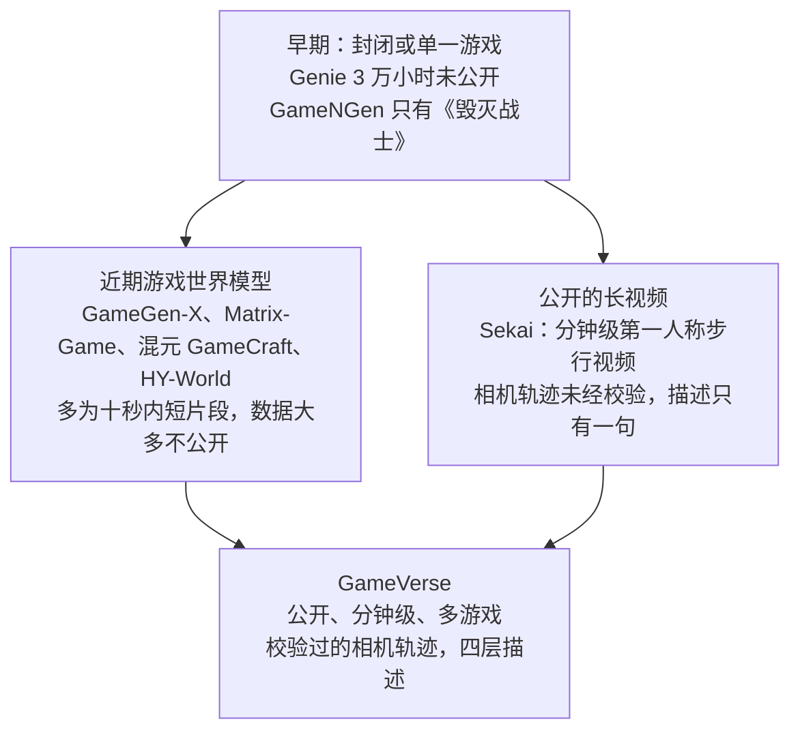
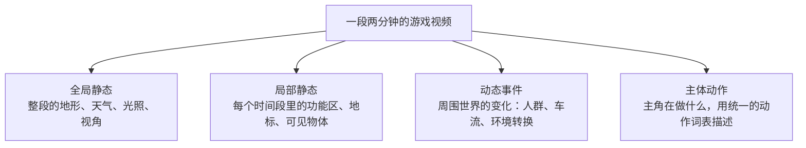

# GameVerse：为长时程交互式世界模型准备的分钟级游戏视频数据集

> **原题**：GameVerse: A Minute-Scale Gameplay Dataset for Long-Horizon Interactive World Modeling
> **作者**：Kang He、Wenshuo Peng、Chuanhao Li、Zihui Gao、Xiaojie Xu、Zhengyuan Lin、Yuzhe Ding、Donghong Ji、Kaipeng Zhang、Yongtao Ge
> **机构**：Alaya Lab 为主（通讯作者邮箱为盛大集团域名），另有上海创智学院、武汉大学国家网络安全学院、清华大学
> **年份**：2026（arxiv ID 2610.37257），已被 NeurIPS 2026 接收
> **分类**：cs.CV
> **链接**：https://arxiv.org/abs/2610.37257
> **精读日期**：2026-11-05

## 阅读须知

### 这篇在领域里的位置

「交互式世界模型」是近两年视频生成里最热的方向之一。它想做的事情，是让模型像游戏引擎一样：给它一帧画面，再告诉它「向前走」「向左转」，它就生成接下来的画面，而且可以一直生成下去。谷歌的 Genie、用扩散模型实时跑《毁灭战士》的 GameNGen，以及腾讯混元、昆仑万维的几个游戏世界模型，都属于这一类。

这些模型目前有一个共同的天花板：生成到一分钟左右，画面就开始漂移，角色走着走着变了样，场景前后对不上。这篇论文认为，问题首先出在数据，而不是模型：现有的游戏视频训练集几乎都是十秒以内的短片段，模型从没见过一分钟以上的连续画面，自然学不会长时间保持一致。

于是作者没有提新模型，而是做了一个数据集。这是一篇典型的「数据集论文」，贡献在数据本身和造数据的流程，实验只用来证明「用了这份数据会更好」。

### 读完能回答什么

1. 为什么作者认为交互式世界模型撑不过一分钟，主要是数据问题？
2. GameVerse 是怎样从 YouTube 游戏录像里切出「两分钟不断镜」的片段，又怎样筛掉字幕、界面和抖动镜头的？
3. 没有游戏引擎的真实相机参数，作者怎样估计每一帧的相机位姿，又怎样判断估得靠不靠谱？
4. 「四层结构化描述」把一段视频拆成了哪四层，为什么要把静态场景和动态事件分开写？
5. 用这份数据微调之后，长视频到底好了多少？哪些结论有对照实验支撑，哪些没有？

### 阅读前置

本文假定读者了解视频扩散模型的基本概念，知道「图生视频」是给一张图、生成后续视频，也大致知道 VBench 这类自动评测基准。

本文不假定读者熟悉相机位姿估计或视觉 SLAM，也不假定读者了解世界模型的具体架构。这些都会在用到时先铺垫再展开。

### 缩写表

| 缩写 | 全称与含义 |
|---|---|
| 交互式世界模型 | Interactive World Model：能根据动作或相机输入持续生成后续画面的视频模型 |
| FPV / TPV | First-Person View / Third-Person View，第一人称与第三人称视角 |
| ViPE | 一种从普通视频中估计逐帧相机位姿的工具，本文用它给游戏录像补上相机轨迹 |
| DROID-SLAM | 另一种视觉定位与建图方法，本文用作独立的对照估计器 |
| RPE | Relative Pose Error，相对位姿误差，衡量相邻两帧相机运动估得准不准 |
| TransNetV2 | 一种检测视频镜头切换的模型 |
| CLIP | 一种图文对齐模型，这里用来算两帧画面在语义上差多远 |
| HUD | Head-Up Display，游戏画面上的血条、地图等界面元素 |
| VBench / WorldScore | 两套视频生成自动评测，前者偏画质与时间一致性，后者偏世界生成的可控性与三维一致性 |
| HY-World 1.5 / LingBot / LTX-Video | 文中用到的几个视频或世界生成模型 |
| Plücker 嵌入 | 一种把相机射线编码成向量的方式，用来把相机轨迹作为条件输入模型 |

## 一、问题

想象一个能「玩」的视频模型：你按方向键，它就生成角色往那边走的画面。要让它真正可用，至少得连续玩上几分钟，而且这几分钟里，同一座房子不能一会儿两层一会儿三层，主角的衣服也不能悄悄换了颜色。

现有模型做不到这一点。作者观察到，GameGen-X、Matrix-Game、混元 GameCraft、HY-World 1.5 等系统在一分钟左右都会崩：画面漂移、角色变样、场景失去连贯。

### 1.1 作者的判断：卡在数据

作者的论点是，这些模型的训练语料几乎全是十秒以内的片段，配的文字描述又是一整段一句话，把背景是什么和发生了什么混在一起。用这样的数据，无论模型多大，都学不到分钟级的连贯，也学不到细粒度的控制。

更具体地说，作者列出了长时程世界模型需要、而现有数据集从未同时提供的四样东西：分钟级的连续画面、经过校验的逐帧相机轨迹、第一与第三人称的大量交互动作，以及把场景和事件分开写的多层描述。

### 1.2 前人的数据

已有数据各缺一块。Matrix-Game 和 HY-World 用游戏引擎拿到了精确的相机参数，但训练数据不公开，连续片段也短。Sekai 有分钟级视频，却是现实中的步行录像，只有向前走，相机轨迹也没校验过。GameGen-X 有动作，但片段短、描述粗。

## 二、方法

本文的方法就是数据构建流水线。作者从 YouTube 收集了 11,002 段开放世界游戏录像，共 4,692 小时，经过四道工序，得到最终的数据集。

### 2.1 按场景切分

先铺垫一下为什么这一步不简单。游戏录像里常有剪辑，有时是一刀切过去，有时是镜头慢慢转到别处、或者界面渐渐变了。前者叫硬切，好检测；后者是渐变，容易漏。

作者用 TransNetV2 找硬切，再在抽样帧之间计算 CLIP 语义距离，距离突然变大就当作渐变边界。两者合起来，切出场景连贯、最长 120 秒的片段。这一步之后有 27 万多段、4,661 小时，其中 120 秒满长的片段约 2,773 小时。

### 2.2 五步质量筛选

游戏录像里有大量会干扰模型的东西：主播加的字幕和水印、游戏自带的血条地图、压缩造成的块状失真、镜头剧烈晃动、内容重复。作者依次做五步筛选：先去掉低分辨率和损坏的视频；再用文字识别找出字幕和界面；然后检测不稳定的运动和界面变化；接着去重并保持多样性；最后用时间质量指标评分。

每段视频的总分是各步分数的加权和，但每一步都有单独的硬门槛，防止某一项特别差的片段靠别的高分混进来。作者还特意捞回了一部分「镜头不动、场景在变」的片段，因为固定视角下物体和人物的运动，对世界模型同样有用。

### 2.3 估计并校验相机轨迹

这一步要先解释什么是相机位姿。视频每一帧都是从某个位置、朝某个方向拍的，这个位置和朝向合起来叫位姿；把每一帧的位姿连起来，就是相机轨迹。世界模型若要按「向左转」生成画面，就需要知道训练视频里的镜头是怎么转的。

游戏引擎内部知道精确的相机参数，可 YouTube 录像里没有。作者用 ViPE 从画面本身反推每一帧的位姿。这种估计在动态场景里常出错，所以作者检查三种典型错误：相邻帧之间不合物理的突然跳变、高频的来回抖动，以及误差日积月累造成的长期漂移。三者合成一个轨迹质量分，低于门槛的片段直接丢掉。

### 2.4 四层结构化描述

以往的游戏数据集，一段视频配一句话，比如「一个骑士在城堡附近骑马」。这句话既说了场景，又说了动作，模型没法只改动作、不改场景。

作者用 Kimi-K2.5 给每段视频写四层描述，并且按「事件边界」而不是固定时间窗口来分段。局部静态和动态事件写得最长，中位数分别是 895 和 775 个字符；主体动作则用受限词表，方便生成时单独调控。

## 三、实验

### 3.1 数据集本身

最终的 GameVerse 有 69.7K 段视频、1,655 小时、3.5 亿帧，其中 4 万多段达到 120 秒上限，合计 1,358 小时。作者称这在连续时长上比以往游戏数据集长一个数量级。

数据覆盖至少 110 款游戏，分布是长尾的：《战神》《荒野大镖客 2》《对马岛之魂》《艾尔登法环》《巫师 3》各贡献了 1,800 段以上。视角上，第三人称占 73%，第一人称 24%，其余 3% 是无人机、车载等特殊视角。相机运动里向前移动最多，占 34.7%；平移加旋转的复杂运动占 22%。

### 3.2 标注质量

| 人工审核（400 段，3 人独立打分） | 结果 |
|---|---|
| 场景与事件准确度 | 4.82 / 5 |
| 主体动作准确度 | 4.66 / 5 |
| 时间对齐 | 4.61 / 5 |
| 相机运动描述准确度 | 4.55 / 5 |
| 片段级幻觉率 | 5.5% |
| 时间错位率 | 4.0% |
| 标注者一致性（Krippendorff α） | 0.76 |

相机轨迹没有真值可比，作者用另一种方法 DROID-SLAM 独立估一遍做对照。对齐后两者的旋转误差在 0.75 到 1.47 度之间，平移方向误差在 4.84 到 11.03 度之间，混合旋转的情形分歧最大。作者也说明，这只能说明两种估计彼此一致，不代表与真实轨迹一致。

### 3.3 生成实验

实验设置是：给 103 张起始图，各生成 60 秒视频，比较四个模型。其中真正受控的对照只有一组：HY-World 1.5 原版，对比用 GameVerse 中约 600 小时数据微调 3,000 步后的 HY-World-FT，架构不变。另外两个模型 LingBot 和 LTX-FT 架构、训练数据都不同，只能算整体系统的参考。

| 模型 | 主体一致性 | 背景一致性 | WorldScore 平均 | 三维一致性 | 相似度首次跌破 0.6 的时刻 |
|---|---|---|---|---|---|
| HY-World 1.5（原版） | 66.92 | 81.77 | 53.33 | 66.94 | 30.4 秒 |
| HY-World-FT（用 GameVerse 微调） | 68.45 | 83.30 | 55.13 | 73.42 | 37.9 秒 |
| LingBot | 74.30 | 88.94 | 46.07 | 63.25 | 49.0 秒 |
| LTX-FT | 79.17 | 90.63 | 59.65 | 95.13 | 50.7 秒 |

最后一列需要解释：作者每隔半秒取一帧，算它和起始画面的 CLIP 相似度，看相似度第一次跌破 0.6 是在第几秒。这个时间越晚，说明画面漂得越慢。

受控对照里，微调后六项 VBench 指标和七项 WorldScore 指标全部提升。最明显的是三维一致性，提高了 6.48 分；漂移开始的时间从 30.4 秒推迟到 37.9 秒。在开车、骑马、跑步、步行四类场景里，主体一致性也都提高了 1 到 2.5 分。

### 3.4 值得单独拎出来的两点

第一，表现最好的 LTX-FT，并不是靠长片段训练出来的。附录交代，它是 220 亿参数的 LTX-Video 2.3，在 GameVerse 中 24,380 段每段只有 12 到 15 秒的片段上微调的。论文的核心主张是「长时程连贯要靠分钟级连续数据」，可全文最强的长视频结果，用的恰恰是短片段。

第二，LTX-FT 没有对应的未微调基线。附录只比较了原版 Wan2.2 和原版 LTX-2.3 在 5 到 15 秒上的表现，而且作者自己说，这个诊断「不能分离 60 秒生成中跨模型差异的原因」。所以表中 LTX-FT 的领先，有多少来自 GameVerse、多少来自 220 亿参数的底座，无从判断。

## 四、局限

### 4.1 作者承认的局限

作者列了五条。数据只来自游戏，能否迁移到现实场景没有验证。相机轨迹和自动生成的描述经过多轮校验，仍可能有残留错误。连续片段上限是两分钟，生成实验只做到 60 秒，更长的生成和闭环交互留待以后。时长、相机监督、结构化描述这三样各自贡献多少，没有拆开做消融。大规模构建数据的计算开销很大，例如相机位姿估计动用了 256 张 GPU。

### 4.2 读者能看出的问题

第一，「交互式」名不副实的风险。真正的交互式世界模型需要玩家的操作输入，比如按了哪个键、鼠标怎么动。GameVerse 来自 YouTube 录像，没有任何真实的操作记录；可用作控制信号的只有估计出来的相机轨迹、附录里提到的 81 类方向角动作编码，以及文字描述里的「主体动作」。对「按键生成画面」这种最核心的交互，它提供不了直接监督。

第二，核心论点缺少直接证据。「瓶颈在数据而不在模型」这个判断，论文没有用对照实验去检验：没有拿同样时长的短片段数据或 Sekai 数据，在同样的算力下训练同一个模型来比较。受控对照只有一组，提升幅度也不大，漂移开始的时间从 30 秒推迟到 38 秒，离「分钟级」还有距离。再加上 3.4 节提到的最强结果来自短片段训练，数据时长到底起了多大作用，目前说不清。

第三，评测规模小。只有 103 张起始图、一个随机种子，没有方差或置信区间。三维一致性提高 6 分之外，多数提升在一到两分之间。

第四，数字前后对不上。论文第 3.1 节（数据收集）说流水线最终得到「18.8 万段结构化片段」，摘要和统计部分却是 6.97 万段，论文没有解释两个数字的关系。

第五，可复现性受制于版权。数据来自 YouTube 上他人上传的游戏录像，致谢里写明 Alaya Lab 授权公开的是「元数据和衍生标注」。使用者多半要自己按链接下载视频，链接失效、视频下架都会让数据集慢慢缺失；游戏画面本身的版权问题，论文也没有讨论。此外，数据集向少数几款 3A 大作倾斜，第三人称占了七成多。

## 值得跟读

1. **Sekai**（Li et al., 2025）：公开的分钟级步行视频数据集，是本文最直接的对比对象。
2. **Matrix-Game 3.0**（Skywork AI, 2026）：从模型一侧用记忆机制解决长时程问题，与本文从数据一侧的思路互补。
3. **ViPE**（Huang et al., 2025）：本文相机轨迹的来源，理解它的误差特性，才能判断 GameVerse 轨迹能用到什么程度。

## 一句话

从 YouTube 游戏录像造出分钟级、带相机轨迹和四层描述的数据集，微调后漂移推迟约七秒。
