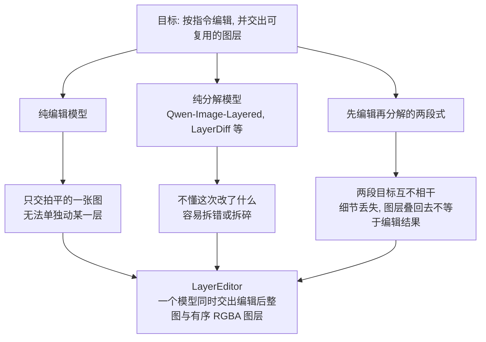
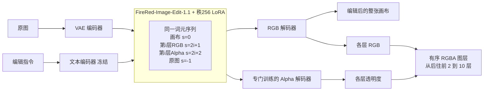
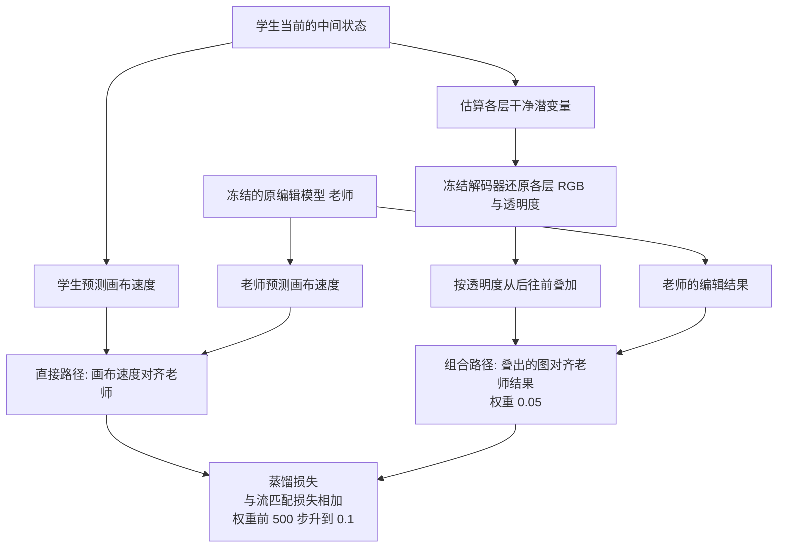

# 把图像编辑成可复用的图层：组合式编辑先验蒸馏（LayerEditor）

> **原题**：Editing Images into Reusable Layers via Compositional Edit-Prior Distillation
> **作者**：Wen Xue, Yong Liu, Xueheng Li, Si Wu, Yong Xu, Yipeng Sun, Yan Li, Simiu Gu
> **机构**：摘要页未列出
> **年份**：2026（arxiv ID 2610.24738，2026 年 10 月 17 日提交）
> **分类**：cs.CV
> **链接**：https://arxiv.org/abs/2610.24738
> **精读日期**：2026-10-25

> 说明：周末 Hugging Face 的每日论文页仍停在 10 月 23 日那一期，当期第一名 WeVisOne-VL 昨天已精读，故今天顺延读第二名。

## 阅读须知

### 这篇在领域里的位置

这篇论文属于「指令式图像编辑」与「图层分解」两条线的交汇处。指令式图像编辑指的是：给模型一张图和一句话，比如「把海报上的标题换成 Summer Sale」，模型直接输出改好的图。过去两年，这类模型从早期的 InstructPix2Pix 一路发展到今天基于扩散 Transformer 的大型编辑模型，改得越来越准，保留得越来越好。图层分解则是另一件事：把一张已经合成好的图拆回若干张带透明度的图层，就像设计师在 Photoshop 里看到的那样，背景一层、文字一层、装饰物一层。

两条线长期各走各的。编辑模型只管交出一张「拍平」的结果图，图层分解模型只管把现成的图拆开。LayerEditor 的位置在于，它试图让同一个模型在完成编辑的同时，直接交出一叠有序、带透明度、可以再次拿来用的图层，并且在适配图层输出的过程中不丢掉原编辑模型的本领。

### 读完能回答什么

1. 为什么「编辑完只交一张拍平的图」对设计类工作是个实际障碍，先编辑再分解的两段式做法差在哪里。
2. LayerEditor 如何把编辑后的整图和一叠 RGBA 图层放进同一个词元序列，又如何让模型分清它们各属于哪一层。
3. 透明度通道是怎么编码和解码的，为什么要专门训练一个透明度解码器。
4. 「组合式编辑先验蒸馏」把老师模型的什么本领、通过哪两条路径传给学生，损失函数长什么样。
5. LayerEditor-100K 数据集是怎么造出来的，在哪些指标上它比把编辑与分解串起来的强基线更好。

### 阅读前置

本文假定读者了解扩散模型与流匹配（flow matching）的大意，知道 Transformer、LoRA 微调和变分自编码器（VAE）的基本作用。读者未必做过图像编辑或图层分解，相关概念会先铺垫再展开。

### 缩写表

- **RGBA**：红、绿、蓝三个颜色通道加一个透明度（Alpha）通道。Alpha 为 1 表示完全不透明，为 0 表示完全透明，中间值表示半透明。
- **LoRA**（Low-Rank Adaptation，低秩适配）：只在大模型的部分权重旁边加一对小矩阵来训练，原权重冻结，省显存又不易破坏原有能力。本文用秩为 256 的 LoRA。
- **VAE**（Variational Autoencoder，变分自编码器）：在扩散模型里负责把图像压到潜空间、再从潜空间还原成图像的编码器与解码器。
- **RoPE**（Rotary Position Embedding，旋转位置编码）：Transformer 中常用的位置编码方式，本文把它扩展成带「层号」的三维坐标。
- **C-EPD**（Compositional Edit-Prior Distillation，组合式编辑先验蒸馏）：本文提出的训练方法，详见第二节。
- **OPD**（On-Policy Distillation，在策略蒸馏）：在学生模型自己生成的中间状态上，让老师模型给出目标，再让学生去对齐。
- **I2L**（Image-to-Layers，图像到图层）：只给一张图，要求拆成若干图层的任务。
- **QIL**：文中对 Qwen-Image-Layered 的简称，一个专门做图层分解的模型。
- **SSIM**（Structural Similarity，结构相似度）：衡量两张图结构上有多像，越高越好。
- **FID**（Fréchet Inception Distance）：衡量生成图分布与真实图分布的距离，越低越好。
- **Alpha IoU**：衡量预测透明度与真实透明度重合程度的指标，定义见第三节，越高越好。

## 一、问题

### 为什么这个问题值得做

设想一位设计师用编辑模型改一张促销海报：把标题从「春季上新」改成「夏日特惠」，再把右下角的小鸟换个颜色。今天最好的编辑模型能把这件事做得很漂亮，交出一张看上去完美的新海报。问题出在下一步：老板说标题再往上挪一点，或者这只鸟换个位置。由于模型交出的是一张文字、物体、背景熔在一起的「拍平」图，设计师没法只动标题那一层，只能再让模型重新生成一遍，每改一次都要冒着别处被连带改坏的风险。

对专业设计流程而言，图层才是工作的基本单位。一张海报在设计软件里本来就是十几个图层叠起来的，每一层都能单独移动、缩放、换色、复用到下一张海报上。编辑模型若只能交出拍平的结果，就只能停在「出个效果图」这一步，进不了真正的生产流程。

### 前人路线及其不足

围绕「编辑」和「图层」，前人大致有三类做法。

第一类是**纯编辑模型**，如今的大型指令编辑模型都属于此类。它们在「改得准、留得住」这件事上进步很大，但目标函数只关心最终那张图像不像目标图，从不考虑结果应该如何分层。

第二类是**纯分解模型**，例如 Qwen-Image-Layered、LayerDiff 等。它们拿到一张现成的图，努力把它拆成若干带透明度的图层。可是它们不懂「这次编辑改了什么」，只能事后拆解，往往把刚改过的标题和背景拆在一起，或者把一个完整的物体拆成两半。

第三类是**把两者串起来**：先用编辑模型改，再用分解模型拆。这样的两段式流水线看似各取所长，实际上两段的优化目标互不相干：编辑阶段不知道后面要怎么分层，分解阶段不知道前面要求改什么。于是编辑结果里的细节可能在分解时被抹掉，分解出的图层叠回去也未必等于编辑后的图。

## 二、方法

LayerEditor 以一个已有的大型编辑模型 FireRed-Image-Edit-1.1 为底座，冻结图像与文本编码器，只用秩为 256 的 LoRA 去适配。它要解决两个技术问题：一是如何让一个原本只输出一张图的模型，同时输出一张整图和一叠图层；二是如何在这样改造之后，不把原模型「改得准」的本领丢掉。前者靠「上下文内 RGB-Alpha 词元建模」，后者靠「组合式编辑先验蒸馏」。

### 上下文内 RGB-Alpha 词元建模

扩散 Transformer 处理图像的方式，是先用 VAE 把图像压成潜空间里的一格格小块，再把这些小块排成一串词元送进 Transformer。LayerEditor 的做法是把要生成的东西全都排进同一串词元里：先是编辑后的整张画布，然后依次是第 0 层的 RGB、第 0 层的 Alpha、第 1 层的 RGB、第 1 层的 Alpha，一直到最后一层。用式子写出来就是：

Z = [ 画布, 第0层RGB, 第0层Alpha, 第1层RGB, 第1层Alpha, …, 第N−1层RGB, 第N−1层Alpha ]

图层按「从后往前」的顺序排列，最底下一层是完整的背景，越往后越靠近观者。

把它们放在同一串里的好处，是 Transformer 的自注意力可以让每一层「看见」整张画布和其他所有层。于是生成某个文字图层时，模型知道背景是什么颜色、标题要改成什么、其他物体占了哪些位置，自然能把各层分得干净又叠得严丝合缝。

**怎么分清哪个词元属于哪一层。** 画布和每一层在空间上用的是同一套坐标，同一个位置 (x, y) 会同时出现在画布和十几个图层里，必须有办法让模型分清。作者把旋转位置编码扩展成三维坐标 (s, x, y)：x 和 y 仍是空间位置，s 则是「第几个字段」。原图的词元 s 取 −1，编辑后的画布 s 取 0，第 i 层的 RGB 取 2i+1，第 i 层的 Alpha 取 2i+2。这样，同一位置上不同字段的词元在位置编码上就彼此区分开了。

**透明度怎么还原。** 原模型的 VAE 只会解码三通道的彩色图，不会还原透明度。作者在潜空间里把 Alpha 当作一个独立字段来生成，再专门训练一个 Alpha 解码器把它还原成连续的透明度图。这个解码器从原来的 RGB 解码器初始化，用透明度重建损失和「叠回去之后要像原图」的组合重建损失来训练。之所以不直接拿 RGB 解码器去解 Alpha，是因为透明度图的统计特性和彩色图很不一样，尤其是头发丝、半透明阴影这类边缘，需要专门学。

### 组合式编辑先验蒸馏

**为什么需要它。** 用 LoRA 把模型改造成同时输出十几个字段之后，一个现实的风险是：模型忙着学「怎么分层」，却把原来「怎么改得准」的本领学丢了。消融实验会显示，这个风险是真实存在的。

**怎么做。** 作者把冻结的原编辑模型当作老师，在学生训练过程中实时提供目标，这种做法称为在策略蒸馏：在学生自己当前生成到一半的中间状态上，问老师「此刻正确的去噪方向是什么」，再让学生对齐。蒸馏沿两条路径进行，所以叫「组合式」：

- **直接路径**：让学生对编辑后整张画布预测的速度（流匹配里的去噪方向）去对齐老师对同一画布预测的速度。这条路径保证整图的编辑质量不退化。
- **组合路径**：从学生当前的中间状态出发，估算出每一层的干净潜变量，用冻结的解码器还原成各层的 RGB 与透明度，再按「后层在下、前层在上」的透明度叠加公式一层层合成回一张图，要求这张合成图接近老师给出的编辑结果。叠加公式是：第 i 次合成结果等于第 i 层透明度乘第 i 层颜色，加上（1 减透明度）乘前一次的合成结果。这条路径保证「图层叠回去等于编辑结果」，也就把老师的编辑本领一路传到了每一层。

两项合起来就是蒸馏损失：画布速度与老师速度之差的平方，加上一个权重乘以合成图与老师结果之差的平方。组合项的权重取 0.05。总损失是原本的流匹配损失加上蒸馏损失，蒸馏损失的权重在前 500 步里从 0 线性升到 0.1，之后保持不变；这样一开始先让模型学会输出格式，再逐步加强对老师的对齐。

### LayerEditor-100K 数据集

要训练「编辑并分层」，就需要「原图、指令、编辑后的图、编辑后的有序图层」四者齐全的样本，这样的数据此前几乎不存在。作者构造了约 10 万对样本，其中文字编辑 48,329 对、物体编辑 36,858 对、海报整体外观编辑 14,813 对，来源有三：

- **原生设计稿**：Crello 和 PrismLayersPro 本来就是带图层的设计数据，自带每个元素的位置、叠放次序和透明度，渲染整理成 2 到 10 个有序图层即可。
- **拍平的编辑对**：ScaleEdit 里的编辑样本只有拍平的前后两张图，作者用 Qwen-Image-Layered 和 Seedream5-Pro 把它们拆成图层，再统一成「底层是完整背景、上层透明」的全画布 RGBA 叠层。

每一层都标注了序号、角色、内容、是否被编辑以及边界框，角色和内容描述会写进训练提示，好让模型学会「按要求把某些东西分到某一层」。

## 三、实验

### 评测设置

作者建了两个测试集：Crello 测试集 2,994 例，来自原生设计稿；ScaleEdit 测试集 1,000 例，来自拍平编辑对再恢复出的图层。指标分三类：

- **编辑质量**：直接输出的整图与叠回去的合成图，各自和目标图比 SSIM 与 FID。
- **图层质量**：RGBA 的 L1 误差，以及 Alpha IoU。Alpha IoU 定义为逐像素「预测与真值透明度的较小值」之和，除以「两者较大值」之和，相当于把交并比推广到连续透明度。
- **大模型打分**：请视觉语言模型按评分细则，从编辑一致性、画面质量、图层分割、图层组合、透明度准确度五个维度各打 1 到 10 分。

最强的对比基线是 Seedream5-Pro 的「联合」用法，即用一个强大的商用模型配合分解流程同时完成编辑与分层。

### 主要结果

| 测试集 | 指标 | LayerEditor | Seedream5-Pro（联合） |
|---|---|---|---|
| Crello | 合成图 SSIM ↑ | **0.8351** | 0.7902 |
| Crello | 合成图 FID ↓ | **33.86** | 55.33 |
| Crello | Alpha IoU ↑ | **0.6074** | 0.5139 |
| Crello | 评分均值 ↑ | **6.00** | 4.50 |
| ScaleEdit | 合成图 SSIM ↑ | **0.8839** | 0.8365 |
| ScaleEdit | 合成图 FID ↓ | **39.48** | 59.62 |
| ScaleEdit | Alpha IoU ↑ | **0.6802** | 0.6583 |

在原生设计稿上，LayerEditor 的透明度质量领先近 10 个点，FID 也低了二十多；在拍平编辑对上，Alpha IoU 的领先缩小到 2 个点左右，这说明面对更接近自然照片的内容时，分层本身仍然更难。

作者还测了两项附加能力。一是**按要求的层数生成**：指定输出几层时，Alpha IoU 为 0.6196，对手为 0.5703。二是**纯分解**：只给一张图和一句「保持原样」的指令，再给出想要的层数，在没有针对分解专门微调的情况下，合成图 SSIM 为 0.8761，专门做分解的 Qwen-Image-Layered 为 0.7963；Alpha IoU 为 0.6343 对 0.5949。也就是说，一个以编辑为主的模型顺带把分解也做得比专职分解模型好。

### 消融：蒸馏是关键

| 变体（Crello 测试集） | 编辑一致性 | 画面质量 | 图层分割 | RGBA L1 ↓ |
|---|---|---|---|---|
| 完整 LayerEditor | **6.14** | **6.35** | **6.83** | **0.0350** |
| 去掉组合式编辑先验蒸馏 | 4.67 | 5.12 | 5.01 | 0.0482 |
| 去掉直接路径蒸馏 | 5.01 | 4.19 | 4.83 | 0.0513 |
| 去掉组合路径蒸馏 | 4.98 | 4.33 | 4.97 | 0.0492 |
| 去掉专门的 Alpha 解码器 | 5.12 | 5.30 | 5.67 | 0.0578 |
| 底座模型 | 3.93 | 4.13 | 3.77 | 0.0735 |

这张表把论文的论点讲得很清楚。去掉整个蒸馏，编辑一致性从 6.14 掉到 4.67，图层分割从 6.83 掉到 5.01，正印证了「只顾学分层会把编辑本领学丢」的担心。直接路径和组合路径单独去掉任一条，都会掉一大截，说明两条路径各管一摊，缺一不可。专门的 Alpha 解码器则主要影响图层误差：去掉它，RGBA L1 从 0.0350 涨到 0.0578，几乎翻倍。

### 值得单独记一笔的现象

去掉直接路径蒸馏后，画面质量反而掉得比去掉组合路径更多（4.19 对 4.33），而按直觉，直接路径只管整张画布、似乎与图层无关。合理的解释是：在同一串词元里，画布和图层是彼此注意的，画布一旦学歪，所有图层都会被带偏；直接路径看似只守住了画布，实际上也守住了各层的参照系。

## 四、局限

### 作者承认的局限

作者在附录中承认，复杂的图层交互和半透明叠加仍然难以完全还原，例如多层半透明阴影、光晕彼此重叠的情形。从实验结果看也是如此：在更接近自然图像的 ScaleEdit 测试集上，透明度质量的领先明显缩小。

### 读完能看出来的潜在问题

第一，**测试数据与训练数据同源**。两个测试集分别来自 Crello 设计稿和 ScaleEdit 编辑对，与训练集的来源一致，而且 ScaleEdit 部分的「真值图层」本身就是由 Qwen-Image-Layered 和 Seedream5-Pro 拆出来的。用某个模型拆出的结果当真值去和这个模型比，比较的公平性要打折扣。

第二，**大量依赖大模型打分**。五个维度的评分由视觉语言模型给出，虽有评分细则，但这类打分对风格、版式往往有偏好，和设计师的真实判断未必一致。论文没有报告人工评测或人工与模型打分的一致性。

第三，**适用范围偏向设计稿**。训练数据以海报、版式设计为主，文字编辑占近一半。对自然照片，比如把一张街景照片里的行人分到单独一层，模型表现如何，论文涉及不多。

第四，**层数上限与计算开销**。每多一层，就要多两段与整图同样长的词元，序列长度随层数线性增长，注意力计算则更快地增长。10 层左右或许还撑得住，真正复杂的设计稿动辄几十层，论文没有讨论如何扩展。

第五，**底座可得性**。底座 FireRed-Image-Edit-1.1 并非人人可得，若底座不开源，复现与后续研究的门槛都会抬高。

## 一句话

LayerEditor 把整图与有序 RGBA 图层放进同一词元序列，并蒸馏原编辑模型的先验，让编辑结果直接可分层复用。
