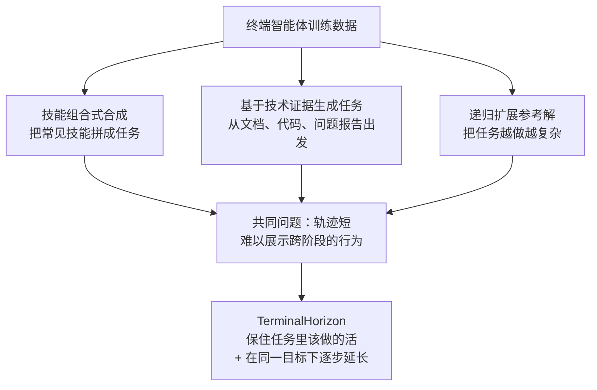
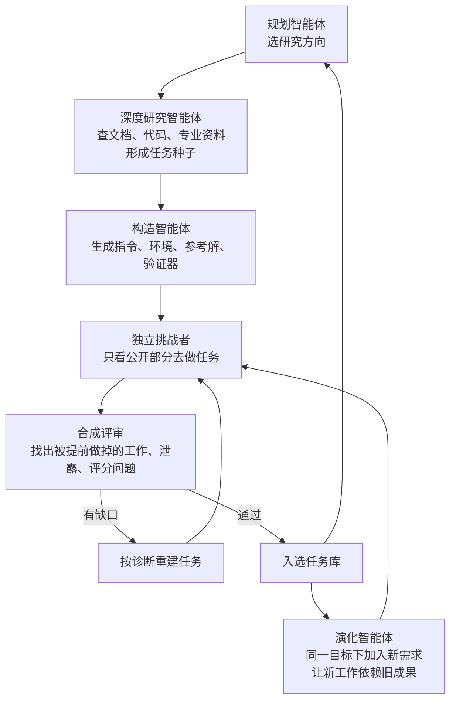
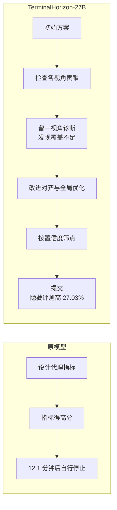

# TerminalHorizon：为终端智能体批量合成「长程」训练数据

> **原题**：Scaling Agentic Data for Long-Horizon Terminal Intelligence
> **作者**：Shun Zou, Ziyu Ma, Yi Zou, Yong Wang, Lin Chen, Zehui Chen, Guanhua Chen, Xiangxiang Chu, Feng Zhao
> **机构**：中国科学技术大学、阿里巴巴高德（AMAP）、南方科技大学
> **年份**：2026（arxiv ID 2610.13166，2026 年 10 月 9 日提交）
> **分类**：cs.CL
> **链接**：https://arxiv.org/abs/2610.13166
> **精读日期**：2026-10-13

## 阅读须知

### 这篇在领域里的位置

「终端智能体」指的是在命令行里干活的大模型智能体：它能读写文件、跑程序、装依赖、看报错、改代码，再根据结果决定下一步。终端之所以受重视，是因为它几乎是一个万能接口，代码、数据、工具和执行反馈都汇集在同一个工作区里，软件开发、系统运维、科学计算都可以在这里完成。

过去一年，围绕终端智能体的训练出现了一批「环境合成」工作：用程序或大模型自动生成大量可执行、可验证的终端任务，让智能体在其中练习，再把成功的操作轨迹拿去微调模型。这些工作的主要贡献是把任务数量和覆盖面做了上去，有的方法生成了几万甚至几十万条轨迹。

本文看到的问题是，这些轨迹普遍太短。短轨迹能教会模型怎么敲命令、怎么调工具，却教不会它怎样在一个长时间的任务里持续积累证据、根据反馈修正策略、最后把中间成果变成交付物。TerminalHorizon 因此不再追求「更多任务」，而是追求「更长、更完整的问题解决过程」，并为此设计了一套自动造任务的引擎。

### 读完能回答什么

1. 为什么短的操作轨迹不足以训练长程终端智能体，「智能体行为模式」指的是什么？
2. 合成环境时，为什么任务会「被提前做掉一部分」，作者怎样用一个独立的挑战者把这种问题找出来并修好？
3. 「渐进式扩展视野」是怎样在不改变目标的前提下把任务越拉越长的？
4. 只用约 3,000 条轨迹微调 27B 模型，为什么能超过用十倍以上数据训练的同类方法？
5. 在 12 小时的自主研究任务里，训练后的模型和原模型的差别具体体现在哪里？

### 阅读前置

本文假定读者熟悉大语言模型、监督微调和「智能体」这些基本概念，大致知道编程智能体是怎样一轮轮调用工具、读取结果的。读者不需要了解终端任务评测的细节，文中涉及的几个评测集都会在首次出现时说明。

### 缩写与术语表

- **终端智能体（terminal agent）**：在命令行环境中通过执行命令完成任务的大模型智能体。
- **TerminalHorizon**：本文提出的自动数据合成引擎，也是数据集与模型的名字前缀。
- **TerminalHorizon-3K**：用该引擎得到的数据集，1,535 个任务环境、2,852 条训练轨迹。
- **TerminalHorizon-27B**：在该数据集上微调 Qwen3.5-27B 得到的模型。
- **Terminal-Bench（TB）1.0 / 2.0 / 2.1**：终端任务评测集，衡量智能体在真实终端任务上的成功率。
- **AutomationBench / VitaBench / τ²-bench**：考察真实工作场景中企业自动化、客服、生活服务等多轮任务的评测集。
- **Terminus2**：一个终端智能体执行框架，本文用它收集轨迹和做评测。
- **SFT**（Supervised Fine-Tuning，监督微调）：用示范轨迹训练模型模仿。
- **RSI**（Recursive Self-Improvement，递归自我改进）：本文用来指一类长达 12 小时、要求智能体不断实验和改进方案的自主研究任务。
- **智能体行为模式（agentic behavioral pattern）**：作者归纳的 27 种问题解决动作组合，例如追踪对象之间的关系、拆解子问题再整合。
- **反馈链（feedback chain）**：轨迹中一段连续的「动作、终端反馈、再动作」序列，用来衡量反馈在多长时间里持续影响决策。

## 一、问题

这个问题之所以值得做，是因为智能体正在从「回答问题」走向「替人完成一段持续的工作」。一个人类工程师接到一个排查线上故障的任务，往往要先四处收集线索，形成一个判断，动手修改，发现没修好再回头重新诊断，最后把结论和修复整理成交付物。这个过程可能持续几十上百步，前面的判断会影响后面的动作，后面的验证又会推翻前面的假设。模型若只在几步长的轨迹上练习，就很难学会这种跨越长时间的组织能力。

现有的终端任务合成方法已经能造出大量可执行、可验证的任务，但作者用同一个教师模型、同样的设置，在几种开源方法生成的任务上各抽 300 个跑了一遍，发现它们的轨迹平均都不长。轨迹短，意味着那些需要很多步才能展开的行为，例如证据慢慢积累、计划一次次修正、后期验证发现问题后回头重来，根本没有机会出现在训练数据里。

### 1.1 两个具体的难题

作者把「合成高质量长程轨迹」拆成两个难题，下面分别说明。

**难题一：任务复杂，不等于智能体真的会去做那些复杂的事。** 合成任务时，构造者为了让任务能跑起来，往往会准备好各种材料。问题在于，这些材料有时已经把一部分活干完了。比如任务要求实现一个核心函数，可环境里已经提供了这个函数，剩下的工作可能只是改一个常量。这样一来，原本设计好的探索、实现、验证都被跳过，轨迹里也就看不到这些行为。

**难题二：就算行为出现了，也要让它们在长时间里连起来。** 单纯把任务加难、或者允许更多交互轮数，并不会自动让行为延续下去。真正有价值的长程数据，是后面的工作建立在前面的判断和结果之上，让探索、诊断、修正、验证这些行为前后呼应。

### 1.2 前人路线与本文的位置

已有方法大致有三类：把常见技能组合成任务，从文档、代码仓库和问题报告这些技术材料出发生成任务，以及递归地扩展参考解、让任务变得更复杂。它们各自扩大了任务的覆盖面和复杂度，却都没有专门处理「行为能不能在长时间里连起来」这件事。本文的切入点就在这里：既要保证任务里该由智能体完成的工作没被提前做掉，又要让任务在同一目标下逐步延长，使后面的工作依赖前面的成果。

### 1.3 任务的形式化

为了说清楚方法，先看作者怎样定义一个终端任务。每个任务包由五部分组成：

$$
T=(I,E,S,V,M),\qquad \mathcal{P}(T)=(I,E)
$$

- $I$：公开指令，说明目标和约束；
- $E$：可执行环境，包括初始状态、工具和执行机制；
- $S$：参考解，用来证明任务可解；
- $V$：私有验证器，检查最终状态和产物是否达标；
- $M$：执行配置。

智能体在执行时只能看到 $\mathcal{P}(T)=(I,E)$，也就是指令和环境，看不到参考解和验证器。作者还加了一条重要约束：验证器检查的要求，必须都能从公开指令和环境中可发现的证据里推出来。换句话说，测试数据可以保密，但评分不能凭空引入智能体无从得知的要求。

## 二、方法

TerminalHorizon 分两个阶段：第一阶段「挑战驱动的长程合成」，负责造出一个真正需要智能体动手的任务；第二阶段「渐进式扩展视野」，负责在同一目标下把任务一步步延长。整体流程如下。

### 2.1 第一阶段：挑战驱动的长程合成

这一阶段由内外两层循环组成。外层循环按批次决定「接下来造什么任务」，内层循环则对单个任务反复「试做、诊断、重建」。

**按批规划。** 每一批开始时，规划智能体参考已有任务的目标、解法和反馈，以及过去的研究与评审记录，挑出能扩大行为覆盖面的新方向，写成若干份研究简报。每份简报说明要做的工作范围、现有任务还没覆盖的需求，以及要去调查的真实资料来源。

**基于证据的深度研究。** 研究简报只给了方向，具体要做什么还得落实。深度研究智能体按简报去查文档、代码仓库、问题报告和专业资料，弄清真实需求、技术约束，以及判断「做完了没有」需要什么证据。它要回答的是：智能体需要自己发现什么，哪些问题需要进一步分析、实现或调试，前一步的结果怎样支撑后一步。这些发现形成一颗「任务种子」，包含一份指令草稿和支撑证据。

**联合构造环境。** 构造智能体根据任务种子，生成一个具体的任务实例：控制好初始状态，写好验证条件，并且明确哪些材料和工具是提供给智能体的、哪些工作要留给智能体自己做、什么算完成。指令、环境、参考解、验证器和执行配置是一起构造的，确保彼此一致。

**独立挑战。** 这是整个方法的关键一步。一个任务能跑通，并不说明设计好的工作在实际解题时仍然必要。于是作者请一个没参与构造的「独立挑战者」来做这个任务，它只能看到公开的指令和环境，看不到研究记录、设计蓝图、参考解和私有测试。挑战者做完后，验证器给出分数，然后一个「合成评审」模块拿着完整任务包、执行轨迹和评分证据做诊断，记录运行缺陷、信息泄露、评分不一致，以及最重要的一点：原本设计的工作有没有真的被保留下来。

**视野缺口分析与重建。** 轨迹揭示了智能体实际做了什么，接下来要找出哪些缺口是任务构造本身造成的。缺口分析会把任务种子里规定的工作和实际轨迹对比，把被省掉的工作追溯到初始材料、对象关系或工具行为上。前面那个例子就是典型：环境已经提供了核心函数，智能体只需改一个常量。重建时，构造智能体会恢复「必须实现和调试这个函数」的需求，同时保留实现它所需的公开规格。

这里有一个细致的区分：评审要分清「智能体用了一个高效但正当的解法」和「工作在构造时就已经被做掉了」，只对后者动手修改。修改后的任务回到独立挑战，检验恢复的需求是否真的进入了解题过程，形成任务级的闭环。通过评审的任务进入任务库，各种记录反馈给下一批的规划，形成批次级的闭环。

### 2.2 第二阶段：渐进式扩展视野

一个能解的任务并不是终点，而是深入这个专业问题的起点。演化智能体会审视一个已通过的「父任务」，在同一目标下提出有价值的扩展，并检查父任务的解法能否直接满足新需求；如果能，说明扩展没有带来新工作，需要重新设计。

扩展内容有四个方向：

- **更广的角色**：利用已有的产物或状态，承担相关的新职责；
- **更深的机制**：把之前被简化的关系、依赖或不确定性变成要处理的工作；
- **更丰富的证据**：加入新的记录、观察和专业材料，要求跨来源分析；
- **方法升级**：要求对原有方案做实质性的扩展或重新设计。

光加需求还不够，还要让新工作依赖之前的进展。演化智能体从三种交互设计中选择合适的一种：

- **探索与判断**：后面的决定依赖通过公开查询、探测和观察收集到的证据；
- **动作与反馈**：可观察的工具或系统效果，把前面的操作和后面的诊断、修正、验证连起来；
- **实例变化与适应**：在固定的公开规格下，对象或状态每次运行都不一样，要求智能体先检查当前实例，再调整动作并验证结果。

扩展后的任务成为新的候选，同样要回到独立挑战与评审；通过后，它又成为下一次扩展的父任务。这样一层层扩展，任务在不改变目标的前提下越来越长，而且长出来的部分和前面紧密相连。

### 2.3 轨迹收集与筛选

用这套引擎，作者生成了 1,535 个任务环境，每个任务用 DeepSeek-V4-Pro-0813 作为教师模型、在 Terminus2 框架下收集两条轨迹。筛选这一步值得注意：作者并不只保留成功的轨迹。他们让一个评审模型通读整条对话，在不知道最终得分的情况下，从三个角度判断它是否适合当示范：轨迹是否连贯有效、进展是否扎根于环境反馈、是否具有多轮训练价值。

这样做的理由是，成功的轨迹可能靠泄露的答案或绕过约束取胜，而失败的轨迹可能恰恰展示了很好的诊断、修正和错误恢复。被拒绝的，只有核心解法依赖禁止的捷径、错误假设贯穿始终、或者交互长期没有进展的轨迹。最终保留 2,852 条，组成 TerminalHorizon-3K。训练前，作者还对 12 组评测做了去污染检查，没有发现训练任务与评测任务重复。

### 2.4 训练设置

在 Qwen3.5-27B 上做监督微调，最大序列长度 262,144 个词元，学习率 $1\times10^{-5}$，余弦调度并有 5% 预热，训练 3 个轮次，使用 144 张 H20 显卡、18 个节点。

## 三、实验

### 3.1 数据本身长什么样

先看合成数据的特征。TerminalHorizon-3K 覆盖芯片、物理、天文等 25 个专业领域。轨迹平均 52.8 轮交互，第 90 百分位达到 98 轮，明显长于其他合成方法在同一教师模型下产生的轨迹。

作者还度量了「最长的连续反馈链」，也就是由终端反馈串起来的连续动作序列有多长，中位数是 25 轮。这说明长度并不是靠来回重复凑出来的，而是反馈在很长一段时间里持续影响着后续动作。按作者归纳的 27 种行为模式（分为信息探索与判断、诊断与纠错、构建与推进、验证与保障、策略与执行协调五大类）统计，每条轨迹平均包含 8.6 种核心模式。

### 3.2 主要结果

在 Terminal-Bench 上，与同样以开源模型为底座的终端合成方法相比，结果如下（摘录部分代表性方法）：

| 模型 | 底座 | 训练轨迹数 | TB 1.0 | TB 2.0 |
|---|---|---|---|---|
| Nemotron-Terminal-32B | Qwen3-32B | 49 万 | – | 27.4 |
| CLI-Universe-32B | Qwen3-32B | 6 千 | 38.8 | 33.4 |
| RST-27B | Qwen3.5-27B | 32.7 万 | – | 49.4 |
| Terminal-Universe-27B | Qwen3.5-27B | 3.2 万 | – | 52.8 |
| Qwen3.5-27B（原模型） | – | – | 46.3 | 41.6 |
| **TerminalHorizon-27B** | Qwen3.5-27B | **约 3 千** | **55.0** | **55.8** |

在更新的 Terminal-Bench 2.1 上，原模型 46.82%，微调后 60.67%，提升 13.85 个百分点。最值得注意的对比是同一底座、同一框架的 Terminal-Universe-27B：它用了 3.2 万条轨迹，TerminalHorizon-27B 只用了不到其十分之一，在 TB 2.0 上还高出 3.0 个百分点。作者据此强调长程轨迹的「信息密度」更高。

除了终端任务，作者还看了迁移效果和通用推理能力：

| 评测 | 原模型 | 微调后 |
|---|---|---|
| AutomationBench 通过率 | 5.5 | 17.2（+11.7） |
| AutomationBench 部分得分 | 26.4 | 49.7（+23.3） |
| τ²-bench 航空 | 79.0 | 84.5（+5.5） |
| τ²-bench 零售 | 84.9 | 87.5（+2.6） |
| VitaBench 跨领域 | 20.5 | 31.8（+11.3） |
| MATH-500 | 96.9 | 98.9（+2.0） |
| AIME 2025 | 86.7 | 93.3（+6.6） |

真实工作场景类的评测都有提升，AutomationBench 的部分得分几乎翻倍；数学推理不但没有被智能体训练削弱，还略有提高。

### 3.3 消融与分析

**教师模型的选择。** 作者从 1,535 个任务里随机抽 100 个，比较两个教师模型：DeepSeek-V4-Pro 的平均轮数为 53.5、平均反馈链 30.3、完全重复动作的比例 13.2%、通过率 50%；GLM-5.2 对应为 46.1、19.2、15.8% 和 44%。两者都能产生长轨迹，说明任务本身就有长程性；DeepSeek-V4-Pro 的交互更持久、重复更少、成功率更高，因此被选为教师。

**换不同大小的底座。** 在 Qwen3.5-35B-A3B 和 Qwen3.5-122B-A10B 上也做了同样的训练，TB 2.1 分别提升 13.11 和 14.98 个百分点，加上 27B 的 13.85，三者都是两位数的提升。

**数据量的影响。** 训练轨迹从 1,000 条增加到约 3,000 条，TB 2.1 持续上升到 60.67%，作者没有观察到饱和迹象。

### 3.4 十二小时自主研究的案例

最有画面感的是长程案例。作者在若干「RSI-Exam」任务上，给原模型和微调模型各 12 小时的自主研究预算。以多视角点云融合为例：原模型在自己设计的代理指标上拿到高分，只用了 12.1 分钟就主动停下，认为结果已经很好可以提交。可是和单一参考视角吻合，并不代表整个场景重建完整，只在其他视角可见的表面可能完全被漏掉。

微调后的模型则没有满足于第一个方案。它检查各个视角的贡献，引入「每次留出一个视角」的诊断，发现覆盖不足，随后改进跨视角对齐、做全局优化、按置信度筛选点，最终提交结果在隐藏评测上比原模型高 27.03%。这个案例说明了作者想要的能力：不只是做得久，而是会怀疑自己的评估指标、根据证据修改方法，并把有效的改进带到最终交付里。

### 3.5 值得单独讨论的结果

有两点与直觉不同，值得拎出来说。

第一，**3 千条轨迹胜过 3 万条甚至 30 万条。** 在同一底座上，RST-27B 用了 32.7 万条轨迹，TB 2.0 是 49.4%；本文用约 3 千条做到 55.8%。这提示终端智能体训练的瓶颈或许不在数量，而在每条轨迹里包含的「有效经验」有多少。

第二，**训练集里保留了失败的轨迹。** 按常理，监督微调应该只学成功的示范；本文却有意保留那些虽然没做完、但展示了扎实诊断和恢复过程的轨迹。结合上面的结果来看，学会「怎样从错误中恢复」可能和学会「怎样一次做对」同样重要。不过论文没有做「只用成功轨迹」的对照实验，这个解释目前还只是合理推测。

## 四、局限

### 4.1 作者承认的局限

论文没有专门的局限性章节，作者只在几处有所交代：数据规模扩大到约 3 千条时性能仍在上升，说明当前规模还没有触到上限；RSI 部分是案例研究而非系统评测，作者也是以「案例」来定位的。

### 4.2 读完能看出来的潜在问题

**成本与可复现性。** 整个引擎由规划、研究、构造、挑战、评审、演化六类智能体组成，每个任务要经过多轮试做与重建，训练又用了 144 张 H20 显卡。论文报告了数据的规模和训练配置，却没有给出合成一个任务平均要花多少调用和算力，独立团队要复现整条流水线，门槛不低。

**评审和筛选高度依赖强模型。** 缺口诊断由大模型完成，轨迹筛选用的是另一个闭源大模型，而且是在不看分数的情况下判断「是否值得学」。这些判断的质量直接决定数据质量，但论文没有报告评审模型与人工判断的一致性，读者无从知道它误判了多少。

**行为模式的分类是作者自己定义的。** 27 种行为模式和「平均 8.6 种」这个统计很直观，但模式的识别同样依赖模型标注，分类本身也带有主观性。用它来证明「轨迹更丰富」，说服力不如任务成功率这类客观指标。

**缺少关键消融。** 论文证明了整套方法有效，却没有拆开来看：去掉独立挑战与重建，或者去掉渐进式扩展，各自会损失多少？只用成功轨迹会怎样？没有这些对照，就很难判断两个阶段中哪一个才是收益的主要来源。

**长程案例的代表性。** 12 小时的 RSI 案例很有说服力，但只展示了少数几个任务，而且是挑选出来的。原模型 12 分钟就停下这一现象，也可能部分源于提示方式或框架设置，而不全是能力差异。要确认「会持续改进」这一结论，需要在更多任务上做系统统计。

## 一句话

用独立挑战者揪出合成任务里被提前做掉的活，再在同一目标下层层延长任务，3 千条长程轨迹就让 27B 终端智能体全面变强。
