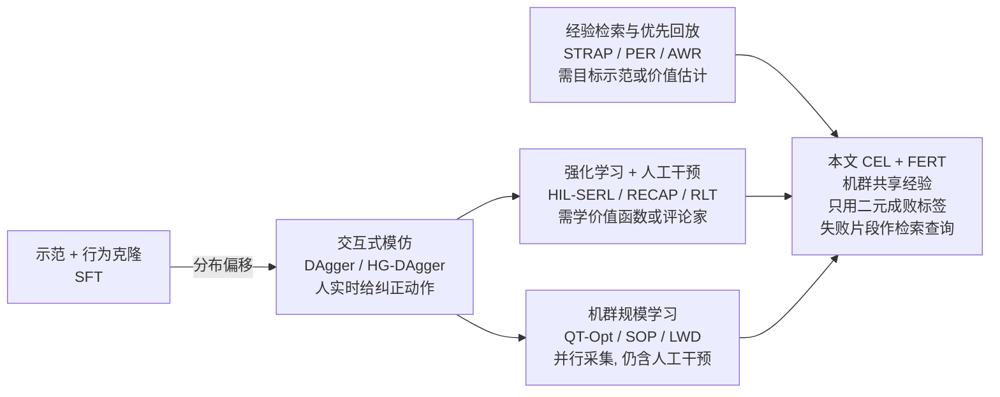
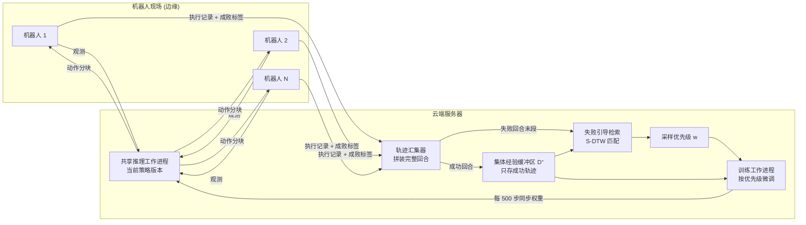
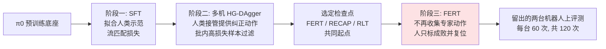
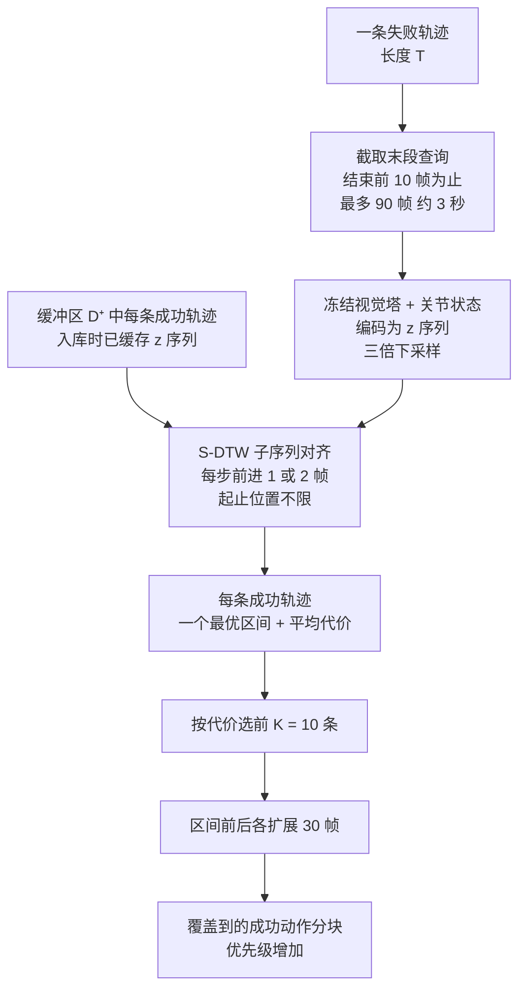
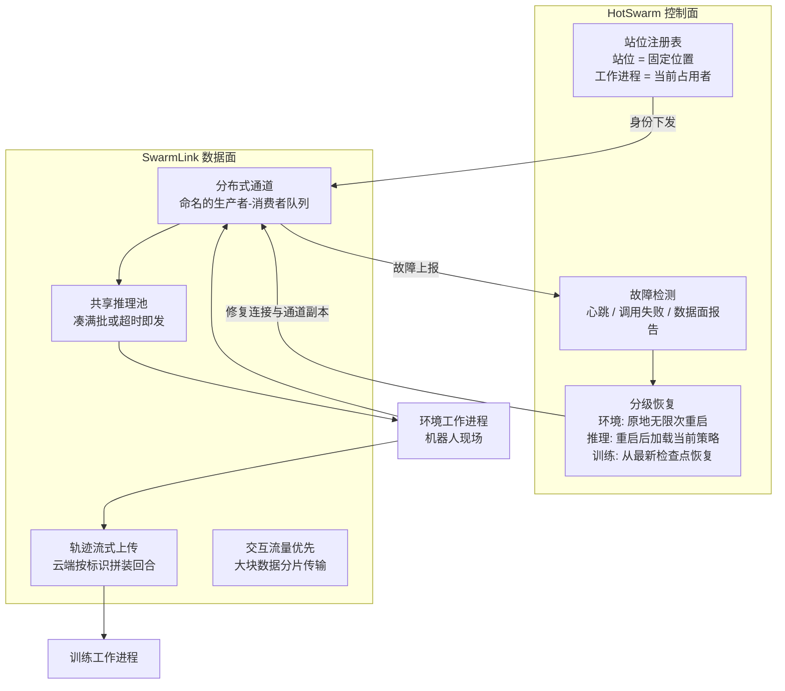
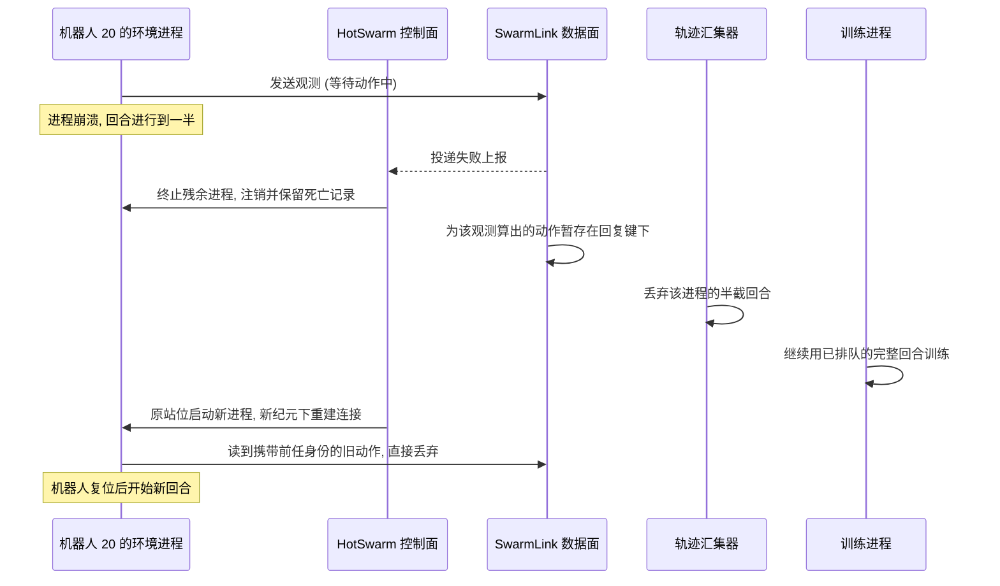
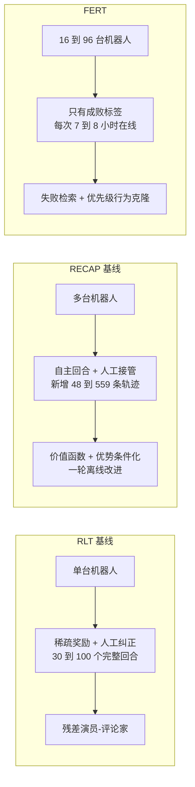

# 从机群经验中学习：一种面向机器人的集体学习范式

> **原题**：Learning from Fleet Experience: A Collective Learning Paradigm for Robots
> **作者**：Chao Yu、Shu'ang Yu、Hao Lin、Hongzhi Zang、Yuxiang Yan、Chenxi Jiang、Zhen Guo 等共 42 位署名作者。Chao Yu 为项目总负责人，Guanghui Ren 与 Quanlu Zhang 分别负责智元与无问芯穹一侧；通讯作者为 Maoqing Yao 与 Yu Wang
> **机构**：清华大学、智元机器人（AgiBot）、无问芯穹（Infinigence AI）；项目主页 https://cel-robot-learning.github.io
> **年份**：2026（arxiv ID 2610.25736，10 月 19 日提交 v1）
> **分类**：cs.RO
> **链接**：https://arxiv.org/abs/2610.25736
> **精读日期**：2026-10-20

## 阅读须知

### 这篇在领域里的位置

机器人操作策略的主流训练方式，是先请操作员遥控机器人完成任务、录下示范轨迹，再用模仿学习把这些轨迹拟合成一个策略。近两年，视觉-语言-动作模型（VLA）把这条路线推进了一大步：它们先在海量机器人数据上预训练，再针对具体任务微调，于是一个通用底座可以较快地适配新任务。然而微调之后的策略往往只有七八成的成功率，距离工厂或仓库要求的稳定可靠还有相当的距离。

于是，「部署之后如何继续变好」成了这一方向近一两年的焦点。已有的做法大致分为两支。第一支让人留在回路里：机器人执行时由操作员监看，一旦出错便接管并给出纠正动作，代表工作有 HG-DAgger、HIL-SERL，以及 Physical Intelligence 在 π\*0.6 中提出的 RECAP。第二支把很多台机器人组织成机群并行采集，代表工作有 SOP 与 LWD（Learning while Deploying），但它们在改进阶段仍然依赖人工干预信号。

这篇论文站在第二支的延长线上，向前推了两步。其一，机群规模推到 96 台真机，并在机群规模上做了系统的扩展实验。其二，在专家监督完成初始化之后，后续改进阶段不再收集任何专家动作，人只负责判定每一回合是成是败、并把场景复位。与昨日精读的 GPT-6-Astra 具身评测报告相比，这篇走的是相反的方向：那篇考察通用大模型能否零样本充当策略，这篇则坚持专用 VLA 策略，研究如何让它在部署中靠自身经验持续变得可靠。

### 读完能回答什么

1. 「集体经验学习」与 HG-DAgger、RECAP 这类方法相比，后续改进阶段究竟省掉了哪一种人工，又保留了哪一种人工。
2. FERT 为什么只模仿成功轨迹、却要用失败轨迹做检索查询；失败片段如何经由子序列动态时间规整找到对应的成功片段，又如何转化为采样优先级。
3. 论文的局部理论保证说了什么：为什么「只拟合成功经验」在当前策略近似下与沿成功率梯度上升同向，检索加权又在什么条件下带来额外收益。
4. 机群从 4 台扩到 96 台时成功率如何变化，为什么机群较小时 FERT 反而可能低于初始化策略。
5. FATS 的数据面与控制面各自解决什么问题；在 96 台真机的运行里，局部恢复相比同步轮次与整体重启保住了多少采集量。

### 阅读前置

本笔记假定读者熟悉深度学习训练的基本流程，包括小批量梯度下降、损失函数与检查点；也大致了解模仿学习「拟合示范动作」的思路，以及强化学习中策略、回报与策略梯度的含义。

笔记不预设读者做过机器人或分布式系统。视觉-语言-动作模型、动作分块、流匹配、DAgger、动态时间规整、数据面与控制面等概念，都会在第一次出现时先说明它要解决什么问题，再展开具体定义。

### 首次出现的缩写表

| 缩写 | 全称与解释 |
| --- | --- |
| CEL | Collective Experience Learning，集体经验学习。本文提出的学习范式：部署中的多台机器人共享执行经验，共同改进一个策略，改进后的策略再回到机群执行 |
| FERT | Failure-guided Experience Retrieval Fine-Tuning，失败引导的经验检索微调。CEL 的算法实现：用失败片段检索相关的成功片段，提高其采样优先级后做监督微调 |
| FATS | Fault-tolerant Asynchronous Training System，容错异步训练系统。CEL 的系统实现，负责把机器人执行、云端推理与策略训练连成一个持续运转的回路 |
| SwarmLink | FATS 的数据面，负责观测、动作与轨迹数据在边缘与云端之间的流动 |
| HotSwarm | FATS 的控制面，负责机群成员管理、故障检测与局部恢复 |
| VLA | Vision-Language-Action model，视觉-语言-动作模型。输入图像与语言指令，直接输出机器人动作 |
| π0 | Physical Intelligence 公司发布的一个基于流匹配的 VLA 模型，本文所有方法都以它为底座 |
| SFT | Supervised Fine-Tuning，监督微调。这里指在人类示范上直接拟合动作 |
| DAgger | Dataset Aggregation，数据集聚合。一种交互式模仿学习方法：在策略自己访问到的状态上请专家补充标注，再并入训练集 |
| HG-DAgger | Human-Gated DAgger，由人决定何时接管的 DAgger 变体 |
| (M)HG-DAgger | 本文在多台机器人上并行运行 HG-DAgger 的实现，其选定的检查点作为 FERT 与两个基线的共同起点 |
| RL | Reinforcement Learning，强化学习 |
| RECAP | π\*0.6 论文中的方法，用价值函数估计动作优势、再训练以优势为条件的策略，训练数据包含专家纠正 |
| RLT | RL Token，在冻结的 VLA 之上学习一个残差的演员-评论家策略，属于单机在线强化学习 |
| DTW / S-DTW | Dynamic Time Warping，动态时间规整；S-DTW 指带斜率约束的子序列 DTW，用来在长序列中寻找与短查询最相似的一段 |
| NLL | Negative Log-Likelihood，负对数似然 |
| FR | Failure-guided Retrieval，失败引导检索，消融实验里的开关名 |
| RLinf | 作者团队此前发表的大规模强化学习基础设施（OSDI 2026），FATS 构建于其上 |
| AWR / AWAC | Advantage-Weighted Regression 与 Advantage-Weighted Actor-Critic，按估计优势给回放动作加权的离线强化学习方法 |
| PER | Prioritized Experience Replay，优先经验回放，按时序差分误差决定回放频率 |
| Hz | 赫兹，这里指控制频率，本文为每秒 30 步 |

## 一、问题

设想一条产线上部署了一个机器人策略，它装一部手机进包装盒的成功率是 80%。这个数字放在论文里已经相当可观，可放到实际运营中，意味着每五次就有一次需要人工介入善后：盖子歪了、充电器放错了格子、手机滑落到桌上。失败本身的代价之外，更难处理的是失败模式会随物体摆放、光照、甚至每台机器人自身的标定差异而变化，于是很难靠事先多采几条示范一次性解决。

过去几年，提升部署后可靠性的主流办法是让人留在回路里。操作员监看机器人执行，发现即将出错时接管控制，把正确的动作示范给它，这些纠正动作再并入训练集。这条路线在单台或少数几台机器人上效果很好，问题在于它的人力需求与机器人数量成正比：一位操作员能同时照看的机器人有限，机群从十台扩到一百台，就需要多出十倍的监看与接管人力。

与此同时，机群本身每天都在产生大量执行经验。一百台机器人并行工作，一天就能积累上万个回合，其中绝大多数是成功的。换句话说，正确的动作其实已经存在于机群自己的经验里，只是散落在不同机器人、不同时刻的轨迹中。这篇论文要回答的问题是：能否在不再收集任何专家动作的前提下，只依靠「这一回合成了还是没成」这样廉价的二元判断，把机群经验转化为策略可靠性的持续提升。

### 1.1 把问题落到可检验的技术陈述

先交代论文使用的符号。机器人在第 t 步的观测记为 o_t，它包含三路摄像头图像（一路头部相机、两路腕部相机）与 16 维本体感知状态，即两条手臂各 7 个关节读数加两个夹爪读数。任务由一句语言指令 g 指定，例如「Pack the phone.」。

策略记为 π_θ(A_t | o_t, g)，其中 θ 是策略参数。这里的 A_t = (a_t, …, a_{t+H−1}) 是一个「动作分块」：策略一次输出未来 H 步的动作，而不是只输出一步。之所以这样设计，是因为高频控制下逐步预测容易抖动，一次规划一小段动作会更平滑。本文取 H = 30，在 30 Hz 的控制频率下相当于一秒钟的动作。每一步动作 a 是 16 维向量，内容是关节位置增量与夹爪指令。

一次完整执行产生一条轨迹 τ = {(o_t, a_t)}，长度为 T。执行结束后，人为这条轨迹给出一个二元结果 y(τ) ∈ {0, 1}，1 表示成功。论文的优化目标就是成功概率本身：

```text
J(θ) = E_{τ ~ π_θ} [ y(τ) ]
```

于是问题可以表述为：给定一个已经用专家数据初始化好的策略，机群在部署中持续产生轨迹与二元结果；在不再收集专家示范或纠正动作的条件下，如何更新 θ 使 J(θ) 上升，并且这种提升要能迁移到从未参与数据采集的机器人上。与此同时，这个学习回路必须能在近百台真机、故障频发的条件下连续运转数小时。

### 1.2 前人尝试过的路线

第一条路线是**示范加行为克隆**，也就是本文的 SFT 阶段。它的优点是简单稳定，只要示范质量够高，策略就能学到基本能力。它的短板是著名的「分布偏移」：策略执行时一旦出现示范里没有的小偏差，就会进入从未见过的状态，误差逐步累积，多阶段任务尤其如此。

第二条路线是**交互式模仿学习**，正是为了解决分布偏移而提出的。DAgger 让专家在策略自己访问到的状态上补充正确动作，从而把训练分布拉向执行分布；HG-DAgger 进一步把接管时机交给人类专家，更贴合真机上的人工监督方式；ThriftyDAgger 则按新颖度与风险分配有限的干预预算。这条路线做对的地方是把监督放在了真正出错的地方，但它的代价是每一条纠正都需要人实时给出动作。

第三条路线是**强化学习结合人工干预**。HIL-SERL 把示范、干预与自主经验一起交给强化学习算法；ConRFT 把人工干预引入 VLA 的强化微调；RECAP 先学一个价值函数估计每段动作的「优势」，再训练一个以优势为条件的策略；RLT 冻结 VLA，在其表示之上训练一个小的残差演员-评论家网络。它们的共同点是需要学习价值函数或评论家，而在稀疏的二元奖励与长时程任务下，价值估计本身就不容易学准；此外，本文实现的这两个基线在改进阶段仍然使用人工纠正动作。

第四条路线是**机群规模学习**。从 QT-Opt 的大规模抓取到 Ghasemipour 等人用「剩余步数」预测构造奖励，再到近期的 SOP 与 LWD，这些工作证明了多台机器人并行执行可以支撑共享策略的改进。然而它们的改进信号仍然包含人工干预，机群越大，对监督人力的需求也越大。

第五条路线来自另一个角度，即**经验检索与优先回放**。Behavior Retrieval 与 STRAP 用目标任务的示范作为查询，从大型离线数据集中检索相关片段；优先经验回放按时序差分误差决定回放频率；自模仿学习只强化回报高于价值估计的历史动作；AWR 与 AWAC 按估计优势给动作加权。这些方法回答了「该强调哪些经验」，但它们要么需要目标示范作查询，要么需要一个学好的价值估计。



从左到右看，这张图上的路线对专家动作监督的依赖逐渐降低。本文所处的位置，是把机群并行采集与经验检索结合起来，并把监督信号压缩到人类最容易给出的那一种：成或者败。

### 1.3 隐藏在问题里的两个难点

第一个难点在算法层面。成功轨迹固然提供了正确动作，可是一条成功轨迹里的大部分步骤，策略早已掌握得很好，例如伸手、抓取一个显眼的物体。若对所有成功经验一视同仁地回放，大部分更新就会花在策略已经熟练的部分，而真正导致失败的那几个难点步骤得不到足够的练习。更棘手的是，二元标签只说明这一回合失败了，并不指出失败从哪一刻开始。

第二个难点在系统层面。真机不像模拟器，它们会因为场景复位而暂停，会掉电、断网、触发关节限位，执行速度也各不相同。若采用同步收集，每次策略更新都要等最慢的那台机器人；若采用数据中心常见的「出错就整体从检查点重启」，那么任何一台机器人出故障都会让整个机群停摆，机群越大，停摆越频繁。论文的方法部分正是围绕这两个难点分别展开的。

## 二、方法

### 2.1 总体结构：范式、算法与系统三层

论文刻意区分了三个层次。CEL 是一个范式，只规定「机群共享经验、改进共同策略、策略再回到机群」这个闭环；FERT 是实现这个范式的具体算法，回答「拿到经验之后怎样更新策略」；FATS 是支撑这个闭环的分布式系统，回答「如何让近百台真机与云端训练持续协同运转」。



这张图里，机器人只负责执行与回传数据，所有策略推理与训练都在云端完成。成功回合进入缓冲区成为可模仿的动作来源，失败回合只截取末段作为查询，用来决定在众多成功经验中重点练习哪些片段。

### 2.2 起点：专家监督的初始化

FERT 不是从零开始，它接手的是一个已经过两轮专家监督训练的策略。之所以这样安排，是因为只用成败标签来学习有一个前提：策略本身必须已经能以可观的概率成功，否则缓冲区里没有成功经验可供模仿。

第一轮是在人类示范上做 SFT。π0 是一个基于流匹配的 VLA。流匹配（flow matching）是一类生成模型的训练方法，它要解决的问题是如何从一个简单的噪声分布出发，逐步变换出复杂的数据分布。具体做法是：把真实动作分块 A 与随机噪声 ε 按时间 α 线性插值得到 A^α = (1 − α)A + αε，再训练网络 v_θ 预测从数据指向噪声的速度 ε − A，推理时沿相反方向积分即可从噪声生成动作。

第二轮是在多台机器人上并行运行 HG-DAgger。每台机器人执行当前策略，操作员在需要时接管，系统逐帧记录哪些动作来自人。训练时只使用完全由人给出的动作分块，并且丢弃每段接管开头的若干个起点，以减少人类刚接手时的犹豫与急促修正。论文还观察到训练批次里有大约 5% 到 10% 的样本损失异常偏高，于是在每个批次内按分位数截掉高损失样本，只用剩下的样本回传梯度。



需要留意的是，FERT 阶段并没有把前两轮的示范与干预数据搬进自己的经验缓冲区。换句话说，第三阶段的全部动作监督，确实都来自机器人自己的执行。

### 2.3 第一步：异步收集，成功入库，失败做查询

FERT 的第一步是持续收集机群的自主执行经验。每条轨迹结束后得到二元结果 y(τ)，成功轨迹进入集体经验缓冲区 D⁺，这是一个滚动窗口，每个训练工作进程最多保留 35 万帧，最旧的经验会被逐步挤出。

失败轨迹的处理方式截然不同：它们的动作从不被当作监督目标，只被临时用作检索查询。这样的分工让 FERT 能够利用失败所携带的信息，同时又避免去模仿失败的动作。轨迹以异步方式到达，不同机器人可以按各自的节奏贡献经验；缓冲区插入、检索与优先级更新都安排在两次训练更新之间完成。

### 2.4 第二步：经验编码

检索需要一个表示，能够衡量「失败时的场景与姿态」与「某段成功经验」有多相似。论文的选择是把视觉特征与关节状态拼在一起。视觉部分取 VLA 自带的视觉塔，在进入 FERT 阶段时复制一份并冻结。之所以冻结，是因为策略在不断更新，如果编码器随之变化，新来的失败查询与早先缓存的成功轨迹就会落在不同的表示空间里，距离也就失去了可比性。

每路相机图像经视觉塔得到 16 × 16 个视觉词元，再做 4 × 4 的平均池化，保留一个 4 × 4 的粗糙空间网格，三路相机按固定顺序展平拼接，得到视觉向量 h_t。保留粗网格而不是全局平均，是为了留住「物体在画面哪个位置」这类空间信息，同时把向量长度压下来。

关节状态记为 s_t。视觉向量与状态向量各自做 L2 归一化之后再拼接，得到检索表示：

```text
z_t = [ h_t / max(‖h_t‖₂, ε) ;  s_t / max(‖s_t‖₂, ε) ]
```

分别归一化的用意在于让视觉与姿态两部分处于可比的尺度，避免维度高得多的视觉部分完全主导距离。成功轨迹在入库时就整条编码并缓存；失败轨迹只编码下一步要用到的那一小段查询。

### 2.5 第三步：失败引导检索

二元失败标签不会指出失败从哪一刻开始。FERT 的处理是一个朴素而有效的假设：失败的原因大多发生在回合结束前不久。于是它从失败轨迹的末尾往前截取一段观测作为查询：

```text
e = T − δ,   b = max(0, e − L),   Q_τ = (o_b, …, o_{e−1})
```

这里 L = 90 帧是查询的最大长度，δ = 10 帧是终点偏移。在 30 Hz 下，这相当于取「结束前约三分之一秒为止的最多三秒钟」。之所以要偏移 10 帧，是因为人工判定失败往往略有延迟，最后几帧可能已经是失败发生之后的无意义画面。

接下来要在缓冲区的每一条成功轨迹中，找到与这段查询最相似的一段。这里用到动态时间规整（DTW）。DTW 是比较两条时间序列相似度的经典方法，它要解决的问题是：同一个动作，两次执行的快慢不同，逐帧对齐会错位。DTW 允许一条序列在时间上做有限的拉伸或压缩，再在所有合法对齐里找总距离最小的那一种。论文用的是子序列版本 S-DTW：查询较短，成功轨迹较长，查询可以对齐到成功轨迹中的任意一段，起止位置都不受限制。

对齐的约束是：查询的每一帧恰好匹配成功轨迹的一帧，相邻两次匹配在成功轨迹上前进一帧或两帧。这意味着查询最多可以被拉伸到两倍长度，并且保持时间顺序不变。逐帧距离用检索表示 z 的欧氏距离，于是视觉相似与姿态相似被同时纳入。动态规划的递推式如下，其中 d 是逐帧距离，D 是累计最小距离：

```text
D[0, j] = d[0, j]
D[i, j] = d[i, j] + min( D[i−1, j−1],  D[i−1, j−2] )     (i > 0)
```

第一行直接取逐帧距离，意味着匹配可以从成功轨迹的任意位置开始，前面的部分不计入代价。递推结束后取最后一行的最小值作为终点，除以查询长度 M 得到平均对齐代价，再回溯得到匹配区间 [l, r)。

对每次失败，FERT 在每条成功轨迹里保留一个最优区间，再从全部成功轨迹中选出代价最低的 K = 10 个。每个区间随后向前、向后各扩展 30 帧，把匹配片段之前的「准备动作」与之后的「收尾动作」也包含进来。扩展只影响后续的优先级覆盖范围，不改变代价排序。为了不让检索拖慢训练，查询与候选序列都先做三倍下采样，理论上加速九倍，实测约六倍。



这一步的意义在于把「失败」转译成「该练什么」。一台机器人在插充电头时失败，它的末段画面会把其他机器人插充电头成功的片段检索出来；插花失败会找到别处插好第二枝花的片段。论文附录给出了五个任务各自的检索可视化，叠衣服的例子里，检索到的成功片段来自不同颜色的衣服，说明表示确实抓住了关键步骤本身，而不是表面的颜色。

### 2.6 第四步：按优先级微调

检索得到的区间需要转化为训练时的采样权重。缓冲区中每个可采样的成功动作分块 A_i 都有一个优先级 w_i。第 n 次检索之后，优先级按下式更新：

```text
w_i ← ρ · w_i + Σ_{R ∈ 本次检索区间} |idx(A_i) ∩ R| / H
```

其中 idx(A_i) 是这个动作分块覆盖的帧区间，H = 30 是分块长度，ρ ∈ [0, 1] 是保留系数，本文取 0.88。完全落在检索区间内的分块获得一整份增量，跨越区间边界的分块按重叠比例获得部分增量。新入库的成功分块获得一个固定的初始优先级 0.5。

这个更新式有两层含义。反复出现的失败情境会不断检索到同一类成功片段，使其优先级持续累积；与此同时，ρ 带来的指数衰减让很久以前的检索事件逐渐失去影响，策略在某个难点上改善之后，相应片段的优先级也会随之回落。值得注意的是，检索代价只用于挑选区间，并不按代价大小调整增量。

训练时按优先级比例采样动作分块，P(i) = w_i / Σ_j w_j，再在采样到的批次上最小化负对数似然。从期望上看，训练目标就是一个按优先级加权的行为克隆：

```text
L_FERT(θ) = − Σ_{i ∈ D⁺} [ w_i / Σ_j w_j ] · log π_θ(A_i | o_i, g_i)
```

由于 π0 是流匹配模型，直接计算动作的对数似然需要沿生成流追踪密度变化，代价很高。论文因此沿用 π0 原本的流匹配损失作为替代，并在附录中说明：流匹配损失可以改写为带噪声水平加权的去噪损失，而后者在适当加权下对应一个对数似然下界。换句话说，最小化流匹配损失大致等价于最大化一个似然下界。整个过程不需要价值函数、不需要优势估计，二元结果只通过两种方式起作用：决定哪些轨迹能进入缓冲区，以及决定缓冲区里哪些片段被多练。

### 2.7 局部理论：为什么这样做会提升成功率

论文给出了一个局部分析，用来说明两件事：只拟合成功经验为什么会提升成功率，以及检索加权为什么能比均匀回放提升得更多。分析在一个理想化条件下进行：缓冲区近似为「从当前策略采样、只保留成功回合、再均匀抽取其中一个分块」，并且只考虑一次足够小的梯度步。

第一个引理建立在一个强化学习里熟知的恒等式上。对二元回报，成功率的梯度可以写成「成功率乘以成功轨迹上对数概率梯度的条件期望」。于是在上述近似下，均匀回放成功经验的平均梯度恰好与成功率梯度 ∇J 方向相同，只差一个正的缩放系数 1 / (T_c · J)，其中 T_c 是一个回合包含的动作分块数。直观地说，模仿当前策略自己的成功行为，就是在提高产生这些成功的概率。

第二个引理考虑一个分阶段的任务模型：任务由若干个依次完成的阶段组成，每个阶段有自己的局部失败率，全部阶段都成功才算任务成功。在这个模型里，来自高失败率阶段的成功经验对成功率的一阶贡献更大，具体为 J · φ_k²，其中 φ_k 是第 k 阶段的局部失败率。于是只要检索给失败率更高的阶段分配不少于其他阶段的权重，并且至少有一对阶段严格如此，检索权重与样本贡献的协方差 κ 就为正。

定理把两者合在一起：在步长足够小时，有 J(θ_FERT) > J(θ_unif) > J(θ_0)，并且 FERT 的提升有如下下界：

```text
J(θ_FERT) − J(θ_0) ≥ η·μ  +  η·κ  −  (λ_J · η² / 2) · ‖G_FERT‖²
                    成功回放   检索贡献      有限步长的高阶惩罚
```

其中 η 是步长，μ 是成功回放与成功率梯度的对齐程度，κ 是检索带来的额外对齐，λ_J 是成功率梯度的利普希茨常数，G_FERT 是 FERT 的平均梯度。作者明确指出，这个保证只覆盖单步、当前策略近似与分阶段检索模型；实际训练是多步更新、使用历史经验、并以流匹配作替代，这些情形只能交给实验检验。

### 2.8 FATS：三类工作进程与两个平面

算法层面的闭环要在真机上持续运转，需要一个专门的系统。论文首先指出两个决定系统形态的事实。其一，交互与经验的时间要求截然不同：机器人需要在下一次交互之前拿到动作，每次请求约 0.45 MB 图像，必须快速返回；训练则消费完整回合，一个装盒回合约 1.58 GB，但晚几分钟到达无妨。其二，真机的可用性远不如计算资源稳定，复位、电量耗尽与硬件故障都会中断它们的贡献，而训练进程里的策略与优化器状态又是重建代价最高的部分。

基于这两个事实，FATS 把学习回路拆成三类工作进程：环境工作进程在机器人现场操作机器人，推理工作进程用当前策略计算动作，训练工作进程用收集到的经验更新策略。在本文的部署中，环境工作进程运行在机器人现场，推理与训练工作进程运行在云端六台服务器、共 48 张 A800 GPU 上，两边通过一条 30 Gbps 的专线相连。



**数据面 SwarmLink** 的设计目标是：共享云端 GPU 与专线带宽，同时不让任何一台机器人等待其他机器人。它用「分布式通道」代替固定的点对点连接，每个通道是一个命名的生产者-消费者队列，消费者直接从数据所在节点读取。推理工作进程服务一个公共请求池，而不是固定的机器人分组，因此一台机器人暂停时，它占用的推理能力会自然让给别人。

批处理是推理效率的关键，可是等凑满一个批次又会让快的机器人等慢的机器人。SwarmLink 的折中是「批次达到目标大小或最老请求等到超时，二者满足其一就发出」。负载高时批次自然凑满，GPU 利用率高；请求稀疏时超时触发小批次，不让个别机器人久等。

训练数据的传输同样做了解耦。回合在执行过程中就把数据逐段上传，推理时已经送到云端的观测图像直接复用，不再重复上传；云端的轨迹汇集器按工作进程、回合与步骤标识把各路数据拼成完整回合，只有当所需字段与成败标签全部到齐后才交给训练。由于训练数据与推理请求共用上行链路，SwarmLink 让交互流量优先，并把大块数据切成有界的小块传输，使新到的观测能在两块之间优先发出。

**控制面 HotSwarm** 的核心是区分「站位」与「工作进程」。站位是机群中的一个固定位置，绑定到某个节点、某些设备，对环境工作进程而言还绑定一台具体的机器人；工作进程则是某一时刻占据这个站位的具体进程。两者寿命不同：站位贯穿整个训练过程，工作进程在崩溃时就结束了。凡是应当在故障后保留的东西，例如机器人在机群中的位置与它的回复队列键，都归属于站位；凡是不应保留的东西，例如传输中的消息与打开的连接，都归属于工作进程。

在此基础上，HotSwarm 按工作进程的类型做分级恢复。环境工作进程最常出故障，但几乎不持有难以重建的状态，最多损失一个回合，所以可以无限次原地重启。推理工作进程持有的是可替换的策略副本，重启后加载当前策略即可。训练工作进程持有数小时积累的策略与优化器状态，因此定期保存检查点并从最近一次恢复，其间存活的推理进程继续用当前策略服务，新经验暂存在通道里等待训练恢复。

故障检测有一个微妙之处：一个不再响应的进程，可能已经崩溃，也可能只是暂时变慢，从外部无法区分。若一直等待，这个站位就悬而未决，并且慢进程恢复后可能与替代者同时发送数据。HotSwarm 的选择是直接终止可疑进程，让每次故障都变得明确，代价至多是一个回合。

### 2.9 一次机器人故障如何穿过两个平面

站位恢复分五步：注销故障进程但保留其「已死亡」记录，以便识别迟到的引用；在原来的节点与机器人上启动新进程；在新的「纪元」编号下重建连接，保证新进程不会绑定到前任发布的网络地址；只重放这个站位在中断时尚未完成的调用份额，其他站位已返回的结果保留；机器人复位后新进程恢复采集。



这张时序图里最关键的一环是身份校验。HotSwarm 给每个可能比进程活得更久的遗留物都附上工作进程身份，并在使用处与注册表比对。假如一个为旧进程观测计算的动作在新进程启动后才到达，若被执行，机器人会按一个早已不成立的状态运动；若被记录进回合，训练就会把动作与并非由它产生的观测配成一对。两种情况都不会报错，却会让训练悄然学到不一致的数据。论文在 96 台运行中记录了一个实例：机器人 20 在 11:24 与移动底座的惯性传感器断开连接，经过 11 分钟原地重启后于 11:37 恢复采集，其余机器人始终照常运行。

## 三、实验

### 3.1 实验设置

五个真实桌面操作任务覆盖了柔性物体、精细对准、工具使用与多阶段执行。插花要求把两枝花和一片叶子依次插进花瓶，花茎会在运动中晃动；叠衣服要求按固定流程把平铺的 T 恤叠好，用时约 40 秒；手机充电要求把充电头插进插线板、从手机上拔下 Type-C 线、再把手机放到指定位置。

凳子组装要求把两颗螺丝放到凳面指定位置，再拿起螺丝刀拧紧，涉及小物体与工具；手机装盒要求把说明书、数据线、充电器、手机壳和手机依次放进包装盒对应位置，最后盖上盒盖，单次用时两到三分钟，前面阶段的小偏差会影响后续操作。所有任务都在智元 AgiBot G2 双臂机器人上完成，图像统一裁剪并缩放到 224 × 224。

训练配置方面，FERT 每次在线训练约 7 到 8 小时，使用 AdamW 优化器与余弦学习率衰减，峰值学习率 2.5 × 10⁻⁵，全局批大小 1024，每 500 个优化步把新权重同步给推理进程，训练进程与机器人数量之比为 1 : 4。

两个基线从同一个初始化检查点出发。RLT 是单机在线强化学习，冻结 VLA，在其之上训练残差演员-评论家网络，训练中由操作员在困难段落临时接管；RECAP 是多机离线强化学习，把初始化阶段积累的数据与新采集的自主回合、人工接管数据合在一起，学价值函数估计优势，做一轮以优势为条件的策略改进。二者在改进阶段都用到了人工纠正动作，这是与 FERT 最根本的区别。



评测在两台从未参与训练数据采集的机器人上进行，所有评测回合都完全自主执行，不允许任何人工干预。每个策略在每个任务上每台机器人测 60 次，合计 120 次，成功率附 95% 威尔逊置信区间。威尔逊区间是一种二项比例的置信区间，在样本量不大、比例接近 0 或 1 时比常见的正态近似更可靠。之所以坚持用留出机器人，是因为同一型号的机器人在硬件、标定与执行上仍有个体差异，这样才能检验机群学到的改进能否迁移到没贡献过经验的机器人上。作为参照，六位遥操作员每人每个任务完成 20 次，同样合计 120 次。

### 3.2 主结果

下表汇总五个任务上各方法的成功率（%）。FERT 一栏报告每个任务所测最大机群的结果，括号内为训练机器人数量；最后一列是 FERT 相对初始化检查点的失败率相对降幅。

| 任务 | SFT | 初始化 (M)HG-DAgger | RLT | RECAP | 人类遥操作 | FERT（机群规模） | 失败率相对降幅 |
| --- | --- | --- | --- | --- | --- | --- | --- |
| 插花 | 35.8 | 98.3 | 95.0 | 95.0 | 90.8 | **99.2**（16 台） | 50.0 |
| 叠衣服 | 65.0 | 85.8 | 88.3 | 91.7 | 82.5 | **98.3**（16 台） | 88.2 |
| 手机充电 | 15.8 | 60.0 | 75.8 | 82.5 | 71.7 | **97.5**（16 台） | 93.8 |
| 凳子组装 | 63.3 | 81.7 | 80.8 | 85.0 | 83.3 | **93.3**（32 台） | 63.6 |
| 手机装盒 | 1.7 | 79.2 | 85.0 | 75.0 | 75.0 | **98.3**（96 台） | 92.0 |
| 平均 | 36.3 | 81.0 | 85.0 | 85.8 | 80.7 | **97.3** | 86.0 |

从初始化出发，FERT 把五个任务的平均成功率从 81.0% 提高到 97.3%，平均失败率从 19.0% 降到 2.7%，相对降幅 86%。提升最明显的是手机充电，从 60.0% 升至 97.5%；手机装盒在 96 台机器人上从 79.2% 升至 98.3%。

与两个基线相比，FERT 在全部五个任务上都更高，平均领先 RLT 12.3 个百分点、领先 RECAP 11.5 个百分点。相对 RLT 的最大差距出现在手机充电（75.8% 对 97.5%），相对 RECAP 的最大差距出现在手机装盒（75.0% 对 98.3%）。

与人类遥操作相比，FERT 在全部五个任务上也都更高，平均高出 16.7 个百分点，手机充电与手机装盒分别高出 25.8 与 23.3 个百分点。不过遥操作员之间差异很大，以手机装盒为例，个人成功率从 25%（20 次中 5 次）到 95%（20 次中 19 次）不等。

### 3.3 机群规模的扩展

这一组实验固定每台机器人的采集时间，只改变参与训练的机器人数量，因此机群越大，总经验量越多。HG-DAgger 从 SFT 出发，FERT 从选定的初始化检查点出发。下表列出 FERT 在不同机群规模下的成功率（%）。

| 任务 | 初始化 | 2 台 | 4 台 | 8 台 | 16 台 | 32 台 | 64 台 | 96 台 |
| --- | --- | --- | --- | --- | --- | --- | --- | --- |
| 插花 | 98.3 | | 96.7 | 99.2 | 99.2 | | | |
| 叠衣服 | 85.8 | | 83.3 | 94.2 | 98.3 | | | |
| 手机充电 | 60.0 | 40.0 | 90.0 | 95.0 | 97.5 | | | |
| 凳子组装 | 81.7 | | | 75.0 | 92.5 | 93.3 | | |
| 手机装盒 | 79.2 | | 50.8 | 70.8 | 86.7 | 92.5 | 95.0 | 98.3 |

总体趋势是机群越大成功率越高。手机装盒的曲线最完整：从 16 台到 96 台，成功率由 86.7% 升到 98.3%，增加 11.6 个百分点。作者对小机群时的回落给出的解释是，经验量不足时，缓冲区中的成功经验覆盖不到策略遇到的各种失败情境，失败引导检索便找不到合适的片段。

作为对照，HG-DAgger 随机群扩大的表现并不单调。单台机器人训练在三个较难任务上反而远低于 SFT：手机充电从 15.8% 跌到 0.8%，凳子组装从 63.3% 跌到 1.7%。作者推测这是过拟合到单台机器人的环境与单个操作员的习惯。机群扩大后性能回升，但在手机充电与手机装盒上趋于饱和，凳子组装在 16 台时还从 80.0% 回落到 63.3%。作者认为人工监看与干预能力有限是一个可能原因，同时也承认采集数据本身的变化可能有影响。

### 3.4 消融实验

消融全部在手机装盒、16 台机器人的设置下进行，完整配置的成功率为 86.7%。下表一并给出按 120 次试验计算的 95% 威尔逊区间，便于判断差异是否超出统计波动。

| 配置 | 成功率（%） | 95% 威尔逊区间 | 相对完整配置 |
| --- | --- | --- | --- |
| 完整 FERT | 86.7 | 79.4 至 91.6 | 基准 |
| 去掉失败引导检索（均匀采样成功经验） | 64.2 | 55.3 至 72.2 | 下降 22.5 |
| 检索区间不做前后扩展 | 57.5 | 48.6 至 66.0 | 下降 29.2 |
| 保留系数 ρ = 0.8 | 70.8 | 62.2 至 78.2 | 下降 15.9 |
| 保留系数 ρ = 0.95 | 82.5 | 74.7 至 88.3 | 下降 4.2 |
| 每 100 步同步权重 | 75.0 | 66.6 至 81.9 | 下降 11.7 |
| 每 1,500 步同步权重 | 80.0 | 72.0 至 86.2 | 下降 6.7 |

最有说服力的两项是检索与扩展。去掉失败引导检索之后成功率下降 22.5 个百分点，置信区间与完整配置互不重叠，这直接支持了「按失败情境挑选成功经验」这一核心设计。去掉前后各 30 帧的扩展，下降幅度更大，达到 29.2 个百分点，说明匹配片段之前的准备动作与之后的收尾动作，对学会一个成功行为同样关键。

保留系数与同步间隔都呈现「居中最好」的形态。ρ 太小，优先级衰减太快，策略只追逐最近的失败；ρ 太大，旧的检索信息迟迟不退。同步间隔太长，机器人长时间使用过时的策略；太短，每个策略版本下积累的经验又太少。需要说明的是，ρ = 0.95 与每 1,500 步同步这两项，置信区间与完整配置重叠，单凭这一组实验还不足以断定它们确实更差。

### 3.5 系统层面的测量

系统评测来自一次 96 台机器人的训练运行，从 10:37 持续到 18:30，中午 12:00 到 13:00 操作员午休、机器人全部暂停。期间操作员只负责标注成败、监看安全与复位场景，不提供任何示范或纠正。整次运行共完成 9,834 个回合。

故障方面，96 台中有 22 台共发生 30 次故障事件。按起因分，19 次源于计算或网络故障，例如主机内存耗尽或网络中断；9 次源于底盘、关节、电池或传感器的硬件故障；2 次是机器人未就绪。把 2 分钟内相继发生的故障归为同一事件，共 19 个故障事件，平均每 22 分钟机群里就有一次。

尽管故障频繁，机群整体采集并未中断。午休之外平均有 65 台机器人同时在执行，每分钟完成约 24 个回合。对 14 个远离午休与首尾的故障事件，比较其前后各 10 分钟的完成回合数，中位情况下事件之后保持了事件之前的 99%，最差也有 88%。30 次故障中有 23 次之后恢复了采集，从故障结束到下一个回合开始的中位间隔只有 12 秒。全部故障合计损失 8.3 个机器人小时，占机群约 660 个机器人小时的 1.3%。

为了量化异步与局部恢复的价值，作者把每台机器人实测的回合与停顿序列放到两种替代设计下重放。下表列出各设计相对实际运行所能完成的回合比例。

| 设计 | 保留的回合比例 |
| --- | --- |
| FATS 实际运行（异步采集 + 局部恢复） | 100% |
| 同步轮次（每次更新等每台机器人完成一个回合） | 33% |
| 同步轮次，且与故障重叠的停顿换成该机器人的中位停顿 | 42% |
| 同步轮次，且所有停顿都换成中位停顿 | 78% |
| 每次故障后整体重启 2 分钟 | 92% |
| 每次故障后整体重启 5 分钟 | 86% |
| 每次故障后整体重启 10 分钟 | 74% |

同步设计损失最大，一轮的中位时长为 9.3 分钟，是单台机器人典型周期 4.1 分钟的两倍多，因为每轮都要等停顿最长或回合最长的那台机器人。值得注意的是，故障只解释了其中一小部分：即使把所有停顿都替换为中位值，同步设计仍只有 78%，剩下的 22% 完全来自各机器人回合时长与停顿时长本身的参差。

整体重启的损失随机群规模恶化。作者用一个简单模型说明这一点：若每台机器人的故障率固定，机群扩大一倍，故障次数就翻倍，每次又要停掉一倍的机器人，于是损失份额大致翻倍。按本次运行估计的故障率外推，在 1,024 台机器人的机群上，整体重启 2、5、10 分钟分别只剩 50.4%、28.9% 与 16.9% 的可用采集时间，而局部恢复的可用比例不随规模变化，仍为 98.7%。

通信方面，观测上行通道 95.18% 的操作在 20 毫秒内完成，99% 以上在 50 毫秒内完成；动作下行通道有 83.15% 落在 200 到 250 毫秒之间，约 97.6% 在 250 毫秒内完成，超过 1 秒的不足 1%。训练数据通道 99% 以上在两分钟内完成，与交互通道相差数个数量级，这正是把推理服务与经验传输解耦的理由。

### 3.6 几个反直觉的结果

第一，小机群时 FERT 普遍低于初始化。论文正文只点名了凳子组装与手机装盒在 8 台时的回落，但对照附录的完整表格可以发现，五个任务在各自所测的最小机群上全部低于初始化：插花 96.7% 对 98.3%，叠衣服 83.3% 对 85.8%，手机充电 40.0% 对 60.0%，凳子组装 75.0% 对 81.7%，手机装盒 50.8% 对 79.2%。换句话说，FERT 存在一个经验量门槛，低于门槛时，用自身经验继续训练会让策略变差。

第二，去掉检索的均匀回放不仅比完整 FERT 差，还低于初始化。在 16 台的手机装盒设置下，均匀回放成功经验得到 64.2%，而起点是 79.2%，两者的置信区间也基本分开。这与第 2.7 节第一个引理「均匀回放成功经验会提升成功率」的局部结论方向相反。论文没有专门讨论这一点；一个合理的推测是，引理依赖「缓冲区来自当前策略」与「单个小步长」，而实际训练用的是滚动的历史经验并连续更新数千步，均匀回放会把大量更新花在策略早已熟练的步骤上，甚至让难点步骤的表现被稀释。

第三，单机 HG-DAgger 在三个较难任务上几乎完全崩溃，成功率跌到 0.8% 到 1.7%，远低于只做 SFT 的水平。这提示在真机上，少量来自单一操作员、单一环境的纠正数据，可能比没有纠正更有害。

第四，自主策略在全部五个任务上超过了人类遥操作。这一结果需要放在语境里理解：遥操作是通过一套间接的控制接口完成的，并非人亲手操作，操作员之间的水平差异也很大，因此它更像是一个「通过同一硬件能达到多少」的参照，而不是人手灵巧度的上限。

## 四、局限

### 4.1 作者承认的局限

作者在结论中明确说明，本研究只在单一机器人平台上评估了五个任务专用的策略。更广泛的任务分布、异构的机器人平台，以及长期运行中对环境变化的适应，都留作未来工作。

人并没有从回路中消失。实验中的成败标签由人工给出，场景复位也由人完成；论文提到成败判断原则上可以交给学习得到的奖励模型，但这一点没有在实验中验证。

理论保证是局部的。它只针对单次小步长更新、当前策略回放近似以及分阶段的检索对齐模型；检索对齐条件本身也不是由非均匀优先级自动满足的，而是对检索质量的要求。多步更新、历史回放与流匹配替代损失下的效果，只由实验评估。

小机群时 FERT 可能低于初始化，作者给出的解释是经验覆盖不足；HG-DAgger 在大机群上的饱和与回落，作者也只将人工监看能力有限列为可能原因之一。这两处都属于推测，没有设计实验专门验证。

系统层面，动作下行通道的延迟集中在 200 到 250 毫秒，作者承认仍有优化空间；通信测量没有把网络传输与等待数据或计算区分开，因而不能单独说明批处理、优先级调度或流式上传各自的收益。恢复机制只修复软件，硬件维修与场景复位仍需操作员；机器人 44 到 47 在 17:17 的主机内存故障之后再未返回。

恢复成本模型假设每台机器人的故障率与停机时长不随机群规模变化、不同机器人的故障相互独立，并且只考虑机器人本地故障，没有计入云端推理或专线这类共享部件的故障。基线方面，作者也说明了改动：RECAP 只做了一轮改进而原方法是多轮，价值函数由原来的多任务语言条件模型换成了每个任务单独训练的视觉与状态网络。

### 4.2 读者能看出来的潜在问题

第一，数据与人力预算并不对等。FERT 的主结果来自 16 到 96 台机器人、每次 7 到 8 小时的在线训练，单是 96 台那一次运行就产生了 9,834 个回合；而 RECAP 新采集的数据只有 48 到 559 条轨迹，RLT 在单台机器人上只用了 30 到 100 个完整回合。因此主表中 FERT 对基线的领先，混合了算法差异与数据量差异。一个旁证是，在手机装盒上，单机 RLT 的 85.0% 与 16 台 FERT 的 86.7% 几乎相同。若要单独衡量算法本身，需要在相同的机器人时间或相同的人工时间下比较。

第二，统计证据偏薄。每个配置只训练了一次，没有多随机种子的重复；120 次试验的置信区间宽度约为正负 6 个百分点。在 16 台的手机装盒上，FERT 的 86.7%（79.4% 至 91.6%）与初始化的 79.2%（71.1% 至 85.5%）区间重叠，因此「16 台已经带来提升」这一点本身也不算确定，可靠的提升要到 32 台以上才显现。

第三，「不需要专家动作」并不等于「不需要人」。96 台运行中每分钟约 24 个回合，每一个都需要有人判定成败并复位场景。人工从动作监督转移到了结果标注与场景复位，而后者对装盒、组装这类需要把零件放回原位的长时程任务，工作量并不小。论文报告的是专家动作的节省，并没有给出总人工时间的对比。

第四，FERT 本质上是一种按优先级加权的「成功过滤行为克隆」，它能放大机群中已经出现过的正确做法，却很难发现初始策略从未成功过的新策略。这也意味着它对起点有要求：本文的初始化成功率在 60% 到 98% 之间，而手机装盒的 SFT 只有 1.7%，若跳过 HG-DAgger 直接进入 FERT，缓冲区里几乎没有成功经验可供模仿。

第五，检索查询只取失败终点之前约三秒。对于「病根在前、症状在后」的失败，例如装盒早期某个物件放得略偏，直到盖盒盖时才导致失败，查询定位到的是症状出现的阶段，而不是真正出错的阶段。论文自己也提到装盒任务的早期误差会影响后续操作，但没有分析这类失败在检索中如何被处理。

第六，泛化的检验范围有限。留出的两台评测机器人与训练机群同型号，论文也没有提到评测时更换场地、物体、光照或桌面布置。因此论文检验的是同一平台不同个体之间的迁移，而不是跨场地、跨物体或跨任务的泛化。

第七，可复现门槛很高。整套实验依赖一个可容纳 100 台机器人的采集场地、48 张 A800 GPU 与一条 30 Gbps 专线，绝大多数实验室无法复现机群规模的结论。FATS 构建于开源的 RLinf 之上，但论文正文与 Hugging Face 页面都没有给出 FERT 或 FATS 的代码仓库链接，目前只有项目主页。

## 一句话

机群共享部署经验，以失败片段检索成功片段加权模仿，不再采集专家动作，五项真机任务成功率达 93% 至 99%。
