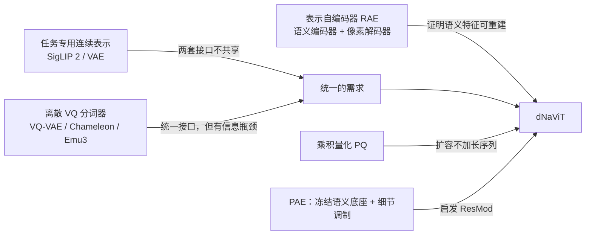
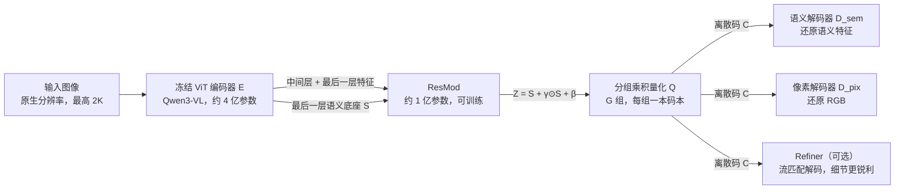
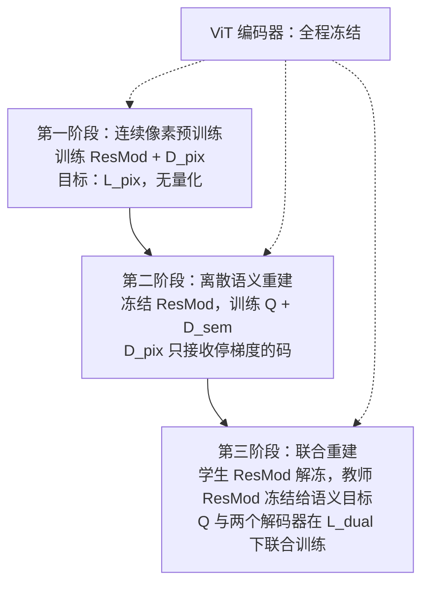
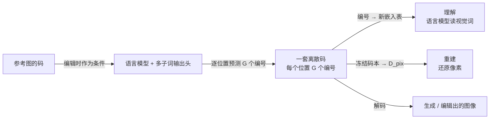

# dNaViT：离散码能不能做通用的视觉表示

> **原题**：dNaViT: Discrete Codes are General-Purpose Visual Representations
> **作者**：Xiaotong Li, Zhengrong Yue, Xu Huang, Jialv Zou, Minhao Jing, Wenhao Yan, Haodong Li, Hai Huang, Bo Zhao, Yan Feng, Peng Pei, Xunliang Cai
> **机构**：论文正文中可读部分未列出机构；代码与模型发布在 meituan-longcat 组织下（GitHub 仓库 LongCat-Next，Hugging Face 同名模型页），并说明本文是团队前作 LongCat-Next 的延伸
> **年份**：2026（arxiv ID 2611.12426，2026 年 11 月 9 日提交，技术报告）
> **分类**：cs.CV（主），cs.AI
> **链接**：https://arxiv.org/abs/2611.12426
> **精读日期**：2026-11-11

## 阅读须知

### 这篇在领域里的位置

视觉表示这件事，过去几年一直是两条路并行。一条路服务于“看懂”：用 CLIP、SigLIP 这类对比学习训练出来的编码器，把图像变成连续的语义特征，再交给多模态大模型去回答问题、读文档。另一条路服务于“画出来”：用 VAE 一类的自编码器把图像压成连续的潜变量，扩散模型在这个潜空间里生成图像。两条路用的是两套不同的表示，彼此并不相通。

与此同时，还有第三条路一直没有断：把图像切成离散的“视觉词”，像文字一样编号，这样语言模型就能用同一套“预测下一个词”的办法同时处理文字和图像。VQ-VAE、VQGAN、Chameleon、Emu3 都属于这一脉。这条路的吸引力在于统一，它的老问题在于离散化会丢信息，丢掉的东西往往正是读小字、看细节所需要的。

这篇论文站在第三条路上，往前推了一步。它的主张写在标题里：离散码可以是通用的视觉表示，同一套码既能拿来理解，也能拿来重建、生成和编辑。它的做法不是从零训练一个离散分词器，而是借用一个已经很强的连续视觉编码器（Qwen3-VL 的 ViT），在它上面加一层轻量的修正，再做分组量化。

### 读完能回答什么

1. 为什么“图像离散化”一直被认为会伤害理解任务，尤其是 OCR 这类要看小字的任务？
2. dNaViT 怎样在冻结的连续编码器上，同时保住语义信息和像素细节？ResMod 这个模块到底在修正什么？
3. 分组乘积量化（grouped product quantization）为什么能在不拉长序列的前提下扩大离散容量？
4. 三阶段训练为什么要先连续、再离散、最后联合，顺序能不能换？
5. 在理解、重建、生成、编辑四类任务上，离散的 dNaViT 实际离连续方案还有多远？

### 阅读前置

本文假定读者熟悉 Transformer 的基本结构与 PyTorch 的张量操作，知道多模态大模型大致是“视觉编码器加语言模型”的拼法。本文不假定读者专门做过图像分词器、向量量化或扩散模型，涉及这些的地方都会先铺垫再展开。

### 缩写表

- **ViT**（Vision Transformer）：把图像切成小块（patch），当成序列送进 Transformer 的视觉编码器。
- **NaViT**（Native-resolution ViT）：允许任意分辨率和长宽比输入的 ViT 做法；本文名字里的 “NaViT” 取的是“原生分辨率”这层意思。
- **dNaViT**（discrete Native-resolution Vision Transformer）：本文提出的离散原生分辨率视觉分词器。
- **VQ / VQ-VAE**（Vector Quantization / Vector-Quantized Variational AutoEncoder）：把连续向量替换成码本里最近的一个条目，从而得到离散编号。
- **PQ**（Product Quantization，乘积量化）：把一个向量切成几段，每段各自量化，组合起来表示原向量。
- **ResMod**（Residual Modulator，残差调制器）：本文在冻结编码器上加的轻量修正模块。
- **RAE**（Representation AutoEncoder，表示自编码器）：用预训练语义编码器加重建解码器的自编码范式。
- **LPIPS**（Learned Perceptual Image Patch Similarity）：一种用深度网络特征衡量两张图“看起来像不像”的感知距离。
- **PSNR / SSIM**（Peak Signal-to-Noise Ratio / Structural Similarity）：两种常用的像素级重建质量指标，越高越好。
- **OCR**（Optical Character Recognition）：从图像里识别文字。
- **LM / LLM**（(Large) Language Model）：语言模型 / 大语言模型。
- **AR**（Autoregressive）：自回归，即逐个预测下一个元素的生成方式。

## 一、问题

先说这个问题为什么值得做。今天的多模态系统在工程上是一锅拼盘：理解用一套连续的语义编码器，生成用另一套连续的 VAE 潜空间，两边的特征形状、训练目标、接口都不一样。于是一个“既能看懂又能画”的模型，内部往往要维护两套视觉表示，训练时目标彼此打架，部署时要多带一个组件。

如果图像能像文字一样变成一串离散编号，局面就会简单很多。语言模型只需要多认识一批“视觉词”，理解时读这些词，生成时写这些词，编辑时在参考图的词上改写。整个系统共用一套接口、一种训练目标，扩展起来也沿用语言模型现成的那套经验。

这条路之所以一直没有成为主流，是因为离散化有代价。把一个高维连续向量换成码本里的一个编号，本质上是一次有损压缩，码本再大也是有限的。过去的离散分词器在重建上尚可，一旦拿来做理解，尤其是读文档、认小字，成绩就明显落后于连续编码器。

### 具体的技术问题

把上面的动机落到一个可以检验的问题上，就是：能否构造一个离散视觉分词器，使得同一套离散码同时满足三件事。第一件是理解，接到语言模型上，在通用问答、数学、OCR、文档、图表这些基准上接近连续编码器的水平。第二件是重建，能把码解回像素，保住布局、颜色和尽量多的细节。第三件是生成与编辑，语言模型能直接预测这些码，再解码成图。

论文还加了一个工程约束：输入要支持原生分辨率和任意长宽比，最高到 2K，而序列长度不能因为容量需求而无限变长。

### 前人路线与各自的不足

第一条路线是**任务专用的连续表示**。理解侧的代表是 SigLIP 2 这类语义编码器，生成侧的代表是潜扩散模型用的 VAE。它们各自在本职任务上很强，问题在于彼此不共享，系统里永远要有两套视觉接口。

第二条路线是**表示自编码器（RAE）**。它的思路是拿一个预训练好的语义编码器当编码端，再训练一个解码器把语义特征还原成像素。这条路说明了一件事：语义特征里其实保留了相当多可以重建的信息。本文沿用了这个思路作为出发点，只是要把中间的连续特征换成离散码。

第三条路线是**离散 VQ 分词器**，从 VQ-VAE 到 Chameleon、Emu3。它们做到了统一接口，但论文引用的观察是：分词时的信息损失会限制下游表现，也会削弱规模扩大带来的收益。UniTok 等工作把“离散容量有限”明确指为关键瓶颈；Janus、TokenFlow 等工作则指出，理解需要的语义和重建需要的像素细节之间存在一种至今没有化解的张力。

## 二、方法

### 整体结构

dNaViT 的整条链路可以概括成六个部件，按数据流动的顺序排列。

第一个部件是**冻结的视觉编码器 E**。它是 Qwen3-VL 的 ViT，约 4 亿参数，在整个训练过程中一直冻结。之所以冻结，是因为它已经是一个经过大规模图文训练的强语义编码器，本文想保住的正是这份语义能力。

第二个部件是 **ResMod（残差调制器）**，约 1 亿参数，可训练。它从编码器的若干中间层和最后一层取特征，融合之后预测一个“缩放加平移”的修正量，叠加在最后一层的语义特征上。它要解决的问题是：最后一层特征偏重语义，丢掉了不少像素细节，而这些细节散落在中间层里。

第三个部件是**分组乘积量化器 Q**。修正后的特征按通道切成 G 组，每组各有一本码本，各自找最近的码字。最终每个空间位置得到 G 个编号。

第四、五个部件是两个解码器：**语义解码器 D_sem** 把离散码还原成语义特征空间里的向量，**像素解码器 D_pix** 把离散码还原成 RGB 图像。两个解码器分别对应“懂”和“画”两种需求。

第六个部件是可选的 **Refiner**，一个以离散码为条件的流匹配解码器，建在一个预训练的图像生成先验上。它用来替换 ViT 像素解码器，让输出的细节更锐利。带 Refiner 的版本叫 dNaViT-G16-R。

整个分词器总共约 5 亿参数。

### ResMod：在语义底座上做细节修正

ResMod 这一步要做的事情，是在不破坏冻结编码器语义的前提下，把像素细节补回来。它分两小步。

第一小步是融合。设 H^(ℓ) 是编码器第 ℓ 层的输出，形状为“位置数 × 通道数”；𝒮 是选中的若干层的编号集合，既有浅层也有深层（论文可读部分没有给出具体层号）。每层先各自做层归一化，再按通道拼接，经一个投影 ℱ 映射到统一宽度，最后过一个由自注意力和前馈层组成的轻量小网络 𝒯，得到融合特征 U：

U = 𝒯(ℱ(Concat[LN(H^(ℓ))]))

第二小步是调制。设 S 是语义底座，取自编码器最后一层，可以原样使用，也可以做空间聚合。ResMod 从 U 预测两组系数 γ 和 β，然后：

Z = S + γ⊙S + β

这里 ⊙ 表示逐元素相乘。关键的设计是：预测 γ、β 的那一层权重初始化为零。于是训练刚开始时 γ 和 β 都是零，Z 恰好等于 S，模型从“原封不动的语义特征”出发，只学一个小的修正量。之所以这样设计，是因为直接改写语义特征很容易把编码器原有的语义能力冲掉，而从零出发的残差修正可以保证修正只在需要的地方生效。论文说明这个设计受 PAE（先验对齐自编码器）“冻结语义底座加细节调制”思路的启发。

### 分组乘积量化：扩容而不加长序列

离散化的核心矛盾是容量。一本有 K 个码字的码本，每个位置只能表达 log₂K 比特的信息；想多表达一些，传统做法要么扩大码本（训练会变难，很多码字用不上），要么增加位置数（序列变长，语言模型的负担变重）。

乘积量化给出了第三种办法。设修正后的特征 Z 在每个位置是一个 C 维向量。把它按通道切成 G 组，每组 d = C/G 维；第 g 组有自己的码本 {e_k^(g)}，k 从 1 到 K。每组各自找最近的码字：

k_t^(g) = argmin_k ‖z_t^(g) − e_k^(g)‖²

然后把 G 组选中的码字拼回去，得到这个位置的量化向量 c_t。于是一个位置不再只有一个编号，而是 G 个编号组成的元组。

换句话说，组合空间的大小是 K 的 G 次方，每个位置的理论比特数是 G·log₂K，整张图是“位置数 × G·log₂K”。增加组数 G 就能成倍扩大容量，而空间位置数不变，序列长度也就不变。论文自己也提醒，这个数字描述的是“可用的离散字母表有多大”，并不等于实际保留了多少信息。

由于码本在所有位置之间共享，同一套量化规则可以直接用在不同分辨率、不同长宽比的网格上，这就是原生分辨率支持的来源。论文中两个主要版本 G16 和 G64，指的就是 16 组和 64 组。

### 双分支目标

量化之后的离散码 C 要同时服务两个目标，所以训练时有两条分支。

**语义分支**要求 D_sem 把 C 还原成语义特征 Ẑ，并与目标特征 Z\*（训练时停止梯度）对齐。损失由余弦距离和均方误差两部分组成：

L_sem = 1 − cos(Ẑ, Z\*) + λ·‖Ẑ − Z\*‖²

之所以在余弦之外加一项均方误差，是因为高维特征往往具有“各向异性”，即大量向量挤在一个狭窄的锥形区域里；在这种情况下，余弦距离即使很小，重建也可能不准。

**像素分支**要求 D_pix 先把码 C 还原回空间网格（token unmerging），再解码出 RGB 图像 x̂，并用一组损失约束它：L1、均方误差、LPIPS 感知损失、基于 ConvNeXt-S 的感知损失，以及匹配 VGG 特征 Gram 矩阵的风格损失。Gram 矩阵衡量的是特征通道之间的相关性，常用来约束纹理。

两条分支加权相加，就是双分支总目标 L_dual。具体权重在论文可读部分没有给出。

### 三阶段训练

三个阶段的顺序，是这篇论文最值得细看的地方之一，因为它决定了语义和像素两种信息谁先谁后、谁保护谁。

**第一阶段：连续的像素预训练。** 此时还没有量化。编码器冻结，只训练 ResMod 和像素解码器，目标是像素损失。这一步让 ResMod 先学会“从中间层把细节捞回来”，在连续空间里就把重建能力打好底子。

**第二阶段：离散的语义重建。** 编码器和 ResMod 都冻结，开始训练量化器 Q 和语义解码器，目标是语义损失。像素解码器也在训练，但它接收的是停止了梯度的离散码，也就是说像素损失的梯度到这里为止，不会回传去扭曲码本。这样做的用意是：先让码本按语义的需要成形。

**第三阶段：联合重建。** 解冻一个“学生”ResMod，同时保留第二阶段的 ResMod 作为冻结的“教师”。语义目标 Z\* 由教师给出，量化输入来自学生。此时像素损失的梯度可以一路传到量化器和学生 ResMod，两种信息在同一套码里达成平衡。编码器和教师始终冻结。

为什么不能一开始就联合训练？论文在第二节提到一个现象：量化可能把那些表达得很弱的外观差异合并进同一个码字。如果没有一个稳定的语义锚点，像素目标会把码本往细节方向拉，语义就会被冲淡。教师 ResMod 的作用正是这个锚点。

### 数据与分辨率课程

训练数据分三类。通用数据来自 LAION、COYO、DataComp、Recap-DataComp-1B、CapsFusion 和一批内部数据。富文本数据包括 TextAtlas5M 的若干子集（书封、长单词、学术论文、幻灯片）、中英文书页与新闻页、OCR 数据、信息图和 ChartGalaxy 图表数据。细粒度与高美感数据包括 LAION 的人脸子集、SA-1B 和内部高美感数据。

分辨率上采用由易到难的课程：先在固定的 256×256 上用较少的数据源训练，再切换到原生分辨率，最高 2K，并在更宽的数据组合上平衡各分辨率段。论文给出的总规模是“几千亿 token”，没有给出图像数量。

### 下游怎么用这套码

同一套码在下游有四种用法。

理解时，只把码的编号送进语言模型。语言模型侧为每一组新建一张嵌入表，和语言模型一起训练。重建时，用冻结的码本查出向量，交给像素解码器。生成与编辑时，在语言模型上加一个“多子词输出头”，让它一次预测一个位置的 G 个编号，编辑时还可以以参考图的码为条件；预测出的码再经同一套码本和像素解码器变回图像。

## 三、实验

论文在四类任务上做了评测：重建、冻结特征分类、视觉理解、生成与编辑。需要先说明一点：除了消融实验之外，与其他模型的比较都取自各自公开报告的数字，训练数据、分辨率、提示方式和评分协议都不相同，论文自己也承认这些比较不是受控比较。

### 重建

ImageNet-1K 验证集全集 5 万张图上，按 256、512、1024 三种分辨率测 PSNR 和 SSIM。dNaViT 的下采样倍数是 32，也就是说 256×256 的图只有 64 个位置，比多数对手（倍数 8 或 16）少得多。

| 方法 | 下采样倍数 | 位置数 | 256² | 512² | 1024² |
|---|---|---|---|---|---|
| SD-VAE XL（连续） | 8 | 1024 | 27.37 / 0.78 | – | – |
| FLUX-VAE（连续） | 8 | 1024 | 32.74 / 0.92 | – | – |
| BSQ-ViT（离散） | 16 | 256 | 28.14 / 0.81 | – | – |
| LlamaGen（离散） | 16 | 256 | 20.65 / 0.54 | – | – |
| Open-MAGVIT2（离散） | 16 | 256 | 22.70 / 0.64 | – | – |
| dNaViT-G16 | 32 | 64 / 256 / 1024 | 22.82 / 0.64 | 25.47 / 0.71 | 28.93 / 0.81 |
| dNaViT-G64 | 32 | 64 / 256 / 1024 | 25.41 / 0.76 | 28.12 / 0.81 | 32.90 / 0.91 |

表中每格为 PSNR（dB）/ SSIM。可以看到，组数从 16 加到 64，各分辨率上 PSNR 都提高了约 2.6 到 4 dB；在 1024² 上，dNaViT-G64 的 32.90 dB 已接近 FLUX-VAE 在 256² 上的水平。但在 256² 这一档，dNaViT-G64 的 25.41 仍低于 BSQ-ViT 的 28.14，后者用的位置数是它的四倍。论文提醒，位置数并不等于码率，所以这张表只能粗看。

小字重建用 TokBench 衡量，指标是文字识别准确率 T-ACC、归一化编辑距离 T-NED（都是百分比）和人脸相似度 F-Sim：

| 方法 | 下采样倍数 | 512²：T-ACC / T-NED / F-Sim | 1024²：T-ACC / T-NED / F-Sim |
|---|---|---|---|
| DC-AE（连续） | 32 | 38.25 / 56.22 / 0.39 | 52.14 / 68.02 / 0.50 |
| FLUX.1-dev（连续） | 8 | 87.64 / 93.86 / 0.86 | 93.09 / 96.96 / 0.96 |
| LlamaGen（离散） | 8 | 52.56 / 68.99 / 0.53 | 63.89 / 78.24 / 0.67 |
| O-MAGVIT2（离散） | 8 | 60.56 / 76.00 / 0.61 | 69.68 / 83.12 / 0.74 |
| UniTok（离散） | 16 | 50.10 / 71.08 / 0.44 | 49.70 / 71.59 / 0.53 |
| dNaViT-G16 | 32 | 33.58 / 52.43 / 0.34 | 45.05 / 62.75 / 0.41 |
| dNaViT-G64 | 32 | 51.69 / 68.72 / 0.54 | 63.08 / 78.27 / 0.67 |

dNaViT-G64 在压缩倍数高得多的情况下，与倍数为 8 的 LlamaGen 大致相当，并在三项指标上都超过同为 32 倍的 DC-AE。与 FLUX.1 相比仍有明显差距，论文直接承认小字依然是难点。按文字大小分桶看，小号文字的 T-ACC 在 512² 下只有 12.18%，到 1024² 才升到 26.79%，大号文字则分别是 87.95% 和 93.95%。论文还说明，G16 和 G64 的训练配置与时长不同，所以这组对比不能单独归因于组数。

### 冻结特征分类

这组实验用冻结的特征加一个线性分类器，在 ImageNet-1K 上训练 10 个 epoch，再迁移到几个分布偏移数据集上测 top-1 准确率。

| 方法 | 下采样倍数 | IN-1K | IN-A | IN-R | IN-V2 | IN-Sketch | ObjectNet |
|---|---|---|---|---|---|---|---|
| QwenViT（连续） | 32 | 80.45 | 60.13 | 65.00 | 70.18 | 46.57 | 56.48 |
| dNaViT-G16（量化前，连续） | 32 | 80.40 | 60.25 | 65.19 | 70.18 | 46.56 | 56.48 |
| UniTok（离散） | 16 | 78.56 | 47.81 | 71.10 | 68.18 | 51.03 | 60.53 |
| dNaViT-G16（离散） | 32 | 79.47 | 56.35 | 68.09 | 69.81 | 45.02 | 59.79 |

第一个看点是量化前的特征与原始 QwenViT 几乎一模一样，说明 ResMod 的残差修正确实没有伤到语义。第二个看点是离散化的代价：在 IN-1K 上只掉了 0.93 个百分点。在离散方法里，dNaViT 在 IN-1K、IN-A、IN-V2 上领先，UniTok 在 IN-R、IN-Sketch、ObjectNet 上更好。

### 视觉理解

理解实验把冻结的 dNaViT-G16 分词器接到 Qwen3-8B 上，依次做对齐、预训练、中期训练和指令微调，各阶段分别约 700 亿、1500 亿、600 亿和 300 亿 token，合计约 3100 亿。得到的模型叫 dNaViT-8B。

通用与理科推理类基准：

| 模型 | MMMU | MMMU-Pro | MathVista | MathVision | RealWorldQA | MMStar |
|---|---|---|---|---|---|---|
| Qwen3-VL-8B（连续） | 69.6 | 55.9 | 77.2 | 53.9 | 71.5 | 70.9 |
| InternVL3.5-8B（连续） | 73.4 | – | 78.4 | 56.8 | 67.5 | 69.3 |
| Qwen2.5-VL-7B（连续） | 58.6 | 38.3 | 68.2 | 25.1 | – | 63.9 |
| ViQ-7B（离散） | 49.1 | – | – | – | – | 54.2 |
| Kelix-8B（离散） | 54.1 | – | 76.5 | – | 72.1 | – |
| LLaDA2.0-Uni（离散） | 50.1 | 34.0 | 68.1 | 26.7 | 66.7 | 64.1 |
| **dNaViT-8B（离散）** | **70.7** | **44.5** | **79.0** | **56.5** | **72.3** | **66.7** |

OCR、文档与图表类基准（OmniDocBench 为编辑距离，越低越好）：

| 模型 | OCRBench | OCRBench V2（英/中） | CharXiv（DQ/RQ） | DocVQA | InfoVQA | OmniDocBench（英/中）↓ |
|---|---|---|---|---|---|---|
| Qwen3-VL-8B（连续） | 896 | 65.4 / 61.2 | 83.0 / 46.4 | 96.1 | 83.1 | 0.17 / 0.26 |
| Qwen2.5-VL-7B（连续） | 864 | 56.3 / 57.2 | 73.9 / 42.5 | 95.7 | 82.6 | 0.31 / 0.40 |
| Emu3-Chat-8B（离散） | 687 | – | 36.8 / 14.1 | 76.3 | 42.7 | – |
| ViQ-7B（离散） | 711 | – | – | 88.9 | 55.3 | – |
| UniAR-8B（离散） | 833 | 43.0 / 48.6 | 63.3 / 26.8 | 91.4 | 68.9 | 0.48 / 0.43 |
| LLaDA2.0-Uni（离散） | 757 | – | 68.4 / – | 89.5 | 70.1 | – |
| **dNaViT-8B（离散）** | **885** | **57.6 / 60.1** | **86.5 / 51.0** | **96.2** | **79.2** | **0.17 / 0.22** |

这两张表最值得注意的是和其他离散方法的距离。在 OCRBench 上，此前的离散模型在 687 到 833 之间，dNaViT-8B 达到 885，离连续的 Qwen3-VL-8B（896）只差 11 分。DocVQA 和 OmniDocBench 上，它与 Qwen3-VL-8B 基本持平；CharXiv 两项上，它在所列模型中最高。

另一面也要看清：与 Qwen3-VL-8B 相比，dNaViT-8B 在 MMMU-Pro（44.5 对 55.9）、MMStar（66.7 对 70.9）、OCRBench V2 英文（57.6 对 65.4）和 InfoVQA（79.2 对 83.1）上明显落后。论文对这几项没有声称持平。

### 生成与编辑

文生图在 GenEval2、Qwen-Image-Bench、SpatialGenEval 和 LongText-Bench（中英）上评测：

| 模型 | 压缩 | 参数量 | GenEval2 GM | QwenImage Bench | SpatialGenEval | LongText 英 | LongText 中 |
|---|---|---|---|---|---|---|---|
| GPT Image 2（闭源） | – | – | – | 64.69 | 0.96 | 0.98 | – |
| Qwen-Image-2512（开源） | – | 20B | 29.0 | 52.06 | 0.60 | 0.96 | 0.97 |
| Qwen-Image（开源） | 16×16 | 20B | 33.8 | 49.23 | 0.61 | 0.94 | 0.95 |
| SenseNova-U1-8B | – | 8B | 40.5 | 49.02 | 0.72 | 0.95 | 0.82 |
| Emu3.5（自回归） | 16×16 | 34.1B | 25.4 | 49.89 | 0.57 | 0.98 | 0.93 |
| **dNaViT-8B（自回归）** | **32×32** | **8B** | **49.5** | **52.17** | **0.68** | **0.94** | **0.94** |

dNaViT-8B 在报告了 GenEval2 的模型里最高，Qwen-Image-Bench 上超过所有开源基线，但仍低于闭源系统（54.07 到 64.69）。考虑到它只有 8B 参数、压缩倍数是 32×32，这个结果相当紧凑。

图像编辑在 GEdit-Bench 英文全集上评测：

| 模型 | 语义一致性 SC | 感知质量 PQ | 总分 |
|---|---|---|---|
| GPT-Image-1 [High]（闭源） | 7.85 | 7.62 | 7.53 |
| Gemini 2.5 Flash Image（闭源） | 7.41 | 7.96 | 7.10 |
| FLUX.1 Kontext [Dev] | 6.52 | 7.38 | 6.00 |
| Step1X-Edit | 7.66 | 7.35 | 6.97 |
| Qwen-Image-Edit | 8.00 | 7.86 | 7.56 |
| Emu3.5 | 8.11 | 7.70 | 7.59 |
| **dNaViT-8B** | **7.41** | **7.20** | **7.30** |

编辑上它处在中游：高于 Step1X-Edit，低于 Qwen-Image-Edit 和 Emu3.5。论文没有声称编辑任务上领先。

### 消融：ResMod 与离散化各自的代价

这组消融把语言模型换成较小的 Qwen3-1.7B，在八个理解基准上比较四种设置，平均分里 OCRBench 除以 10 计入。

| 实验 | 类型 | ResMod | MMMU | RealWorldQA | MMStar | OCRBench | TextVQA | AI2D | ChartQA | DocVQA | 平均 |
|---|---|---|---|---|---|---|---|---|---|---|---|
| 1 | 连续 | 无 | 39.44 | 60.26 | 44.60 | 695 | 74.84 | 81.87 | 73.64 | 86.29 | 66.31 |
| 2 | 连续 | 评测时插入，不重训 | 40.56 | 60.92 | 45.33 | 695 | 74.89 | 81.51 | 73.16 | 86.01 | 66.48 |
| 3 | 连续 | 带 ResMod 训练 | 40.00 | 62.61 | 46.60 | 713 | 75.05 | 81.31 | 72.80 | 86.01 | 66.96 |
| 4 | 离散 | 有 | 38.33 | 59.08 | 45.73 | 682 | 73.49 | 80.60 | 71.00 | 83.98 | 65.05 |

这张表回答了两个问题。第一，ResMod 本身不伤害理解：不重训语言模型、直接插入 ResMod（实验 2），平均分甚至比不插（实验 1）还略高一点。第二，离散化的代价在这个规模上约为 1.3 到 1.9 个百分点（实验 4 对实验 1、3）。需要注意，每组只跑了一次，没有方差；表里也没有“离散但不带 ResMod”的一行，所以 ResMod 对离散版本的单独贡献没有被直接量出来。

ResMod 与另一种“自蒸馏”做法（训练编码器并让最后一层特征对齐冻结教师）的对比，论文只给了损失曲线：训练后期 ResMod 的像素均方误差和特征余弦损失都更低，没有表格数字。

### 值得单独拎出来的几个结果

第一个是**离散反而更好**的情况。在冻结特征分类里，离散的 dNaViT-G16 在 IN-R（68.09 对 65.19）和 ObjectNet（59.79 对 56.48）上超过了它自己的连续特征。论文据此说明，离散化带来的迁移损失“并不是处处都更低”。一种可能的解释是量化起到了某种正则作用，把一些对分布偏移敏感的细微差异抹平了，但论文没有对此做专门验证。

第二个是**离散码能读小字**。一般认为离散表示会丢掉 OCR 所需的细节，而 dNaViT-8B 的 OCRBench 885 分是所列离散模型中最高的，并接近连续的 Qwen3-VL-8B。

第三个是**像素解码器与 Refiner 的分工**。论文的定性分析指出，ViT 像素解码器能稳定还原全局布局、颜色和语义内容，但会把高频细节抹平，小字和精细边界会糊；Refiner 能恢复更锐利的笔画和更细的纹理，在高压缩倍数下尤其明显。不过 Refiner 的效果只有定性图，重建表里没有 G16-R 的数字。

## 四、局限

### 作者自己承认的

第一，小字仍然困难。TokBench 上与 FLUX.1 这类强重建模型的差距没有消除，小号文字的识别准确率在 512² 下只有十几个百分点。

第二，比较不受控。与外部模型的对比来自各自报告，训练数据、分辨率、采样配置和评测协议都不同，论文明确说这些比较不能视为受控或码率对齐的比较。

第三，G16 与 G64 的训练配置和时长不同，组数的影响没有被单独分离出来。

第四，ViT 像素解码器会过度平滑高频细节，这是引入 Refiner 的原因。

### 读者能看出来的

第一，**底座不是从零学的**。整套方法建立在 Qwen3-VL 的 ViT 之上，并且全程冻结。这意味着“离散码是通用表示”这个结论，在相当程度上是“一个已经很强的连续编码器，经过精心量化之后仍然很强”。离开这样一个底座，方法能走多远，论文没有回答。

第二，**理解实验的语言模型与底座同源**。dNaViT-8B 接的是 Qwen3-8B，视觉底座来自 Qwen3-VL，与主要对手 Qwen3-VL-8B 同一家族。这使得“接近 Qwen3-VL-8B”这件事更容易做到，也让跨家族的可迁移性存疑。

第三，**关键超参数缺失**。码本大小 K、正式版本使用的组数、通道宽度、各项损失权重、学习率、批量大小、每阶段步数、训练算力，在论文可读部分都没有给出。论文给出了代码和模型地址，复现可能要依赖发布的权重而不是论文描述。

第四，**命名前后不一致**。第四节第四部分说评测的是 dNaViT-G16-R，表 7 和表 8 却标作 dNaViT-8B、压缩 32×32。读者很难确定生成与编辑结果到底用的是哪个解码器。

第五，**摘要措辞比正文乐观**。摘要说在各基准上“匹配或超过任务专用基线”，正文则更克制：分类比连续版本低 0.93 个点，编辑低于 Qwen-Image-Edit 和 Emu3.5，多项理解基准低于 Qwen3-VL-8B。读这篇论文时，以正文各节的表述为准更稳妥。

第六，**数据预算的说法缺少对照**。引言和结论都提到结果是在“明显更小的数据预算”下取得的，但正文没有给出与对手的数据量对比。

## 一句话

在冻结的强语义编码器上加残差修正和分组量化，dNaViT 让一套离散码同时撑起理解、重建与生成。

## 值得接着读

- **LongCat-Next**（Meituan LongCat Team 等，2026）：本文的前作，残差连接的想法和“离散嵌入需要更多数据、差距随规模缩小”的观察都来自这里。
- **Diffusion Transformers with Representation Autoencoders**（Zheng 等，2025，arXiv:2510.11690）：RAE 范式的出处，dNaViT 的整体思路沿用了它。
- **Prior-Aligned Autoencoders for Latent Diffusion**（Yue 等，2026，arXiv:2605.07915）：ResMod “冻结语义底座加细节调制”的直接灵感来源。
