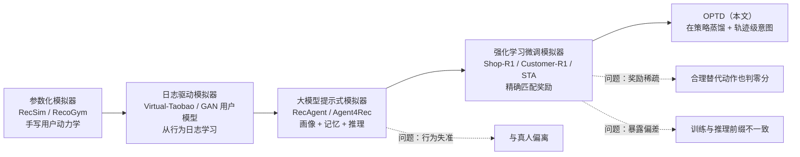
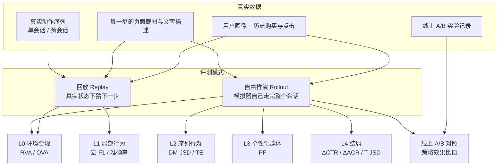
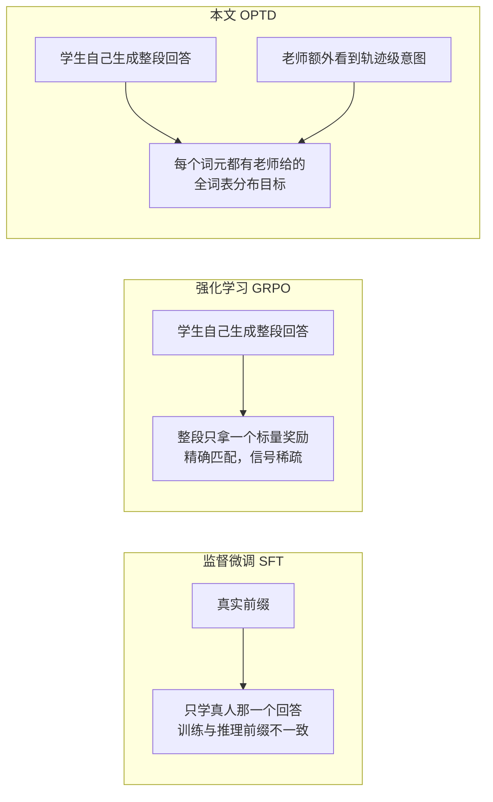
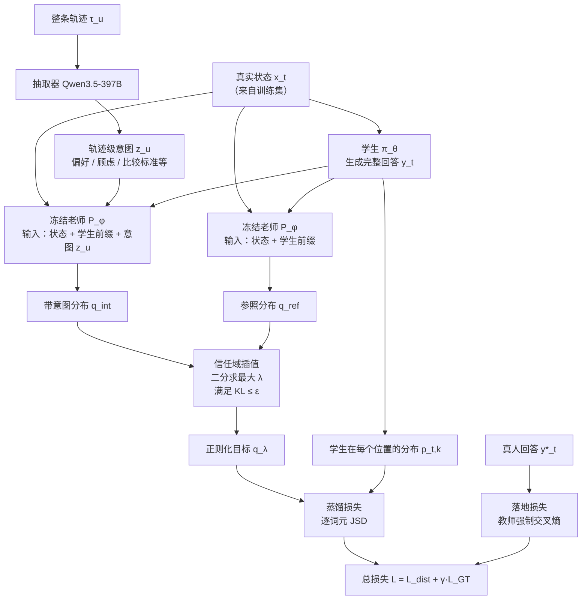
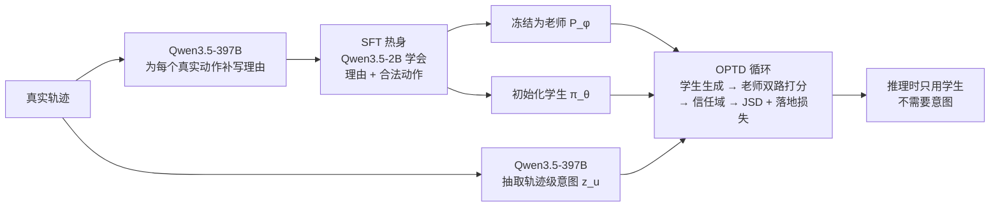
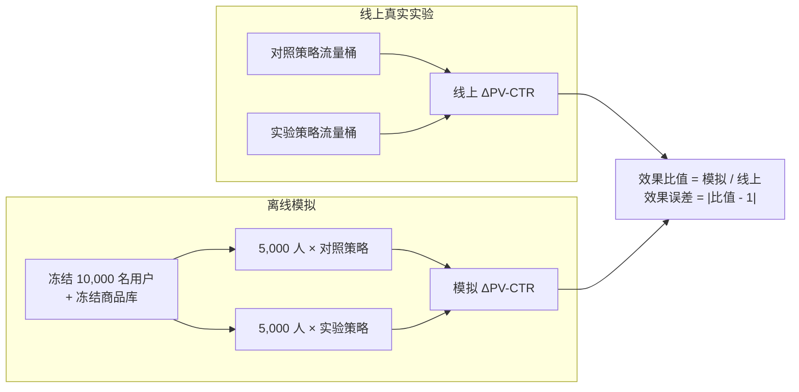

# UserArena：为长程购物智能体打造的交互式用户模拟评测基准

> **原题**：UserArena: Benchmarking Interactive User Simulation for Long-Horizon Shopping Agents
> **作者**：Jujia Zhao, Jiakai Tang, Jing Yu, Wen Chen, Jian Wu, Han Zhu, Fei Sun, Suzan Verberne, Zhaochun Ren
> **机构**：莱顿大学、中国人民大学、阿里巴巴集团、中国科学院计算技术研究所
> **年份**：2026（arxiv ID 2610.30932，2026 年 10 月 22 日提交）
> **分类**：cs.IR
> **链接**：https://arxiv.org/abs/2610.30932
> **代码与数据**：https://github.com/RecGPT-Team/UserArena
> **精读日期**：2026-10-26

## 阅读须知

### 这篇在领域里的位置

这篇论文属于推荐系统里「用户模拟器」这条线。用户模拟器的用途很朴素：推荐团队想知道一个新的排序策略上线后用户会不会多点、多买，最可靠的办法是做线上 A/B 实验，可线上实验既花时间又有风险，于是人们希望先在一个「假用户」身上试一遍。这个假用户能看懂页面、会滑动、会点开商品、会加购或离开，它就是用户模拟器。

过去十年，用户模拟器从手写规则的概率模型，走到从日志里学出来的生成模型，再走到今天以大语言模型扮演购物者的智能体。最近一年又出现了用强化学习微调的模拟器，例如 Shop-R1 和 Customer-R1。UserArena 站在这条线的最新一步：它一方面给出一套带真实长程轨迹、并能对照线上 A/B 结果的评测基准，另一方面提出一种叫 OPTD 的训练方法，让小模型模拟器在长时间交互中更像真人。

### 读完能回答什么

1. 为什么只比较「下一步动作猜得准不准」不足以说明一个用户模拟器可信，UserArena 的五级评测各自在查什么。
2. UserArena 的数据从哪里来，规模多大，「跨会话」轨迹与以往单会话基准有什么不同。
3. OPTD 如何把「整段轨迹的购物意图」交给老师模型、再经由逐词元的分布传给学生，学生为什么始终看不到这份意图。
4. 信任域插值在 OPTD 里起什么作用，为什么不直接让学生去模仿带意图的老师。
5. 在对照真实线上 A/B 实验时，OPTD 与通用大模型各自把策略效果估成了多少，这说明了什么。

### 阅读前置

本文假定读者熟悉大语言模型的自回归生成、监督微调（SFT）与 KL 散度等基础概念，大致知道强化学习微调语言模型是怎么回事。读者未必专门做过推荐系统或用户模拟，相关背景会先铺垫再展开。

### 缩写表

- **SFT**（Supervised Fine-Tuning，监督微调）：用「输入与标准答案」的配对数据直接训练模型，让它学会照答案输出。
- **GRPO**（Group Relative Policy Optimization，组相对策略优化）：一种强化学习微调方法。同一个问题采样一组回答，每个回答拿一个标量奖励，按组内相对好坏更新模型。
- **OPTD**（On-Policy Trajectory Distillation，在策略轨迹蒸馏）：本文提出的训练方法，详见第二节。
- **KL**（Kullback–Leibler divergence，KL 散度）：衡量两个概率分布差多远的量，不对称，值越小越接近。
- **JSD**（Jensen–Shannon Divergence，JS 散度）：KL 散度的对称、有界版本，以 2 为底时取值在 0 到 1 之间。
- **GUI**（Graphical User Interface，图形界面）：本文里指直接看页面截图的模拟器，与只看文字描述的模拟器相对。
- **RVA / OVA**（Replay / Rollout Valid-Action rate）：回放模式与自由推演模式下，模拟器输出能被环境解析并执行的比例。
- **DM-JSD**（Decision-Mix JSD）：进入商品页后第一个决定（返回、加购、购买、结束、展开）的分布与真人相比的 JS 散度。
- **TE**（Trajectory Error，轨迹长度误差）：模拟会话与真实会话平均动作数之差的绝对值。
- **PF**（Population Fidelity，群体保真度）：按历史行为分群后，模拟器能否复现各群体之间的差异。
- **CTR / ACR**（Click-Through Rate / Add-to-Cart Rate）：点击率与加购率；带 Δ 时表示模拟值与真实值之差的绝对值。
- **T-JSD**（Terminal-state JSD）：会话最终结局（购买、仅加购、仅浏览、被截断）分布的 JS 散度。
- **PV-CTR**（Page-View CTR）：按曝光页面计的点击率，线上 A/B 实验常用指标。

## 一、问题

### 为什么这个问题值得做

电商推荐正在从「给你排一列商品」转向「替你完成一段购物」。新一代推荐智能体要连续做许多决定：先给什么、用户滑走后接着给什么、用户点开一件衣服后要不要补一件相配的包。训练和评估这样的智能体，需要一个能模拟环境与用户反应的「推荐世界模型」。没有它，每改一次策略都只能上线做实验，代价高、周期长，还可能伤到真实用户的体验。

问题在于，现有的模拟器到底像不像真人，一直缺少硬证据。一个模拟器可以每一步都猜得不错，连起来却走出一条真人绝不会走的路线；也可以在平均数上对得很准，却抹平了不同用户之间的差别。更要紧的是，几乎没有工作检验过「在模拟器里比出来的结论，与线上 A/B 的真实结论是否一致」。如果这一点不成立，模拟器得出的任何策略排名都只是自说自话。

### 具体要解决的技术问题

把上面的动机落到可验证的层面，论文要回答两件事。第一件是评测：给定一个用户模拟器，如何从「输出能否执行」一路检查到「整段轨迹、不同人群、最终结局乃至线上策略效果」是否与真人一致。第二件是训练：如何让一个参数量只有 20 亿的模拟器，在几十步乃至跨越多次访问的交互里保持行为连贯。

围绕第一件事，作者指出现有数据有两处缺口。数据层面，很少有数据集在每一步同时对齐真实用户画像、当时看到的页面、页面上的商品信息与用户动作，更少有把同一用户多次访问串起来的长程轨迹。评测层面，主流做法是逐步比对下一个动作，这只检查局部，无法判断一条轨迹整体是否保留了用户的行为倾向。

### 前人路线及其不足

用户模拟器大致经历了四代。最早一代是可配置的参数化模型，例如 RecSim 与 RecoGym，研究者手写用户怎样随推荐内容改变兴趣。这类模型便于做受控实验，但用户动力学是人定的，与真实行为差多少无从知晓。

第二代从日志里学习用户动力学。Virtual-Taobao 用生成式顾客模型加对抗模仿学习，GAN 式用户模型则同时学用户行为与奖励。它们比手写规则更贴近数据，但仍以点击与购买这类粗粒度信号为主，看不到页面长什么样。

第三代用大语言模型扮演用户，例如 RecAgent 与 Agent4Rec。模型拿到用户画像和记忆，用自然语言推理下一步做什么，表达力大大增强。可是它们大多只靠提示词，没有在真实轨迹上训练，行为容易偏离真人，论文称之为「行为失准」。

第四代在第三代基础上做强化学习微调，例如 Shop-R1、Customer-R1，以及看截图的 STA。它们用「是否与真人下一步完全一致」作为奖励。这种奖励很稀疏：真人可能有好几种同样合理的做法，模型做出其中另一种也会被判零分。另一方面，监督微调时模型永远在真实前缀上学习，推理时却要接着自己生成的前缀往下走，两者不一致，误差会越积越大。这个现象叫暴露偏差。

基准方面，已有资源各补了一块。Qilin 与 RL4RS 有真实轨迹但没有页面画面；OPeRA 与 USB 有画面和完整动作空间，却只覆盖单次会话；OmniBehavior 有长程记录但动作空间不全；A/B Agent 的轨迹则是合成的。论文的表 1 显示，没有一个基准同时具备真实轨迹、视觉上下文、完整动作空间、跨会话长程与线上 A/B 对照这五项，UserArena 是第一个全部打勾的。

## 二、方法

论文的贡献分成两块：一块是 UserArena 基准本身，包括环境、数据与五级评测；另一块是 OPTD 训练方法。下面先讲基准，再讲方法。

### UserArena 的环境与数据

UserArena 的数据来自亚洲最大的电商平台之一，作者单位里有阿里巴巴，致谢中也写明由阿里创新研究计划资助。环境把线上的推荐信息流页面和商品详情页重新搭了出来，支持 13 种动作，从信息流上下滑动、点开商品、在详情页滑动与查看评论，到加购、购买和结束会话。

环境的运作方式值得说明一下。每个会话的完整信息流事先渲染成一张长图，模拟器往下滑时，环境就从长图上裁出当前可见的那一屏。模拟器可以点开当前屏幕上任何一件商品，包括真人当时并没有点的那件，环境会用这件商品预先渲染的页面和记录下来的商品内容，拼出一个可交互的详情页。

数据规模如下表所示。

| 项目 | 数量 |
|---|---|
| 用户 | 11,010 |
| 会话 | 64,729 |
| 动作 | 577,670 |
| 商品 | 566,102 |
| 动作类型 | 13 |
| 用户画像字段 | 6 |
| 商品点击 | 73,717，覆盖 41 个品类 |

动作分布很不均衡。信息流下滑占 38.34%，点开商品占 12.76%，结束会话占 11.21%，从详情页返回信息流占 10.62%，详情页下滑占 10.08%。真正带来收入的加购和购买分别只占 3.90% 和 1.02%。正因为如此，后面的局部指标采用对动作类型等权的宏平均，免得高频的滑动动作主导评分。

品类方面，服饰占点击的 54.90%，其余 40 个品类分掉剩下的 45.10%。商品的长尾很长：67,267 件被点过的商品里有 92.0% 只被点过一次，点击最多的前 1% 商品只占全部点击的 3.23%。这说明模拟器不可能靠记住少数热门商品来蒙混过关。

### 跨会话长程轨迹

UserArena 最突出的地方，是把同一用户的多次访问按时间串成一条长轨迹。跨会话子集有 5,768 名用户、59,378 个会话，每人 4 到 15 次访问，平均 10.29 次会话、86.36 个动作。

下表把它与同样具备完整动作空间的真实用户购物基准放在一起比较。

| 基准 | 用户数 | 会话数 | 轨迹范围 | 平均会话数 | 平均动作数 |
|---|---|---|---|---|---|
| OPeRA | 51 | 527 | 单会话 | 1.00 | 11.11 |
| USB | 5,222 | 5,274 | 单会话 | 1.00 | 13.24 |
| UserArena | 5,768 | 59,378 | 跨会话 | 10.29 | 86.36 |

相邻两次访问之间的间隔从几分钟到十二小时以上都有。在 53,610 对相邻会话里，有 57.8% 会回到上一次出现过的品类。换句话说，这份数据既记录了用户兴趣的延续，也记录了兴趣的漂移，正是检验长程一致性所需要的材料。

### 五级评测协议

评测有两种模式。回放模式（Replay）在真实会话的每一步把当时的真实状态交给模拟器，只让它预测下一个动作，这样可以单独衡量局部判断，不受前面错误的累积影响。自由推演模式（Rollout）则让模拟器自己选动作、自己决定后续状态，一直走到会话结束，用来检验整条轨迹和总体结局。

在这两种模式之上，论文把保真度分成五级，范围逐级扩大。

L0 检查环境合规，即模拟器的输出能否被解析成当前状态下可执行的动作。L1 检查局部行为，宏 F1 看动作类型是否一致，准确率还要求点开的商品或评论也对得上；准确率计算时排除了四种滑动动作，因为它们没有目标，只会重复 F1 已经测过的信号。

L2 检查序列行为。DM-JSD 看的是每次进入商品详情页后的第一个决定：返回、加购、购买、结束还是继续展开，把这五类的比例与真人比较。TE 则比较平均每个会话走了多少步。

L3 检查个性化群体保真度。做法是只用会话之前的历史，把用户按活跃度、购买倾向和品类广度分群，然后在每个群体里比较八个方面：会话长度、动作分布、信息深度、进入详情页的比例、从详情页返回的比例、转化、商品品类与价格。每个群体得分为 1 减去八项差异的平均值，再在群体与分群方案之间等权平均。这一级要防的是模拟器只会复现「平均用户」，把不同人群的差别都抹平。

L4 检查结局。ΔCTR 比较每次信息流动作带来的点击数，ΔACR 比较每次点击带来的加购数，T-JSD 比较会话最终落在「购买、仅加购、仅浏览、被截断」四种结局上的分布。

在五级之外，还有一项线上 A/B 对照，放在实验部分讲。

### OPTD 的整体思路

有了评测，接下来的问题是怎样训练出一个在长程上更像真人的模拟器。OPTD 的核心想法可以用一句话概括：让老师模型偷看整条轨迹归纳出的购物意图，再在学生自己生成的回答上逐词元给出分布目标；学生从头到尾看不到这份意图，只能通过老师的分布间接受益。

为了说清这件事，先交代符号。

- $u$：一名用户。
- $\tau_u$：用户 $u$ 的一条完整购物轨迹。
- $x_t$：第 $t$ 步的状态，包含当前页面与此前的交互历史。
- $y_t$：第 $t$ 步的回答，是一个词元序列，先写一段简短的第一人称理由，再给出一个结构化的界面动作。
- $y_{t,k}$：回答中第 $k$ 个词元；$y_{t,<k}$ 是它之前的前缀。
- $\pi_\theta$：学生模型，也就是要训练的模拟器，参数为 $\theta$。
- $P_\phi$：老师模型的下一词元分布，参数为 $\phi$，训练中冻结不动。
- $z_u$：从整条轨迹抽出来的「轨迹级意图」。

下图对比了三种训练方式各自给模型什么样的监督信号。

### 第一步：在学生自己的回答上做蒸馏

标准的监督微调采用教师强制（teacher forcing），每个词元都在真人回答的前缀上预测。推理时模型却要接着自己写出来的前缀往下写，一旦某处写偏，后面就进入训练中从未见过的状态。

OPTD 沿用在策略蒸馏的做法来缓解这个问题。每个训练步从训练集里抽一个真实状态 $x_t$，让当前的学生完整生成一个回答：

$$y_t = (y_{t,1}, \ldots, y_{t,|y_t|}) \sim \pi_\theta(\cdot \mid x_t)$$

随后由老师在这个回答的每一个位置上打分。学生学习的是「在自己写出的前缀上，老师认为下一个词元应当如何分布」，于是训练时见到的前缀与推理时一致。

### 第二步：用轨迹级意图引导老师

光有在策略蒸馏还不够，因为老师如果和学生看到的信息一样，它给出的目标也只能反映当前这一步，无法体现整段会话的走向。OPTD 的做法是给老师额外一份「轨迹级意图」。

意图由一个抽取器 $E$ 从完整训练轨迹里归纳出来，论文用的是 Qwen3.5-397B：

$$z_u = E(\tau_u)$$

$z_u$ 是一份结构化记录，由几张互补的「类型化锚点」组成，分别描述这名购物者在整条轨迹里的偏好、顾虑、信息需求、比较标准，以及在什么条件下会下决心。

这里有一个关键约束：意图不能变成逐步的答案。抽取与校验规则明确排除具体动作、具体商品与编号、确切价格、轨迹结局、未来页面内容，以及支撑这些归纳的步骤编号。论文附录举过一例：某位用户四次访问里反复查看高端服饰与配饰，品类从连衣裙、首饰换到围巾、手袋、发饰和雨伞，抽出的意图写的是「偏好优雅设计与品牌商品」「留意明星同款风格」「审美与品质都满意时购买意愿更强」，没有任何一条指向某件具体商品或下一步动作。

拿到意图后，老师在学生前缀上给出带意图的分布：

$$q^{\text{int}}_{t,k}(v) = P_\phi(v \mid x_t, z_u, y_{t,<k})$$

这里 $v$ 是词表 $\mathcal{V}$ 中的任意一个候选词元。学生在同一位置的分布则是 $p_{t,k}(v) = \pi_\theta(v \mid x_t, y_{t,<k})$，注意其中没有 $z_u$。老师的输出被当作常数，梯度不会传回老师。

### 第三步：用信任域限制意图的影响

意图只在训练时存在，推理时学生拿不到。如果老师因为看了意图而给出与可见信息相差甚远的分布，学生就会被训练去模仿一种它根本无从推断的行为，这等于在教它猜。OPTD 因此给意图的影响设了上限，作者称之为逐词元信任域。

具体做法分两步。先让同一个老师在同一状态、同一学生前缀上，不看意图再算一次，得到参照分布：

$$q^{\text{ref}}_{t,k}(v) = P_\phi(v \mid x_t, y_{t,<k})$$

两次查询只差 $z_u$ 一项，所以两者之间的差距恰好就是意图带来的影响。

然后在对数概率空间里，把两个分布按系数 $\lambda \in [0, 1]$ 插值：

$$q^{\lambda}_{t,k} = \mathrm{softmax}\Big(\log q^{\text{ref}}_{t,k} + \lambda\big(\log q^{\text{int}}_{t,k} - \log q^{\text{ref}}_{t,k}\big)\Big)$$

$\lambda = 0$ 时退回不看意图的参照分布，$\lambda = 1$ 时就是完全带意图的分布。每个位置上取满足散度预算的最大 $\lambda$：

$$\lambda_{t,k} = \max\big\{\lambda \in [0, \lambda_{\max}] : D_{\mathrm{KL}}(q^{\lambda}_{t,k} \,\|\, q^{\text{ref}}_{t,k}) \le \epsilon\big\}$$

沿着这条几何插值路径，KL 散度随 $\lambda$ 单调不减，可行的 $\lambda$ 构成一个区间，所以可以用二分法求出。论文取 $\lambda_{\max} = 1$、$\epsilon = 0.02$，每个词元做八次二分，误差不超过 1/256。

这一设计的效果是自适应的。在意图影响不大的词元上，学生可以拿到完整的意图引导；在意图会把分布推得很远的词元上，目标会被拉回到参照分布附近，直到满足预算。

### 第四步：训练目标

总损失由蒸馏项与落地项组成：

$$\mathcal{L} = \mathcal{L}_{\text{dist}} + \gamma \, \mathcal{L}_{\text{GT}}$$

蒸馏项在学生生成的每个词元上，用广义 JS 散度让学生分布 $p_{t,k}$ 去对齐正则化目标 $q^{\lambda}_{t,k}$，再对词元取平均、对状态和回答取期望。广义 JS 散度带一个混合权重 $\beta$，论文取 $\beta = 0.5$，即标准 JS 散度。选它而不是 KL 的一个原因是 JS 散度有上界，学生与目标差得再远，单个词元的损失也不会失控。

之所以用分布对齐而不是精确匹配，是因为真人在同一处可能有多种同样合理的说法或动作。精确匹配只奖励其中一种，分布对齐则能给所有合理选项都分到概率。

落地项是在真人回答上做普通的教师强制交叉熵，监督理由、动作和终止符的每一个词元，权重 $\gamma = 0.1$。蒸馏项传递的是整段会话的意图，落地项则把学生拴在每一步真实发生过的行为上，两者互相牵制。

### 训练流程

OPTD 不是从零开始。它先在统一的交互格式上做一轮监督微调热身，让模型学会读指令、先写一段简短理由再给出合法动作。监督目标里的理由并非真人所写，而是由 Qwen3.5-397B 根据用户上下文、交互历史与当前状态为每个真实动作补写的第一人称理由。

热身得到的检查点随后被冻结为老师，同时也作为学生的初始化。之后进入 OPTD 循环。工程上用 ROLL 做分布式训练，vLLM 负责在策略生成，Megatron-Core 负责学生优化与老师推理，精度为 BF16。

## 三、实验

### 评测设置

对比的基线分两类。文本类模拟器读页面的文字描述，包括 RecAgent、Agent4Rec、SimUSER、Shop-R1、Customer-R1 与 AlignUSER；图形界面类模拟器看页面截图，包括 A/B Agent 与 STA。为了排除模型规模的干扰，主实验里所有方法，包括只靠提示词的基线，都统一用 Qwen3.5-2B 作为骨干，最大上下文 32k 词元。

用户按 8:1:1 划分训练、验证与测试，同一用户的所有会话只落在一个划分里。回放模式用贪心解码，自由推演用温度 1.0、top-p 0.95 采样，每步最多生成 512 词元。自由推演在单会话设置下最多走 31 步，跨会话设置下最多 42 步，均比真实数据中的最长会话多一步，走到上限仍未结束的会话记为截断。

### 单会话主要结果

下表摘出单会话设置下各级指标里最有代表性的几行。箭头表示方向：↑ 越大越好，↓ 越小越好。

| 方法 | RVA ↑ | F1 ↑ | 准确率 ↑ | DM-JSD ↓ | TE ↓ | PF ↑ | ΔCTR ↓ | ΔACR ↓ | T-JSD ↓ |
|---|---|---|---|---|---|---|---|---|---|
| RecAgent | 0.9834 | 0.1424 | 0.1507 | 0.2928 | 3.63 | 0.6941 | 0.6162 | 1.0642 | 0.1287 |
| SimUSER | 0.9833 | 0.1411 | 0.1680 | 0.1140 | 9.27 | 0.7230 | 0.2559 | 0.4897 | 0.0664 |
| Customer-R1 | 0.9673 | 0.4108 | 0.3114 | 0.1954 | 2.86 | 0.7382 | 0.0227 | 0.3997 | 0.2810 |
| A/B Agent | 0.4113 | 0.1017 | 0.0157 | 0.6699 | 9.68 | 0.6459 | 0.0291 | 0.2039 | 0.8205 |
| STA | 0.9856 | 0.4030 | 0.2899 | 0.0245 | 1.77 | 0.7958 | 0.1080 | 0.1880 | 0.1519 |
| **OPTD** | 0.9773 | **0.4178** | **0.3204** | **0.0156** | **1.72** | **0.8692** | **0.0026** | **0.0430** | **0.0387** |

OPTD 在 L1 到 L4 的八项指标上全部第一。局部指标上它只比 Customer-R1 略好，F1 高 0.007、准确率高 0.009。拉开差距的是后几级：群体保真度从 STA 的 0.7958 提到 0.8692；点击率误差从次优的 0.0227 降到 0.0026，几乎小了一个数量级；加购率误差从 0.1880 降到 0.0430。

这个分布本身说明了问题。局部判断各家已经做得差不多，真正难的是让整段行为、不同人群和最终结局都像真人，而这正是 OPTD 借助轨迹级意图想补的部分。

### 跨会话主要结果

| 方法 | F1 ↑ | 准确率 ↑ | DM-JSD ↓ | TE ↓ | PF ↑ | ΔCTR ↓ | ΔACR ↓ | T-JSD ↓ |
|---|---|---|---|---|---|---|---|---|
| Shop-R1 | 0.3533 | 0.1975 | 0.1310 | 1.35 | 0.8739 | 0.0905 | 0.3514 | 0.0941 |
| AlignUSER | 0.3172 | 0.1933 | 0.0370 | 2.11 | 0.8732 | 0.0485 | 0.1461 | 0.0099 |
| A/B Agent | 0.1094 | 0.0265 | 0.5709 | 4.17 | 0.6917 | 0.0615 | **0.0096** | 0.7980 |
| STA | **0.3556** | 0.2919 | 0.0465 | 0.81 | 0.8911 | **0.0099** | 0.1577 | 0.0173 |
| **OPTD** | 0.3456 | **0.2969** | **0.0284** | **0.72** | **0.8929** | 0.0357 | 0.1399 | **0.0077** |

跨会话设置下 OPTD 不再全胜。它在准确率、DM-JSD、TE、PF 与 T-JSD 五项上第一，在 ΔCTR 与 ΔACR 上第二，在宏 F1 上排第三，落后于 STA 和 Shop-R1。作者的解读是，OPTD 的优势集中在长程轨迹结构与个性化群体这两级，而 STA 的强化学习微调在部分局部与结局指标上更占便宜，但这种好处在各级之间并不一致。

### 对照线上 A/B 实验

这是全文最有说服力的一组实验。作者拿到一次真实线上 A/B 实验的记录：两个排序策略分别服务两个流量桶，在固定观察窗口内记录了各自的 PV-CTR。离线时，冻结 10,000 名用户与商品库，每个策略各分 5,000 人，让每个模拟器都在完全相同的分配下跑一遍。

策略效果定义为两组 PV-CTR 之差。效果比值是模拟出的效果除以线上真实效果，越接近 1 越好；效果误差是比值与 1 之差的绝对值。

| 模拟器 | 效果比值 | 效果误差 |
|---|---|---|
| Qwen3.5-2B（未微调） | 0.004 | 0.996 |
| AlignUSER | 0.020 | 0.980 |
| Shop-R1 | 0.162 | 0.838 |
| Customer-R1 | 0.191 | 0.809 |
| STA | 0.297 | 0.703 |
| **OPTD** | **0.713** | **0.287** |
| GPT-6-Sol | 1.576 | 0.576 |
| GPT-6-Luna | 2.154 | 1.154 |

结果呈现出清楚的两极。专门训练过的小模型模拟器普遍把策略效果估得太弱，效果比值在 0.020 到 0.297 之间，未微调的 Qwen3.5-2B 几乎感受不到策略变化，只有 0.004。与之相对地，两个通用大模型 GPT-6-Sol 与 GPT-6-Luna 则把效果估得过强，分别达到线上的 1.58 倍与 2.15 倍。

OPTD 的效果比值是 0.713，误差 0.287，比次接近的 GPT-6-Sol 低 50.2%。不过它仍然把线上效果低估了 28.7%，作者也明确承认所有模拟器都与线上存在差距。

### 消融与人工评测

消融实验依次去掉五个组件：把学生生成的回答换成真人回答（去掉在策略）、去掉轨迹级意图、去掉信任域插值、把落地损失权重设为零、跳过监督微调热身。论文只以相对图的形式报告了 L1 到 L4 各一项代表指标，没有给出具体数值。结论有两条：去掉任何一个组件都会让至少一项指标变差；去掉监督微调热身的退化最明显，说明热身阶段建立的指令遵循与动作生成能力是后续蒸馏的前提。

人工评测仿照图灵测试设计。每次给三名标注者看同一用户上下文下的一条真实轨迹与一条模拟轨迹，来源匿名、顺序随机，请他们指出哪条是机器生成的，或选择「不确定」。每个模拟器评 200 对。

OPTD 的「人类判对率」最低，为 38.7%；「把真人误判为机器」的比例最高，为 26.3%。Customer-R1 的「不确定」比例最高，为 47.0%。标注者之间的 Fleiss κ 为 0.528，属于中等一致。

### 值得单独记一笔的现象

第一个反直觉的现象来自 A/B Agent。它在回放模式下只有 41% 的输出能被环境执行，几乎所有指标都垫底，但在跨会话设置下的加购率误差却是全场最低的 0.0096。这说明单看某一个结局指标，一个整体上很差的模拟器也可能碰巧对上。这恰好是五级评测存在的理由：只有各级一起看，才不会被单项数字误导。

第二个现象是「能执行不等于像真人」。RecAgent 与 SimUSER 的合法动作率都在 98% 以上，局部 F1 却只有 0.14 左右。输出格式正确只是门槛，与行为保真度几乎无关。

第三个现象是通用大模型在 A/B 对照里的表现。GPT-6 系列在能力上远强于 20 亿参数的小模型，却把策略效果高估了一半到一倍多。作者据此认为，通用模型的能力并不会自动转化为对排序策略变化的真实敏感度，行为校准需要专门的数据与训练。

效率方面，OPTD 推理时只用学生，不需要意图，单步总词元数一般低于 STA，延迟曲线与 STA 基本重合。保真度的提升并没有换来更高的推理代价。

## 四、局限

### 作者承认的局限

作者承认所有被测模拟器都与线上结果存在差距，OPTD 作为最接近的方法，仍把线上策略效果低估了 28.7%。作者也承认长程模拟仍有提升空间，计划下一步围绕 UserArena 搭建持续更新的排行榜，并研究能在多次访问之间保持兴趣演化与行为一致的更强模拟器。

数据方面，作者说明数据经过去标识化处理，界面图像是用 React 离线重建后批量渲染的，并非真实用户的截图。数据只以非商业研究用途、在数据使用协议下发布，协议禁止重新识别用户或与外部个人数据关联。

### 读完能看出来的潜在问题

线上 A/B 对照只有一对策略、一个指标。用一次实验检验「模拟器结论与线上一致」，最多说明在这一对策略上效果大小估得比较接近，还不能说明模拟器给多个策略排出的先后顺序可靠。要回答后一个问题，需要多组 A/B 实验，看模拟排名与线上排名的相关性。

主实验所有方法统一用 20 亿参数的骨干，这对控制变量是好事，但对一些原本为大模型设计的提示式方法可能不太公平，例如 RecAgent 与 Agent4Rec 依赖较强的推理与记忆管理能力。论文也没有报告 OPTD 换到更大骨干后的表现，因此规模扩大后的结论未知。

主结果表没有给出置信区间或多次运行的方差。单会话里 OPTD 与 Customer-R1 在 F1 上只差 0.007，这一类细小差距是否稳定，从论文里无法判断。消融实验也只以相对图呈现，没有给出绝对数值。

数据集中在一个平台、一种界面，服饰又占了一半以上的点击。在其他平台、其他品类结构或其他交互形式上，模拟器的表现能否迁移，目前没有证据。另外，信息流内容是按真实会话预先渲染好的，模拟器在同一会话里的行为不会让后面的推荐内容随之改变，这对需要闭环交互的策略训练是一个限制。

最后，训练里有两处依赖 Qwen3.5-397B：一处是为每个真实动作补写理由，另一处是抽取轨迹级意图。补写的理由是模型对真人想法的猜测，并非真人自述，学生学到的推理过程因此带着大模型的口吻。意图抽取虽然有排除规则，可规则能否完全挡住信息泄露，论文没有给出定量检验。这两处也意味着，想完整复现 OPTD，需要能运行四千亿参数级别模型的算力。

## 一句话

UserArena 以真实跨会话轨迹与线上 A/B 对照检验用户模拟器，OPTD 用轨迹意图蒸馏让小模型更像真人。
