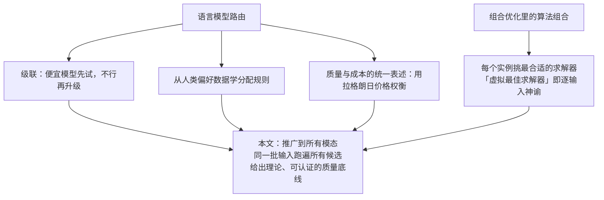
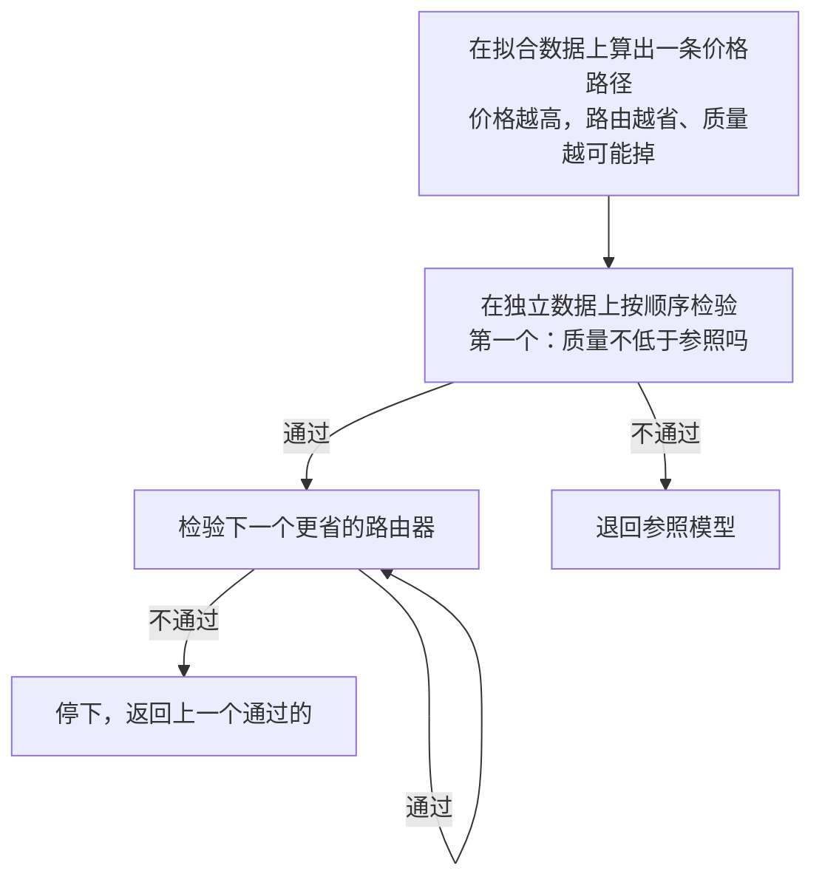
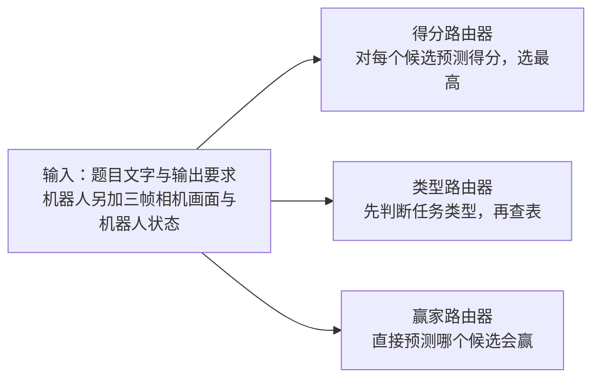

# 路由一切：通用 AI 系统里的模型与策略路由

> **原题**：Route Anything: A Study of Model and Policy Routing for General-Purpose AI Systems
> **作者**：Pengfei Zhou、Yixing Ma、Hexin Wang、Weidong Tang、Zhenglin Wan、Wangbo Zhao、Yang You
> **机构**：新加坡国立大学 HPC-AI Lab（尤洋团队）为主，作者单位还包括 InfRec、Cardinal AI Lab、加州大学伯克利分校与香港科技大学
> **年份**：2026（arxiv ID 2611.05275）
> **分类**：cs.CV
> **链接**：https://arxiv.org/abs/2611.05275
> **精读日期**：2026-11-04

## 阅读须知

### 这篇在领域里的位置

如今一个实用的 AI 系统，手边往往不止一个模型：有几家的大语言模型，有画图的、生成视频的、合成语音的模型，还有控制机器人的策略。与其指望一个模型样样精通，不如在每个请求到来时挑一个最合适的去处理。这个「挑」的环节就叫路由，负责挑的组件叫路由器。

路由的研究此前几乎都集中在语言模型上：先让便宜的模型试，不行再升级到贵的；或者从人类偏好数据里学一个分配规则。这篇论文把问题推广到所有模态，并且做了一件此前没人系统做过的事：让每个候选模型都在同样的输入上跑一遍，攒出一张大表，再在这张表上回答「路由到底能带来多少好处」。

结论比标题和摘要给人的印象要冷静得多：理论上的上限很高，学出来的路由器却只比「永远用最好的那一个」多出零点几分；路由最靠得住的收益，是在质量几乎不掉的前提下换用便宜得多的模型。

### 读完能回答什么

1. 「每题都挑对模型」的理论上限比「永远用最好的那个模型」高多少？这个差距主要藏在哪里？
2. 为什么按任务类型分配模型几乎没用，差距大多发生在同一类任务内部？
3. 训练路由器时，为什么应该预测每个候选的得分，而不是预测「谁会赢」？机器人实验里两种做法差了多少？
4. 论文说路由把效率平均提高 8.82 倍，这个数是怎么来的，哪些情形下根本省不了钱？
5. 「质量不低于参照模型」这个承诺为什么在拟合数据上成立、在测试集上却常常失效？论文怎样做到可认证？

### 阅读前置

本文假定读者用过大语言模型的 API，知道不同模型价格和能力差别很大，也大致了解分类和回归两种训练目标的区别。

本文不假定读者熟悉运筹学里的分数规划，也不假定读者了解假设检验里的多重比较问题。这些都会在用到时先铺垫再展开。

### 缩写表

| 缩写或术语 | 含义 |
|---|---|
| 候选（candidate） | 路由器可以选择的任何一个去处：一个语言模型、一个生成模型、一条机器人策略，或者一个执行方案（如「先用便宜模型，验证不过再升级」） |
| 固定候选（fixed candidate） | 在训练数据上表现最好、然后对所有输入一律使用的那一个候选，是路由器要打败的基线 |
| 逐输入神谕（per-input oracle） | 事后看答案、每个输入都挑得分最高候选的理想路由器，代表上限 |
| 参照（reference） | 用来比较成本与质量的基准策略，例如「永远调用最强的模型」 |
| 质量底线 | 要求路由后的质量不比参照低于某个容差 ε |
| VLA | Vision-Language-Action，视觉语言动作模型，这里指机器人策略 |
| LoRA | Low-Rank Adaptation，一种只训练少量低秩参数的微调方法 |
| HLE / AA-LCR / GenEval2 等 | 论文用到的 25 个评测基准中的几个，分别涉及高难度问答、长上下文推理、图像生成等 |
| CodeRouterBench / RouterBench | 两个公开的路由评测集，带有每个模型的得分和调用价格 |
| RoboTwin | 一个机器人双臂操作仿真基准 |

## 一、问题

设想一个服务同时接入了三四家大模型、几个画图模型、几个视频模型。每来一个请求，系统都要决定交给谁。若一律交给最强也最贵的那个，钱花得多；若一律交给便宜的，质量会掉。路由器要做的，就是在每个请求上把这笔账算清楚。

这个问题之所以值得认真研究，是因为没有一个模型在所有输入上都是最好的。同一个基准里，这道题甲模型对、乙模型错，下一道题可能正好相反。如果能逐题挑对，理论上既能比任何单个模型更好，又能更省钱。

### 1.1 前人的路线

语言模型路由已经有三条成熟的思路。级联最直观：先让便宜模型回答，用某种检验判断够不够好，不够再交给贵模型。偏好学习则是从「人类更喜欢哪个回答」的数据里训练一个分配器。第三条是把质量和成本放进同一个目标里，用一个「价格」把两者折算，论文直接继承了这一条。

不足之处有两点。一是这些研究几乎都只看文本，图像、视频、语音和机器人上路由有没有用，没人系统测过。二是很多比较并不在同一批输入上进行，候选之间的差异混进了题目本身的差异。

## 二、方法

本文的「方法」由两部分组成：一套关于路由价值的理论，以及一张让所有候选在相同输入上跑过的大表。理论给出要测什么，大表负责测出来。

### 2.1 把路由写成一个带价格的优化问题

先设几个记号。对一个输入 x，路由器能选的候选集合记作 U(x)。运行候选 u 会得到一个分数 V_u，取值在 0 到 1 之间，就是该基准的评分；同时消耗一份资源 D_u，可以是美元，也可以是秒。

路由器看不到输入的全部，它看到的是输入的某种「状态」s，可能只是「这是哪个基准」，可能是「这是哪类任务」，也可能是输入本身。给定资源价格 λ，路由器的收益定义为平均分数减去 λ 乘以平均花费。λ = 0 时只看质量。

论文的第一个定理说，在给定价格下，最优路由器在每个状态都选「期望分数减去 λ 乘以期望成本」最大的候选。更有意思的是第二部分：如果目标改成「在质量不低于参照的前提下，把每单位成本换来的分数做到最高」，最优解仍然是某个价格下的同一种规则。这个价格不必人为设定，由参照模型和质量容差自动决定。推导用的是分数规划里的 Dinkelbach 方法加线性规划对偶。

这里有一个引理值得单独拎出来，它提醒效率和质量是两回事。论文的例子是：一个便宜模型只答对 15% 的题，成本是参照的十分之一，算下来「每单位成本的分数」是参照的 1.5 倍，可质量掉了 85 个百分点。所以效率提升和质量底线必须同时检查。

### 2.2 信息阶梯：路由器能达到多高，取决于它看到多少

论文证明，路由器看到的信息越细，能达到的最好成绩只会更高或持平。这四级台阶里，最左和最右都能直接测：最佳固定候选和逐输入神谕。中间两级可以用「事后在测试集上挑最好的查表」来乐观估计。

阶梯上有两个「台阶为零」的条件很有启发。其一，粗一级的信息只有在它改变了最佳候选时才有用；若同一类任务里总是同一个模型最好，知道任务类型也没用。其二，最后一级的差距是纯粹的运气：如果一个模型在某题上对错像抛硬币，再聪明的路由器也预测不了。

### 2.3 训练目标：预测得分，而不是预测赢家

学一个路由器需要标签，常见的有两种。一种是对每个候选分别预测它在这个输入上的得分，然后选预测分最高的；另一种是直接预测「哪个候选赢了」，把它当成多分类。

论文证明前者是对的，后者可能很糟。原因在于「赢家」标签丢掉了太多信息：很多题好几个候选都对，只能靠某个规则（比如谁更快）选一个当赢家。论文举的例子是，一个成功率 90% 的候选，碰上一个成功率 50% 但更快的候选，按「平局判给快的」规则，前者赢得标签的概率反而更低。

### 2.4 可认证的质量底线

用拟合数据算出来的「质量不掉」，到测试集上未必成立。论文的办法是：把路由器按价格从低到高排成一条路径，在一份独立的数据上依次做假设检验，一旦有一个通不过就停下，返回最后一个通过的。这种「固定顺序检验」不需要做多重比较校正；若一个都通不过，就退回参照模型。

### 2.5 全模态结果矩阵

理论之外，本文的主要工作量在数据。作者在 25 个基准上，让 452 个候选配置都跑同样的输入，攒下 374,401 条带评分的运行记录。覆盖范围是文本问答、图文问答、图像生成、视频生成、语音生成、代码与办公智能体、机器人操作七组。

语言模型候选是 Claude Opus 5.5、GPT-6.1 Sol、DeepSeek V4.1 Flash，长上下文、知识与智能体任务里再加上 GPT-6 Astra。数据按来源划分为 70/10/20 的训练、开发、测试集，同一来源的题目不会跨集合。机器人测试的 2,000 个场景来自路由器训练时从未见过的 10 个任务。

路由器统一用 Qwen3.5-4B 微调。下图是三种路由器的区别：

## 三、实验

### 3.1 上限有多高

| 任务组 | 测试输入 | 最佳固定候选 | 逐输入神谕 | 差距 |
|---|---|---|---|---|
| 文本问答 | 9,482 | 83.27 | 87.56 | 4.28 |
| 图文问答 | 5,708 | 85.32 | 88.02 | 2.70 |
| 图像生成 | 1,515 | 82.93 | 87.92 | 4.99 |
| 视频生成 | 158 | 62.43 | 81.36 | 18.93 |
| 语音生成 | 608 | 98.62 | 99.30 | 0.68 |
| 代码与办公智能体 | 343 | 69.17 | 77.29 | 8.11 |
| 机器人操作 | 2,000 | 70.45 | 88.85 | 18.40 |
| 全部 | 19,814 | 82.60 | 87.98 | 5.38 |

逐题挑对，平均能比最佳固定候选高 5.4 分。语音生成几乎没有空间，因为每个生成器都接近满分；视频生成和机器人操作的空间最大，将近 19 分，因为那里没有一个候选全面占优。

关键的发现是这些差距藏在哪里。如果只按任务类型分配，即便事后在测试集上挑最好的类型对照表，也只能补上差距的 8%。剩下的九成多发生在同一类任务内部，题与题之间。

还有一部分差距是运气。在一个每题跑了三次的长上下文基准上，神谕比固定候选高 2.4 分；可一旦每个候选按三次的平均分来算，这 2.4 分就消失了。也就是说，神谕上限里有相当一部分是抽到了好签，不是路由器能学到的东西。

### 3.2 学出来的路由器实际能拿到多少

| 任务组 | 最佳固定候选 | 学出来的路由器 | 神谕 | 路由器多出的分 |
|---|---|---|---|---|
| 文本问答（3 个基准） | 65.14 | 64.97 | 71.43 | -0.17 |
| 代码与办公智能体（5 个） | 69.24 | 70.01 | 74.78 | +0.77 |
| 图像生成（5 个） | 82.96 | 83.21 | 87.92 | +0.25 |
| 视频生成（1 个） | 62.17 | 64.28 | 80.22 | +2.12 |
| 语音生成（2 个） | 98.63 | 98.63 | 99.30 | 0.00 |
| 16 个基准合计 | 79.68 | 79.98 | 84.80 | +0.30 |
| 机器人操作 | 70.45 | 71.55 | 88.85 | +1.10 |

这张表才是全文最该细看的。一个覆盖 16 个基准的路由器，比固定候选多 0.3 分，只拿到神谕潜力的 6%。它在 10 个基准上和固定候选的差距不到 0.01 分，因为它把 83% 到 86% 的输入都送给了固定候选。

图像生成尤其冷峻。作者在两个图像基准上试了 31 种路由器设计、124 种配置，没有一个能显著打败固定的那个生成器，反而有 44 个显著更差。一个不经训练、直接让 Qwen3.5-4B 自己挑模型的做法，比固定候选低 1.15 分。

机器人上的结果更有画面感。路由器从三帧相机画面里看出场景是干净的还是被随机扰动过的：干净场景大多交给 PatchWAM，扰动场景大多交给 ME-Dex，而这两个条件下的最佳策略正好相反。总成功率 71.55%，比最佳单一策略高 1.1 个百分点，同时策略推理时间少了 24%。不过这 1.1 分的 95% 置信区间是从负 0.40 到正 2.55，跨过了零。

### 3.3 训练目标的差别

| 机器人实验 | 成功率 |
|---|---|
| 最佳单一策略 | 70.45% |
| 得分路由器（预测每个策略的成功率） | 71.55% |
| 赢家路由器（预测谁会赢） | 42.80% |

两者的输入、骨干网络和训练场景完全一样，只差训练目标。赢家路由器之所以崩，是因为训练场景里常常好几个策略都成功，94% 的赢家标签是靠「谁更快」决出来的。31,408 条成功记录里有 24,556 条被标成了「输家」。于是路由器学会了挑快的策略，而快的策略经常失败。

### 3.4 一个被缺失值翻转的结论

这是一个方法论上的提醒。在 11 个基准的实验里，作者起初的固定候选基线要求「在每个训练输入上都有分数」才算数。Claude Opus 5.5 在高难度问答基准 HLE 的 1,122 道训练题里缺了 11 个分数，于是被这条规则排除，基线退而用了次一级的模型。

结果基线从 68.30 掉到 65.52，路由器原本落后 0.4 分，一下变成领先 2.4 分。换句话说，只因为一个强模型缺了不到 1% 的分数，结论的正负号就翻了过来。作者由此提出第一条规矩：一定要在相同的输入上比较候选。

### 3.5 省钱：唯一稳定的大收益

| 测试平台 | 参照 | 质量变化 | 效率是参照的几倍 |
|---|---|---|---|
| 代码（CodeRouterBench，美元） | 永远用 Opus 4.6 | -0.44 分 | 25.5 倍 |
| 文本问答（RouterBench，美元） | 永远用 GPT-4 | -0.40 分 | 7.1 倍 |
| 图像生成（美元） | 固定生成器 | -0.47 分 | 1.35 倍 |
| 机器人（秒） | 固定策略 | +1.10 分 | 1.33 倍 |

摘要里「效率平均提高 8.82 倍」，就是这四个倍数的算术平均。它主要由代码平台的 25.5 倍撑起来，图像和机器人只有 1.3 倍上下。

代码平台的故事很典型。在那里，最便宜的 Qwen3-Max 一律使用，就已经达到参照效率的 20.1 倍，代价是掉 4.2 分；按任务类别路由把这 4.2 分几乎全部补回来，效率还再高 27%。在这个平台上，「质量不掉」的最优路由器根本一次都不调用 Opus 4.6，因为便宜模型已经够好。

拟合出来的底线并不可靠。把拟合数据随机切一半重新拟合，「质量不掉」的承诺在测试集上只在 12.5% 的切分里成立。改用 2.4 节的可认证流程后，200 次切分全部成立，效率中位数是 19.4 倍。

### 3.6 多花一步值不值

作者还检验了几种「在任务内多花钱」的做法，结果都提醒要算净账。

一个模型失败后换第二个模型重试，第二个模型的成功率大约减半（42 对模型的中位数比值为 0.49），因为留下来的都是更难的题。用一个免费的编译检查做验证门，能把效率提高到 4.09 倍；可若换成按标价收费的大模型当评判，效率只有参照的 0.30 倍，比不路由还差。

路由器本身的开销倒不必担心：一个 4B 路由器每次决策 0.13 秒，生成一张图要 27 到 158 秒，一段视频要 211 到 314 秒。

## 四、局限

### 4.1 作者承认的局限

作者在附录里写了两条。第一，理论假设输入的状态分布与路由器的选择无关，因此覆盖不了「后面的步骤取决于前面选了谁」的情形，例如代码任务里后续步骤包含模型自己先前写的代码，这类基准被排除在潜力分析之外。第二，可认证流程需要参照模型在每一个认证输入上都有结果。此外，长程智能体任务里逐步路由更复杂，作者把它留给后续研究。

### 4.2 读者能看出的问题

第一，摘要的叙述和实验的分量不太相称。摘要把「神谕高 5.4 分」和「效率平均 8.82 倍」放在最显眼处，而正文最扎实的结论恰恰是：学出来的路由器只多 0.3 分，主要的路由器只训练了一个随机种子，机器人上那 1.1 分的置信区间也跨过零。读者若只看摘要，容易高估路由在质量上的作用。

第二，8.82 倍是四个倍数的算术平均，被一个 25.5 倍主导。四个平台里图像和机器人只有 1.3 倍上下，用中位数或几何平均来报告会更诚实。

第三，最大的省钱效果来自两个外部的代码与文本平台，而不是作者自己构建的全模态矩阵。代码平台上的路由状态是数据集自带的「维度 × 来源」标签，作者补充说明用提示词推断的标签也能达到 25.3 倍。更需要留意的是级联里的验证环节：论文构造「便宜模型先答、不合格再交给参照」时，判断合格与否用的是数据集里现成的真实得分，等于一个永不出错、也不花钱的验证器。文本平台的 7.1 倍正是靠这种级联得到的；3.6 节换成真实验证器后，免费的编译检查尚可，收费的大模型评判就得不偿失了。

第四，神谕上限部分来自运气，作者自己在长上下文基准上演示了这一点，却没有在其他基准上做同样的重复运行去扣除噪声。5.4 分的潜力因此是一个偏乐观的上限。

第五，结论高度依赖所选的候选池。语言模型候选只有三四个前沿模型，彼此水平接近；若候选池里有更多专长差异明显的模型，路由的空间可能完全不同。

## 值得跟读

1. **Dekoninck 等人关于路由与级联统一表述的工作**（文中参考文献 [3]）：用拉格朗日价格统一路由和级联，是本文理论的直接前身。
2. **RouterBench**（文中参考文献 [5]）：本文文本问答省钱实验所用的公开路由评测集，带有每个模型的得分与价格。
3. **算法组合与「虚拟最佳求解器」的经典工作**（文中参考文献 [53]–[55]）：组合优化领域二十年前就在研究同一个问题，本文的神谕上限正对应那里的虚拟最佳求解器。

## 一句话

逐题挑模型的上限高，学出来的路由器却只多 0.3 分；路由真正稳定的收益是用便宜模型省钱。
