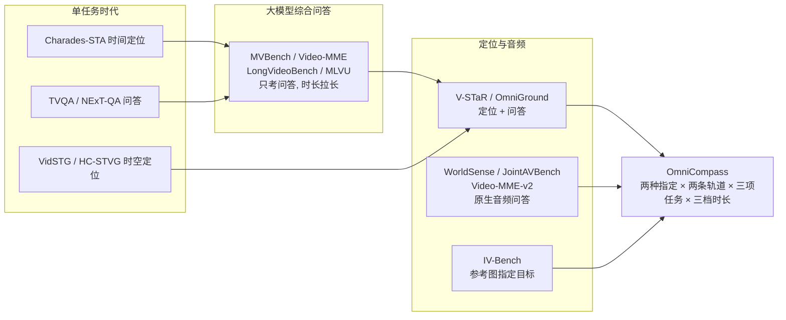
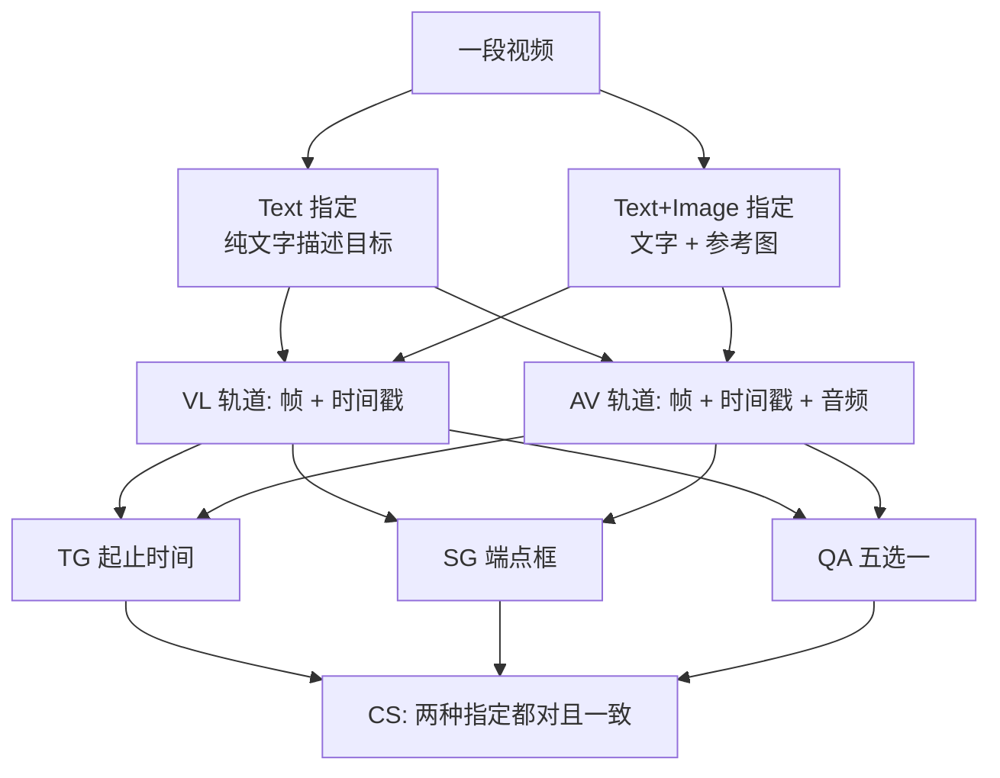
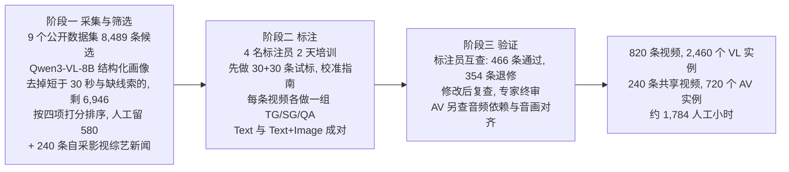

# OmniCompass：全模态视频定位与理解的整体评测

> **原题**：OmniCompass: A Holistic Benchmark for Omni-Modal Video Grounding and Understanding
> **作者**：Xuyang Liu, Shihao Wang, Xinyu Wei, Minghan Li, Zeqing Wang, Zuhao Yang, Zichen Wen, Lei Zhang
> **机构**：香港理工大学、OPPO 研究院、科罗拉多矿业学院、南洋理工大学、上海交通大学（PolyU-OPPO 联合创新研究中心支持）
> **年份**：2026（arxiv ID 2610.18829，10 月 13 日提交）
> **分类**：cs.CV / cs.CL / cs.MM
> **链接**：https://arxiv.org/abs/2610.18829
> **精读日期**：2026-10-16

## 阅读须知

### 这篇在领域里的位置

这篇论文属于「多模态大模型的视频理解评测」这一支，做的不是模型而是尺子。过去三年里，视频评测基准经历了几个阶段：最早是 Charades-STA、TVQA 这类单任务数据集，只考一件事，比如给一句话找出它对应的时间段，或者看完一段视频答一道选择题；随后出现了 MVBench、Video-MME、LongVideoBench、MLVU 这一批面向大模型的综合问答基准，它们把视频拉长、把题型铺开，但输出仍然只是选择题答案；再往后，V-STaR 和 OmniGround 开始要求模型不只答对，还要指出证据在时间轴上的哪一段、画面里的哪一块，也就是「定位」；与此同时，WorldSense、JointAVBench、Video-MME-v2 这一支把原生音频加了进来，考察模型能不能把听到的和看到的对上。

OmniCompass 想做的是把这几条线并到一张尺子上：同一段视频同时考时间定位、空间定位和问答三件事；同一个目标既用纯文字描述、又用「文字加一张参考图」来指定，看模型在两种指法下给出的答案是否一致；视觉轨道和音视频轨道并列；视频时长从半分钟到一个多小时。它的价值主要在诊断：当一个模型问答得分很高而定位得分很低时，这张尺子能告诉你它到底是「看懂了」还是「猜对了」。

### 读完能回答什么

- 现有视频评测基准在哪四个维度上各有缺口，OmniCompass 分别怎么补？
- 「跨指定一致性分数」（CS）是怎么定义的，为什么单看两种设定各自的准确率不够？
- 这个基准是怎么造出来的，1,800 个人工小时花在了哪里，质量验证到底查什么？
- 50 个模型评下来，闭源与开源的差距在哪一轨最大，问答、时间定位、空间定位三者哪个最难？
- 给模型一张参考图到底有没有帮助，帧时间戳和音频又分别带来多少提升？
- 这篇论文的结论里，哪些是扎实的，哪些受实验设计所限只能算倾向？

### 阅读前置

假定读者了解多模态大模型的基本工作方式（把视频抽成若干帧和文字一起送进模型），知道交并比（IoU）这种重叠度量，对选择题式的问答评测不陌生。不假定读者做过视频定位或音视频理解。

### 首次出现的缩写表

- **MLLM**（Multimodal Large Language Model，多模态大语言模型）：能同时接收图像、视频、音频与文本的大模型。
- **TG**（Temporal Grounding，时间定位）：给定对某个目标或事件的描述，输出它在视频里出现的起止时间。
- **SG**（Spatial Grounding，空间定位）：给定目标和一个时间区间，在区间两端的帧上各画出一个包围该目标的框。
- **QA**（Question Answering，问答）：五选一的选择题。
- **VL**（Vision-Language，视觉语言）轨道：只给画面帧，不给音频。
- **AV**（Audio-Visual，音视频）轨道：给画面帧加原生音频，题目需要听才能答。
- **CS**（Cross-Specification Consistency Score，跨指定一致性分数）：本文提出的指标，同时要求两种目标指定方式下的预测都正确且彼此一致。
- **tIoU / sIoU**：时间区间的交并比、空间框的交并比；m 前缀表示平均值。
- **R@0.5 / AP@0.5**：交并比不低于 0.5 算命中的召回率与平均精度。
- **MoE**（Mixture of Experts，专家混合）：稀疏架构，本文只在模型名里出现（如 Qwen3.5-397B-A17B）。

## 一、问题

先说这个问题为什么值得做。多模态大模型如今已经能看视频答题，很多评测榜单上的分数也相当好看，但做产品的人很快会发现一件事：模型答对了题，未必知道答案在哪里。你问它「那个 33 号球员什么时候扣篮」，它给一个时间，错了；你问「扣篮发生在画面哪里」，它画的框落在空地上；可是你换成选择题问「33 号球员扣了几次篮」，它又能选对。这三种能力在现有基准里是分开考的，于是一个模型可以在问答榜上名列前茅，而它的定位能力从未被量化过。对于需要把结果落到时间轴和画面上的应用，比如体育集锦、监控检索、新闻核查，这种「只会答题」的模型是不够用的。

现有基准的问题可以归成三条。第一，视频证据的覆盖不全：大多数基准只考画面，少数音视频基准只考需要听的题，没有谁同时覆盖两种情形，而现实里的新闻视频既有「画面里出现了什么」的问题，也有「主播说到谁的时候画面上是谁」的问题。第二，目标的指定方式单一：几乎所有基准都只用文字描述目标，IV-Bench 虽然加了参考图，却没有把同一个目标分别用两种方式指定一遍来做对照，而用户在实际使用中既可能口头描述、也可能直接给一张截图。第三，任务覆盖碎片化：问答基准不考定位，定位基准不考问答，音视频基准几乎都不考定位，于是模型在「时间检索」「空间定位」「语义理解」三个环节上分别失败时，没有办法把失败归到具体环节。

论文把目标定成一个清楚的陈述：**建立一个基准，让同一段视频、同一个目标，在纯文字与文字加图两种指定下，同时接受时间定位、空间定位和问答三项考核，并且在只看画面与看画面听声音两条轨道上都能做。** 这样一来，模型的失败就能被拆开归因，而两种指定方式下的答案是否一致，本身也成为一个可度量的能力。

## 二、方法

这是一篇基准论文，「方法」指的是基准的设计、指标的定义和数据的构造过程。

### 2.1 四个维度与两条轨道

OmniCompass 沿四个维度展开。目标指定分 Text 与 Text+Image 两种：前者用一句完整的文字描述目标，例如「美国队 33 号球员何时完成扣篮」；后者把文字里能认出目标的那部分抽掉，换成一张参考图，例如「参考图里的球员何时完成扣篮」。两种设定共享同一段视频、同一个目标、同一道题和同一份标准答案，所以两者的差异只来自指定方式本身。视频证据分 VL 与 AV 两条轨道：VL 轨道的输入是均匀抽样的 K 帧及其时间戳，AV 轨道在此之上加上同步的音频，并且 AV 的题目被设计成不听音频答不了。任务分 TG、SG、QA 三项：TG 输出起止秒数；SG 给定区间后在两个端点帧上各输出一个归一化到 0 到 1000 的框；QA 是五选一。时长分短（30 到 90 秒）、中（90 到 300 秒）、长（300 秒以上）三档。

VL 轨道的问答有八类：事实识别、动作识别、属性感知、视觉计数、空间感知五类属于感知，时序推理、因果推理、比较判断三类属于推理。AV 轨道有五类：语音理解、事件理解、情绪识别属于感知，时序推理与因果推理属于推理。其中「事件理解」要求把听到的线索和画面里的人、动作或场景对上，后面会看到它正是开源模型落后最多的地方。

### 2.2 跨指定一致性分数

论文提出 CS 的动机是：如果只分别报告 Text 和 Text+Image 两种设定下的准确率，两个数接近并不说明模型在同一道题上两次都答对了，它可能在一半题上只有文字指定答对、另一半题上只有参考图指定答对，总分一样而行为完全不稳定。CS 把「正确」和「一致」绑在一起算。

对时间定位，设第 i 对题在两种设定下预测区间与标准区间的 tIoU 分别为 g_i^T 与 g_i^TI，两个预测区间彼此的 tIoU 为 a_i，则 CS_TG 等于所有题上 min{g_i^T, g_i^TI, a_i} 的平均。也就是说，三个重叠度里最差的那个决定得分，两次都对但彼此不重叠不行，彼此一致但都偏离标准也不行。空间定位同理，在起点帧和终点帧上各算一次再平均。问答最简单，CS_QA 是「两种设定下的答案都等于标准答案」的比例。三者的平均记为 CS^Avg，是论文排榜的主指标。

### 2.3 数据构造

第一阶段先从 MultiSports、LiveSports-3K、UCF-Crime、CG-Bench、MovieChat、ActivityNet-QA、QVHighlights、StreetScene、ComplexVAD 九个公开数据集里收集 8,489 条候选视频，用 Qwen3-VL-8B-Instruct 给每条视频生成结构化画像：实体、动作、属性、场景各有多少种，外加一段描述。去掉短于 30 秒的 1,454 条和缺少任一类线索的 89 条，剩下 6,946 条。然后用四个启发式分量打分排序：指称必要性 R（目标是否需要额外线索才能唯一确定，由歧义度和丰富度合成）、定位适宜性 G、时空效用 T（时长与变化度）、证据多样性 E（四类线索计数的归一化熵），总分 S = 0.35R + 0.25G + 0.25T + 0.15E。按领域、时长、来源、子类的覆盖约束入围后，人工审阅留下 580 条，再加上团队自己采集的 70 条电影、70 条剧集、50 条综艺、50 条新闻，共 820 条。那 240 条自采视频叙事与音频都丰富，同时构成 AV 轨道。

第二阶段的标注遵循四条原则：同目标成对，即 Text+Image 里的文字必须依赖参考图才能确定目标；参考类型与来源多样，参考图可以是视频里裁出来的，也可以是语义匹配的外部图片，但不能泄露答案所在的事件，视频内裁图优先取目标区间之外的另一视角；TG 区间要紧贴完整事件，SG 框在区间两端都要框住同一目标；QA 仿照 CG-Bench 的做法，先定一个线索区间，再配一个正确答案和四个似是而非的干扰项。四名标注员先在 30 条 VL 和 30 条 AV 视频上做试标，暴露出目标配对、时间边界、空间一致性和问答证据上的不一致，由负责专家统一裁决后再全量标注。

第三阶段是逐条验证。标注员互相复查对方的标注，检查事件是否完整、端点框是否对齐、答案是否唯一且有证据支撑，AV 轨道还要确认题目确实依赖音频、音画确实对应。VL 轨道 820 条视频里 466 条一次通过，354 条被退回修改；AV 轨道 240 条里 151 条通过，89 条共 105 处问题被修正，其中空间定位的问题最多，有 70 处。全部修改后由专家终审。按项目记录折算，整个过程约 1,784 人工小时，其中标注员 1,280 小时、专家 504 小时。

最终基准覆盖七个领域、52 个子类，每个子类至少 10 条视频；视频总长 80.6 小时，单条从 30 秒到 88.4 分钟，平均 354 秒；短、中、长三档分别 162、309、349 条。时间定位的目标区间平均只占 VL 视频时长的 4.6% 和 AV 视频时长的 1.7%，空间框平均占画面面积的 13.2% 和 30.7%。参考图里 79.7% 是实体线索，其余是动作、属性和场景，1,933 张来自视频内部裁剪，527 张来自互联网。

### 2.4 评测协议

闭源模型和参数超过 1,000 亿的开源模型均匀抽 64 帧，更小的模型抽 32 帧，GPT 系列因为 50 张图的输入上限抽 49 帧以便留一张给参考图，VITA-1.5-7B 按官方限制抽 16 帧。每一帧前面紧跟它的秒数时间戳，这是沿用 TimeLens 的做法。AV 轨道把音频放在帧之后，Text+Image 设定再把参考图放在任务提示之前。SG 任务直接给定相关区间，只要求在两个端点帧上各回一个框，所以它考的是「在指定时刻定位目标」而不是在整段视频里搜索。各模型帧数不同，论文明确说跨模型比较反映的是各自的输入预算，不是严格等算力的对比。

## 三、实验

### 3.1 VL 轨道

共评 36 个视觉语言模型。下表摘录各组里有代表性的几个，数字为 Text / Text+Image 两种设定下的指标以及对应的 CS。

| 模型 | 帧数 | TG mtIoU | CS_TG | SG msIoU | CS_SG | QA 准确率 | CS_QA | CS^Avg |
|---|---|---|---|---|---|---|---|---|
| Gemini-3.8-Flash | 64 | 32.6 / 33.5 | 27.1 | 37.7 / 41.8 | 32.3 | 73.3 / 76.6 | 69.1 | **42.8** |
| Seed-2.1-Pro | 64 | 29.3 / 29.9 | 23.7 | 40.6 / 39.6 | 34.9 | 73.4 / 74.3 | 67.4 | 42.0 |
| Qwen3.8-Max | 64 | 30.7 / 32.2 | 26.7 | 33.9 / 34.0 | 26.7 | 72.4 / 72.5 | 67.2 | 40.2 |
| GPT-6-Astra | 49 | 30.9 / 31.7 | 26.3 | 37.8 / 38.3 | 32.7 | 69.4 / 65.6 | 59.4 | 39.5 |
| Gemini-3.1-Pro | 64 | 25.6 / 26.6 | 19.3 | 36.5 / 37.3 | 31.8 | 71.4 / 73.6 | 65.7 | 38.9 |
| Kimi-K3（开源最佳） | 64 | 27.1 / 27.7 | 22.6 | 33.3 / 35.2 | 28.4 | 73.0 / 72.9 | 67.6 | 39.6 |
| Qwen3.5-397B-A17B | 64 | 28.6 / 28.7 | 23.1 | 33.4 / 33.7 | 28.0 | 67.7 / 69.6 | 60.6 | 37.2 |
| GLM-5.3-Flash | 64 | 25.5 / 24.4 | 18.3 | 22.9 / 23.5 | 14.6 | 68.3 / 68.7 | 59.4 | 30.8 |
| DeepSeek-V4.1-Flash | 64 | 19.1 / 19.4 | 12.4 | 18.1 / 17.9 | 10.5 | 66.2 / 64.6 | 56.6 | 26.5 |
| Qwen3.5-9B | 32 | 20.2 / 16.6 | 13.3 | 22.3 / 22.3 | 17.7 | 58.5 / 55.2 | 50.1 | 27.0 |
| InternVL3.5-38B | 32 | 16.3 / 13.6 | 10.1 | 2.5 / 2.5 | 1.4 | 61.3 / 58.4 | 52.4 | 21.3 |
| LLaVA-Video-7B | 32 | 4.3 / 3.1 | 1.5 | 0.5 / 0.5 | 0.1 | 55.0 / 50.7 | 45.6 | 15.7 |

Gemini-3.8-Flash 以 42.8% 的 CS^Avg 居首，开源最好的 Kimi-K3 是 39.6%，两者只差 3.2 个百分点，这一轨上开源与闭源的差距并不大。真正悬殊的是任务之间的差距：36 个模型里有 29 个的 CS_QA 超过 50%，最高 69.1%，而 CS_TG 和 CS_SG 的最高值只有 27.1% 和 34.9%。换句话说，所有模型都「会答题」，但没有一个「会指出证据在哪」。问答内部也不均匀，视觉计数在八个被画出来的模型里全部垫底，CS_QA 只有 26.4% 到 48.1%，空间感知平均 61.0%，低于因果推理的 69.8%。

参考图的作用出乎意料地有限。Text+Image 只让 36 个模型中的 11 个提高了平均分，其中 12 个闭源模型里有 8 个、24 个开源模型里只有 3 个；参数小于 1,000 亿的开源模型里只有 Qwen3.8-27B 受益，而且它在 TG 和 SG 上各涨 1.9 和 1.5 个百分点的同时，问答掉了 2.2 个百分点。论文的解释是，参考图帮助匹配目标，却去掉了文字描述里本来有用的细节。模型大小也不是单调的：Qwen3.5 的 397B 在 CS^Avg 上高于 122B（37.2% 对 33.5%），在 CS_TG 上却反过来（23.1% 对 24.3%），27B 的 CS_SG 也低于 9B。

一致性是另一条主线。36 个模型的 CS_TG、CS_SG、CS_QA 分别比两种设定里较低的那个单设定分数平均低 4.3、4.6 和 6.4 个百分点。附录 B.3 给了一个具体例子：Kimi-K3 在两种设定下的问答准确率几乎相同，73.0% 与 72.9%，但两次都答对的只有 67.6%；它的 808 对题里 546 对两次都对，44 对只在 Text 下对，43 对只在 Text+Image 下对，175 对都错。总分相同掩盖了题目层面完全不同的结果。

### 3.2 AV 轨道

共评 17 个支持原生音频的模型。

| 模型 | 帧数 | TG mtIoU | CS_TG | SG msIoU | CS_SG | QA 准确率 | CS_QA | CS^Avg |
|---|---|---|---|---|---|---|---|---|
| Gemini-3.8-Flash | 64 | 46.4 / 45.9 | 40.6 | 59.8 / 59.3 | 53.5 | 80.3 / 80.8 | 78.2 | **57.4** |
| Qwen3.8-Omni-Flash | 64 | 29.2 / 30.9 | 21.8 | 56.8 / 56.0 | 50.9 | 75.9 / 78.9 | 73.2 | 48.6 |
| Qwen3.5-Omni-Plus | 64 | 21.0 / 21.1 | 14.0 | 55.5 / 55.6 | 50.5 | 71.1 / 73.2 | 68.4 | 44.3 |
| Gemini-3.1-Pro | 64 | 16.6 / 17.7 | 9.0 | 52.0 / 52.1 | 45.8 | 72.4 / 71.1 | 64.9 | 39.9 |
| Seed-2.0-Lite | 64 | 16.9 / 13.2 | 10.6 | 53.3 / 51.8 | 45.5 | 71.3 / 69.2 | 63.8 | 39.9 |
| MiMo-V2.5（开源最佳） | 64 | 9.4 / 8.7 | 3.1 | 34.9 / 36.0 | 23.4 | 59.2 / 58.7 | 47.3 | 24.6 |
| Qwen3-Omni-30B-A3B | 32 | 5.5 / 5.0 | 3.5 | 27.4 / 29.8 | 17.3 | 53.3 / 55.0 | 47.9 | 22.9 |
| MiniCPM-o-4.5-8B | 32 | 1.9 / 1.4 | 0.4 | 10.4 / 9.0 | 5.0 | 52.1 / 52.9 | 47.1 | 17.5 |
| video-SALMONN 2+ 72B | 32 | 5.4 / 2.3 | 1.6 | 1.9 / 2.3 | 1.0 | 56.3 / 54.2 | 50.8 | 17.8 |
| VITA-1.5-7B | 16 | 0.5 / 1.2 | 0.2 | 1.1 / 1.3 | 0.5 | 34.2 / 34.6 | 27.5 | 9.4 |

这一轨上开源与闭源的差距是 32.8 个百分点：Gemini-3.8-Flash 57.4%，开源最好的 MiMo-V2.5 只有 24.6%。十个开源模型的 CS_TG 全部不超过 3.5%，也就是说开源模型基本不具备「听到某句话时定位它发生在哪一秒」的能力。问答内部，闭源与开源在语音理解上差 12.5 个百分点，在事件理解上差 38.9 个百分点，后者要求把音频线索绑定到画面里的实体或动作，是差距最大的一类。Qwen3.8-Omni-Flash 是一个典型：CS_QA 73.2%，CS_TG 只有 21.8%。时序推理在六个被画出的模型里有五个垫底，因果推理反而全在 74.3% 到 94.3% 之间。

值得注意的是 Gemini-3.1-Pro 在 AV 轨道的 CS_TG 只有 9.0%，远低于同门的 Flash，论文没有解释这一反差，但它说明「更大的型号」在音视频时间定位上并不自动更强。

### 3.3 分析实验

**帧时间戳的作用。** 去掉每帧前面的秒数后再测，五个模型与轨道的组合里 CS^Avg 全部下降，15 个任务级对比里 14 个变差。VL 轨道上 Gemini-3.8-Flash、Qwen3.5-397B-A17B、Qwen3.8-27B 因为时间戳分别多得 7.0、10.4、2.3 个百分点，增益集中在 TG：前两者的 CS_TG 各提高 18.3 和 18.2 个百分点。AV 轨道上时间戳对 TG 几乎没有影响（变化在 −0.2 到 +0.8 之间），对 SG 却让 Qwen3.8-Omni-Flash 提高了 16.0 个百分点。论文据此认为时间戳的作用是帮模型把抽样帧和时间位置对上。

**输入模态的作用。** 在 AV 轨道上对四个模型分别测纯文本、只看画面、画面加音频三种输入。纯文本的 CS_TG 只有 0.1% 到 0.8%，CS_QA 却有 18.8% 到 30.1%，说明问答题有一部分可以靠常识猜。加上画面后 12 个模型任务组合全部提高。再加上音频，CS_QA 提高 18.6 到 28.1 个百分点，平均 22.9；CS_TG 的变化则因模型而异，Gemini-3.8-Flash 提高 29.4 个百分点，Qwen3.8-Omni-Flash 提高 11.1，MiMo-V2.5 反而降 1.5；CS_SG 几乎不动。

**帧数的作用。** 从 8 帧加到 128 帧，VL 轨道三项任务都显著提高，Gemini-3.8-Flash 的 TG、SG、QA 各涨 22.2、22.8、20.0 个百分点；AV 轨道上 SG 和 QA 也涨，TG 却几乎不变。论文的推测是音频本身已经提供了时间线索，密集抽帧带不来更多时间证据。

**时长与领域。** 十个 VL 模型在长视频上的 TG 全部低于短视频，Seed-2.1-Pro 从 33.4% 掉到 15.1%，Gemini-3.8-Flash 从 33.8% 掉到 21.0%；但 SG 只有五个模型下降，QA 只有六个。按领域看，所有模型在交通视频上的 SG 和 QA 最低，均值分别只有 7.8% 和 37.3%；综艺视频的 TG 最低（8.1%）而 SG 最高（26.6%），说明同一领域里空间定位强与时间定位弱可以并存。目标粒度上，所有模型的 TG 都随目标区间占比增大而单调提高，Gemini-3.8-Flash 从最小一档的 7.9% 升到最大一档的 43.1%。

有一个反直觉的发现值得单独拎出来：参考图对不同任务的作用方向相反。附录 B.2 按参考类型拆开后，动作类参考图让十个模型里七个的 TG、九个的 SG 提高，却让八个模型的问答准确率下降；Gemini-3.8-Flash 在动作类 SG 上涨 10.4 个百分点，Qwen3.8-Max 却跌 7.6。论文提醒这不是「加了一张图」的纯净效应，因为 Text+Image 设定同时改写了文字描述，它测的是「用一张图替代部分文字描述」的综合效果。

## 四、局限

### 作者自己承认的

跨模型比较不是等算力的，帧数按模型大小和接口限制分档，GPT 系列只有 49 帧；时长与领域的对比没有控制内容和目标粒度，所以只能说明关联，不能归因于时长本身；参考图实验改变的不只是图的有无，还有文字描述；按参考类型拆分后有的子集很小，场景类 TG 只有 8 对题；CS 与单设定分数的差距里，真正由两次预测互不重叠造成的只占 0.3 到 1.8 个百分点，其余来自「两次都要与标准答案重叠」这个更严的要求，所以不能把整个差距解读为预测不稳定。视频版权方面，论文承认数据集仓库的可用并不等于视频可再分发，自采的影视综艺片段只用于学术评测。

### 读完能看出来的

第一，这是一张只有 820 条视频、每项任务每条视频一道题的尺子。VL 轨道每项任务 820 道、AV 轨道每项 240 道，按八类和五类问答再拆下去，每类只有 35 到 148 道题，分析实验里许多「某模型涨了 10 个百分点」的结论建立在几十道题的子集上，论文自己也说热力图不带显著性。

第二，排行榜的头名是 Gemini-3.8-Flash，而数据构造阶段用 Qwen3-VL-8B 做画像筛选、参考图里有不少来自互联网，这些选择会不会偏向某类模型，论文没有讨论。更重要的是，标注员的五个选项和干扰项是人写的，「两次都答对」在五选一上的基线是 4%，CS_QA 动辄 60% 以上，并不能排除题目本身存在可猜的规律。

第三，SG 任务给定了区间、只在两个端点帧上画框，这与真实场景里「先找到事件再定位目标」的流程不同，它把时间搜索的难度从空间定位里剥掉了，所以 CS_SG 和 CS_TG 之间不能直接比较难度。

第四，AV 轨道只有 17 个模型，开源部分多是 7B 到 30B 的小模型，而闭源部分是各家旗舰，「开源落后 32.8 个百分点」里混着规模差距，不全是开源与闭源的差距。

第五，音频实验显示纯文本就能在问答上拿到 18.8% 到 30.1%，远高于随机的 4%，说明 AV 轨道的问答有相当一部分可以不看不听只凭先验作答，这削弱了「题目需要音频」这一设计承诺的力度，尽管验证阶段检查过音频依赖。

第六，所有评测都是一次性推理、固定提示、固定抽帧，不涉及近来兴起的「边推理边回看片段、主动取证」的智能体式视频理解，而论文引言恰恰以这类模型的出现作为动机。这张尺子量的是静态输入下的能力，对工具式的视频智能体还需要另外的协议。

## 一句话

OmniCompass 用 820 条人工标注视频，让同一目标在纯文字与文字加图两种指定、看画面与听声音两条轨道上同时接受时间定位、空间定位和问答考核，并以「两次都对且一致」的 CS 指标揭示：50 个模型里问答普遍及格而定位普遍不及格，开源模型在音视频定位上几乎为零。
