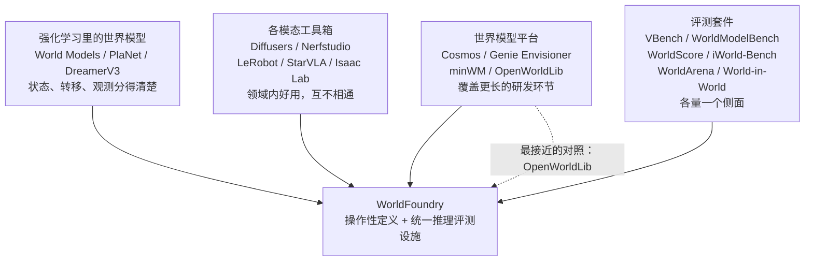
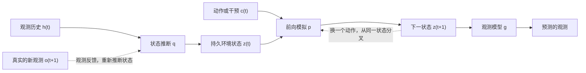
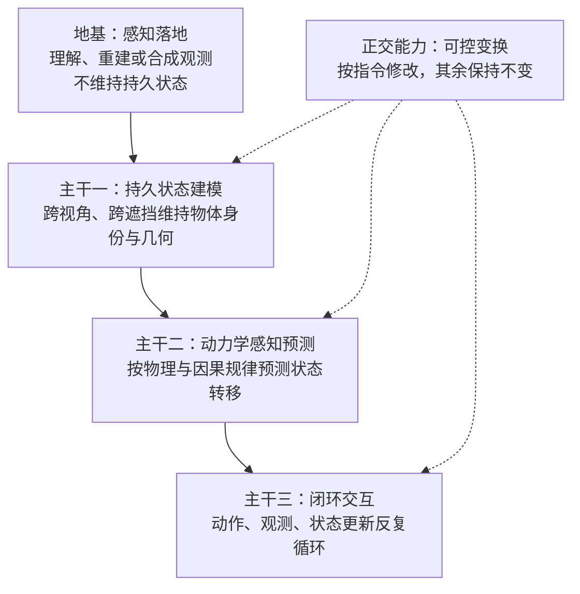
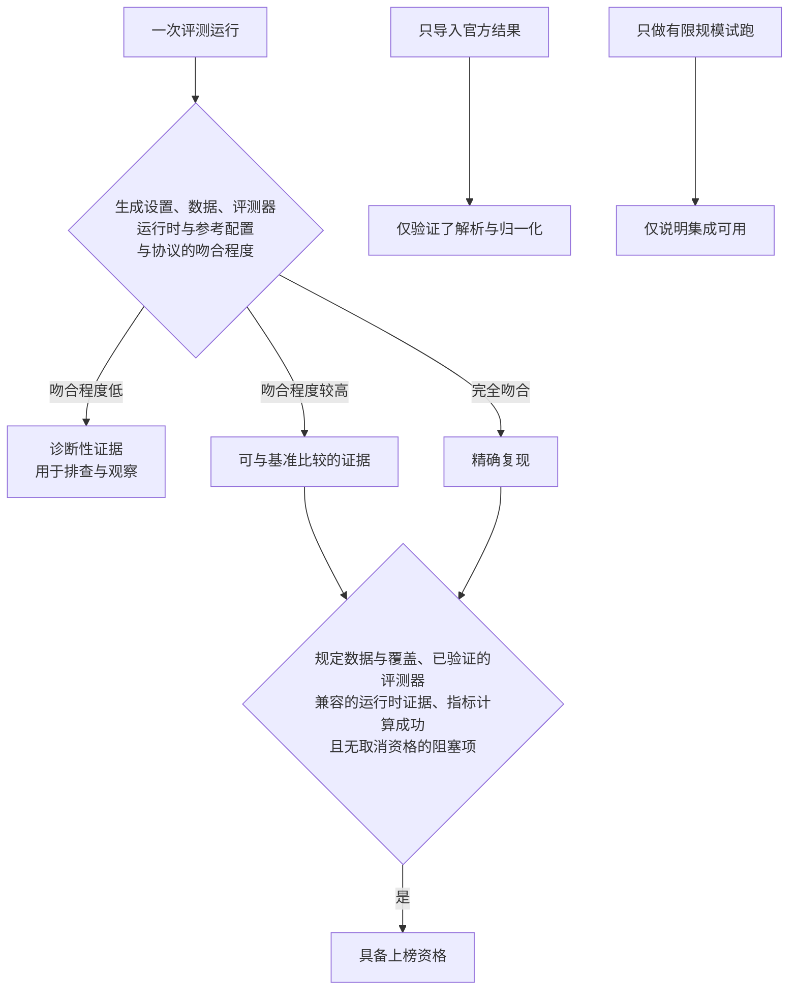
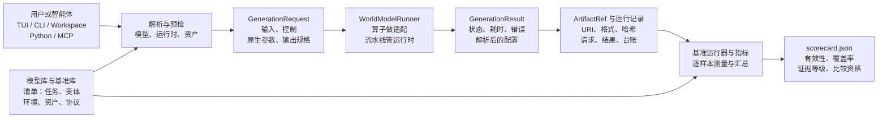

# WorldFoundry：面向世界智能的统一基础设施

> **原题**：WorldFoundry: Towards Unified Infrastructure for World Intelligence
> **作者**：OpenEnvision 团队，Juanxi Tian, Jiadong Hou, Baiang Li, Xin Lin, Zhengbo Jiao, Weijia Zhang, Yeying Jin, Truong Nguyen, Haitian Zheng, Zhifei Zhang, Jianfei Yang, Ming-Hsuan Yang, Felix Heide, Wei Xiong, Enze Xie, Wanhua Li
> **机构**：NTU（南洋理工大学）、普林斯顿大学、加州大学圣迭戈分校、香港科技大学、耶鲁大学、新加坡国立大学、加州大学默塞德分校、Adobe、Nvidia
> **年份**：2026（arxiv ID 2611.10771，2026 年 11 月 7 日提交，39 页技术报告）
> **分类**：cs.CV / cs.AI
> **链接**：https://arxiv.org/abs/2611.10771
> **代码**：https://github.com/OpenEnvision/WorldFoundry
> **精读日期**：2026-11-10

## 阅读须知

### 这篇在领域里的位置

这篇论文属于「世界模型」研究里的基础设施与评测方法这一类工作。它没有提出新的模型，也没有刷新任何一个基准上的分数。它做的是另外两件事：先给「什么才算世界模型」下一个可以操作的定义，再围绕这个定义搭一套开源的推理与评测平台。

要理解它的位置，需要先看过去几年这个方向是怎样走过来的。世界模型（world model）这个说法最早在强化学习里成形，指的是智能体在自己内部学出来的一个环境模拟器，智能体可以在这个模拟器里预演动作的后果，再决定现实中怎样行动。2018 年的 World Models、之后的 PlaNet 与 DreamerV3 都属于这条线，它们的环境规模不大，但「状态、转移、观测」三件事分得很清楚。

与此同时，视频生成模型在 2024 年之后画质提升得很快，许多工作开始把视频生成器称作「世界模拟器」。随后又出现了能够接收键盘、鼠标或相机指令的交互式世界模型，以及把视觉预测接到机器人控制上的具身模型。于是「世界模型」这个词同时被用在四五类差别很大的系统上，彼此的输入、输出、运行环境与评测办法都不相通。

这篇论文位于这条脉络的「整理」一步。它之前已经有 NVIDIA 的 Cosmos 平台与 OpenWorldLib 这样的整合性工作，本文在它们的基础上强调两点：一是定义要落在「状态是否闭环」上，二是平台要把「模型能跑通」与「结果可以拿来比较」分开记录。

### 读完能回答什么

- 论文怎样用状态推断、前向模拟、交互响应三个算子，再加一条「闭环」判据，来界定生成式世界模型，它与「基础生成模型」的分界线画在哪里。
- 感知落地、持久状态建模、动力学感知预测、闭环交互、可控变换这五项能力之间是什么关系，为什么可控变换被放在主干之外。
- WorldFoundry 的五个组成部分各自负责什么，一次运行从用户发出命令到产出评分卡，中间经过哪些环节。
- 为什么要把「收录进目录」「能跑通」「做过有限验证」「完整复现基准」当作四种不同的声明，证据的三个等级又各指什么。
- 这份技术报告的实验实际验证到了哪一步，它在实验一节开头承诺的测量有哪些没有出现在正文里。

### 阅读前置

这份笔记假定读者熟悉深度学习模型的训练与推理流程，用过 Diffusers 之类的推理库，也大致知道视频生成模型与机器人策略模型是做什么的。笔记不预设读者做过基于模型的强化学习，也不预设读者熟悉三维重建或具身智能的评测基准，这些内容在用到的地方都会先做铺垫。

### 缩写表

- **WM**（World Model，世界模型）：能够在内部维持环境状态并预测其演化的模型，本文对它给出了更严格的定义。
- **VA**（Vision-Action，视觉到动作）：只看图像和机器人自身状态就输出动作的策略模型。
- **VLA**（Vision-Language-Action，视觉语言动作）：在 VA 的基础上再接收自然语言指令的策略模型。
- **WAM**（World-Action Model，世界动作模型）：一边生成动作、一边预测环境未来变化的模型。
- **TUI**（Terminal User Interface，终端用户界面）：在终端里用菜单引导操作的界面。
- **CLI**（Command-Line Interface，命令行界面）：用一条条命令驱动的界面，适合写进脚本。
- **API**（Application Programming Interface，应用程序接口）：文中的 Hosted API 专指由厂商托管、只能远程调用的模型服务。
- **MCP**（Model Context Protocol，模型上下文协议）：让外部智能体以统一方式调用工具的协议。
- **LB**（Leaderboard，排行榜）：基准维护方公布的公开榜单。
- **FVD**（Fréchet Video Distance）：衡量一批生成视频与真实视频在特征分布上相差多远的指标，数值越低越好。
- **LIBERO**：一套机器人操作的仿真基准，LIBERO-10 是其中十个多步长程任务组成的子集。
- **JSONL**：每行一条 JSON 记录的文本格式，适合逐条追加运行日志。

## 一、问题

视觉生成模型越来越像模拟器，这是这篇论文的出发点。一段由模型生成的第一人称视频，可以跟着键盘指令向前走、向左转，看上去与在游戏里移动没有差别。可是画面看上去可信，并不说明模型内部真的维持着一个世界。论文举的例子很具体：模型能在你转身回来时把原先的房间画对，并不能说明一扇被推开的门在你离开视野之后依然开着。

这个问题不解决，受影响的首先是做研究的人。每个模型都带着自己的运行环境、输入约定、推理脚本和输出格式，评测基准又各有各的数据与打分流程。于是两个模型在论文里的分数相差几个点时，读者很难判断差距来自模型本身，还是来自两套不同的实验流程。

第二层困难出在「支持」这个词上。一个平台说自己「支持某模型」，可能只是把它列进了目录，可能是推理跑通过一次，可能是在基准上做过小规模试跑，也可能是完整复现了官方分数。论文认为这四种情况常常被混成一种说法，读者无从分辨。

把这些痛点落成技术上的陈述，论文要解决的是三件互相牵连的事。其一，领域里缺少一个可操作的定义，用来区分「基础生成模型」与「生成式世界模型」。其二，现有基准大多以感知质量为中心，量的是画面，而不是状态与因果。其三，工作流是割裂的，因此任何一项评测结论都难以追溯到支撑它的具体产物与运行条件。

### 前人的几条路线

第一条路线来自强化学习。World Models 把压缩过的视觉表示、循环式的动力学模型和策略学习接在一起；PlaNet 在隐空间的动力学里做规划；DreamerV3 则让策略完全在想象出来的轨迹里学习。这条线把世界模型的结构讲得最清楚，但它面向的是具体的控制任务，并不处理今天这些通用的视频、三维与具身系统。

第二条路线是各个模态自己的工具箱。Diffusers 组织生成模型的推理流程，Nerfstudio 支持神经重建与渲染，LeRobot 与 StarVLA 面向机器人策略的开发与部署，Isaac Lab 提供仿真与学习的工作流。它们在各自领域里用起来很方便，可是互不相通，也都不回答「什么算世界模型」。

第三条路线是世界模型平台，覆盖的研发环节更长。Cosmos 把数据准备、基础模型与后训练放在一起，另有 Cosmos Evaluator 负责打分编排与结果存储。Genie Envisioner 与 GE-Sim 2.0 把动作条件的视频模拟接到机器人策略的评测与学习上，minWM 则支持可控自回归生成的微调与蒸馏。

这条路线里与本文最接近的是 OpenWorldLib。它用流水线、算子、表示、推理、记忆几个模块，把视频、空间与具身系统统一到共同接口之下，支持多轮执行，也支持对已保存的结果做评测。它给出的世界模型表述强调感知、交互与长期记忆。

第四条路线是评测套件，它们各自量世界模型的一个侧面。VBench 系列量感知质量、语义对齐与内在忠实度；VideoPhy 与 WorldModelBench 检查生成的事件是否符合物理约束与常识；WorldScore 在给定相机轨迹的条件下评测视频与空间生成；iWorld-Bench 关注交互控制与记忆；WorldArena 与 World-in-World 则把评测延伸到具身效用与闭环规划。

这些套件所需要的证据并不相同，这一点是论文后面设计证据层的直接原因。有些评测只需要对固定的生成产物打分；交互式与具身类的任务则需要控制历史、环境反馈与真正执行过的轨迹。运行条件与协议是否被遵守，因此成为结果能否比较的关键。



### 论文自己画的对照表

论文的表 1 把自己与上述系统逐栏对照。下面按原表转录，✓ 表示有文档可查的支持，◐ 表示只有专门化的或局部的支持，× 表示没有文档可查的工作流。需要说明的是，这张表是作者自己的判断，依据是各系统公开文档里写明的工作流。

| 系统 | 视频 | 3D/4D | 交互式 WM | 具身 | 模型运行器 | 托管 API | 闭环 | 训练 | 评测协议 | 证据 | WM 定义 |
|---|---|---|---|---|---|---|---|---|---|---|---|
| OpenWorldLib | ✓ | ✓ | ✓ | ✓ | ✓ | ✓ | ✓ | × | ✓ | ◐ | ✓ |
| Cosmos | ✓ | × | ✓ | ✓ | ◐ | ✓ | ✓ | ✓ | ✓ | ◐ | ◐ |
| Genie Envisioner | ◐ | × | ✓ | ✓ | ◐ | × | ✓ | ✓ | ◐ | ◐ | ◐ |
| minWM | ◐ | × | ✓ | × | ◐ | × | × | ✓ | × | ◐ | ◐ |
| Diffusers | ✓ | ◐ | ◐ | ◐ | ✓ | × | × | ✓ | ◐ | ◐ | × |
| LeRobot | ◐ | × | ✓ | ✓ | ✓ | × | ✓ | ✓ | ◐ | ◐ | × |
| StarVLA | × | × | × | ✓ | ◐ | × | ✓ | ✓ | ◐ | ◐ | × |
| VBench | ✓ | × | × | × | × | × | × | × | ◐ | ◐ | × |
| WorldScore | ✓ | ✓ | × | × | ◐ | ◐ | × | × | ◐ | ◐ | ◐ |
| WorldArena | ◐ | × | ◐ | ✓ | ◐ | × | ✓ | ◐ | ◐ | ◐ | ◐ |
| World-in-World | ◐ | × | ◐ | ✓ | ◐ | ◐ | ✓ | ◐ | ◐ | ◐ | ◐ |
| **WorldFoundry** | ✓ | ✓ | ✓ | ✓ | ✓ | ✓ | ✓ | × | ✓ | ✓ | ✓ |

原表最后还有一栏列出各系统的界面种类，为了版面这里改用文字说明。其余系统大多提供 Python 与 CLI 两种入口，个别带网页或公开排行榜；WorldFoundry 一行列的是 TUI、CLI、网页、Python 与 MCP 五种。

读这张表时有两处值得留意。第一，「证据」一栏里只有 WorldFoundry 拿到了 ✓，其余所有系统都是 ◐；按表注的解释，✓ 的含义是把每个条目的就绪状态与结果的来源记录连在一起，◐ 的含义是只保存配置或分数。第二，WorldFoundry 与 OpenWorldLib 两行在覆盖、执行、评测协议与定义这几栏上完全相同，差别只落在证据一栏与界面种类上，而两者的「训练」一栏都是 ×。

## 二、方法

这篇论文的「方法」由两部分组成。前一部分是概念上的：一个定义、一条能力递进线、一条分界线。后一部分是工程上的：WorldFoundry 这套系统的五个组成部分。两部分之间的关系是，定义规定了什么样的证据才算数，系统负责让这样的证据能够被产出、保存和追溯。

### 符号

论文用到的符号不多，先逐个说明。

- `o(t)`：时刻 t 的观测，可以是一帧图像、一组多视角图像，或机器人传感器的读数。
- `c(t)`：时刻 t 的动作或干预，例如一次键盘输入、一段相机运动、一条机器人控制指令。
- `h(t)`：到时刻 t 为止的交互历史，由时刻 t 及之前的全部观测、时刻 t 之前的全部动作组成。
- `z(t)`：与任务相关的环境状态，是模型内部维持的隐变量，并不直接可见。
- `q`、`p`、`g`：分别是状态推断模型、状态转移模型与观测模型。

### 三个算子与一个闭环

论文把世界建模拆成三个紧密耦合的操作，并强调这三个操作作用在隐状态上，而不是只作用在观测上。状态推断（state inference）要做的事情，是从观测历史里估计出环境此刻的隐状态。前向模拟（forward simulation）要做的事情，是预测这个状态在自身动力学、物理约束与外部动作的共同作用下如何演化。交互响应（interactive response）要做的事情，是在不同的动作或干预之下，给出彼此不同而又各自连贯的未来。

这三个操作写成式子，就是论文的式 (1)：

```text
状态推断：  z(t)    ~ q( z(t)   | h(t) )
前向模拟：  z(t+1)  ~ p( z(t+1) | z(t), c(t) )
观测生成：  ô(t+1)  ~ g( ·      | z(t+1) )
```

其中 `ô(t+1)` 是模型预测的下一时刻观测，波浪号表示「从这个分布里采样」。反复应用 `p`，就能在不同的控制序列下滚出多条预测轨迹。

仅有这三步还不够，关键在于回路要合上。一旦真实的 `o(t+1)` 被观测到，状态需要依据更新后的历史 `h(t+1)` 重新推断，也就是 `z(t+1) ~ q( · | h(t+1) )`，然后才进入下一轮预测。换句话说，预测与反馈之间构成一个闭环：动作改变状态，状态约束预测，新的观测再回头修正状态。

这个表述是功能性的，而不是架构性的。`z(t)` 可以是循环网络的隐向量，可以是以物体为中心的表示，可以是几何结构，也可以是一串离散的 token，论文对此不作规定。三个操作也不要求每个系统全都实现，它们只是一套用来描述系统的公共词汇。



### 定义

把上面这些操作耦合成一个持续运转的过程，就得到论文的核心定义。生成式世界模型是一个学习得到的、以历史与控制为条件的隐式动力系统：它推断并维持一个持久的环境状态，让这个状态在内生动力学与外部干预之下演化，并且吸收反馈以生成连贯的未来轨迹。

论文特别说明，这里的「持久」是操作意义上的，而不是名义上的。一次干预必须在状态里留下痕迹，并且这个痕迹要约束之后的预测；每一次新来的观测也必须反过来修正状态。只有两条同时成立，世界建模的回路才算闭合。

与之相对地，画面是否可信只反映观测模型 `g` 这一个环节。论文的说法是，视觉上的可信对于「底层状态确实持久」这件事来说，既不是必要证据，也不是充分证据。

### 能力递进

有了定义之后，论文把现有的生成系统沿一条能力递进线排开。这条线不是把每个系统归到某一个等级，而是给每个系统画一份能力画像：它具备哪几项能力，这些能力之间整合到了什么程度。

递进线的地基是感知落地（Perceptual Grounding），指理解、重建或合成可观测内容的能力。它在观测层面捕捉结构，为状态推断提供感知基础，但自身并不维持对环境的持久表示。

地基之上是论文称为「世界模型主干」的三级，每一级都建立在前一级之上。第一级是持久状态建模，要求从连续观测里推断、维持并递归更新一个结构化的环境状态，能在视角变化与遮挡之下跟住物体的身份、几何与空间关系。第二级是动力学感知预测，要求按照物理与因果规律预测状态转移，让先发生的事件通过其持续的后果约束后面的预测。第三级是闭环交互，要求在一个持久环境里维持「动作、环境转移、观测、状态更新」的反复循环。

可控变换（Controllable Transformation）被放在主干之外，作为一项正交能力。它指按照指定的控制去修改内容或状态，同时保持编辑范围之外的属性与结构不变。之所以把它单列，是因为会编辑并不意味着有状态、有动力学或能闭环：它可以与主干的任何一级搭配，但单凭它自己建立不起主干上的任何一项能力。



论文据此对当前几类系统作了定位。视频生成器的感知落地很强，但状态大体是隐式的。三维与四维方法维持着显式的空间结构，却很少预测它在动作之下的演化。交互式世界模型已经能在较短的时间跨度上闭环，并且开始处理更长程的记忆。具身策略在持久环境里行动，但覆盖的任务与机器人形态比较窄。

### 一条分界线

在定义与递进线的基础上，论文只画了一条分界线：系统是否闭合了世界建模的回路。主要用于生成或变换观测的模型，即便带有局部的、隐式的动力学，只要没有同时做到维持持久状态、支持以干预为条件的动力学、吸收观测反馈这三条，就归入基础生成模型。三条全部满足的，才归入生成式世界模型。

这条线的含义是，单项能力再强也不够。论文的原话大意是，强的单项能力不足以维持一个连贯而可修正的世界模型，决定性的性质是功能上的耦合。

### WorldFoundry 的五个组成部分

要检验上述能力，需要可复现的实验，把观察到的行为与明确规定的任务和评测条件对应起来。WorldFoundry 围绕「发现、运行环境准备、执行、检查、评测」这一条共同的研究流程来组织，由五个部分构成。

**界面层（Surface Layer）。** 这一层提供多种入口，但所有入口共用同一条编排路径。TUI 负责引导式的发现：查询模型与基准目录，检查依赖与就绪情况，并在分配计算资源之前先解析出一条可执行的命令。CLI 覆盖发现、准备、推理、评测、验证与出报告，面向自动化实验。浏览器里的 Workspace 支持多模型任务的配置、监控与跨运行比较，单模型的 Studio 则提供针对各模态的交互控制与可视化。Python 接口与 MCP 接口把同样的功能开放给外部程序与智能体。

之所以强调共用一条编排路径，是因为这样才能保证结果与启动方式无关。每个入口都把用户的意图翻译成规范化的请求，再对着同一套目录、运行配置、流水线、算子与结果契约去解析。

**统一推理与交互。** 每个模型标识符或别名，先被映射到目录里的一个规范条目。这个条目的清单（manifest）写明了来源、支持的任务与变体、输入输出模态、所需资产、运行配置与就绪约束。解析器据此核对环境与资产是否齐备，报告阻塞项，并选定执行后端。

解析成功之后，输入被编码成一个 `GenerationRequest`。它规定了一组公共字段：样本标识、任务上下文、条件输入、控制信号、生成参数与输出规格，同时保留模型专属的载荷。这个契约统一的是编排，而不是输入的语义：视频系统保留它的时间与媒体条件语义，三维与四维系统保留相机、坐标系与渲染语义，具身系统保留观测到动作的格式与仿真器契约，交互式世界模型保留会话状态与顺序控制。

执行由 `WorldModelRunner` 协调，它依靠两个互补的抽象。算子（Operator）负责与任务相关的适配，包括输入校验、预处理、翻译成模型原生参数、后处理，以及把原生输出转换成框架认识的产物。流水线（Pipeline）负责模型的生命周期与推理运行时，包括模型构建、加载权重、设备分配、分布式执行与调用原生推理过程。对于交互式系统，流水线可以常驻并保留会话状态，于是连续的动作可以直接更新环境，而不必每次重新加载权重。

**产物与表示契约。** 契约分两层。样本层上，一个 `GenerationRequest` 代表一个执行单元，其中 `inputs` 放文本、源媒体或观测，`controls` 放动作序列或相机轨迹，`generation_kwargs` 保留随机种子、帧率之类的模型原生参数，`output_schema` 声明期望的产物类型。对应的 `GenerationResult` 记录执行状态、错误、耗时、解析后的配置与输出引用。每个落盘的输出由一个 `ArtifactRef` 描述，写明它的语义角色与 URI，可选地附上 MIME 类型、媒体属性、文件大小与内容哈希。

运行层上，一次运行会留下一组固定的记录文件。`execution_plan.json` 写明计划的阶段与样本标识，`requests.jsonl` 与 `results.jsonl` 保留请求与结果，`sample_ledger.jsonl` 跟踪每个样本在各阶段的状态与失败，`artifacts.jsonl` 为产物建索引，`run_manifest.json` 记录运行身份、配置、运行时上下文与输出位置。失败的请求会明确留在结果与台账里，这样覆盖率的统计才不会在无人察觉的情况下被掩盖。

这些契约全部可以序列化成 JSON，因此可以脱离原来的模型实现，跨进程、跨环境地保存、传输与检查。它带来的直接好处是，花了很多算力才生成的输出，可以在不重新加载模型的情况下被重新打分、比较与审计。

**评测与证据。** 评测被设计成以产物为中心的过程：只要所需输出已经落盘，打分就可以独立于原来的模型运行时进行。论文在这里区分了指标（metric）与基准（benchmark）的职责。指标只负责从兼容的产物里算出逐样本的测量与汇总统计。基准除此之外还规定了数据、样本覆盖、预处理、产物布局、评测器资产、裁判模型的配置与汇总规则。

依赖与评测器权重都必须显式声明。资源不可用时，系统给出明确的「跳过」或「失败」状态，而不是不加说明地换一个替代品。这一条看似细小，却是结果能否比较的前提，因为换了评测器的分数与原协议的分数并不是同一个量。

证据层记录评测结果，以及这些结果在什么条件下才能支持科学上的比较。逐样本的测量存在 `metrics/per_sample.jsonl`，汇总值与失败或跳过的样本标识存在 `metrics/summary.json`，运行元数据与一个可复现性指纹存在 `run_manifest.json`。这些记录最终汇入 `scorecard.json`，它是分数有效性、来源、协议忠实度、覆盖率与比较资格的权威记录；`summary.json` 与 `report.md` 只是从它派生出来的摘要。

证据被分成三个等级：诊断性的、可与基准比较的、对基准的精确复现。划分的依据是运行与规定的生成设置、数据、评测器、运行时和参考配置之间的吻合程度。论文还特别澄清了两种容易被高估的情况：导入官方结果，只验证了结果的解析与归一化；跑一次有限规模的评测器，只说明集成是可用的。两者都不构成完整的基准复现。

论文给出了划分所依据的几个维度，但没有逐条写出每个等级的门槛。下图的三个分支因此只表示吻合程度由低到高，具体的判定以各基准的清单为准。



**模型库与基准库。** 模型库是一个由清单驱动的注册表，条目分成五个操作类别：视频模型、生成式世界模型、三维与四维模型、具身的 VLA、VA 与 WAM 模型，以及厂商托管的远程模型。论文说明这些类别反映的是集成上的需求，而不是互斥的能力划分。权重、凭据与其他受保护或依赖具体机器的资产不放进仓库，而是通过显式引用去解析。

这里有一句话概括了整个设计的态度：被收录进目录只意味着可以被发现，并不意味着可以执行。源码是否可得、实现状态、资产就绪、运行时验证与执行证据都是分开跟踪的，条目在条件满足之前保持「计划中」或「受阻」的状态。

基准库是与之平行的注册表。每个基准的执行路径可以是框架内的评测器、外部的官方运行时、官方结果的导入器、托管的裁判模型，或是仿真器接口。模型与基准只有在各自声明的任务语义与产物要求相容时才会被配对，配对之后再按来源、覆盖、协议忠实度与验证证据归入前面说的三个证据等级。

### 一次运行的完整流向

把五个部分连起来，一次运行的流向如下图。产物契约处在中间，是执行与评测之间唯一的交接面。



## 三、实验

这篇技术报告的实验一节与常见的模型论文很不一样，读之前需要先调整预期。它没有主结果表，没有与基线的数值对比，也没有消融。作者明确说，由于各个模型家族的目标、输入、输出与执行语义都不相同，他们评测的是基础设施的能力，而不是跨领域给模型排名。

### 实验设置

实验在 128 块 NVIDIA A100 与 H100 显卡上进行，每块 80 GB 显存，其他硬件上的评测留待以后。验证的对象是四件事：框架能否把声明式的目录条目解析成可执行的配置，能否跨界面保持模型的原生语义，能否把异构的输出存成持久的产物，以及报告出来的结论能否由可追溯的证据支撑。

### 规模

报告给出的硬数字主要是覆盖规模，汇总如下。

| 类别 | 条目数 | 细分 |
|---|---|---|
| 模型 | 270 | 视频生成 64、世界模型 109、3D 与 4D 34、具身 53、托管 API 10 |
| 基准 | 74 | 视频生成 33、具身 23、世界模型 18 |
| 指标 | 62 | 图像与特征分布 26、感知与布局 11、多模态与质量打分 10、编辑 7、已有结果处理 5、视频分布 3 |

附录把这些条目逐一列出，每个模型附有稳定的注册标识与就绪状态。按附录的说明，270 个模型条目全部标为「Runner verified」，74 个基准全部标为「Integrated & Verified」，并且注明验证范围只针对相应的执行路线、模型变体与配置。

### 四个模型家族的定性结果

**视频生成。** 论文通过 WorldFoundry 运行了 CogVideoX、HunyuanVideo 1.5、LTX-2.5、Wan2.1、Wan2.2、MiniMax H3 等系统，图 7 展示了其中三个模型的文生视频结果。定性观察是，CogVideoX 与 Vchitect-2.0 能抓住场景构图与大致的运动模式，但复杂运动与多物体交互会暴露身份、细节与空间关系上的不一致。由此得出的结论是，一段视频可以在视觉上平滑、内容可辨认，同时违反接触关系，或者没有完成要求的变化，所以事件层面的一致性必须作为逐帧质量的补充。

**交互式世界模型。** 这一组包括 Matrix-Game 系列、LingBot-World 1.0 与 2.0、Hunyuan GameCraft 系列、YUME-1.5、SANA-WM、Echo-WM 等，图 8 展示了五个系统在方向移动与鼠标相机控制之下的 30 秒滚动结果。论文观察到 Matrix-Game 2.0 的导航响应灵敏，但在较长的滚动里外观会漂移；带记忆增强的新系统则着手处理超出即时上下文的一致性。

这一组得出的结论是全文最有分量的一条。场景回忆与动作响应，都不等于交互结果的持久：能把熟悉的视角恢复出来，并不能证明一扇打开的门仍然开着，也不能证明一个被移走的物体在离开视野之后还留在新位置上。于是评测的优先事项，是把「对场景外观的记忆」与「对动作所造成变化的记忆」区分开来。

**三维与四维生成。** 图 9 在同一个室内场景上比较了 VGGT、VGGT-Omega、DUSt3R 与 CUT3R，从同一组视角渲染各自的重建结果。论文在这里区分三种性质：与已观测证据的吻合、对推断内容的跨视角一致、场景结构在时间上的持久。一个表示可以看上去可信并且自洽，却在没被观测到的区域里并不准确；同样地，重建出一段动态序列，也不等于有能力预测它在别的动作之下如何演化。

**具身动作生成。** 这一组覆盖 VA、VLA 与 WAM 三种范式，评测把离线的动作预测与兼容仿真环境里的闭环执行结合起来。图 10 是全文唯一带具体数字的执行记录：OpenVLA 通过 WorldFoundry 在 LIBERO-10 上跑了三个任务，每个任务记录一个回合。

| 任务 | 结果 | 步数 | 时长 |
|---|---|---|---|
| 把书放进收纳架 | 成功 | 179 | 8.95 秒 |
| 把两件物品放进篮子 | 达到步数上限，未完成 | 520 | 26 秒 |
| 把碗放进抽屉并关上抽屉 | 达到步数上限，未完成 | 520 | 26 秒 |

论文用这三个回合说明，单物体的抓放任务可以完成，而两个多阶段任务都在步数上限之前没有完成，所以应当看闭环完成率，而不是离线的动作精度。对具身一组的总结是，世界建模的价值取决于预测在控制流程的哪个位置进入：作为训练数据的扩充、作为表示上的监督，还是作为动作生成中的在线部件。

### 值得单独讨论的两处

第一处是实验一节开头的承诺与正文之间的落差。5 节的引言说，评测首先验证框架在匹配条件下与原生实现给出一致的结果，然后检查通过 CLI、Python 接口与网页发出的等价请求是否得到一致的配置与行为，最后测量延迟与显存开销，以及集成一个新模型所需的工作量。可是在正文与附录里，这几项都没有对应的数字或表格，四个家族的小节给出的只有定性描述与示例图。

第二处是成熟度标注的均匀。论文从头到尾都在强调收录、能跑、有限验证与完整复现必须分开声明，表 2 的注脚也写明各条目「并非同样成熟」。然而附录里 270 个模型的状态栏全是同一个标签，74 个基准的状态栏也全是同一个标签。按论文自己的口径，这个标签对应的只是「有文档的参考工作流跑通过」这一级，它并没有说明哪些模型与基准的组合达到了可比较或精确复现的等级。

## 四、局限

### 作者承认的局限

作者首先承认，广泛的覆盖之下包含着不同的执行成熟度。目录收录、可运行的集成、本地资产就绪、官方运行时验证与基准资格始终是不同的状态，因为各个模型与基准分别依赖外部权重、需要授权的数据集、托管服务、仿真器资产与专用环境。

其次，当前框架只管推理、交互、产物管理与评测。通用的训练基础设施留给以后，上游的训练代码被有意与现在的运行时包分开。这与表 1 里「训练」一栏的 × 是一致的。

第三，推理内核里已经接入了不少优化手段，包括多种注意力后端、编译与推理缓存、量化与多显卡并行，但它们在各个模型家族上的效果还没有被系统地刻画过。验证主要在 A100 与 H100 上完成，作者说明由于拿不到足够的新一代加速器，更新硬件上的评估受到限制。

第四点写在结论里，分量其实最重。作者指出，当前的评测很少去量「干预的效果是否持久」与「新来的观测是否修正了状态」这两件事，而直接探查这两点的评测被列为今后的工作。

### 读者能看出来的问题

定义与检验之间还隔着一步。论文把「是否闭环」立为世界模型的判据，但没有给出一个可以执行的测试来判定某个模型过没过这条线，全文也没有用这条判据去实际划分任何一个模型。与此相关的是，模型库里那 109 个「世界模型」条目是按集成需求归类的，论文自己也说类别并不代表能力，所以这个类别名并不等于通过了论文自己的定义。

基础设施层面的主张缺少定量支撑。与原生实现的一致性、跨界面的一致性、框架带来的延迟与显存开销，这些正是使用者在决定是否采用一套统一框架时最想知道的数字，目前只能等后续版本。arXiv 页面的备注里写明这份技术报告会定期更新，所以这或许是进度问题，但就这一版而言，结论只能建立在定性展示之上。

定性结论的来源需要分辨。四个家族小节里的许多判断，引用的是各模型原论文报告的结果或官方演示，并不是通过 WorldFoundry 在统一条件下测出来的。真正由平台执行并给出数字的只有图 10 的三个回合，而每个任务只有一个回合，不足以说明成功率。

对照表是自我评估。表 1 里 WorldFoundry 除训练之外全部是 ✓，而「证据」一栏所有其他系统都是 ◐。这一栏的评判标准恰好是按本文的设计重点来定义的，读者在引用这张表时应当记得这一点。

复现门槛不低。验证用了 128 块 80 GB 显存的显卡，许多条目还依赖需授权的数据集、带凭据的托管服务与专用仿真环境。托管 API 类的条目另有一层不确定：厂商一侧的模型会更新，即使请求与配置被完整记录下来，同一请求在日后也未必得到同样的输出，这一点论文没有讨论。

报告本身还有打磨的余地。视频生成小节的定性分析中间插有一段介绍 FLAG3D++ 的文字，讲的是带动作捕捉三维姿态的人体活动数据，与前后对各视频模型的比较并不衔接。

## 一句话

用「是否闭环」界定生成式世界模型，并开源一套收录 270 个模型、把能跑通与可比较分开记录的推理评测设施。
