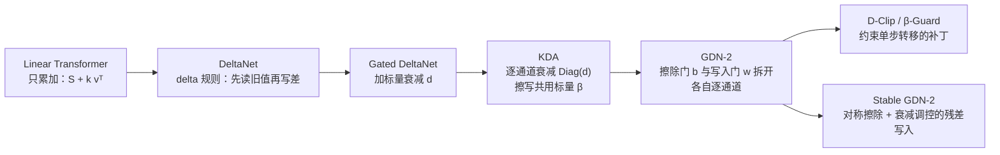
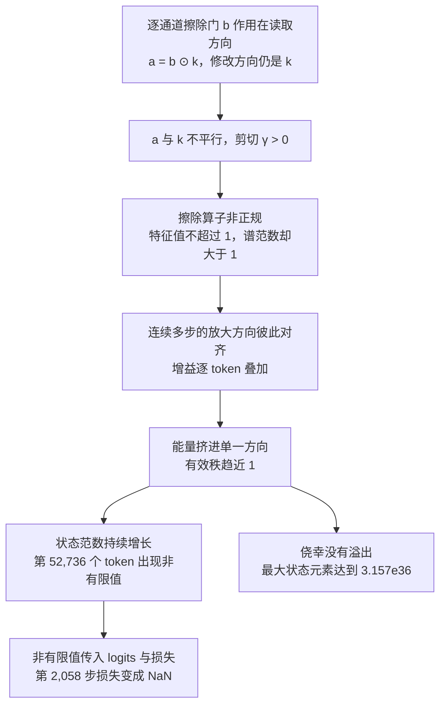
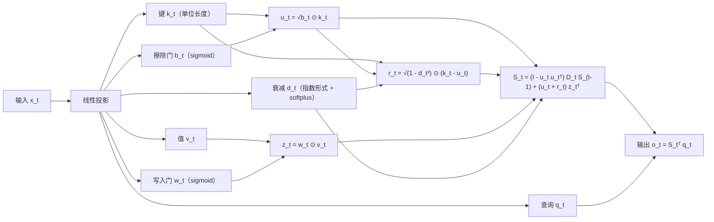
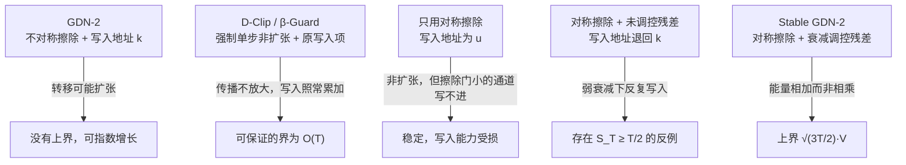
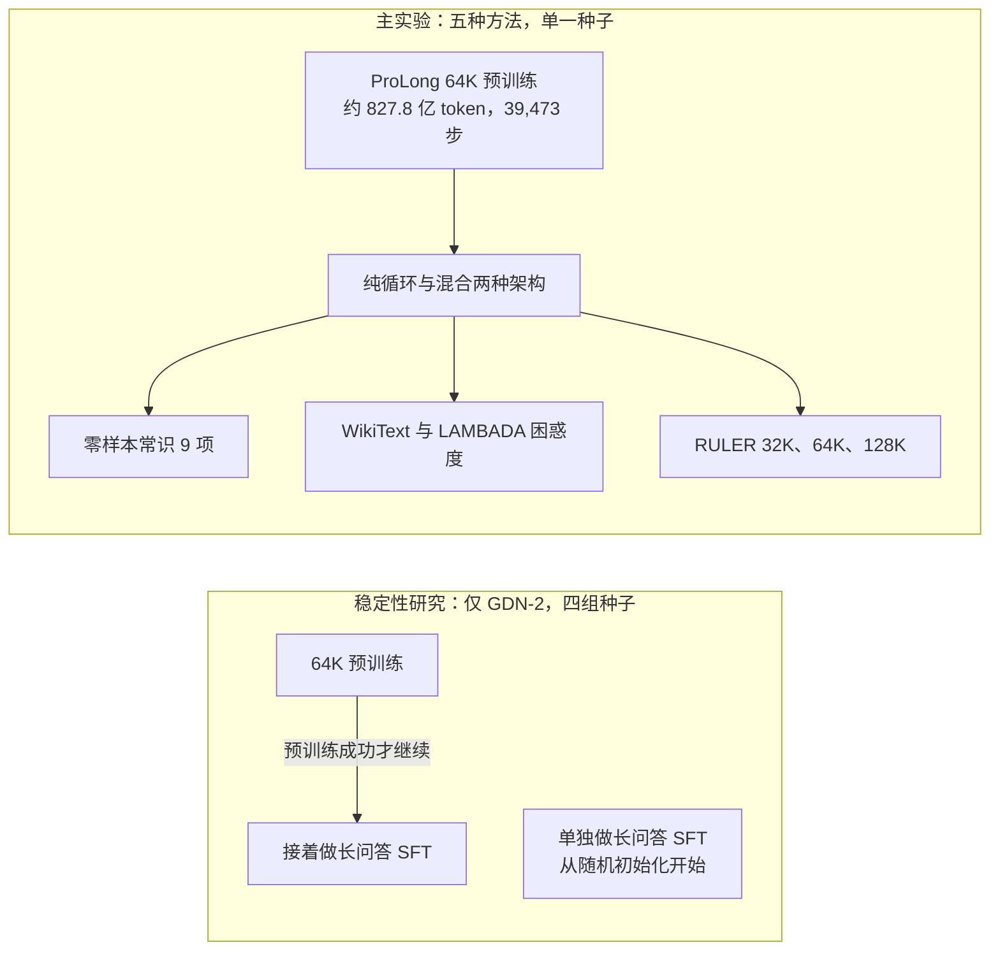

# Stable Gated DeltaNet-2：理解并缓解线性注意力循环状态的不稳定性

> - **原题**：Stable Gated DeltaNet-2: Understanding and Mitigating Recurrent State Instability
> - **作者**：Xichong Zhang、Xixuan Hao、Zhichen Liu、Le Zhou、Zeyu Zhang、Boyu Chen、Mingfei Lu、Zehao Lin、Bo Tang、Yonggang Zhang、Linyun Liu、Feiyu Xiong、Jianlin Su、Zhiyu Li（前四位为共同第一作者；通讯作者 Yonggang Zhang、Linyun Liu）
> - **机构**：MemTensor（记忆张量）、中国科学技术大学、香港科技大学（广州）、南方科技大学、上海交通大学、香港科技大学、科学空间（kexue.fm）
> - **年份**：2026（arxiv ID 2611.34051，2026-11-25 提交）
> - **分类**：cs.CL / cs.LG
> - **链接**：https://arxiv.org/abs/2611.34051
> - **精读日期**：2026-11-28

## 阅读须知

### 这篇在领域里的位置

这篇论文属于「线性注意力」方向，更具体地说，属于其中以 delta 规则为核心的那一支。线性注意力要解决的是标准 Transformer 的一个老问题：softmax 注意力在每一步都要与全部历史 token 两两比对，计算量随序列长度的平方增长，推理时还要保存一份随长度线性变大的 KV 缓存。线性注意力的做法是把全部历史压缩进一个大小固定的矩阵，称为循环状态，每来一个 token 就更新一次。于是，计算量与序列长度成正比，推理时的显存也不再随上下文变长而增加。

过去几年里，这一支的演进可以看成一个持续的追问：怎样更聪明地往这块固定大小的记忆里写东西、擦东西。2020 年的 Linear Transformer 只会往状态里不断累加；2021 年的 DeltaNet 引入了 delta 规则，写入之前先把同一个键下的旧内容擦掉；Gated DeltaNet 在此基础上加了一个标量衰减门，让旧记忆可以整体淡出。

随后，KDA 把衰减改成了逐通道的；Gated DeltaNet-2（简称 GDN-2）则更进一步，把擦除门与写入门拆开，各自做成逐通道的向量。与此同时，工业界已经有模型把这类层与少量全注意力层按三比一的比例混合使用，这条路线已经进入实际的大模型之中。

本文位于 GDN-2 之后的下一步。它没有再提出更强的表达方式，而是指出 GDN-2 在 64K 长上下文训练时会出现数值发散，把根源追查到擦除算子的不对称上，并给出一个既保持稳定、又尽量保留 GDN-2 灵活性的修改版本，称为 Stable GDN-2。换句话说，这是一篇「表达力提升之后回头补稳定性」的工作，理论分析在全文中的比重比一般的结构论文更大。

### 读完能回答什么

1. GDN-2 把擦除门放到「读取方向」上之后，为什么一个只擦不写的操作反而可能让状态变大，而它的特征值却全都不超过 1。
2. 单步的小幅放大为什么会在几万个 token 上累积成数值溢出，以及「训练没有出现 NaN」为什么不代表状态是健康的。
3. 对称擦除怎样让状态传播变成非扩张的，它又为什么会顺带削弱写入能力。
4. 按衰减强度调节的残差写入，为什么能把状态范数的增长压到 $O(\sqrt{T})$，去掉这层调节之后又为什么会退回线性增长。
5. 在 64K 预训练的约 16 亿参数模型上，Stable GDN-2 相对 GDN-2、KDA、D-Clip、β-Guard 赢在哪里，又在哪些指标上并不占优。

### 阅读前置

本文假定读者熟悉 Transformer 的自注意力机制、矩阵乘法与 PyTorch 风格的张量记号，也知道向量的二范数是什么。读者不需要事先了解线性注意力、delta 规则或者分块并行训练，这些概念会在正文第一次出现时铺垫。

论文里用到的少量矩阵分析知识，例如谱范数、对称矩阵与非正规矩阵的区别，也会在用到的地方交代。论文附带的分块并行推导涉及具体的计算组织方式，下文只讲到概念层面，不展开实现细节。

### 缩写与专名表

- **线性注意力**（linear attention）：用一个固定大小的状态矩阵代替 softmax 注意力的全部历史，使计算量随序列长度线性增长的一类注意力。
- **循环状态** $S_t$：线性注意力在第 $t$ 个 token 之后保存的那块记忆，形状为 $d_k\times d_v$，可以理解成一张「键到值」的联想记忆表。
- **delta 规则**（delta rule）：写入新值之前，先用当前的键把记忆里对应的旧值读出来，只写入新旧之差的更新方式。
- **DeltaNet**：最早把 delta 规则用于线性注意力的模型，后来有了可以高效并行训练的实现。
- **GDN**（Gated DeltaNet）：在 DeltaNet 上加一个标量衰减门的版本，让全部旧记忆可以按比例淡出。
- **KDA**（Kimi Delta Attention）：把 GDN 的标量衰减改成逐通道衰减，但擦除与写入仍共用一个标量门。
- **GDN-2**（Gated DeltaNet-2）：把擦除门与写入门拆开、各自做成逐通道向量的版本，是本文要修复的对象。
- **Stable GDN-2**：本文提出的修改版本，由对称擦除与衰减调控的残差写入两部分组成。
- **D-Clip**：一种对照方法，把每一步的衰减系数截断到 $1/\lVert A_t\rVert_2$ 以下，用更强的遗忘换取非扩张。
- **β-Guard**：另一种对照方法，在需要时把逐通道擦除门向它的加权均值收缩，以满足非扩张的一个充分条件。
- **谱范数** $\lVert\cdot\rVert_2$：一个矩阵能把任意单位向量拉长到的最大倍数。谱范数大于 1，就说明这个矩阵在某个方向上会放大信号。
- **Frobenius 范数** $\lVert\cdot\rVert_F$：矩阵所有元素平方和的平方根。它的平方可以看成状态的总能量。
- **非正规矩阵**（non-normal matrix）：不满足 $AA^\top=A^\top A$ 的矩阵。对这类矩阵而言，特征值都不超过 1 并不能保证它不放大向量。
- **非扩张**（non-expansive）：变换之后的范数不超过变换之前，等价于谱范数不超过 1。
- **有效秩**：本文定义为 $\lVert S\rVert_F^2/\lVert S\rVert_2^2$，衡量状态的能量分散在多少个方向上；接近 1 表示能量几乎全部挤在同一个方向上。
- **DPLR**（Diagonal-Plus-Low-Rank，对角加低秩）：可以写成「对角矩阵加若干个外积」的矩阵结构，这类转移矩阵有现成的分块并行算法。
- **WY 表示**：把多个「单位阵减外积」连乘的结果整理成紧凑形式的一种线性代数技巧。分块并行训练时，它把一个块内的连乘化为一次三角方程求解。
- **RULER**：一个长上下文能力评测集，包含大海捞针、多键多值检索、词频统计、问答、变量追踪等任务，可以设定 32K、64K、128K 等不同长度。
- **NIAH**（Needle In A Haystack，大海捞针）：在很长的无关文本里藏一条信息，要求模型找出来的检索任务。
- **MQ / MV**（Multi-Query / Multi-Value NIAH）：大海捞针的两种变体，前者一次询问多个键，后者一个键对应多个值。
- **CWE / FWE**（Common / Frequent Words Extraction）：统计长文本里最常出现的词语的聚合类任务。
- **QA-H / QA-S**：分别基于 HotpotQA 与 SQuAD 构造的长上下文问答任务。
- **VT**（Variable Tracking，变量追踪）：在长文本里沿着一串赋值关系追踪某个变量最终取值的任务。
- **PPL**（Perplexity，困惑度）：语言模型对文本的平均「意外程度」，数值越低越好。
- **BF16 / FP32 / FP64**：分别是 16 位脑浮点、32 位单精度与 64 位双精度浮点格式。FP32 能表示的最大数约为 $3.4\times10^{38}$。
- **SFT**（Supervised Fine-Tuning，监督微调）：在带标准答案的数据上继续训练。本文稳定性研究中的「后训练」阶段就是长上下文问答 SFT。

## 一、问题

线性注意力存在的全部理由，是让模型在很长的上下文里依然便宜。一旦它在长上下文训练里自己发散，这个理由就落空了。对训练团队来说，本文每一次 64K 长度的训练都要占用 16 张 H800，如果训练到两千步时损失突然变成 NaN，前面投入的算力便全部浪费；而且换一个随机种子未必能复现，排查成本很高。

对模型本身来说，状态数值一旦失控，后续 token 读到的就是被一两个方向上的巨大数值淹没的记忆。于是，长距离检索能力会在训练曲线还看不出异样的时候悄悄退化。

更麻烦的是，这种失控未必会表现为 NaN。本文记录到一次顺利完成的预训练，其循环状态里的最大元素达到了 $3.157\times10^{36}$，离 FP32 的上限只差两个数量级。换句话说，训练曲线看上去一切正常，模型内部的数值却已经逼近表示上限，使用者拿到的是一个在更长输入上随时可能溢出的模型。

这个方向过去几年的主流路线，是不断提升状态更新的表达能力：从只会累加，到会擦除，到会整体遗忘，再到逐通道地遗忘、逐通道地擦除与写入。GDN-2 是这条路线上最新的一步，它在检索类任务上确实更强。然而，表达能力每增加一分，状态更新矩阵的结构就复杂一分，过去那些「天然稳定」的性质也就不再自动成立。

GDN-2 之后已经有人提出了 D-Clip、β-Guard 这类补丁。按本文的说法，它们约束的是单步转移，对多步之间的累积，以及写入本身的累积，都只是隐含地处理。这正是本文要补上的那一块。

### 从线性注意力到 GDN-2：一条「更会擦写」的路线

先把线性注意力的基本形式交代清楚。设第 $t$ 个 token 的查询、键、值分别为 $q_t$、$k_t\in\mathbb{R}^{d_k}$ 与 $v_t\in\mathbb{R}^{d_v}$，状态为 $S_t\in\mathbb{R}^{d_k\times d_v}$。最朴素的线性注意力每一步做的事情是 $S_t=S_{t-1}+k_tv_t^\top$，输出是 $o_t=S_t^\top q_t$。

可以把 $S_t$ 想象成一张联想记忆表：用一个向量去乘它，就能读出与这个向量相似的那些键当初存进去的值。朴素累加的问题在于只进不出。状态大小固定，而历史越来越长，于是不同的键值对互相覆盖、互相干扰，长距离检索也就越来越模糊。

DeltaNet 引入的 delta 规则针对的正是这一点：写入之前，先用当前的键把旧值读出来，然后只写入新旧之差。它的更新式是

$$S_t=(I-\beta_tk_tk_t^\top)S_{t-1}+\beta_tk_tv_t^\top$$

其中 $\beta_t\in[0,1]$ 是一个标量写入强度，$k_t$ 被归一化为单位长度。括号里的 $I-\beta_tk_tk_t^\top$ 就是「擦除算子」：它在 $k_t$ 方向上把状态缩小到原来的 $1-\beta_t$，在与 $k_t$ 垂直的方向上保持不动。

这个擦除算子是对称矩阵，所有特征值都落在 $[0,1]$ 之内。对称矩阵的谱范数等于它最大的特征值，所以它只会收缩、不会放大。后文的全部讨论，都围绕这条性质在 GDN-2 里是否还成立而展开。

Gated DeltaNet 在擦除之前再乘一个标量衰减 $d_t\in(0,1]$，让整张记忆表可以按比例淡出，以便模型在话题切换时主动遗忘。KDA 把这个标量换成逐通道的对角矩阵 $D_t=\mathrm{Diag}(d_t)$，使不同的键通道可以按不同的速度遗忘。不过，在 GDN 与 KDA 里，擦除与写入仍然共用同一个标量 $\beta_t$。

GDN-2 认为这种共用限制了表达力，于是把它拆成两个逐通道的门：擦除门 $b_t\in(0,1)^{d_k}$ 与写入门 $w_t\in(0,1)^{d_v}$。它的更新式是

$$S_t=\left[I-k_t(b_t\odot k_t)^\top\right]D_tS_{t-1}+k_t(w_t\odot v_t)^\top$$

这里 $\odot$ 表示逐元素相乘。当 $b_t$ 与 $w_t$ 都退化成同一个标量乘以全 1 向量时，GDN-2 就回到 KDA；当 $D_t$ 再退化成标量乘以单位阵时，就回到 GDN。GDN-2 的作者报告，这种拆分带来了更有表达力的状态更新与更好的上下文内检索。

### GDN-2 卡在哪里

把 GDN-2 的擦除算子单独拿出来看，它是 $A_t=I-k_ta_t^\top$，其中 $a_t=b_t\odot k_t$。在 delta 规则的语言里，$a_t$ 是「读取方向」：模型用它从旧状态里读出要擦掉的内容；$k_t$ 是「修改方向」：读出来的内容沿着它被减掉。

在 DeltaNet、GDN 与 KDA 里，这两个方向是同一个向量，最多相差一个标量倍数，所以擦除算子是对称的。GDN-2 让擦除门逐通道地作用在读取方向上，修改方向却仍是原始的 $k_t$。两个方向一旦不再平行，擦除算子就变成了一个不对称的矩阵，而且一般是非正规的。

非正规意味着什么，需要稍作铺垫。对一个对称矩阵来说，它能把向量拉长的最大倍数恰好等于它绝对值最大的特征值；对非正规矩阵来说，这个等式不再成立，特征值都不超过 1 的矩阵，仍然可能在某些方向上把向量拉长。

GDN-2 的擦除算子正好属于这种情况。它的特征值是 1 与 $1-k_t^\top a_t$，全部落在 $[0,1]$ 之内，看上去「只会擦」；实际上，它却可能在某些方向上放大状态。

于是，本文要回答的具体问题可以这样表述：GDN-2 的长上下文训练失败，是否源于擦除算子的不对称所引起的状态放大；如果是，能否设计一种更新方式，使状态传播在任何门控取值下都不放大，状态范数随序列长度的增长有一个与门控无关的上界，同时仍然保留逐通道写入的灵活性，并且依旧可以用分块并行的方式高效训练。

## 二、方法

方法部分分两步。第一步是诊断：先从理论上说明不对称擦除为什么会放大状态，再用一次真实的训练失败加以印证。第二步是修复：先用对称擦除堵住放大，再用残差写入补回被对称擦除削弱的写入能力，并证明整体的状态增长有界。

### 记号

下面这些符号贯穿全文，先逐一交代。

- $k_t\in\mathbb{R}^{d_k}$：第 $t$ 个 token 的键，归一化为单位长度；本文实验里 $d_k=128$。
- $v_t\in\mathbb{R}^{d_v}$：第 $t$ 个 token 的值；本文实验里 $d_v=128$。
- $S_t\in\mathbb{R}^{d_k\times d_v}$：处理完第 $t$ 个 token 之后的循环状态，初值 $S_0=0$。
- $b_t\in(0,1)^{d_k}$：擦除门，由当前输入经线性投影再经 sigmoid 得到，每个键通道一个值。
- $w_t\in(0,1)^{d_v}$：写入门，同样由 sigmoid 投影得到，每个值通道一个值。
- $z_t=w_t\odot v_t$：经写入门加权之后的值，也就是真正要写进状态的内容。
- $d_t\in(0,1]^{d_k}$：逐通道衰减系数，按指数形式参数化，衰减速率经 softplus 约束为正；$D_t=\mathrm{Diag}(d_t)$。
- $a_t=b_t\odot k_t$：GDN-2 的读取方向。
- $\mu_t=k_t^\top a_t$：读取方向在键方向上的投影长度，取值在 $[0,1]$ 之间，决定沿键方向衰减多少。
- $\gamma_t=\lVert a_t-\mu_tk_t\rVert_2$：读取方向偏离键方向的程度，论文称之为「剪切」（shear）。

### 诊断一：单步擦除为什么会放大

论文的出发点是一个干净的几何分解。把读取方向 $a$ 拆成平行于 $k$ 的部分 $\mu k$ 与垂直于 $k$ 的部分，后者的长度就是 $\gamma$，方向记作 $e_\perp$。在由 $k$ 与 $e_\perp$ 张成的平面里，擦除算子的作用可以写成一个 $2\times2$ 矩阵 $\begin{pmatrix}1-\mu&-\gamma\\0&1\end{pmatrix}$，平面之外的方向则保持不变。

这个小矩阵的两个位置各管一件事。对角线上的 $1-\mu$ 负责沿键方向衰减，这是擦除本来应该做的事情；右上角的 $-\gamma$ 则是一个剪切，它会把 $e_\perp$ 方向上的内容推一部分到 $k$ 方向上去。

剪切的后果可以用一个最简单的例子说明。假设状态只有一列，并且恰好指向 $e_\perp$。擦除之后，这一列变成 $e_\perp-\gamma k$，它的能量从 1 变成了 $1+\gamma^2$。换句话说，一个名义上只负责擦除的操作，反而让状态的能量变大了。

论文的定理 3.1 给出了擦除算子谱范数的精确表达式：

$$\lVert A\rVert_2=\frac{\sqrt{\mu^2+\gamma^2}+\sqrt{(2-\mu)^2+\gamma^2}}{2}$$

从这个式子可以直接读出结论：当且仅当 $\gamma=0$，也就是读取方向与键方向平行时，$\lVert A\rVert_2=1$；只要两者稍有偏离，谱范数就严格大于 1。GDN 与 KDA 的读取方向是 $\beta k$，天然满足 $\gamma=0$，所以它们的擦除是非扩张的；GDN-2 的逐通道擦除门一旦在不同通道上取值不同，$\gamma$ 就不再为零。

### 诊断二：单步放大如何累积成溢出

单步放大到 1.1 倍左右，看上去并不严重。问题在于状态要连乘几万次。设某个 token $s$ 之后不再有任何写入，那么此后的状态就等于一串转移矩阵 $M_j=A_jD_j$ 的连乘作用在 $S_s$ 上。

如果相邻几步里，前一步放大出来的方向恰好落在后一步会放大的输入方向上，增益就会一步步叠加起来。非正规矩阵的连乘之所以危险，正是因为这种方向上的对齐在实际数据里并不罕见。

论文的推论 3.2 说明这种情况确实可以发生：存在合法的单位键与取值在 $(0,1)$ 内的门控，使得只在第一个 token 写入一次之后，状态范数就趋于无穷。附录给出了一个只用两个键交替出现的显式构造，即便衰减系数取 0.99，每两个 token 构成的一个周期里状态仍放大约 1.0775 倍。

按这个构造粗算，每个 token 的平均增益约为 1.038，大约两千四百个 token 之后就会超出 FP32 的表示上限。这当然是一个刻意构造的最坏情况，不过它说明了一件事：衰减本身并不能抵消不对称擦除带来的放大。

### 诊断三：一次真实训练失败的复盘

理论之外，论文用实际的训练记录印证了这条因果链。作者在 64K 序列上分别训练纯循环与混合两种架构的 GDN-2，每种架构用四组「数据顺序种子与初始化种子」的组合，并在预训练、单独的后训练、预训练接后训练三种设置下统计损失变成 NaN 的次数。

| 架构 | 预训练 | 单独后训练（从随机初始化开始） | 预训练接后训练 |
|---|---|---|---|
| GDN-2 纯循环 | 1/4 | 1/4 | 0/3 |
| GDN-2 混合 | 2/4 | 3/4 | 0/2 |

最后一列的分母小于 4，是因为预训练失败的种子不再继续启动后训练。合起来看，8 次预训练里失败了 3 次，8 次单独后训练里失败了 4 次，失败率在三成到一半之间。表里还有一个细节：五次从预训练权重出发的后训练全部顺利完成，失败都发生在从随机初始化开始的训练里。

作者挑出纯循环架构种子 4 的那次失败做了复盘。这次训练在第 2,058 步损失变成 NaN，作者从第 2,057 步的检查点出发，取一条长 65,536 个 token 的样本，观察第 4 层第 5 个注意力头（从 0 开始编号）的状态，每 64 个 token 记录一次。

复盘的第一条观察是，GDN-2 的状态范数持续增长，在第 52,736 个 token 处第一次出现非有限值，随后非有限值传到 logits 与损失；在同样的数据上，GDN 与 KDA 没有出现这种现象。第二条观察来自附录：在这条样本上，GDN-2 有 89.58% 的单步转移矩阵谱范数大于 1，最大值为 1.135。

第三条观察最能说明问题。作者保留前 64 步的写入，把之后的写入全部置零，只让状态在转移矩阵下自行传播，并用 FP64 加对数尺度记录来避免溢出。结果 GDN 与 KDA 的状态逐渐衰减，GDN-2 的状态却继续增长。这说明增长的来源是传播本身，而不是不断写入的新内容。

第四条观察是，GDN-2 状态的有效秩迅速掉到接近 1，意味着几乎全部能量挤进了同一个方向。这与「对齐的方向上增益层层叠加」的理论图景吻合。

即便是那些顺利完成的训练，状态也并不健康。纯循环种子 2 的预训练，最大状态元素达到 $3.157\times10^{36}$；纯循环种子 3 达到 $1.660\times10^{20}$，混合种子 4 达到 $3.264\times10^{11}$。作为对照，纯循环种子 1 的预训练最大值是 $4.383\times10^{5}$。损失保持有限，只能说明数值还没有越过 FP32 的边界，并不能说明状态的量级受到了控制。

### 修复一：对称擦除

既然放大来自读取方向与修改方向不一致，最直接的修复就是让两者重新一致。Stable GDN-2 定义

$$u_t=\sqrt{b_t}\odot k_t,\qquad A_t^{\mathrm{sym}}=I-u_tu_t^\top$$

这里 $\sqrt{b_t}$ 是逐元素开方。新的擦除算子用同一个向量 $u_t$ 既读又改，因此它是对称矩阵。它的对角元素是 $1-b_{t,i}k_{t,i}^2$，与 GDN-2 原来的擦除算子完全相同，所以每个通道各自被擦掉多少并没有改变。

更有意思的是，按定义推算，$A_t^{\mathrm{sym}}$ 的非平凡特征值是 $1-\lVert u_t\rVert_2^2=1-\sum_ib_{t,i}k_{t,i}^2$，恰好等于 GDN-2 擦除算子的 $1-k_t^\top a_t$。换句话说，两个算子的特征值与对角元素都一样，差别只在于一个对称、一个不对称；对称擦除拿掉的，正是那部分不对称的剪切。

对称之后，稳定性就容易证明了。由于 $\lVert u_t\rVert_2^2\le1$，$A_t^{\mathrm{sym}}$ 的特征值都落在 $[0,1]$ 之内，而对称矩阵的谱范数等于最大特征值，所以 $\lVert A_t^{\mathrm{sym}}\rVert_2\le1$。再乘上衰减矩阵 $D_t$，转移矩阵 $M_t=A_t^{\mathrm{sym}}D_t$ 的谱范数不超过 $\lVert d_t\rVert_\infty\le1$。这就是论文的命题 4.1：没有写入时，状态的 Frobenius 范数只会不增。

不过，对称擦除也带来了一个副作用。把更新式写成 delta 形式，可以看得更清楚：

$$S_t=D_tS_{t-1}+u_t\left[z_t-(D_tS_{t-1})^\top u_t\right]^\top$$

这个式子的意思是：模型用 $u_t$ 从衰减之后的旧状态里读出旧值，计算新值 $z_t$ 与旧值之差，再沿 $u_t$ 把差值写回去。问题在于写入地址也变成了 $u_t$。当某个通道的擦除门 $b_{t,i}$ 趋近于 0 时，$u_{t,i}$ 也趋近于 0，这个通道上不仅不再擦除，连新内容也写不进去了。

与之相对地，GDN-2 的写入地址始终是完整的 $k_t$，「少擦一点、但照样写」正是它把擦写拆开的初衷。对称擦除在堵住放大的同时，也把擦写解耦这一设计收回去了一部分。

### 修复二：衰减调控的残差写入

为了把写入能力补回来，Stable GDN-2 在写入地址上加了一项残差：

$$r_t=\sqrt{1-d_t^2}\odot(k_t-u_t)$$

完整的更新式变成

$$S_t=A_t^{\mathrm{sym}}D_tS_{t-1}+(u_t+r_t)z_t^\top$$

这一项可以分两层理解。第一层，$k_t-u_t=(1-\sqrt{b_t})\odot k_t$ 是原始键里「没有被擦除用上」的那一部分，把它加回写入地址，擦除门很小的通道也就能写进内容了。

第二层，$\sqrt{1-d_t^2}$ 是一个按衰减强度调节的系数。衰减把一个通道的能量保留了 $d_t^2$ 的比例，腾出的余量是 $1-d_t^2$，残差写入的幅度正好以这块余量为限。于是，衰减越强，腾出的空间越大，允许补写的内容就越多；衰减很弱、几乎不遗忘的通道，则几乎不允许额外写入。

由于残差系数落在 $[0,1]$ 之内，写入向量 $u_t+r_t$ 的每个分量的绝对值都不超过 $k_t$ 的对应分量，写入本身不会被放大。论文也说明，$u_t$ 与 $r_t$ 都不再额外归一化，门控的参数化方式沿用 GDN-2。

### 状态增长的上界：从 $O(T)$ 到 $O(\sqrt{T})$

转移非扩张只解决了一半问题。即使每一步传播都不放大，只要每一步都在写入，状态仍可能越积越大。论文先给出一个朴素的界：在零初值、每一步值的范数不超过 $V$ 的条件下，非扩张的转移加上写入，可以得到 $\lVert S_T\rVert_F\le TV$。这个界随长度线性增长，与最早的 Linear Transformer 只会累加时的情形相同。

D-Clip 与 β-Guard 让转移变得非扩张，但保留了 GDN-2 原来的写入项 $k_tz_t^\top$，因此它们能给出的保证也就停在这个线性界上。D-Clip 的代价是在擦除算子会放大的那些步上强行加大遗忘；β-Guard 的代价是把逐通道擦除门向均值收缩，使它更接近 KDA 那样的共享门。

Stable GDN-2 的命题 4.2 把这个界收紧到

$$\lVert S_T\rVert_F\le\sqrt{\tfrac{3T}{2}}\,V$$

证明的核心思路是把传播与写入合在一起看。作者证明拼接矩阵 $\left[M_t,\ \sqrt{2/3}\,(u_t+r_t)\right]$ 是一个压缩映射，于是每一步的状态能量最多增加 $\tfrac32\lVert z_t\rVert_2^2$，即 $\lVert S_t\rVert_F^2\le\lVert S_{t-1}\rVert_F^2+\tfrac32V^2$。逐步累加之后，能量至多随 $T$ 线性增长，范数也就至多随 $\sqrt{T}$ 增长。

这个证明背后的直观图景是：对称擦除沿 $u_t$ 擦掉多少，就在同一方向上腾出多少写入空间；衰减在每个通道腾出 $1-d_t^2$ 的余量，残差写入只往这块余量里写。腾出多少空间才写进多少内容，能量便只能相加，而不会相乘。

两种界的差距在长序列上很明显。取 $V=1$、$T=65{,}536$，线性界是 65,536，而 $\sqrt{3T/2}$ 约为 313.5；到了 $T=131{,}072$，后者也只有约 443.4。

这个界不要求衰减系数始终严格小于 1，这一点很重要。模型需要长期记忆时，门控会学到非常接近 1 的衰减，而界依然成立。附录还补充了一个特例：如果所有衰减都一致地不超过某个 $\rho<1$，状态范数可以进一步被一个与长度无关的常数 $\lVert S_0\rVert_F+V/(1-\rho)$ 控制住。

衰减调控这一层并不是可有可无的。附录 C.3 给出了一个反例：若去掉 $\sqrt{1-d_t^2}$ 这个系数，转移矩阵完全不变，可是在一维情形下取擦除门 $b=\varepsilon^2$、衰减 $d=1-\varepsilon^2$、$\varepsilon=1/T$，状态会长到 $S_T\ge T/2$，而值的范数始终不超过 2。

这一次增长来自弱衰减下的反复写入，与转移放大无关。由此，「传播不放大」与「写入不堆积」被分成了两件需要分别控制的事情：对称擦除负责前者，衰减调控负责后者。

### 分块并行训练（概念层面）

一个循环更新式如果只能逐 token 顺序计算，在 GPU 上训练会非常慢。因此，线性注意力的实用版本都依赖分块并行：把序列切成长度为 $C$ 的块，块内 token 之间的相互作用用矩阵运算一次性算完，块与块之间只传递边界状态。

DeltaNet 一族之所以能做到这一点，是因为它们的转移矩阵属于对角加低秩结构，一个块内的连乘可以借助 WY 表示，化为求解一个 $C\times C$ 的下三角线性方程组。Stable GDN-2 保留了这个结构：它的转移矩阵仍然是对角矩阵 $D_t$ 加一个秩一修正。

把更新式写成 $S_t=D_tS_{t-1}+u_t\delta_t^\top+r_tz_t^\top$ 之后（其中 $\delta_t$ 是 delta 规则里那个「新旧之差」），前两项就是 GDN 一族已有的形式。新增的残差项 $r_tz_t^\top$ 只依赖块内的输入，不依赖块外传进来的状态，所以可以提前算好，作为三角方程右端的一部分。

于是，三角方程的规模仍是 $C\times C$，在块长与头维度固定时，训练复杂度仍随序列长度线性增长。代价是残差写入要多做若干次矩阵乘法，论文没有给出实测的速度对比。

## 三、实验

### 实验设置

| 项目 | 设置 |
|---|---|
| 预训练数据 | ProLong 语料中 64K 与 512K 两部分合并，用 TinyLlama 分词器重新分词，打包成 64K 长的序列，共约 827.8 亿 token；每个样本边界处重置状态 |
| 架构 | 20 层；纯循环版全部为线性注意力层；混合版为「3 层线性注意力 + 1 层全注意力」重复 5 次 |
| 尺寸 | 隐藏维度 2,304，前馈中间维度 6,208，16 个头，键与值各 128 维；纯循环约 15.95 亿参数，混合约 15.54 亿参数 |
| 训练 | 随机初始化，单个 epoch，39,473 步，每步 32 条序列（约 210 万个 token 位置） |
| 优化器 | AdamW（$\beta_1=0.9$，$\beta_2=0.95$），权重衰减 0.1，梯度裁剪 1.0；学习率在前 500 步线性升到 $3\times10^{-4}$，之后保持不变 |
| 精度与硬件 | BF16 混合精度，全量激活重算，每次训练用 16 张 H800 |
| 对照方法 | GDN-2、KDA、D-Clip、β-Guard，参数量与 Stable GDN-2 对齐 |
| 评测 | 9 项零样本常识任务；WikiText 在 8K 至 64K 窗口上的困惑度，以及 LAMBADA 困惑度；RULER 在 32K、64K、128K 三个长度上的 11 个子任务 |

九项零样本任务是 PIQA、HellaSwag、WinoGrande、ARC-C、ARC-E、OpenBookQA、SocialIQA、BoolQ 与 LAMBADA，它们考查的主要是短上下文下的常识与语言理解。RULER 则专门考查长上下文：大海捞针类的 S1、S2、S3 与 MK1 四个子任务合并成表中的一列 NIAH，其余七列为 MQ、MV、CWE、FWE、QA-H、QA-S 与 VT。

主实验评测的是第 39,473 步，也就是预训练结束时的检查点，初始化种子为 42，数据顺序种子为 2026。对照方法里，D-Clip 在论文中记为 Su（2026），本文作者名单里也有苏剑林；β-Guard 记为 Hatamizadeh（2026），与 GDN-2 的第一作者同名。

前文稳定性研究里的「后训练」，用的是 nvidia/ChatQA2-Long-SFT-data 的官方训练集。作者保留了 143,367 条长度不超过 65,536 个 token 的问答样本，只在答案与结束符上计算损失，每次训练一个 epoch，批大小为 16 个打包序列，共 2,331 步。「预训练接后训练」从预训练的最终权重出发，并重置优化器、学习率计划与随机数状态。

### 主要结果

先看纯循环设置。下表的困惑度只列 64K 窗口，其余窗口的排序与之一致；RULER 一列是 11 个子任务的平均分。

| 方法（纯循环） | 九项平均准确率 | WikiText PPL（64K） | LAMBADA PPL | RULER 32K | RULER 64K | RULER 128K |
|---|---|---|---|---|---|---|
| GDN-2 | 50.39 | 7.804 | **7.856** | 15.85 | 12.95 | 4.82 |
| D-Clip | 49.10 | 7.871 | 8.691 | 17.34 | 11.94 | 7.02 |
| β-Guard | 48.89 | 7.806 | 9.543 | 16.29 | 15.27 | 10.82 |
| KDA | 49.02 | **7.677** | 9.250 | 16.51 | 14.55 | 9.96 |
| Stable GDN-2 | **50.39** | 7.759 | 9.333 | **17.35** | **16.34** | **11.62** |

在纯循环设置下，Stable GDN-2 的九项平均准确率与 GDN-2 持平，都是 50.39%，高于其余三个方法。它的 WikiText 困惑度在 8K 到 64K 的全部窗口上都低于 GDN-2、D-Clip 与 β-Guard，但高于 KDA。

最显眼的是 RULER。128K 平均分从 GDN-2 的 4.82 提高到 11.62，增加 6.80 个百分点，这是论文摘要里的头条数字；在 64K 上，Stable GDN-2 同样是五个方法里最高的，在 32K 上则与 D-Clip 几乎持平（17.35 对 17.34）。

再看混合设置。

| 方法（混合） | 九项平均准确率 | WikiText PPL（64K） | LAMBADA PPL | RULER 32K | RULER 64K | RULER 128K |
|---|---|---|---|---|---|---|
| GDN-2 | 49.91 | **7.493** | 9.001 | 25.39 | 15.50 | 8.57 |
| D-Clip | 50.29 | 7.519 | 8.277 | 30.37 | 18.65 | 8.85 |
| β-Guard | 49.68 | 7.561 | **8.153** | 27.40 | **19.13** | **10.52** |
| KDA | 50.36 | 7.504 | 8.399 | 24.31 | 14.49 | 8.20 |
| Stable GDN-2 | **50.53** | 7.558 | 8.586 | **31.72** | 18.69 | 8.78 |

在混合设置下，Stable GDN-2 的九项平均准确率最高，为 50.53%，比 GDN-2 高 0.62 个百分点，这是摘要里的第二个头条数字。与此同时，它的 WikiText 困惑度略高于 GDN-2、D-Clip 与 KDA。

RULER 上的优势在混合设置里明显缩小。Stable GDN-2 只在 32K 上领先；到了 64K，它以 18.69 排在 β-Guard 的 19.13 之后；到了 128K，它以 8.78 排在 β-Guard 的 10.52 与 D-Clip 的 8.85 之后，名列第三。

### 128K 头条数字的构成

纯循环设置下 6.80 的提升值得拆开来看。下表是 128K 上各子任务的得分。

| 方法（纯循环，128K） | 平均 | NIAH | MQ | MV | CWE | FWE | QA-H | QA-S | VT |
|---|---|---|---|---|---|---|---|---|---|
| GDN-2 | 4.82 | 2.35 | 2.40 | 2.55 | 0.32 | 12.87 | 11.80 | 6.15 | 7.48 |
| D-Clip | 7.02 | 6.45 | 2.25 | 3.00 | 0.50 | 29.53 | 10.60 | 5.42 | 0.12 |
| β-Guard | 10.82 | 17.95 | 1.70 | 2.40 | 0.32 | 18.20 | 12.00 | 5.93 | 6.68 |
| KDA | 9.96 | 17.85 | 2.30 | 2.35 | 1.24 | 11.53 | 8.80 | 6.07 | 5.84 |
| Stable GDN-2 | 11.62 | 17.30 | 2.40 | 2.55 | 0.40 | 27.20 | 10.80 | 6.42 | 8.88 |

按表中数字验算，平均分是按 11 个子任务计算的，NIAH 一列是四个大海捞针子任务的均值，因此它在平均分里占四份权重。由此推算，Stable GDN-2 相对 GDN-2 的 6.80 分里，约 5.4 分来自 NIAH 从 2.35 升到 17.30，约 1.3 分来自 FWE，其余子任务的贡献合计不到 0.1 分。

换句话说，这个头条数字主要反映的是 GDN-2 在 128K 大海捞针上的崩溃，而 β-Guard 与 KDA 在 NIAH 上同样能拿到 17.9 分左右，略高于 Stable GDN-2。与最强的对照 β-Guard 相比，Stable GDN-2 在 128K 平均分上的领先是 0.80 分，来源主要是 FWE 与 VT。

### 消融

消融在纯循环设置下进行，比较完整的 Stable GDN-2、去掉残差写入、去掉衰减调控三个版本。这里的 RULER 指标与主表不同，是四个大海捞针子任务在 32K、64K、128K 上共 12 组得分的均值。

| 变体 | 九项平均准确率 | NIAH 均值（12 组） | WikiText PPL（8K） |
|---|---|---|---|
| Stable GDN-2（完整） | **50.39** | **25.43** | **7.8004** |
| 去掉残差写入 | 49.43 | 22.22 | 7.8104 |
| 去掉衰减调控 | 49.18 | 13.53 | 正文未给出 |

两个组件都有贡献。去掉残差写入之后，准确率下降约 1 个百分点，检索均值下降约 3 分，这与「对称擦除削弱了写入能力」的分析一致。去掉衰减调控之后，检索均值从 25.43 跌到 13.53，几乎减半。

### 值得单独讨论的几个结果

第一个反直觉的结果来自消融：去掉衰减调控的版本，比完全不加残差的版本还要差，检索均值是 13.53 对 22.22。按定义推算，去掉 $\sqrt{1-d_t^2}$ 之后，写入地址 $u_t+(k_t-u_t)$ 恰好退回到原始的键 $k_t$，也就是「对称擦除加 GDN-2 原有的写入」。这个组合正是附录 C.3 反例所描述的情形，写入会在弱衰减的通道里不断堆积。多写反而有害，说明残差写入的收益完全取决于那个看似不起眼的调控系数。

第二个值得注意的结果是 LAMBADA 困惑度。在纯循环设置下，GDN-2 的 LAMBADA 困惑度是五个方法里最低的 7.856，Stable GDN-2 反而高出约 1.5；而在混合设置下，GDN-2 又变成了最高的 9.001。同一个指标在两种架构下排序翻转，论文报告了这些数字，但没有讨论原因。

第三，短上下文能力几乎没有受到稳定性问题的影响。纯循环设置下，GDN-2 与 Stable GDN-2 的九项平均准确率完全相同，五个方法之间的差距也在 1.5 个百分点以内。GDN-2 的问题集中暴露在长上下文检索上，这与「状态在几万个 token 之后才失控」的诊断是一致的。与此同时，结构最简单的 KDA 在纯循环设置下拿到了最低的 WikiText 困惑度。

第四，混合架构削弱了各方法之间的差别。每四层里有一层全注意力，长距离检索可以部分交给全注意力层完成，线性注意力层的状态是否稳定，对最终检索分数的影响也就小了一些。这可以解释为什么 Stable GDN-2 在混合设置的 64K 与 128K 上不再领先，不过论文本身没有做这样的分析。

## 四、局限

### 论文自己提到的

论文没有单独的局限性章节，下面几条来自正文与附录里作者自己交代的边界条件。

其一，$O(\sqrt{T})$ 上界依赖两条假设：状态零初始化，以及每一步值的范数有统一的上界 $V$。它本身仍是随长度增长的上界，只有在衰减系数一致地严格小于 1 时，才能换成与长度无关的常数界。

其二，作者明确指出，去掉衰减调控之后，与门控无关的 $O(\sqrt{T})$ 界不再成立，并给出了线性增长的反例。这意味着残差写入的具体形式不能随意替换，换一种系数就需要重新证明。

其三，残差写入在分块并行时会多出若干次矩阵乘法。作者只说明三角方程的规模不变、复杂度仍是线性的。

其四，作者在正文里如实报告了不占优的地方：混合设置下，Stable GDN-2 的困惑度略高于 GDN-2、D-Clip 与 KDA；纯循环设置下，它在 128K 上的 NIAH 略低于 β-Guard 与 KDA。

### 读完能看出来的

第一，规模与统计都偏小。主实验只有约 16 亿参数、约 830 亿 token、一组随机种子，没有报告方差。在这样的条件下，混合设置里 0.62 个百分点的平均准确率提升，很难与随机波动区分开。RULER 上 6.80 分的提升幅度较大，但同样是单种子结果，并且如上文所拆，它主要反映的是 GDN-2 自身在 NIAH 上的崩溃。

第二，RULER 的绝对分数很低。纯循环模型在 128K 上最好也只有 11.62%，混合模型在 128K 上全部落在 8% 到 11% 之间。128K 已经是训练长度 64K 的两倍，这些数字测量的更接近长度外推之下的残余能力。在这样低的基线上，相对提升容易显得很大，而它能否在更大的模型、更充分的训练之后保持，论文没有给出证据。

第三，稳定性的对照组并不完整。论文用四组种子统计了 GDN-2 的失败率，但在我读到的内容里，没有看到 Stable GDN-2 以及 D-Clip、β-Guard 在同样四组种子、同样的预训练与后训练设置下的失败统计，也没有给出它们的状态最大值表。主实验的五个模型都完成了训练，这只能说明它们在那一组种子上没有失败；考虑到 GDN-2 本身也有一半以上的运行可以顺利完成，「稳定训练」这一结论若要更有说服力，需要同样口径的失败率对比。

第四，几个异常没有得到解释。纯循环设置下 GDN-2 的 LAMBADA 困惑度明显最好，混合设置下 β-Guard 在 64K 与 128K 的 RULER 上胜出，论文报告了这些数字，但没有分析原因。KDA 在纯循环设置下拿到最低的 WikiText 困惑度，也提示 GDN-2 一族逐通道擦写的表达力优势，未必能在语言建模指标上体现出来。

第五，速度代价未知。线性注意力一族的价值很大程度上在于训练与推理效率，而论文没有任何吞吐、显存或耗时的实测，读者无从判断残差写入额外的矩阵乘法在实际实现里占多少开销。我读到的版本里也没有公开代码的链接。

第六，理论保证覆盖的范围有限。$\sqrt{3T/2}\,V$ 是前向状态范数的上界，它保证状态不会无界增长，却不直接说明训练中的状态量级落在 BF16 与 FP32 都能舒适表示的区间里，也不涉及反向传播时梯度的稳定性。实验里训练采用 BF16 混合精度，状态累加主要使用 FP32，块边界状态以 BF16 保存，这些精度安排与上界之间的关系，论文没有展开。

## 一句话

指出 GDN-2 长上下文发散源于非对称擦除，改用对称擦除并按衰减补写残差，使状态增长有 O(√T) 上界。
