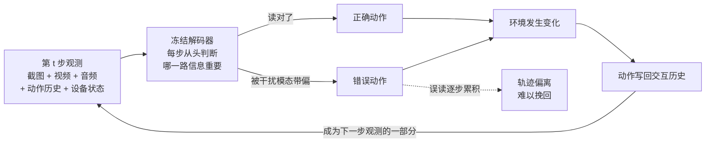
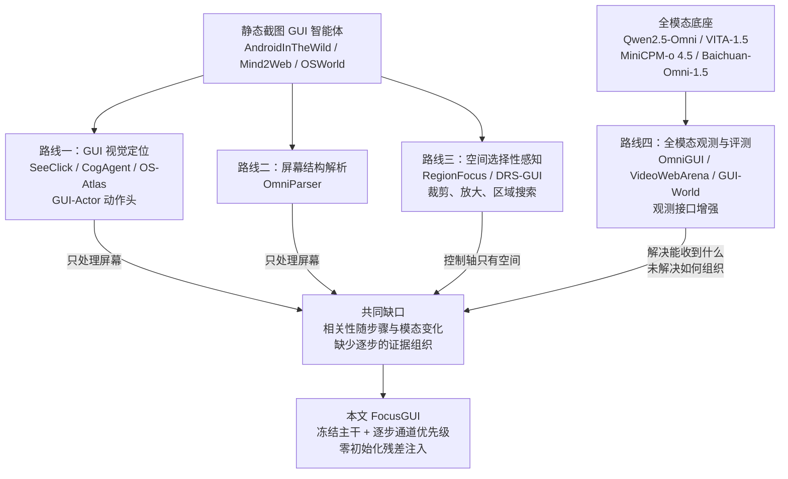
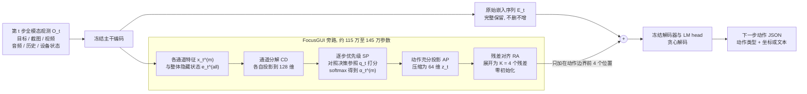
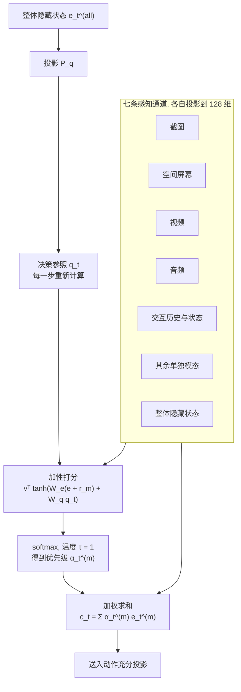
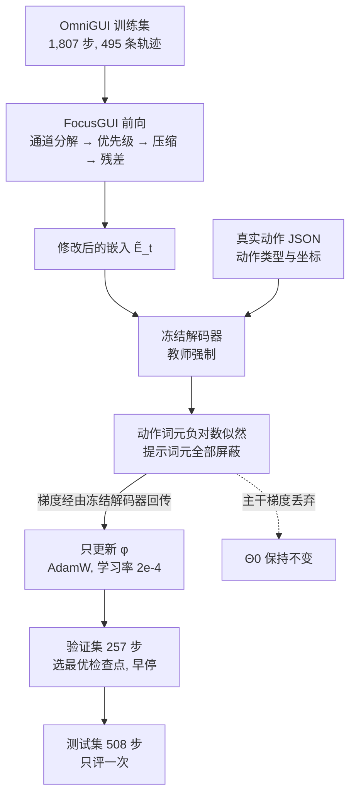
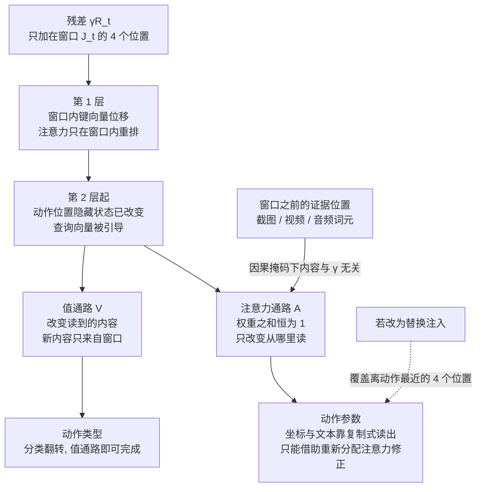
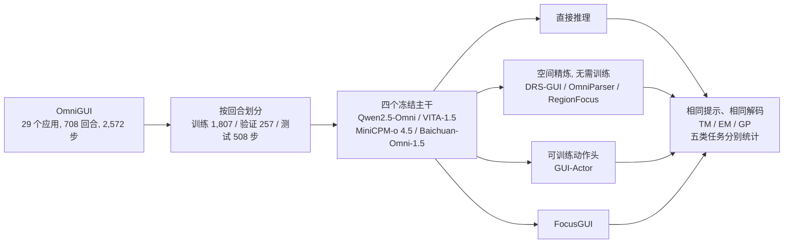

# 聚焦感知的全模态 GUI 智能体（FocusGUI）

> **原题**：Focused Omni-Modal GUI Agents
> **作者**：Fuyao Zhang、Wenwen He、Jiaming Zhang、Yurong Hao、Xuan Wang、Guowei Guan、Che Wang、Longtao Huang、Wei Yang Bryan Lim
> **机构**：南洋理工大学（Nanyang Technological University）、阿里巴巴集团（Alibaba Group）；代码 https://github.com/fyzhang1/FocusGUI ，项目主页 https://fyzhang1.github.io/FocusGUI/
> **年份**：2026（arxiv ID 2610.26203，10 月 19 日提交 v1）
> **分类**：cs.CV
> **链接**：https://arxiv.org/abs/2610.26203
> **精读日期**：2026-10-21

## 阅读须知

### 这篇在领域里的位置

图形用户界面智能体（GUI 智能体）是这两年多模态大模型最受关注的落地方向之一。它要做的事情，是像人一样看着手机或电脑屏幕，根据用户的一句指令，一步一步地点击、滑动、输入文字，直到把任务完成。早期的工作几乎都围绕「当前这一张截图」展开：模型看到截图，判断下一步该做什么动作、该点在哪里。

围绕这条主线，研究者先后在视觉定位、屏幕结构解析、大规模定位数据和长程任务规划上投入了大量精力。代表性的模型有 SeeClick、CogAgent、OS-Atlas 与 GUI-Actor，代表性的评测有 AndroidInTheWild、Mind2Web 与 OSWorld。

最近一年，这个方向的视野出现了一次扩展。真实的手机使用场景里，决定下一步动作的信号并不总在屏幕上：它可能是一声通知提示音，可能是视频播放到的某个画面，也可能是用户口头说出的一句话。于是出现了 VideoWebArena、GUI-World 这类要求理解动态视频内容的评测，以及把屏幕、视频、音频与交互历史交织在一起的 OmniGUI 评测。与此同时，Qwen2.5-Omni、MiniCPM-o 4.5 这类全模态模型已经能够在一个网络里同时接收图像、视频、音频和文字。

这篇论文站在这两条线的交汇处。它既不提出新的模型底座，也不提出新的评测，而是在已有的全模态模型之上加一个约一百多万参数的轻量适配器，回答一个更具体的问题：当模型一次性收到所有模态的观测时，如何让它在每一步都把注意力放在真正决定这一步动作的那部分证据上。

在方法谱系上，它属于「冻结主干、外挂轻量模块」一类的参数高效改造。与此同时，它把自己明确地放在此前一系列在屏幕上做裁剪、放大的「空间聚焦」方法的对立面，主张聚焦应当改变模型读取观测的方式，而不是删减观测本身。

### 读完能回答什么

1. 论文所说的「顺序分心」（Sequential Distraction）指什么，作者用哪些统计证据说明相关性在步与步之间频繁切换、在一步之内又极其稀疏。
2. 为什么裁剪、放大、屏幕解析这类空间精炼方法在全模态多步任务上几乎不提升动作类型的准确率，却明显降低精确匹配；FocusGUI 选择「改变解码器怎么读」而不是「改变给它看什么」的理由何在。
3. FocusGUI 的四个组件（通道分解、逐步优先级、动作充分投影、残差对齐）各自承担什么职责，零初始化残差为什么只加在动作边界之前的四个位置上。
4. 附录的理论分析如何说明：一个只作用于四个位置的残差，能够直接改变动作类型，却只能借助重新分配注意力来修正坐标与文本参数，以及为什么必须用加法注入而不能直接替换。
5. 实验增益中，有多大比例来自「在域内数据上训练了一个小适配器」，又有多大比例来自「逐步聚焦」这一核心主张；哪些数字支撑这个拆分，哪些地方的证据仍然偏薄。

### 阅读前置

本笔记假定读者熟悉 Transformer 的基本结构，包括词嵌入、自注意力、残差连接与 LayerNorm，也了解大语言模型按词元自回归生成、以负对数似然训练的基本方式。读者最好对「冻结大模型、只训练少量新增参数」这类参数高效微调的思路有初步印象，例如 LoRA 或软提示。

笔记不预设读者做过 GUI 智能体，也不预设读者熟悉全模态模型的内部结构。动作类型与动作参数、屏幕定位、加性注意力打分、零初始化残差、教师强制、按回合聚类的自助法置信区间等概念，都会在第一次出现时先交代它要解决什么问题，再展开具体定义。

### 首次出现的缩写表

| 缩写 | 全称与解释 |
| --- | --- |
| GUI | Graphical User Interface，图形用户界面。GUI 智能体指能够看着屏幕、按用户指令执行点击、滑动、输入等操作的模型 |
| FocusGUI | 本文提出的方法，一个挂在冻结全模态主干上的轻量适配器，负责在每一步重新组织多模态证据 |
| 全模态模型 | Omni-modal model，在一个网络里同时接收文本、图像、视频与音频的模型，本文的四个主干都属于这一类 |
| MLLM | Multimodal Large Language Model，多模态大语言模型 |
| OmniGUI | 本文使用的评测基准，在全模态智能手机环境中评测 GUI 智能体，覆盖 29 个应用 |
| TM | Type Match，类型匹配。只看预测的动作类型是否正确，不管参数 |
| EM | Exact Match，精确匹配。要求动作类型正确、坐标落在目标元素的边界框内、输入文本与参考一致 |
| GP | Goal Progress，回合进度。以回合为单位衡量任务被正确推进了多少，再在回合间平均 |
| CD | Channel Decomposition，通道分解。把观测拆成可以分别打分的感知通道 |
| SP | Step-adaptive Prioritization，逐步自适应优先级。每一步重新计算各通道的权重 |
| AP | Action-sufficient Projection，动作充分投影。把加权后的表示压缩到 64 维 |
| RA | Residual Alignment，残差对齐。把聚焦信号以零初始化残差的形式加到解码器输入上 |
| NLL | Negative Log-Likelihood，负对数似然，语言模型的标准训练损失 |
| LM head | Language Model head，语言模型输出层，把隐藏状态映射为词表上的概率分布 |
| LN / pre-LN | LayerNorm，层归一化；pre-LN 指每个子层先做层归一化、再计算注意力或前馈网络的 Transformer 块结构 |
| KV 缓存 | Key-Value cache，自回归生成时缓存已计算位置的键向量与值向量，避免重复计算 |
| LoRA | Low-Rank Adaptation，低秩适配。冻结主干、只训练一对低秩增量矩阵的参数高效微调方法 |
| DRS-GUI | Dynamic Region Search for GUI grounding，动态区域搜索。一种无需训练、在推理时搜索候选区域的定位方法 |
| OmniParser | 微软提出的屏幕解析工具，先把截图解析成带标签的可交互元素列表，再交给通用模型决策 |
| RegionFocus | 出自 Visual Test-time Scaling for GUI Agent Grounding，推理时放大模型关注的区域以提升定位精度 |
| GUI-Actor | 一种在主干视觉词元之上学习动作头、无需逐字生成坐标数字的 GUI 定位方法 |
| Qwen2.5-Omni / Thinker | 阿里通义千问的全模态模型。其中 Thinker 负责理解多模态输入并生成文本，Talker 负责生成语音，本文只用前者 |
| VITA-1.5、MiniCPM-o 4.5、Baichuan-Omni-1.5 | 本文另外三个开源全模态主干，架构与多模态表示方式各不相同 |
| AdamW | 把权重衰减与梯度更新解耦的 Adam 优化器变体，训练 Transformer 时最常用的优化器 |
| JSON | JavaScript Object Notation，本文动作输出所使用的结构化文本格式 |

## 一、问题

设想一个手机助手接到这样一条指令：「视频里一讲到童年的事情，就帮我按暂停。」从第一步到最后一步，屏幕上几乎没有任何变化，播放器的界面始终是同一个样子，真正决定何时动手的信号完全藏在音频里。一个只关注截图的智能体，要么一直等待下去，要么被屏幕上最显眼的按钮吸引而提前点击。

更麻烦的是后果的传递。一旦智能体做出一个错误的动作，这个动作会被写进交互历史，成为下一步观测的一部分，于是后续每一步都在一个已经偏离的上下文里做决定。这正是全模态 GUI 智能体面临的处境，也是这篇论文要处理的问题。

从产品的角度看，手机上的大量真实任务本来就依赖声音与动态画面：等待验证码短信的提示音、在直播中把握某个时刻、按照语音指令操作界面。如果智能体无法在合适的时刻听见、看见关键的信号，它在这些任务上就几乎不可用。从模型的角度看，把截图、视频、音频、历史全部一并交给解码器，看似信息最全，却把「此刻哪一路信息重要」这个判断完全推给了解码器，让它在每一步都从头重新发现一遍。

过去几年，这个方向的主流努力集中在两件事上。一是让模型把屏幕上的元素看得更准，例如用海量定位数据训练专门的 GUI 视觉模型；二是让模型少看一些无关内容，例如把截图裁剪到候选区域、放大细节，或者先把屏幕解析成结构化的元素列表。这两条路线在静态截图任务上都取得了明显的进展。

然而它们的控制对象始终是「屏幕上的哪一块区域」。一旦决定性的信号出现在音频、视频或设备状态里，空间上的裁剪便无从下手；而即便信号就在屏幕上，被裁掉的背景也常常包含确定坐标与输入文本所需的上下文。这篇论文要推进的，正是这两条旧路线共同停滞的地方。

### 1.1 从静态截图到流式全模态观测

先交代 GUI 智能体的基本工作方式。GUI 智能体在每一步接收一份观测，输出一个可执行的动作。动作由两部分组成：一部分是动作类型，例如点击、长按、上滑、输入文字、返回、等待；另一部分是动作参数，例如点击的坐标、滑动的起点与终点、要输入的字符串。

评测时，动作类型对不对与参数对不对通常分开统计。之所以要分开，是因为前者是一个分类判断，只需要理解「这一步该做哪一类事」；后者则需要把指令落到屏幕上的精确位置或精确文本上，两者依赖的信息并不相同。这一区分在后文解释实验结果时会反复用到。

在本文使用的 OmniGUI 设定里，一次观测包含六个部分：用户目标、当前屏幕截图、一段时序视频、一段音频、此前已经执行过的动作历史，以及设备状态。全模态模型把这些内容按固定顺序编码成一长串嵌入向量，交给语言模型解码器，再由解码器逐个词元生成一个 JSON 格式的动作，例如 `{"action_type":0,"coordinate":[421,736]}`。

这里的「全模态」指一个模型同时接收文本、图像、视频与音频，而不是为每种模态各配一个单独的模型。这种做法的默认假设是：只要把完整的观测摆在解码器面前，解码器就能自己判断哪些信息与当前这一步有关。论文的出发点，正是对这一默认假设的质疑。

### 1.2 诊断：相关性一步一变，在一步之内又很稀疏

为了检验上述假设，作者在 Qwen2.5-Omni 上做了一组模态消融分析。具体做法是：在多步任务的每一步，逐一去掉某一种模态的输入，观察模型生成正确动作的对数似然如何变化。如果去掉某个模态后正确动作的似然下降，说明这个模态在这一步有用；如果似然反而上升，说明这个模态在这一步是干扰；似然下降最多的那个模态，被记为这一步的主导模态。

统计结果的第一条结论关于切换。主导模态在 45.3% 的相邻步之间发生了切换，94.0% 的任务回合里至少切换过一次。这说明「哪一路信息最重要」并不是任务的固定属性，而是随着步骤推进不断变化的。

第二条结论关于干扰。90.1% 的步里至少存在一个干扰模态，也就是说，把全部信息一并交给模型，绝大多数时候都会混进有害的成分。

第三条结论关于稀疏。根据标注，目标元素在屏幕上的面积中位数只占 0.87%，一步之内视频内容的变化幅度中位数只有 7.41%。换句话说，即便在单独一步之内，真正支撑决策的证据也只占观测的很小一部分，其余部分很容易成为干扰。

把这三条放在一起，作者得出一个判断：相关性是「这一步」的属性，而不是「这份观测」的静态属性。解码器在每一步都被迫从头重新发现什么重要，却没有任何显式信号告诉它这一步与上一步相比发生了什么变化。

在闭环运行的智能体里，这种误读不会停留在当前这一次预测上。执行出去的动作会改变环境，并作为历史写回下一步的观测，于是一次看错会在后续步骤里不断累积，最终把整条轨迹带向无法挽回的偏离。作者把这种逐步累积的失败模式称为「顺序分心」（Sequential Distraction）。



### 1.3 把问题落到可检验的技术陈述

在上述诊断的基础上，论文把要解决的问题表述为一种表示层面的要求，称为「聚焦感知」（Focused Perception）。它要求智能体在每一步使用的表示同时满足三个性质。

第一个性质是逐步自适应：哪一路证据被强调，应当随着当前步骤重新计算，而不是一组固定的权重。第二个性质是动作充分：这个表示要足以支撑当前这一步动作的选择与参数落地，但不必重建整份观测。

第三个性质是非侵入：它不应删改原始输入，也不应改动主干模型的参数，以免破坏模型原本已经具备的能力。之所以把这一条单独列出，是因为作者认为旧路线的主要问题恰恰出在「删改输入」上，1.5 节会展开这一点。

落到可验证的层面，问题变成：在主干全模态模型参数完全冻结、输入完全不变、训练信号只有「下一步的正确动作」的条件下，能否学到一个轻量模块，使模型在 OmniGUI 评测上的类型匹配、精确匹配和回合进度都显著提升。

除此之外，论文还给出了一条更有区分力的预言：如果方法真正抑制的是累积的干扰，那么它相对主干的优势应当随交互深度的增加而扩大，而不是保持一个固定的差值。这一条是区分「逐步聚焦」与「单纯更强的预测器」的关键，实验部分会专门检验。

### 1.4 前人尝试过的路线

围绕 GUI 智能体的感知问题，前人工作大致可以归为四条路线，它们在不同程度上为本文提供了出发点，也构成了本文的对照对象。

第一条路线是专门的 GUI 视觉定位。它要解决的问题是：通用视觉语言模型虽然能看懂图片，却不擅长把「点击设置按钮」这样的指令精确地落到屏幕坐标上。SeeClick、CogAgent、OS-Atlas 等工作用大规模界面截图与定位标注训练模型，显著提升了定位精度。

GUI-Actor 在这条路线上更进一步，它在主干的视觉词元之上学习一个专门的动作头，直接在视觉词元上选出目标区域，而不是让语言模型逐字生成坐标数字。这条路线做对的地方，是把「看准」这件事做得更扎实；它的不足在于只针对屏幕这一种模态。

第二条路线是屏幕结构解析。OmniParser 是其中的代表，它先用检测与识别模型把截图解析成一组带标签的可交互元素，再把这份结构化列表交给通用模型做决策。这样做降低了通用模型理解界面的难度，代价是解析结果可能遗漏或误标元素，而且它同样只处理屏幕。

第三条路线是空间上的选择性感知，也是本文最直接的对照对象。它的思路是：既然整张截图里大部分区域与当前动作无关，就先缩小视野。RegionFocus 在推理时放大模型关注的区域，以视觉上的测试时扩展换取定位精度；DRS-GUI 在推理时搜索候选区域，逐步收缩到目标；还有一些主动感知方法让模型自己决定何时裁剪、放大或平移视野。

这些方法证明了「抑制无关内容」的价值，但它们的控制轴始终是空间：决定的是屏幕上哪一块值得细看。在全模态交互中，相关性还会沿着信息来源与动作步骤两个维度变化，这是空间控制无法覆盖的。

第四条路线来自全模态一侧。一方面，OmniGUI、VideoWebArena、GUI-World 等评测把视频、音频与交互历史引入了 GUI 任务；另一方面，Li 与 Shi 在 2026 年提出的智能体-计算机观测接口，在观测侧加入门控关键帧、音频转写和持续的视觉叙述，让计算机使用智能体能够处理动态内容。这条路线解决的是「模型能收到什么」，而「收到之后如何为下一步动作组织这些证据」仍然悬而未决。



### 1.5 为什么「做减法」不够

面对「信息太多、相关的太少」这一诊断，最直观的补救是对输入做减法，把无关内容去掉。路线二与路线三本质上都是这样做的。作者认为，这种「少给一些」的策略与流式全模态交互的性质在两个方面不相容。

其一，决定性的信号可能在任何时刻出现在音频、视频或设备状态里，而这些通道完全在空间裁剪的作用范围之外。无论屏幕被处理得多么精细，一个依赖提示音的决定都无法从截图里恢复。

其二，即便信号确实在屏幕上，被裁掉的背景也往往包含确定坐标与文本参数所需的上下文。例如要在一个列表里点击某一项，模型需要看到列表的整体排布，才能把相对位置换算成绝对坐标；裁剪之后，动作类型也许更显眼了，坐标却失去了参照。

于是作者把问题重新表述为：解码器并不是收到了太多信息，而是缺少「此刻该优先看什么」的引导。一个合适的聚焦机制，应当改变解码器读取观测的方式，而不是改变交给它的内容。这一判断直接决定了下一节方法的形态。

## 二、方法

### 2.1 总体思路：输入不动，只改变解码器怎么读

FocusGUI 的设计从一个分工出发。主干模型原本的通路保持完整：完整的多模态观测照常编码、照常进入解码器，任何像素、坐标、转写文本都不丢失。FocusGUI 另开一条旁路，从同一份观测中计算出一个紧凑的「聚焦信号」，再把这个信号以加法的方式叠加到解码器输入的少数几个位置上。

这样一来，原通路负责保留证据，旁路只负责告诉解码器这一步该强调哪些证据。先交代这一节会用到的基本符号，它们都以第 t 步为单位：

- O_t = {g, I_t, V_t, A_t, H_t, S_t} 是这一步的全模态观测，依次为用户目标、当前界面截图、时序视频、音频、交互历史和设备状态。
- y_t = (y_{t,1}, …, y_{t,L_t}) 是要预测的动作，它被表示为一串词元，L_t 是这串词元的长度，其中既包含动作类型，也包含参数。
- F_Θ0 是预训练的全模态主干模型，Θ0 是它的参数，全程冻结。
- E_t 是送入解码器的嵌入序列，形状为 N_t × d_model，其中 N_t 是序列长度，d_model 是解码器的隐藏维度。
- φ 是 FocusGUI 自己的全部可训练参数。

FocusGUI 从观测计算一个紧凑表示 z_t = f_φ(O_t)，再把它映射成残差 R_t = A_φ(z_t)，加到少数几个已有的嵌入位置上。论文的第一个关键式子是：

```text
Ẽ_t = E_t + S_{J_t}( γ · R_t )
p_{Θ0,φ}( y_t | O_t ) = p_{Θ0}( y_t | Ẽ_t )
```

这里 J_t 是被注入残差的位置集合，S_{J_t}(·) 表示把残差放到这些位置上、其余位置补零，γ 是残差的缩放系数，默认取 1。第二行的含义是：解码器本身没有任何变化，它只是在一份被轻微修改过的嵌入序列上照常生成动作。

这种分工带来两个直接的推论。其一，z_t 不需要重建观测，也不需要编码任何执行细节，因为所有细节仍然可以经由原通路读到。其二，z_t 因此可以做得很小，它的职责是调节一次「读取」，而不是携带证据本身。



### 2.2 通道分解：先把证据拆成可比较的几路

要给不同的信息来源排优先级，前提是这些来源能被分别看到。全模态模型的内部表示是融合在一起的，在一个融合表示里无法定义「音频占多少分量」。因此 FocusGUI 的第一步，是把观测重新暴露为若干条可分离的感知通道，记作 X_t = {x_t^(m)}，其中 m 取遍通道集合 M。

这里的通道并不只是原始模态。除了截图、视频、音频、交互历史这些单独模态之外，通道集合还包括两条特殊的通道：一条是主干模型对整份观测的综合隐藏状态，另一条是专门保留屏幕空间结构的空间屏幕通道。论文正文没有逐一列出全部通道的名称，但从实验部分「均匀分配时每条为 14.3%」的说法可以推算，通道总数是七条。

不同来源的原始特征统计性质差异很大，例如音频特征与图像特征的尺度、分布都不一样。为此，每条通道配一个专属的投影器 P_m，把它映射到一个共享的 d 维空间：

- e_t^(m) = P_m(x_t^(m))，维度 d = 128。

专属投影器的作用有两层：一是尊重各个来源各自的原生统计，二是让投影之后的表示彼此可比，为下一步打分做准备。消融实验里，这一步被称为通道分解（CD）。

### 2.3 逐步自适应优先级：用整体语境给每一路打分

一条通道有没有用，不仅取决于它包含什么内容，还取决于当前的任务状态。例如同一段音频，在等待提示音的那一步至关重要；到了提示音已经响起、需要点击按钮的下一步，它就成了干扰。因此打分需要一个参照物，它要能代表「此刻整体在发生什么」。

FocusGUI 用整份观测的综合表示 e_t^(all) 构造这个参照，称为决策参照：q_t = P_q(e_t^(all))。它概括了当前观测的整体语义语境，各条通道的证据都在这个语境下接受评估。

打分采用的是一种经典的加性注意力。加性注意力最早出现在神经机器翻译中，它要解决的问题是：如何用一个可学习的小网络，衡量一个查询向量与一组候选向量之间的匹配程度。它的做法是把查询与候选各自做线性变换后相加，经过 tanh 非线性，再与一个可学习向量做内积，得到一个标量分数。FocusGUI 的打分、归一化与加权如下：

```text
s_t^(m) = vᵀ · tanh( W_e · (e_t^(m) + r_m) + W_q · q_t )
α_t^(m) = exp( s_t^(m) / τ ) / Σ_j exp( s_t^(j) / τ )
c_t     = Σ_m α_t^(m) · e_t^(m)
```

逐个交代其中的符号：

- r_m 是第 m 条通道的身份嵌入，可学习，用来让打分网络知道当前评估的是哪一路来源。
- W_e、W_q 是两个线性变换矩阵，v 是一个可学习向量，三者共同构成打分网络。
- τ 是 softmax 温度，默认取 1.0。温度越低，权重越集中于得分最高的通道。
- α_t^(m) 是第 m 条通道在第 t 步的优先级，所有通道的优先级之和为 1。
- c_t 是按优先级加权之后的融合表示，仍处在 128 维的共享空间中。

这一设计有一个值得注意的性质：式子里没有任何跨步的状态。通道表示与决策参照每一步都重新计算，于是各路信息的相对权重可以随任务推进而改变。作者的论证是：既然偏离是一步一步产生的，那么在每一步都消除当下的干扰，便能消除它的累积。

作者也特意提醒，α_t^(m) 描述的是 FocusGUI 在自己的旁路里如何组织证据，不能当作冻结主干内部如何使用各个模态的完整解释。这一点在解读后文的优先级可视化时需要记住。消融实验里，这一步被称为逐步自适应优先级（SP）。



### 2.4 动作充分投影：把聚焦信号压到 64 维

加权后的 c_t 决定了各路证据在旁路中的贡献，但它仍然处在完整的 128 维共享空间里。FocusGUI 接下来用一个投影 P_s 把它压缩到更低的维度：

- z_t = P_s(c_t)，维度 d_z = 64，且 d_z 小于 d。

这一步压缩的对象是旁路调节信号的容量，而不是主干能够接触到的信息量。由于完整观测仍然经由原通路可达，z_t 不必独立编码每一个视觉细节、坐标或文本参数，它只需要提供一个紧凑的摘要，说明这一步应当更加强调什么。论文称之为「动作充分」：信息量足以引导当前动作，但不多于此。

消融实验里，这一步被称为动作充分投影（AP）。后文的容量实验会显示，d_z 取 32 时信号太小，精确匹配下降近 7 个点；从 64 往上则基本稳定。这与「z_t 只承担调节职责」的设计意图一致。

### 2.5 残差对齐：零初始化，只加在动作边界之前

最后一步，是把 z_t 转换成冻结解码器能够直接使用的形式。为此需要先定义动作边界。动作边界 b_t 是解码器开始生成动作词元的那个位置，也就是提示词最后一个词元之后的位置。在它之前的 K 个位置构成注入窗口：

- J_t = {b_t − K, …, b_t − 1}，默认 K = 4。

FocusGUI 用一个线性层把 z_t 展开为 K 个与解码器隐藏维度一致的向量，加到这 K 个位置原有的嵌入上：

```text
R_t = Reshape( W_p · z_t + b_p )      形状为 K × d_model
Ẽ_{t,J_t} = E_{t,J_t} + γ · R_t
```

这一步有三处设计各有用意。第一处是位置。残差紧贴在动作生成之前注入，于是在自回归生成时，后续每一个动作词元都能经由注意力读到这个聚焦信号，既不需要额外的预测头，也不需要改动输出词表。坐标仍然以文本数字的形式，由原本冻结的 LM head 逐字生成，并归一化到 0 到 1000 的范围。

第二处是加法。残差叠加在原有嵌入之上，原始的嵌入内容被保留下来，聚焦表示只作为一个附加的调节信号存在。注入位置本身就是提示词里已有的位置，FocusGUI 既不追加文字提示，也不删去任何多模态输入。

第三处是零初始化。W_p 与 b_p 初始化为零，于是训练开始时 R_t 恰好为零，Ẽ_t 与原始 E_t 完全相同，模型的行为与冻结主干一模一样。训练只是在这个起点附近，逐渐学到依赖观测的偏移。

这种做法与 ControlNet 的零卷积、LoRA 中把一个低秩矩阵初始化为零的思路相同，目的都是保证新增模块在训练初期不会破坏预训练模型已有的能力。消融实验里，这一步被称为残差对齐（RA）。

### 2.6 训练：只用下一步动作作监督

FocusGUI 不需要任何「这一步哪个模态重要」的标注。全部可训练参数 φ，包括各通道投影器、决策参照投影、打分网络、压缩投影和残差映射，都只依靠下一步的正确动作联合学习。

训练目标是动作词元上的平均负对数似然。负对数似然是语言模型最常用的训练损失，它衡量模型给正确词元分配的概率有多高，概率越高，损失越小。论文的损失写作：

```text
L_act(φ) = − (1 / |D_tr|) · Σ_t (1 / L_t) · Σ_k log p_{Θ0,φ}( y_{t,k} | y_{t,<k}, O_t )
```

其中 D_tr 是训练集中的全部交互步。求和先在每一步的动作词元上取平均，再在所有步上取平均。损失只计算在动作词元上，系统提示与用户提示的词元全部被屏蔽。

训练采用教师强制。教师强制是训练自回归模型的标准做法，它要解决的问题是：如果训练时让模型基于自己生成的前缀继续生成，早期的错误会让后续的训练信号变得混乱。于是训练时一律把真实答案的前缀 y_{t,<k} 提供给模型，让它预测下一个词元。

梯度的流向值得单独说明。损失对 φ 的梯度需要经由冻结的解码器回传，因此解码器在反向传播中参与计算，但它的参数不接受任何更新。也就是说，一个动作生成目标同时教会了旁路三件事：强调哪些证据，如何把它们概括成 z_t，以及如何把这个概括表达成解码器原生嵌入空间里能够被理解的残差。



推理时，FocusGUI 用当前观测构造各条通道、在当前语境下打分、生成 z_t 与残差；冻结解码器随后沿着原本的生成通路，以贪心解码逐词元产出下一步的动作。执行之后，这个动作写入交互历史，进入下一步的观测。

### 2.7 理论分析：一个只作用于四个位置的残差，如何影响整份观测的读取

读到这里，一个自然的疑问是：残差只加在提示词末尾的四个位置上，而决定坐标的证据分布在截图词元、视频词元等较远的位置，这个小小的残差凭什么能够纠正坐标？论文附录 G 给出了一个机制层面的分析，回答了这个问题，也解释了为什么注入必须使用加法。

分析的对象是由 L 层 pre-LN Transformer 块组成的冻结解码器。所谓 pre-LN，是指每个子层先对输入做层归一化，再计算注意力或前馈网络，结果再加回残差流。作者考察残差缩放系数 γ 的变化如何经由各层传到动作位置的输出，并把动作位置注意力输出的变化拆成两条通路。

第一条是值通路（V）。注意力的输出是各位置「值向量」的加权和。如果某些位置的隐藏状态被残差改变了，它们的值向量也随之改变，动作位置读到的内容便发生变化。由于残差只直接作用于注入窗口，内容上的变化只能从被改动的那些位置进入。

第二条是注意力通路（A）。残差同样会改变注意力权重本身。这条通路有一个重要的性质：注意力权重之和恒为 1，所以它不增加任何新内容，只是把动作位置的「读取份额」在已有的上下文之间重新分配。换句话说，值通路改变的是「从某处读到什么」，注意力通路改变的是「从哪里读」。

在此基础上，作者给出一个按层递进的命题。在第一层，动作位置本身尚未受到残差影响，只有注入窗口内各位置的键向量发生了位移，注意力的重新分配局限在窗口之内。从第二层开始，第一层的注意力已经把变化写进了动作位置的隐藏状态，动作位置的查询向量因此被引导，注意力的重新分配扩展到整份观测的每一个未被遮挡的位置。

与此同时，在因果掩码下可以用归纳法证明：位于注入窗口之前的所有位置，在每一层的隐藏状态都与 γ 完全无关。也就是说，截图、视频、音频这些证据位置的内容丝毫未变，改变的只是它们被读取的方式。另外，由于残差的变化方向受 W_p 的列空间约束，旁路对冻结计算的全部影响都局限在一个至多 d_z 维的控制空间之内。

这一分析对动作生成有两条直接推论。动作类型是一个分类选择，要把它从 b 翻转为 a，只需要动作位置的隐藏状态在两个类别输出向量之差的方向上获得足够的分量，值通路就能直接提供。动作参数，也就是坐标与输入文本，则是从证据位置以「复制式读出」的方式产生的；既然证据位置的内容不变，修正参数便只能依靠注意力通路，把读取份额挪到正确的证据上。

由此也解释了加法注入的必要性。如果把加法换成替换，即直接用 R 取代窗口内原有的嵌入，查询引导仍然存在，可窗口内的这四个位置恰好是离动作最近、通常也最受关注的上下文位置，它们原有的证据价值会被一个至多 64 维的信号覆盖掉。消融实验里「替换」比「加法」在精确匹配上低 5.3 个点，正是这一推论的经验对应。



### 2.8 实现细节

全部超参数在四个主干上保持一致，没有针对单个主干或单个评测做搜索。共享通道维度 d 为 128，动作充分维度 d_z 为 64，注入窗口 K 为 4，残差缩放 γ 与 softmax 温度 τ 均为 1.0，dropout 为 0.05。

训练使用 AdamW 优化器，学习率 2×10⁻⁴，权重衰减 10⁻³，最多训练 3 个 epoch，早停耐心为 2，梯度裁剪阈值为 1.0。推理一律采用贪心解码，束宽为 1。

在 Qwen2.5-Omni 上，FocusGUI 的可训练参数为 144.5 万，而冻结的 Thinker 部分有 89.32 亿参数，可训练参数占比仅为 0.0162%。四个主干各自训练一个独立的适配器，参数量在 115 万到 145 万之间，彼此不共享。全部实验在两张 NVIDIA L20 显卡上完成。

## 三、实验

### 3.1 实验设置

评测数据来自 OmniGUI，这是一个在全模态智能手机环境中评测 GUI 智能体的基准，覆盖 29 个应用。本文使用其中 708 个回合、共 2,572 个动作步。每一步把一张截图与同步的音频、视频和动作历史配对，因此决定性的信号可能来自四路中的任意一路。

任务分为五类：定位（Localization）、语义（Semantic）、跨模态（Cross-modal）、时序（Temporal）与即时响应（Instant）。数据按回合划分为互不重叠的训练、验证与测试集，分别包含 1,807、257 与 508 步，来自 495、71 与 142 条轨迹。所有特征变换与归一化统计只在训练集上拟合，验证集只用于选择检查点，测试集在模型选定之后只评估一次。

动作空间沿用 OmniGUI 的十三种原语：三种带一个坐标的指点动作（点击、双击、长按），四种带起点与终点坐标的滑动，一种带字符串的输入，四种不带参数的导航与终止动作（返回、回到主页、任务完成、任务无法完成），以及一个表示「这一步应当观察等待而不行动」的 NONE。坐标统一归一化到 0 到 1000。

评测指标有三个。类型匹配（TM）只检查预测的动作类型是否与标注一致，不管参数；精确匹配（EM）在类型正确的基础上，进一步要求坐标落在目标元素的边界框之内、输入的文本与参考文本一致。

回合进度（GP）以回合为单位，论文给出的定义是每个回合中被正确执行的部分所占的比例，再在所有回合上取平均。从数值上看，GP 远低于 EM（例如 FocusGUI 在 Qwen2.5-Omni 上 EM 为 40.16，GP 只有 17.49），说明它更接近于「从第一步开始连续做对了多少」，一步出错便截断后续进度。作者在解读时说「回合进度受制于轨迹中最弱的那一步」，与这一理解相符。

参与比较的主干是四个开源全模态模型：Qwen2.5-Omni、VITA-1.5、MiniCPM-o 4.5 与 Baichuan-Omni-1.5。它们都支持文本、视觉、听觉与时序输入，但架构与多模态表示方式各不相同，用来检验 FocusGUI 是否对不同的模型家族都适用。所有主干的参数全程冻结。

基线有四个，同样作用于全部四个主干，且不修改主干权重。DRS-GUI、OmniParser 与 RegionFocus 属于推理时的空间精炼方法，分别在候选区域上做搜索、把截图解析成结构化元素、放大模型关注的区域。GUI-Actor 则不同，它在主干视觉词元之上学习一个动作头，使用与 FocusGUI 相同的标注与数据划分训练，主干同样冻结。

把 GUI-Actor 纳入比较的用意，是拆分两种解释。如果 FocusGUI 的增益仅仅来自「在这份数据上多训练了一些参数」，那么同样带可训练参数的 GUI-Actor 应当也能拿到相近的提升；如果增益来自逐步组织证据，那么只有 FocusGUI 会表现出明显的优势。



### 3.2 主结果

先看最有代表性的 Qwen2.5-Omni。五种配置在全部任务上的总体结果如下。

| 方法（Qwen2.5-Omni，主干冻结） | 类型匹配 TM | 精确匹配 EM | 回合进度 GP |
| --- | --- | --- | --- |
| 直接推理 | 49.61 | 12.60 | 5.50 |
| + DRS-GUI（区域搜索） | 49.41 | 6.69 | 2.97 |
| + OmniParser（屏幕解析） | 48.43 | 7.68 | 3.87 |
| + RegionFocus（区域放大） | 48.23 | 7.68 | 4.07 |
| + GUI-Actor（可训练动作头） | 50.20 | 13.78 | 5.54 |
| + FocusGUI | **71.65** | **40.16** | **17.49** |

再看四个主干上直接推理、可训练基线 GUI-Actor 与 FocusGUI 的对照。

| 主干 | 直接推理 TM / EM / GP | + GUI-Actor TM / EM / GP | + FocusGUI TM / EM / GP |
| --- | --- | --- | --- |
| Qwen2.5-Omni | 49.61 / 12.60 / 5.50 | 50.20 / 13.78 / 5.54 | 71.65 / 40.16 / 17.49 |
| VITA-1.5 | 13.98 / 9.65 / 6.09 | 14.57 / 11.02 / 5.39 | 58.66 / 26.38 / 6.84 |
| MiniCPM-o 4.5 | 36.02 / 13.58 / 7.55 | 36.61 / 14.17 / 7.64 | 67.72 / 41.54 / 16.76 |
| Baichuan-Omni-1.5 | 24.41 / 8.86 / 4.32 | 31.10 / 11.02 / 5.35 | 58.86 / 25.98 / 8.73 |
| 四个主干平均 | 31.0 / 11.2 / 5.9 | 33.1 / 12.5 / 6.0 | 64.2 / 33.5 / 12.5 |

按四个主干平均，FocusGUI 相对直接推理提升了 33.2 个 TM 点、22.3 个 EM 点和 6.6 个 GP 点；精确匹配从 11.2% 升到 33.5%，即摘要中所说的三倍。相对每个主干上最强的基线，平均提升分别为 30.1、23.6 与 8.0 个点。

在四个主干、六个统计口径（总体加五个类别）构成的 24 个格子里，FocusGUI 的 TM 与 EM 全部是最高。GUI-Actor 虽然同样经过训练，却几乎没有带来提升，这是作者用来论证「增益不只是来自可训练参数」的第一条证据。

GP 的情况则没有这样整齐，这一点论文没有着重讨论，笔记按论文表 1 逐格核对后单独指出。在 VITA-1.5 的定位与即时响应两类、以及 Baichuan-Omni-1.5 的跨模态与即时响应两类中，FocusGUI 的 GP 低于冻结主干直接推理；VITA-1.5 的总体 GP 也只从 6.09 升到 6.84，与 TM 提升 44.7 个点的幅度相比几乎可以忽略。

这意味着「逐步聚焦带来轨迹稳定」的叙述，主要在 Qwen2.5-Omni 与 MiniCPM-o 4.5 这两个较强的主干上得到了清楚的体现。在较弱的主干上，FocusGUI 显著改善了单步的动作类型，却没有相应地转化为回合层面的推进。

### 3.3 空间精炼为什么反而有害

三个空间精炼基线的表现呈现出一个很有诊断意义的模式。它们对 TM 几乎没有影响，平均只变化正 0.9 个点；但在 EM 上相对降低了 28%，在 GP 上相对降低了 35%，而且在 12 个「主干与方法」的组合里，每一个组合在这两个指标上都是下降的。

作者的解释与 1.5 节的论证一致。把截图收窄之后，动作类型变得更加醒目，这正是 TM 所奖励的；可周围用于确定坐标与文本的上下文被丢掉了，而 EM 恰恰需要这些上下文。

再加上三种方法都无法触及音频、视频或设备状态，依赖这些通道的决定，无论屏幕处理得多么精细都无法恢复。一旦相关性是「步」的属性而不是「区域」的属性，精炼区域便无法把它找回来，付出的代价反而可能大于收益。

### 3.4 增益集中在哪里

按任务类别看，TM 的提升从时序类的 37.3 个点到即时响应类的 27.8 个点不等，EM 的提升遵循同样的排序。时序类任务的决定性信号跨越多帧持续存在，单张截图最难胜任；即时响应类任务的决定则是反应式的，信号大多就在当前屏幕上。增益的大小顺序，恰好与「单张截图的不足程度」相对应。

跨主干看，四个主干之间的总体 TM 差距从 35.6 个点收窄到 13.0 个点。换句话说，在证据组织得更好之后，「选对动作类型」这件事对主干的依赖大幅降低。EM 的跨主干差异则依然明显，作者认为这反映的是各主干自身生成参数的能力差异，属于旁路无法替代的部分。

### 3.5 消融：四个组件各自贡献什么

消融实验在 Qwen2.5-Omni 上进行，依次去掉四个组件中的一个，结果如下。表中「去掉通道分解」意味着只使用主干的整体隐藏状态这一条通道，此时逐步优先级也随之失去打分的对象。

| 配置 | CD | SP | AP | RA | TM | EM | GP |
| --- | --- | --- | --- | --- | --- | --- | --- |
| 冻结主干 | ✗ | ✗ | ✗ | ✗ | 49.61 | 12.60 | 5.50 |
| 只有压缩与残差（单一整体通道） | ✗ | ✗ | ✓ | ✓ | 66.26 | 35.00 | 12.20 |
| 有通道分解、无优先级（等权平均） | ✓ | ✗ | ✓ | ✓ | 67.38 | 37.78 | 11.56 |
| 去掉动作充分投影 | ✓ | ✓ | ✗ | ✓ | 71.14 | 38.75 | 16.11 |
| 残差改为替换注入 | ✓ | ✓ | ✓ | ✗ | 70.45 | 34.86 | 12.11 |
| 完整 FocusGUI | ✓ | ✓ | ✓ | ✓ | 71.65 | 40.16 | 17.49 |

去掉动作充分投影、残差对齐、逐步优先级和通道分解时，总体 TM 分别下降 0.51、1.20、4.27 与 5.39 个点；GP 则分别下降 1.38、5.38、5.93 与 5.29 个点。

需要注意的是，GP 的基数只有 TM 的约四分之一。按相对幅度计算，每个组件对 GP 的价值是对 TM 的四到五倍：对 TM 的影响最多为 7.5%，对 GP 的影响最高可达 33.9%。作者据此认为，这些组件的主要作用是防止轨迹逐步瓦解，这与顺序分心的预言一致。

有两个细节值得单独说明。其一，只做通道分解、不做优先级（各通道等权平均）时，TM 与 EM 比单一整体通道分别高 1.12 与 2.78 个点，GP 却略低。这说明光有更丰富的通道还不够，需要优先级来决定这一步信任哪一路，才能把更多的通道转化为回合层面的稳定。

其二，把加法残差换成替换注入，TM 只变化 1.20 个点，EM 却下降 5.30 个点，GP 下降 5.38 个点。这正对应 2.7 节的理论推论：替换主要损害的是参数落地，因为它覆盖了离动作最近、最受关注的四个位置上的原有证据。

### 3.6 随交互深度的变化：差距越拉越大

这是全文最关键的一组实验，因为它直接检验顺序分心的预言。论证的逻辑是这样的：如果干扰会逐步累积，那么一个能够抑制干扰的方法，应当随着轨迹变长与主干拉开越来越大的差距；而一个只是「整体更强」的预测器，与主干之间应当保持一个大致恒定的差值。

作者把每个测试步按它在回合中的序号分箱，第四步及以后合并为一箱，并给出按回合聚类的自助法置信区间。自助法是一种用反复有放回抽样来估计统计量不确定性的方法；之所以要「按回合聚类」，是因为同一回合里的各步彼此相关，若把它们当作独立样本抽取，会低估区间的宽度。

| Qwen2.5-Omni 上的深度对比 | 第一步 | 第四步及以后 |
| --- | --- | --- |
| 冻结主干 TM | 64.79 | 32.79（只剩一半） |
| FocusGUI TM 保持率 | 100% | 86.8% |
| FocusGUI EM | 38.73 | 46.72 |
| EM 差距（FocusGUI 减主干） | +22.54 | +35.25 |

冻结主干的 TM 从第一步的 64.79 跌到第四步及以后的 32.79，只剩下初始准确率的一半。FocusGUI 在同一区间保持了 86.8%，而且它的 EM 不降反升，从 38.73 升到 46.72。于是 EM 上的差距随深度单调扩大，从正 22.54 个点增加到正 35.25 个点，所有区间都不包含零。

时序类任务上的对比最为悬殊：冻结主干在第三步之后的 EM 为 0.00，FocusGUI 则达到 39.39。这说明表 1 中回合进度的提升并不是沿轨迹均匀分布的，而主要来自那些冻结主干早已出错的后续步骤。

即时响应类任务充当了一个负对照。这类任务在最初两步几乎没有积累的历史，此时 FocusGUI 与主干在统计上无法区分，TM 差值分别为负 8.70 与负 17.39 个点，90% 置信区间都包含零。到了第三步，以及第四步及以后，交互历史开始积累，FocusGUI 分别领先 28.57 与 46.67 个点。

作者认为，这种依赖深度的分离正是一个针对累积机制的方法应有的表现。为了排除「不同深度的样本来自不同回合」造成的偏差，作者还把分析限制在至少有四步的回合上，使每个深度箱里的回合集合保持一致，差距扩大的趋势依然存在。

附录在另外三个主干上重复了这一分析。VITA-1.5、MiniCPM-o 4.5 与 Baichuan-Omni-1.5 的冻结版本都随深度下降，对应的 FocusGUI 版本都基本保持，EM 曲线在冻结曲线下降的深度上持平或上升。作者据此认为，这种衰减是该交互形态本身的属性，而不是某一个模型特有的问题。

### 3.7 学到的通道优先级：随交互阶段重新排序

作者把测试步按交互阶段分组，统计每条通道的平均优先级。七条通道均匀分配时，每条应为 14.3%。

在开局一步，交互状态通道获得了 30.9% 的优先级，超过均匀份额的两倍，是最受重视的通道；到了收尾阶段，它降到 7.7%，变成最不受重视的通道。音频与视频的走向恰好相反，分别从 13.4% 与 11.3% 上升到 18.8% 与 18.3%。

没有任何一组固定权重能同时复现这两端的分布，只有随决策变化而重新加权的表示才能做到，这正是聚焦感知所要求的逐步自适应。论文还用一个案例追踪了单个回合内的同一种转移：指令要求在听到引擎声之后再点击，屏幕在每一步看起来都一样，FocusGUI 把优先级转向音频，等声音出现后才点击，而冻结主干被视觉上的显眼元素吸引，提前动手且再也无法挽回。

更耐人寻味的是屏幕的位置。截图通道在每个阶段都在 10.9% 到 12.8% 之间，始终低于均匀份额；空间屏幕通道从未超过 9.1%。而前人的空间精炼方法恰恰着力于这两条通道，后期获得更高优先级的音频与视频，正是它们触及不到的流式通道。

需要再次强调，这些优先级完全没有监督，是仅从动作标注中自行学出的；与此同时，按作者自己的提醒，它们描述的是旁路的证据组织方式，并不等于主干内部的模态使用方式。

### 3.8 容量敏感性与参数对齐的对照

| 配置（Qwen2.5-Omni） | 总体 TM | 总体 EM | 总体 GP | 时序类 GP |
| --- | --- | --- | --- | --- |
| K = 1，d_z = 64 | 72.83 | 39.76 | 15.13 | 17.66 |
| K = 4，d_z = 64（默认） | 71.65 | 40.16 | 17.49 | 26.35 |
| K = 8，d_z = 64 | 70.28 | 37.80 | 15.72 | 16.04 |
| K = 16，d_z = 64 | 71.65 | 39.76 | 18.09 | 25.10 |
| K = 4，d_z = 32 | 70.47 | 33.27 | 10.95 | 12.45 |
| K = 4，d_z = 128 | 72.83 | 37.99 | 15.05 | 15.73 |
| K = 4，d_z = 256 | 71.23 | 38.19 | 18.28 | 15.83 |

注入窗口 K 在十六倍的范围内变化，总体 TM、EM、GP 的波动分别只有 2.6、2.4 与 3.0 个点，且没有任何趋势。这与 K 在设计中的角色相符：R_t 是 z_t 的确定性函数，加宽窗口只是把同一个压缩表示铺到更多位置上，并不会让更多的观测信息进入旁路。

真正决定容量的是 d_z。d_z 为 32 时，压缩表示太小，不足以承载动作所需的信息，EM 比默认值低 6.9 个点，GP 低 6.5 个点；从 64 往上，结果基本稳定。作者强调默认配置在所有主干上固定不变，从未针对单个基准调参。

为了排除「增益只是因为多了参数」的解释，附录还做了一组参数对齐的对照。对照组把各条通道按固定布局拼接起来，取代按决策参照逐步打分，参数量调到与 FocusGUI 只差 79 个。拼接保留了每条通道各自的槽位，下游投影可以学到一组固定的、与步骤无关的权重，因此它比等权平均更强，是一个更严格的静态基线，两者之间唯一的差别就是逐步打分。

| 配置（Qwen2.5-Omni） | 参数量 | TM | EM | GP |
| --- | --- | --- | --- | --- |
| 参数对齐的固定拼接 | 1,444,913 | 71.85 | 33.46 | 10.14 |
| 逐步动态优先级 | 1,444,992 | 72.83 | 37.01 | 13.58 |
| 差值 | +79 | +0.98 | +3.54 | +3.44 |

逐步优先级在三个指标上都更好，且增益集中在 EM 与 GP 上，TM 的变化较小。作者认为这说明增益出现在机制本应发挥作用的地方，即可执行的参数落地，而不是动作类型的选择，并且无法用潜变量的容量来解释。

附录还统计了逐样本的配对纠错情况。在全部五类任务中，FocusGUI 纠正主干错误的次数都多于把主干原本做对的步做错的次数，总计纠正 153 次、退步 13 次，净改进最大的是时序类任务。

### 3.9 几个反直觉的结果

第一个反直觉之处，是「看得更少」反而更差。直觉上，把截图裁剪到候选区域应当减少干扰、提升准确率；实际结果却是三种空间精炼方法在 12 个组合里全部降低了 EM 与 GP。原因在于 TM 与 EM 依赖的信息不同：动作类型受益于醒目，参数落地却依赖被裁掉的上下文。

第二个反直觉之处，是 FocusGUI 的 EM 随深度上升。通常的预期是后面的步骤更难，所有方法都会下降；而 FocusGUI 在 Qwen2.5-Omni 上从第一步的 38.73 升到第四步及以后的 46.72。一种可能的解释是，积累起来的交互历史对于一个能够正确筛选证据的模型是有用的信息，对于一个不会筛选的模型则是噪声，同一份历史在两者手里的作用方向相反。论文没有直接给出这一解释，这是笔记的推测。

第三个反直觉之处，是屏幕在一个 GUI 任务里从来不是最受重视的通道。截图在所有阶段的优先级都低于均匀份额，这与「GUI 智能体以截图为中心」的传统设定形成鲜明的对比。不过，考虑到 OmniGUI 的任务本身就是为了强调非屏幕信号而设计的，这个结论能否推广到以屏幕为主的常规任务，还需要另作检验。

第四个反直觉之处，是只拆分通道、不做优先级时，GP 反而比完全不拆分略低。更多的通道在缺少取舍机制时，似乎会给回合层面的稳定性带来额外的扰动，这从反面说明了优先级这一步的必要性。

## 四、局限

### 4.1 作者承认的局限

作者在结论与附录 B 中承认的局限比较克制，主要有三条。

第一条，当前的通道优先级只依据当前这一步的观测计算，不会预判哪些证据在后续步骤中会变得重要。作者认为，把这一机制扩展为能够预判通道相关性的形式，或许可以在交互序列更早的阶段缓解轨迹偏离，这是自然的后续方向。

第二条，实验只覆盖四个全模态主干与五类交互任务。把聚焦感知推广到更广泛的计算机使用场景，例如桌面与网页环境，留待后续工作。

第三条，作者在方法部分明确提醒，学到的优先级 α 只描述 FocusGUI 在旁路中组织证据的方式，不能当作冻结主干内部如何使用各模态的完整解释。此外，作者把 FocusGUI 定位为与感知、定位、规划方面的进展互补的轻量机制，它本身并不处理任务规划。

### 4.2 读者能看出来的潜在问题

第一，增益的大部分来自「训练了一个以观测为条件的小适配器」，而不是「逐步聚焦」本身。消融表里，只有压缩与残差、只用单一整体通道的配置，已经把 Qwen2.5-Omni 从 49.61 / 12.60 / 5.50 提升到 66.26 / 35.00 / 12.20，约占完整方法 TM 增益的 76%、EM 增益的 81%、GP 增益的 56%。

这个配置本质上是一个依赖观测的软提示：从主干的整体隐藏状态出发，压缩之后加到提示末尾。通道分解与逐步优先级在此之上再加约 5 个点。论文的核心叙述是聚焦，但数据显示，最大的一块收益来自在 1,807 个域内训练步上做了参数高效的适配。

第二，与基线的比较并不完全对等，缺少关键的参照。三个空间精炼基线都不经过训练，而 FocusGUI 在同一份数据上训练过；冻结主干在零样本条件下对 OmniGUI 的动作格式与动作分布并不熟悉，VITA-1.5 只有 13.98 的 TM，很可能部分源于输出格式的不匹配。

GUI-Actor 虽然也经过训练，但它的动作头作用于视觉词元上的定位，本来就不负责动作类型的选择，因此它的 TM 与主干几乎相同并不令人意外。真正有说服力的对照应当包括：用同样的数据对主干做 LoRA 微调，以及一个不依赖观测、参数量相同的静态软提示或前缀微调。附录的参数对齐拼接对照部分回应了这一点，但它仍然是 FocusGUI 自身架构内部的一个变体。

第三，评测是否真正闭环没有交代清楚。顺序分心的核心机制是「智能体自己的错误动作写回历史，污染后续观测」。然而 OmniGUI 上的逐步 TM 与 EM 通常是离线计算的，如果每一步的动作历史使用的是标注中的真实动作，那么模型自己的错误根本不会进入后续观测，深度上的衰减便更可能来自历史变长、上下文变杂，而不是自身错误的累积。

论文的正文与附录都没有明确说明评测时的历史来自标注还是模型预测，案例图中「它自己的动作写回了后续每一步的上下文」的说法，也无法确认是否只是示意。这一点直接关系到核心论点的证据强度：深度实验能够证明「越往后越需要筛选」，却未必能证明「错误在自我累积」。

第四，样本量偏小，且没有多次运行的方差。测试集只有 508 步、142 个回合，按类别拆开后每类只有 82 到 124 步；在定位类上，一步之差就是 1.22 个点。主结果表没有报告多随机种子的标准差。

更值得注意的是，附录参数对齐表中「逐步动态优先级」一行（72.83 / 37.01 / 13.58）与主表中完整 FocusGUI 的结果（71.65 / 40.16 / 17.49）并不一致。两者的参数量相同、按描述应是同一配置的另一次训练，EM 与 GP 的差异却分别达到 3.15 与 3.91 个点，已经与多数消融的差值处于同一量级。容量表中时序类 GP 在 16 到 26 之间非单调地跳动，也提示类别层面的数字噪声较大。

第五，GP 的提升在主干之间很不均匀。VITA-1.5 的 TM 提升 44.7 个点，GP 只提升 0.75 个点；在 VITA-1.5 与 Baichuan-Omni-1.5 的共四个类别格子里，FocusGUI 的 GP 甚至低于冻结主干。「逐步聚焦防止轨迹瓦解」这一论断，在较弱的主干上缺乏回合层面的支撑。

第六，泛化范围有限。全部实验只在一个基准、一个平台（安卓手机）上进行；数据划分只保证回合不重叠，没有说明应用是否重叠，测试集中的应用很可能在训练集中出现过。FocusGUI 在未见过的应用、其他全模态 GUI 基准，或者桌面与网页环境上是否同样有效，目前没有证据。每个主干都要单独训练一个适配器，更换主干就需要重新训练。

第七，推理开销没有报告。决策参照依赖主干对整份观测的综合隐藏状态，这可能需要在注入残差之前先做一次前向计算。按照理论分析中的因果掩码性质，注入窗口之前各位置的 KV 缓存不受残差影响，可以复用，额外开销理论上只涉及窗口内的四个位置；但论文没有给出延迟或显存的实测数据。对于需要实时响应提示音与视频画面的流式场景，这一点并非无关紧要。

第八，通道的定义不够透明。正文只说通道集合包括整体隐藏状态、空间屏幕通道和各个单独模态，并没有逐一列出七条通道的名称与各自的特征来源；OmniGUI 的样本描述中也只提到截图、音频、视频与动作历史，设备状态通道的实际内容并不清楚。这给复现带来了一定的不确定性，所幸作者已经公开了代码仓库，可以在那里核对。

## 一句话

FocusGUI 在冻结全模态模型的动作边界前注入零初始化残差，逐步重排各模态权重，缓解多步 GUI 操作中的顺序分心。
