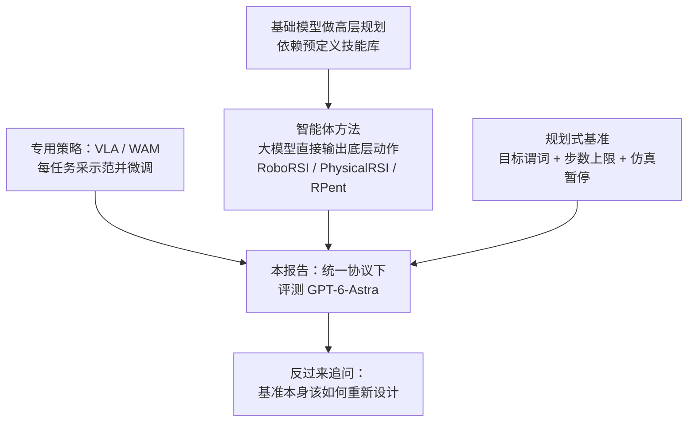
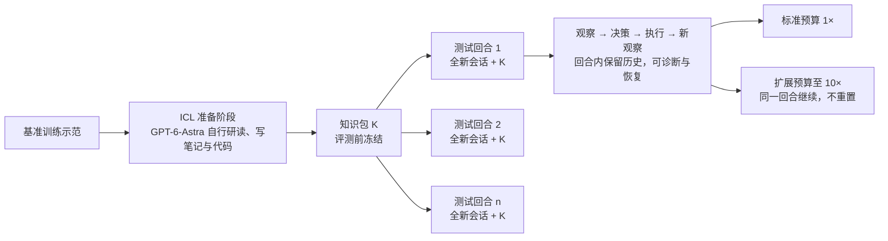
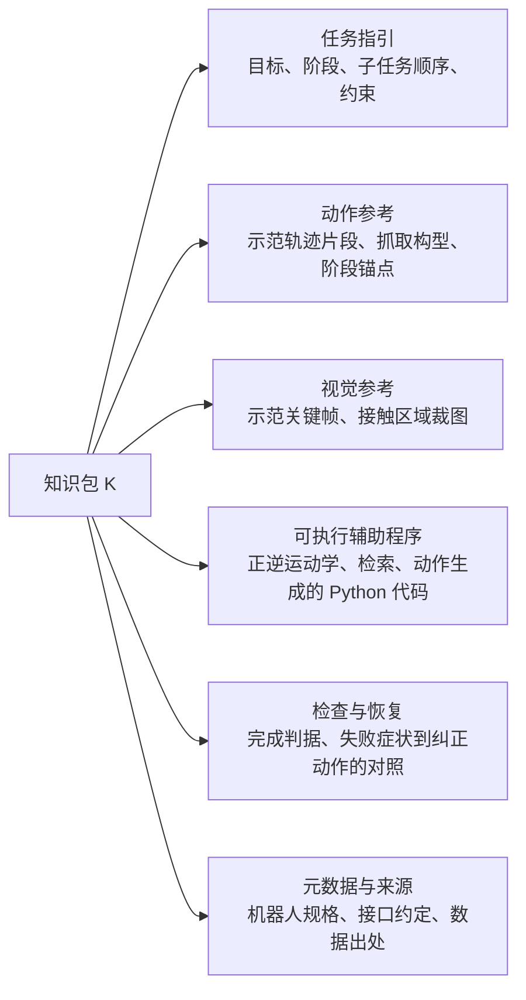
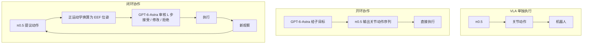
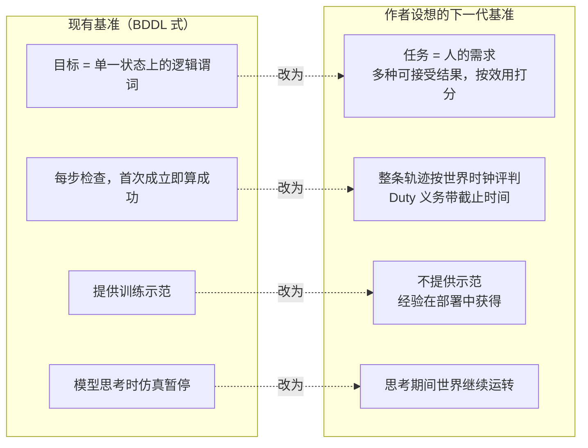
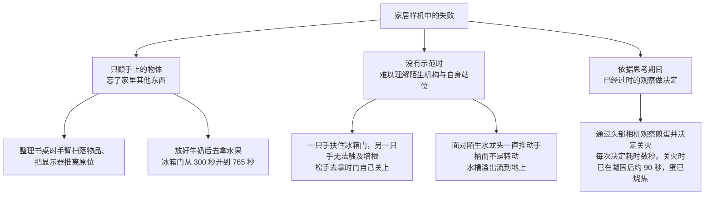

# GPT-6-Astra 已经具备具身智能了吗？

> **原题**：Has GPT-6-Astra Achieved Embodied Intelligence?
> **作者**：SenseNova 联合研究团队（Joint Research Team，共 61 位署名作者）。项目负责人为 Zhongang Cai、Zhonghua Wu、Qingyi Tao；顾问组包括 Lei Yang、Chen Change Loy、Lewei Lu、Ziwei Liu、Dahua Lin、Atsushi Yamashita、Xingang Pan、Dacheng Tao、Xiaogang Wang
> **机构**：论文未逐一列出机构，项目主页挂在 sensenova.ai（https://sensenova.ai/has-gpt-6-astra-achieved-embodied-intelligence）
> **年份**：2026（arxiv ID 2610.22471，10 月 15 日提交 v1）
> **分类**：cs.RO
> **链接**：https://arxiv.org/abs/2610.22471
> **精读日期**：2026-10-19

## 阅读须知

### 这篇在领域里的位置

具身智能（embodied intelligence）研究的是让一个模型通过机器人身体去感知、行动并改变物理世界。过去几年，这个领域的主流做法是为每一类任务、每一种机器人单独训练专用模型：先请操作员遥操作机器人收集成百上千条示范轨迹，再用模仿学习把这些轨迹拟合成一个策略。视觉-语言-动作模型（VLA）把这条路线推到了相当高的水平，它们在大规模机器人数据上预训练，再针对具体任务微调，推理速度快，在训练分布内表现稳定。

2026 年秋天，前沿多模态大模型 GPT-6-Astra 在机器人操作与导航任务上表现出的能力，开始动摇「每个任务都要专门训练一个模型」这一前提。于是短短几周内出现了一批专门评测它的报告。本笔记在 10 月 1 日精读过其中一篇，即银河通用（Galbot）团队的《系统探究 GPT-6 Astra 作为具身策略的能力》（arxiv 2609.38537），那篇在六类仿真任务上测量它直接当策略用的表现。今天这一篇来自 SenseNova 联合研究团队，覆盖面更广：十二个仿真基准、一组控制框架消融、八种真实机器人配置，最后还给出了一套重新设计具身基准的方案。

换句话说，这篇不是提出新模型或新算法的论文，而是一份兼具评测与立场性质的技术报告。它的核心问题有两层：GPT-6-Astra 在具身任务上究竟能做到什么程度，以及这样的能力对整个研究社区意味着什么。

### 读完能回答什么

1. 作者的统一评测协议放宽了哪两个条件，上下文学习与十倍步数预算分别贡献了多少提升，为什么后者在仿真里有效、到了真机上却难以兑现。
2. GPT-6-Astra 在上下文学习准备阶段自己整理出的「知识包」由哪几部分组成，测试时它又是如何使用这些材料的。
3. 让 GPT-6-Astra 当慢速的「System 2」、让 π0.5 当快速的「System 1」时，闭环审核为什么明显好于开环下发，代价是多少 token。
4. 为什么直接输出关节角的控制方式不如末端位姿，自适应动作分块为什么能同时提高成功率并降低调用开销。
5. 作者提出的下一代具身基准遵循哪三条原则，在家居样机里 GPT-6-Astra 又暴露了哪三类典型失败。

### 阅读前置

本笔记假定读者熟悉大语言模型的基本用法，知道什么是智能体（agent）通过工具调用与环境交互，也大致了解模仿学习「从示范轨迹学策略」的思路。笔记不预设读者做过机器人：末端执行器、正逆运动学、全身控制器等概念都会在第一次出现时先铺垫再展开。

### 首次出现的缩写表

| 缩写 | 全称与解释 |
| --- | --- |
| VLA | Vision-Language-Action model，视觉-语言-动作模型。输入图像与语言指令，直接输出机器人动作，通常靠大量示范数据训练 |
| WAM | World Action Model，世界动作模型。一类同时预测未来场景变化与机器人动作的模型，与 VLA 同属专用路线 |
| ICL | In-Context Learning，上下文学习。不更新模型权重，只把示范或笔记放进上下文让模型参考 |
| SR | Success Rate，成功率 |
| SOTA | State of the Art，当前已发表的最好结果 |
| EEF | End-Effector，末端执行器，即机械臂最末端的夹爪或手。EEF 位姿指它在三维空间里的位置与朝向 |
| FK / IK | Forward / Inverse Kinematics，正运动学与逆运动学。前者由关节角算出末端位姿，后者反过来由目标位姿求关节角 |
| DoF | Degrees of Freedom，自由度 |
| π0.5 | Physical Intelligence 公司发布的一个通用 VLA 模型，本文在 RoboDojo 上微调后用作 System 1 |
| System 2 / 1 / 0 | 借用「慢思考 / 快直觉」的说法：System 2 是慢速推理的大模型，System 1 是高频输出动作的学习策略（如 VLA），System 0 是更底层的运动控制器（如人形机器人的平衡与行走控制） |
| WBC | Whole-Body Control，全身控制器，负责把上层目标转成人形机器人各关节的协调动作 |
| AMO | Adaptive Motion Optimization，一种人形机器人全身控制方法，本文在 SIMPLE 基准里用作 System 0 |
| VLN-CE | Vision-and-Language Navigation in Continuous Environments，连续环境中的视觉-语言导航 |
| R2R / RxR | Room-to-Room 与 Room-across-Room，两套经典的语言导航数据集 |
| LHPR-VLN | Long-Horizon Planning and Reasoning VLN，长程多阶段导航基准 |
| BDDL / PDDL | BEHAVIOR Domain Definition Language 与 Planning Domain Definition Language，用逻辑谓词描述任务初始状态与目标状态的规划语言 |

## 一、问题

把一个机器人从实验室带进真实场景，最昂贵的环节往往不是硬件，而是数据。传统的专用路线要求每换一个任务、每换一台机器人，都重新采集示范、重新训练或微调策略。于是机器人公司的成本结构被示范采集牢牢绑住，模型在训练分布之外的泛化也一直是短板：换一个摆放、换一种物体，成功率就可能大幅下滑。

与此同时，通用大模型的推理能力在过去两年快速增长。如果一个不针对机器人训练的通用模型，可以零样本或只看少量材料就完成操作与导航，那么具身智能的研发方式就要重新考虑：数据该花在哪里，专用模型还剩什么位置，基准又应当测什么。GPT-6-Astra 的出现让这个「如果」第一次有了认真检验的价值。

然而检验本身并不简单。现有具身基准大多为模仿学习策略设计，它们提供训练示范、规定步数上限、在模型思考时暂停仿真。用这些基准去测一个通用智能体，测出的数字到底代表什么，需要先把协议想清楚。这也是这篇报告存在的理由。

### 前人路线

第一条路线是专用策略。VLA 类模型（如 π0.5、OpenVLA-OFT、LiLo-VLA）在大规模机器人数据上预训练，再在具体基准的训练集上微调。它们做对的地方是推理快、动作平滑，适合高频控制；不够用的地方在于每个新任务都需要示范，并且长程、多阶段的任务往往一路积累误差。

第二条路线是让基础模型做高层规划。大模型负责把指令拆成子任务，再从预定义的技能库里挑选「抓取」「放置」之类的原语去执行。这条路线的瓶颈在技能库本身：技能没写到的事情，大模型想得再清楚也做不出来。

第三条路线是近一年兴起的智能体方法。前沿大模型通过工具接口直接读取图像与机器人状态，逐步输出末端位姿等底层动作，并在执行反馈中纠错。RoboRSI、PhysicalRSI、RPent 都属于此类，银河通用那篇报告也是在这条路线上做的评测。它的优势是零样本泛化与失败恢复，劣势是慢、贵、难以做稠密的实时控制。

第四条线索是基准本身。LIBERO、BEHAVIOR、RoboDojo 等基准沿用经典规划的思路：用逻辑谓词描述目标状态，每一步检查目标是否成立，规定固定的步数上限。这些设计对模仿学习策略是合理的，但对一个能读示范、能反复尝试的通用智能体，它们可能高估或低估真实能力。

### 落到可验证的问题

把上面的动机落到技术层面，这篇报告想回答四个具体问题。第一，在模型权重保持冻结的前提下，如果允许它读取训练示范、允许它多走若干步，它在十二个代表性基准上的上限是多少，剩下的失败集中在哪里。第二，把大模型的推理转成机器人动作的那一层「控制框架」（作者称为 harness）应当如何设计，才能在成功率与 token 开销之间取得平衡。

第三，仿真里的结论到了真实机器人上还剩多少，哪些条件在物理世界里不再成立。第四，既然现有基准越来越接近饱和，下一代基准应当改变什么，而不仅仅是把任务做得更难。

## 二、方法

这一节讲的「方法」，指的是作者为了回答上述四个问题而设计的评测协议、控制框架与基准样机。它们本身就是这篇报告最值得借鉴的部分。

### 2.1 统一协议：两条放宽

作者在十二个基准上采用同一套协议，模型权重始终不变。这套协议有两条刻意的放宽。

第一条放宽是允许上下文学习。专用策略在训练时本来就能看到基准提供的示范，如果评测 GPT-6-Astra 时不给它这些示范，两者所处的信息条件就不一致。于是作者在测试前为每个任务单独安排一个准备阶段：GPT-6-Astra 自行翻阅训练示范，写下任务笔记与可复用代码，整理成一个知识包，记作 K。知识包在评测开始前冻结，此后每一个测试回合都拿到同一份 K，回合之间不传递任何信息。

第二条放宽是延长交互预算。作者观察到，GPT-6-Astra 经常能识别出某个动作失败了，并换一种策略重来，但官方的步数上限会在恢复成功之前把回合截断。因此他们同时报告两种预算：标准预算（1×）即基准规定的步数，扩展预算（10×）允许多走到十倍的步数。扩展是在同一个回合内继续，不重置环境，此前造成的后果全部保留；回合在验证成功、触发终止性失败或用完预算时结束。

有一个细节值得留意。论文主表里的「1×」列与「10×」列来自两次独立运行，并且运行时模型被告知了自己的预算。作者另外报告了「10× 那次运行在 1× 步数处的截断成绩」，这样读者可以分辨：提升究竟来自多出来的步数，还是来自模型知道预算更宽裕之后的不同行为。

### 2.2 知识包里装了什么

作者没有规定知识包的格式，GPT-6-Astra 自己决定看哪些示范、保留哪些帧和哪些数值。有意思的是，尽管格式完全放开，十二个基准上的知识包却反复出现同样的六类内容。

不同基准的知识包侧重点不同。灵巧手基准 Bench2Dex 与 DexJoCo 侧重手部构型和按阶段索引的动作样例；LIBERO-Long++ 把示范拆成可组合的原子技能；人形基准 SIMPLE 则保留了完整的数值轨迹，外加从中截取并修改动作片段的辅助代码。

事后分析显示，测试时的工作流相当一致：先读任务指引，再调用辅助程序检索一段候选动作，最后对照视觉参考检查执行结果。与此同时，它并不是机械地回放示范。在 Bench2Dex 的「装球入盒」任务里，它重新映射了参考关节角，并补偿了大约 4 到 5 厘米的工作台高度差；在 DexJoCo 的「拿相片」任务里，物体滑落后它换用了另一条参考抓取路线。

### 2.3 控制框架之一：System 2 与 System 1 如何协作

大模型思考一次需要数秒乃至数十秒，而机械臂的控制频率通常在每秒十几次以上。于是一个自然的想法是分层：让 GPT-6-Astra 当慢速的 System 2 负责判断，让一个快速的学习策略当 System 1 负责出动作。作者用在 RoboDojo 上微调过的 π0.5 作为 System 1，比较了三种协作方式。

第一种是 VLA 单独执行，完全没有大模型参与。第二种是开环协作：GPT-6-Astra 只给出子目标，VLA 直接输出关节动作序列并执行，中间不再审核。第三种是闭环协作：VLA 先提出动作，系统用正运动学把关节动作换算成末端位姿，再交给 GPT-6-Astra 逐一决定接受、修改还是拒绝，通过后才真正执行。闭环模式下还有一个参数 L，表示每次调用大模型时一并审核几步 VLA 提议的动作。

### 2.4 控制框架之二：动作怎么表示、一次给几步

第二组消融固定为大模型直接控制，不引入 VLA，基线沿用 RoboRSI 的框架：GPT-6-Astra 看 RGB 图像与机器人状态，每次决策输出一个绝对坐标下的末端位姿目标。作者在此基础上换掉两个维度。

一个维度是动作表示。除了绝对末端位姿，作者还测试了「方向性运动指令」，即只说往哪个方向移动多远；以及直接输出各关节角。另一个维度是动作分块，也就是每次决策输出几步动作：固定一步、固定四步，或者让模型自己在一到四步之间选择。分块越大，调用大模型的次数越少，但每一步的反馈也越稀疏。

### 2.5 真机变体：零样本、人写上下文、按墙钟计时

仿真协议依赖两个在真机上不成立的假设：测试任务恰好有成功示范，以及多走几步不需要付出代价。于是作者为真机设计了一个变体，改动有三处。

第一，真机上没有示范，GPT-6-Astra 以零样本方式工作，不接受任何针对任务或机器人的训练。第二，知识包由人写的结构化上下文代替，内容是部署机器人时本来就能拿到的信息，例如工具接口说明、关节限位、相机位置、安全约束，个别平台还提供可选的抓取点。任何平台都不提供「抓取」「放置」「插入」这类高层技能。

第三，预算从步数改为墙钟时间，通常是每次试验 60 分钟。之所以这样设计，是因为在真实硬件上，耗时同时决定 token 开销、安全风险、硬件损耗与人工看护成本。全程有操作员手握急停开关，是否成功由人根据物理结果判断，而不是采信模型自己的完成声明。

### 2.6 下一代基准：三条原则与一个家居样机

报告最后一部分转向基准设计。作者的判断是：现有基准测出的分数，有相当一部分取决于基准「送」给模型的条件，即示范、免费的额外步数与暂停的时钟。仅仅把任务加难无法改变这一点，因此需要改变的是基准的设计方式。

第一条原则是任务源于人的需求。任务要用人自然会说的话表达，例如「能给我做个早饭吗」，评判依据是结果对人的效用，而不是某个固定的目标状态。这样的需求还隐含着没有人明说的义务，例如冰箱开了要关、灶台空着要熄火、水龙头开着要拧上。作者把明说的请求称为 Intent，把隐含的义务称为 Duty，两者放在同一次部署里一起评判。

第二条原则是经验在测试时获得。基准不提供任何领域内的训练回合或场景示范，智能体必须在陌生的房子与陌生的身体里，依靠自己的探索弄明白房间布局，并通过尝试掌握物体的用法。评判用的谓词定义在只有裁判知道的物理量上，例如「熟了」等于核心温度达到 70 摄氏度，智能体看不到这些定义。

第三条原则是世界不会等你。模型思考期间，仿真继续按上一条指令运行，就像真实机器人在等待下一条命令时一样。于是思考时间本身成为成绩的一部分：一位十五分钟后要出门的住户，十分钟端上来的鸡蛋吐司，比一小时后的全套早餐更有价值。

论文用一个早餐任务把新旧两种写法并排对比。左边是 BEHAVIOR-1K 里的 cook_bacon 任务，目标只要求所有培根「已煮熟」且冰箱关着；由于「煮熟」只看温度是否曾超过阈值，烤焦的培根同样算熟，灶台也不要求关火。右边是作者设想的写法：吐司得 0.5 分、鸡蛋加吐司得 0.8 分、再加咖啡得 1.0 分，十五分钟内送达得满额，超过三十分钟归零，中间线性递减；同时规定冰箱打开后一分钟内必须关上、空灶两分钟内必须熄火、地上有水五分钟内必须擦干。

为了落地这些原则，作者在 NVIDIA Isaac Sim 里搭了一套一居室公寓。家具由编码智能体按真实尺寸摆放并经人工审核，所有部件都绑定了物理属性，包括铰接、接触、流体、布料，以及从灶头到锅再到食物的热传导。测试时 GPT-6-Astra 控制一台 AgiBot G2 机器人，只能通过机载相机与本体感知观察世界，同样不给示范。

## 三、实验

### 3.1 十二个基准的总成绩

十二个评测设置分属五类：桌面机械臂、灵巧手、人形机器人的移动操作、长程家务，以及视觉-语言导航。下表摘自论文表 2，「已发表最好」与「已发表最好智能体方法」均为标准预算下的公开结果。

| 基准 | 类别 | 已发表最好（方法） | 最好智能体方法 | Astra 1× | Astra 10× | 10× 运行在 1× 处截断 |
| --- | --- | --- | --- | --- | --- | --- |
| LIBERO-Long++ | 桌面机械臂 | 82.0（LiLo-VLA） | – | 97.5 | 100.0 | 97.5 |
| LIBERO-PRO | 桌面机械臂 | 50.0（π_RLinf） | 92.6（RPent / GPT-6 Astra） | 98.3 | 99.3 | 98.3 |
| LIBERO-Ultra-Long | 桌面机械臂 | 44.0（LiLo-VLA） | – | 82.2 | 98.9 | 82.2 |
| RoboDojo | 桌面机械臂 | 29.6（Awomo-0.5） | 31.4（PhysicalRSI） | 54.2（含 VLA） | 81.9 | 27.6 |
| RoboLab（零样本） | 桌面机械臂 | 42.9（FLUX 3 Action） | – | 57.1 | 69.2 | 57.1 |
| SIMPLE | 人形 | 92.5（Psi-0） | – | 96.3 | 98.8 | 97.5 |
| BEHAVIOR | 移动平台 | 14.8（Rondo） | 5.3（Agent） | 37.0 | 未扩展 | 未扩展 |
| DexJoCo | 灵巧手 | 40.3（π0.5） | – | 78.2 | 87.3 | 78.2 |
| Bench2Dex | 灵巧手 | 25.5（π0.5） | – | 25.6 | 61.5 | 25.6 |
| VLN-CE RxR | 导航 | 76.5（Qwen-RobotNav） | – | 82.0 | 90.0 | 84.0 |
| VLN-CE R2R | 导航 | 77.4（Robostral Navigate） | 81.3（GPT-6-Astra ultra） | 80.0 | 88.0 | 85.0 |
| LHPR-VLN | 导航 | 2.4（FantasyVLN） | 5.3（Claude Code Opus-5） | 21.1 | 28.9 | 25.4 |

单位均为成功率百分比。

先看标准预算。即使只用官方规定的步数，GPT-6-Astra 加上下文学习在多数设置上已经追平或超过已发表的最好结果。差距最大的是 LIBERO-Ultra-Long 与 DexJoCo：前者从 44.0 提到 82.2，后者从 40.3 提到 78.2，几乎都翻了一倍。BEHAVIOR 从 14.8 提到 37.0，同样是成倍的提升。

与此同时，也有几处并不领先。Bench2Dex 上 25.6 对 25.5，基本打平；VLN-CE R2R 上 80.0 略低于另一个基于 GPT-6-Astra 的智能体方法的 81.3。RoboDojo 那一格的 54.2 带有星号，表示那次运行接入了 VLA；若只看纯直接控制的 10× 运行在 1× 处的截断成绩，则是 27.6，略低于已发表最好智能体方法的 31.4。

再看扩展预算。多给步数之后，提升最大的是需要反复纠正的任务：RoboDojo 从 27.6 升到 81.9，约为三倍，作者统计 1× 时没做完的回合里约有四分之三最终完成，其中精度类任务组收益最大；Bench2Dex 从 25.6 升到 61.5，翻了一倍多。与之相对地，长程导航 LHPR-VLN 只从 25.4 升到 28.9，依然是所有设置中最低的。这说明对于要跨越许多阶段追踪子目标的任务，单纯多给步数解决不了问题。

### 3.2 上下文学习本身贡献多少

为了把上下文学习的作用单独分离出来，作者在人形基准 SIMPLE 的四个共同任务上对比了零样本与上下文学习两种条件，全部在标准预算下进行。

| 指标 | 零样本 | 上下文学习 | Psi-0（参考） |
| --- | --- | --- | --- |
| 成功率（120 个回合） | 85/120（70.8%） | 109/120（90.8%） | 108/120（90.0%） |
| 平均动作步数（81 个两边都成功的回合） | 376.9 | 210.4 | – |
| 单回合平均 token（百万） | 2.64 | 6.40 | – |
| 单回合平均墙钟时间（分钟） | 47.0 | 31.4 | – |
| 每个任务一次性准备成本 | – | 8.34 百万 token，90.4 分钟 | – |

上下文学习把成功率从 70.8% 提到 90.8%，略高于专门训练的 Psi-0。上下文学习的收益高度依赖训练数据对测试任务的覆盖程度：在 LIBERO 系列、SIMPLE 与 VLN-CE 这些测试任务紧贴训练分布的基准上，知识包几乎可以直接检索并改编示范里的动作或路线，成功率因而接近饱和。

与之相对地，RoboLab 没有训练集，无法构建任务级知识包，成功率只有中等水平。RoboDojo 的 Open 组没有本组示范，只能用从其他四组学来的知识包，结果在所有组里成功率最低。

### 3.3 时间与金钱

强表现的代价很高，而且即使在几乎已经解决的基准上也是如此。LIBERO-Long++ 在标准预算下成功率已超过 97%，但每个回合仍然要消耗约一百万 token、接近一小时的推理与工具调用时间；LIBERO-Ultra-Long 上则升到约九百万 token、接近两小时。

扩展预算让成本进一步上升，而且新增的开销主要花在那些最终仍然失败的困难回合上。在 RoboDojo 上，扩展预算下单个回合平均耗时超过三小时。作者给出的换算口径是：由于约 98% 的 token 是缓存命中的输入，一百万 token 大约折合 1 美元。换句话说，跑完一个 LIBERO-Ultra-Long 回合大约要花 9 美元。

还有一组对比更直观。RoboDojo 的标准预算换算成机械臂实际运动的时长只有 8 到 76 秒，而 GPT-6-Astra 平均要花 55 分钟计算。之所以这个比例在仿真里看不出问题，是因为仿真器在模型思考时是暂停的。

### 3.4 控制框架消融

两组消融都在 RoboDojo 上进行，成功率为各任务类别得分的不加权平均，token 为单回合消耗，单位百万。

| 设置 | 成功率（%） | Token（百万） |
| --- | --- | --- |
| 基线：GPT-6-Astra 直接控制，绝对 EEF 位姿，每次一步 | 15.56 | 2.560 |
| π0.5 单独执行 | 6.91 | – |
| A.1 加 VLA，开环 | 5.83 | 0.387 |
| A.2 加 VLA，闭环（每次审核 1 步） | 23.61 | 7.664 |
| A.3 加 VLA，闭环（每次审核 4 步） | 25.83 | 2.796 |
| A.4 加上下文学习 | 29.67 | 9.567 |
| A.5 上下文学习加 VLA 闭环 | 54.17 | 19.335 |
| B.1 方向性运动指令 | 18.06 | 1.908 |
| B.2 关节角控制 | 9.72 | 1.120 |
| B.3 固定分块（每次 4 步） | 11.39 | 0.435 |
| B.4 自适应分块（每次 1 到 4 步） | 20.00 | 1.146 |

协作方式一组的结论比较清楚。闭环比开环高出 17.8 个百分点，审核步长加到 4 之后差距扩大到 20 个百分点，原因在于大模型在执行前能拦下不合理的动作；代价是逐步审核要消耗 766 万 token，是基线的三倍。把每次审核的步数从 1 增加到 4，token 下降了 63.5%，成功率反而从 23.61% 小幅升到 25.83%。上下文学习与闭环协作叠加后达到全组最高的 54.17%，但 token 也涨到 1,934 万，约为不带上下文学习的最佳闭环配置的 6.9 倍。

动作表示一组揭示的是作者所说的「表示鸿沟」。直接输出关节角时成功率掉了 5.84 个百分点，而语义上更接近人类描述方式的方向性指令反而提升了 2.5 个百分点。作者的解释是，多模态大模型的推理擅长「往左移三厘米」这类语义层面的判断，并不擅长在七维关节空间里精确计算。因此控制框架应当暴露与模型推理方式对齐的动作空间，把精确执行交给底层控制器。

### 3.5 几个反直觉的结果

第一个反直觉的结果是开环协作比 VLA 单独执行还差，5.83% 对 6.91%。一般会以为多一个聪明的规划者总有帮助，但如果规划者只给子目标、不审核执行，它的子目标可能与 VLA 在训练中见过的指令分布不一致，反而干扰了 VLA。

第二个是更大的审核步长同时带来更高的成功率与更低的开销。按直觉，审核越密越可靠，可数据显示每次审核四步比逐步审核成功率更高、token 更少。一种可能的解释是，连续几步动作放在一起看，大模型更容易判断整体意图是否合理，而逐步审核时它看到的只是局部抖动。

第三个是自适应分块同样兼顾了成功率与开销。B.4 的成功率比基线高 4.44 个百分点，token 却不到基线的一半。与之相对地，固定四步分块虽然最省，成功率却下降。这说明关键不在于一次给几步，而在于让模型判断什么时候可以放心多走几步、什么时候需要停下来看。

第四个是上下文学习让单回合 token 增加到原来的约 2.4 倍，墙钟时间却缩短了三分之一。原因在于读知识包会增加输入 token，但有了参考之后动作步数从 377 步降到 210 步，多余的动作减少，总耗时随之下降。

### 3.6 真实机器人

作者在八种平台、五类构型上部署了 GPT-6-Astra，全部零样本，不使用任何示范。

| 平台 | 构型 | 主要任务与结果（成功次数 / 试验次数） |
| --- | --- | --- |
| Franka 3 | 单臂夹爪 | 积木堆叠 6/6，叠布 2/4，插头插入 0/3 |
| Franka Panda | 单臂夹爪 | 胶带卷堆叠 3/3，叠毛巾 2/2，叠布 1/2，插头插入 0/5 |
| AgileX PiPER + Pika 夹爪 | 单臂夹爪 | 容器嵌套 3/3，叠布 3/3，插头插入 0/3 |
| AgileX Piper 双臂 | 双臂夹爪 | 12 项任务共 14/14（含叠 T 恤、插花、双臂托牛奶盒等） |
| Tianji M6S + Wuji 灵巧手 | 双臂灵巧手 | 人写抓取脚本：玩具 3/3，瓶子 1/3（经人工反馈后成功）；模型自写抓取代码 0/3 |
| Galaxea R1 Pro | 轮式移动操作 | 找洗衣机并按键 2/2，6 项桌面任务 9/9，采花入篮 0/2（均因躯干过热中断） |
| AgileX Tracer + xArm7 | 轮式移动操作 | 导航与搜索 9/23（五项任务） |
| Unitree G1 + Wuji 灵巧手 | 人形 | 拾取并放下玩具 2/3，转身、靠近并停下 3/3 |

第一个发现是：同一个模型无需针对平台训练，就能驱动从单臂到人形的全部八种平台，但成功与否主要取决于任务性质。刚性物体的抓放相当可靠，合计 17/18，与仿真结论一致；可变形物体、精密接触与长程移动任务则明显更难，三个平台上的插头插入合计 0/11，导航与搜索只有 9/23。

第二个发现关于主动视觉。在插花任务里，夹爪从上方竖直夹住花茎，跟随夹爪移动的腕部相机因此看不到下方的瓶口。在单臂 Franka 3 上，这是唯一的近景视角，GPT-6-Astra 始终看不到瓶口，最后把花掉在了瓶子旁边。到了双臂 Piper 上，持花那只手的视角同样受限，但 GPT-6-Astra 主动把空闲的另一只手移过去，让它的腕部相机对准瓶口，然后完成了插入。

作者指出，这种行为在遥操作示范里几乎不存在。操作员通常从自己的视角看场景，而不是透过机器人的相机看，所以示范里很少出现「为了看清而移动相机」的动作，从示范学来的策略也就无从模仿。一个只能透过机器人相机感知世界的零样本智能体，必须自己发现这件事。

第三个发现是慢速的 System 2 可以直接驾驭现成的 System 0。在 Unitree G1 人形机器人上，GPT-6-Astra 不经过任何任务训练的 System 1，直接下发手臂关节目标、手部开合，以及厂商速度接口的转向与行走指令。这证明了可行性，但作者强调，这是在缓慢、依赖反馈的监督下完成的，算不上可靠的实时视觉运动控制。

### 3.7 真机上不再成立的两件事

仿真里的高分建立在两个前提上，而这两个前提到了真机上都受到约束。第一个前提是额外步数不需要付出代价。真实世界里有三重限制：安全保护会在接触力超限时触发停机，例如 PiPER 的三次插头试验中有两次以关节碰撞故障告终，GPT-6-Astra 无法从这类硬件级故障中恢复；机械极限会在反复尝试中暴露，例如 Wuji 灵巧手的指关节在负载下卡住，唯一的保护是模型给自己设的温度阈值，手指升到 62 摄氏度时尝试被中断。

第三重限制是实时性。仿真在模型思考时暂停，真机不会。在 G1 上，GPT-6-Astra 约 90% 的时间都在思考，一次操作试验超过一小时。因此仿真里「多走几步换更高成功率」的交易，在真实硬件上并不能随意兑现。

第二个前提是有现成的成功示范。真实部署的新任务往往没有示范，人写的上下文足以应付相当一部分任务，但它本质上仍是专家做的提示工程，质量直接决定结果。Tianji 灵巧手就是最直接的例子：没有预定义的抓取原语时 0/3，有人写的抓取原语时 3/3。作者也展示了另一种可能：在 Galaxea R1 Pro 上，GPT-6-Astra 在一次不运动的熟悉阶段里，读厂商文档、探测传感器与控制器，自己写出了机器人档案，之后每次任务都从这份档案出发。

### 3.8 家居样机里的三类失败

作者在公寓样机里运行了若干零样本任务，给出五个代表性失败，归为三类。这部分是定性的，回合数量很少。

第一类失败是只顾眼前一步。GPT-6-Astra 似乎只在其他东西挡住下一步时，才把它们纳入考虑，包括它自己的手臂与它改变过的状态。值得注意的是，如果只检查最终状态，这两个失败都看不出来：回合结束时冰箱门是关着的，书最后放在哪里也说明不了书桌上其他东西的情况。这正是作者主张按整条轨迹评判义务的原因。

第二类失败是没有示范时难以理解陌生机构的运作方式，也难以规划自己身体的位置。拿培根那个例子里，要够到冰箱里的培根，机器人需要把底盘停在一个位置，让打开的冰箱门与自己的身体都能容纳在冰箱与身后台面之间的窄通道里。GPT-6-Astra 只规划了夹爪与门把手，没有规划身体其余部分。在第二节的那些基准上，知识包里的示范同时展示了这两件事，所以这个弱点在那里没有暴露。

第三类失败是观察已经过时。GPT-6-Astra 正确地判断出鸡蛋凝固后就该关火，但每一次决策都要花掉若干秒的世界时间，在这段时间里灶火一直开着。它的推理方式仿佛世界会停下来等它，而在第二节的仿真器里，世界确实会等。

## 四、局限

### 作者自己承认的

作者在仿真部分归纳了六条局限：上下文学习难以迁移到示范来源之外的任务；即使是简单任务，推理成本与执行时间也远超商业部署所能接受的范围；模型常常无法核实物理上是否真的成功，也认不出是哪个条件还没满足；它难以识别失败的原因；它无法可靠地从后果严重或不可逆的失败中恢复；在长程任务里，它难以在许多子任务之间保持并追踪进度。

关于「核实物理成功」，论文给了几个具体例子。在 RoboDojo 挂杯子任务里，GPT-6-Astra 看到头部相机里杯柄与挂钩重叠，就认定杯子挂上了，并没有确认挂钩是否真的穿过了杯柄；之后重新抓取时，它又把手指合拢当成了已经接触。在 Bench2Dex 拼图任务里，它报告四块拼图已组成矩形，同时注意到回合没有结束，于是继续微调，结果反而把拼块推开了。

关于真机，作者承认额外步数在物理世界里受安全、机械与实时性的约束，示范在实际部署中往往昂贵或不可得。在人写上下文与完整示范之间，还有跨构型示范、仿真中自生成的示范、人类示范、机器人自身的部署历史、跨机器人共享的知识包等多种来源，作者都尚未评测。

关于基准样机，作者明确说明这些回合数量少、属于定性观察。真正建成完整基准还面临四个难题：裁判需要物理事实作为证据，而现有仿真器多用启发式状态切换来模拟诸如「蛋翻了没有、焦了没有」，视觉-语言模型做成功检测在接触密集的装配任务上平衡准确率最多 60%；仿真的建模误差会伪装成智能体的行为；世界不暂停意味着分数会受延迟、硬件与服务负载影响；而一次持续一小时以上的部署很难重复足够多次。

### 读完能看出来的

第一，「统一协议」在信息条件上相当宽松，主表的不同列不宜直接横向比较。GPT-6-Astra 的结果使用了最大推理强度、上下文学习与扩展预算，而已发表基线都是标准预算。1× 那一列在步数上可比，但上下文学习让 GPT-6-Astra 读到的是经过它自己整理、配有可执行代码的示范，与专用策略「从示范学权重」并不完全是同一种信息使用方式。更需要留意的是，RoboDojo 的 1× 成绩接入了 VLA，与同一行其他列的配置不同，读图 1 时容易忽略这个星号。

第二，在测试任务紧贴训练分布的基准上，接近饱和的成绩中有多少是「理解后改编」、有多少是「检索近似轨迹」，目前难以区分。作者自己的分析也承认，使用记录无法分离各个组件的因果贡献。RoboLab 与 RoboDojo Open 组这类没有本任务示范的设置，可能才是更接近真实泛化能力的读数。

第三，控制框架消融只在 RoboDojo 一个基准上进行，表中没有给出置信区间或重复次数。像方向性指令带来的 2.5 个百分点这类差异，是否超出了随机波动的范围，暂时无法判断。真机部分同样如此，多数任务只有 2 到 5 次试验，0/3 与 1/3 之间的差别不宜过度解读。

第四，结论高度依赖一个闭源模型及其当时的服务条件。成本按「一百万 token 约 1 美元」估算，前提是约 98% 的输入命中缓存，这一比例与定价都可能变化。延迟也受服务负载影响，而作者正是把延迟当作真机与新基准里的关键变量，这让结果的可复现性更依赖外部条件。

第五，与 10 月 1 日精读的银河通用报告对照，两篇在不同基准、不同团队手里得出了方向一致的结论：GPT-6-Astra 擅长任务层面的决策与纠错，短板在稠密、实时的物理控制，以及对物理状态的可靠核实。这篇的增量在于把「给足条件能做到多高」与「这些条件在真实部署中是否存在」分开测量，并据此提出改造基准的具体方案。

## 一句话

给足示范与步数，GPT-6-Astra 能逼近多数具身基准的上限；换到真机与不停转的世界，验证、恢复与时延仍是短板。
