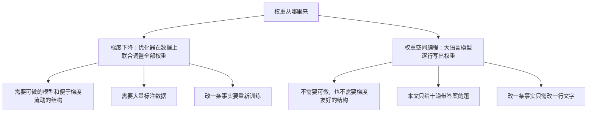
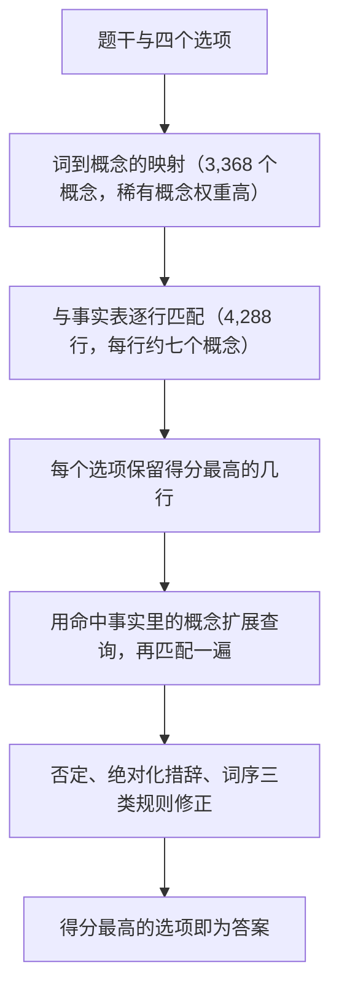
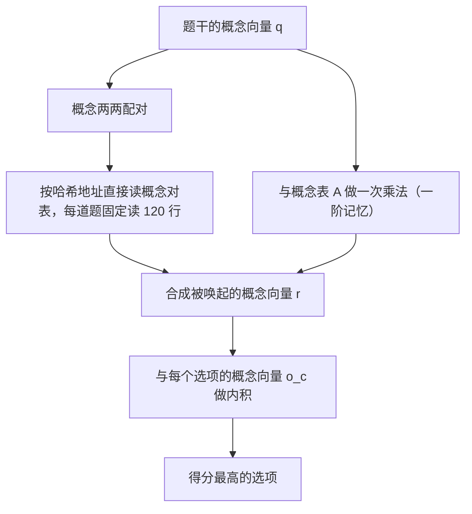

# 权重空间编程不需要 Transformer

> **原题**：Weight-Space Programming Doesn't Need Transformers
> **作者**：Hyunjong Ok, Jaeho Lee
> **机构**：浦项科技大学（POSTECH）
> **年份**：2026（arxiv ID 2611.22055）
> **分类**：cs.LG / cs.AI / cs.CL
> **链接**：https://arxiv.org/abs/2611.22055
> **精读日期**：2026-11-18

## 阅读须知

### 这篇在领域里的位置

过去十年里，神经网络的权重几乎只有一种来历：先定下一个结构，再用梯度下降在数据上把权重一点一点调出来。Transformer 之所以成为默认结构，很大程度上是因为它在这条路线上表现得最好，既容易被梯度优化，又能在 GPU 上跑得很快。

2026 年出现了另一条很不一样的路线，叫作权重空间编程（weight-space programming，下文简称 WSP）。它的做法是让一个大语言模型直接把目标模型的权重「写」出来，中间没有梯度，也没有在数据上拟合的过程。Takehi 等人的工作先证明了这件事做得到，本文则接着追问一个更靠前的问题：既然权重不再由梯度产生，目标模型还有必要长成 Transformer 的样子吗。

这篇论文属于「结构该怎么选」这一类研究，但它的切入方式比较少见。它没有提出一个新结构再去和旧结构比分数，而是先把选择权交给三个前沿大模型，观察它们在没有约束时会造出什么，再回过头解释这个选择背后的道理，最后才给出作者自己的改进版本。

### 读完能回答什么

- 权重空间编程和梯度训练在「怎样把一条知识放进权重」这件事上有什么本质区别。
- 三个大模型在可以自由设计结构时，为什么不约而同地造出了一张稀疏的事实表，而不是 Transformer。
- 「答案可以追溯」与「修改只影响局部」这两个性质是怎样被实验检验的，Transformer 又是在哪里失守的。
- 大模型自己设计的表格模型为什么在 GPU 上反而很慢，作者的联想记忆模型怎样把每道题的开销固定下来。
- 这条路线目前的能力边界在哪里，和预训练模型相比差多少。

### 阅读前置

这份笔记假定读者熟悉 Transformer 的基本结构，知道注意力、MLP、词向量各自做什么，也大致了解梯度下降是怎样更新权重的。读者不需要事先了解权重空间编程，也不需要了解联想记忆的理论，这两部分都会在正文里从头讲起。

### 首次出现的缩写表

- **WSP**（Weight-Space Programming，权重空间编程）：由大语言模型直接写出目标模型的权重，不经过梯度训练，也不在数据上拟合。
- **写手**（writer）：论文对负责写权重的那个大语言模型的称呼，本文用了 Claude Opus 5.5、GPT-6.1 Sol、GPT-6 Astra 三个。
- **ARC**（AI2 Reasoning Challenge）：一套小学到初中水平的科学选择题，分 ARC-Easy 与 ARC-Challenge 两部分，本文用的是其中四个选项的题目。
- **BM25**：一种经典的关键词检索打分方法，按词频和词的稀有程度给文本排序，不含任何学习得到的参数。
- **MLP**（Multi-Layer Perceptron，多层感知机）：Transformer 每一层里紧跟在注意力之后的那个前馈网络。
- **GELU**：Transformer 里常用的一种平滑激活函数。
- **IDF**（Inverse Document Frequency，逆文档频率）：一个词出现得越少，权重越高，这是检索里衡量词的稀有程度的标准做法。
- **谱系**（lineage）：论文里的多代改进流程，每一代在上一代验证集成绩最好的模型基础上继续写。
- **CUDA graph**：GPU 上把一串运算录下来整体重放的优化手段，可以省掉逐个启动运算核的开销。

## 一、问题

一个模型的结构从来不是凭空选出来的，它总是在迁就某种制造权重的方式。Transformer 迁就的是梯度下降：残差连接和归一化让梯度能够顺畅地流过很多层，大块的稠密矩阵乘法又恰好是 GPU 最擅长的运算。

权重空间编程把制造权重的方式整个换掉了。在这种设定下，写手拿到的只有一份任务说明、极少量的示例和一个可以运行代码的沙盒，它要靠自己已有的知识，把目标模型的每一个权重张量写出来。于是原先支持 Transformer 的两条理由，容易被梯度训练和适合 GPU 的稠密运算，至少有一条已经不再成立。

这就引出了论文标题里的那个问题：在权重空间编程里，还应该保留 Transformer 吗。这个问题之所以值得认真对待，是因为它的答案会决定这条新路线往哪里走。如果写手被迫往一个为梯度设计的结构里填权重，那么测出来的成绩反映的可能只是结构不合适，而不是「手写权重」这件事本身的上限。

在这之前，相关的研究大致有三路，它们都把结构当成给定的前提。第一路是不借助语言模型、直接构造或编译权重的工作，例如把程序编译成 Transformer 权重用于可解释性研究，或者手工构造能存事实的 MLP。第二路是模型编辑，也就是在一个已经训练好的模型里定位并改写某条事实。第三路是用语言模型做结构搜索或者用超网络生成权重，但候选结构仍然要靠梯度训练或者在数据上打分来筛选。

本文与这三路的区别在于两点。其一，它把结构的决定权交给了写手本人，然后拿写手自己设计的模型去和同一个写手写出的 Transformer 做比较。其二，整个过程里目标模型从不接受梯度训练，写手也看不到测试成绩。

论文给出的具体技术命题可以概括成三句话。第一，在只给十道例题、从随机初始化或者空白开始的设定下，让写手自己设计结构，比让它往固定结构里写权重更准，而且参数少得多。第二，写手选出的结构是一张稀疏事实表，这个选择可以用「可追溯」和「局部可改」两个性质来解释。第三，这种表格模型可以改造成每道题开销固定的联想记忆模型，在 GPU 上比同样大小的 Transformer 更快。

## 二、方法

### 实验规程：写手能看到什么

整套规程的核心是把写手能接触到的信息压到最低。每一次运行里，写手只能看到十道 ARC 训练题及其答案，其中 ARC-Easy 与 ARC-Challenge 各五道。除此之外它看不到任何 ARC 数据，也看不到自己的模型在测试集上得了多少分。

写手工作在一个隔离的沙盒里，有文件、搜索和命令行工具，但除了访问它自己的模型之外没有网络。它可以在沙盒里把权重构建出来，检查张量的名字和形状，也可以在 CPU 上运行模型，只是手边没有基准数据可供它拟合。

论文比较了两种设定。第一种是固定结构：写手要么往十五个公开发布的结构（Transformer、状态空间模型、循环网络）的随机初始化上写权重，要么把作者提供的一个两层小 Transformer 的全部权重从零写出来。第二种是自行设计：写手自己交出结构文件、构建脚本和若干纯文本的知识文件，由构建脚本在 CPU 上把文本编译成张量。

在此之上还有一个多代改进的流程，论文称之为谱系。每一代跑两次，从第二代起，写手会拿到上一代验证集成绩较高的那个模型的全部文件，以及那一个验证集准确率数字，但不会知道具体哪些题对了哪些题错了。当某一代没能提高历代最好的验证成绩，或者到了第十代，谱系就停下来。

### 三个写手造出了同一种东西

在可以自由设计的设定下，三个写手都没有造 Transformer。它们造出的是同一类模型：一张稀疏的事实表，外加一个固定不变的查询过程。整个模型里没有注意力，没有 MLP，也没有稠密的词向量。

以 Claude Opus 5.5 第一代的模型为例，它的构造分成几步。写手先把领域知识写成一句一句的短陈述句，例如「空心的骨头让鸟变轻，所以能飞」。构建脚本再把每句话变成表里的一行。

为了让这些句子能匹配上各种措辞，模型里还有一层「概念」映射。它把 361,150 个词形归并成 3,368 个概念，同一个意思的不同写法（例如 bird、birds、bird's）落在同一个概念上，越稀有的概念权重越高。事实表共有 4,288 行，非零元素只有 29,502 个，平均每行大约七个概念。

回答问题时，模型把题干和每个选项各自转成概念向量，然后拿它们去和表里的每一行做匹配。每个选项保留得分最高的几行，再用这些行里出现的概念扩展一次查询，做第二遍匹配，最后叠加几条处理否定词、绝对化措辞和词序的规则。

### 不用梯度写权重，需要什么性质

没有梯度的时候，写手调试模型的方式和程序员调试代码很像。它会自己出练习题，运行模型，查看哪些题答错了，然后补一条规则或者一行事实。稀有概念加权、否定词翻转符号、第二遍匹配这些机制，都是在这样的循环里一点一点长出来的。

论文从这个过程里提炼出两个必需的性质。第一个是答案可追溯：每个预测都来自少数几行可以指认的文字，写手才能找到造成错误的那一条。第二个是修改只影响局部：增删或改写一行，只改变依赖这一行的那些预测，其余预测保持原样。

Claude Opus 5.5 在自己第一代的运行记录里把这两条说得很直白。它写道，没有训练的时候，把知识放进模型的唯一办法就是把它写下来，而简短的陈述句是最便宜的书写和检查形式；它还写道，稀疏的检索模型让每一个数字都能追溯到自己写的某一句话。

### 用联想记忆的眼光统一来看

论文借用了一个已有的理论视角，把 Transformer 的每个部件都看成联想记忆。所谓联想记忆，就是用一个查询去找和它相似的「键」，再把这些键对应的「值」取回来。写成公式是：

$$f(x)=\sum_{i=1}^{M} v_i\,\sigma\!\left(k_i^{\top}x\right)$$

这里 $x$ 是查询，$k_i$ 与 $v_i$ 是第 $i$ 条记忆的键和值，$M$ 是记忆的条数，$\sigma$ 是决定「取哪几条」的选择函数。在线性层里 $\sigma$ 是恒等映射，在 MLP 里它是 GELU 这样的激活函数，在自注意力里它是对上下文各个键做的 softmax。

用这个视角看，Transformer 的问题出在键上。它的键是稠密的，彼此重叠，取回一条记忆时总会混进别的记忆的值，这就是干扰。选择函数越尖锐，干扰越小，但稠密的键决定了干扰不可能消失。

写手设计的表格模型是同一个公式的另一种取法。每条记忆就是一句写下来的事实，它的稀疏概念向量既当键又当值。设 $q$ 是题干的概念向量，$o_c$ 是选项 $c$ 里有而题干里没有的那些概念，那么选项 $c$ 的主要得分是：

$$s_c=\max_i\;\left(k_i^{\top}q\right)\left(k_i^{\top}o_c\right)$$

也就是说，一行事实既要和题干对得上，也要和这个选项对得上，两个匹配分数相乘才是这一行给出的支持度，再取所有行里最大的那一个。每个键在三千多个概念里只有七个左右的非零项，彼此很少重叠，再加上只取最高的几行，残余的重叠也被丢掉了。

### 作者的联想记忆模型

写手设计的模型有一个明显的代价：它对每道题都要给表里的每一行打分。写手每多写一条事实，推理就慢一点，而且前向过程里要启动很多个小的 GPU 运算核。

作者为此设计了一个联想记忆模型，目标是保留「逐行书写」这个优点，同时让每道题的开销不再随事实条数增长。做法是由作者把前向过程固定下来，连同权重的名字和张量形状一起交给写手；写手仍然写词表、纯文本文件和构建脚本，只是这回脚本要把文字编译成两张指定的表。

第一张是概念表 $A$，属于一阶记忆，记录的是单个概念 $a$ 能在多大程度上唤起概念 $b$。第二张是概念对表，属于二阶记忆，记录的是一对概念 $(a,b)$ 同时出现时会唤起哪些概念，按这对概念算出的哈希地址直接读取。前向过程写成公式是：

$$r=\sum_{(a,b)\in P(q)} q_a\,q_b\;t_{h(a,b)}\;+\;\mu\,A^{\top}q,\qquad s_c=o_c^{\top}r$$

这里 $P(q)$ 是题干里出现的概念两两组成的概念对，$h(a,b)$ 是这对概念的哈希地址，$t_{h(a,b)}$ 是概念对表里那一行存的内容，$\mu$ 是两张表之间的配比，由写手设定。$r$ 可以理解成「这道题让模型想起了哪些概念」，选项 $c$ 的得分就是它的概念 $o_c$ 与 $r$ 的内积。

这样一来，每道题只读概念对表里的 120 行，再和概念表 $A$ 做一次乘法，开销与写了多少条事实无关。在 Claude Opus 5.5 第一代的这个模型里，40,312 个词映射到 3,805 个概念，概念表 $A$ 有 206 万个非零项，概念对表有 1,048,576 行，每行最多存 40 个被唤起的概念及其权重。

论文举了一道测试题来说明两种模型的差别：哪一种适应特征帮助鸟类飞行。在写手设计的模型里，「空心的骨头让鸟变轻，所以能飞」这一行对「空心骨头」选项给出 70 的支持度，而另外三个错误选项的最好匹配只有 13 到 22。在联想记忆模型里，题干中的「适应」与「飞」这一对概念直接寻址到一行，这一行唤起的正是「空心」与「骨头」，于是正确选项得 52.1 分，第二名只有 15.8 分。

## 三、实验

### 主结果：自己设计的结构更准，也更小

主实验在 ARC-Easy 与 ARC-Challenge 合并后的 3,530 道四选一测试题上进行，四个选项随机猜的准确率是 25%。下表列出 Claude Opus 5.5 作为写手时的结果，并放上梯度训练的对照。

| 模型 | 用到的标注题 | 参数量 | 写手费用 | ARC 测试准确率 |
|---|---|---|---|---|
| 梯度训练，最好的公开结构（Mamba-2 130M，随机初始化） | 3,358 | 1.29 亿 | 无 | 24.6% |
| 梯度训练，两层 Transformer | 3,358 | 333 万 | 无 | 29.8% |
| 梯度训练，同规模最好的小网络（MLP） | 3,358 | 334 万 | 无 | 32.7% |
| WSP，十五个公开结构（随机初始化上写） | 10 | 1.29 亿到 26 亿 | 15 美元 | 43.1% |
| WSP，给定的两层 Transformer | 10 | 8 万到 396 万 | 16 美元 | 36.1% |
| WSP，写手自行设计，第一代 | 10 | 94 万 | 29 美元 | 50.8% |
| WSP，写手自行设计，第五代 | 10 | 335 万 | 144 美元 | 54.4% |
| WSP，联想记忆模型，第一代 | 10 | 253 万 | 28 美元 | 49.6% |
| WSP，联想记忆模型，第五代 | 10 | 624 万 | 96 美元 | 52.4% |
| 预训练后微调，Qwen3.5-0.8B | 3,358 | 7.52 亿 | 无 | 82.1% |

这张表里有三层对比值得分开看。第一层是在权重空间编程内部，写手自己设计的模型比它写出的 Transformer 高出十几个百分点，而且比它写得最准的那个公开 Transformer 小了大约 1,800 倍。第二层是和不带预训练的梯度训练相比，手写的模型也更准，因为公开结构从随机初始化出发，即使用上全部 3,358 道训练题，成绩仍然贴着随机猜测。

第三层对比则指向相反的方向。预训练之后再微调的小模型远远领先，Qwen3.5-0.8B 达到 82.1%，比最好的手写模型高出将近 28 个百分点。论文对此说得很清楚：它的结论只关乎「手写权重时该造什么结构」，并不是说手写权重已经能与预训练抗衡。

另外两个写手的结果在方向上一致，绝对数值低一些。GPT-6.1 Sol 自行设计的模型从第一代的 44.6% 升到第七代的 47.4%，它写的两层 Transformer 是 36.3%。GPT-6 Astra 自行设计的模型从 42.7% 升到第五代的 46.2%，它写的两层 Transformer 是 32.6%。

### 两个性质的检验

对「答案可追溯」的检验做得很干脆：每个选项只保留匹配得最好的那一条事实，把其余所有打分都丢掉。完整模型的准确率是 50.8%，只留一条事实的版本是 49.1%，两者只差 1.7 个百分点，说明准确率绝大部分来自每个选项最匹配的那一行。

对「修改只影响局部」的检验是删掉一行文字、重建模型，再数测试集上有多少道题的答案变了，每个模型随机删 40 行。在四个表格类模型里，删一行平均改变 0.5 到 1.8 个答案。

同样的检验放到手写的 Transformer 上，结果差了很多。第一个手写 Transformer 平均每删一行改变 4.8 个答案。第二个更极端，它的构建脚本从同一个随机数流里给所有向量取编码，删掉一行会让后面的编码全部错位，几乎每个权重都变了，平均有 38% 的答案随之改变。

### 是内容的功劳还是结构的功劳

一个很自然的质疑是：准确率也许只取决于写手写下的那些事实，装事实的结构并不重要。作者为此设计了一个对照，直接在写手为每个模型写下的文字上跑 BM25 检索，再把检索的准确率和模型自己的准确率放在一起比。

| 模型 | 模型自身准确率 | 在它的文字上跑 BM25 | 差值 |
|---|---|---|---|
| 手写的两层 Transformer | 36.1% | 44.1% | 低 8.0 |
| 手写的公开结构 | 43.5% | 46.2% | 低 2.7 |
| 写手自行设计，第一代 | 50.7% | 47.0% | 高 3.7 |
| 写手自行设计，第五代 | 54.1% | 48.4% | 高 5.7 |
| 联想记忆模型，第一代 | 49.9% | 48.4% | 高 1.5 |
| 联想记忆模型，第五代 | 52.6% | 49.1% | 高 3.5 |

这是全文最有说服力的一组数字。Claude Opus 5.5 写出的六个两层 Transformer 全都不如直接检索它们自己的文字，平均低 8 个百分点，换句话说，把事实编译进 Transformer 这一步反而损失了信息。表格类模型则都高于检索，说明结构本身在文字之外还贡献了一部分准确率。

作者还在一个生成任务上直接量出了干扰的大小。Claude Opus 5.5 写的那个 Transformer 要在 58 维里放下大约 2,800 个答案词，同一套打分规则在没有干扰的情况下 F1 是 0.37，放进 Transformer 之后只有 0.24 到 0.25。

### 一个反直觉的结果：表格模型在 GPU 上很慢

读到这里，读者很容易以为稀疏小表一定比 Transformer 快，实测正好相反。在 46 个由写手设计的模型变体里，只有一个比同样大小的 Transformer 快，中位数是慢 9.4 倍。

原因出在运算的形状上。两层 Transformer 处理一批 64 道题只需要几次大的矩阵运算，平摊下来每道题大约启动一个 GPU 运算核，而写手设计的模型每道题要启动两个到将近三百个。随着代际推进，写手不断往里加打分步骤和规则模块，Claude Opus 5.5 的模型每道题启动的运算核从第一代的 13 个涨到第五代的 118 个。

作者先试过让 Claude Opus 5.5 自己把模型改写成适合 GPU 的形式。改写后的版本确实快了，准确率也保住了，但它们仍然对每道题给每一行打分，比同样大小的 Transformer 还是慢 6 到 33 倍。这才促使作者自己把前向过程固定下来。

| 模型 | 非零值个数 | ARC 准确率 | GPU 用时（3,530 道题） | 同规模 Transformer 用时 | 对比 |
|---|---|---|---|---|---|
| 写手自行设计，第一代 | 57 万 | 50.8% | 0.566 秒 | 0.052 秒 | 慢 11 倍 |
| 写手自行设计，第五代 | 335 万 | 54.4% | 15.8 秒 | 0.176 秒 | 慢 90 倍 |
| 联想记忆模型，第一代 | 253 万 | 49.6% | 0.018 秒 | 0.134 秒 | 快 7 倍 |
| 联想记忆模型，第五代 | 624 万 | 52.4% | 0.018 秒 | 0.302 秒 | 快 17 倍 |

联想记忆模型的准确率比写手自行设计的模型低三个百分点以内，换来的是从第一代到第五代用时始终是 18 毫秒。在合成数据上，概念对表从 300 万个非零值增长到 10 亿个，每道题的用时一直停在 0.012 毫秒，同规模的 Transformer 则从 0.044 毫秒涨到 14.5 毫秒。

### 往外推广时哪里成立、哪里不成立

把为 ARC 写的模型原样拿去做别的四选一基准，结果高度依赖题目和写下的知识是否对口。在同样是初等科学的 SciQ 上，两类模型第一代都是 47.7%，第五代都是 50.1%；在 OpenBookQA 上是 30% 到 36%；在 MMLU 上则回到 25% 左右的随机水平。

换成需要产出文字的任务时，写手仍然造表格，只是每一行装的东西变了。在 SQuAD 1.1 的片段抽取上，写手设计的模型 F1 是 42.3，它写的 Transformer 是 33.2，同一个 Transformer 用全部训练数据做梯度训练只有 16.1。

从预训练的检查点出发时，写手的行为明显不同。在 87 次运行里有 48 次只改动了不到 1% 的权重，主要是校准答案字母的读出方式，或者把科学词汇的词向量往写下的定义上挪一挪。另有 30 次是把检查点整个覆盖成手写的事实或规则模型，其中 19 次发生在本来就接近随机水平的检查点上，而准确率高于 72% 的检查点从未被覆盖。

图像是这条路线目前明确走不通的地方。在 CIFAR-10 的原始像素上，Claude Opus 5.5 写的网络在八种固定结构上只有 21% 到 28%，随机水平是 10%。作者的解释与全文的主线一致：落在单个像素上的权重，没有一个写手能叫得出名字的含义。

## 四、局限

### 作者自己承认的

第一条局限是这些模型只会回忆，不会推理。它们靠取回写手写下的事实来作答，既不会把几条事实串成多步推理，也不会组织一段长答案，所以 ARC-Easy 能到 63% 左右，ARC-Challenge 却一直停在 38% 附近。

第二条局限是结论的适用范围。「不需要 Transformer」只对当前这种写法成立，也就是从随机初始化出发、不在数据上运行、每个权重都要能说出含义的写法。如果以后出现了能写出回忆之外的能力的方法，最合适的结构是什么仍然是开放问题。

第三条局限是速度优势有边界。联想记忆模型的用时不随事实条数增长，但会随概念数量增长：概念表 $A$ 以稠密形式存储时，概念数到 15,000 至 32,000 之间就会慢于 Transformer，改成按行列表读取可以撑到大约 100,000 个概念。

第四条局限是硬件。所有速度都只在一块 RTX 3090 上测过，而这种显卡是为稠密矩阵乘法设计的，对哈希寻址和查表并不友好。作者把在面向查表的硬件上重新评测列为后续方向。

第五条是关于「为什么选表格」的另一种解释没有被排除。大语言模型本来就知道检索是不训练就能答题的经典办法，有一个写手甚至把 IDF 检索称作 ARC 的经典基线，所以现有数据分不清写手选表格是因为它适合书写，还是仅仅因为它眼熟。

### 读完能看出来的

主实验的任务本身偏向检索。小学科学选择题恰好是「题干与选项里的关键词能对上某条事实」就能答对的题型，表格结构在这里占优并不意外，而在 MMLU 上回到随机水平也说明这个优势很难离开对口的知识范围。

对照组的强弱值得留意。梯度训练的对照是在三千多道题上从随机初始化训练小网络，这本来就是一个很弱的设定；真正有分量的对照是 BM25，而表格模型只比它高 1.5 到 5.7 个百分点。把这两点合起来看，手写模型的成绩更像是「一个做得不错的检索系统」，而不是一种新的学习能力。

写手的知识来自它自己的预训练，这一点让「只用十道标注题」的说法需要打些折扣。那十道题只起到说明题型的作用，真正被搬进小模型的是前沿大模型里已有的科学常识，整个流程在效果上接近一种把知识从大模型蒸馏成可读表格的办法。

样本量偏小也是一个问题。每一代只跑两次，很多结论建立在个位数的运行之上，例如手写 Transformer 的局部性检验只有两个模型，其中一个的异常还来自构建脚本的写法而不是结构本身。

最后是成本与可复现性。谱系推进到后面，单条谱系的写手费用从几十美元涨到几百美元，GPT-6 Astra 的联想记忆模型谱系到第八代花了 490 美元；而且三个写手都是闭源的商业模型，别人很难在完全相同的条件下重跑。

## 一句话

让大模型手写权重时，它们会放弃 Transformer 而造一张可追溯、可局部修改的稀疏事实表，作者据此做出每题开销固定的联想记忆模型。
