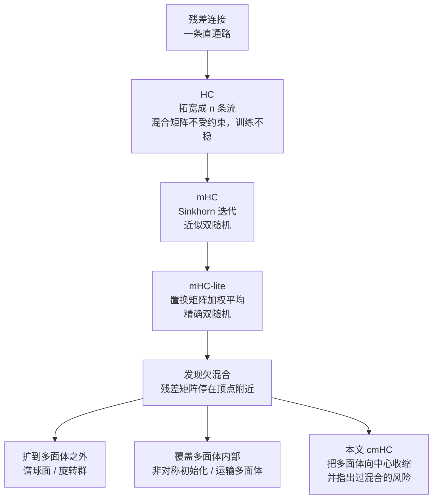
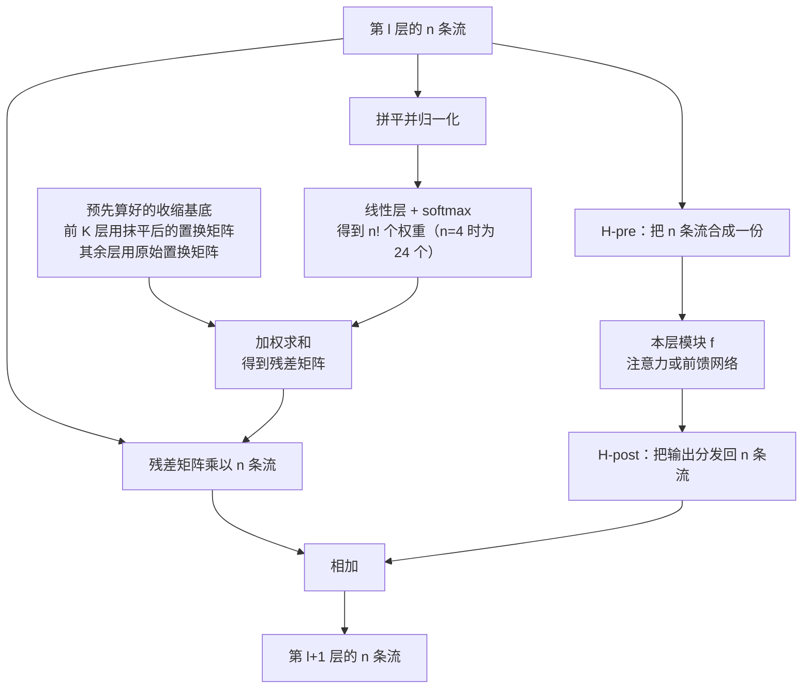
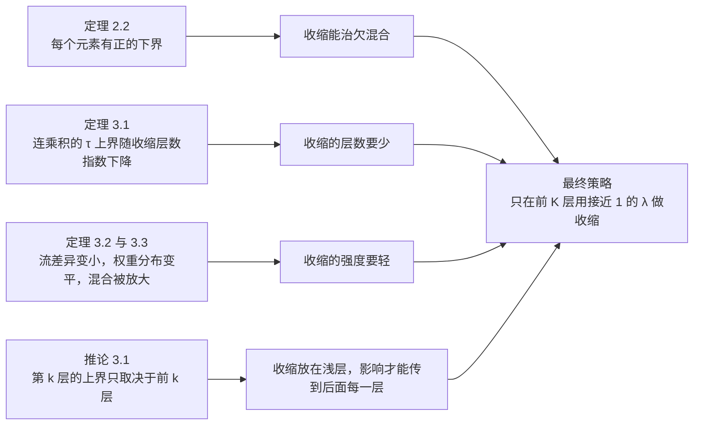
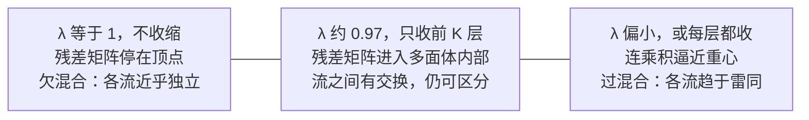

# cmHC：用几何收缩平衡超连接里的流混合

> **原题**：cmHC: Balancing Stream Mixing in Hyper-Connections via Geometric Contraction
> **作者**：Haowei He、Ziwen Zhao、Chenshuo Pan、Gang Lin、Zhihao Yang、Chao Wang、Xinzhang Liu、Kaidong Yu、Han Gao、Dongfang Li、Menglin Yang、Shuangyong Song、Yongxiang Li
> **机构**：中国电信星辰 AGI 实验室（Xingchen AGI Lab, China Telecom）；香港科技大学（广州）；哈尔滨工业大学（深圳）；华为
> **年份**：2026（arxiv ID 2611.27193）
> **分类**：cs.LG
> **链接**：https://arxiv.org/abs/2611.27193
> **精读日期**：2026-11-23

## 阅读须知

### 这篇在领域里的位置

这篇论文属于「改造残差连接」这一类工作。残差连接是深层网络里把上一层的输出原样加到下一层输出上的那条旁路，自 2016 年的 ResNet 以来几乎没有变过。2025 年的超连接（Hyper-Connections，下文简称 HC）第一次认真地改动了它：把一条残差通路拓宽成若干条并行的「流」，再让网络自己学习这些流之间怎样混合。

HC 之后的工作大致分成两步。第一步是求稳：DeepSeek 提出的 mHC 把负责混合各条流的矩阵限制成「双随机矩阵」，训练才稳定下来；随后的 mHC-lite 换了一种写法，让这个限制精确成立。第二步是求有效：研究者发现，限制住之后的矩阵常常停在单位矩阵附近，各条流其实没有怎么混合，于是出现了一批想办法「让它混起来」的工作。

本文位于第二步，并且提出了一个与同行不同的看法。它认为混合并不是越多越好：混得太少，多条流退化成互不相干的几条单流；混得太多，各条流又会变得彼此雷同。论文给出的方法很小，只改了一组预先算好的常数矩阵，篇幅的大半用在论证「为什么要轻轻地改、而且只改最前面几层」。作者主要来自中国电信的星辰 AGI 实验室，这家实验室此前发布过 TeleChat 系列模型，所以文中有一组 3000 亿参数规模的验证实验。

### 读完能回答什么

1. 多流残差里的「残差矩阵」是什么？为什么要把它限制成双随机矩阵？
2. 「欠混合」是怎样的现象？它为什么不只出现在单位矩阵附近？
3. 几何收缩的那一个公式做了什么？为什么不增加任何可学习参数，却能保证任意两条流之间都有正的混合量？
4. 为什么收缩不能太强，也不能每一层都做？论文说的「蝴蝶效应」指什么？
5. 实验里的收益有多大？哪些结论有充分证据，哪些证据偏薄？

### 阅读前置

本文假定读者熟悉 Transformer 的基本结构，知道残差连接与 softmax，也具备矩阵范数这一类线性代数常识。本文不假定读者读过 HC、mHC 或 mHC-lite 的原始论文，也不假定读者了解双随机矩阵、Birkhoff 多面体、压缩映射或 Dobrushin 遍历系数，这些概念第一次出现时都会先铺垫再展开。

### 首次出现的缩写表

- **HC**（Hyper-Connections，超连接）：把一条残差通路拓宽成 $n$ 条并行的流，并让流之间的混合方式可学习的结构。
- **流**（stream）：HC 里并行存在的 $n$ 份隐藏状态之一，每一份的形状与普通 Transformer 的隐藏状态相同。
- **残差矩阵** $\mathbf{H}^{\mathrm{res}}$：一个 $n\times n$ 的矩阵，决定上一层的 $n$ 条流以怎样的比例混合后传给下一层。
- **双随机矩阵**（doubly stochastic matrix）：所有元素非负、每一行之和与每一列之和都等于 1 的方阵。
- **Birkhoff 多面体** $B_n$：全体 $n\times n$ 双随机矩阵构成的集合。它的顶点恰好是全部 $n!$ 个置换矩阵。
- **置换矩阵**（permutation matrix）：每行每列恰有一个 1、其余为 0 的方阵，作用在流上只是调换流的顺序。
- **重心** $\mathbf{J}_n$：所有元素都等于 $1/n$ 的矩阵，位于 Birkhoff 多面体的正中央，作用在流上是把所有流取平均。
- **mHC**（Manifold-Constrained Hyper-Connections，流形约束超连接）：DeepSeek 提出的做法，用 Sinkhorn-Knopp 迭代把残差矩阵近似投影成双随机矩阵。
- **mHC-lite**：把残差矩阵直接写成 $n!$ 个置换矩阵的加权平均，从而精确地满足双随机约束。
- **cmHC**（Contraction for mHC）：本文的方法，名字里的 c 取自 contraction，即收缩。
- **收缩系数** $\lambda$ 与 $\lambda'$：前者是论文里直接设定的系数，后者是它的归一化形式，$\lambda'=(n\lambda-1)/(n-1)$。$\lambda$ 越小，收缩越强。
- **收缩层数** $K$：施加收缩的层数，指从最浅的一层数起的前 $K$ 个超连接层。
- **Dobrushin 遍历系数** $\tau$：衡量一个行随机矩阵各行之间差异的量，取值在 0 到 1 之间，越接近 0 说明各行越相像。
- **MoE**（Mixture of Experts，混合专家）：每个 token 只激活一小部分前馈子网络的稀疏结构。
- **NPU**（Neural Processing Unit，神经网络处理器）：本文特指华为的 Ascend（昇腾）系列芯片。
- **nanoGPT**：Karpathy 开源的小型 GPT 训练框架，本文用它从头训练 GPT-2 规模的模型。

## 一、问题

残差连接之所以重要，是因为它给信号和梯度留了一条不经过任何变换的直通路。几十上百层的网络能够训练起来，靠的正是这条路上的恒等映射。然而这条路只有一条，每一层读到的输入与写回的输出都挤在同一份隐藏状态里；HC 的想法是把它拓宽，让网络拥有若干份并行的状态，并自己决定每一层从哪几份里读、往哪几份里写、各份之间怎样互通。

拓宽之后，问题转移到了「互通」这一步上。负责互通的是一个 $n\times n$ 的残差矩阵，它在每一层都要乘一次，几十层连乘下来，只要它稍微放大或缩小信号，累积效应就会让训练失稳。mHC 用双随机约束解决了失稳，可稳定并不等于有效：约束只规定了矩阵「不许放大信号」，并没有规定它「必须让流之间交换信息」。于是，多流结构付出了数倍的状态宽度，换来的可能只是几条各走各路的单流。这是本文要处理的痛点。

### 具体要解决什么

先把记号交代清楚。HC 在第 $l$ 层维护 $n$ 条流 $\mathbf{x}_l\in\mathbb{R}^{n\times d}$，其中 $d$ 是隐藏维度。一层的更新写作：

$$\mathbf{x}_{l+1}=\mathbf{H}^{\mathrm{res}}_{l}\mathbf{x}_{l}+{\mathbf{H}^{\mathrm{post}}_{l}}^{\top}f(\mathbf{H}^{\mathrm{pre}}_{l}\mathbf{x}_{l};\mathbf{\Theta}_{l})$$

这里有三个系数矩阵，各管一件事。$\mathbf{H}^{\mathrm{pre}}_l$ 是一个 $1\times n$ 的行向量，把 $n$ 条流加权合成一份，交给这一层真正的计算模块 $f$，也就是注意力或前馈网络。$\mathbf{H}^{\mathrm{post}}_l$ 同样是 $1\times n$，把 $f$ 的输出按不同权重分发回 $n$ 条流。$\mathbf{H}^{\mathrm{res}}_l$ 则是本文的主角，它不经过 $f$，直接把上一层的 $n$ 条流混合成下一层的 $n$ 条流。

在此基础上，本文要回答的技术问题可以表述为：在保持残差矩阵精确双随机、并且不引入任何新参数的前提下，怎样让各条流之间既有保证下限的信息交换，又不至于在多层累积之后变得无法区分。

### 前人走过的几条路线

第一条路线是原始的 HC。它对残差矩阵不加任何约束，表达能力最强，代价是训练不稳。本文的对照实验里，HC 在 24 层的模型上梯度范数的均值达到 2.72、标准差达到 2.23，而其余方法都在 0.4 上下。

第二条路线是 mHC。它规定残差矩阵必须是双随机矩阵，这样每条输出流都是输入流的一个加权平均，矩阵的谱范数不超过 1，信号不会被放大。实现上，mHC 先学一个不受约束的矩阵，再用 Sinkhorn-Knopp 算法反复对行与列做归一化。这个算法是迭代的，通常要 10 到 20 轮才收敛，轮数不够时列和会偏离 1，所以约束只是近似成立。

第三条路线是 mHC-lite。它利用了 Birkhoff-von Neumann 定理：任何双随机矩阵都可以写成置换矩阵的加权平均。于是 mHC-lite 不再学矩阵本身，而是学 $n!$ 个权重 $\boldsymbol{\alpha}_l$，再用 softmax 保证它们非负且和为 1：

$$\mathbf{H}^{\mathrm{res}}_{l}=\sum_{m=1}^{n!}\alpha_{l,m}\mathbf{P}_{m},\qquad\boldsymbol{\alpha}_{l}=\mathrm{softmax}\left(a_{l}^{\mathrm{res}}\mathbf{x}'_{l}\mathbf{W}^{\mathrm{res}}_{l}+\mathbf{b}^{\mathrm{res}}_{l}\right)$$

其中 $\mathbf{P}_m$ 是第 $m$ 个置换矩阵，$\mathbf{x}'_l$ 是把 $n$ 条流拼平并归一化之后的向量，其余符号是可学习的缩放、权重与偏置。当 $n=4$ 时一共有 24 个置换矩阵，对应 24 个权重。这样写出来的矩阵天然落在 Birkhoff 多面体之内，约束精确成立，本文的方法就建在这个写法之上。

第四条路线是一批针对「混不起来」的修补工作。有的把可行域扩到多面体之外，例如允许负元素的谱球面约束，或者把残差矩阵限制为旋转矩阵；有的留在多面体之内，改用非对称初始化、运输多面体或正交约束去覆盖更大的内部区域。本文对它们的评价有两点：构造普遍比较复杂，而且没有一个能严格保证混合量的下限；此外它们大多没有在很大的模型上验证过，论文举出的此前最大规模是 280 亿参数。

### 欠混合到底是什么样子

此前的工作已经观察到，mHC-lite 训练出来的残差矩阵在大多数层都贴近单位矩阵，非对角线上只有很小的数值。本文进一步指出，这件事与「单位矩阵」无关，而与「初始化偏向哪个置换」有关。

mHC-lite 的初始化是这样安排的：输入先被复制成 $n$ 份；偏置 $\mathbf{b}^{\mathrm{res}}_l$ 里对应单位置换的那一项设为 0，其余各项设为 $-8$。经过 softmax 之后，单位置换的权重几乎是 1，其余几乎是 0。论文把被偏向的对象换成另一个置换矩阵重新训练，结果各层残差矩阵的平均值在第 0 步、第 5000 步、第 10000 步始终贴着那个被选中的置换。

换句话说，训练过程并没有把权重从初始的那个顶点上挪开。论文从训练动态上给的解释是：初始化偏向的那一项得到的更新更大，于是它的权重被继续推向 1，其余权重被继续压低。而置换矩阵只会调换流的位置，并不会让两条流的内容相加，所以流之间的信息交换几乎为零。

## 二、方法

### 核心公式：把每个置换矩阵抹平一点

cmHC 的做法是保留 mHC-lite 的全部参数化，只把求和时用到的那组置换矩阵换成「抹平」之后的版本：

$$\mathbf{P}'_{m}=\lambda\mathbf{P}_{m}+\frac{1-\lambda}{n-1}\left(\mathbf{1}_{n}\mathbf{1}_{n}^{\top}-\mathbf{P}_{m}\right)$$

这里 $\mathbf{1}_n\mathbf{1}_n^{\top}$ 是全 1 矩阵，$\lambda$ 是收缩系数，取值在 $1/n$ 与 1 之间。这个式子的含义很直接：置换矩阵每一行原本只有一个 1，现在把这个 1 改成 $\lambda$，再把剩下的 $1-\lambda$ 平均分给同一行的其余 $n-1$ 个位置。以论文主要使用的 $n=4$、$\lambda=0.97$ 为例，原先是 1 的位置变成 0.97，原先是 0 的位置变成 0.01。

当 $\lambda$ 趋于 1 时，$\mathbf{P}'_m$ 退回原来的置换矩阵，方法退回 mHC-lite；当 $\lambda$ 趋于 $1/n$ 时，所有元素都变成 $1/n$，也就是完全平均。由于 $\mathbf{P}'_m$ 可以事先算好，替换之后既不增加可学习参数，也不改变权重 $\boldsymbol{\alpha}_l$ 的个数与学法。

### 换一个角度看：整个多面体向中心缩小

把上面的替换代回求和式，可以得到一个等价的写法。记 $\mathbf{J}_n=\mathbf{1}_n\mathbf{1}_n^{\top}/n$ 为重心，$\lambda'=(n\lambda-1)/(n-1)$，则收缩之后的残差矩阵是：

$$\mathbf{H}^{\mathrm{res}\prime}_{l}=\lambda'\,\mathbf{H}^{\mathrm{res}}_{l}+(1-\lambda')\,\mathbf{J}_{n}$$

这说明 cmHC 所做的事情，是把原来的残差矩阵与重心按 $\lambda'$ 比 $1-\lambda'$ 的比例做插值。几何上，整个 Birkhoff 多面体被以重心为中心、按比例 $\lambda'$ 缩小了一圈，原先的顶点不再可达。对 $n=4$ 而言，$\lambda=0.97$ 对应 $\lambda'=0.96$，$\lambda=0.70$ 对应 $\lambda'=0.60$。

论文为这个构造证明了两条性质。定理 2.1 说，收缩后的矩阵仍然是精确的双随机矩阵，谱范数仍不超过 1，因此 mHC 带来的稳定性原样保留。定理 2.2 说，收缩后的矩阵每一个元素都不小于 $\min\left(\lambda,\frac{1-\lambda}{n-1}\right)$，这个数严格大于 0。也就是说，即便权重 $\boldsymbol{\alpha}_l$ 仍旧全部压在一个置换上，任意一条输入流对任意一条输出流也都有正的贡献，极端的欠混合被排除了。

### 为什么不能收得太狠：累积效应

方法到这里其实已经讲完了，论文余下的理论都在回答同一个问题：既然收缩能治欠混合，为什么不把 $\lambda$ 调小一些、让每一层都混得更充分？

第一层理由来自多层累积。残差矩阵在每一层都要乘一次，$L$ 层之后起作用的是这些矩阵的连乘积。论文借用 Dobrushin 遍历系数 $\tau$ 来度量连乘积的各行有多相像：$\tau$ 等于 1 减去「任意两行逐元素取较小值再求和」的最小值，$\tau$ 越接近 0，各行越接近相同，也就意味着每条输出流都以几乎一样的比例混合了全部输入流。定理 3.1 给出：

$$\tau\left(\prod_{l=0}^{L-1}\mathbf{H}^{\mathrm{res}\prime}_{L-1-l}\right)\leq\prod_{l=0}^{L-1}\lambda'_{l}$$

这个上界是各层 $\lambda'$ 的乘积，所以只要每一层都收缩，它就随层数指数下降。按这个式子自己算一下：$\lambda'=0.96$ 连乘 48 层约为 0.14，$\lambda'=0.60$ 连乘 12 层只剩约 0.002。论文的图 3 也显示，$\lambda$ 从 1 降到 0.97 时 $\tau$ 就下降了约 0.5，$\lambda=0.7$ 时连乘积已经与重心几乎无法区分。这种状态被论文称为过混合。

### 为什么不能收得太狠：蝴蝶效应

第二层理由更微妙。直觉上，把基底换成抹平的版本只是换了一组常数，不应当影响权重 $\boldsymbol{\alpha}$ 怎么学。论文指出它其实会影响，并把这个现象称作蝴蝶效应。

论证分两步。第一步看前向。把每条流拆成「所有流的平均」与「这条流偏离平均的部分」，后者记作流差异 $\tilde{\mathbf{x}}$。在把本层模块局部线性化的近似之下，定理 3.2 给出流差异范数的上界：它等于第一层的流差异乘以沿途各层 $(\lambda'_l+\ell_l)$ 的连乘，其中 $\ell_l$ 是本层模块在流差异方向上的 Lipschitz 常数。于是，浅层的收缩会压低此后所有层的流差异上界。

第二步看反向。定理 3.3 给出，任意两个置换对应的权重，它们的梯度之差不超过 $2\lambda'_l$ 乘以回传梯度的范数再乘以本层流差异的范数。流差异被压小之后，不同权重收到的梯度就更接近，$\boldsymbol{\alpha}$ 的分布随之变得更平，而更平的 $\boldsymbol{\alpha}$ 又意味着更多的混合。因此，一个数值上很小的收缩，会通过「压小流差异、拉平权重分布」这条链被逐层放大。

论文用实测支持了这条链。在 48 层的模型上，只对前 2 层施加 $\lambda=0.97$ 的收缩，多数层的 $\boldsymbol{\alpha}$ 分布就比 mHC-lite 更平，归一化熵更高，尽管这些层自己并没有被收缩。

### 最终的策略：只在浅层轻轻收一下

综合上面的分析，cmHC 实际采用的方案是：前 $K$ 个超连接层使用抹平后的基底，并共用同一个 $\lambda$；其余各层仍然使用原始的置换矩阵，允许它们停在接近恒等的位置上。

之所以选浅层而不选深层，论文给了两条理由。其一是推论 3.1：到第 $k$ 层为止的累积上界只取决于前 $k$ 层的收缩系数，所以浅层的收缩会沿着网络一路传下去，而深层的收缩只能影响最后几步。其二是表示学习上的常识：浅层特征较为通用，深层特征较为专门，在深层混合不同的流应当更谨慎。

### 工程上的配套：昇腾上的融合算子

收缩本身不增加计算量，可是多流结构在框架里的直接实现会启动许多很小的算子，并且反复读取那份被拓宽了 $n$ 倍的状态。为此，论文在华为昇腾 NPU 上用 Ascend C 写了两个融合算子：Pre 算子把「生成系数、合成本层输入、算出残差矩阵」合成一次调用，Post 算子把「残差混合、分发本层输出」合成一次调用。收缩后的基底每层只准备一次并缓存起来，所以算子实现的仍是上面那个公式。这部分属于芯片相关的工程实现，本文只在实验一节转述它的测量结果。

## 三、实验

### 小规模对比：GPT-2 级别的三个模型

论文先用 nanoGPT 框架从头训练三个模型，分别记作 nanoGPT-S、M、L，参数量约为 0.45 亿、1.2 亿、3.6 亿。每个 Transformer 块里注意力与前馈各包一个超连接层，所以三个模型分别有 12、24、48 个超连接层。数据是 OpenWebText（约 90 亿训练 token）与 FineWeb-Edu 的一个约 100 亿 token 的子集，每个模型训练 1 万步，所有方法都用 4 条流，结果取 3 次运行的平均。

对照组有六个：单流的普通残差、4 条互不混合的独立残差流、原始 HC、mHC、mHC-lite，以及用 Kronecker 积分解残差矩阵的 KromHC。下表摘自论文表 1 在 OpenWebText 上的验证损失，数值越低越好，最后一列是论文统计的训练与验证损失的平均名次。

| 方法 | S（12 层） | M（24 层） | L（48 层） | 平均名次 |
| --- | --- | --- | --- | --- |
| 普通残差，单流 | 3.5636 | 3.3363 | 3.2442 | 11.8 |
| 独立残差，4 流不混合 | 3.4742 | 3.2587 | 3.1909 | 6.0 |
| HC | 3.4796 | 3.2681 | 3.2356 | 9.7 |
| mHC | 3.4775 | 3.2558 | 3.1920 | 6.0 |
| mHC-lite | 3.4759 | 3.2564 | 3.1949 | 6.7 |
| KromHC | 3.4766 | 3.2602 | 3.1934 | 8.0 |
| cmHC，$\lambda=0.70$，全部层 | 3.4756 | 3.2618 | 3.2169 | 9.0 |
| cmHC，$\lambda=0.85$，全部层 | 3.4732 | 3.2575 | 3.2119 | 6.7 |
| cmHC，$\lambda=0.97$，全部层 | 3.4713 | 3.2542 | 3.2026 | 4.2 |
| cmHC，$\lambda=0.97$，$K=10$ | 3.4718 | 3.2584 | **3.1893** | 4.2 |
| cmHC，$\lambda=0.97$，$K=5$ | 3.4693 | 3.2549 | 3.1913 | 3.2 |
| cmHC，$\lambda=0.97$，$K=2$ | **3.4686** | **3.2540** | 3.1904 | **1.3** |

在 OpenWebText 上，$\lambda=0.97$、$K=2$ 的配置在三个规模上都低于 mHC 与 mHC-lite，相对 mHC-lite 的验证损失分别低 0.0073、0.0024、0.0045。在 FineWeb-Edu 上结论没有这么整齐：cmHC 的平均名次仍是最好的（2.8），可最小的模型上是 mHC-lite 最低，最大的模型上验证损失最低的是 KromHC。论文另外换了一个随机种子重跑 S 与 M 两个规模，cmHC 在其中三组设置上保持最低，剩下一组四种方法的差距只有万分之五左右。

### 两组消融：收多狠、收几层

第一组消融固定「全部层都收缩」，只改变 $\lambda$。温和的 0.97 始终好于强烈的 0.70，而且网络越深差距越大：在 OpenWebText 上，两者的验证损失之差从 12 层时的 0.0043 扩大到 48 层时的 0.0143。这与累积效应的分析是一致的。

第二组消融固定 $\lambda=0.97$，只改变收缩的层数。平均名次随着 $K$ 从全部层减到 10、5、2 而逐步变好。论文还做了一个反过来的实验，把收缩放在最后 1、2、10 层，结果在 S 与 L 两个规模上都不如放在最前面 2 层，梯度范数在 9 组里有 8 组更高；唯一的例外是 M 规模上「最后 10 层」取得了最低损失，可同一设置在 S 规模上把验证损失抬到了 3.5184，梯度范数也升到 1.38。

### 两个反直觉的结果

第一个结果是，全层收缩在深网络上会适得其反。在 48 层的模型上，即便是最温和的 $\lambda=0.97$，只要每一层都收缩，验证损失（3.2026）就比完全不收缩的 mHC-lite（3.1949）更差；把收缩限制在前 2 层之后才反超（3.1904）。这是论文「过混合确实存在」这一论点最直接的证据。

第二个结果是，「4 条流互不混合」这个最朴素的对照相当强。在 OpenWebText 的 48 层模型上，它的验证损失是 3.1909，好于 mHC、mHC-lite 与 KromHC 三种带混合的方法，只有 cmHC 的两个浅层配置略低于它。论文在训练曲线一节也承认了这一点：在 12 层模型上，已有的几种方法训练损失都高于 4 条独立流，cmHC 是唯一低于它的。这意味着在这样的规模与训练长度下，流混合带来的净收益本身就很薄。

### 放大到 60 亿与 3000 亿参数

为了验证方法在大模型上是否仍然成立，论文训练了两个 DeepSeek 风格的 MoE 模型，都用 4 条流，数据都是 FineWeb-Edu。

| 设置 | 6B-MoE | 300B-MoE |
| --- | --- | --- |
| Transformer 块数 / 隐藏维度 | 28 / 2048 | 48 / 7168 |
| 专家总数 / 每个 token 选中的专家数 | 64 / 4 | 256 / 6 |
| 优化器 | AdamW | Muon |
| 训练步数 / 处理的 token 数 | 71,500 / 约 1500 亿 | 2,000 / 约 336 亿 |
| cmHC 的 $\lambda$ 与 $K$ | 0.97，4 | 0.96，6 |
| 训练结束时相对 mHC 的损失优势 | 0.002 | 0.0157 |
| 训练结束时相对 mHC-lite 的损失优势 | 0.005 | 论文未报告 |

在两个规模上，cmHC 的梯度范数都比对照更小也更平滑，论文据此认为收缩带来的好处可以延伸到很大的模型。需要留意的是，3000 亿参数的那次运行只有 2000 步，比较的是训练早期的损失差距。

### 融合算子的延迟

算子测试在一台 Ascend 910C 服务器上进行，批大小为 1，序列长度为 4096，流数为 4，并且不包含注意力与前馈模块本身，只测超连接部分前向加反向的总耗时。对比对象是芯片配套软件 CANN 9.1.0 里自带的 mHC 融合算子。

| 每条流的隐藏维度 | cmHC（微秒） | mHC（微秒） | 加速比 | 延迟下降 |
| --- | --- | --- | --- | --- |
| 2048 | 1474.59 | 2670.02 | 1.81 倍 | 44.8% |
| 3584 | 2706.02 | 3923.59 | 1.45 倍 | 31.0% |
| 7168 | 6472.56 | 8523.01 | 1.32 倍 | 24.1% |

两条流水线使用同一个 Post 算子，差别全部来自 Pre 算子；Post 约占 cmHC 总耗时的一半，所以隐藏维度越大，整体加速比越被稀释。论文另外把自己的 Pre 算子与「用 MindSpore 基础算子拼出来的未融合实现」做了比较，前向快 4.25 到 4.85 倍，反向快 3.16 到 4.90 倍。

## 四、局限

### 论文自己提到的

论文没有单独的局限性章节，下面几条散见于正文与脚注。

其一，关于过混合的两条定理（3.2 与 3.3）建立在近似之上。推导时把本层模块局部线性化，并且忽略了它在「流平均」方向上产生的流差异。论文在脚注里说明，累积混合的上界（定理 3.1）不依赖这个近似，其余两条依赖。

其二，流差异的上界里含有每层模块自身的 Lipschitz 常数，所以更深的层并不保证流差异更小。实测曲线只能说明收缩之后的流差异整体更低，不能说明它逐层单调下降。

其三，浅层收缩的影响传得更远，这一点既是它有效的原因，也意味着它同样可能加重过混合。论文在脚注里承认，$\lambda$ 与 $K$ 需要小心选取。

### 读完能看出来的

第一，收益的幅度很小。各组对比的差距都在损失的小数点后第三位，量级是 0.002 到 0.007，而不少格子的标准差也在 0.001 到 0.003 之间。「平均名次」这个汇总指标会把这样的微小差距放大成清晰的排序，读表时应当回到原始数值上看。

第二，评价只有训练损失与验证损失，没有任何下游任务。小模型只训练 1 万步；3000 亿参数的模型只训练 2000 步，报告的是早期损失的差距；两个大模型的对比没有给出重复运行的方差，3000 亿规模上也没有与 mHC-lite 的对照。此外，两个规模用了不同的优化器与学习率，所以它们并不构成一组受控的规模扩展实验。

第三，超参数靠经验选取。四组实验用了四套设置：小模型是 0.97 与 $K=2$，60 亿参数是 0.97 与 $K=4$，3000 亿参数是 0.96 与 $K=6$，6 条流时改用 0.95。理论给出的都是上界，它能解释「为什么要轻、为什么要浅」，却不能告诉使用者在一个新的深度与宽度上应当取多少。

第四，理论与实测之间还有一段距离没有被定量地填上。按定理 3.1，只收缩前 2 层、$\lambda'=0.96$ 时，连乘积的 $\tau$ 上界仍有 0.92 左右；而论文附录里的可视化显示，这一配置下各层残差矩阵的连乘积已经接近重心。可见真正完成混合的是被「蝴蝶效应」带动的权重分布变化，而这一部分只有定性的上界，没有可以用来预测混合程度的式子。

第五，方法继承了 mHC-lite 的置换基底，基底的个数是 $n!$。4 条流时是 24 个，6 条流时是 720 个，8 条流时就到了 40320 个，因此这条路线很难推广到更多的流。论文的融合算子也只针对 4 条流做了专门实现。

第六，延迟数据的适用范围有限。测量是芯片专属的算子级测试，批大小为 1，不含注意力与前馈模块，论文没有报告完整训练的吞吐变化。同时，按 mHC 的定义，对照算子计算残差矩阵时走的是 Sinkhorn 迭代那条路，与 cmHC 的置换加权求和不同，所以这 24% 到 45% 的下降不能单独归功于「收缩」这个改动；收缩本身只改变了一组缓存的常数。我读到的这一版里也没有给出代码或权重的公开链接。

## 一句话

cmHC 把置换矩阵基底向均匀矩阵轻轻收一点、且只收最浅几层，不加参数地缓解多流残差的欠混合，同时避开过混合。
