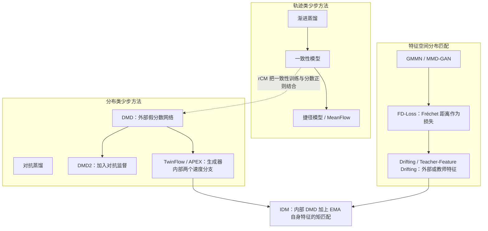
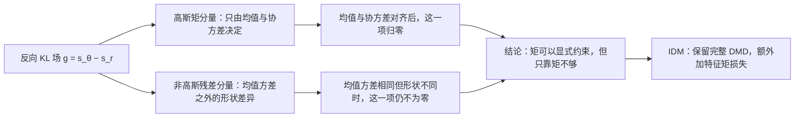
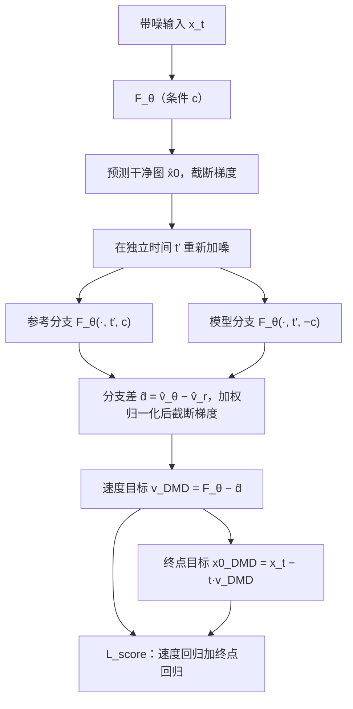
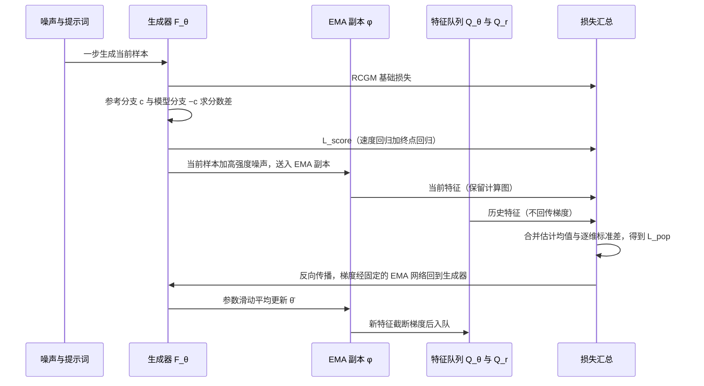
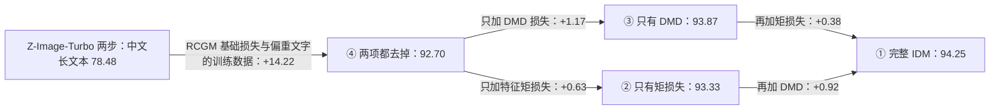

# 内生分布匹配：用生成器自身特征约束均值与方差的少步文生图训练

> **原题**：Intrinsic Distribution Matching
> **作者**：Deyuan Liu、Yansen Han、Kaiwen Zheng（以上三位为共同一作）、Jun Xie、Jiacheng Liu、Zhenglin Cheng、Peng Sun、Jintao Zhang、Jianguo Li、Tao Lin（后三位为通讯作者）
> **机构**：Inclusion AI、西湖大学、清华大学、浙江大学、上海创智学院、MBZUAI
> **年份**：2026（arxiv ID 2610.39633）
> **分类**：cs.CV / cs.AI
> **链接**：https://arxiv.org/abs/2610.39633
> **精读日期**：2026-10-30

## 阅读须知

### 这篇在领域里的位置

文生图模型这几年的主干是扩散模型与流匹配模型。这两类模型生成一张图的方式，是从一团纯噪声出发，由网络反复预测「下一小步该往哪个方向走」，走上几十步乃至上百步之后，噪声才逐渐变成清晰的图像。

每走一步都要完整地运行一遍网络，于是生成成本与步数成正比。在 6B、20B 这种规模的模型上，几十步意味着几秒乃至十几秒的等待，这正是少步生成这一方向存在的理由。

为了把步数压下来，领域里形成了两条主要路线。第一条路线沿着生成轨迹做文章：渐进蒸馏、一致性模型、捷径模型与 MeanFlow 都在教一个学生网络直接跨越轨迹上的一大段，让它一步顶原来的许多步。

第二条路线不关心轨迹本身，只关心最终生成的图像在整体上是否与真实数据相似。对抗训练用判别器来区分真假，分布匹配蒸馏（DMD）则用两个分布在每个样本处的「分数差」来指引生成器向参考分布靠拢。

这篇论文属于第二条路线，而且是其中较新的一个分支。原始 DMD 需要额外训练一个「假分数网络」来追踪生成器当前的分布；TwinFlow 与 APEX 两篇工作随后发现，同一个生成器内部可以分出两个速度分支，分别充当参考分支与模型分支，从而省掉那个额外网络。

IDM 站在 APEX 的基础上继续往前走。它沿用这种内部分支的 DMD，再在生成器自己的特征空间里加一道显式约束，要求生成样本与参考样本的特征均值和逐维标准差对齐。

换句话说，IDM 把「分布匹配蒸馏」和「特征空间矩匹配」这两股原本分开的工作接到了一起。后者的前辈包括 GMMN、MMD-GAN、FD-Loss 以及近期的 Drifting 系列，它们大多依赖外部的冻结编码器（例如 DINOv2）或教师网络来提供特征。IDM 的不同之处在于，特征直接取自生成器的指数滑动平均副本，不引入任何外部网络。

### 读完能回答什么

1. DMD 里的「分数差」在样本空间里指向哪里？它又是怎样经过生成器的雅可比转置，变成参数更新的？
2. 把反向 KL 的梯度场拆成「高斯矩分量」与「非高斯残差」之后，作者为什么决定保留完整的 DMD、只额外加一个矩损失，而不是用矩匹配取代 DMD？
3. 不训练单独的假分数网络时，TwinFlow 与 APEX 怎样让同一个生成器同时给出参考分数和模型分数？
4. IDM 的特征矩损失具体比较哪些统计量？它为什么恰好等于两个对角高斯之间的 2-Wasserstein 距离平方？为什么用 EMA 副本的特征而不用 DINOv2？
5. 两步生成下长文本渲染的大幅领先，有多少来自新加的两项损失，又有多少来自训练数据与基础损失？

### 阅读前置

本文假定读者熟悉深度学习的基本训练流程，知道损失函数、反向传播、梯度截断（stop-gradient）与 LoRA 微调分别是什么，也大致了解扩散模型「从噪声逐步去噪」的生成方式。

本文不假定读者推导过分数函数、KL 散度的变分形式或 Wasserstein 距离，这些概念在首次出现时都会先铺垫再展开。数学部分只保留理解方法所必需的几个公式，附录里大量的正则性条件与证明细节，本文只转述结论，不逐条复述。

### 缩写表

| 缩写 | 全称与含义 |
|---|---|
| DMD | Distribution Matching Distillation，分布匹配蒸馏。用参考分布与生成分布的分数差来训练少步生成器 |
| DMD2 | DMD 的第二版，加入对抗监督等技巧以稳定少步蒸馏 |
| KL | Kullback-Leibler 散度，衡量两个分布差异的常用量。「反向 KL」指以生成分布为基准去衡量它与参考分布的差异 |
| NFE | Number of Function Evaluations，网络前向次数，即生成一张图要运行几遍网络 |
| EMA | Exponential Moving Average，指数滑动平均。本文指生成器参数的滑动平均副本 |
| LoRA | Low-Rank Adaptation，低秩适配。只训练插入的小矩阵，原始权重保持冻结 |
| RCGM | 论文使用的基础损失（Sun 与 Lin，2025），按论文的描述，它通过递归一致的速度场估计，在不同时间区间上监督生成 |
| W2 | 2-Wasserstein 距离，衡量把一个分布「搬运」成另一个分布所需的最小平方代价 |
| FID | Fréchet Inception Distance，用 Inception 网络特征比较生成图与真实图分布的指标，越低越好 |
| CLIP score | 用 CLIP 模型衡量图文一致程度的分数，越高越好 |
| GenEval | 检查组合式指令遵循（物体数量、颜色、位置、属性绑定）的基准 |
| DPG-Bench | 检查冗长细致的提示词能否被逐项遵循的基准 |
| WISE | 检查生成图像是否符合世界知识（文化、时间、空间、生物、物理、化学）的基准 |
| OneIG | 综合评测对齐、文字、多样性、风格与推理五个维度的基准 |
| LongText-Bench | 评测图像中长段中文与英文文字渲染准确度的基准，分为 LongText-CN 与 LongText-EN 两个子集 |
| MJHQ-30K | 计算 FID 与 CLIP score 所用的三万张高质量参考图集合 |
| DINOv2 | Meta 发布的自监督视觉编码器，常被当作通用的冻结特征提取器 |
| GMMN / MMD-GAN | 用矩差或核函数差（最大均值差异，MMD）训练生成模型的早期工作 |
| FD-Loss | 把 Fréchet 距离（全协方差高斯特征差）改写为训练目标的工作 |
| TwinFlow / APEX | 用生成器内部两个速度分支估计分数差、从而省去假分数网络的两项前作 |
| FSDP2 | PyTorch 第二代全分片数据并行，用于在多张显卡之间切分大模型参数 |

## 一、问题

少步文生图的商业价值相当直接。一张图如果从五十步压到两步，同样的显卡在同样的时间里就能多出二十多倍的产能；交互式的应用，例如边输入提示词边出图、实时修改海报，也才真正变得可行。

然而步数一旦少到一两步，模型就失去了「先画轮廓、再慢慢修细节」的余地。它必须在一次前向计算里，把提示词要求的所有细节一次画对。

文字渲染把这个难点放大到了极致。一张海报、一块菜单板上可能有几十个汉字与英文单词，每一笔都要清晰，每个字都要正确，而且要排布在一张整体协调的画面里。

论文选择 LongText-Bench 作为主要战场，原因正在于此：长段文字是检验「少步生成是否保留了细粒度条件信息」最苛刻的考题。少步模型在这里的退化也最明显，例如 8 步蒸馏版 Z-Image-Turbo 被强行压到 2 步时，中文长文本得分从 92.56% 跌到 78.48%。

过去两年，分布匹配蒸馏是少步生成里效果最稳定的路线之一，但它有一个工程上的负担。除了生成器本身，还要在线训练一个与生成器同等规模的假分数网络，去追踪生成器不断变化的分布。

TwinFlow 与 APEX 把这个网络折叠进了生成器内部，显存占用和工程复杂度随之下降。问题在于，学出来的分数估计总有误差，训练步数也有限，分数差这一路监督未必能把生成分布的每一项统计量都对齐到位。这篇论文要回答的就是：在内部 DMD 之上，能否再加一道代价低廉的显式统计约束，把那些没有对齐的部分补回来。

### 1.1 具体的技术问题

把上面的动机落到可以验证的技术陈述上，论文要回答的是这样一个问题：给定一个用内部速度分支做 DMD 的少步生成器，如果再加一项损失，要求生成样本与参考样本在某个特征空间里的均值和逐维标准差相等，生成质量是否会提升？这项损失所用的特征又应该从哪里来？

这个问题有两个隐含的前提需要先交代。第一，DMD 在理论上已经包含了完整的分布信息，精确的分数差会把生成分布一路推到与参考分布重合，因此加矩约束不是在补理论上的漏洞，而是在补「估计不准、训练不足」带来的实际误差。

第二，均值与方差只是分布的一小部分信息。两个分布完全可以均值方差都相同而形状迥异，因此矩匹配不可能取代 DMD，只能作为它的补充。

### 1.2 前人的几条路线

**轨迹类方法**。渐进蒸馏让学生网络一步学会老师网络两步的效果，再反复折半；一致性模型要求轨迹上任意一点都映射到同一个终点；捷径模型与 MeanFlow 则直接学习轨迹上任意两点之间的平均速度。

这类方法做对的地方在于训练信号稠密而稳定，每个样本都有明确的回归目标。它们的不足在于，回归目标本质上是条件均值，平方误差回归会天然地把输出往「平均答案」上拉，在一两步的极端设定下容易产生模糊或细节丢失。

**分布类方法**。对抗蒸馏用判别器给出「像不像真图」的信号，DMD 则用分数差给出「往哪里挪才能更像参考分布」的信号。

它们做对的地方在于直接优化分布层面的差异，不受条件均值回归的牵制，因而一两步生成的图像往往更锐利。不足之处在于需要额外的网络，也就是判别器或假分数网络，训练过程也更脆弱。

**内部分数估计**。TwinFlow 与 APEX 让同一个生成器既充当参考分支又充当模型分支，具体手段是在条件向量上做文章：用原条件 c 运行得到的速度当作参考速度，用取反后的条件 −c 运行得到的速度当作模型速度。

这样省去了独立的假分数网络，代价是两个分支共享全部参数，必须在同一套权重里同时学好各自的任务。

**特征空间分布匹配**。这一脉从 GMMN、MMD-GAN 开始，用矩或核函数衡量两组样本在特征空间里的差异；FD-Loss 把评测用的 Fréchet 距离直接改写成训练损失；Drifting 系列与 Teacher-Feature Drifting 则在冻结特征或教师特征上构造分布更新。

它们做对的地方在于提供了跨样本的整体统计监督，补足逐样本监督看不到的东西。不足之处在于几乎都依赖外部编码器，而外部编码器的特征空间未必与生成器的需要对齐。

IDM 位于图中两股箭头的汇合处。DMD 一脉提供逐样本的分布方向，特征矩一脉提供跨样本的统计约束，而 IDM 把后者的特征来源从外部编码器换成了生成器自己的 EMA 副本。

## 二、方法

### 2.1 从整流流到一步生成器

要理解 IDM，需要先交代它所依托的生成框架。整流流（rectified flow）是流匹配的一种简洁形式，它把「从数据到噪声」的路径定义为一条直线：

$$\mathbf{x}_{r,t} = (1-t)\,\mathbf{x}_r + t\,\boldsymbol{\epsilon}$$

- $\mathbf{x}_r$：一张参考数据在潜空间中的表示，维度为 $d$，来自参考分布 $p_r$
- $\boldsymbol{\epsilon}$：标准高斯噪声，与 $\mathbf{x}_r$ 维度相同
- $t \in [0,1]$：时间，$t=0$ 对应干净数据，$t=1$ 对应纯噪声

网络 $\boldsymbol{F}_\theta(\mathbf{x}_t, t, \mathbf{c})$ 的任务是回归这条直线的速度 $\boldsymbol{\epsilon}-\mathbf{x}_r$，其中 $\mathbf{c}$ 是文本条件向量。在平方误差的最优点，网络学到的是「同一个带噪输入、同一个条件下，所有可能速度的平均值」，这个平均值称为边际速度。

少步生成就是沿着这个速度场，从 $t=1$ 往 $t=0$ 走很少的几步。只走一步时，生成器写成：

$$G_\theta(\mathbf{z}, \mathbf{c}) = \mathbf{z} - \boldsymbol{F}_\theta(\mathbf{z}, 1, \mathbf{c})$$

也就是从噪声 $\mathbf{z}$ 出发，一次减去整段速度，直接落到干净图像上。这个映射诱导出一个生成分布 $p_\theta$，整篇论文要做的事情，就是让 $p_\theta$ 尽可能接近 $p_r$。

### 2.2 分数与速度是同一件事的两种写法

分数（score）是分布匹配里的核心概念。一个分布在某一点的分数，是对数密度在该点的梯度 $\nabla_{\mathbf{x}}\log p(\mathbf{x})$，它指向概率密度上升最快的方向。

直观地说，如果把分布想象成一片起伏的地形，分数就是每个位置上「往高处走」的箭头。整流流框架下，分数和边际速度之间有一个精确的换算关系：

$$\mathbf{s}_t(\mathbf{x}_t) = -\frac{\mathbf{x}_t + (1-t)\,\mathbf{v}^*_t(\mathbf{x}_t)}{t}$$

这条恒等式的意义在于，一个学好了的速度网络，同时也是一个分数估计器。于是两个速度在同一点相减，得到的就是两个分数之差乘上一个与 $t$ 有关的系数；而 DMD 需要的恰恰是分数差，这条恒等式让速度网络可以直接充当分数网络。

### 2.3 反向 KL 场：DMD 到底在推动什么

反向 KL 散度 $\mathcal{D}_{\mathrm{KL}}(p_\theta \| p_r)$ 衡量的是：站在生成分布的角度看，它与参考分布相差多少。论文先说明，这个散度对生成分布的变分梯度，在样本空间里是一个向量场：

$$\mathbf{g}_{\mathrm{KL}}(\mathbf{x}) = \mathbf{s}_\theta(\mathbf{x}) - \mathbf{s}_r(\mathbf{x})$$

它的反方向 $\mathbf{s}_r - \mathbf{s}_\theta$，就是 DMD 推动每个生成样本移动的方向。这个方向的含义是：往参考分布更密、而生成分布相对更稀的地方挪动，使两者的密度比降下来。

样本空间里的方向还需要变成参数空间里的更新。论文给出的一般形式是，参数梯度等于生成器雅可比矩阵的转置乘以这个场，再对输入噪声取期望。

换句话说，分数差先告诉每个样本「该往哪里挪」，反向传播再把这个挪动翻译成「参数该怎么改」。这个拆分让后面的分析只需讨论样本空间里的场，而不必牵扯具体的网络结构。

### 2.4 关键一步：把反向 KL 场拆成两部分

这是全文理论部分的核心。对任何一个光滑、二阶矩有限的分布 $p$，都可以构造一个与它均值 $\mu_p$、协方差 $\Sigma_p$ 完全相同的高斯分布 $q_p$，称为它的矩匹配高斯。

高斯分布的分数是线性的，写作 $-\Sigma_p^{-1}(\mathbf{x}-\mu_p)$。于是 $p$ 的分数可以精确地拆成两项：

$$\mathbf{s}_p(\mathbf{x}) = \underbrace{-\Sigma_p^{-1}(\mathbf{x}-\mu_p)}_{\text{高斯部分}} + \underbrace{\boldsymbol{\eta}_p(\mathbf{x})}_{\text{非高斯残差}}$$

残差 $\boldsymbol{\eta}_p$ 收纳了分布在高斯近似之外的全部结构，例如多峰、偏斜与长尾。论文还证明了残差的一个性质：在它自己的分布下，残差的期望为零，并且与任意线性函数正交。

这个性质的含义是，均值与协方差的信息已经被高斯部分完全吸收，残差里只剩下「形状」。把生成分布与参考分布各自拆开再相减，反向 KL 场就变成两部分之和：一部分只取决于两边的均值与协方差，称为高斯矩分量；另一部分是两边残差之差，称为非高斯残差分量。

论文的图 3 用二维示意说明了这一点：两个分布的均值和协方差完全一样时，高斯分量消失了，残差分量却仍然画出一片不为零的箭头。

这个分解给出的训练启示有两层。一是均值与协方差可以被单独、显式地约束；二是只约束它们远远不够，因为残差承载着矩之外的全部差异。

需要强调的是，论文自己也很谨慎地说明，后面的特征矩损失只是「受这个分解启发」，并不是在样本空间里估计高斯分量或残差分量。分解是在原始样本空间里、用全协方差完成的，损失却是在网络特征空间里、只用逐维方差计算的，两者之间是动机关系，而不是推导关系。

### 2.5 内部 DMD 损失

IDM 的第一项监督沿用 APEX 的内部分支构造。同一个网络 $\boldsymbol{F}_\theta$ 被调用两次：

- 参考分支：$\widehat{\mathbf{v}}_{r,t} = \boldsymbol{F}_\theta(\mathbf{x}_t, t, \mathbf{c})$，使用原条件
- 模型分支：$\widehat{\mathbf{v}}_{\theta,t} = \boldsymbol{F}_\theta(\mathbf{x}_t, t, -\mathbf{c})$，使用取反后的条件

两者之差 $\widehat{\mathbf{d}}_t = \widehat{\mathbf{v}}_{\theta,t} - \widehat{\mathbf{v}}_{r,t}$，就是以速度形式写出的分数差估计。

取反条件之所以能让网络分出一个模型分支，是因为训练时另有一项辅助流匹配损失，专门用生成器自己产出、已截断梯度的样本去训练 $-\mathbf{c}$ 这一路，让它学会描述当前的生成分布。论文也直言，这个解释成立的前提，是两个分支都确实学到了各自的边际速度。

有了分数差，下一步是把它变成回归目标。做法分为四步：

1. 用当前网络从带噪输入 $\mathbf{x}_t$ 预测干净图像 $\widehat{\mathbf{x}}_0 = \mathbf{x}_t - t\boldsymbol{F}_\theta(\mathbf{x}_t,t,\mathbf{c})$，并截断梯度
2. 在一个独立抽取的时间 $t'$ 上，把这个预测重新加噪
3. 在重新加噪的点上计算分支差 $\widehat{\mathbf{d}}_{t'}$，加权归一化后截断梯度，记作 $\widehat{\mathbf{d}}^{\mathrm{DMD}}_{t'}$
4. 构造速度目标与终点目标：

$$\mathbf{v}^{\mathrm{DMD}}_t = \mathrm{sg}\big(\boldsymbol{F}_\theta(\mathbf{x}_t,t,\mathbf{c}) - \widehat{\mathbf{d}}^{\mathrm{DMD}}_{t'}\big),\qquad \mathbf{x}^{\mathrm{DMD}}_0 = \mathrm{sg}\big(\mathbf{x}_t - t\,\mathbf{v}^{\mathrm{DMD}}_t\big)$$

其中 $\mathrm{sg}$ 表示截断梯度。速度目标等于「当前预测减去分数差修正」，终点目标则是这个修正后的速度所对应的干净图像。DMD 损失 $\mathcal{L}_{\text{score}}$ 把两者都用平方误差回归：

$$\mathcal{L}_{\text{score}} = \mathbb{E}\big[\|\boldsymbol{F}_\theta - \mathbf{v}^{\mathrm{DMD}}_t\|^2 + \|\widehat{\mathbf{x}}_0 - \mathbf{x}^{\mathrm{DMD}}_0\|^2\big]$$

这里有一个值得注意的细节。在固定输入与时间下，终点误差恰好等于速度误差乘以 $t^2$，因此两项等权相加，等价于给速度回归乘上 $1+t^2$ 的时间权重。

论文在消融里比较了只用速度、只用终点以及不同配比，最终选择了等权。作者也坦承，这些组合只是同一个修正信号的不同加权方式，并不说明两项各自携带了独立的分布信息。

### 2.6 特征矩损失：IDM 新增的部分

第二项监督是本文真正新增的内容。它要回答两个子问题：在什么特征空间里比较，以及比较哪些统计量。

**特征从哪里来**。IDM 用生成器的 EMA 副本作为特征提取器。EMA 副本是生成器参数的滑动平均，更新规则是 $\bar\theta \leftarrow 0.99\,\bar\theta + 0.01\,\theta$，它比当前参数更平稳，又随着训练缓慢演化。

具体做法是把样本按整流流的方式加上较高强度的噪声，送进 EMA 副本，取最后一层隐藏状态做平均池化，得到每个样本一个 $d_\phi$ 维的特征向量 $\phi(\mathbf{x},\mathbf{c})$。

选择 EMA 副本而不选外部编码器，论文的考虑是：生成器内部的表示本来就包含丰富的语义（REPA 等工作已经说明了这一点），而且它与生成器处在同一个表示空间里，不需要额外加载一个 DINOv2 或教师网络。

不直接使用当前生成器的「实时特征」，是因为特征提取网络如果每一步都和生成器一起变化，统计目标本身就在漂移。EMA 在两者之间取了一个折中，消融实验把这三种选择都拿来做了比较。

**比较哪些统计量**。设 $\mu^\phi_i$ 与 $\nu^\phi_{i,j}$ 分别是第 $i$ 个分布（$i$ 取参考 $r$ 或生成 $\theta$）下特征的均值向量与第 $j$ 维方差。损失写作：

$$\mathcal{L}_{\text{pop}} = \|\mu^\phi_\theta - \mu^\phi_r\|_2^2 + \sum_{j=1}^{d_\phi}\Big(\sqrt{\nu^\phi_{\theta,j}} - \sqrt{\nu^\phi_{r,j}}\Big)^2$$

第一项把生成特征的平均值拉向参考特征的平均值，第二项把每一维的离散程度拉向参考的离散程度。

这个式子恰好等于两个对角高斯 $\mathcal{N}(\mu^\phi_i, \mathrm{diag}(\nu^\phi_i))$ 之间的 2-Wasserstein 距离平方。原因在于，对角高斯之间的最优搬运可以逐维独立计算，每一维的代价正是均值差的平方加上标准差差的平方。

这里有两个刻意的简化需要说明。一是只用逐维方差，不用全协方差，这比 FD-Loss 那样的全协方差 Fréchet 距离便宜得多，也更稳定，代价是忽略了维度之间的相关性。

二是统计量在所有文本条件之间合并计算。它比较的是「所有提示词混在一起」的特征总体，而不是每个提示词下的条件分布。

**怎样估计统计量**。一个批次只有 64 个样本，直接在批次内计算均值与方差，噪声会很大。IDM 为生成特征和参考特征各维护一个容量为 $K=16384$ 的队列，里面存放过去若干步计算出、已截断梯度的特征。

计算生成侧统计量时，使用当前批次的 $B$ 个特征加上队列里的 $K$ 个；参考侧直接使用参考队列里的 $K$ 个。梯度只经过当前批次的特征流回生成器，队列里的历史特征不回传梯度。

### 2.7 完整的训练目标与一次迭代

最终的生成器目标是三项之和：

$$\mathcal{L}_{\text{IDM}} = \mathcal{L}_{\text{base}} + \lambda_{\text{score}}\,\mathcal{L}_{\text{score}} + \lambda_{\text{pop}}\,\widehat{\mathcal{L}}_{\text{pop}}$$

其中 $\mathcal{L}_{\text{base}}$ 是 RCGM 损失，负责常规的跨时间区间速度场监督。默认权重为 $\lambda_{\text{score}}=1$、$\lambda_{\text{pop}}=0.5$，在整个训练过程中保持不变；此外还有前面提到的辅助流匹配损失，专门训练 $-\mathbf{c}$ 那一路模型分支。

这里有一个容易误解的地方：EMA 参数在一步更新中是固定的，但这不等于特征是固定的。特征的数值随着当前生成的图像而变化，梯度正是沿着「图像、固定的 EMA 网络、特征」这条路径传回生成器。

如果把当前特征也截断梯度，矩损失就失去了对生成器的作用。特征提取与队列只在训练时使用；推理时一次前向即可出图，同一个检查点也可以用两步采样。

## 三、实验

### 3.1 实验设置

**骨干与微调方式**。IDM 在两个骨干上训练：Z-Image-Turbo（6B 参数，本身是一个 8 步蒸馏模型）与 Qwen-Image（20B 参数）。每个骨干都做了全参数微调，以及秩 32、秩 64 两档 LoRA 微调。

需要注意的是，Z-Image 一侧的起点是已经蒸馏过的 Turbo 检查点，而不是未经蒸馏的基础模型。

**训练数据**。参考分布 $p_r$ 由几部分组成：ShareGPT-4o 与 BLIP-3o 两个公开集合，加上用 Qwen-Image-2512 与 Z-Image-Turbo 合成的样本。合成部分里，60 万张来自 FLUX-Reason-6M 的提示词，500 万张来自文字渲染类提示词。

作为对照，论文给出的 APEX 训练数据是 20 万张海报类样本。论文明确说明，这个更大、更偏重文字的数据集合，为密集文字渲染提供了更多训练样例。

**训练配置**。全部实验使用 BF16 精度、FlashAttention4 与 FSDP2，全局批次为 64。Z-Image-Turbo 6B 训练 1.5 万步，使用 32 张 H100；Qwen-Image 20B 的 LoRA 训练 1 万步，使用 8 张 A100。

每个检查点都在 1 步和 2 步下评测，不针对步数单独调整损失权重。

**评测基准**。组合指令遵循用 GenEval，图像质量用 MJHQ-30K 上的 FID 与 CLIP score，细粒度提示遵循用 DPG-Bench，世界知识用 WISE。Z-Image 一侧另外加测 OneIG 与 LongText-Bench。

### 3.2 主要结果：长文本渲染

两步生成下的长文本渲染是论文的主打结论。下表摘自论文表 5 的对比部分，所有行都是 Z-Image 骨干，最后一行是 8 步的 Z-Image-Turbo，作为高步数参照。

| 方法 | 步数 | LongText-CN | LongText-EN | GenEval | DPG-Bench | OneIG |
|---|---|---|---|---|---|---|
| Z-Image-Turbo | 2 | 78.48 | 72.89 | 76.53 | 85.78 | 50.94 |
| TwinFlow | 2 | 78.65 | 71.99 | 72.41 | 85.98 | 51.38 |
| DMD2 | 2 | 85.30 | 80.99 | 76.12 | 85.40 | 50.70 |
| APEX | 2 | 90.38 | 88.76 | 77.23 | **88.64** | 52.60 |
| Z-Image-Turbo++ | 2 | 91.62 | 89.88 | 75.70 | 85.86 | 52.50 |
| **IDM** | 2 | **94.25** | 90.20 | **77.81** | 86.82 | **53.06** |
| Z-Image-Turbo（参照） | 8 | 92.56 | **91.74** | 75.01 | 84.86 | 52.84 |

两步 IDM 在中文长文本上达到 94.25%，比此前最好的两步方法 Z-Image-Turbo++ 高 2.63 个百分点，比 APEX 高 3.87 个百分点。这个中文分数甚至超过了 8 步的 Z-Image-Turbo（92.56%），也就是说，四分之一的步数换来了更准确的中文。

英文长文本上的领先幅度则小得多：90.20% 只比 Z-Image-Turbo++ 高 0.32 个百分点，而且仍低于 8 步 Z-Image-Turbo 的 91.74%。与此同时，APEX 在 DPG-Bench 上以 88.64 对 86.82 领先 IDM，论文也在正文中如实写出了这一点。

### 3.3 通用质量与效率

下表摘自论文表 1，比较全参数微调下 IDM 与 APEX 在 Qwen-Image 骨干上的表现，并列出 IDM 在 Z-Image 上的速度。速度在单张 A100（BF16）上测量，吞吐量以批次 10 计算，延迟以批次 1 计算。

| 方法 | 骨干 | 步数 | 吞吐（张/秒） | 延迟（秒） | FID ↓ | CLIP ↑ | GenEval ↑ |
|---|---|---|---|---|---|---|---|
| APEX | Qwen-Image 20B | 2 | 3.30 | 0.45 | 6.44 | 28.51 | 0.90 |
| IDM | Qwen-Image 20B | 2 | 3.28 | 0.44 | 6.34 | 28.56 | 0.91 |
| APEX | Qwen-Image 20B | 1 | 3.50 | 0.34 | 6.87 | 28.66 | 0.89 |
| IDM | Qwen-Image 20B | 1 | 3.44 | 0.35 | 6.77 | 28.71 | 0.90 |
| IDM | Z-Image 6B | 2 | 5.18 | 0.30 | 6.71 | 28.22 | 0.78 |
| IDM | Z-Image 6B | 1 | 5.41 | 0.25 | 7.13 | 28.37 | 0.77 |

在 Qwen-Image 上，IDM 与 APEX 的延迟几乎相同，FID 低约 0.1，GenEval 高 0.01。这说明 IDM 的额外训练开销没有带到推理端；但也说明在通用质量上它与 APEX 基本持平，真正拉开距离的只有长文本渲染。

LoRA 的表现值得一提。Qwen-Image 用秩 64 的 LoRA 只训练约 4 亿参数，两步 GenEval 达到 0.90，与全参数的 0.91 只差 0.01；对没有大规模算力的团队来说，这意味着可以用较低的成本拿到大部分收益。

WISE 世界知识基准上，同为一步生成，全参数 Qwen-Image IDM 得分 0.55，APEX 得分 0.54，同样是很小的差距。

### 3.4 消融：每一项损失各贡献多少

消融全部在 Z-Image 全参数、两步生成的设定下进行，使用同一套数据与配置。下表合并了论文表 5 的主要行。

| 编号 | 配置 | OneIG | GenEval | DPG-Bench | LongText-CN | LongText-EN |
|---|---|---|---|---|---|---|
| ① | 完整 IDM | **53.06** | **77.81** | **86.82** | **94.25** | **90.20** |
| ② | 去掉 DMD 损失 | 52.58 | 76.90 | 86.15 | 93.33 | 89.62 |
| ③ | 去掉特征矩损失 | 52.87 | 77.46 | 86.54 | 93.87 | 89.79 |
| ④ | 两项都去掉 | 52.25 | 76.24 | 85.68 | 92.70 | 88.88 |
| ⑤ | 只用速度回归（保留矩损失） | 52.43 | 76.64 | 85.93 | 93.03 | 89.17 |
| ⑥ | 只用终点回归（保留矩损失） | 52.78 | 77.26 | 86.42 | 93.71 | 89.74 |
| ⑦ | 终点乘 2 加速度 | 53.01 | 77.71 | 86.75 | 94.17 | 90.13 |
| ⑧ | 终点加速度乘 2 | 52.95 | 77.59 | 86.66 | 94.05 | 90.04 |
| ⑨ | 特征换成 DINOv2 | 53.00 | 77.75 | 86.71 | 94.13 | 90.09 |
| ⑩ | 特征换成教师网络 | 52.82 | 77.36 | 86.49 | 93.79 | 89.81 |
| ⑪ | 特征换成实时自身特征 | 52.91 | 77.51 | 86.60 | 93.95 | 89.95 |

**矩损失的贡献**。对比 ① 与 ③，加上特征矩损失之后，GenEval 从 77.46 升到 77.81，中文长文本从 93.87 升到 94.25，英文长文本从 89.79 升到 90.20，五项汇总指标全部上升。

细看 GenEval 的分项，收益集中在颜色属性绑定（65.25 升到 66.25）、位置（50.75 升到 51.25）与计数（70.94 升到 71.25）三项，单物体与双物体两项没有变化。

**DMD 损失的贡献**。对比 ① 与 ②，去掉 DMD 损失使 GenEval 下降 0.91 个点，比去掉矩损失时的 0.35 个点大得多。论文据此认为，分数差修正仍是核心，矩匹配起的是补充作用。

**特征从哪里来**。EMA 特征（①）与 DINOv2（⑨）几乎打平：GenEval 为 77.81 对 77.75，中文长文本为 94.25 对 94.13；教师特征（⑩）与实时自身特征（⑪）都略差一些。

这个结果支持了论文的主张，即不需要外部编码器，生成器自己的 EMA 副本就能提供够用的特征空间。不过 DINOv2 在 DPG-Bench 的「全局」分项上反而更好（82.26 对 80.85），说明两种特征各有侧重，并非 EMA 全面占优。

### 3.5 值得单独讨论的几个结果

**收益的主要来源不在新损失上**。这是读消融表时最需要注意的一点。行 ④ 把 DMD 损失和矩损失都去掉，只剩 RCGM 基础损失加上那批偏重文字的训练数据，中文长文本就已经达到 92.70%，比两步 Z-Image-Turbo 的 78.48% 高出 14 个多百分点，也已经超过了 APEX 的 90.38%。

在此基础上，DMD 与矩损失两项合起来，只再加了 1.55 个百分点。换句话说，「两步方法中长文本最高」这一结论，主要功劳属于训练数据与基础训练流程，而不是本文提出的特征矩损失。论文在正文中承认与 APEX 的比较「反映的是完整训练设置」，但读者很容易从摘要得到「矩损失带来了领先」的印象，这一点需要自己分辨。

**回归形式的影响比矩损失更大**。行 ⑤ 只用速度回归、但保留了矩损失，GenEval 只有 76.64，比完全不加矩损失的行 ③（77.46）还低。

也就是说，DMD 修正以什么形式回归，对结果的影响超过了加不加矩损失。这提醒读者，IDM 的最终表现依赖一组相互配合的工程选择，把矩损失单独拿出来，未必能在别的设置里复现同样的增益。

**方差约束没有换来多样性**。矩损失的第二项专门约束逐维标准差，附录 B.7 还专门讨论了平方误差回归会使输出协方差收缩的问题，读者自然会期待它能提升样本多样性。

然而在 OneIG 的多样性分项上，IDM 只有 12.85，低于两步 Z-Image-Turbo 的 13.85 和 TwinFlow 的 15.49；加不加矩损失，这一项只从 12.81 变到 12.85，几乎没有变化。论文没有讨论这个现象。

**两步仍未全面追上八步**。8 步 Z-Image-Turbo 在英文长文本（91.74 对 90.20）与 OneIG 的文字分项（99.32 对 98.15）上仍然领先两步 IDM。

两步 IDM 在中文长文本、GenEval、DPG-Bench 与 OneIG 总分上超过了 8 步参照，因此「少步追平多步」的结论只在部分指标上成立。

## 四、局限

### 4.1 作者承认的局限

论文没有单列局限一节，但在正文与附录中多处主动划定了结论的边界。第一，作者明确指出矩匹配本身不足以决定分布，两个分布可以均值方差都相同而形状不同，所以矩损失只能补充、不能取代 DMD。

第二，特征矩是在所有文本条件之间合并计算的。它约束的是总体统计量，而不是每个提示词下的条件分布。

第三，作者说明特征矩损失只是受反向 KL 分解「启发」，并没有在估计样本空间里的高斯分量或残差分量，理论与方法之间是动机关系。第四，队列里的特征来自较早的模型与 EMA 状态，因此由队列算出的统计量只是对当前总体统计的近似。

第五，作者承认速度回归与终点回归的各种配比只是同一个修正信号的不同时间加权，消融结果不能说明两项各自携带了独立的分布信息。第六，作者写明与 APEX 的比较使用了不同规模的训练数据，反映的是完整训练设置之间的差异，各项损失的作用要靠受控消融来分离。

### 4.2 读者能看出的问题

**新损失的增益很小，而且没有方差**。矩损失在各项指标上带来的提升大多在 0.2 到 0.4 个百分点之间。论文的全部结果都来自单次训练、单次评测，没有报告随机种子、置信区间或多次运行的波动。

在这样的幅度下，训练本身的随机性就可能造成同一量级的差异。读者不宜把这些细小差距当作确定的结论。

**训练数据混淆了主要对比**。前面已经指出，去掉两项新损失之后，模型的中文长文本得分就已经超过 APEX。IDM 仅合成部分就有 560 万张，而论文给出的 APEX 数据是 20 万张，并且 IDM 的数据偏重文字渲染，其中一部分还是用 Z-Image-Turbo 自己合成的。

如果想知道矩损失在 APEX 原有数据上能带来多少提升，论文没有给出这组实验。

**表格数字异常规整**。在 GenEval、DPG-Bench 与 WISE 的分项表里，同一骨干下 LoRA 秩 32、秩 64 与全参数三行，几乎在每一个子项上都以约 0.01 的步长整齐递增，1 步与 2 步之间的差距也高度一致。

单次评测的结果通常不会这样平滑。这本身不足以说明问题，但它加重了对种子与方差缺失的担忧，最好等代码与检查点公开之后再做独立验证。

**理论与方法之间的跨度较大**。反向 KL 的分解发生在原始样本空间，使用全协方差，而且针对每一个条件；实际损失却发生在一个非线性特征空间，只用对角方差，并且在所有条件之间合并。

从前者到后者，中间每一步简化都会丢掉分解所保证的性质。所以这套理论更适合被理解为「为什么值得尝试矩约束」的直觉，而不是对方法有效性的证明。

**计算与数据成本没有完整交代**。Z-Image 的训练用了 32 张 H100、1.5 万步，这已经不是小成本；更大的隐性开销在于用 Qwen-Image-2512 与 Z-Image-Turbo 合成 560 万张参考图。

论文没有报告合成数据的耗时与花费，也没有说明这批合成数据是否随代码一同公开。没有这批数据，外部团队很难复现论文的主要数字。

**评测几乎全部依赖自动指标**。所有结论都来自自动化基准，没有人工偏好评测。少步生成常见的问题，例如质感偏塑料、颜色过饱和、细节重复，未必能被这些指标充分捕捉。

论文在定性部分提到，不加矩损失的版本颜色更饱和，寿司海报里的橙色与黄色区域最为明显。这个观察很有意思，却没有对应的量化指标来支撑。

## 一句话

IDM 给内部 DMD 加上 EMA 自身特征的均值方差约束，两步出图中文长文本达 94.25%，主要增益来自训练数据。
