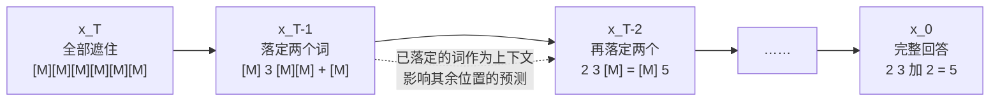
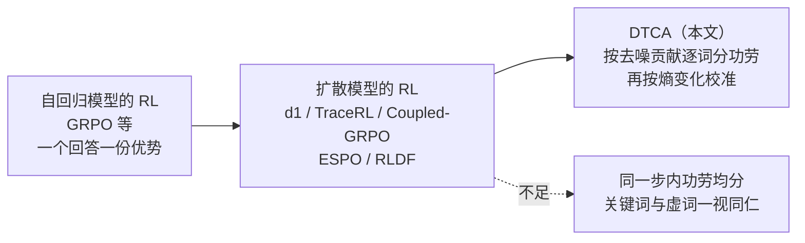
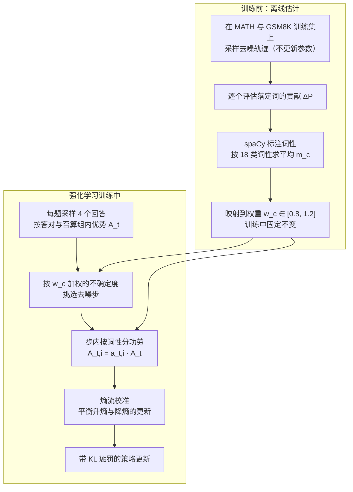
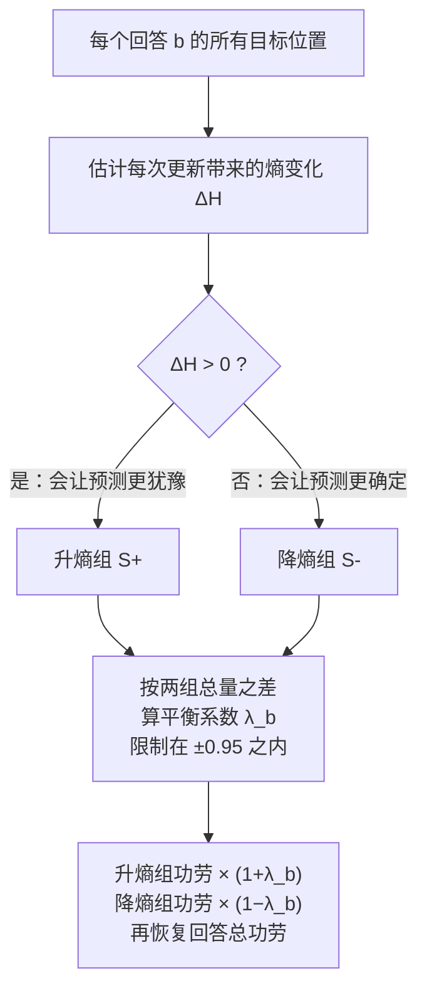

# DTCA：扩散语言模型强化学习里的逐词元功劳分配

> **原题**：DTCA: Denoising Token Credit Assignment for Reinforcement Learning in Diffusion Language Models
> **作者**：Hongze Chen, Miao Pan, Lizhou Liang, Qinfeng Li, Xinyin Ma, Yongliang Shen, Weishi Wang, Daniel Dahlmeier, Xuhong Zhang, Wenqi Zhang
> **机构**：浙江大学、新加坡国立大学、SAP
> **年份**：2026（arxiv ID 2610.35201，2026 年 10 月 26 日提交）
> **分类**：cs.CL
> **链接**：https://arxiv.org/abs/2610.35201
> **代码**：https://github.com/ZJU-OmniAI/DTCA
> **精读日期**：2026-10-29

## 阅读须知

### 这篇在领域里的位置

这篇论文属于「扩散语言模型的强化学习」这条线。扩散语言模型是自回归模型之外的另一种文本生成方式：它不是从左到右一个词一个词地写，而是先让整段回答全部处于「被遮住」的状态，再分很多步，每一步揭开其中几个位置、填上确定的词，直到全部填满。这种做法能同时看到左右两侧的上下文，也能一次并行地填好几个词，LLaDA、Gemini Diffusion 都是这一路的代表。

过去一年，人们开始把强化学习用到扩散语言模型上，以提升数学推理一类的能力，代表工作有 d1、TraceRL、Coupled-GRPO、ESPO 与 RLDF。它们大多沿用自回归模型里成熟的 GRPO 思路，用整段回答答对与否作为奖励。DTCA 指出，扩散模型的生成过程有许多步，每一步揭开的词又会影响后面各步怎么填，只用一个整体奖励很难说清是哪些词、哪几步立了功。它提出一种逐词元分配功劳的办法，并在 LLaDA-8B-Instruct 上验证。

### 读完能回答什么

1. 为什么在扩散语言模型里做强化学习，「功劳分配」比在自回归模型里更难。
2. DTCA 如何衡量一个词被揭开之后对后续去噪的贡献，为什么要按词性分组来估计。
3. 词性贡献权重在训练中用在了哪两处：选哪些去噪步来训练，以及每个词分到多大的学习信号。
4. 熵流校准是什么，它为什么能让训练后期更稳。
5. 在 MATH500 与 GSM8K 上，DTCA 比基础模型和其他强化学习方法高多少，哪个组件在长生成长度下最关键。

### 阅读前置

本文假定读者了解大语言模型的强化学习微调，知道 GRPO 一类「组内相对优势」的做法，熟悉交叉熵、熵与 KL 散度的含义。读者未必了解扩散语言模型，相关概念会先铺垫再展开。

### 缩写表

- **DLM**（Diffusion Language Model，扩散语言模型）：通过多步「去遮罩」逐步填出整段文本的语言模型，本文专指掩码扩散模型。
- **RL**（Reinforcement Learning，强化学习）：根据奖励信号调整模型，让高奖励的输出更可能出现。
- **GRPO**（Group Relative Policy Optimization，组相对策略优化）：同一道题采样一组回答，用组内标准化后的奖励作为每个回答的「优势」，再据此更新模型。
- **SFT**（Supervised Fine-Tuning，监督微调）：用标准答案直接训练模型。
- **POS**（Part of Speech，词性）：名词、动词、数词、标点、限定词、介词等词类。本文用 spaCy 的英文小模型标注 18 类词性。
- **KL**（Kullback–Leibler divergence，KL 散度）：衡量两个概率分布差多远，这里用来约束训练后的模型不要离参照模型太远。
- **OPEFO**：一篇针对自回归模型的强化学习工作，提出了按熵变化平衡学习信号的方法，DTCA 把它改造后用在扩散模型上。
- **RLDF**：一个扩散语言模型强化学习方法，DTCA 的训练框架与数据处理都以它为基础，也是最直接的对照组。

## 一、问题

### 为什么这个问题值得做

扩散语言模型被寄予厚望，原因是它能并行生成、能双向看上下文，理论上在推理速度和全局规划上都有优势。可是要让它像自回归大模型一样会做数学题、会推理，强化学习几乎是必经之路。现有的扩散模型强化学习方法，已经能把 LLaDA 一类模型的数学成绩提高几个百分点，但离自回归模型经过强化学习后的进步幅度还有距离。

作者认为，一个关键的瓶颈在于功劳分配。强化学习只在最后告诉模型「这道题答对了」或「答错了」，而扩散模型生成一个回答要经过几十到几百步，每一步揭开几个词，揭开的词又会改变后面各步对其他位置的判断。哪些词、在哪一步揭开，对最终答对起了关键作用，整体奖励里完全看不出来。若把同一份奖励均匀地摊给所有词、所有步，真正关键的决定和无关紧要的虚词就得到一样的鼓励，学习信号便很粗糙。

### 扩散语言模型怎样生成文本

为了说清楚这个问题，先交代掩码扩散模型的生成过程。给定一个问题 $q$，模型从一段全部被遮住的回答出发，记作 $x_T$；每走一步，就把其中一部分被遮住的位置换成预测出的词，得到 $x_{T-1}$、$x_{T-2}$……直到 $x_0$，即完整回答。这一串状态构成一条去噪轨迹 $\tau = (x_T, x_{T-1}, \ldots, x_0)$。

论文把「某一步把某个位置换成确定的词」称为词元落定（token commitment）。本文用的是单调揭开的方式：一个词一旦落定，就一直可见，并会作为上下文影响剩下那些仍被遮住的位置的预测。

### 现有扩散模型强化学习的做法

现有方法大体是把 GRPO 搬过来：同一道题采样一组回答，按答对与否算出每个回答的优势 $A$，再挑出若干去噪步，在这些步上对要学习的位置施加带优势的对数似然损失，外加一个约束模型不要偏离参照模型的 KL 惩罚。写成示意式：

$$\mathcal{L}_{\text{RL}}(\theta) = -\mathbb{E}\Big[\frac{1}{N}\sum_{t \in \mathcal{T}}\sum_{i \in \mathcal{B}_t} A_{t,i}\log\pi_\theta(v_i \mid q, x_t)\Big] + \beta_{\text{KL}}\,\mathcal{L}_{\text{KL}}$$

- $\mathcal{T}$：被选中用于训练的去噪步。
- $\mathcal{B}_t$：第 $t$ 步上要学习的位置。
- $v_i$：位置 $i$ 上的目标词。
- $A_{t,i}$：分给这个位置的学习信号，也就是功劳。

d1、TraceRL、Coupled-GRPO、ESPO、RLDF 的区别，主要在于怎样选步、怎样估计似然、怎样降低方差。比如 RLDF 会按每一步的平均「意外程度」随机抽样若干步来训练。但它们在一个关键点上做法相同：同一步里所有位置分到的功劳 $A_{t,i}$ 基本一样。DTCA 要改的正是这一点。

## 二、方法

### 整体思路

DTCA 的做法分三层。第一层，在强化学习开始之前，先离线估计各类词性的「去噪贡献」：一个词落定后，能让剩下被遮住的位置预测得更有把握多少。第二层，训练时用这份按词性得到的贡献权重做两件事：挑出最值得训练的去噪步，以及在每一步内部按词性给各个位置分配不同大小的功劳。第三层，再按每次更新会让预测熵升高还是降低，对功劳做一次平衡校准。

### 第一步：衡量一个词的去噪贡献

DTCA 用一个直观的量来衡量某个词落定的作用：它落定之后，剩下那些仍被遮住的位置，模型的预测变得多有把握。先定义一个去噪状态 $x$ 在一组遮住位置 $\mathcal{M}$ 上的总把握：

$$F(x;\mathcal{M}) = \sum_{j \in \mathcal{M}} \max_{v \in \mathcal{V}} p_{\theta,j}(v \mid q, x)$$

- $j$：一个仍被遮住的位置。
- $\mathcal{V}$：词表。
- $p_{\theta,j}(v \mid q, x)$：模型在状态 $x$ 下，认为位置 $j$ 是词 $v$ 的概率。

于是 $F$ 就是每个遮住位置上「最有把握的那个候选词」的概率之和。对第 $t$ 步落定的某个词 $v_i$，它的贡献定义为：

$$\Delta P_i = \max\Big(0,\ F(x_t^{(i)};\mathcal{M}) - F(x_t;\mathcal{M})\Big)$$

其中 $x_t^{(i)}$ 是只把这一个词单独落定之后的状态，$\mathcal{M}$ 是落定前后都仍被遮住的位置。负值一律记为零。这个值越大，说明这个词一旦确定，就越能帮模型想清楚其他位置该填什么。

### 为什么要按词性分组

逐词计算这个贡献，在强化学习训练中做不起。每评估一个词，都要多跑一次前向计算；同一步里又常常同时落定好几个词，彼此纠缠，单个词的效果很难分开。即便算出来，不同回答之间的估计也波动很大。

DTCA 的办法是把这件事挪到训练之前离线做，并按词性求平均，换取稳定。离线阶段，去噪步数设为最大生成长度的一半，每步落定两个词，再对每个词各多跑一次前向计算来得到 $\Delta P_i$。然后用 spaCy 的英文模型给每个词标注词性 $c_i$，在每一类词性内求平均：

$$m_c = \frac{1}{N_c}\sum_{i: c_i = c} \Delta P_i$$

论文开头的预分析给出了这样做的理由：不同词性的去噪行为差别明显。名词在整个去噪过程中落定比例一直较高；动词在开头落定得多，之后迅速减少；限定词、介词、形容词落定比例较低且平稳。按贡献看，动词最大，其次是名词和专有名词，限定词与介词最小。换句话说，实词承载内容，往往决定了后面怎么写；虚词主要搭语法架子，对后续的帮助有限。

### 把贡献变成有界的权重

各类词性的平均贡献再被线性映射到一个很窄的区间：

$$w_c = 0.8 + 0.4\,\frac{m_c - \min_j m_j}{\max_j m_j - \min_j m_j}$$

于是贡献最小的词性权重是 0.8，最大的是 1.2。作者有意把范围压得这么窄，是为了只微调功劳的分配，不至于把原有的强化学习目标改得面目全非。这份权重表在整个训练过程中固定不变。

### 第二步：用权重挑选值得训练的去噪步

沿用 RLDF 的做法，DTCA 不在每条轨迹的所有去噪步上训练，只挑一部分。对第 $t$ 步，记这一步落定的词为集合 $\mathcal{A}_t$，它的重要性得分为：

$$q_t = \sum_{i \in \mathcal{A}_t} w_{c_i}\,(1 - p_i)$$

其中 $p_i$ 是词 $i$ 落定时模型对它的把握。$1 - p_i$ 让含有低把握落定的步得分更高，因为那正是模型犹豫、最需要学习的地方；$w_{c_i}$ 则让落定了高贡献词性的步得分更高。

把所有步按得分排序，选出累计得分达到总得分 70% 的最少几步，并限制在 2 到 32 步之间。这样，挑出多少步会随每条轨迹的情况自动变化。附录的覆盖率分析显示，在挑出同样比例的步时，DTCA 覆盖到的低把握质量和熵，大约是 RLDF 随机抽样的两倍。例如在只挑 16.82% 的步时，低把握覆盖从 19.93% 提到 40.59%。

### 第三步：在步内按词性分功劳

对选中的第 $t$ 步，要学习的位置集合 $\mathcal{B}_t$ 包括这一步落定的词，以及按 RLDF 的低概率过滤规则保留下来的、仍被遮住的位置。这些位置的词性取自最终完成的回答。每个位置分到的功劳系数为：

$$a_{t,i} = \frac{w_{c_i}}{\frac{1}{|\mathcal{B}_t|}\sum_{k \in \mathcal{B}_t} w_{c_k}}$$

分母是这一步所有位置权重的平均值，因此一步之内功劳系数的平均恰好是 1，整步的优势大小不变，只是在步内重新分配。最终的学习信号是 $A_{t,i} = a_{t,i} A_t$。高贡献词性的位置得到更强的信号，低贡献的得到更弱的信号，原本一整段回答共用的一份奖励，就这样被细分到了每个词上。

### 第四步：熵流校准

只按贡献分功劳还有一个隐患。强化学习的每次更新，会让一些位置的预测变得更确定（熵下降），让另一些变得更犹豫（熵上升）。如果熵下降的更新长期占上风，模型会越来越「自以为是」，探索能力衰退，训练后期容易失稳。

DTCA 借用了 OPEFO 为自回归模型设计的熵流平衡方法，并把它改到扩散模型的选中步与目标位置上。先用一阶近似估计一次更新会让每个位置的熵改变多少：

$$\Delta H^{(b)}_{t,i} = -\eta\,A^{(b)}_{t,i}\,(1 - p^{(b)}_i)^2\,\big(\log p^{(b)}_i + H^{(b)}_i\big)$$

- $b$：第几个回答。
- $\eta$：学习率。
- $p^{(b)}_i$：当前模型给目标词的概率。
- $H^{(b)}_i$：这个位置完整预测分布的熵。

然后在每个回答内部，把升熵与降熵的更新分成两组，按两组总量的差算出一个平衡系数：

$$\lambda_b = \operatorname{clip}\left(\frac{\sum_{S_b^-}|\Delta H| - \sum_{S_b^+}\Delta H}{\sum_{S_b^-}|\Delta H| + \sum_{S_b^+}\Delta H},\ -0.95,\ 0.95\right)$$

当降熵的更新多于升熵时，$\lambda_b > 0$，于是把升熵更新的功劳放大为 $(1 + \lambda_b)$ 倍，把降熵更新的功劳缩小为 $(1 - \lambda_b)$ 倍；反过来亦然。校准之后再把每个回答的总功劳恢复原状。这一步只在同一组内统一缩放，所以先前按词性拉开的差距依然保留。

### 训练配置

训练直接从 LLaDA-8B-Instruct 出发，不做中间的监督微调，数据是 RLDF 处理过的 MATH 训练集，奖励只看最终答案是否正确。每道题采样 4 个回答做组内标准化。全参数 bf16 训练，AdamW，学习率恒为 $10^{-6}$，KL 惩罚系数 0.01。采样时最大回答长度 256、去噪 256 步，块大小 32，动态置信阈值 0.9，并用 Fast-dLLM 的键值缓存加速。训练共约 500 次更新。

## 三、实验

### 评测设置

评测用 MATH500 与 GSM8K 两个数学推理基准，只看最终答案对不对。每个模型在 128、256、512 三种最大生成长度下评测，去噪步数与长度相同，温度为 0，每题只生成一个回答。对照组包括基础模型 LLaDA-8B-Instruct、LLaDA-1.5、均匀监督微调，以及 d1、ESPO、TraceRL、Coupled-GRPO、RLDF 五种扩散模型强化学习方法。值得注意的是，表中所有对照组的分数都是作者在同一套设置下本地复现的，不是照抄原论文。

### 主要结果

| 方法 | MATH500 @128 | @256 | @512 | GSM8K @128 | @256 | @512 |
|---|---|---|---|---|---|---|
| LLaDA-8B-Instruct（基础） | 30.8 | 36.4 | 39.2 | 75.3 | 83.2 | 82.9 |
| LLaDA-1.5 | 32.6 | 39.4 | 39.8 | 76.2 | 81.6 | 83.0 |
| 均匀监督微调 | 24.6 | 30.0 | 32.6 | 74.8 | 80.7 | 78.6 |
| d1 | 33.6 | 37.6 | 37.2 | 75.8 | 82.4 | 81.8 |
| ESPO | 37.6 | 38.0 | 40.2 | 78.1 | 83.2 | 84.0 |
| TraceRL | 32.6 | 34.2 | 34.0 | 76.6 | 80.4 | 81.8 |
| Coupled-GRPO | 35.2 | 40.2 | 40.2 | 78.0 | 83.6 | 83.2 |
| RLDF | 36.2 | 41.2 | 42.6 | 77.2 | 83.4 | 82.7 |
| DTCA 去掉熵校准 | 37.4 | 41.8 | 39.8 | 78.3 | 83.9 | 81.9 |
| DTCA 去掉按词性分功劳 | 36.2 | 39.4 | 41.2 | 77.1 | 82.9 | 82.3 |
| **DTCA** | **39.8** | **43.2** | **44.0** | **80.6** | **85.3** | **85.4** |

DTCA 在六个设置上全部第一。相对基础模型，MATH500 分别高 9.0、6.8、4.8 个百分点，GSM8K 分别高 5.3、2.1、2.5 个百分点。相对最直接的对照 RLDF，MATH500 高 3.6、2.0、1.4 个百分点，GSM8K 高 3.4、1.9、2.7 个百分点。提升在最短的生成长度 128 下最大，作者据此认为 DTCA 在去噪计算有限时收益更明显。

### 消融：两个组件各管什么

去掉按词性分功劳（改成同一步内均分，但保留按权重选步）之后，在 256 长度下 MATH500 掉 3.8、GSM8K 掉 2.4 个百分点。去掉熵校准（保留按词性分功劳与选步）之后，256 长度下两项各掉 1.4 个百分点，但到了 512 长度，掉幅扩大到 4.2 和 3.5 个百分点。

训练曲线给出了更细的解释。去掉按词性分功劳的变体，奖励曲线和完整方法差不多，但梯度范数始终更大，说明分功劳主要改变的是更新的方式，而不只是奖励涨得多快。去掉熵校准的变体，前期与完整方法相近，后期 KL 散度上升更快、奖励更低，说明熵校准的作用在于稳住后期的更新。

与 RLDF 的训练轨迹相比，第 401 到 500 次更新之间，DTCA 的平均奖励是 0.537，RLDF 是 0.482；DTCA 的策略熵是 2.00 纳特，RLDF 是 1.78；DTCA 的平均 KL 散度是 0.36，RLDF 是 0.89。也就是说，DTCA 奖励更高，却离参照模型更近，模型也保留了更多的不确定性。

### 训练后模型的去噪行为变了什么

作者对比了训练前后的落定模式。DTCA 并没有把所有词统一提前或推后落定，而是按词性做了不同的调整：数词的落定比例在各阶段都下降，标点的落定比例上升。动词的落定比例变化不大，但落定时的把握明显提高、熵明显降低。也就是说，DTCA 不仅改变了先填哪些词，也改变了填词那一刻模型的状态。

### 值得单独记一笔的现象

第一个反直觉之处在消融表的 512 长度那一列。去掉熵校准、只保留按词性分功劳时，MATH500 是 39.8，比 RLDF 的 42.6 还低 2.8 个百分点；GSM8K 是 81.9，比基础模型的 82.9 还低。换句话说，在长生成长度下，按词性分功劳本身不但没帮上忙，反而有害，必须配合熵校准才能转为正收益。这提示两个组件之间有很强的相互依赖，论文正文对这一点没有展开讨论。

第二个现象是均匀监督微调全面低于基础模型，在 MATH500 上低 5 到 7 个百分点。这说明对 LLaDA 这类已经过指令微调的扩散模型，直接拿数学数据再做监督微调，会损害它的推理能力，强化学习在这里几乎是唯一能稳定带来提升的路子。

第三个现象出现在熵的分析里：功劳变化与熵变化并不总是同向。比如符号类词得到了更多功劳，熵却下降；助动词得到的功劳减少，熵却上升。作者解释说，功劳只改变更新的力度，熵升还是降还取决于优势的正负、当前的预测分布与目标词本身。

## 四、局限

### 作者承认的局限

作者承认，按词性分组依赖词性标注与词元对齐的质量，更精确的逐词标注方法也许能进一步改善估计。对「贡献」的定义，即落定后剩余遮住位置把握的提升，是一种经验做法，还缺少更有原则的理论表述。实验只覆盖了 LLaDA-8B-Instruct 上的数学推理，用到代码生成等任务时，词的分布与生成方式不同，分组策略可能要重新设计，也需要在更多扩散模型架构上验证。

### 读完能看出来的潜在问题

结果的统计稳健性不明。每个设置每题只生成一个回答，温度为 0，表中没有给出多次训练的方差或置信区间。MATH500 共 500 题，一个百分点就是 5 道题；DTCA 相对 RLDF 在 512 长度下 1.4 个百分点的优势，相当于多答对 7 道题，单次运行很难排除随机波动。所有对照组又都是本地复现，复现的质量会直接影响差距的大小。

按词性分功劳的实际力度很有限。权重被压在 0.8 到 1.2 之间，又在每步内归一化，同一步里最强与最弱位置的功劳最多相差一半。可消融显示去掉它会掉 3.8 个百分点，这么小的调整带来这么大的变化，读者会想知道提升中有多少其实来自选步方式的改变。附录只比较了不同选步规则的覆盖率，没有单独消融选步对最终准确率的影响。

词性标注在数学文本上的可靠性存疑。spaCy 的英文小模型是为普通英文句子训练的，而数学推理的回答里充满数字、算式、LaTeX 符号与变量名，这些内容的词性标注往往不准。论文没有报告标注质量，也没有说明符号与公式是怎样对齐到模型词元上的。

权重表在整个训练中固定不变。它来自训练前基础模型的去噪轨迹，而随着训练推进，模型的去噪行为本身在变（作者自己展示了数词、标点落定比例的变化），早期估计的贡献是否还准确，值得怀疑。离线估计需要对每个落定的词额外跑一次前向计算，这部分计算成本论文也没有量化。

最后，评测只看最终答案是否正确，不评中间推理过程；训练与评测数据都来自 MATH 与 GSM8K 这类英文数学题。方法在其他语言、其他任务上的表现，以及在更大的扩散模型上是否依然有效，目前都没有证据。

## 一句话

DTCA 按词性估计词元的去噪贡献来选步、分功劳，再用熵流校准稳住训练，让 LLaDA 数学推理最多提升 9 个百分点。
