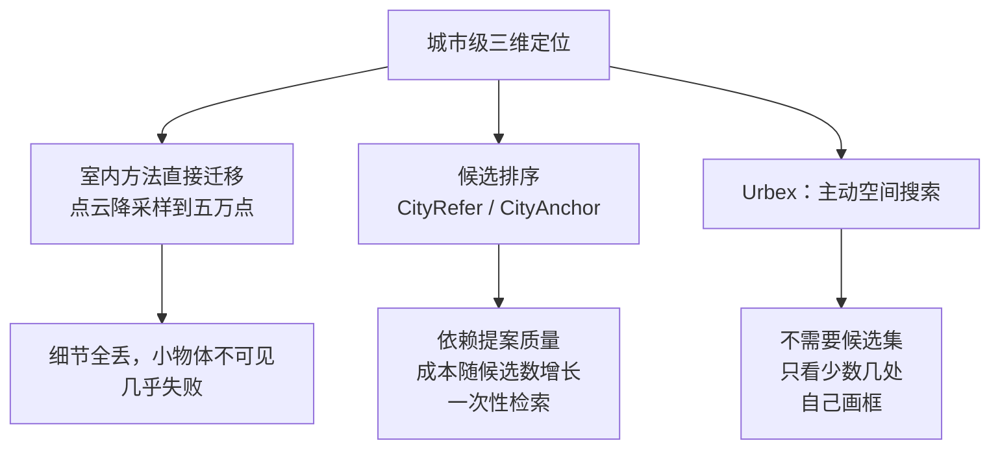
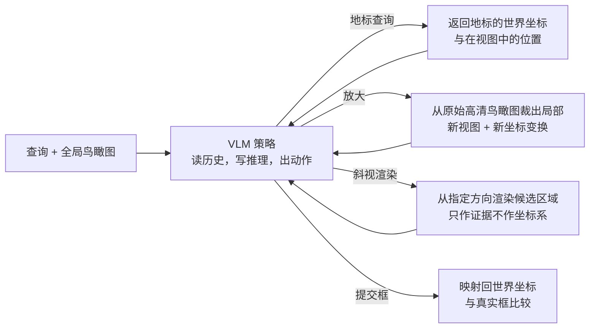
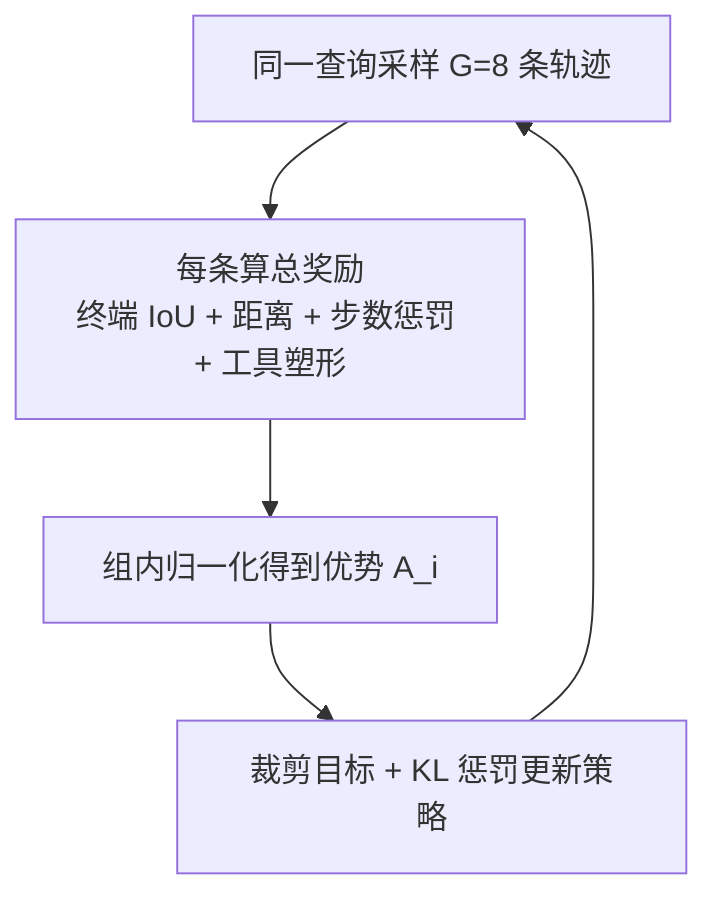

# Urbex：把城市级三维场景里的「按描述找东西」变成一场主动搜索

> **原题**：Urbex: Agentic Spatial Grounding for City-Scale 3D Scenes
> **作者**：Yu Wang, Rui Dai, Wei Chen, Yi Wang, Bo Dang, Kaikui Liu, Xiangxiang Chu, Yansheng Li
> **机构**：武汉大学、阿里巴巴高德（AMAP）
> **年份**：2026（arxiv ID 2610.18356，2026 年 10 月 13 日提交，NeurIPS 2026）
> **分类**：cs.CV / cs.AI
> **链接**：https://arxiv.org/abs/2610.18356
> **精读日期**：2026-10-14

## 阅读须知

### 这篇在领域里的位置

「三维视觉定位」（3D grounding）要解决的问题，是给一段自然语言描述和一个三维场景，让模型把描述所指的那个物体找出来、框出来。这是具身智能的基础能力之一，自动驾驶、机器人导航、无人机巡检都用得上。过去几年这个方向的研究绝大多数集中在室内场景：一间房、一套公寓，点云几万到几十万个点，描述也多是「沙发旁边的那把椅子」这一类。

把场景放大到一座城市，问题的性质就变了。一个城市级场景动辄几千万个点，描述里会出现建筑名、道路方向和远处的地标，例如「西米德兰兹警察拘留所左边那辆橙色车旁边停着的白车」。模型既要有细粒度的视觉识别能力，又要能顺着长距离的空间线索推理。

针对城市级场景，此前的主流做法是「候选排序」：先用标注或者实例分割模型把场景里所有物体切出来当候选，再给每个候选打一个与描述的匹配分，取最高分。本文 Urbex 换了一种提法，把定位当成一场主动的空间搜索：一个会用工具的视觉语言模型智能体，从鸟瞰图出发，查地标、放大局部、换斜视角确认，最后自己画出一个框。它和同期把「智能体 + 工具调用 + 强化学习」用到视觉任务上的一批工作同属一个潮流，而把这套方法落到城市级三维场景上，本文是较早的一篇。

### 读完能回答什么

1. 为什么室内三维定位的方法搬到城市级场景会失效，候选排序这条路又卡在哪里？
2. Urbex 怎样把一个几千万点的三维场景，变成一个视觉语言模型能「看」能「操作」的环境？
3. 三个工具（地标查询、放大、斜视渲染）各自解决什么问题，哪一个贡献最大？
4. 为什么要用强化学习而不是监督微调，奖励是怎样设计的，每一项起什么作用？
5. Urbex 比最强的候选排序方法快了多少，代价是什么，剩下的短板在哪里？

### 阅读前置

本文假定读者熟悉视觉语言模型的基本用法，知道什么是工具调用、什么是强化学习里的策略和奖励。读者不需要做过三维视觉或点云处理，点云、鸟瞰图、IoU 这些概念会在首次出现时先铺垫再解释。

### 缩写与术语表

- **3D grounding（三维视觉定位）**：根据自然语言描述，在三维场景中找出所指物体并给出其空间范围。
- **点云（point cloud）**：用大量带坐标（常带颜色）的点表示的三维场景数据。
- **BEV**（Bird's-Eye View，鸟瞰图）：从正上方俯视场景渲染出的二维图像。
- **VLM**（Vision-Language Model，视觉语言模型）：既能看图也能读写文字的大模型。
- **候选排序（candidate ranking）**：先列出场景中的所有物体实例，再逐个与描述匹配打分的做法。
- **IoU**（Intersection over Union，交并比）：预测框与真实框的重叠面积除以两者并集面积，衡量框得准不准。
- **Hit@k**：把预测结果与候选物体按重叠度排序后，正确目标是否落在前 k 名。
- **RL**（Reinforcement Learning，强化学习）：靠奖励信号而非标准答案来训练策略。
- **GRPO**（Group Relative Policy Optimization）：一种不需要单独价值网络的强化学习算法，用同一问题的多次采样互相比较来估计优势。
- **CityRefer**：建立在 SensatUrban 点云之上的城市级三维定位数据集，本文的主要训练与评测集。
- **STPLS3D-Refer**：作者从 STPLS3D 无人机摄影测量点云上新构建的评测集，只用于零样本测试。
- **ND / NO**：CityRefer 的两个测试划分，ND 是训练过的场景里没见过的描述，NO 是完全没见过的场景。
- **CityAnchor**：此前最强的城市级候选排序方法，用多模态大模型给每个候选打分。

## 一、问题

这个问题之所以值得做，是因为「在一座城里按一句话找到一个东西」是很多实际系统的共同需求，而现有方法在城市尺度上要么不准、要么太慢。无人机巡检要找「某条路尽头那栋红顶仓库」，物流机器人要找「某栋楼门口的那辆白色货车」，这些都不是室内方法能处理的规模。更进一步说，在一个巨大的环境里定位，天然是一个一步步探索的过程：先弄清大致在哪个街区，再到那一带去细看，最后确认。把它压成一次性的检索，本身就丢掉了问题的结构。

### 1.1 室内方法为什么失效

室内三维定位方法通常会先把原始点云降采样到固定大小，例如五万个点，再送进网络。在室内这够用，在城市里就不够了：一个 CityRefer 场景有一千二百万到一亿一千六百万个点，降到五万个点之后，一辆车只剩几个点，细节几乎全部丢失。本文的实验里，室内方法 EDA 在城市场景上几乎完全失败，Hit@1 不到 0.5%。

### 1.2 候选排序为什么不够好

为了避开整片点云，近期的城市级方法改走候选排序。它们先从标注或者现成的实例分割流水线得到物体提案，再计算文本与每个实例的匹配分。这确实把输入规模压下来了，但带来三个问题。第一，准确率被提案质量锁死，分割漏掉的东西永远找不到。第二，推理成本随候选数量线性增长，一个场景里有几十到几百个候选，每个都要过一遍打分模型。第三，也是作者最强调的一点，它把定位变成了静态检索，而城市里的定位本应是顺序的、探索式的。

### 1.3 任务的形式化

作者把任务写成这样。给定一个城市级三维场景 $\mathcal{S}$ 和一句查询 $q$，目标是定位所指物体 $o^\star$ 并输出它的空间范围。候选排序方法假定有一个候选集 $\mathcal{C}=\{o_i\}_{i=1}^{N}$，并学习打分函数 $s(q,o_i)$；Urbex 不接收任何候选集，而是通过一组视图 $\mathcal{V}$ 观察场景，视图可以用工具不断扩充。它最终在某个与鸟瞰图对齐的视图 $v$ 里预测一个自由形状的框 $\hat{b}_v$，环境再把这个框映射回世界坐标。真实框只在训练时提供奖励、在评测时提供标准答案，推理时不作为输入。

## 二、方法

Urbex 的核心设计只有一句话：用少数几张坐标对齐的图像，把一个巨大的三维场景暴露给视觉语言模型，让它看、让它操作。下面分三层展开：环境怎么搭，智能体怎么推理，策略怎么训练。

### 2.1 交互式环境：把点云变成可操作的多视图

**视图表示。** 初始观察是一张全局鸟瞰图。每个与鸟瞰图对齐的视图 $v$ 都包含一张图像 $I_v$ 和一个从视图坐标到世界坐标的映射 $T_v$。智能体用归一化的二维坐标表达框，环境维护对应的变换，于是在任何视图里画的框都能投影回真实的三维场景。这个设计让模型面对的是一个简单一致的二维界面，同时保留了原场景的度量信息。

**三个城市专用工具。** 作者刻意把动作空间压得很小，只给三个工具，分别对应全局锚定、局部细节和三维确认。

- **地标查询**：把查询里出现的建筑名、路名解析成真实地标，返回它的世界坐标以及在指定视图中的投影。城市级描述里专有名词非常多，这些名字是最强的全局锚点，数据来自 OpenStreetMap。
- **放大**：把选定的框映射到原始高分辨率鸟瞰图上，裁出局部返回，并附上新的视图编号和坐标变换。原始鸟瞰图长边通常超过一万像素，而模型看到的全局图是降采样过的，小物体只占几个像素，放大才能找回真正的细节。
- **斜视渲染**：从指定的方位（东南西北）渲染选定的候选区域，得到一张带三维信息的图，用来核对物体的形状、高度和位置关系。这张图只作为证据，不作为最终提交框的坐标系。

### 2.2 多视图工具调用的推理循环

策略 $\pi_\theta$ 是一个视觉语言模型，输入当前观察 $o_t$ 和交互历史 $h_t$，历史里包含原始查询、过去的工具调用、返回的视图编号、坐标约定和所有图像。每一步它输出一段推理和一个动作：

$$
(\mathrm{thought}_t, a_t) \sim \pi_\theta(o_t, h_t)
$$

动作要么是带结构化参数的工具调用，要么是最终答案。推理过程自然分成三段：先解析描述、在鸟瞰图上找到属性和空间锚点，再放大可疑区域看清小物体和密集的局部，最后在俯视证据不够时渲染斜视图来确认。因为每一次工具返回都会追加到历史里，模型可以回看之前的视图，在全局与局部之间切换时保持坐标一致。

这套协议可以直接给一个未经训练的视觉语言模型使用，得到一个零样本的工具调用基线。但搜索空间仍然很大：模型不仅要会看图，还要学会什么时候查地标、放大多大、斜视值不值得多花一步、什么时候证据够了可以停。这正是下面强化学习要解决的事。

### 2.3 用强化学习学会主动搜索

作者把一次定位看成有限步数的马尔可夫决策过程：状态是对话历史、当前视图集合和工具反馈，动作是合法的工具调用或提交答案，环境转移是确定的，随机性只来自策略采样。回合在提交答案或用完步数预算时结束。

**终端奖励。** 设提交的世界坐标框为 $\hat{b}$，真实框为 $b^\star$，终端奖励是：

$$
R_{\mathrm{term}}=\lambda_{\mathrm{iou}}\,\mathrm{IoU}(\hat{b},b^\star)+\lambda_{\mathrm{dist}}\exp\!\left(-\frac{d(\hat{b},b^\star)}{\tau}\right)-\lambda_{\mathrm{step}}\frac{T}{T_{\max}}
$$

其中 $d$ 是两个框中心在地面上的距离，$T$ 是用掉的轮数，$T_{\max}$ 是预算。IoU 项奖励框得准；距离项在重叠为零时仍给出连续的信号，这在训练初期的城市场景里极为常见，因为一开始模型画的框往往离目标很远；步数项惩罚拖沓。作者特意不用「成功就加一分」那种离散奖励，让奖励随定位质量平滑增长，避免阈值处的断崖。实际参数是 $\lambda_{\mathrm{iou}}=1.0$、$\lambda_{\mathrm{dist}}=0.3$、$\tau=80$ 米、$\lambda_{\mathrm{step}}=0.05$。

**工具级塑形奖励。** 在终端奖励之外，每一步工具调用也有小额奖励：

$$
R(\tau)=R_{\mathrm{term}}+\sum_{t=1}^{T}R_{\mathrm{tool}}(s_t,a_t)
$$

放大时，裁剪中心比上一次更靠近目标就加分、更远就扣分；斜视渲染的奖励与渲染区域和目标的重叠成正比；工具名写错、参数不合法、框不可能、执行出错都扣分。所有这些塑形奖励都设了上限，防止盖过终端目标。需要说明的是，这些奖励用到了真实框，属于训练时的「特权信号」，只用于优化策略，从不出现在智能体看到的文本里，所以推理时不会泄露目标。

**优化。** 整个训练只用强化学习，没有任何监督示范轨迹，算法是 GRPO。它不训练单独的价值网络，而是对同一个查询采样一组 $G$ 条轨迹，用组内奖励的均值和标准差来归一化优势：

$$
A_i=\frac{R(\tau_i)-\mu_R}{\sigma_R+\epsilon}
$$

然后最大化带裁剪的目标，并加上对参考策略的 KL 惩罚。底座是 Qwen3-VL-4B-Instruct，视觉编码器冻结，每条轨迹最多八个助手轮次（七次工具调用加一次回答），训练 300 步，批大小 256，组大小 8，用 16 张 H20 显卡。

## 三、实验

### 3.1 实验设置

主评测集是 CityRefer，12 个场景，总面积 1.594 平方公里，8.77 亿个点，2,234 个真实候选物体，299 个 OpenStreetMap 地标。作者清洗了重复和错误标注后，分出 2,744 条训练、549 条验证、1,098 条 ND 测试和 1,396 条 NO 测试查询，其中七个场景完全留作 NO。零样本评测集 STPLS3D-Refer 是作者从 STPLS3D 的两个无人机摄影测量场景（南加州大学校园和一个海洋科学中心）半自动构建的，目标只有建筑和车辆两类。

对比方法分三组：接上同一套 Urbex 工具的闭源大模型（GPT-5.4、Qwen3.6-plus），室内三维定位方法（EDA、InstanceRefer），以及城市级候选排序方法（CityRefer、CityAnchor）。评测分两种设定：「有真实候选」时，排序方法可以用标注好的候选集，指标是 Hit@1/3/5；Urbex 即使在这个设定下也不用候选，它先画框，再按二维 IoU 和候选匹配。「无真实候选」时，所有方法必须直接输出空间范围，指标是二维 IoU、三维 IoU 和点级 F1。

### 3.2 主要结果

| 方法 | ND Hit@1 | ND Hit@3 | NO Hit@1 | NO Hit@3 | 每条耗时（秒） |
|---|---|---|---|---|---|
| GPT-5.4 + Urbex 工具 | 9.3 | 12.4 | 13.1 | 18.6 | 未报 |
| Qwen3.6-plus + Urbex 工具 | 6.4 | 9.6 | 11.5 | 16.2 | 未报 |
| EDA（室内） | 0.1 | 0.1 | 0.2 | 0.3 | 3.0 |
| InstanceRefer（室内，用候选） | 1.6 | 5.0 | 4.9 | 15.9 | 0.6 |
| CityRefer | 1.6 | 3.9 | 0.6 | 2.1 | 0.7 |
| CityAnchor | 23.4 | 35.3 | 14.2 | 22.4 | 32.1 |
| **Urbex** | **25.8** | **39.2** | **23.9** | **36.9** | 3.2 |

无真实候选的设定下，Urbex 在 ND 上二维 IoU 15.6、三维 IoU 11.0、点级 F1 20.1，在 NO 上分别为 14.6、7.7、17.8；接了同样工具的 GPT-5.4 只有 4.4、2.2、9.4 和 4.6、1.9、10.4。作者还补了一条完整的提案流水线对照：用 SoftGroup 在 15 个其他场景上训练分割，把提案喂给 CityAnchor，在 NO 上只得到 4.2、2.4、4.7，远低于 Urbex。

这张表有三处值得细看。第一，闭源大模型接上工具后并非毫无办法，但离训练过的策略差距很大，说明工具协议只是舞台，什么时候用哪个工具这件事必须学。第二，在 NO 这种完全没见过的场景上，Urbex 的优势比 ND 更大，Hit@1 23.9 对 CityAnchor 的 14.2，提示它学到的是一种搜索方式而不是对特定场景的记忆。第三，CityAnchor 在 ND 上保住了最高的 Hit@5（45.4 对 42.3）：穷举排序能把好几个像样的候选都留在前五，而主动搜索一旦在局部选错就全错，两种方法的失败模式不同。

### 3.3 推理效率

CityAnchor 每条查询约 32.1 秒，因为要把打分模型跑遍所有候选；Urbex 约 3.2 秒，快了一个数量级，其中工具执行只占约 0.36 秒。斜视渲染可以预先缓存，12 个场景的缓存要花约 2.3 小时；不缓存、按需渲染的话每条约 4.4 秒。这些数字都不含离线的场景准备。

### 3.4 零样本迁移

只在 CityRefer 上训练、直接用到 STPLS3D-Refer 上，Urbex 的 Hit@1/3/5 为 27.2/32.1/33.4，无候选设定下二维 IoU 13.0、三维 IoU 10.0、点级 F1 16.2，在每一项上都是最好。候选排序方法在这里崩得很厉害，CityAnchor 的 Hit@1 只有 2.1，耗时却涨到 47.2 秒；GPT-5.4 接工具能到 16.3，仍不及 Urbex。

### 3.5 消融

| 工具组合 | 轮数预算 | Hit@3 | 二维 IoU |
|---|---|---|---|
| 无工具 | 0 | 10.5 | 2.1 |
| 放大 | 8 | 15.5 | 4.1 |
| 放大 + 地标 | 8 | 28.2 | 8.9 |
| 放大 + 地标 + 斜视 | 7 | 34.8 | 11.0 |
| 放大 + 地标 + 斜视 | 8 | **36.9** | **14.6** |
| 放大 + 地标 + 斜视 | 9 | 36.8 | 13.2 |

| 奖励设置 | Hit@3 | 二维 IoU |
|---|---|---|
| 只有 IoU | 22.8 | 6.7 |
| IoU + 距离 | 30.6 | 10.9 |
| IoU + 工具塑形 | 28.4 | 9.6 |
| 全部 | **36.9** | **14.6** |

贡献最大的单个工具是地标查询：加上它之后 Hit@3 从 15.5 跳到 28.2，二维 IoU 翻倍还多。这印证了作者的出发点，城市级描述先要定对街区，细看才有意义。轮数预算从 7 到 8 有明显提升，到 9 反而略降，说明多给一步确认有用，再多就变成无谓的徘徊和临时改框。奖励方面，距离项的作用最大，因为训练初期预测框与目标往往毫无重叠，只靠 IoU 几乎没有梯度。

### 3.6 几个分析

**固定工作流对照。** 作者把工具顺序固定成「地标、放大、斜视、回答」，让模型只填参数和画框。未训练的 Qwen 底座只有 2.7 的 Hit@1，训练后的 Urbex 在同一流程下达到 10.0，说明训练学到的不只是顺序，更是怎样根据看到的画面选裁剪框、在裁剪里找目标。同一个固定流程给 GPT-5.4 用，准确率不变而词元消耗从 16,321 降到 7,734。

**地标有多重要。** 在含地标的 NO 查询上，给地标坐标加 10 米噪声只让 Hit@1 降 1.2 个百分点，而地标缺失或错误会让它掉十个百分点以上。锚点稍不准没关系，没有锚点才致命。

**框画得大。** 这是一个反直觉的结果。Urbex 认对目标的能力很稳，换不同的匹配规则 Hit@1 最多变 0.29 个百分点；可一旦要求排第一的目标与预测框的 IoU 不低于 0.25，Hit@1 就从 23.53 降到 18.71。预测框面积与目标面积之比的中位数是 1.40，第 90 百分位高达 9.92，也就是说有相当一部分框把目标周围一大片都圈了进去。模型「知道是哪一个」，但「框得不紧」，这和 Hit@k 这种只看排名的指标掩盖了的问题正好对应。

## 四、局限

### 4.1 作者承认的局限

Urbex 依赖一个任务专用的交互环境：鸟瞰图渲染和视图到世界坐标的标定必须可靠，标定或渲染出错会把一个看起来合理的二维框投到错误的世界位置。地标缺失、含糊、过时时，智能体只能退回到纯视觉搜索，效率下降。当前策略提交的是与鸟瞰图对齐的框，细粒度的三维分割精度还有提升空间，作者提议把多视图三维实例分割模型作为额外工具接入。作者也在附录里讨论了误用风险：这类技术可能被用于监控和目标追踪，他们只在公开数据上训练，并以仅限研究的许可发布代码和模型。

### 4.2 读完能看出来的潜在问题

**绝对精度仍然很低。** 最好的 Hit@1 也只有 25.8%，无候选设定下的三维 IoU 只有 11.0。这是一个很难的任务，Urbex 把它往前推了一步，但离「能用」还远。文中的「最佳」都是相对基线而言。

**与闭源模型的比较并不对等。** GPT-5.4 和 Qwen3.6-plus 只是接上工具、没有训练，而 Urbex 是在 CityRefer 上用强化学习专门优化过的 4B 模型。这组对比证明的是「训练有用」，不能读成「小模型胜过了大模型」。

**评测集小而偏。** CityRefer 只有 12 个场景，NO 划分的七个场景之间统计上可能很不均匀；STPLS3D-Refer 只有两个场景、两类目标，描述还是半自动生成的。零样本结论建立在很窄的基础上。

**框大的问题削弱了「候选无关」的卖点。** 主动搜索最大的优点是不依赖提案，可是它输出的框经常比目标大好几倍，真要在下游使用，多半还得接一个分割或细化模块，这又把一部分依赖加了回来。

**训练成本与可复现性。** 16 张 H20 做强化学习，每条轨迹要跑多次渲染，斜视缓存要数小时。代码虽承诺开源，环境搭建的门槛不低。

## 一句话

把城市级三维定位从「给所有候选打分」改成「智能体查地标、放大、斜看、画框」的主动搜索，用强化学习训出策略，准确率超过最强排序方法且快十倍。
