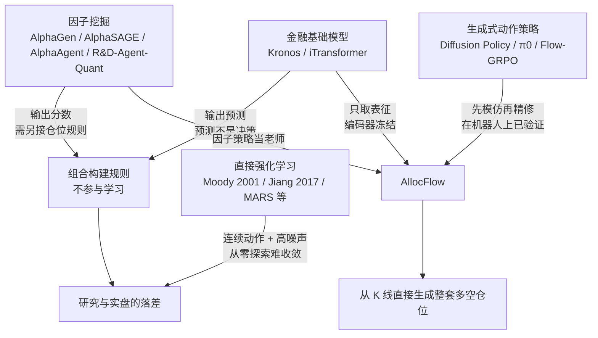
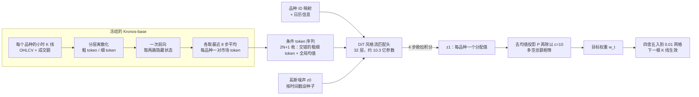
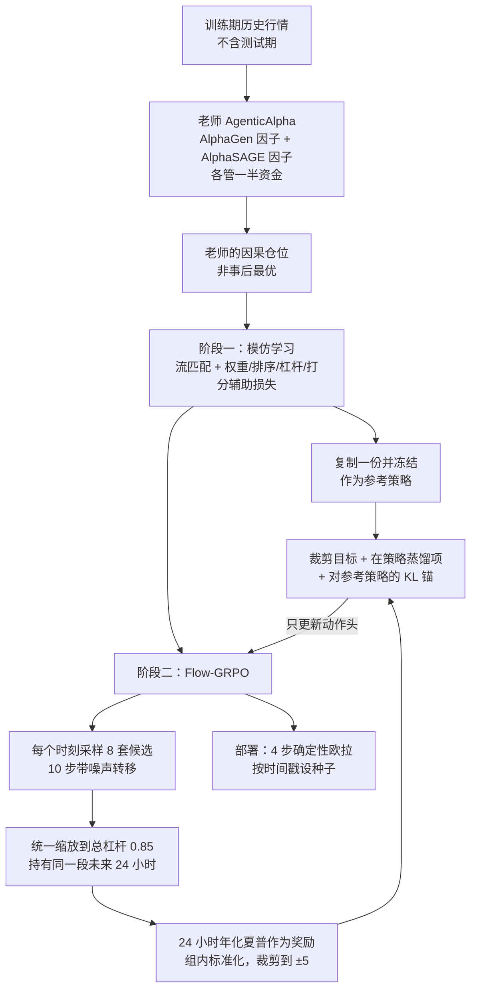
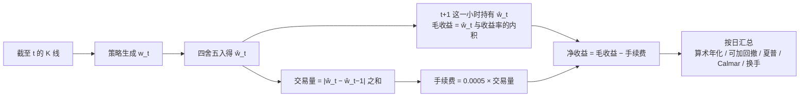
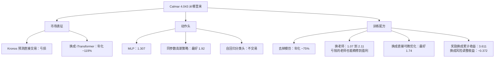

# AllocFlow：从原始行情直接生成多资产组合仓位

> **原题**：AllocFlow: End-to-End Portfolio Trading Action Generation from Raw Market Data
> **作者**：Annan Wang、Yuchen Xie、Yu Cen、Leon Liangyu Chen、Qianyu Julie Zhu、Xin Li、Tianyi Wei、Weisi Lin
> **机构**：arxiv 摘要页与 HTML 正文均未列出作者机构
> **年份**：2026（arxiv ID 2611.19937）
> **分类**：cs.LG（主分类）
> **链接**：https://arxiv.org/abs/2611.19937
> **精读日期**：2026-11-17

## 阅读须知

### 这篇在领域里的位置

量化交易把行情变成仓位的流程，长期以来被切成前后几段。第一段是从历史价格里找出带有预测力的信号，业内把这类信号叫作 alpha，也常称为因子；第二段是用一套组合构建规则，把每个品种的信号分数换算成具体的买卖仓位；第三段才是执行，把目标仓位落成真实订单。

过去几年，机器学习的力气主要花在第一段。AlphaGen 用强化学习搜索公式化因子，AlphaSAGE 用生成流网络做同样的事，AlphaAgent 与 R&D-Agent-Quant 则让大语言模型智能体自动做因子研究。与此同时，Kronos 这类金融时间序列基础模型把 K 线当作一种"语言"来预训练，学出可以复用的市场表征。这些工作都在让"信号"更准，但仓位怎么配，仍然交给固定的规则。

另一条线一直在尝试"直接学交易"。从 2001 年 Moody 与 Saffell 的直接强化学习，到 2017 年 Jiang 等人的深度强化学习组合管理框架，研究者希望模型从观测直接输出仓位，绕过中间的信号层。可是金融回报的噪声极大，从零开始探索的强化学习常常学不出稳定行为，这条线在实践中屡屡受挫。

本文位于这两条线的交汇处。它借用机器人领域近两年流行的"先模仿、再用奖励精修"的生成式策略路线，把一个流匹配（flow matching）生成模型当作整套组合仓位的生成器：先模仿一个因子策略的历史决策，再用组合层面的金融奖励做强化学习精修。

### 读完能回答什么

1. 为什么"预测更准"不等于"交易更赚"，把信号和仓位分开优化会损失什么？
2. AllocFlow 怎样把一个冻结的金融基础模型和一个流匹配动作头拼成"从 K 线直接到仓位"的策略？
3. 为什么强化学习之前必须先模仿一个老师策略，而且老师本身亏钱也不妨碍最终盈利？
4. 为什么同样的强化学习目标下，流模型做动作生成器比参数量相同的高斯策略强出一倍以上？
5. 论文报告的扣费后年化 51%、Calmar 4.0 在什么条件下成立，还有哪些假设没被检验？

### 阅读前置

假定读者熟悉 Transformer 的基本结构，知道监督学习与 PPO 一类策略梯度方法的大意，也大致了解扩散模型"从噪声逐步生成样本"的思路。不预设读者做过量化交易，多空、杠杆、回撤、夏普比率等金融术语会在第一次出现时解释。同样不预设读者熟悉流匹配与 GRPO 的细节，这两样会在方法部分从头铺垫。

### 缩写与术语表

| 缩写或术语 | 含义 |
|---|---|
| OHLCV | Open、High、Low、Close、Volume，一根 K 线里的开盘价、最高价、最低价、收盘价与成交量 |
| 永续合约 | 没有到期日的期货合约，可以做多也可以做空，多空双方按固定周期互付资金费 |
| 目标仓位簿（target book） | 模型每小时输出的一整组带符号权重，正数是多头，负数是空头 |
| 总敞口（gross exposure） | 所有权重绝对值之和，衡量账户整体用了多大杠杆 |
| IL | Imitation Learning，模仿学习，让模型拟合老师策略的输出 |
| RL | Reinforcement Learning，强化学习，用奖励信号改进策略 |
| GRPO | Group Relative Policy Optimization，组内相对策略优化，同一输入采样一组候选，用组内相对好坏作为优势 |
| Flow-GRPO | 把 GRPO 用到流匹配生成模型上的方法 |
| DiT | Diffusion Transformer，用 Transformer 做扩散或流模型主干的架构 |
| OPD | On-Policy Distillation，在策略蒸馏，用参考策略对当前采样动作的打分作为额外优势 |
| DRaFT | Direct Reward Fine-Tuning，把可微奖励沿生成过程直接反向传播的微调方法 |
| LoRA | Low-Rank Adaptation，低秩适配，一种参数高效的微调方法 |
| MLP | Multi-Layer Perceptron，多层感知机 |
| MDD | Maximum Drawdown，最大回撤，累计收益从峰值到谷底的最大跌幅 |
| Sharpe | 夏普比率，日净收益均值除以其标准差再年化，衡量单位波动换来的收益 |
| Calmar | 年化净收益除以最大回撤，衡量单位回撤换来的收益 |
| TO | Turnover，换手率，本文指每天目标权重变化的绝对值之和 |
| bps | basis point，基点，等于 0.01% |

## 一、问题

一个交易账户每个小时真正要回答的问题，是"眼下这二十个品种，各自做多还是做空，各自多大仓位"。预测模型可以告诉你"比特币下一小时大概率上涨"，可这句话离一个可执行的仓位还很远。如果账户已经通过以太坊持有了同方向的大量风险，再加比特币仓位等于把同一个赌注押了两遍；如果预测的涨幅不够覆盖手续费，那么调仓这件事本身就是亏的。

换句话说，一个方向正确的预测，照样可能因为仓位过大、与别的头寸重复、或者调仓成本太高，变成一笔坏交易。与之相对地，一组协调好的多空头寸，可以在不押注大盘涨跌的情况下赚取品种之间的相对差价。每一个仓位都必须放在整套仓位里去评价，这是组合管理与单品种预测的根本区别。

这个问题不解决，业务侧的直接后果是研究与实盘之间的落差。因子研究员优化的是预测指标，账户最终却按扣费后的收益与回撤结算，两者之间隔着一层人工设计的换算规则。学界把这种落差称为"先预测、后优化"的错位：前一段学得再好，只要后一段规则不匹配，收益就会被吃掉。

论文里恰好有一个极端例子。直接拿 Kronos 对下一根 K 线的预测去做"只做多、选排名前几"的交易，零样本年化亏损 44.5%，做了 LoRA 微调之后仍亏 34.6%。一个预训练得不错的预测模型，原样拿去交易反而是亏钱的。

过去几年的努力大致落在两类路线上。第一类继续在信号层发力，因子更好、表征更好，但仓位规则不动；第二类让强化学习直接出仓位，可作者把 11 种从零训练的强化学习交易方法放到同一份数据上，没有一个的夏普比率追得上简单持有比特币。于是旧路线卡在两头：信号路线无法让"仓位怎么配"被优化，纯强化学习路线又在巨大的连续动作空间与高噪声回报里找不到方向。

### 具体的技术问题

把上面的动机落成一个可以验证的技术陈述：在每个整点时刻 t，给定当期可交易的 N_t 个永续合约的历史 K 线，模型要一次性输出一个带符号的目标权重向量，正数表示做多，负数表示做空，权重相对于一个固定的账户名义本金。评价标准不看任何中间预测指标，只看这一串目标仓位在扣除手续费之后的真实账户表现。

这里的"端到端"有明确边界。推理时从原始 K 线到可执行权重之间没有中间预测、没有因子分数、也没有优化器；但负责读行情的编码器是预训练好之后冻结的，这一点与视觉语言模型和机器人策略里"冻结视觉编码器"的做法相同。

### 前人路线逐条看

**因子挖掘加组合构建。** AlphaGen（KDD 2023）用强化学习生成一组互补的公式化因子，AlphaSAGE（ICLR 2026）改用生成流网络以求更广的探索，AlphaAgent 和 R&D-Agent-Quant 让大模型智能体提出并检验因子。这条路线做对的地方在于信号可解释、可以组合；它不够用的地方在于输出只是分数，必须再接一套规则才能变成多空仓位，而这套规则本身不参与学习。

**金融时间序列基础模型。** Kronos 把 OHLCV 离散成 token，像语言模型一样预训练"预测下一根 K 线"，iTransformer 一类模型则把每个变量当作一个 token 做预测。它们提供了可复用的市场表征，但预测本身不是决策，上面那组亏钱的 Kronos 直接交易数字就是证据。

**直接强化学习组合管理。** 从 Moody 与 Saffell 到 FinRL 框架，再到近两年的 MARS、ReCAP、DeepAries，这条线一直在端到端地优化收益。它的难处在探索：动作是连续的整套仓位，回报噪声极大，手续费还会让"什么都不做"显得最安全。目前在加密货币上表现较好的强化学习方法，例如 EarnHFT、MacroHFT、FineFT，都借助"事后最优"的神谕动作来引导智能体，等于悄悄给了它一个老师。

**生成式动作策略。** 机器人领域的扩散策略（Diffusion Policy）和 π0 用扩散或流模型生成连续动作，DPPO、Flow-GRPO、ReinFlow 进一步证明这类生成式策略可以用强化学习继续精修。这些方法在图像生成与机器人控制上已被广泛验证，本文的贡献是把这套组合搬到组合交易上，并为它设计了"因子策略模仿加组合奖励精修"的训练配方。

### 为什么纯强化学习会卡死在"不交易"

附录里有一个简单但很说明问题的推导。设想账户从空仓出发，只决策一期，目标函数是期望收益减去按交易量计算的手续费，再减去一个非负的风险惩罚。如果每个品种的期望收益绝对值都不超过手续费率，那么"一个仓位都不开"就是全局最优解；把可行集限制为多空总额相等的组合，这个结论依然成立。

这条推导解释了两个现象。其一，在信号微弱、手续费确定的市场里，从零开始的策略很容易收敛到空仓。其二，GRPO 依靠组内比较来产生学习信号，如果一组候选全是空仓，它们的奖励完全相同，组内相对优势全部为零，策略得不到任何方向性的更新。因此，强化学习开始之前，候选仓位必须已经"像样"，这正是模仿学习阶段存在的理由。

## 二、方法

AllocFlow 由三块组成：一个冻结的市场编码器负责把每个品种的历史压缩成少量 token，一个流匹配动作头负责一次性生成整套仓位，再加上一套两阶段训练配方，先模仿、后精修。下面先交代符号，再逐块展开。

### 2.1 符号

- t：市场时间，以小时为单位，每根 K 线一小时。
- U_t：t 时刻的可交易品种集合。每周日重建一次，取过去 60 天成交额最大的 20 个合约。
- N_t：U_t 里的品种个数，通常为 20。
- X_t：形状为 N_t × L × C 的张量，L 是回看的 K 线根数，C 是通道数（OHLCV 加成交额）。
- w_t：长度为 N_t 的带符号目标权重向量，相对于固定名义本金。
- ŵ_t：把 w_t 四舍五入到执行网格之后的目标，下一根 K 线开始生效。
- τ：流时间，取值从 0 到 1，是生成过程内部的进度，与市场时间 t 无关。
- z_τ：生成过程中的动作隐变量，长度与品种数相同。
- v_θ：动作头学到的速度场，θ 是动作头参数。

### 2.2 冻结的市场编码器：只取 Kronos 的表征

如果让动作头直接对每个品种的每根 K 线做注意力，二十个品种乘以几百根 K 线，上下文会很长。作者的做法是把"读行情"交给一个现成的金融基础模型，并且全程冻结它。

Kronos 是一个专为金融 K 线设计的基础模型。它先把归一化后的 OHLCV 与成交额编码成分层的离散 token，分为粗粒度和细粒度两级，再像语言模型那样预训练"预测下一根 K 线"。本文用的是 Kronos-base 检查点，它的预训练数据截止到 2024 年 6 月，早于测试期，所以权重里不含测试期信息。

AllocFlow 不用 Kronos 的预测输出，而是在一次前向计算中截取两个隐藏状态：粗粒度解码器的最终上下文，以及细粒度依赖层的输出。对每一路取最近 8 步的平均，就得到每个品种一枚粗粒度市场 token 和一枚细粒度市场 token。这条路径既不采样下一根 K 线，也不把预测价格喂给策略，所有交易决策都留给后面的动作头去学。

### 2.3 流匹配动作头：一次生成整套仓位

先铺垫流匹配。流匹配是一种生成模型的训练方法，它要解决的问题是，怎样从简单的高斯噪声出发，把样本一步步"推"成目标分布里的样本。具体做法是学习一个速度场 v_θ(z, τ)，生成时让隐变量沿着 dz/dτ = v_θ 从 τ = 0 积分到 τ = 1。训练时只需在噪声 ε 与真实样本 a 之间取直线插值 z_τ = (1 − τ)ε + τa，让速度场去回归两者之差 a − ε。与扩散模型相比，它的训练目标更直接，推理时用很少几步数值积分就能得到样本。

动作头的输入由两类 token 组成。第一类是条件 token：每个品种的粗、细两枚市场 token 交错排列，再加一枚所有 token 的平均值作为全局市场 token，一共 2N_t + 1 枚。第二类是每个品种一枚"分配状态 token"，它在生成结束时的值就是该品种的目标权重。此外还有品种身份嵌入与日历信息作为条件。

品种 ID 映射把同一品种的市场 token 和分配状态 token 对应起来。因此可交易集合每周换了成员、换了顺序、甚至个数变化，都不需要为某个币种写死的输出槽位。动作头是 DiT 风格的 Transformer，32 层、32 个注意力头、每头 48 维，约 10.3 亿参数，它可以在注意力里横向比较各品种的机会，同时生成它们的仓位。

生成结束后，隐变量按下式解码为权重：

$$w_t=\frac{1}{c}P_t z_1,\qquad P_t=I-\frac{\mathbf{1}\mathbf{1}^{\top}}{N_t},\qquad c=10$$

P_t 的作用是从向量里减去所有分量的平均值，于是解码出的权重之和恒为零，也就是多头总金额等于空头总金额，金融上称为"美元中性"。c 只是一个缩放常数。投影之后，模型仍然自由决定每个品种的方向、相对大小，以及整体用多大杠杆。

需要注意，主实验版本没有再设一个硬性的总杠杆上限。作者也明确说明，美元中性并不等于对大盘涨跌不敏感：如果多头品种的贝塔系数是 2、空头品种是 1，即使金额相等，组合仍然有净的大盘暴露。

### 2.4 为什么选流模型做动作生成器

作者给了三个理由。第一，组合仓位的分布天然是多峰的：几个高度相关的币种都可能是同一笔空头的合适人选，选哪一个都说得通，一个单峰的高斯分布难以表达这种"几选一"的结构。第二，后面的组内相对强化学习需要一组彼此协调的候选仓位，流模型每次采样都是一整套完整的仓位，而对角高斯策略只是在一个平均仓位上逐个坐标加噪声。第三，带噪声的流采样器每一步转移都是高斯分布，可以写出闭式的转移似然，Flow-GRPO 正需要这个似然来计算策略比值。

### 2.5 第一阶段：模仿一个因子策略

动作头从随机初始化开始训练，只有 Kronos 编码器带着预训练权重。第一阶段让它模仿老师策略的历史决策，老师名叫 AgenticAlpha，由作者自行构建。

AgenticAlpha 用 AlphaGen 与 AlphaSAGE 各自在训练期挖出一组因子，两组因子各管一半资金，再一起通过一套标准的仓位流水线：24 根 K 线的时间平滑、目标波动率 0.05 的波动率缩放、总杠杆上限 10 个单位、单品种上下限各 2 个单位、0.1 个单位的执行网格，最后除以名义本金 10 得到权重。其中一条权重较大的因子是 Sign(Mul(-1.0, TsDelta($vwap, 336)))，意思是取过去 336 小时（两周）成交均价变化的反方向，相当于一个两周尺度的反转信号。

这里要强调，老师的决策都是"当时能做出的"因果决策，不是事后最优的仓位。模仿学习的目的只是给强化学习一个合理的起点，让候选仓位有像样的方向和规模，而不是要把老师的收益当作最终目标。

模仿目标由五项组成：

$$\mathcal{L}_{\mathrm{IL}}=\mathcal{L}_{\mathrm{FM}}+\mathcal{L}_{\mathrm{score}}+0.5\,\mathcal{L}_{\mathrm{weight}}+0.05\,\mathcal{L}_{\mathrm{rank}}+0.1\,\mathcal{L}_{\mathrm{gross}}$$

L_FM 是标准的流匹配损失，把老师仓位放大 c 倍作为目标样本 a，让速度场回归 a − ε。它教会模型的是"整套仓位的分布"，但光有分布还不够，因为好的搜索起点还需要可靠的相对偏好和不小的仓位规模，否则又会滑回上一节说的空仓陷阱。

于是作者加了四项辅助损失，都作用在"由当前隐变量一步外推出的终点动作" â = z_τ + (1 − τ)v_θ 上。L_weight 用 Huber 损失约束每个品种的权重贴近老师；L_gross 约束总杠杆贴近老师；L_rank 是成对的逻辑损失，只在老师权重相差超过 0.01 的品种对上计算，用来保住老师"更看好谁"的排序；L_score 则来自一个直接打分的辅助输出头，同样回归老师权重。

### 2.6 第二阶段：Flow-GRPO 组合奖励精修

先铺垫 GRPO。GRPO 由 DeepSeekMath 提出，原本用于训练语言模型做数学推理。它要解决的问题是，传统 PPO 需要额外训练一个价值网络来估计"这个动作比平均水平好多少"，而价值网络在噪声大的任务里很难学准。GRPO 的办法是对同一个输入采样一组回答，用组内奖励的均值和标准差把每个回答的奖励标准化，直接当作优势。

Flow-GRPO 把这个办法搬到流匹配模型上。普通的流模型生成是一条确定性的常微分方程轨迹，没有概率可言；Flow-GRPO 把它改成每一步都注入一点高斯噪声的随机采样，于是每一步转移都是一个高斯分布，可以算出对数似然，进而套用 PPO 式的比值裁剪。本文的随机采样器用 10 步转移，噪声系数 0.7。

具体到组合交易，每个历史时刻的流程如下。旧策略为这一时刻采样 G = 8 套候选仓位；每套仓位先被缩放到总杠杆 0.85，然后在同一段未来 24 小时里保持不动；用这 24 个小时收益的均值除以标准差，再乘以 √8760 年化，得到该候选的奖励 R_i。

$$\tilde w_i=g_0\frac{w_i}{\|w_i\|_1+\varepsilon},\quad p_{i,h}=\tilde w_i^{\top}r_{t,h},\quad R_i=\sqrt{8760}\,\frac{\operatorname{mean}_h p_{i,h}}{\operatorname{std}_h p_{i,h}+\varepsilon}$$

之所以先把杠杆统一成 0.85，是为了让奖励比较的是"仓位的构成"，而不是"谁杠杆开得大"。同一时刻的八个候选面对完全相同的价格路径、相同的杠杆，奖励之差就只反映组合构成的好坏。

作者把这一阶段定性为一个上下文赌博机问题，而不是长时程的序列决策。理由是在流动性好的市场里，策略被假定为价格接受者，它的交易不会推动价格；当前持仓只通过调仓手续费影响结果。这样一来，奖励只衡量一整套仓位的质量，省去了长时程回放里的信用分配噪声。

组内相对优势按下式计算并裁剪到正负 5 之间：A_i = clip((R_i − R̄) / (s_R + ε), −5, 5)。更新目标是：

$$\mathcal{L}_{\mathrm{RL}}=\mathbb{E}\left[\mathcal{C}(q_{i,k},A_i)+\lambda\,\mathcal{C}(q_{i,k},B_{i,k})+\beta\,\mathcal{K}_{i,k}\right]$$

这里逐项解释符号：

- q_{i,k}：第 i 个候选在第 k 步转移上，新旧策略的似然比。它用"每个品种的平均对数密度"来算，相当于整套仓位联合似然比开 N 次方。作者特别提醒，这个维度归一化会改变裁剪后的目标，复现时必须保留。
- C：取负号的 PPO 裁剪目标，比值裁剪阈值 δ 只有 10⁻³，远比语言模型里常见的 0.2 紧。
- B_{i,k}：一个不回传梯度的"参考优势"，等于冻结的模仿策略与旧策略对同一步转移的对数密度之差，裁剪到正负 5。参考策略更认可的转移会得到额外鼓励，这一做法借自 OpenClaw-RL 的在策略蒸馏思路。
- K_{i,k}：当前策略与参考策略在转移均值上的平方距离，等价于一个缩放过的高斯 KL 散度，起锚定作用。
- λ = 0.1，β = 0.004。

换句话说，强化学习阶段只更新动作头；模仿学习得到的那份策略被复制一份冻结起来，当作一根软缰绳，让策略在噪声很大的金融奖励下不至于把学到的结构一下子丢掉。训练完成后，部署时仍用同一个动作头，但改回 4 步确定性欧拉积分，初始噪声按时间戳设种子，所以同一时刻的输出可复现。

## 三、实验

### 3.1 评估设置

数据是币安 U 本位永续合约的小时 K 线。作者选加密永续合约的理由有三：全天候交易，做多做空手续费相同，而且长时间的细粒度成交记录可以公开免费获取。可交易集合每周日重建，取过去 60 天成交额最大的 20 个合约，这种因果重建避免了用"事后才知道的热门币"挑样本。

主测试期从 2024 年 11 月 2 日到 2025 年 12 月 31 日，约 14 个月、423 到 425 个评估日。训练用的老师演示与奖励窗口都不含测试期，Kronos 的预训练也在测试期之前结束。之后作者又用同一个训练好的策略、不重新训练，额外评估了 2026 年 1 月到 6 月的六个月。

账本规则决定了数字的含义，值得单独说清楚。时刻 t 根据截至 t 的数据生成目标，四舍五入后在下一根 K 线生效；订单等于新旧目标之差，品种进出可交易集合也算交易；每单位交易权重收 5 个基点手续费。这个费率取的是各大永续合约交易所基础档吃单费率与以往论文所用费率中的最大值，而成交合约的中位半价差只有 0.24 个基点。

所有指标都基于固定名义本金，不做复利。年化收益是日净收益之和按 365 天折算的算术平均；最大回撤是累计净收益曲线的最大峰谷差，用加减而非乘除计算；无风险利率取零。

### 3.2 主要结果

| 策略 | 年化净收益 % | 最大回撤 % | 夏普 | Calmar | 日均换手 |
|---|---|---|---|---|---|
| AlphaGen | 35.42 | 20.60 | 1.242 | 1.720 | 0.248 |
| AlphaSAGE | 31.30 | 23.36 | 1.396 | 1.340 | 1.255 |
| R&D-Agent-Quant | 20.69 | 18.53 | 0.967 | 1.117 | 0.397 |
| AlphaAgent | 29.12 | 26.93 | 1.048 | 1.081 | 0.651 |
| 老师 AgenticAlpha | 33.92 | 19.57 | 1.472 | 1.733 | 未列 |
| AllocFlow 仅模仿 | 27.79 | 29.10 | 0.954 | 0.955 | 1.143 |
| AllocFlow 模仿 + 精修 | 51.38 ± 2.04 | 12.81 ± 1.51 | 2.192 ± 0.086 | 4.043 ± 0.379 | 1.976 ± 0.047 |
| BTC 买入持有 | 23.8 | 37.7 | 0.55 | 未列 | 不适用 |

最直接的证据是模仿与精修之间的对比，因为两者用的是同一个冻结编码器、同一种动作头结构、同一套账本。精修之后年化净收益从 27.79% 升到 51.38%，最大回撤则从 29.10% 降到 12.81%，Calmar 从 0.955 升到 4.043。也就是说，Calmar 的提升同时来自分子变大和分母变小，不是只靠多冒风险换来的。

精修后的结果是 5 个随机种子的均值与标准差，每个指标先在单个种子上算好再取平均。值得一提的是，单靠模仿学习时策略还不如老师（Calmar 0.955 对 1.733），因为它学的是贴近老师的仓位，而不是老师的收益；精修之后则在每一项指标上都超过了老师，Calmar 是老师的两倍多。

换手率也值得看一眼。精修后日均换手从 1.143 升到 1.976，而表中收益已经扣掉了相应的手续费，所以收益的提升是在更重的交易负担下取得的。外部方法里最强的 AlphaGen，Calmar 是 1.720。

在 2026 年 1 月到 6 月的追加测试中，同一个策略不经重新训练，取得年化 62.53%、最大回撤 12.77%、夏普 2.06、Calmar 4.90。这一段还按交易所公布的历史，逐个合约以 4 小时或 8 小时为周期结算了资金费；作者称在原测试期按同样方式结算资金费，各项指标的变化都落在种子间波动之内。

### 3.3 消融：收益到底从哪里来

作者从三个方向拆解：市场表征要带来有用的信息，动作头要把信息变成协调的仓位，强化学习要在模仿的基础上真正改进。下面把最有说服力的几组对比摆在一起。

**动作头之争。** 在同一个冻结的 Kronos 上，换用 MLP、一次前向的 Transformer、逐个品种自回归的分类头，前三者模仿后的 Calmar 相近（0.912、0.878、0.955），差距要到精修阶段才拉开：流模型头升到 4.043，MLP 只到 1.307，一次前向 Transformer 只到 0.960。自回归分类头模仿后就亏钱（Calmar −0.480），精修后干脆不再交易。

| 动作头 | 模仿后 Calmar | 精修后 Calmar |
|---|---|---|
| 流匹配 Transformer | 0.955 | 4.043 |
| MLP | 0.912 | 1.307 |
| 一次前向 Transformer（高斯策略） | 0.878 | 0.960 |
| 自回归分类头 | −0.480 | 不交易 |

**高斯策略的噪声扫描。** 那个一次前向的 Transformer 与流模型头参数量相同，约 10 亿，用完全相同的 GRPO 代码，只是从 N(μ, σ²I) 采样仓位。作者把 σ 从 0.05 扫到 0.8，精修后的 Calmar 依次为 −0.55、−0.62、0.96、1.92、−0.12，最好的一档也不到流模型头的一半。从相近的模仿起点出发，强化学习给流模型头带来的 Calmar 增量是 3.1，约为高斯策略的三倍。

**老师换成别人。** 作者换了四个老师分别重训：AgenticAlpha、短周期 MACD（12 小时与 26 小时）、长周期 MACD（48 小时与 104 小时）、以及经典的 Alpha101 第 9 号因子。精修在每一组里都提升了 Calmar。

| 老师 | 模仿后 Calmar | 精修后 Calmar |
|---|---|---|
| AgenticAlpha | 0.955 | 4.043 |
| MACD（12h, 26h） | −0.559 | 1.856 |
| MACD（48h, 104h） | 0.538 | 2.114 |
| Alpha101 #9 | 0.401 | 1.068 |

**去掉模仿。** 同样的编码器、采样器、奖励和训练步数，只是从随机初始化的动作头直接做 Flow-GRPO，结果完全学不出有意义的交易，停留在未训练的水平，每年亏损 75%。把强化学习步数加到 4.8 倍，大致等于模仿加精修的总算力，总杠杆反而漂移到本金的 4.5 倍，回撤超过本金。

**换掉编码器。** 把 Kronos 换成冻结的 iTransformer、其余不变，模仿后年化 −141.58%，精修后 −119.29%，强化学习也救不回来。结合"Kronos 预测直接交易会亏钱"那组数字，作者的结论是：好的市场表征只有配上合适的动作头才变得有价值，两者缺一不可。

**动作头深度。** 12 层的头模仿后略好于 32 层（Calmar 1.033 对 0.955），精修后两者都大幅提升，但 32 层最终更高（4.043 对 3.728）。

**奖励函数的选择。** 以夏普为奖励，最大回撤最小、Calmar 最高；以累计收益为奖励，年化收益最高（60.62%），但回撤更大（16.79%），Calmar 3.611；以平均收益为奖励，Calmar 3.395。而一个名为"风险调整收益"的奖励反而让策略亏钱，Calmar −0.372。

**直接可微优化。** 从同一个模仿检查点出发，把同样的可微奖励沿 4 步确定性积分直接反向传播（DRaFT），四组设置里最好的 Calmar 只有 1.74。作者的解释是：路径梯度只跟随一条已实现的价格路径，主要效果是把换手推高（两组设置的日均换手分别升到 3.59 和 4.50）；组内相对打分则对重尾回报更稳健。

**纯强化学习基线。** 三个近年方法（MARS、ReCAP、DeepAries）和八个经典算法（DDPG、PPO、A2C、SAC、TD3、MADDPG、MAPPO、DQN）在同一份数据、同一账本上从零训练，没有一个的夏普追得上比特币买入持有（0.55）。其中最好的 MARS 年化 25.9%、回撤 52.3%、夏普 0.50。

### 3.4 几个反直觉的结果

**亏钱的老师也能教出赚钱的学生。** 短周期 MACD 老师模仿后 Calmar 是负的（−0.559），精修后却升到 1.856。这说明模仿阶段真正提供的不是"盈利能力"，而是有方向、有规模、彼此协调的候选仓位；只要候选像样，组内比较就有信息量，强化学习就能从中挑出更好的。与此同时，起点的质量仍然重要，最强的老师 AgenticAlpha 带出了最强的最终策略。

**把手续费写进奖励，扣费后的表现反而更差。** 直觉上，训练目标越贴近部署目标越好。可作者发现，把夏普乘以总杠杆，Calmar 从 4.043 降到 2.76；在奖励里扣除手续费，换手确实降到 1.30，但最大回撤升到 26.0%，Calmar 降到 1.98。相比之下，把当前持仓作为额外输入、做成闭环策略，换手自然降到 1.38，Calmar 还升到 4.59；再在执行时加一个"变化太小就不调仓"的不交易带，夏普升到 2.46，Calmar 升到 5.75。看起来，让策略"知道自己持有什么"比在奖励里罚它交易更有效，不过这几组都是单个种子的结果。

**名为"风险调整"的奖励未必带来风险控制。** 风险调整收益奖励的回撤（28.60%）几乎与模仿起点相同，年化还转成了亏损。作者据此提醒，奖励名字里带"风险调整"并不保证它提供了有用的训练信号。

### 3.5 两个具体的交易决策

总体指标看不出单笔交易发生了什么，作者因此把老师、模仿策略、精修策略在两个转折点附近的仓位并排画了出来。在 AUCTION 见顶之前约 11 小时，精修策略已经翻成空头，而老师和模仿策略在随后的下跌中大多仍持多头；接下来 24 小时该币跌了 22.1%，精修策略在这个品种上赚 0.76%，模仿策略亏 1.78%。

在 1000PEPE 见底之前约 11 小时，精修策略平掉空头并转为多头，老师和模仿策略仍然做空；随后 24 小时该币涨了 30.0%，精修策略赚 1.29%，模仿策略亏 0.07%。作者特别说明，这两个窗口只用来说明"精修能改变方向和时机"这一机制，并不代表这种情况在整个组合里出现的频率。

## 四、局限

### 作者自己承认的

**美元中性不等于风险中性。** 解码投影只保证多空金额相等，并不保证对大盘贝塔、板块或回撤有任何约束；主实验也没有设硬性的总杠杆上限。此外，四舍五入到执行网格会留下一点残余净头寸，作者给出的上界是 N·q/(2A)，而报告的实现里没有再做一次最终的可行性投影。

**训练奖励与部署账本并不一致。** 训练时比较的是"固定持有 24 小时不动"的候选仓位，并不回放未来一连串调仓及其手续费。作者在附录里明确区分了"选择目标仓位"与"选择走向目标仓位的成本最优路径"，本文学的是前者；主版本的策略输入里也没有当前持仓，闭环版本只是作为扩展给出。

**似然比是近似的。** 维度归一化后的比值是联合转移似然比的 N 次方根，作者提醒它不应被理解为严格的联合策略似然比估计，复现时必须保留这一细节。

**会计口径的边界。** 算术年化与可加回撤意味着回撤可以超过 100%，这类数字不应被理解为一个真实账户在破产后还能继续运行。各方法的评估天数在 423 到 425 天之间，统一指标口径并不等于成交、调仓与品种可得性完全一致。

**个案只说明机制。** AUCTION 与 1000PEPE 两个例子只用于说明精修如何改变方向与时机，不代表其出现频率。

### 读完能看出来的

**市场与时期单一。** 全部实验只在币安小时级永续合约、成交额前 20 的品种上完成，没有股票、商品期货或其他时间频率的验证。测试期集中在 2024 年底到 2026 年中，这段加密市场的行情结构是否有代表性，论文没有讨论，追加的六个月看起来也只给了单个数字，没有种子间的波动范围。

**手续费负担很重，敏感性却没给。** 按论文给出的日均换手 1.976 和 5 个基点费率推算，每年手续费约占名义本金的 36%，也就是说扣费前的算术年化收益接近 87%。作者论证 5 个基点已是保守上限，挂单成交最多只要 2 个基点，但正文没有画出收益随费率变化的曲线。

**容量与冲击成本未建模。** 策略被假定为价格接受者，交易不推动价格，滑点只用中位半价差 0.24 个基点来论证。一个每天换手接近两倍名义本金的策略，资金规模放大之后会怎样，尤其是在成交额排名靠后的山寨币合约上，论文没有给出冲击模型或容量估计。

**模型选择流程不透明。** 正文没有交代验证集，总杠杆 0.85、比值裁剪 10⁻³、32 层深度、24 小时奖励窗口这些关键常数如何选定也没有说明。主结果给了 5 个种子，多数消融却是单次运行；高斯策略对 σ 极其敏感，流模型头对其采样噪声系数是否同样敏感，论文没有报告。

**基线的公平性有限。** 外部因子方法共用作者搭建的"信号转仓位"流水线，它们的成绩受这套流水线影响；纯强化学习基线从零训练并沿用原论文超参数，处于明显劣势。除 AgenticAlpha 之外，另外三个老师策略本身的扣费表现也没有列出，读者无法判断精修相对于每个老师各自提升了多少。

**可复现性与成本。** 作者表示会公开全部原始因子，但代码与训练好的动作头是否开源，正文没有说明。一个约 10 亿参数的动作头在两阶段训练里花了多少算力，论文同样没有报告。

## 一句话

流匹配一次生成整套多空仓位，先模仿因子策略再用组内强化学习精修，扣费后 Calmar 由 0.96 升到 4.04。
