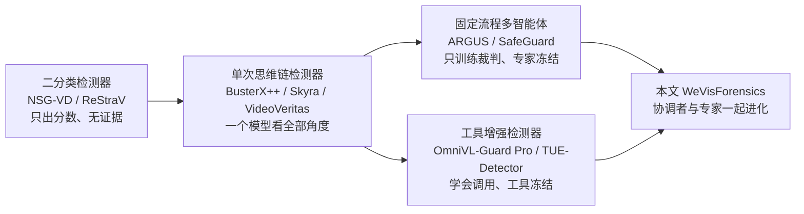
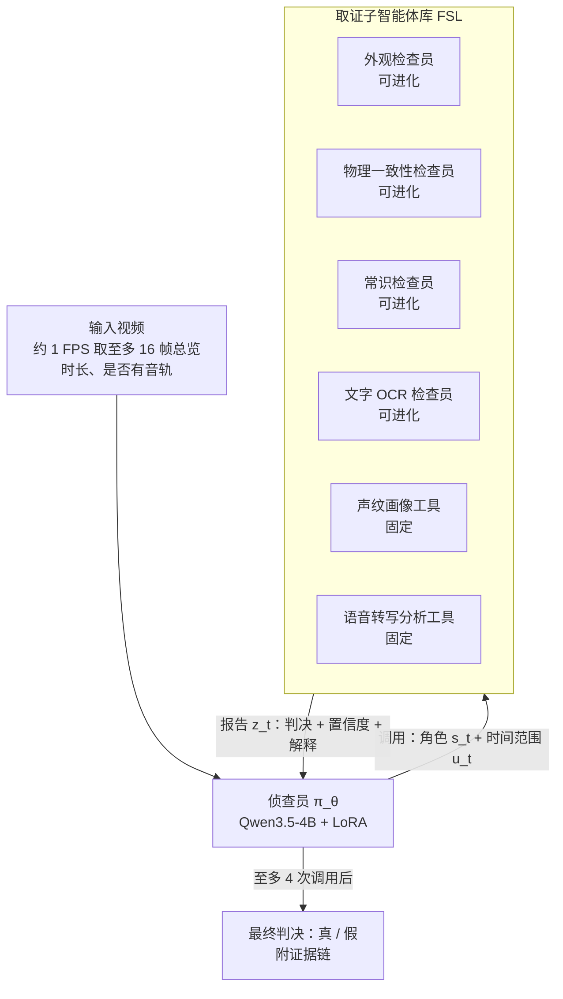
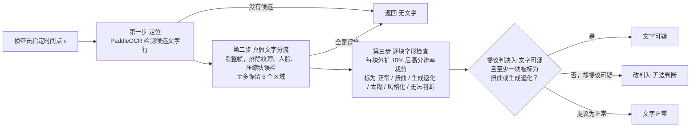
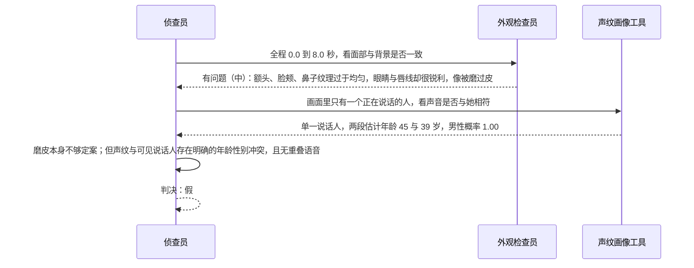
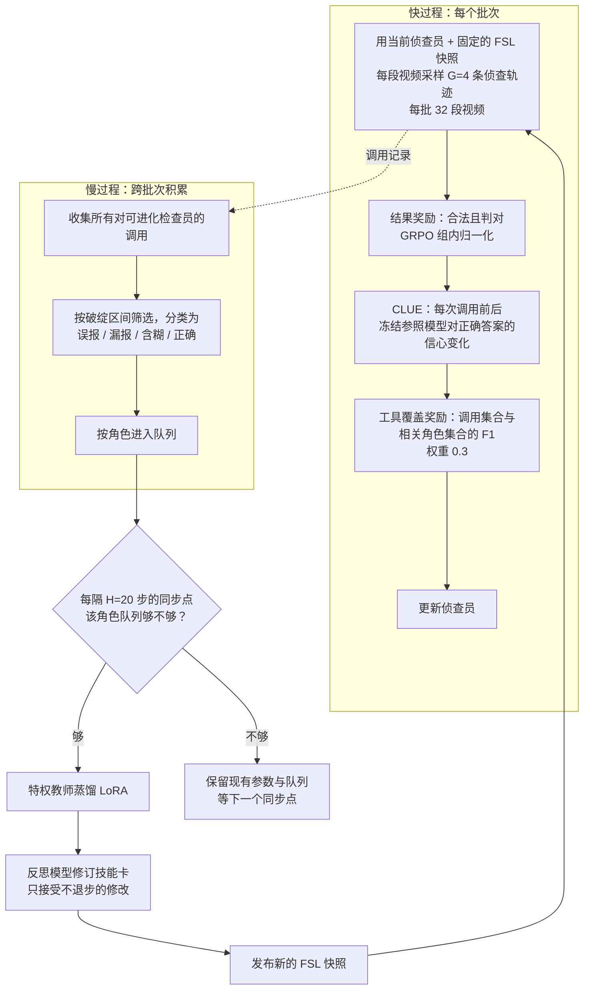
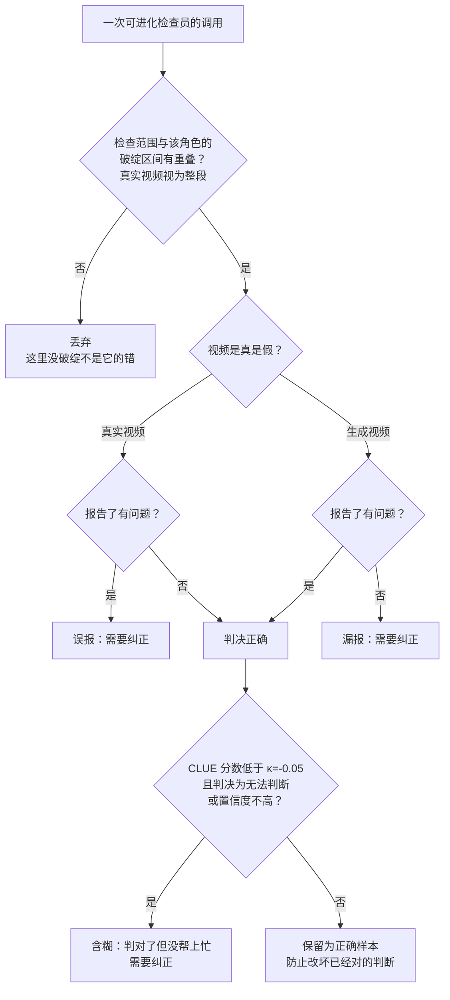
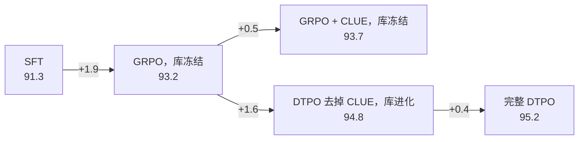

# WeVisForensics：主侦查员与检查员一同进化的全模态 AI 生成视频鉴伪智能体

> **原题**：WeVisForensics: Self-Evolving Agent for Omni AI-Generated Video Detection
> **作者**：Yipeng Du、Yuxi Li、Ying Zhang、Chong Sun、Chen Li、Jing Lyu、Ying Tai（Yuxi Li 为项目负责人，Chen Li 与 Ying Tai 为通讯作者；第一作者的工作在微信实习期间完成）
> **机构**：南京大学；腾讯微信视觉团队（WeChat Vision, Tencent）
> **年份**：2026（arxiv ID 2611.21373）
> **分类**：cs.CV / cs.AI
> **链接**：https://arxiv.org/abs/2611.21373
> **精读日期**：2026-11-21

## 阅读须知

### 这篇在领域里的位置

这篇论文属于「AI 生成视频检测」这一类工作，也就是判断一段视频是真实拍摄的，还是由视频生成模型合成的。这个方向过去几年大致走过三代。第一代把它当成普通的二分类问题：训练一个网络去捕捉生成过程留下的痕迹，例如频域里的异常纹理、帧间噪声的不自然分布，最后输出一个「是假的概率」。这类方法给不出理由，换了一家生成器往往就失灵。

第二代借助多模态大模型，让模型先用自然语言写出它看到的破绽，再给结论，BusterX、Skyra、VideoVeritas 都属于这一代，它们通常还会用强化学习去打磨这段推理。第三代则把鉴伪拆给多个专家：有的用固定流程依次调用几位专家再汇总，例如 ARGUS；有的训练一个模型学会何时调用裁剪、放大之类的工具。

这篇论文站在第三代的基础上再往前走一步。前人即便让协调者学会了「该问谁」，被问的专家本身却始终冻结不动；本文让协调者与专家在同一批交互上一起进化，协调者学得快，专家学得慢，这是全文的核心。

### 读完能回答什么

1. 为什么「一次看完整段视频再下结论」的思维链检测器，容易漏掉只持续一两秒、只占画面一角的破绽？
2. 如果主侦查员和检查员在每一批数据上同时更新，会出什么问题？DTPO 为什么要用快慢两种时间尺度？
3. 在只有「最终判对还是判错」这一个奖励的情况下，CLUE 怎样告诉主侦查员「哪一次检查真正帮了忙」？
4. 检查员的「进化」具体靠两条通道：带特权信息的教师蒸馏，以及可读的技能卡规则。这两条通道各自改变的是什么？
5. 只训练主侦查员、只进化检查员、两者一起进化，三种做法在没见过的生成器上分别差多少？

### 阅读前置

本文假定读者熟悉 Transformer 与多模态大模型的基本用法，知道 LoRA 这类参数高效微调的大意，也大致了解策略梯度类强化学习（例如 PPO）是在做什么。本文不假定读者做过视频取证，也不假定读者读过 GRPO、在线蒸馏或特权信息蒸馏的原始论文，这些概念第一次出现时都会先铺垫再展开。

### 首次出现的缩写表

- **MLLM**（Multimodal Large Language Model，多模态大语言模型）：能同时读入图像、视频帧与文字的大模型。本文所有模型共用的骨干 Qwen3.5-4B 就属于这一类。
- **VLM**（Vision-Language Model，视觉语言模型）：与 MLLM 基本同义，文中多用来指代负责标注与核验数据的外部模型。
- **CoT**（Chain-of-Thought，思维链）：让模型先写出推理过程、再给出结论的做法。
- **FSL**（Forensic Sub-agent Library，取证子智能体库）：本文的检查员集合，包含四个视觉检查员与两个音频工具。
- **DTPO**（Dual-Timescale Policy Optimization，双时间尺度策略优化）：本文提出的核心训练算法，主侦查员走快过程，检查员走慢过程。
- **GRPO**（Group Relative Policy Optimization，组相对策略优化）：对同一个输入采样一组回答，用组内均值与标准差把奖励归一化成优势值的强化学习方法，不需要单独训练价值网络。
- **CLUE**（Call-Level Utility Estimation，调用级效用估计）：本文提出的逐次调用打分，衡量某一次检查报告让「正确答案」变得更可信了多少。
- **SFT**（Supervised Fine-Tuning，监督微调）：用标注好的示范数据直接做下一个词预测训练。
- **RL**（Reinforcement Learning，强化学习）。
- **LoRA**（Low-Rank Adaptation，低秩适配）：冻结原始权重，只在线性层旁边训练一对低秩小矩阵的微调方法。
- **EMA**（Exponential Moving Average，指数滑动平均）：本文用它让教师模型的参数缓慢跟随学生模型。
- **OPD**（On-Policy Distillation，在线策略蒸馏）：在学生自己生成的回答前缀上，让教师逐个 token 给出概率分布，再让学生去对齐。文中的 D_OPD 指被挑选出来用于这种蒸馏的检查调用集合。
- **KL**（Kullback-Leibler divergence，KL 散度）：衡量两个概率分布差多远的量。
- **OCR**（Optical Character Recognition，光学字符识别）。
- **ASR**（Automatic Speech Recognition，自动语音识别）。
- **ID / OOD**（In-Domain / Out-of-Domain，域内 / 域外）：测试数据与训练数据是否来自同一分布、同一批生成器。
- **GB / GB++**：GenBuster-Bench 与 GenBuster-Bench++，两个公开的 AI 生成视频检测基准，前者在本文里当作域内测试，后者当作域外测试。
- **F1**：精确率与召回率的调和平均。
- **FPS**（Frames Per Second，每秒帧数）。

## 一、问题

视频生成模型这两年进步得很快。Sora 2、Veo 3.1、可灵 3.0、Seedance 2.0 这一代商用模型生成的片段，在清晰度、时间连贯性和光影真实感上，已经很难凭肉眼一眼识破。于是，伪造的新闻现场、冒用他人面孔与声音的视频、虚构的产品演示，都可以低成本地批量生产，平台审核、新闻核查与普通观众都要面对这一压力。

在这种场景下，一个只输出「假的概率 0.87」的检测器很难被真正使用。审核员需要知道它凭什么这样判断：是第几秒的哪只手长出了第六根手指，还是包装盒上的字母在融化，还是画面里明明是年轻女性在说话、音轨里却是中年男声。换句话说，检测不仅要准，还要把结论落在可以复核的局部证据上。

过去几年的主流路线，是让多模态大模型直接看视频、写一段推理、给出结论，再用强化学习奖励「判对」。这条路线在训练过的生成器上表现不错，可一旦换到新一代生成器，准确率就会明显下滑。本文的表 4 里，两个最新的二分类检测器即便在作者的数据上重训，在域内基准上也只有 46% 到 52% 左右，接近随机猜测；几个思维链检测器换到未见过的生成器上，也普遍掉到 50% 到 70% 之间。旧路线卡在哪里，正是这篇论文要回答的问题。

### 具体要解决什么

把高层动机落到一个可以验证的技术问题上，本文要做的事情是：给定一段视频（可能带音轨），判断它是真实的还是 AI 生成的，并且让这个判决建立在若干次有明确时间范围、有明确取证角度的检查之上。

更具体地说，作者希望系统同时具备两种能力。第一种是自适应取证：针对每一段视频，自己决定先查什么、查哪一段、查到什么程度可以停手，而不是对所有视频跑同一套固定流程。第二种是专家自身的成长：负责具体检查的模型，要能从它被调用的那些场合里学到东西，逐渐学会报告那些它以前会放过的细微破绽。

### 前人走过的四条路线

第一条路线是二分类检测器，例如 NSG-VD 与 ReStraV。它们学习生成过程在像素或时序统计上留下的痕迹，输出一个分数。这条路线的长处是推理快、不依赖大模型；它的问题在于给不出证据，而且生成痕迹会随着生成器换代而改变，泛化很差。

第二条路线是单次思维链检测器，例如 BusterX++、Skyra、VideoVeritas、DeepTraceReward。它们让一个多模态大模型一次看完整段视频，用一段自由文本把所有类型的破绽都讨论一遍，再给结论。这条路线做对了「给出理由」这件事，但它有两个结构性弱点。

其一，一个模型要同时负责纹理、物理、常识、文字、声音所有角度，只持续一两秒或者只占画面一小块的破绽很容易被漏掉，甚至被模型自己编出的理由解释过去。论文图 6 里有一个例子：一段视频中的手写文字随时间扭曲变形，VideoVeritas 没有去细看，直接把这些乱码归为「手写风格」。其二，所有判断都缠在一段自由文本里，没有办法单独检查或单独监督其中某一条论断。

第三条路线是固定流程的多智能体系统，例如 SafeGuard、Hermes、DVAR 与 ARGUS。它们把取证拆给几位专家，按预先写好的顺序调用，再由一个裁判汇总。以 ARGUS 为例，它每次都收集四位专家的报告，训练时只更新裁判、冻结专家。这样做的毛病是，与这段视频无关的报告也会被送进裁判，数量上可能压过真正找到破绽的那一份。

第四条路线是工具增强的检测器，例如 OmniVL-Guard Pro 与 TUE-Detector。它们训练一个模型学会何时调用裁剪、放大、分割等工具，比固定流程灵活，但工具本身的能力是固定的。

这四条路线有一个共同的天花板。无论协调者多聪明、汇总多巧妙，只要负责看细节的那位专家看不出来，后面的路由与聚合就无从补救。作者把这一点概括为：前人的系统受限于冻结专家的局部准确率。

### 数据与评测上的缺口

除了方法本身，数据也是一个瓶颈。现有的伪造视频训练集，例如 GenBuster-200K、IVY-FAKE、ViF-CoT-4K，大多只给整段视频一个真假标签，或者一段笼统的解释文字。它们既没有按取证角度拆开的证据，可以拿来单独训练每一位专家；也没有「调用了谁、得到什么回复」的交互轨迹，可以拿来训练协调者。

评测上也存在类似问题。已有基准只看最终判决对不对，一个智能体即便是靠一次毫不相干的检查碰巧猜对，分数上也看不出来。于是，作者除了提出方法，还配套做了一个训练数据集 ForenCue-30K 和一个评测基准 AgenticCue。

## 二、方法

### 总体框架：把鉴伪当成一次侦查

WeVisForensics 的出发点，是把「判断视频真假」看成一次侦查，而不是一次感知。作者用人类取证分析师做类比：分析师不会扫一眼就下结论，而是先从整体内容形成一个假设，再把注意力移到可以检验这个假设的时刻与区域，请相应的专家去看，证据够了才结案。

系统因此分成两层。上层是主智能体，论文称之为「侦查员」（investigator），负责规划查什么、在哪儿查；下层是取证子智能体库 FSL，里面的「检查员」（inspector）各自从一个取证角度检查视频，返回结构化的证据。

整个设计遵循三条原则。第一，规划与感知分离：侦查员只决定查什么、查哪一段，检查员只判断自己专长的那一类破绽在这一段里是否存在。第二，证据按角色拆开：每一次检查都只回答一个角度的问题，返回判决、置信度和一段引用了具体时间点的解释，于是每一条证据都可以被单独审计、单独监督、单独计功。第三，会随生成器变化而过时的部分才去进化：侦查策略与视觉检查员要随训练不断改进，而音频分析、文字检测这类「测量型」工具保持固定，作为稳定的参照。

### 侦查协议

一次侦查从一份视频总览开始。系统在整段视频上大约每秒取一帧，最多保留 16 帧，每帧都标上它在原视频里的绝对时间；同时告诉侦查员视频有多长、有没有音轨。论文把这份总览写成下面这个形式：

o_x = ({(f_k, ν_k)}, T_x, α_x)

其中 f_k 是第 k 张总览帧，ν_k 是它的绝对时间戳，T_x 是视频时长，α_x 取 0 或 1，表示有没有音轨。

此后每一轮，侦查员输出一条结构化消息，由「推理」与「动作」两部分组成。推理部分要写清楚当前的假设是什么、目前的证据能说明什么、不能说明什么，以及为什么下一次检查有信息量。动作部分要么调用一位检查员并给出参数，要么结束侦查并给出真假判决。

调用的参数因检查员而异。外观、物理、常识三位检查员需要一个时间窗口 [t_s, t_e]；文字检查员只需要一个时间点；两个音频工具不需要参数，直接分析整条音轨。

用 h_t 表示截至第 t 轮的全部历史（总览加上之前所有的调用与回复），侦查员的一次检查动作 a_t = (s_t, u_t) 包含两样东西：s_t 是要调用的检查员，u_t 是检查范围。检查员拿到从这个范围里抽出的输入 v(x, u_t)，以及它自己的角色说明和技能卡 q_s，生成报告 z_t，报告被追加进历史。

协议规定了调用预算与几条规则：至多调用四次；同一位检查员不能在同一范围上重复调用；范围必须落在视频之内；无声视频不能调用音频工具。至少有一次调用成功之后才能作答，所以一次侦查最多五轮。每条轨迹的奖励写成：

R(τ) = 1[轨迹合法] × 1[判决正确]

也就是说，格式出错、违反规则都算作判错。在这个上限之内，侦查员被要求选择「最小的充分检查集合」：一个明显且定位清楚的破绽往往一次检查就够，只有存在独立的不确定性、或者需要互补证据时，才值得再调用一次。对超过 30 秒的视频，侦查员要瞄准一个局部事件，通常把窗口控制在 15 秒以内，而不是覆盖几乎整段视频。

检查员的报告可能互相矛盾，所以侦查员读报告也有规矩。视觉报告的判决分为三种：有问题（issue）、没问题（no_issue）、无法判断（inconclusive），置信度分高、中、低三档。「无法判断」被当作中等强度的证据，记录的是一种真实的局限，而不是暗含倾向的判决；「没有文字」、工具失败、纯描述性的声纹画像，除非包含具体矛盾，否则都当作中性信息。还有一条很重要：某一段范围里「没问题」，不足以证明整段视频是真的，最终判决必须综合所有调用的证据。

### 取证子智能体库：六位成员

FSL 覆盖六个取证角度。四位视觉检查员与侦查员共用同一个骨干结构，但各自持有独立的 LoRA 参数，这样每一位都能专门化，不会彼此干扰，也不会干扰侦查策略。另外两个是音频工具，只在有音轨时使用。

| 成员 | 检查范围 | 输入 | 判决 | 是否进化 |
| --- | --- | --- | --- | --- |
| 视觉外观 | 时间窗口 | 窗口内 2 FPS 的帧 | 有问题 / 没问题 / 无法判断 | 是 |
| 物理一致性 | 时间窗口 | 窗口内 2 FPS 的帧 | 有问题 / 没问题 / 无法判断 | 是 |
| 常识 | 时间窗口 | 窗口内 2 FPS 的帧 | 有问题 / 没问题 / 无法判断 | 是 |
| 文字一致性（OCR） | 单个时间点 | 该帧加文字区域放大图 | 文字正常 / 文字可疑 / 无文字 | 是 |
| 声纹画像 | 整条音轨 | 音轨 | 描述性画像 | 否 |
| 语音转写分析（ASR） | 整条音轨 | 转写文本加时间 | 节奏异常 / 自然 | 否 |

三位基于时间窗口的视觉检查员，拿到的是请求窗口内按每秒两帧解码出的画面，每一帧都标着绝对时间，然后各自按一份角色清单去检查。

外观检查员看纹理在运动中是否稳定，头发、手指、牙齿、小物件这类细节与边缘是否完整，局部清晰度有没有无缘无故地变化，有没有重影或复制，以及光照、阴影、反射在时间和几何上是否一致。物理检查员看生物与机械的运动是否合理，身体与刚体的结构是否完整，物体被遮挡后是否还在，接触与抓握是否成立，流体与可变形物体的动力学是否说得通。

常识检查员看因果关系、物体与角色是否符合语境、物体的用途是否被正确使用、事件顺序是否合理。侦查员在大多数视频上都会调用外观和物理检查，常识检查则留给总览里已经透出语义或因果异常的场合，例如动物在完成人类的任务。

三位检查员共用同一套汇报纪律。判「有问题」必须指出所给帧里有具体的异常；判「没问题」要求相关内容足够可见并且前后一致；当所需的证据缺失、没有被真正考验到、或者被采样间隔、模糊、遮挡、分辨率挡住时，就判「无法判断」。置信度要与证据的强度和覆盖面相称：一个几乎不动的主体，撑不起高置信度的物理判断；一张干净的帧，撑不起高置信度的外观判断。正常剪辑、镜头运动、运动模糊、压缩、风格化与动画，都被明确规定为本身不算异常，以免检查员把后期制作当成生成痕迹。

文字检查员值得单独说一说。视频生成器至今仍不擅长渲染文字：一开始清晰可读的字形，往往随着片段推进而粘连、断裂、漂移、融化，所以屏幕上的文字是一条独立而且诊断力很强的线索。困难在于，文字只占画面很小一部分，整帧缩放给视觉语言模型之后，笔画的细节就丢了。

因此文字检查员被设计成一条三段式流水线，只作用在侦查员指定的那一帧上：

最后那条规则的意思是：一旦要指控「文字是伪造的」，就必须至少有一块放大图里能看到明显被生成过的字形；如果所有放大图都只是太糊或者风格化，那就只能报告无法判断。论文附录里有一个完整例子：外观检查先注意到一张过分光滑的脸，侦查员随即在第 4 秒对包装盒上的文字做一次 OCR 检查，在放大图里确认了字母「A」的结构反复出错。

两个音频工具的思路不同。生成视频越来越多地配有合成语音，而「听到的」与「看到的」之间的矛盾，往往比任何视觉破绽都更显眼。声纹画像工具做说话人分离，估计每位说话人的年龄、男女童的概率，以及唤醒度、支配度、愉悦度三项情绪分数。它的输出刻意设计成描述性的：画面里清楚地有一张脸在说话、声音的年龄或性别却明显对不上，这是有用的旁证；而配音、旁白、多人说话的情形都要打折扣。

语音转写分析工具则给出带逐词时间戳的转写，再让一个冻结的语言模型只审查具体的文本与节奏异常，例如机械、等间距的语句片段，对照的是犹豫、换气这类自然语音特征。两个工具通常在有音轨、并且画面里能看到说话的人脸时调用。

### 哪些成员进化，哪些成员固定

FSL 被分成两部分：四位视觉检查员属于可进化成员，两个音频工具属于固定成员。可进化成员通过两条互补的通道改进：一是它的 LoRA 适配器从侦查员发出的调用中蒸馏学习，二是它的「技能卡」被一个反思模型修订。技能卡是一小串「要报告」与「要忽略」的规则，追加在角色说明后面。

作者给出的理由是：视觉破绽是随着生成器进步变化最快的线索，而侦查员发出的调用，恰好暴露了检查员会在什么输入、什么范围、什么难度上被咨询。与之相对地，音频工具与 PaddleOCR 检测器的输出是测量值，例如说话人属性、转写文本、文字框坐标，这些量的含义不应当在侦查员学习如何解读它们的过程中漂移；再加上带标注的音频伪造样本稀少，让它们去适配也不可靠。侦查员本身则用强化学习优化。于是系统在两头同时改进：问什么，以及被告知什么。

### 一次侦查的样子

论文第 5.6 节给了三条完整的侦查记录。下面这张时序图概括其中「声音与人脸对不上」那一条：一段 8 秒、有音轨的视频里，一位年轻女性站在木桥上说话。

这个例子能看出协议设计的用意。外观检查员给的是中等置信度，因为它自己也承认美颜和后期处理可能造成类似效果；侦查员没有就此下结论，而是转向一个独立的模态去找互补证据，找到之后才结案。

### 训练数据：ForenCue-30K

ForenCue-30K 由 30,000 段精选视频构成，在此基础上产出三层监督：117,552 条按角色拆开的检查员记录、33,896 条侦查员交互轨迹，以及一个 7,500 行的强化学习数据池。

生成视频主要来自公开数据集 GenBuster-200K、RewardData、VBench-2.0 与 AIGVDBench，覆盖开源模型与上一代商用模型，例如 CogVideoX、HunyuanVideo、Wan 2.1 与 2.2、Gen-3、Pika 1.5、可灵 1.0 与 1.5、Veo 3、Vidu Q1；另外补充了在 AI 视频生成平台上生成的视频，以及数字人、声画不符的音频伪造这类专门领域。真实视频取自 OpenVid-1M 与 Koala-36M，再补充 Pexels、Pixabay 两个素材网站的视频。

监督数据的构造顺序与智能体的结构一一对应。每段视频先按每一个取证角色分别标注，标注再转成检查员的训练记录，最后由实际执行过的检查员调用拼装成侦查员的轨迹。全程使用同一套角色分类，于是检查员学会报告的证据，恰好就是侦查员学会去请求、去解读的证据。

标注本身分三道工序。第一道，一个按评分细则工作的 VLM 标注器，在每个角色的专用指南下查看带时间戳的帧，把可见的破绽定位到时间区间，并写出落在具体画面上的解释；如果某个角色在一段生成视频上看不到异常，就如实记为「没问题」，不强行归因。第二道，一个来自另一家族的 VLM 核验器逐条对照视频，修正或驳回候选标注，过滤掉编造的解释、过度泛化的常识论断与不准确的区间。第三道，人工审核员按来源与角色抽样检查，把发现的问题反馈回指南与过滤规则；音频矛盾则直接由人一边看一边听来标注。

作者做了一次定量人审：在 340 条「视频与角色」的标注中，94.7% 被判为完全有画面证据支持，4.4% 部分正确，只有 0.9% 被判为错误。

侦查员轨迹的合成方式，作者称为「以执行为依据」。一个 VLM 轨迹规划器在训练阶段可以看到视频总览与已经核实过的角色证据，据此决定要咨询哪些角色、哪些时间范围；然后每一次规划好的调用都真的交给对应的检查员去执行，规划器再根据检查员实际返回的报告，写出每一轮的推理。最后，所有只在训练时可见的元信息都从学生看到的消息里剥掉。

这样做的好处是，侦查员从来不会从「想象出来的观察」里学习，它学到的每一个决定，都建立在推理时真的会收到的证据之上。这些轨迹平均每条调用约两次，人工审查 100 条轨迹，96% 的工具选择被判为恰当。

强化学习数据池有 7,500 行，跨 15 个数据集合、56 个来源子集，包含 3,750 段不重复的真实视频与 3,180 段不重复的生成视频，按来源加权重复以平衡标签与来源。每段生成视频都带着按角色标注的破绽时间区间，供慢过程筛选检查调用时使用；每段视频还带着一组核实过的「相关角色」，供工具覆盖奖励使用。

### 评测基准：AgenticCue

AgenticCue 专门用来暴露「最终判对了、过程却是乱查的」以及「某一类破绽始终处理不好」这两种问题。与以开源和上一代商用模型为主的训练集不同，它瞄准的是更新一代的商用生成器：Veo 3.1、可灵 2.5 与 3.0、Seedance 1.5 与 2.0、海螺 2.3、Wan 2.6、Sora 2、即梦、HappyHorse 1.0，另外加入了训练时没有出现过的数字人、换脸与声画不符的音频伪造。

基准分为视觉、物理、文字、常识、音频五个类别，每个类别恰好 500 段经过人工确认带有该类破绽的生成视频，五个类别共用同一批 500 段真实视频，所以每个类别都是一个 1,000 段、真假各半的平衡集。有 170 段生成视频同时属于多个类别，因此不重复的生成视频共 2,330 段；这些视频都不在 ForenCue-30K 里。

除了检测准确率，基准还报告「调用精确率」：在智能体调用了某个工具的那些生成视频中，有多大比例确实需要这个角色。作为参照，如果对每一段视频都调用某个工具，得到的精确率就是该角色的基础比例，外观、物理、文字、常识、音频分别是 91.1%、78.6%、49.2%、24.0%、21.5%。作者强调，精确率必须和准确率一起读：如果智能体为了精确而跳过了该查的角色，准确率就会掉下来。

### 第一阶段：监督初始化

所有模型共用 Qwen3.5-4B 这一个骨干。侦查员与四位视觉检查员分别训练五个秩为 64、缩放系数 α 为 128 的 LoRA 适配器，挂在语言模型的所有线性层上；骨干本身、视觉编码器、视觉到语言的投影层全程冻结。这样安排的用意，是让适配集中在取证推理上，而不是去改底层视觉特征。

训练目标是标准的带掩码下一个词预测：只在模型自己该写的 token 上计算损失，指令、总览帧、检查员报告、工具输出与填充位置都被掩掉。对侦查员来说，被监督的是每一轮的推理、每一个动作和最终判决；对检查员来说，被监督的是那份结构化报告。

侦查员在 33,896 条轨迹（外加覆盖更多内容的补充轨迹）上训练，每条轨迹打包成一个最长 32,768 个 token 的多轮样本，学习率 2×10⁻⁴，余弦退火、前 5% 预热，分两个各跑一轮的阶段，用不同的数据顺序，第一阶段的适配器合并进骨干之后再开始第二阶段。检查员各自在自己角色的那部分记录上训练，配方相同，最长 32,768 个 token（文字检查员输入只有一帧，用 16,384）。每个角色的数据里都同时保留真实与生成视频，免得检查员养成「默认报有问题」的习惯。

训练完成后，整个系统就是一个骨干加五个小适配器，存储和部署都很省事。

### 第二阶段：DTPO

DTPO 要解决的是一个「互为移动靶」的问题。侦查员决定检查员会看到哪些输入，检查员的报告又反过来影响侦查员下一步怎么走，还影响哪些交互会被选去训练检查员。如果在每一批数据上同时更新两者，每一方都在追一个不断移动的目标，训练很难稳定。

作者的办法是把两者放到不同的时间尺度上。快过程在每一个采样批次上只更新侦查员；慢过程则跨越多个批次积累按角色分好的交互队列，再让检查员向一个缓慢变化的 EMA 教师对齐。更新后的检查员库再为后续的采样提供观察，形成闭环。视频级标签与破绽标注只在训练时使用，推理时侦查员与检查员都以固定参数执行上面的侦查协议。

#### 快过程：侦查员的策略学习

先铺垫一下 GRPO。传统的 PPO 需要一个价值网络来估计「这一步比平均水平好多少」；GRPO 省掉了这个网络，它对同一个输入采样一组回答，直接拿组内的平均奖励当基准。具体到本文，对每段视频，用当前侦查员和一份固定的检查员快照采样 G 条轨迹，每条轨迹得到上面那个「合法且判对」的奖励 R_g，再在组内归一化：

A_g = (R_g − 组内平均奖励) / (组内奖励标准差 + δ)

其中 δ 是防止除以零的小常数。

这个结果奖励只说明侦查最后成功与否，却说不出其中哪一次检查起了作用。为此作者引入 CLUE，给每一次调用单独打分。它的做法是借用一个冻结的参照模型（就是没有微调过的 Qwen3.5-4B），在第 j 次调用的报告返回之前和之后，分别问它一次「正确答案的可能性有多大」。

记 ℓ⁻ 为报告返回之前、参照模型给正确标签的对数概率，ℓ⁺ 为报告返回之后的对数概率（概率只在真、假两个选项之间归一化）。CLUE 分数定义为：

c_j = clip( log[ (−ℓ⁻ + ε) / (−ℓ⁺ + ε) ], −b, b )

直观地说，−ℓ 可以理解为参照模型离正确答案还有多「远」。如果报告让它更接近正确答案，−ℓ⁺ 就比 −ℓ⁻ 小，比值大于 1，分数为正；如果报告把它带偏了，分数为负。ε 让比值平滑，b 给分数设上下限，本文取 ε = 0.1、b = 1。

之所以用一个独立的参照模型，而不是侦查员自己，是因为这样衡量的是证据本身的信息量，而不是侦查员自己的信念。这些分数还要在同一组轨迹里再做一次中心化：对第 j 次调用，只在组内那些至少调用了 j 次的轨迹之间减去平均值。

最后，侦查员输出的每个 token 拿到的优势值是这样分配的：属于第 j 次检查动作的 token，优势值是 A_g 加上 λ 乘以中心化后的 CLUE 分数；侦查员的其他输出 token，包括最终判决，仍然只用 A_g；检查员的报告和填充位置不参与损失。λ 取 0.2。这样一来，每一次检查选择都能得到「它带回了多有用的证据」这一反馈，而最终判决依旧由结果来训练。

#### 工具覆盖奖励

只看判对与否，会容忍那些靠一次无关检查碰巧判对的侦查，而这种捷径到了决定性破绽在别处的视频上就会失灵。因此每段训练视频都带着一组核实过的相关角色，每条轨迹再额外获得一个 F1 分数，比较它实际调用的工具集合与这组相关角色。这个分数在组内中心化之后，以 0.3 的权重加到 A_g 上，而且是在正确性归一化之后才加。它的作用是在结果相同的轨迹之间排出先后，而不会压过正确性本身。

#### 慢过程：挑选哪些调用拿来改进检查员

慢过程的原料，是快过程采样时对可进化检查员的每一次调用。换句话说，侦查员决定了检查员会在哪些输入、哪些时间范围、哪些难度上被改进，侦查员的采样就是检查员的课程。

这些候选调用首先要用标注来筛选。对一段生成视频，只有当调用的检查范围与该角色标注的破绽区间有重叠时，这次调用才会被保留；对一段真实视频，整段视频都算作参照区间。之所以排除没有重叠的调用，是因为在一个本来就没有该类破绽的范围里没找到破绽，并不是这位检查员的错。

被保留的调用再按判决与视频标签分类：

这里「含糊」一类值得解释。一份判决方向正确的报告，仍然可能妨碍后续推理，例如一份低置信度的「无法判断」，让侦查员拿不到可用的证据。CLUE 分数恰好能识别这类报告。作者还特别指出，最终轨迹不必是错的：哪怕侦查员最后自己挽回了正确答案，一份局部无用的报告依旧值得改进。所有被保留的调用都进入按角色划分的队列；轮到某个角色刷新时，从队列里按真假视频数量相等的方式组批，多的一类做下采样。

#### 特权检查员蒸馏

先铺垫一下「特权信息蒸馏」这个概念。它的思路是：训练时教师可以看到一些学生在推理时看不到的额外信息，凭借这些信息给出更好的示范，学生则只用推理时能拿到的输入去模仿。本文里，教师是检查员自己的 EMA 副本，它看到的额外信息 g_i 是这样构造的：对真实视频，直接告诉它这是真的；对生成视频，列出与本次检查范围重叠、并且属于该角色专长的破绽区间，要求它在所给帧里找到对应的异常。作者强调，这个提示只是告诉教师「往哪里看」，而不是把它当作证据。

蒸馏本身采用在线方式：不需要教师重新生成一条回答，而是在学生实际写出的回答的每一个前缀上，同时取教师与学生的下一个 token 分布。教师条件在检查输入、特权信息和学生已经写下的前缀上；学生只条件在检查输入和自己的前缀上。

每个角色的损失由两项组成。第一项是逐 token 的 KL 散度，让学生分布靠近教师分布（教师一侧不回传梯度），在决定判决的那几个 token 上权重放大为 ω = 5。第二项是判决纠正：在回答确定判决的那个位置，只对比「与标签一致的判决」和「与之相反的判决」这两个选项的 logit，用一个二选一的交叉熵把学生往正确的一边推，权重 β = 1。只对比这两个选项的好处是，纠正判决的同时不会压制「无法判断」这个选项，也不会压制词表里的其他 token。

还有两个细节。对文字检查员，同样的目标还会额外加入一些在生成视频上被双重确认为「文字正常」的区域，让它学会：一段伪造片段里出现规整的文字，本身并不构成伪造证据。对那些需要改判的回答，如果特权教师在判决位置上仍然最倾向于学生原来的错误判决，就去掉 KL 项、只保留判决纠正，免得教师把错误再教一遍。

教师参数按 EMA 缓慢跟随学生，更新系数 ρ = 0.001；学生的学习率从 3×10⁻⁵ 起沿着侦查员的训练进度线性衰减，所以当侦查策略收敛时，检查员库也随之稳定下来。

#### 技能卡进化

适配器更新改变的是检查员「怎么看」。但有些失败模式更适合写成明确的汇报规则，例如「快速移动的手上的运动模糊不算结构缺陷」，或者「软物体在直接接触下变形不算违反物理」。因此每位可进化检查员除了适配器权重，还带着一张技能卡：一小串「要报告」与「要忽略」的规则，附在角色说明后面，学生与教师都能看到。

每一轮蒸馏之后，一个冻结的反思模型查看最近那些当前检查员仍然判错的调用及其标签，提出规则修改。新卡只有在满足一个严格条件时才会替换旧卡：在留出的最近调用上判对的数量更多，并且在真实视频和生成视频两边都不丢掉任何一个原本判对的样本。这个接受条件让技能卡的修改在近期经验上是单调不退步的，也防止反思模型拿误报去换漏报，或者反过来。

附录列出了几次训练中学到的技能卡。规则多是局部、对比式的，例如外观检查员的一条「要报告」：大片连续的颜色渐变完全缺乏细微纹理，而相邻物体的边缘仍然锐利；文字检查员的一条「要报告」：一串字里某一个字形的笔画融成畸形，相邻字形却结构完好。

#### 快慢两过程如何同步

训练在四件事之间循环：采样、更新侦查员、挑选交互、定期刷新检查员库。每一批都用当前的侦查员和一份固定的检查员快照来采样；侦查员更新之后，挑出的交互进入各角色的队列。每隔 H = 20 步侦查员更新，设一个同步点，检查各角色的队列是否攒够了样本：够的就蒸馏、修订技能卡、发布新快照，然后才恢复采样；不够的保持现有参数，队列留到下一个同步点。

### 工程实现

一次 DTPO 更新要跑 32 × G 条多轮侦查，每条最多调用四次检查员、每次都要处理视频输入，所以检查员的推理服务与检查员库的刷新占了训练成本的大头。作者让侦查员和四位视觉检查员分别由独立的 vLLM 推理引擎提供服务，共享同一个训练集群；采样进程异步执行侦查，一次慢的音频或 OCR 调用不会拖住同批的其他轨迹；音频工具与 PaddleOCR 作为独立服务运行。

在每个同步点，四位检查员的刷新被分成两条并行的 GPU 通道：一条先做外观再做常识，另一条先做物理再做文字，因为各角色积累的调用数量差别很大，这样分配能让两条通道负载相近。刷新后的适配器先合并进骨干，再作为完整检查点发布给推理引擎，而不是以 LoRA 模块热替换，作者发现前者在他们的硬件上数值更稳定。每 20 步刷新一次，几百步侦查员更新的完整联合训练大约一天跑完。

## 三、实验

### 评测设置

域内测试用 GenBuster-Bench（GB）。域外测试有两个：GenBuster-Bench++（GB++）的视频部分，以及 MintVid 的 General 划分，后者按生成器分成海螺、即梦、可灵、Seedance、Sora 2、Wan 2.5 六个类别。再加上 AgenticCue 的五个类别。所有结果都是二分类准确率，格式错误或没有输出一律算错。作者说明，二分类检测器是在他们的数据上按原始设置重新训练的。

### 主结果

下表从论文表 4 里摘取代表性的方法。MintVid 一列是六个生成器类别的平均，AgenticCue 一列是五个类别的平均，最后一列是 GB、GB++、MintVid 均值、AgenticCue 均值四者的平均，与论文的「Avg.」一致。

| 方法 | 类型 | GB（域内） | GB++ | MintVid 均值 | AgenticCue 均值 | 总平均 |
| --- | --- | --- | --- | --- | --- | --- |
| NSG-VD | 二分类 | 46.4 | 53.7 | 53.5 | 41.0 | 48.7 |
| ReStraV | 二分类 | 51.9 | 66.9 | 56.9 | 52.1 | 57.0 |
| Qwen3.5-4B | 通用多模态模型 | 82.9 | 73.2 | 64.8 | 76.4 | 74.3 |
| Qwen3.5-397B | 通用多模态模型 | 65.1 | 66.7 | 56.7 | 74.1 | 65.7 |
| Gemini-3.1-Pro | 通用多模态模型 | 69.4 | 54.3 | 52.1 | 62.7 | 59.6 |
| BusterX++ | 思维链检测器 | 70.1 | 79.6 | 73.7 | 67.5 | 72.7 |
| DeepTraceReward | 思维链检测器 | 76.4 | 58.8 | 62.3 | 54.1 | 62.9 |
| Skyra-RL | 思维链检测器 | 68.2 | 55.7 | 55.1 | 79.3 | 64.6 |
| VideoVeritas | 思维链检测器 | 94.3 | 91.4 | 82.2 | 76.9 | 86.2 |
| ARGUS | 固定流程多智能体 | 86.4 | 78.9 | 63.4 | 75.9 | 76.2 |
| WeVisForensics-SFT | 本文，只做监督 | 93.9 | 94.2 | 83.0 | 94.3 | 91.3 |
| WeVisForensics-DTPO | 本文，完整训练 | **97.7** | **97.5** | **88.0** | **97.8** | **95.2** |

在域内基准上，WeVisForensics 达到 97.7%，比此前最强的 VideoVeritas 高 3.4 个百分点，比 ARGUS 高 11.3 个百分点。在域外的 GB++ 上它达到 97.5%，在 MintVid 六个生成器的平均上达到 88.0%，而且在每一个生成器类别上都超过了只做监督的版本。总平均 95.2%，比此前最强的检测器高 9.0 个百分点，这就是摘要里那个数字的来源。

不过 MintVid 的六个类别之间差距不小。完整模型在 Seedance 上是 98.6%，在 Sora 2 上是 82.4%，在即梦上是 82.9%，这说明对于部分新一代生成器，它仍然会放过相当一部分假视频。

### AgenticCue 上的分类别表现

AgenticCue 的五个类别把不同路线的盲区分别暴露了出来。通用多模态大模型擅长发现违背常识的内容，却看不出细粒度的破绽：Qwen3.5-397B 在常识类别上有 94.5%，到了音频类别只剩 54.1%。

缺乏专门取证工具的思维链检测器下滑得更厉害：DeepTraceReward 在五个类别上都只有 51.9% 到 55.5%，接近随机；BusterX++ 在音频类别上是 49.9%。与之相对地，WeVisForensics 在五个类别上都稳定在 97.0% 到 98.8% 之间，在音频类别上领先 VideoVeritas 27.7 个百分点，五类平均领先 20.9 个百分点。

| 调用精确率（%） | 外观 | 物理 | 文字 | 常识 | 音频 | 平均调用次数 |
| --- | --- | --- | --- | --- | --- | --- |
| 全部都调用（基础比例） | 91.1 | 78.6 | 49.2 | 24.0 | 21.5 | - |
| WeVisForensics-SFT | 98.6 | 94.0 | 72.8 | 77.1 | 84.1 | 2.50 |
| WeVisForensics-DTPO | 98.6 | 94.6 | 95.4 | 99.7 | 94.3 | 2.19 |

调用精确率这张表回答的是「智能体有没有请对专家」。对每段视频都调用全部工具，只能拿到基础比例，这也是 ARGUS 这类固定流程的上限，例如物理角色只有 78.6%。经过 DTPO，物理、文字、常识、音频四个角色的精确率达到 94.3% 到 99.7%，是各自基础比例的 1.2 到 4.4 倍；文字与常识两项比只做监督时各提升了 22.6 个百分点。

精确并不靠多调用。DTPO 版本平均每段视频调用 2.19 次，比监督版本的 2.50 次少了 12.4%，准确率却在每一个 AgenticCue 类别上都更高。

### 消融：快过程与慢过程各贡献多少

| 侦查员 | 检查员库 | GB | GB++ | MintVid | AgenticCue | 平均 |
| --- | --- | --- | --- | --- | --- | --- |
| SFT | SFT | 93.9 | 94.2 | 83.0 | 94.3 | 91.3 |
| GRPO | 冻结 | 96.8 | 97.0 | 84.3 | 94.7 | 93.2 |
| GRPO + CLUE | 冻结 | 96.5 | 96.9 | 84.5 | 96.8 | 93.7 |
| DTPO 去掉 CLUE | 进化 | 97.4 | 97.6 | 86.6 | 97.4 | 94.8 |
| DTPO | 进化 | 97.7 | 97.5 | 88.0 | 97.8 | 95.2 |

这张表给出三点观察。第一，面对冻结的检查员库只优化侦查员，主要是在拟合训练分布：GRPO 在 GB 和 GB++ 上各涨了约 3 个百分点，在 MintVid 上只涨了 1.3，在 AgenticCue 上只涨了 0.4。

第二，让检查员慢慢进化，打破了证据这一瓶颈，并且主要体现在域外迁移上：与 GRPO 相比，平均提升 1.6 个百分点，其中 MintVid 提升 2.3、AgenticCue 提升 2.7。第三，逐次调用的计分 CLUE 只有在检查员也在进化时才真正起作用，在进化库上再加 CLUE，MintVid 又提升 1.4 个百分点，达到全表最好的 95.2% 平均。

### 刷新节奏：为什么是「慢」

| 刷新方式 | 海螺 | 即梦 | 可灵 | Seedance | Sora 2 | Wan 2.5 | 均值 |
| --- | --- | --- | --- | --- | --- | --- | --- |
| DTPO，每 20 步刷新 | 88.9 | 82.9 | 89.6 | 98.6 | 82.4 | 85.6 | 88.0 |
| 每个批次都刷新 | 84.1 | 82.3 | 87.0 | 98.2 | 80.1 | 84.3 | 86.0 |
| 分阶段：先进化库再冻结、只训侦查员 | 85.5 | 81.5 | 84.9 | 97.8 | 80.2 | 83.9 | 85.6 |

作者比较了三种刷新节奏，都从同一个监督初始化出发、在同一步评测。每个批次都刷新检查员库，会让六个未见过的生成器全部下降，海螺降了 4.8 个百分点，均值降了 2.0；而且这种下降发生在训练奖励差不多的情况下。

分阶段的做法先把检查员库进化好、再冻结它去训练侦查员，两层各自都提升了，却从来没有互相适应过，在六个生成器上全部落后于 DTPO，均值差 2.4 个百分点。作者给出一个更直接的指标：在未见过的生成器上，假视频召回率在分阶段方案下是 70.2%，每批刷新下是 71.3%，DTPO 下是 74.8%，三者的真实视频召回率都保持在 100%。

### 检查员的证据本身是否变好了

视频级准确率无法区分「侦查员问得更好」和「检查员答得更好」。为此作者用角色级的标注来给检查员的每一次调用打分：只有当这个角色在该视频上被标为值得检查、并且调用的窗口与标注区间重叠时，这次调用才计入。两个检查员库回答完全相同的一组调用。

| 角色 | 检查员库 | GB | GB++ | MintVid | AgenticCue |
| --- | --- | --- | --- | --- | --- |
| 外观 | 冻结 | 97.3 | 97.1 | 79.4 | 95.4 |
| 外观 | 进化 | 98.1 | 97.5 | 86.4 | 98.7 |
| 物理 | 冻结 | 66.5 | 85.1 | 72.7 | 89.4 |
| 物理 | 进化 | 97.8 | 97.3 | 91.9 | 98.5 |
| 文字 | 冻结 | 89.3 | 76.7 | 56.6 | 77.9 |
| 文字 | 进化 | 92.7 | 88.5 | 58.9 | 84.0 |

物理检查员的变化最大：在 GB 上的证据 F1 从 66.5% 升到 97.8%，与此同时它判「无法判断」的比例从 26.9% 降到 0.3%。在未见过的 MintVid 生成器上，外观与物理的 F1 分别提升 7.0 和 19.2 个百分点；文字检查员在每个基准上都有提升，GB++ 上最多提升 11.8 个百分点，但在 MintVid 上仍只有 58.9%。

人工评审给出了一致的结论。作者从评测集里抽了 200 对检查，每一对在相同的侦查员与相同的检查窗口下，分别由监督版和进化版检查员回答，评审员在不知道来源的情况下判断哪一份证据更准确，并标出没有依据的论断与漏掉的可见异常，再由第二位评审复核。

结果是进化版在 65 对中更好，监督版在 20 对中更好；含有任何缺陷的回答比例从 30.5% 降到 8.0%，其中漏掉明显异常的比例从 28.6% 降到 2.5%，而没有依据的论断本来就少，进化后依然很少。在两者判决一致的 100 对里，有 97 对被评为不分高下，说明进化没有改坏原本一致的证据，收益集中在它改变了判断的那些检查上。

训练过程的追踪也指向同一个方向：随着一次次 LoRA 刷新，检查员在生成视频上漏掉异常的比例从 22.1% 降到 5.2%，真实视频上的误报也在下降，判决 F1 从 80.3% 升到 93.7%；文字检查员的错误率从 24.7% 降到 9.3%。

### 两层各自的贡献

| 侦查员 \ 检查员 | SFT 检查员 | DTPO 检查员 |
| --- | --- | --- |
| SFT 侦查员 | 91.3 | 92.0 |
| DTPO 侦查员 | 93.2 | 95.2 |

作者把监督版与 DTPO 版的侦查员、检查员两两交叉配对。只进化检查员，平均从 91.3% 升到 92.0%；只训练侦查员，升到 93.2%；两者一起进化，升到 95.2%，总提升 3.9 个百分点，比两项单独提升之和（0.7 加 1.9）还多出 1.3 个百分点。也就是说，两层是互补的：训练过的侦查员问得更准，进化过的检查员让每一次询问更有信息量。

论文图 6 用一个例子说明了这一点。一段生成视频里的手写文字随时间扭曲。在 WeVisForensics 内部，监督版检查员在两种侦查员下都认为文字结构正常；进化版检查员能标出字形异常，可监督版侦查员仍把它归为手绘风格、判为真实；只有 DTPO 训练过的侦查员会把 OCR 检查对准第 7 秒那段扭曲的文字，并把这份证据组合成「假」的判决。这一处纠正，需要两层同时进化才能做到。

### 几处反直觉的结果

第一处是通用大模型的规模反而帮了倒忙。在没有任何取证训练的情况下，4B 参数的 Qwen3.5 在域内 GB 上有 82.9%，397B 的同族模型只有 65.1%，Gemini-3.1-Pro 是 69.4%，总平均上 4B 模型（74.3%）也高于 397B（65.7%）和 Gemini-3.1-Pro（59.6%）。作者的解释是，通用多模态模型无论规模大小，对假视频的召回率都偏低，也就是倾向于把视频判成真的；更大的模型这一倾向似乎更强。

第二处是二分类检测器即便在作者的数据上按原设置重训，域内准确率也只有 46.4% 和 51.9%，NSG-VD 甚至低于随机。作者只用「接近随机」一句带过，没有分析原因，读者在引用这组数字时需要留意。

第三处是 CLUE 单独加在冻结库上几乎无用，平均只提升 0.5 个百分点。这其实很符合直觉：如果检查员本身就看不出破绽，那么告诉侦查员「哪一次检查有用」也没多少可分配的功劳；等检查员开始进化、证据本身变得有区分度之后，逐次计功才有了用武之地。

第四处是每批都刷新检查员库，训练奖励与 DTPO 差不多，域外表现却全面更差。这提醒我们，在这类两层系统里，训练奖励曲线并不能说明泛化好坏，过于频繁的刷新可能让两层在训练分布上互相迁就。

## 四、局限

### 作者承认或在文中点明的局限

论文没有单独的局限一节，但正文里有几处明确交代了边界。第一，两个音频工具与 PaddleOCR 检测器在训练中保持固定，理由是它们的输出属于测量值、含义不应漂移，同时带标注的音频伪造样本太少，让它们去适配也不可靠。于是系统在音频上的能力，受限于这两个现成工具；声纹画像只是描述性的，遇到配音、旁白、多人说话都要打折扣。

第二，训练集以开源模型和上一代商用模型为主，对新一代生成器的能力是靠 AgenticCue 与 MintVid 来检验的。从结果看，这种泛化并不均匀：Sora 2 与即梦两个类别仍只有八成出头。作者在刷新节奏一节给出的数字更直观：在未见过的生成器上，完整方法的假视频召回率是 74.8%，也就是大约四分之一的假视频仍被判为真。

第三，检查员看到的是采样帧，总览至多 16 帧，窗口内每秒两帧，两帧之间发生的事情是看不到的；论文的几个完整案例里，检查员也多次因为美颜或后期处理可能造成类似效果，而只给出中等置信度。第四，调用预算至多四次，超过 30 秒的视频只瞄准 15 秒左右的局部事件，对长视频的覆盖有限。第五，训练需要为侦查员与四位检查员分别部署推理引擎，几百步联合训练在作者的集群上要一天左右，集群规模没有给出。

### 读完能看出来、但论文没有正面讨论的问题

第一，从数据到评测，都高度依赖视觉语言模型的判断。训练标注由 VLM 标注器加跨家族 VLM 核验器生成；评测里的调用精确率参考集，以及检查员证据 F1 的参考标注，同样来自两个跨家族 VLM 标注器加一个不看真假标签的裁判。人工审核都是抽样（340 条标注、100 条轨迹、200 对检查），覆盖面有限。于是存在一种可能：系统学到的「破绽」，在一定程度上是这些标注模型眼中的破绽，评测又用同类模型来打分。

第二，AgenticCue 是作者自建的，五个类别共用同一批 500 段真实视频，用来估计误报率的样本量不大。更重要的是，它是真假各半的平衡集，而在真实的平台审核里，假视频只占很小一部分。在平衡集上 97% 的准确率，换算到线上，误报的绝对数量仍可能很可观，论文没有报告低流行率场景下的精确率。

第三，「脸部蜡质、像磨过皮」是多个案例里的主要证据之一，而美颜滤镜在短视频平台上极其普遍。附录的技能卡在这一点上甚至出现了前后矛盾：第一次训练学到的外观规则里，有一条要求「报告」缺乏毛孔与细微纹理、像喷枪修饰过的脸；第二次训练学到的规则里，却有一条要求「忽略」由美颜滤镜或重度压缩造成的均匀磨皮。这说明技能卡的内容依赖于具体的训练过程，对开了美颜的真实视频会作何判断，值得单独评估。

第四，基线比较的公平性有若干没交代清楚的地方。二分类检测器重训后在域内仍接近随机，作者没有分析是不是训练配置出了问题；几个 MLLM 检测器是否在 ForenCue-30K 上重训，正文没有说明；Gemini-3.1-Pro 这类通用模型是零样本使用的。因此主表里相对外部方法的领先，部分来自数据与协议本身，而不只是 DTPO；真正能单独说明 DTPO 价值的，是表 6 与表 9 这些在同一系统内部做的消融，那里的提升是 3.9 个百分点。

第五，系统依赖的若干强线索带有时效性。文字字形的融化、声音与人脸在年龄性别上的明显冲突，都是当前生成器的短板，随着生成器进步，这些线索可能会变弱。论文也没有测试转码压缩、二次剪辑、刻意规避检测等情形下的稳健性，而这些在实际部署中很常见。

第六，物理检查员「无法判断」的比例从 26.9% 骤降到 0.3%，这一方面说明它更敢于下判断了，另一方面也可能意味着它在证据确实不足时也不再承认不确定。训练目标里把「判对了但含糊」的回答专门挑出来纠正，正是推动这一变化的因素之一。论文报告了准确率和 F1，却没有报告置信度是否校准，这一点在需要人工复核的场景里比较关键。

第七，在可复现性上，论文给出了项目主页、代码仓库与模型权重的链接，这是好的一面；但训练数据中有一部分来自在 AI 视频生成平台上自行生成的视频、数字人与声画不符的专门伪造，这些数据是否随 ForenCue-30K 一同公开，正文没有写明。

## 一句话

侦查员快学该查什么，检查员慢学该怎么看，两层在同一批调用上协同进化，让视频鉴伪既更准又能指出具体破绽。
