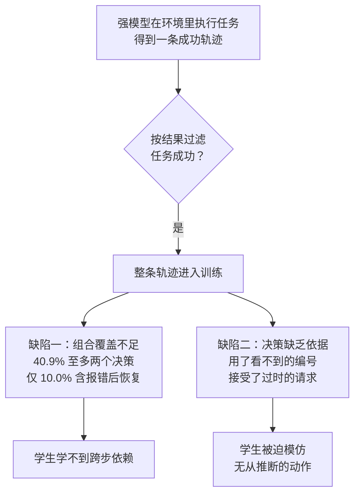
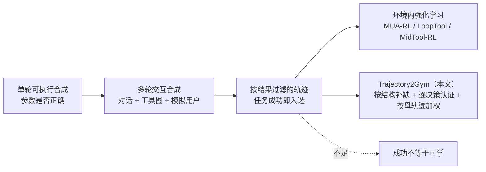
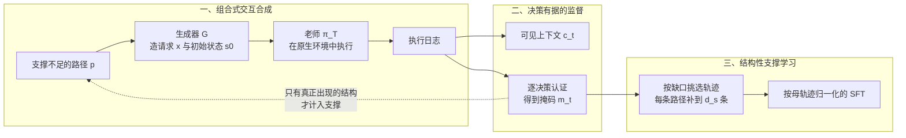
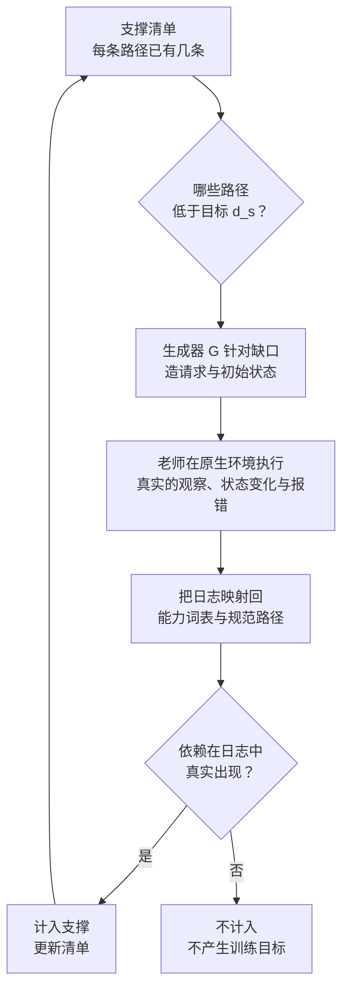
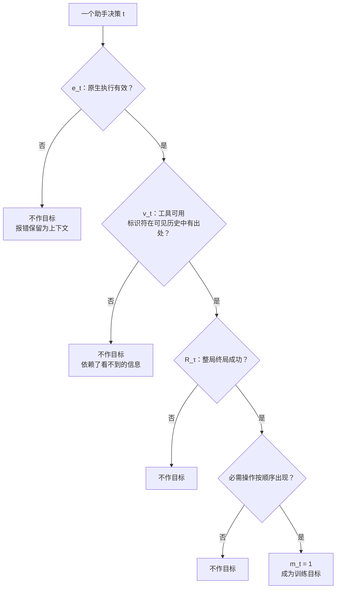
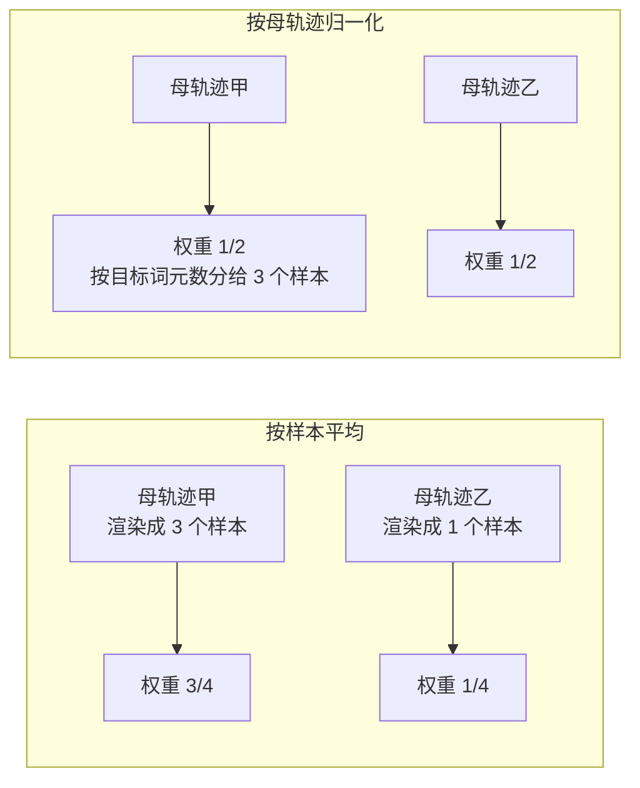

# Trajectory2Gym：为工具调用智能体构造「学得会」的交互经验

> **原题**：Trajectory2Gym: Decision-Grounded Compositional Interaction Synthesis for Tool-Use Agents
> **作者**：Yihao Hu, Zhihao Wen, Yitong Lin, Siyuan Lu, Pan Wang, Wei Wu, Jiang-Ming Yang, Tao Lin
> **机构**：摘要页与正文均未列出
> **年份**：2026（arxiv ID 2610.33568，2026 年 10 月 24 日提交）
> **分类**：cs.CL
> **链接**：https://arxiv.org/abs/2610.33568
> **精读日期**：2026-10-27

## 阅读须知

### 这篇在领域里的位置

这篇论文属于「工具调用智能体的训练数据构造」这条线。工具调用智能体指的是这样一类模型：它不只回答问题，还会调用外部接口去查订单、改地址、退货、办理机票改签，并根据接口返回的结果决定下一步。训练这种模型最常见的做法，是先让一个强模型在环境里把任务做一遍，把成功的过程记录下来，再让小模型照着这些轨迹做监督微调。

过去两年，这条线的重心从「造更多能执行的单步调用数据」逐步转向「造多轮、带模拟用户、能真正跑通的完整交互」。可几乎所有流水线都默认一条规则：任务做成了，这条轨迹就是好数据。Trajectory2Gym 质疑的正是这条默认规则。它主张一条轨迹教会模型什么，不取决于结局是否成功，而取决于轨迹里实际出现了哪些前后依赖，以及每一个被模仿的动作能否从模型当时看得到的信息里推出来。

### 读完能回答什么

1. 为什么「任务成功」的轨迹仍可能是糟糕的训练数据，论文指出的两个缺陷分别是什么。
2. 「组合式路径」与「结构性支撑」是怎样定义的，论文如何据此有针对性地合成缺少的交互。
3. 决策级监督掩码由哪四道检查相乘而成，失败的调用为什么留作上下文而不作为模仿目标。
4. 「按母轨迹归一化」的监督微调改了什么，为什么它在消融中贡献最大。
5. 在 Tau1、Tau2 与 BFCL 上，五个规模的 Qwen3 各自提升了多少，提升集中在哪类任务，又在哪一类上有所退步。

### 阅读前置

本文假定读者熟悉大语言模型的监督微调与交叉熵损失，大致知道函数调用（function calling）是什么。读者未必做过智能体训练或熟悉 τ-bench 一类评测，相关背景会先铺垫再展开。

### 缩写表

- **SFT**（Supervised Fine-Tuning，监督微调）：用「输入与目标输出」的配对数据训练模型，让它学会照目标输出。
- **Tau1 / Tau2**（τ-bench 与 τ²-bench）：模拟客服场景的交互式评测。智能体要与一个由大模型扮演的用户对话，同时调用零售、航空、电信等领域的接口完成任务，最后由环境检查数据库状态是否正确。
- **BFCL**（Berkeley Function Calling Leaderboard，伯克利函数调用排行榜）：评测函数调用能力的基准，含单轮的 Simple、Parallel、Multiple、Irrelevance 等类别，以及多轮的 Multi-turn。
- **Pass@1**：每个任务只跑一次，成功的比例。
- **MoE**（Mixture of Experts，混合专家）：本文中的 Qwen3-30B-A3B 即混合专家模型，总参数 300 亿，每次推理只激活约 30 亿。
- **RL**（Reinforcement Learning，强化学习）：用环境给出的奖励信号更新模型，文中多个对照模型以此训练。

## 一、问题

### 为什么这个问题值得做

设想让一个客服智能体「取消两笔订单、修改第三笔」。称职的做法是：先查账户；如果用邮箱查不到，就请用户提供姓名和邮编再查；逐笔读取订单，确认它们仍处于待处理状态；与用户确认之后，再用目录返回的商品编号去取消和更换。每一次调用本身都很简单，真正要学会的是它们之间的组合：前一步的观察、用户的补充或环境状态的变化，决定了后一步该怎么做。论文把这种工作流称为组合式交互。

工具调用智能体的训练数据，通常是把强模型做成功的轨迹收集起来。问题在于「成功」只说明这一局结束得好，并不说明它教会了什么，也不说明其中每一个被模仿的动作，在当时是否有据可依。已有研究甚至观察到，直接在记录下来的轨迹上微调，效果可能低于初始模型。

### 两个具体缺陷

论文把问题落到两个可以检验的缺陷上。第一个是组合覆盖不足。在作者收集的 34,772 条通过认证的候选轨迹里，40.9% 至多只有两个可监督的决策，只有 10.0% 含有「遇到真实报错之后、仍做出正确决策」的片段。换句话说，数据量大，并不等于从报错中恢复、根据反馈继续这类跨步依赖得到了足够的练习。

第二个是决策缺乏依据。每一个训练目标都应当能从智能体在那一刻看得到的信息推出来，可接口执行成功并不能保证这一点。采集轨迹的强模型可能用了一个对话里从未出现过的编号；接口也可能同样接受一个过时的请求。论文图 1 举的例子是：用户先说要换一瓶更大的饮料和一盏更暗的台灯，后来只确认了台灯。按执行结果过滤，两条换货请求都会被保留，因为接口都能接受；而真正该学的只有台灯那一条。

### 前人路线及其不足

工具调用的训练数据大体走过三步。最早是合成单轮函数调用数据，并在真实接口上验证调用能否执行，代表工作把这类数据做到了很大规模。这一步解决了「参数写得对不对」，却不涉及多步之间的依赖。

第二步是把交互扩展到多轮，引入对话、工具图和模拟用户，让数据更像真实客服流程。这一步让轨迹变长了，但筛选标准大多仍是任务是否完成或单次调用是否执行成功。

第三步是用强化学习或探索直接在环境里训练，奖励来自执行结果，例如 MUA-RL、LoopTool、MidTool-RL 一类方法。这些方法不依赖模仿，却仍然以结局作为主要信号，也同样难以保证稀有的交互结构得到足够的练习。

还有一类相关工作关注失败轨迹，为每一步加上更细的信号，或者用失败诊断选择恢复策略。Trajectory2Gym 的切入点与它们不同：它关心的是每个决策是否有资格成为模仿目标，以及每种交互结构在训练集中得到了多少支撑。

## 二、方法

### 问题的形式化

先交代论文的视角：开发者在采集数据时能看到完整日志，包括采集模型的私有提示和内部事件；而要训练的学生模型，将来只能通过环境原生的接口行事。为此定义一个投影 $V$，把交互历史映射成智能体实际看得到的部分。

- $\mathcal{E}$：工具调用环境，例如 Tau2 的零售域。
- $x$：用户的请求。
- $\mathcal{T}_t$：第 $t$ 步时可用的工具说明。
- $H_{<t}$：第 $t$ 步之前的完整交互历史。
- $c_t = (x, \mathcal{T}_t, V(H_{<t}))$：第 $t$ 步的决策上下文，只含智能体看得到的内容。
- $\tau_i$：第 $i$ 条轨迹，含 $T_i$ 个助手决策。
- $\mathbf{m}_i \in \{0,1\}^{T_i}$：监督掩码。$m_{it}=1$ 表示第 $t$ 个决策是训练目标。

训练集写成 $\mathcal{D}_s = \{(\tau_i, \mathbf{m}_i)\}$，下标 $s$ 表示学生的规模。关键在于：整条可见交互都保留为上下文，掩码只决定哪些决策要算损失。论文要求这个训练集同时满足两条性质：组合覆盖，即需要学会的观察与动作之间的依赖在数据里有足够支撑；决策有据，即每个受监督的动作都能被实际发生的交互和当时的上下文 $c_t$ 所支持。

### 整体流程

Trajectory2Gym 由三个环节组成，三者彼此咬合。第一环节按「缺什么补什么」合成交互，应对组合覆盖不足；第二环节逐个决策认证，应对决策缺乏依据；第三环节决定每种结构进入训练的次数，以及每条交互在损失里占多大分量。

作者强调，三者缺一不可。只合成而不认证，学生会学到采集模型的捷径；只认证而不合成，认证出来的池子里恢复与探查依然稀少；两者都没有时，挑选只是在原有池子上重新加权。

### 环节一：组合式交互合成

要知道「缺什么」，先得有一套描述交互结构的语言。论文定义了一个共享的能力词表 $\mathcal{K}$，涵盖语义动作与参数、观察结果、报错恢复、分支、转人工、结束以及交互长度。不同后端的原生工具都映射到这套角色上。例如「查询订单详情」被映射为「读取、商品类对象」，「取消待处理订单」被映射为「不可逆写入、商品类对象」，一个订单号参数只记作「标识符、字符串」，而不记具体数值。

一条有序路径 $p = (\kappa_1, \ldots, \kappa_\ell)$ 把这些能力元素按时间顺序串起来。开头那个客服例子对应的路径就是：查询、报错、澄清、重试、读订单、确认、取消、修改。每条轨迹按它全部受监督决策的描述符序列，确定唯一一条规范路径 $p(\tau)$。某条路径在一个集合 $\mathcal{S}$ 里的支撑数，就是集合中规范路径恰为 $p$ 的轨迹条数：

$$n_{\mathcal{S}}(p) = \sum_{\tau \in \mathcal{S}} \mathbf{1}[p(\tau) = p]$$

合成时，挑出支撑数低于目标的路径，让生成器 $G$ 针对它造一个请求 $x$ 和一个相容的初始环境状态 $s_0$，再由老师模型 $\pi_{\mathrm{T}}$ 在原生环境里执行：

$$(x, s_0) \sim G(\cdot \mid p, \mathcal{E}), \qquad \tau \sim P_{\mathcal{E}}(\cdot \mid x, s_0, \pi_{\mathrm{T}})$$

之所以要专门针对稀有路径去造，是因为随机抽样很容易漏掉它们。论文给出一个简单的结论：从 $N$ 条候选里均匀抽 $B$ 条，一条只出现过一次的路径被漏掉的概率是 $1 - B/N$。

造任务时，生成器会为路径备好它需要的实体、前置条件和信息来源。例如交易类任务可以让用户身份明确，但订单编号必须先查询才能得到；恢复类任务则故意制造一个能被原生接口暴露出来的拒绝。所有必需的值都绑定到可见来源上，即用户请求、用户的回答或工具的返回，因为只有这样的值才可能成为有据的训练目标。

这里有一个重要区分：意图中的结构与实际发生的结构。生成器想要一条「报错后恢复」的轨迹，但如果老师在执行中压根没遇到那个障碍，这条轨迹就不为恢复路径提供任何支撑。只有在执行日志里真实出现的依赖，才会更新支撑清单并引导下一轮合成。于是生成器或老师的失误只会表现为「没有通过认证的结构」，而不会混进训练目标。

### 环节二：决策有据的监督

这一环节把一条执行日志变成两样东西：学生能看到的上下文，以及一组被认证的训练目标。认证按三层依次检查：可见性、局部执行、流程完成。

首先，决策上下文 $c_t$ 只包含通过原生接口暴露给智能体的事件。完整日志仍可用来做认证，但老师的提示和私有事件永远不会进入学生的上下文。

其次是局部资格。论文区分两个指示量：

- $e_t \in \{0,1\}$：原生执行有效性。对一次工具调用，要求它经认证执行且未报错，或通过了原生的仅动作校验。
- $v_t \in \{0,1\}$：决策时有据。要求这个工具对智能体可用，且像标识符一类的参数，在此前的可见信息中有出处；需要先检索才能发现的工具，也必须先在可见的检索结果里出现过。

局部资格为两者之积，$g_t = e_t \, v_t$。只有采集模型知道的编号，不能支撑一个训练目标。一次被拒绝的调用及其真实报错，会保留在上下文里但不计模仿损失；紧随其后的那一步有据的恢复动作，才成为训练目标。

最后是流程完成。记 $R_\tau$ 为环境原生的终局成功判定，$q_\tau$ 为任务要求的有序操作序列，$A_\tau$ 为相关用户操作与具备局部资格的助手动作组成的规范化序列。最终掩码为：

$$m_t = R_\tau \, \mathbf{1}[q_\tau \preceq A_\tau] \, g_t$$

其中 $\preceq$ 表示「按顺序作为子序列包含」，也就是说必需操作之间可以夹着别的动作，但先后不能乱。只要一条轨迹里还有至少一个 $m_t = 1$，它就进入合格池。

论文附录用一个信息论结论说明为什么要剔除缺乏依据的目标。设 $C$ 为学生可见上下文，$Z$ 为采集模型的私有信息，$A$ 为动作。任何只看 $C$ 的学生，其期望对数损失都不低于 $H(A \mid C) = H(A \mid C, Z) + I(A; Z \mid C)$。若采集模型在给定 $(C, Z)$ 时动作确定，这个下限就等于 $I(A; Z \mid C)$，也就是动作里只能靠私有信息才知道的那一部分。这部分损失学生无论如何也压不下去，硬学只会让它学着去猜。作者也坦言，操作上的检查规则并不能保证每个被剔除的目标都真有正的信息量，这只是剔除的动机。

### 环节三：结构性支撑学习

拿到合格池之后，要决定每种结构进入训练多少次。对规模 $s$ 的学生，设 $d_s$ 为每条可行规范路径希望有的不同轨迹条数。这个数随学生规模增长，从 1.7B 到 30B-A3B 依次为 1、2、3、4、8，让大模型在一轮训练里看到同一路径的更多变体。路径 $p$ 在集合 $\mathcal{S}$ 中的剩余缺口为：

$$\delta_s(p; \mathcal{S}) = \big[d_s - n_{\mathcal{S}}(p)\big]_+$$

挑选从一个固定的认证核心集开始，先为每个训练任务补一条完整完成的示范，再补齐尚未覆盖的能力元素与路径，最后加入能缩小缺口的轨迹。在纯数量预算下，这一补缺口的阶段恰好最大化「封顶支撑」$\sum_p \min(n_{\mathcal{S}}(p), d_s)$。设上限是关键：如果不封顶，目标函数对「覆盖了哪些路径」毫不在乎，只会往已经很多的路径上继续堆。

### 按母轨迹归一化的监督微调

选好的轨迹会按原生的提示格式、角色、工具说明与可见观察渲染成训练样本。一条语义上完整的交互，可能被渲染成好几个训练样本，论文称前者为母轨迹，后者为子样本。如果按样本取平均，一条母轨迹的权重就与它被切成多少个子样本成正比，长的多轮交互会主导损失。

论文因此在母轨迹层面定义每条交互的贡献。记 $(h_u, y_u)_{u=1}^{N_\tau}$ 为轨迹 $\tau$ 在所有子样本中被认证的「上文与下一个词元」配对，$N_\tau$ 为它们的总数：

$$\ell_\theta(\tau) = -\frac{1}{N_\tau}\sum_{u=1}^{N_\tau} \log \pi_\theta(y_u \mid h_u), \qquad \mathcal{L}_{\mathrm{SFT}}(\theta) = \frac{1}{|\mathcal{D}_s|}\sum_{\tau \in \mathcal{D}_s} \ell_\theta(\tau)$$

这样每条母轨迹的权重相等，非目标的可见消息仍作为上下文；把目标重新分组到不同子样本里，目标函数也不变。

上图正是论文给的例子：两条交互分别渲染成三个样本和一个样本，按样本平均时权重为 3/4 与 1/4，按母轨迹归一化后各为 1/2。

### 训练配置

所有模型都从公开的 Qwen3 检查点出发，只做一轮全参数监督微调，不用思考模式，也不用偏好学习、过程奖励或强化学习。批大小为 8 个渲染样本，BF16 精度，AdamW 优化器，权重衰减 0.01，余弦学习率与十步预热。学习率随规模变化：1.7B 用 1.1×10⁻⁵，4B 与 8B 用 7×10⁻⁶，14B 与 30B-A3B 用 3.7×10⁻⁶。

数据方面，1.7B 到 14B 共用一个含 34,772 条认证交互、覆盖 2,515 个训练任务的语料；30B-A3B 用一个扩展语料，含 35,819 条交互、覆盖 3,602 个任务。按规模挑选后，各规模分别使用 11,583、13,986、14,819、15,805 与 19,937 条交互，监督目标词元约为 1,300 万到 2,390 万。

## 三、实验

### 评测设置

评测用三个基准。Tau1 含 115 个零售任务与 50 个航空任务；Tau2 含 40 个零售、20 个航空与 40 个电信任务；两者都按领域取原生任务成功率再等权平均。BFCL 共 1,718 个样例，总分为非实时四类均值、实时三类均值与多轮基础题三者的等权平均。

核心证据是配对比较：每个后训练模型只与它自己的公开初始化相比，任务集合、接口、解码设置、模拟用户与评分器全部相同，每个任务跑一次。论文另外重新评测了五个系列的公开智能体训练检查点，并列出闭源模型的已报告数字，但作者明确说明这两组都不是匹配或等算力的对照，只作参考。

### 主要结果：五个规模全部提升

下表汇总每个规模在三个基准上的成绩。三基准均值是 Tau1 平均、Tau2 平均与 BFCL 总分的等权平均。

| 模型 | Tau1 平均 | Tau2 平均 | BFCL 总分 | 三基准均值 | 提升 |
|---|---|---|---|---|---|
| Qwen3-1.7B | 8.52 | 23.33 | 55.88 | 29.24 | |
| + Trajectory2Gym | 34.43 | 37.50 | 66.48 | 46.14 | +16.9 |
| Qwen3-4B | 24.22 | 19.17 | 62.92 | 35.44 | |
| + Trajectory2Gym | 44.22 | 69.17 | 74.85 | 62.75 | +27.3 |
| Qwen3-8B | 27.87 | 25.00 | 67.30 | 40.06 | |
| + Trajectory2Gym | 51.13 | 74.17 | 78.62 | 67.97 | +27.9 |
| Qwen3-14B | 32.04 | 25.00 | 72.01 | 43.02 | |
| + Trajectory2Gym | 58.04 | 80.83 | 79.68 | 72.85 | +29.8 |
| Qwen3-30B-A3B | 44.39 | 28.33 | 77.58 | 50.10 | |
| + Trajectory2Gym | 66.78 | 84.17 | 80.93 | 77.29 | +27.2 |

提升最大的是 Tau2。后训练的 4B 模型在 Tau2 上达到 69.17，而未经后训练的 30B-A3B 只有 28.33；后训练的 30B-A3B 达到 84.17，与闭源参考 GPT-5.2（84.76）和 Claude-4.5-Opus（85.31）相差不到 1.2 分。五个领域乘五个规模共 25 组配对比较里，有 24 组提升，唯一例外是 1.7B 在 Tau2 航空上持平于 20.00。变化最大的是 Tau2 电信，30B-A3B 从 12.50 升到 95.00。

### 与公开智能体检查点的比较

| 模型 | Tau1 平均 | Tau2 平均 | BFCL 总分 |
|---|---|---|---|
| Simia Tau-SFT（Qwen3-8B） | 36.61 | 42.50 | 43.08 |
| MUA-RL-8B | 34.65 | 25.83 | 58.17 |
| MUA-RL-32B | 54.04 | 45.00 | 72.48 |
| LoopTool-8B | 23.57 | 24.17 | 68.66 |
| EnvFactory-8B（思考模式） | 40.13 | 26.67 | 77.55 |
| MidTool-RL-8B | 24.87 | 29.17 | 73.73 |
| **Trajectory2Gym-8B** | **51.13** | **74.17** | **78.62** |

在 Tau2 上，Trajectory2Gym 的 8B 模型比所有被重新评测的检查点高出至少 28 分，其中包括 14B 与 32B 规模、用强化学习训练的模型。在 Tau1 上它只落后于 MUA-RL-32B，而本文的 14B 与 30B-A3B 模型超过了后者。三基准等权均值上，8B 模型为 67.97，其余检查点最高为 57.17。

这里有一组对比特别能说明问题。EnvFactory-8B 在 BFCL 总分上与本文 8B 模型几乎持平（77.55 对 78.62），多轮基础题也打平（都是 68.00），可在 Tau2 上落后 47.5 分。作者据此认为，函数调用的熟练度并不会自动迁移到有状态的任务上，因为后者还要求后来的动作与此前积累的证据和状态保持一致。

### BFCL：提升集中在多轮

BFCL 总分在每个规模都有提升，主要来自多轮基础题，涨幅在 7 到 41 分之间。4B 及以上的所有后训练模型，在多轮基础题上都超过了 GPT-5.5 已报告的 60.00。30B-A3B 的总分为 80.93，数值上高于 Gemini-3.0-Pro 在其原始协议下报告的 79.97。

单轮类别起点就高，大多持平。唯一一致的退步是实时简单题，在五个规模中的四个下降了 6 到 13 分。作者推测，这是因为模型更倾向于先收集信息，而这类题目期望的是立即给出一次调用。

### 消融：四个设计都朝正确方向

消融全部在 Qwen3-8B 上做，每组只改一个设计，其余尽量对齐。

| 环节 | 对照做法 | 本文做法 | 三基准均值变化 |
|---|---|---|---|
| 组合式合成 | 只用已有候选池（69.08） | 加入定向扩充（72.63） | +3.55 |
| 决策有据 | 宽松的按成功取目标（65.22） | 逐决策认证（67.97） | +2.75 |
| 结构性挑选 | 随机挑选（68.23） | 按结构挑选（70.55） | +2.32 |
| 训练分量 | 按渲染样本平均（59.94） | 按母轨迹归一化（67.97） | +8.04 |

按母轨迹归一化的增益最大，达 8.04 分，其中 Tau2 从 52.50 升到 74.17。这一组对照里语义轨迹、渲染样本和目标掩码完全相同，唯一变的是优化分量如何分配，因此它干净地说明了「以一条完整交互而不是一个渲染样本作为加权单位」的价值。

按结构挑选在同样预算（14,819 条母轨迹、目标词元数相等）下多覆盖了 942 条规范路径，两项 Tau 都有提升，BFCL 基本不变。定向扩充那一组改变了候选供给，却没有固定目标词元预算，所以它不能把「定向」与「数据量」分开。

作者也很坦率：每组只跑了一次，而 Tau2 航空域只有 20 个任务，其中一个任务的成败就能让三基准均值变动 0.56 分。因此几分的差距只能看作方向性证据。四组改动的是不同环节，增益也不能简单相加。

### 值得单独记一笔的现象

支撑深度并非越深越好。在 8B 上把每条路径的目标条数设为 2、3、4，三基准均值分别是 72.28、70.55、69.44，最浅的反而最好，下降主要来自 Tau2（82.50 降到 75.00）。论文的主结果用的是事先定好的深度 3，所以这不是挑检查点，而是敏感性测试。由于深度同时改变了数据量，这组实验也无法把「路径支撑」与「词元数」分开。作者的结论是：结构支撑是一个分配问题，而不是简单的数据规模问题。

还有一个反直觉的地方是，后训练 4B 模型在 Tau2 上超过了未后训练的 30B-A3B 四十多分。在这类有状态、多步依赖的任务上，数据怎么造比模型多大更要紧。

论文的定性案例很直观。同一个零售任务里两处修改必须按顺序进行。Simia 的模型已经在订单记录里看到了要求的地址，却仍反复查询用户资料，最后转人工，看到的证据没有用到需要它的决策上。MUA-RL 的模型拿到了正确地址，却先改了商品，这一步使订单状态改变，地址再也改不了；而由于改商品这一步本身执行成功，逐次调用的检查发现不了这个顺序错误。Trajectory2Gym 的模型先确认两处修改，趁订单仍是待处理状态先改地址，再改商品。三者的原生奖励分别为 0、0、1。

## 四、局限

### 作者承认的局限

作者承认，主结果反映的是整套方案，而训练数据的视图本身也随规模变化，因此跨规模的比较不能归因到单个环节。四组消融各只跑一次，几分的差距只是方向性的；支撑深度的实验同时改变了数据量，无法隔离路径支撑与词元数。

在评测设定上，作者说明 Tau1 航空域用公开的 50 个任务身份做训练侧的交互构造，再用新对话评测，因此属于见过任务的直推设定，并非任务互斥的泛化。与公开检查点和闭源模型的比较也不是匹配或等算力的对照。作者把将决策级认证扩展到在策略采样，以及网页、软件工程与终端智能体，列为下一步工作。

### 读完能看出来的潜在问题

评测规模偏小。Tau2 的三个领域合计只有 100 个任务，航空域只有 20 个，每个任务又只跑一次。在这样的规模下，单个领域上的大幅跳变，例如电信从 12.50 到 95.00，固然方向清楚，具体幅度却可能有相当的随机成分。论文没有报告多次运行的方差或置信区间。

训练数据与评测环境高度同源。合成在 Tau1、Tau2 与 BFCL 各自的原生环境里进行，训练侧用的是官方训练划分，测试侧用官方测试划分。这保证了样例层面的分离，但作者自己也说语义相近的工具行为可能同时出现在两边。方法在完全没见过的环境与工具集上能保留多少提升，目前没有证据。

采集轨迹用的老师模型是什么，正文没有交代，附录只说老师身份不作为挑选特征。生成器的具体实现也不清楚。这两样决定了合成数据的质量上限，不公开会妨碍复现，也让人无法判断提升中有多少来自老师本身的能力。

论文的认证规则依赖若干人工设定：能力词表的类别、工具名到读写类型的映射规则、标识符类参数的判定办法。这些规则在客服类领域里很自然，迁移到工具结构差别很大的场景，例如代码执行或网页操作，需要重新设计，作者也把这类场景留作后续工作。

最后，实时简单题在四个规模上一致下降 6 到 13 分，作者只给出了推测。如果原因真是模型变得更爱先问再做，那么在用户期望立刻执行的真实产品里，这可能是一种需要权衡的行为偏移。

## 一句话

成功轨迹不等于好数据，Trajectory2Gym 靠结构补缺、逐决策认证与母轨迹加权，大幅提升多步工具调用。
